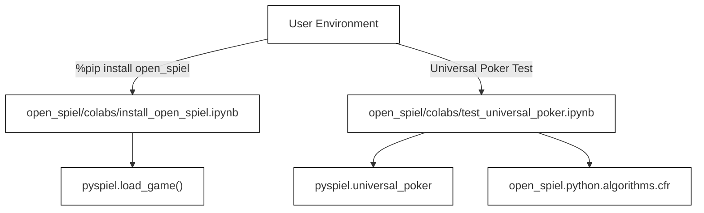

<!-- source: DeepWiki mcp.deepwiki.com · repo google-deepmind/open_spiel · page 8.4 Examples, Colabs and Research Data · fetched 2026-10-26 -->

# Examples, Colabs and Research Data

<details>
<summary>Relevant source files</summary>

The following files were used as context for generating this wiki page:

- [open_spiel/algorithms/trajectories.cc](open_spiel/algorithms/trajectories.cc)
- [open_spiel/colabs/CFR_and_REINFORCE.ipynb](open_spiel/colabs/CFR_and_REINFORCE.ipynb)
- [open_spiel/colabs/OpenSpielTutorial.ipynb](open_spiel/colabs/OpenSpielTutorial.ipynb)
- [open_spiel/colabs/crowd_modelling_4rooms_MFGsurvey.ipynb](open_spiel/colabs/crowd_modelling_4rooms_MFGsurvey.ipynb)
- [open_spiel/colabs/install_open_spiel.ipynb](open_spiel/colabs/install_open_spiel.ipynb)
- [open_spiel/colabs/open_spiel_gemma.ipynb](open_spiel/colabs/open_spiel_gemma.ipynb)
- [open_spiel/colabs/open_spiel_hf_llm.ipynb](open_spiel/colabs/open_spiel_hf_llm.ipynb)
- [open_spiel/colabs/research_dqn_flax_pt.ipynb](open_spiel/colabs/research_dqn_flax_pt.ipynb)
- [open_spiel/colabs/research_nfsp_flax_pt.ipynb](open_spiel/colabs/research_nfsp_flax_pt.ipynb)
- [open_spiel/colabs/test_universal_poker.ipynb](open_spiel/colabs/test_universal_poker.ipynb)
- [open_spiel/data/paper_data/routing_game_experiments/Experiments.ipynb](open_spiel/data/paper_data/routing_game_experiments/Experiments.ipynb)
- [open_spiel/data/paper_data/routing_game_experiments/readme.md](open_spiel/data/paper_data/routing_game_experiments/readme.md)
- [open_spiel/data/paper_data/routing_game_experiments/utils.py](open_spiel/data/paper_data/routing_game_experiments/utils.py)
- [open_spiel/examples/benchmark_game.cc](open_spiel/examples/benchmark_game.cc)
- [open_spiel/examples/example.cc](open_spiel/examples/example.cc)
- [open_spiel/python/algorithms/adidas_utils/solvers/nonsymmetric/pg.py](open_spiel/python/algorithms/adidas_utils/solvers/nonsymmetric/pg.py)
- [open_spiel/python/algorithms/adidas_utils/solvers/nonsymmetric/qre.py](open_spiel/python/algorithms/adidas_utils/solvers/nonsymmetric/qre.py)
- [open_spiel/python/algorithms/adidas_utils/solvers/nonsymmetric/qre_anneal.py](open_spiel/python/algorithms/adidas_utils/solvers/nonsymmetric/qre_anneal.py)
- [open_spiel/python/algorithms/adidas_utils/solvers/nonsymmetric/regmatch.py](open_spiel/python/algorithms/adidas_utils/solvers/nonsymmetric/regmatch.py)
- [open_spiel/python/algorithms/adidas_utils/solvers/symmetric/ate.py](open_spiel/python/algorithms/adidas_utils/solvers/symmetric/ate.py)
- [open_spiel/python/algorithms/adidas_utils/solvers/symmetric/ate_anneal.py](open_spiel/python/algorithms/adidas_utils/solvers/symmetric/ate_anneal.py)
- [open_spiel/python/algorithms/adidas_utils/solvers/symmetric/ped.py](open_spiel/python/algorithms/adidas_utils/solvers/symmetric/ped.py)
- [open_spiel/python/algorithms/adidas_utils/solvers/symmetric/pg.py](open_spiel/python/algorithms/adidas_utils/solvers/symmetric/pg.py)
- [open_spiel/python/algorithms/adidas_utils/solvers/symmetric/qre.py](open_spiel/python/algorithms/adidas_utils/solvers/symmetric/qre.py)
- [open_spiel/python/algorithms/adidas_utils/solvers/symmetric/qre_anneal.py](open_spiel/python/algorithms/adidas_utils/solvers/symmetric/qre_anneal.py)
- [open_spiel/python/algorithms/adidas_utils/solvers/symmetric/qre_anneal_noaux.py](open_spiel/python/algorithms/adidas_utils/solvers/symmetric/qre_anneal_noaux.py)
- [open_spiel/python/algorithms/adidas_utils/solvers/symmetric/regmatch.py](open_spiel/python/algorithms/adidas_utils/solvers/symmetric/regmatch.py)
- [open_spiel/python/algorithms/discounted_cfr.py](open_spiel/python/algorithms/discounted_cfr.py)
- [open_spiel/python/algorithms/fictitious_play.py](open_spiel/python/algorithms/fictitious_play.py)
- [open_spiel/python/algorithms/fictitious_play_test.py](open_spiel/python/algorithms/fictitious_play_test.py)
- [open_spiel/python/bots/bluechip_bridge_uncontested_bidding.py](open_spiel/python/bots/bluechip_bridge_uncontested_bidding.py)
- [open_spiel/python/bots/bluechip_bridge_uncontested_bidding_test.py](open_spiel/python/bots/bluechip_bridge_uncontested_bidding_test.py)
- [open_spiel/python/bots/scenarios.py](open_spiel/python/bots/scenarios.py)
- [open_spiel/python/examples/bridge_uncontested_bidding_bluechip.py](open_spiel/python/examples/bridge_uncontested_bidding_bluechip.py)
- [open_spiel/python/examples/cfr_example.py](open_spiel/python/examples/cfr_example.py)
- [open_spiel/python/examples/example.py](open_spiel/python/examples/example.py)
- [open_spiel/python/examples/fictitious_play_example.py](open_spiel/python/examples/fictitious_play_example.py)
- [open_spiel/python/examples/get_all_states.py](open_spiel/python/examples/get_all_states.py)
- [open_spiel/python/examples/mccfr_cpp_example.py](open_spiel/python/examples/mccfr_cpp_example.py)
- [open_spiel/python/examples/meta_cfr/sequential_games/cfr.py](open_spiel/python/examples/meta_cfr/sequential_games/cfr.py)
- [open_spiel/python/examples/meta_cfr/sequential_games/cfr_test.py](open_spiel/python/examples/meta_cfr/sequential_games/cfr_test.py)
- [open_spiel/python/examples/meta_cfr/sequential_games/dataset_generator.py](open_spiel/python/examples/meta_cfr/sequential_games/dataset_generator.py)
- [open_spiel/python/examples/meta_cfr/sequential_games/game_tree_utils.py](open_spiel/python/examples/meta_cfr/sequential_games/game_tree_utils.py)
- [open_spiel/python/examples/meta_cfr/sequential_games/meta_learning.py](open_spiel/python/examples/meta_cfr/sequential_games/meta_learning.py)
- [open_spiel/python/examples/meta_cfr/sequential_games/models.py](open_spiel/python/examples/meta_cfr/sequential_games/models.py)
- [open_spiel/python/examples/meta_cfr/sequential_games/openspiel_api.py](open_spiel/python/examples/meta_cfr/sequential_games/openspiel_api.py)
- [open_spiel/python/examples/meta_cfr/sequential_games/typing.py](open_spiel/python/examples/meta_cfr/sequential_games/typing.py)
- [open_spiel/python/examples/meta_cfr/sequential_games/utils.py](open_spiel/python/examples/meta_cfr/sequential_games/utils.py)
- [open_spiel/python/examples/meta_cfr/sequential_games/world_representation.py](open_spiel/python/examples/meta_cfr/sequential_games/world_representation.py)
- [open_spiel/python/examples/play_scenarios.py](open_spiel/python/examples/play_scenarios.py)
- [open_spiel/python/utils/data_logger.py](open_spiel/python/utils/data_logger.py)
- [open_spiel/python/utils/file_logger.py](open_spiel/python/utils/file_logger.py)
- [open_spiel/python/utils/file_logger_test.py](open_spiel/python/utils/file_logger_test.py)
- [open_spiel/python/utils/spawn.py](open_spiel/python/utils/spawn.py)
- [open_spiel/python/utils/spawn_test.py](open_spiel/python/utils/spawn_test.py)
- [open_spiel/python/utils/stats.py](open_spiel/python/utils/stats.py)

</details>


## Purpose and Scope

This page serves as a comprehensive reference for the executable examples, interactive Colab notebooks, advanced research codebases (such as Meta-CFR), and reproducible research paper data included in the OpenSpiel framework. These resources bridge abstract game theory abstractions with concrete implementations, providing developers and researchers with reference designs for game evaluation, performance benchmarking, meta-learning algorithms, and empirical multi-agent experiments.

Sources:
- `open_spiel/examples/example.cc:1-25`
- `open_spiel/python/examples/example.py:1-30`
- `open_spiel/data/paper_data/routing_game_experiments/readme.md:1-25`

---

## C++ Examples (`open_spiel/examples/`)

The `open_spiel/examples/` directory contains standalone C++ binaries that demonstrate how to interact directly with the OpenSpiel core C++ API without Python wrappers. The primary examples are `example.cc` and `benchmark_game.cc`.

### `example.cc`: Basic Game Simulation Loop
`open_spiel/examples/example.cc` implements a complete random simulation loop for any registered game. It parses command-line flags using Abseil (`absl::ParseCommandLine`), lists registered games via `open_spiel::RegisteredGames()`, and instantiates a game instance via `open_spiel::LoadGame()` [open_spiel/examples/example.cc:40-67]().

During the simulation loop, the code inspects the state type using virtual methods on `open_spiel::State` [open_spiel/examples/example.cc:80-165]():
- **Chance Nodes (`state->IsChanceNode()`)**: Queries outcomes via `state->ChanceOutcomes()` and samples an action using `open_spiel::SampleAction()` [open_spiel/examples/example.cc:83-91]().
- **Mean Field Nodes (`state->IsMeanFieldNode()`)**: Updates distribution support using `state->UpdateDistribution()` [open_spiel/examples/example.cc:92-99]().
- **Simultaneous Nodes (`state->IsSimultaneousNode()`)**: Iterates over all players, queries legal actions, optionally formats information state tensors (`state->InformationStateTensor()`), and applies a joint action vector via `state->ApplyActions()` [open_spiel/examples/example.cc:100-135]().
- **Decision Nodes**: Samples a uniform random legal action and advances the state via `state->ApplyAction()` [open_spiel/examples/example.cc:136-162]().

### `benchmark_game.cc`: Performance Benchmarking
`open_spiel/examples/benchmark_game.cc` measures execution speed by running thousands of random simulations (`open_spiel::RandomSimulation()`) across multiple attempts [open_spiel/examples/benchmark_game.cc:32-153](). It measures throughput in terms of simulations per second and moves per second using Abseil time utilities (`absl::Now()`, `absl::ToDoubleSeconds`) [open_spiel/examples/benchmark_game.cc:128-140]().

```mermaid
graph TD
    A["main()"] --> B["absl::ParseCommandLine()"]
    B --> C["open_spiel::LoadGame()"]
    C --> D["game->NewInitialState()"]
    D --> E{state->IsTerminal()}
    E -- No --> F{state->IsChanceNode()}
    F -- Yes --> G["state->ChanceOutcomes()"]
    F -- No --> H{state->IsSimultaneousNode()}
    H -- Yes --> I["state->ApplyActions()"]
    H -- No --> J["state->ApplyAction()"]
    G --> E
    I --> E
    J --> E
    E -- Yes --> K["state->Returns()"]

    classDef default stroke:#000,fill:#fff;
```
*Diagram 1: Control flow of C++ game simulation in `open_spiel/examples/example.cc`.*

Sources:
- `open_spiel/examples/example.cc:1-173`
- `open_spiel/examples/benchmark_game.cc:1-154`

---

## Python Examples (`python/examples/`)

Python examples under `open_spiel/python/examples/` demonstrate how to use the `pyspiel` module and Python-native algorithms.

### `example.py`: Pythonic Simulation
`open_spiel/python/examples/example.py` mirrors the C++ `example.cc` logic using Python bindings [open_spiel/python/examples/example.py:1-89](). It loads games via `pyspiel.load_game(FLAGS.game_string)` [open_spiel/python/examples/example.py:40](), loops until `state.is_terminal()` [open_spiel/python/examples/example.py:48](), and handles chance, simultaneous, and decision nodes using NumPy random sampling (`np.random.choice`) and Python lists [open_spiel/python/examples/example.py:51-79]().

Other scripts in this directory (such as `cfr_example.py`, `fictitious_play_example.py`, and `mccfr_cpp_example.py`) provide reference implementations for solving tabular and extensive-form games using algorithms from `open_spiel.python.algorithms`.

Sources:
- `open_spiel/python/examples/example.py:1-90`

---

## Colab Notebooks (`open_spiel/colabs/`)

The `open_spiel/colabs/` directory contains interactive Jupyter/Colab notebooks designed for Google Colaboratory and local Jupyter environments.

### Key Notebooks
- `install_open_spiel.ipynb`: Guides users through installing OpenSpiel via pip (`%pip install --upgrade open_spiel`) and executing a basic random rollout in Tic-Tac-Toe [open_spiel/colabs/install_open_spiel.ipynb:1-117]().
- `test_universal_poker.ipynb`: Demonstrates Universal Poker integration, ACPC game definition parsing (`load_universal_poker_from_acpc_gamedef`), bot evaluation (`pyspiel.evaluate_bots`), and exploitability comparison between native and ACPC games [open_spiel/colabs/test_universal_poker.ipynb:1-324]().
- `OpenSpielTutorial.ipynb`: Comprehensive framework tutorial covering core concepts, information states, and solvers.
- LLM Integration Notebooks (`open_spiel_hf_llm.ipynb`, `open_spiel_gemma.ipynb`): Showcase how to interface Large Language Models with OpenSpiel game environments.


*Diagram 2: Relationship between Colab notebooks and `pyspiel` code entities.*

Sources:
- `open_spiel/colabs/install_open_spiel.ipynb:1-118`
- `open_spiel/colabs/test_universal_poker.ipynb:1-325`

---

## Meta-CFR Research Code (`python/examples/meta_cfr/`)

The `python/examples/meta_cfr/sequential_games/` directory contains research code implementing Meta Counterfactual Regret Minimization (Meta-CFR) using JAX, Haiku, and Optax [open_spiel/python/examples/meta_cfr/sequential_games/meta_learning.py:1-57]().

### Key Modules and Data Flow
- `meta_learning.py`: Defines the main meta-training loop, batching logic, and policy updates [open_spiel/python/examples/meta_cfr/sequential_games/meta_learning.py:37-180]().
- `cfr.py`: Implements tabular and neural-guided CFR iterations over sequential game trees.
- `models.py`: Defines neural network architectures (MLP and LSTM models) using `haiku` (`hk`) for predicting regret updates or policy improvements.
- `dataset_generator.py`: Generates training tasks and game perturbations across sequential games like Leduc Poker.

Data flow during meta-training involves computing one-hot representations and regret vectors (`compute_next_policy_invariants`), batching inputs (`utils.get_batched_input`), querying the Haiku neural network (`utils.get_network_output_batched`), and deriving the subsequent policy [open_spiel/python/examples/meta_cfr/sequential_games/meta_learning.py:73-178]().

Sources:
- `open_spiel/python/examples/meta_cfr/sequential_games/meta_learning.py:1-455`

---

## Paper Data and Reproducible Experiments (`open_spiel/data/paper_data/`)

OpenSpiel bundles data and reproduction scripts for published academic papers under `open_spiel/data/paper_data/`.

### Routing Game Experiments
The routing game experiments subdirectory (`open_spiel/data/paper_data/routing_game_experiments/`) reproduces experiments from Cabannes et al., *Solving N-player dynamic routing games with congestion: a mean field approach* [open_spiel/data/paper_data/routing_game_experiments/readme.md:1-24]().

- `readme.md`: Provides instructions for setting up the environment, installing OpenSpiel, and running `Experiments.ipynb` [open_spiel/data/paper_data/routing_game_experiments/readme.md:1-24]().
- `Experiments.ipynb`: An interactive Jupyter notebook reproducing the Braess paradox, computation time scaling between N-player CFR and Mean Field Game (MFG) Online Mirror Descent, and Sioux Falls traffic network simulations [open_spiel/data/paper_data/routing_game_experiments/Experiments.ipynb:1-792]().
- `utils.py`: Provides helper functions (`create_games`, `create_braess_network`) that instantiate `DynamicRoutingGame` (as an N-player game), convert it to turn-based form (`pyspiel.convert_to_turn_based`), and construct corresponding `MeanFieldRoutingGame` instances [open_spiel/data/paper_data/routing_game_experiments/utils.py:46-78]().

Sources:
- `open_spiel/data/paper_data/routing_game_experiments/readme.md:1-25`
- `open_spiel/data/paper_data/routing_game_experiments/Experiments.ipynb:1-793`
- `open_spiel/data/paper_data/routing_game_experiments/utils.py:1-202`

---

