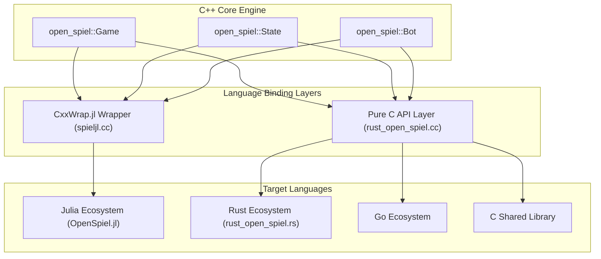

<!-- source: DeepWiki mcp.deepwiki.com · repo google-deepmind/open_spiel · page 9 Language Bindings Beyond Python · fetched 2026-10-26 -->

# Language Bindings Beyond Python

Relevant source files

The following files were used as context for generating this wiki page:

- [open_spiel/examples/gtp.cc](open_spiel/examples/gtp.cc)
- [open_spiel/julia/Project.toml](open_spiel/julia/Project.toml)
- [open_spiel/julia/deps/deps.jl](open_spiel/julia/deps/deps.jl)
- [open_spiel/julia/src/OpenSpiel.jl](open_spiel/julia/src/OpenSpiel.jl)
- [open_spiel/julia/src/patch.jl](open_spiel/julia/src/patch.jl)
- [open_spiel/julia/test/bots.jl](open_spiel/julia/test/bots.jl)
- [open_spiel/julia/test/games_api.jl](open_spiel/julia/test/games_api.jl)
- [open_spiel/julia/test/games_simulation.jl](open_spiel/julia/test/games_simulation.jl)
- [open_spiel/julia/test/runtests.jl](open_spiel/julia/test/runtests.jl)
- [open_spiel/julia/wrapper/spieljl.cc](open_spiel/julia/wrapper/spieljl.cc)
- [open_spiel/python/bots/gtp.py](open_spiel/python/bots/gtp.py)
- [open_spiel/rust/CMakeLists.txt](open_spiel/rust/CMakeLists.txt)
- [open_spiel/rust/Cargo.toml](open_spiel/rust/Cargo.toml)
- [open_spiel/rust/build.rs](open_spiel/rust/build.rs)
- [open_spiel/rust/src/example.rs](open_spiel/rust/src/example.rs)
- [open_spiel/rust/src/open_spiel_bindings.rs](open_spiel/rust/src/open_spiel_bindings.rs)
- [open_spiel/rust/src/rust_open_spiel.cc](open_spiel/rust/src/rust_open_spiel.cc)
- [open_spiel/rust/src/rust_open_spiel.h](open_spiel/rust/src/rust_open_spiel.h)
- [open_spiel/rust/src/rust_open_spiel.rs](open_spiel/rust/src/rust_open_spiel.rs)

While Python is the primary scripting and research interface for OpenSpiel, the C++ core is designed with modularity in mind, allowing games, states, bots, and evaluation utilities to be exposed to other programming languages. OpenSpiel provides first-class language bindings for **Julia**, **Rust**, **Go**, and a pure **C shared library API**. These bindings enable researchers and developers to integrate OpenSpiel into high-performance or alternative ecosystem workflows without leaving their preferred language.

This parent page provides a high-level overview of the multi-language binding architecture. For deep technical details, implementation specifics, and testing guides, please refer to the child pages:
- **[Julia Bindings](#9.1)** — Document `open_spiel/julia`: `spieljl.cc` wrapper, `OpenSpiel.jl` package, tests, and build integration.
- **[Rust, Go and C API](#9.2)** — Document the Rust crate bindings, Go bindings, integration tests, and the shared-library C API example.

---

## Architecture of Non-Python Bindings

OpenSpiel bridges its C++ core to other languages using two primary strategies:
1. **Direct C++ Interoperability (Julia)**: Using CxxWrap.jl, Julia directly interfaces with compiled C++ symbols, mapping C++ classes, vectors, and memory wrappers into native Julia types.
2. **Pure C API Layer (Rust, Go, C Shared Library)**: Exposing an `extern "C"` procedural interface (`rust_open_spiel.h`) that wraps C++ memory allocations behind opaque pointers (`void*`), which are then safely consumed by Rust, Go, or external C programs.

**Sources:** `[open_spiel/julia/wrapper/spieljl.cc:1-120]()`, `[open_spiel/rust/src/rust_open_spiel.h:15-90]()`, `[open_spiel/rust/src/rust_open_spiel.cc:65-142]()`

---

## Julia Bindings Overview

The Julia integration (`open_spiel/julia`) exposes the OpenSpiel C++ core via the `CxxWrap.jl` library. The wrapper file `open_spiel/julia/wrapper/spieljl.cc` registers core classes such as `Game`, `State`, `Policy`, `Bot`, and various solvers (`CFRSolver`, `MCTSBot`) with Julia types.

Key aspects of the Julia integration include:
- **Package Structure**: Managed via `open_spiel/julia/Project.toml`, providing an idiomatic `OpenSpiel.jl` interface.
- **Type Patching**: `open_spiel/julia/src/patch.jl` hooks into Julia's `Base` methods (e.g., `show`, `copy`, `deepcopy`) to provide seamless printing and state duplication.
- **Simulation and Testing**: Comprehensive test suites (`open_spiel/julia/test/games_simulation.jl`, `open_spiel/julia/test/bots.jl`) exercise registered games, simulate game trees, and validate search algorithms like MCTS.

For details, see [Julia Bindings](#9.1).

**Sources:** `[open_spiel/julia/wrapper/spieljl.cc:1-174]()`, `[open_spiel/julia/Project.toml:1-19]()`, `[open_spiel/julia/src/patch.jl:1-68]()`, `[open_spiel/julia/test/games_simulation.jl:1-50]()`

---

## Rust, Go and C API Overview

To support languages without direct C++ interop libraries, OpenSpiel implements a C-compatible procedural wrapper (`open_spiel/rust/src/rust_open_spiel.cc` and `rust_open_spiel.h`). This layer flattens C++ objects into opaque pointers managed through explicit creation and destruction functions (`NewGameParameters`, `LoadGame`, `DeleteGame`, `DeleteState`).

- **Rust Crate**: Located in `open_spiel/rust`, it includes `rust_open_spiel.rs` which implements safe Rust wrappers over the raw bindings (`open_spiel_bindings.rs`), managing memory safely through `Drop` traits.
- **Go Bindings**: Expose equivalent game state exploration and bot stepping capabilities.
- **C Shared Library**: Allows arbitrary C applications to load games, query legal actions, apply moves, and extract observation tensors.

For details, see [Rust, Go and C API](#9.2).

**Sources:** `[open_spiel/rust/src/rust_open_spiel.h:15-89]()`, `[open_spiel/rust/src/rust_open_spiel.cc:65-142]()`, `[open_spiel/rust/src/rust_open_spiel.rs:19-75]()`

---

