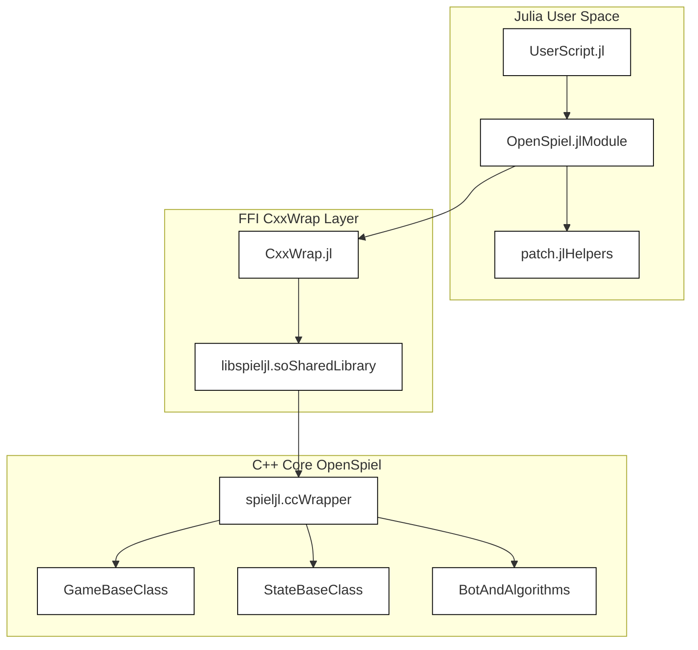
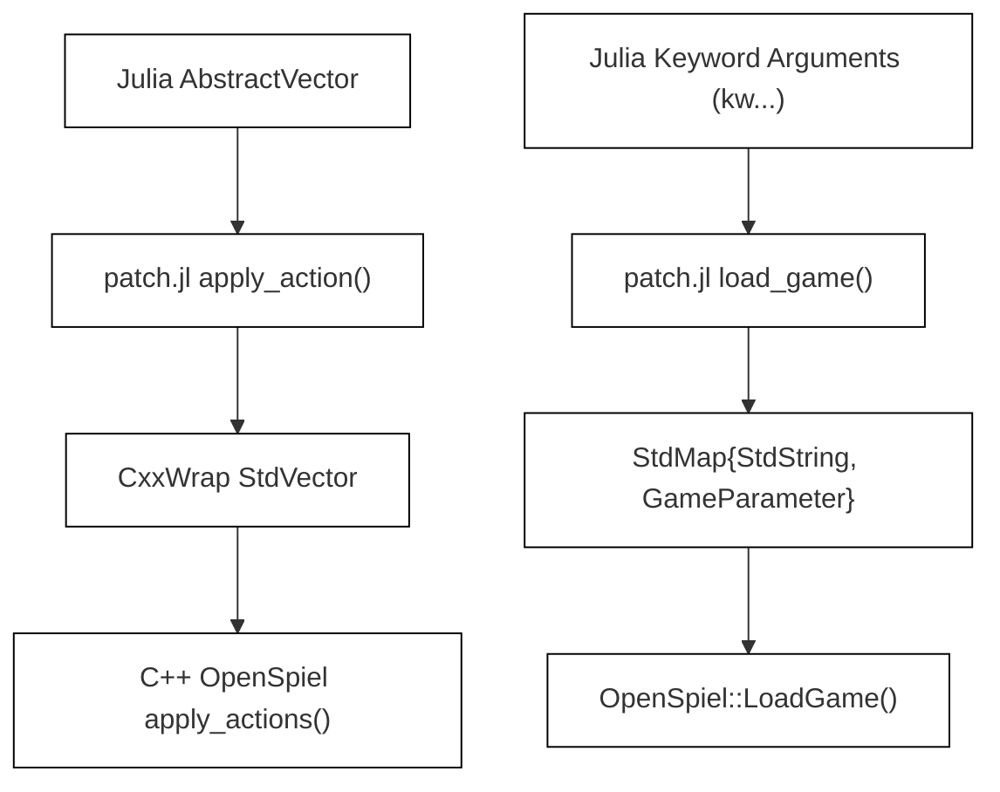

<!-- source: DeepWiki mcp.deepwiki.com · repo google-deepmind/open_spiel · page 9.1 Julia Bindings · fetched 2026-10-26 -->

# Julia Bindings

<details>
<summary>Relevant source files</summary>

The following files were used as context for generating this wiki page:

- [docs/index.rst](docs/index.rst)
- [docs/julia.md](docs/julia.md)
- [open_spiel/examples/gtp.cc](open_spiel/examples/gtp.cc)
- [open_spiel/julia/Project.toml](open_spiel/julia/Project.toml)
- [open_spiel/julia/README.md](open_spiel/julia/README.md)
- [open_spiel/julia/deps/deps.jl](open_spiel/julia/deps/deps.jl)
- [open_spiel/julia/src/OpenSpiel.jl](open_spiel/julia/src/OpenSpiel.jl)
- [open_spiel/julia/src/patch.jl](open_spiel/julia/src/patch.jl)
- [open_spiel/julia/test/bots.jl](open_spiel/julia/test/bots.jl)
- [open_spiel/julia/test/cfr.jl](open_spiel/julia/test/cfr.jl)
- [open_spiel/julia/test/games_api.jl](open_spiel/julia/test/games_api.jl)
- [open_spiel/julia/test/games_simulation.jl](open_spiel/julia/test/games_simulation.jl)
- [open_spiel/julia/test/runtests.jl](open_spiel/julia/test/runtests.jl)
- [open_spiel/julia/test/trajector.jl](open_spiel/julia/test/trajector.jl)
- [open_spiel/julia/wrapper/spieljl.cc](open_spiel/julia/wrapper/spieljl.cc)
- [open_spiel/python/bots/gtp.py](open_spiel/python/bots/gtp.py)

</details>


The Julia bindings for OpenSpiel provide a native interface for the Julia language to interact with the C++ game engine core. Most APIs closely mirror their Python and C++ counterparts, while embracing Julia idioms such as `AbstractArray` inputs, operator overloading, and keyword arguments for convenience [docs/julia.md:1-6](). 

---

## Architecture and C++ Wrapper (`spieljl.cc`)

The bridge between OpenSpiel's C++ core and Julia is built using [CxxWrap.jl](https://github.com/JuliaInterop/CxxWrap.jl) via the shared library wrapper source file `open_spiel/julia/wrapper/spieljl.cc` [open_spiel/julia/README.md:6-9](). 

The wrapper defines inheritance hierarchies using `jlcxx::SuperType` and mirrors C++ enums and classes using `jlcxx::IsMirroredType`. For instance, game types, state types, parameters, and algorithms such as MCTS and CFR are explicitly mapped into the Julia runtime environment:

```cpp
template <>
struct SuperType<open_spiel::SimMoveGame> {
  typedef open_spiel::Game type;
};
template <>
struct SuperType<open_spiel::algorithms::MCTSBot> {
  typedef open_spiel::Bot type;
};
```
*[open_spiel/julia/wrapper/spieljl.cc:36-77]()

Inside `define_julia_module`, STL containers like `std::vector` and `std::pair` are specialized for Julia vector and pair types, and C++ classes such as `GameParameter`, `State`, and `Game` are registered with constructors and member methods [open_spiel/julia/wrapper/spieljl.cc:117-152]().

### Component Architecture Diagram
The following diagram illustrates how Julia user scripts interact with the compiled C++ wrapper module and underlying OpenSpiel game engine abstractions:


*Sources: [open_spiel/julia/wrapper/spieljl.cc:117-174](), [open_spiel/julia/src/OpenSpiel.jl:1-32](), [open_spiel/julia/README.md:6-9]()*

---

## The OpenSpiel.jl Package (`OpenSpiel.jl` and `patch.jl`)

The Julia package resides under `open_spiel/julia/` and is defined by its package configuration file `Project.toml`, which depends on `CxxWrap` [open_spiel/julia/Project.toml:1-19]().

### Module Initialization (`OpenSpiel.jl`)
The root module file `open_spiel/julia/src/OpenSpiel.jl` loads the binary dependency artifact (`deps.jl`), wraps the shared library module via `@wrapmodule`, includes patch routines, and exports all public symbols:

```julia
module OpenSpiel
include("$(@__DIR__)/../deps/deps.jl")
using CxxWrap
@wrapmodule(LIB_OPEN_SPIEL)
include("patch.jl")
# ... export loop ...
end
```
*[open_spiel/julia/src/OpenSpiel.jl:1-32]()

### Ergonomic Patches (`patch.jl`)
Because CxxWrap exposes low-level C++ semantics directly, `open_spiel/julia/src/patch.jl` introduces Julia-friendly overloads and data structure converters [docs/julia.md:102-105](). Key features include:
- **String and Show Overloads**: Formats `Game`, `State`, and `GameParameter` objects cleanly using `to_string()` and `to_repr_string()` [open_spiel/julia/src/patch.jl:1-3]().
- **Keyword Argument Support for Game Loading**: Allows loading games with named parameters (e.g., `load_game("kuhn_poker")` or parameter maps) [open_spiel/julia/src/patch.jl:52-68]().
- **Vector-based Action Application**: Automatically converts Julia vectors of actions into C++ `StdVector` instances [open_spiel/julia/src/patch.jl:10-28]().
- **Dictionary Bridging**: Wraps `std::map` and `std::unordered_map` into `StdMap`, making them behave like Julia `AbstractDict` types [open_spiel/julia/src/patch.jl:35-50]().

### Indexing Conventions and Data Structures
OpenSpiel C++ APIs are **0-based** (e.g., player IDs start at `0`), whereas Julia conventions are predominantly **1-based**. Bridge types like `StdVector` and helper functions handle index translations where appropriate, but callers interacting directly with native player IDs must account for zero-indexing [docs/julia.md:102-106]().

### Data Flow and Type Conversion Diagram

*Sources: [open_spiel/julia/src/patch.jl:10-68]()*, [docs/julia.md:102-106]()*

---

## Build System and Integration

The Julia wrapper is integrated into OpenSpiel's CMake build architecture. 

### Configuration and Installation
To build OpenSpiel with Julia support:
1. Edit `open_spiel/scripts/global_variables.sh` and set `OPEN_SPIEL_BUILD_WITH_JULIA=ON` [docs/julia.md:14-16]().
2. Run the root installation script `./install.sh`, which provisions dependencies and checks for a compatible Julia installation (v1.3+) [docs/julia.md:17-21]().
3. Build and test the codebase using `./open_spiel/scripts/build_and_run_tests.sh` [docs/julia.md:23-27]().
4. Register the local package in the Julia REPL via `] dev ./open_spiel/julia` [docs/julia.md:29]().

Sources: [docs/julia.md:14-29]()

---

## Testing Framework

The Julia test suite is orchestrated by `open_spiel/julia/test/runtests.jl`, which runs comprehensive checks across game APIs, simulations, bots, and algorithms [open_spiel/julia/test/runtests.jl:37-43]().

- **`games_api.jl`**: Validates registered game attributes, game creation parameters, Kuhn poker sequence testing, and matrix game conversions [open_spiel/julia/test/games_api.jl:1-84]().
- **`games_simulation.jl`**: Iterates through all loadable games (`registered_games()`), simulates complete game trajectories from initial states to terminal states, tests state cloning, history consistency, serialization/deserialization, and simultaneous move handling [open_spiel/julia/test/games_simulation.jl:1-141]().
- **`bots.jl`**: Tests `MCTSBot` behavior across games like Tic-Tac-Toe, Catch, and Pig, validating search tree outcomes and bot evaluations [open_spiel/julia/test/bots.jl:1-88]().
- **`cfr.jl` & `trajector.jl`**: Tests counterfactual regret minimization solvers and trajectory collection utilities.

Sources: [open_spiel/julia/test/runtests.jl:1-43](), [open_spiel/julia/test/games_api.jl:1-84](), [open_spiel/julia/test/games_simulation.jl:1-141](), [open_spiel/julia/test/bots.jl:1-88]()

---

