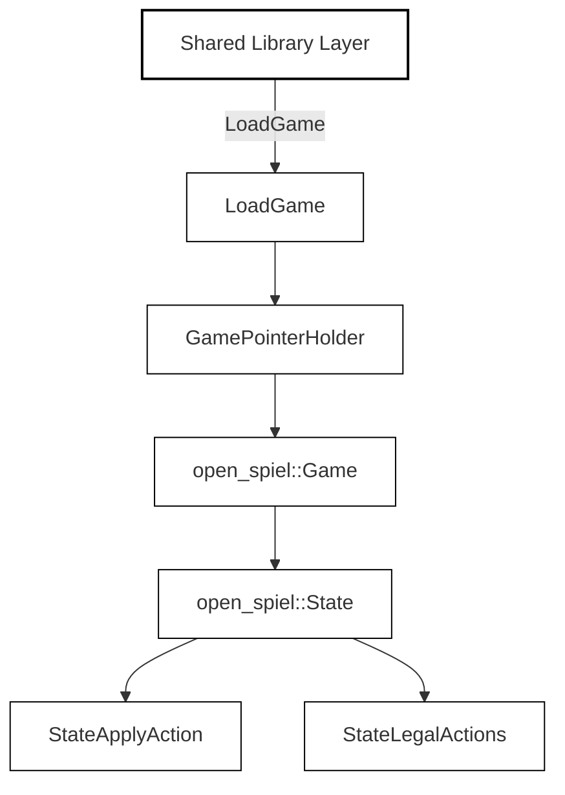
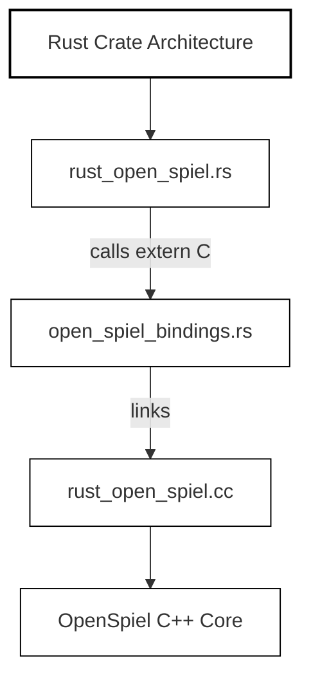

<!-- source: DeepWiki mcp.deepwiki.com · repo google-deepmind/open_spiel · page 9.2 Rust, Go and C API · fetched 2026-10-26 -->

# Rust, Go and C API

<details>
<summary>Relevant source files</summary>

The following files were used as context for generating this wiki page:

- [docs/alpha_rank.md](docs/alpha_rank.md)
- [docs/authors.md](docs/authors.md)
- [docs/contributing.md](docs/contributing.md)
- [docs/developer_guide.md](docs/developer_guide.md)
- [docs/intro.md](docs/intro.md)
- [docs/library.md](docs/library.md)
- [open_spiel/examples/shared_library_example.cc](open_spiel/examples/shared_library_example.cc)
- [open_spiel/julia/CMakeLists.txt](open_spiel/julia/CMakeLists.txt)
- [open_spiel/libnop/CMakeLists.txt](open_spiel/libnop/CMakeLists.txt)
- [open_spiel/libnop/libnop_integration_test.cc](open_spiel/libnop/libnop_integration_test.cc)
- [open_spiel/libtorch/.gitignore](open_spiel/libtorch/.gitignore)
- [open_spiel/libtorch/CMakeLists.txt](open_spiel/libtorch/CMakeLists.txt)
- [open_spiel/libtorch/torch_integration_test.cc](open_spiel/libtorch/torch_integration_test.cc)
- [open_spiel/rust/CMakeLists.txt](open_spiel/rust/CMakeLists.txt)
- [open_spiel/rust/Cargo.toml](open_spiel/rust/Cargo.toml)
- [open_spiel/rust/build.rs](open_spiel/rust/build.rs)
- [open_spiel/rust/src/example.rs](open_spiel/rust/src/example.rs)
- [open_spiel/rust/src/open_spiel_bindings.rs](open_spiel/rust/src/open_spiel_bindings.rs)
- [open_spiel/rust/src/rust_open_spiel.cc](open_spiel/rust/src/rust_open_spiel.cc)
- [open_spiel/rust/src/rust_open_spiel.h](open_spiel/rust/src/rust_open_spiel.h)
- [open_spiel/rust/src/rust_open_spiel.rs](open_spiel/rust/src/rust_open_spiel.rs)

</details>


## Purpose and Scope

OpenSpiel provides multi-language support beyond Python to enable high-performance embedding, alternative language research, and standalone library usage [docs/intro.md:20-33](). This page documents the low-level C shared library API, the Rust crate bindings, and integration tests for external libraries such as LibTorch and Libnop.

---

## The Shared-Library C API

To allow other programming languages (such as Rust and Julia) or standalone C++ programs to interact with OpenSpiel without recompiling the entire framework, OpenSpiel exposes a pure C API (`extern "C"`) in `open_spiel/rust/src/rust_open_spiel.h` [open_spiel/rust/src/rust_open_spiel.h:18-21]() and implemented in `open_spiel/rust/src/rust_open_spiel.cc` [open_spiel/rust/src/rust_open_spiel.cc:65-65]().

### Core C API Abstractions

The C API bridges object-oriented C++ classes (`open_spiel::Game`, `open_spiel::State`, `open_spiel::GameParameters`, `open_spiel::Bot`) into opaque `void*` pointers. Because `open_spiel::Game` is managed via `std::shared_ptr`, the C wrapper defines a helper struct `GamePointerHolder` to safely manage lifetimes [open_spiel/rust/src/rust_open_spiel.cc:43-46]():

```cpp
struct GamePointerHolder {
  std::shared_ptr<const Game> ptr;
};
```

Memory allocation across the C boundary uses explicit buffer copying [open_spiel/rust/src/rust_open_spiel.cc:48-61]():
- `AllocBuf`: Serializes C++ vectors (e.g., tensor shapes, legal actions) into dynamically allocated C arrays via `malloc`.
- `AllocAndCopyString`: Copies `std::string` data into null-terminated C-style strings that must be freed by the caller.

### Shared Library Example (`shared_library_example.cc`)

As documented in the library usage guide [docs/library.md:27-40](), OpenSpiel can be compiled as a shared library (`libopen_spiel.so` or `lib_openspiel.dylib`):

```bash
BUILD_SHARED_LIB=ON CXX=clang++ cmake -DPython3_EXECUTABLE=$(which python3) -DCMAKE_CXX_COMPILER=${CXX} ../open_spiel
make -j$(nproc) open_spiel
```

Client applications can then dynamically link against `libopen_spiel` and load games at runtime without direct dependency on the OpenSpiel source tree [docs/library.md:55-72]().



*Diagram 1: C API execution and pointer translation flow bridging external callers to the C++ core.*

Sources:
- `open_spiel/rust/src/rust_open_spiel.h` [open_spiel/rust/src/rust_open_spiel.h:1-90]()
- `open_spiel/rust/src/rust_open_spiel.cc` [open_spiel/rust/src/rust_open_spiel.cc:1-63]()
- `docs/library.md` [docs/library.md:1-77]()

---

## Rust Crate Bindings

The Rust crate (`open_spiel/rust/`) builds on top of the shared C API. It consists of raw bindings generated via bindindgen (`open_spiel/rust/src/open_spiel_bindings.rs`) and an idiomatic Rust object wrapper (`open_spiel/rust/src/rust_open_spiel.rs`).

### Safe Rust Wrappers

The Rust crate wraps opaque raw pointers into safe structs:
- `GameParameters`: Manages game configuration parameters (integers, doubles, strings) [open_spiel/rust/src/rust_open_spiel.rs:19-21]().
- `Game`: Represents an loaded game instance [open_spiel/rust/src/rust_open_spiel.rs:27-29]().
- `State`: Represents a game state [open_spiel/rust/src/rust_open_spiel.rs:23-25]() supporting actions (`apply_action`) [open_spiel/rust/src/rust_open_spiel.rs:147-149](), cloning (`clone`) [open_spiel/rust/src/rust_open_spiel.rs:89-91](), legal actions (`legal_actions`) [open_spiel/rust/src/rust_open_spiel.rs:121-129](), and observation tensors (`observation_tensor`) [open_spiel/rust/src/rust_open_spiel.rs:184-193]().
- `Bot`: Wraps OpenSpiel bots for automated play [open_spiel/rust/src/rust_open_spiel.rs:31-33]().

### Memory Management and Thread Safety

- **Drop Trait**: Rust wrappers automatically clean up underlying C++ allocations by invoking destructors like `DeleteGameParameters` [open_spiel/rust/src/rust_open_spiel.rs:71-75]() and `DeleteState` [open_spiel/rust/src/rust_open_spiel.rs:212-216]().
- **String Conversion**: `convert_and_free_cstring` safely converts raw C character buffers into owned Rust `String` instances and frees the C buffer [open_spiel/rust/src/rust_open_spiel.rs:11-17]().
- **Concurrency**: `GameParameters` and `State` implement `Send` and `Sync` to allow multi-threaded access across Rust threads [open_spiel/rust/src/rust_open_spiel.rs:77-78](), [open_spiel/rust/src/rust_open_spiel.rs:218-219]().



*Diagram 2: Relationship between Rust wrappers, bindings, and the C++ core.*

Sources:
- `open_spiel/rust/src/rust_open_spiel.rs` [open_spiel/rust/src/rust_open_spiel.rs:1-223]()
- `open_spiel/rust/src/open_spiel_bindings.rs` [open_spiel/rust/src/open_spiel_bindings.rs:1-210]()

---

## Libtorch and Libnop Integration Tests

OpenSpiel includes integration tests for optional C++ dependencies to ensure compatibility with third-party tensor libraries and serialization frameworks.

### LibTorch Integration Test (`torch_integration_test.cc`)
Located in `open_spiel/libtorch/torch_integration_test.cc` [open_spiel/libtorch/torch_integration_test.cc:1-34](), this test verifies that PyTorch C++ (`libtorch`) tensors can be allocated, manipulated, and computed correctly alongside OpenSpiel:
- `TestMatrixMultiplication` performs random tensor creation (`torch::rand`), identity multiplication, and checks tensor element summation using `SPIEL_CHECK_EQ` [open_spiel/libtorch/torch_integration_test.cc:24-30]().

### Libnop Integration Test (`libnop_integration_test.cc`)
Located in `open_spiel/libnop/libnop_integration_test.cc` [open_spiel/libnop/libnop_integration_test.cc:1-65](), this test validates integration with Google's `libnop` (Notice-Oriented Serialization):
- Defines a contrived template structure `UserDefined<T>` with private members and `NOP_STRUCTURE` serialization macros [open_spiel/libnop/libnop_integration_test.cc:30-45]().
- `TestSerialization` tests streaming serialization of objects and arrays using `nop::StreamWriter` and `nop::Serializer` [open_spiel/libnop/libnop_integration_test.cc:47-59]().

Sources:
- `open_spiel/libtorch/torch_integration_test.cc` [open_spiel/libtorch/torch_integration_test.cc:1-34]()
- `open_spiel/libnop/libnop_integration_test.cc` [open_spiel/libnop/libnop_integration_test.cc:1-65]()

---

