# Page: OpenSpiel Overview

# OpenSpiel Overview

<details>
<summary>Relevant source files</summary>

The following files were used as context for generating this wiki page:

- [Dockerfile.base](Dockerfile.base)
- [docs/Makefile](docs/Makefile)
- [docs/alpha_rank.md](docs/alpha_rank.md)
- [docs/api_reference.md](docs/api_reference.md)
- [docs/authors.md](docs/authors.md)
- [docs/concepts.md](docs/concepts.md)
- [docs/contributing.md](docs/contributing.md)
- [docs/developer_guide.md](docs/developer_guide.md)
- [docs/fix_table_links.sh](docs/fix_table_links.sh)
- [docs/install.md](docs/install.md)
- [docs/intro.md](docs/intro.md)
- [docs/library.md](docs/library.md)
- [docs/requirements.readthedocs.txt](docs/requirements.readthedocs.txt)
- [open_spiel/examples/shared_library_example.cc](open_spiel/examples/shared_library_example.cc)
- [open_spiel/game_parameters.cc](open_spiel/game_parameters.cc)
- [open_spiel/game_parameters.h](open_spiel/game_parameters.h)
- [open_spiel/games/rbc/rbc.cc](open_spiel/games/rbc/rbc.cc)
- [open_spiel/games/rbc/rbc.h](open_spiel/games/rbc/rbc.h)
- [open_spiel/games/rbc/rbc_test.cc](open_spiel/games/rbc/rbc_test.cc)
- [open_spiel/integration_tests/playthroughs/rbc(board_size=4).txt](open_spiel/integration_tests/playthroughs/rbc(board_size=4).txt)
- [open_spiel/integration_tests/playthroughs/rbc(sense_border=true,sense_centered=true).txt](open_spiel/integration_tests/playthroughs/rbc(sense_border=true,sense_centered=true).txt)
- [open_spiel/integration_tests/playthroughs/rbc.txt](open_spiel/integration_tests/playthroughs/rbc.txt)
- [open_spiel/julia/CMakeLists.txt](open_spiel/julia/CMakeLists.txt)
- [open_spiel/spiel.cc](open_spiel/spiel.cc)
- [open_spiel/spiel.h](open_spiel/spiel.h)
- [open_spiel/tests/basic_tests.cc](open_spiel/tests/basic_tests.cc)
- [open_spiel/tests/basic_tests.h](open_spiel/tests/basic_tests.h)
- [open_spiel/utils/tensor_view_test.cc](open_spiel/utils/tensor_view_test.cc)
- [readthedocs.yml](readthedocs.yml)

</details>


OpenSpiel is a collection of environments and algorithms for research in general reinforcement learning and search/planning in games. This document provides a high-level overview of the OpenSpiel framework, its architecture, and core components.

## Purpose and Scope

OpenSpiel aims to provide a flexible, extensible framework for research in reinforcement learning, game theory, and multi-agent learning [docs/contributing.md:1-19](). It supports:

- Single and multi-player games [open_spiel/spiel.h:123-125]()
- Zero-sum, general-sum, and cooperative (identical) utilities [open_spiel/spiel.h:105-111]()
- Perfect and imperfect information games [open_spiel/spiel.h:97-101]()
- Sequential and simultaneous move dynamics [open_spiel/spiel.h:68-74]()
- Stochastic games via explicit or sampled chance nodes [open_spiel/spiel.h:87-93]()
- Normal-form, extensive-form, and mean-field games [open_spiel/spiel.h:71-98]()

The framework includes implementations of various classic board games, card games, and other environments, along with a suite of algorithms for solving, learning, and analyzing these games.

Sources: [docs/contributing.md:1-19](), [open_spiel/spiel.h:52-120]()

## 1.1. Key Concepts and Architecture

For details, see [Key Concepts and Architecture](#1.1).

OpenSpiel's C++ core defines foundational abstractions: `Game` represents the static rules and parameterization of a game, while `State` represents a mutable point in the game tree [open_spiel/spiel.h:52-120](). Game types, dynamics, and utilities are categorized statically via `GameType` [open_spiel/spiel.h:59-111](). Python bindings expose these core abstractions to Python via pybind11 [open_spiel/python/pybind11/pyspiel.cc]().

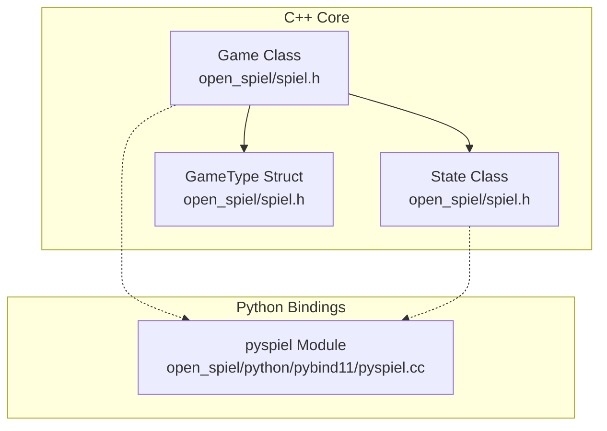

Sources: [open_spiel/spiel.h:52-120](), [open_spiel/python/pybind11/pyspiel.cc]()

## 1.2. Repository Layout and Developer Workflow

For details, see [Repository Layout and Developer Workflow](#1.2).

The repository is organized with top-level directories separating C++ implementations (`open_spiel/games/`, `open_spiel/algorithms/`) from Python wrappers and algorithms (`open_spiel/python/`) [docs/developer_guide.md:1-26](). Development workflows rely on script-based builds (`./install.sh`, `build_and_run_tests.sh`) [docs/install.md:80-132]() and adhere to contribution and testing practices [docs/developer_guide.md:35-106]().

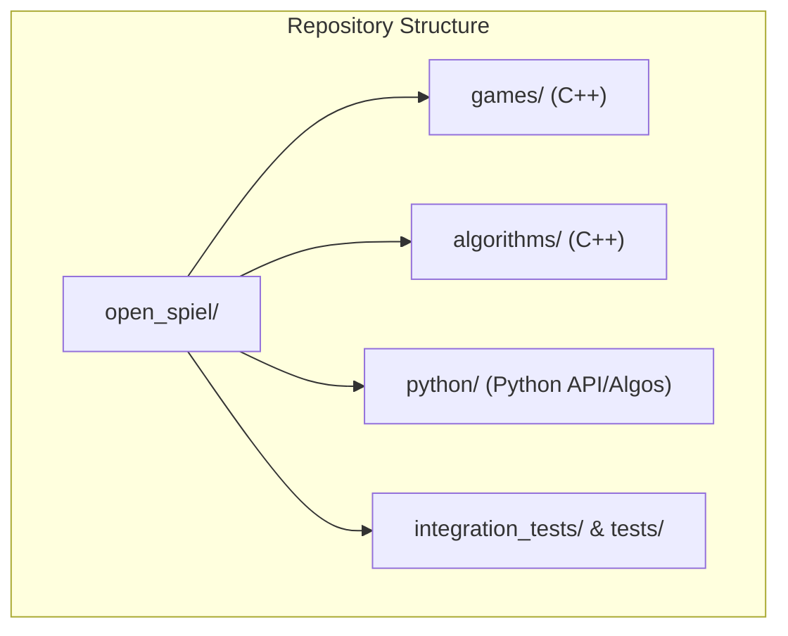

Sources: [docs/developer_guide.md:1-26](), [docs/install.md:80-132]()

---

# Page: Key Concepts and Architecture

# Key Concepts and Architecture

<details>
<summary>Relevant source files</summary>

The following files were used as context for generating this wiki page:

- [Dockerfile.base](Dockerfile.base)
- [docs/Makefile](docs/Makefile)
- [docs/api_reference.md](docs/api_reference.md)
- [docs/concepts.md](docs/concepts.md)
- [docs/fix_table_links.sh](docs/fix_table_links.sh)
- [docs/install.md](docs/install.md)
- [docs/requirements.readthedocs.txt](docs/requirements.readthedocs.txt)
- [open_spiel/game_parameters.cc](open_spiel/game_parameters.cc)
- [open_spiel/game_parameters.h](open_spiel/game_parameters.h)
- [open_spiel/games/rbc/rbc.cc](open_spiel/games/rbc/rbc.cc)
- [open_spiel/games/rbc/rbc.h](open_spiel/games/rbc/rbc.h)
- [open_spiel/games/rbc/rbc_test.cc](open_spiel/games/rbc/rbc_test.cc)
- [open_spiel/integration_tests/playthroughs/rbc(board_size=4).txt](open_spiel/integration_tests/playthroughs/rbc(board_size=4).txt)
- [open_spiel/integration_tests/playthroughs/rbc(sense_border=true,sense_centered=true).txt](open_spiel/integration_tests/playthroughs/rbc(sense_border=true,sense_centered=true).txt)
- [open_spiel/integration_tests/playthroughs/rbc.txt](open_spiel/integration_tests/playthroughs/rbc.txt)
- [open_spiel/spiel.cc](open_spiel/spiel.cc)
- [open_spiel/spiel.h](open_spiel/spiel.h)
- [open_spiel/tests/basic_tests.cc](open_spiel/tests/basic_tests.cc)
- [open_spiel/tests/basic_tests.h](open_spiel/tests/basic_tests.h)
- [open_spiel/utils/tensor_view_test.cc](open_spiel/utils/tensor_view_test.cc)
- [readthedocs.yml](readthedocs.yml)

</details>


## Purpose and Scope

This page documents the fundamental concepts and architectural patterns that form the foundation of OpenSpiel. It covers the core abstractions (`Game`, `State`, `Policy`), the two-layer architecture (C++ core with Python bindings layer), game parameterization, registration, and verification testing.

For build instructions and dependencies, see [Build System and Development Environment](#2). For specific game implementations, see [Game Implementations](#5). For algorithm implementations using these abstractions, see [Algorithms and Solution Concepts](#6).

Sources: [open_spiel/spiel.h:1-158](), [open_spiel/spiel.cc:1-199]()

---

## Core Abstractions

OpenSpiel centers around abstract base classes defined in C++ that establish uniform interfaces for all game types, states, and strategies.

### Game and State

The `Game` class (`open_spiel::Game`) defines static properties, metadata, factories, and tensor shapes for a game type. The `State` class (`open_spiel::State`) tracks the trajectory history, current player, legal actions, transitions, and terminal rewards.

**Diagram: Game and State Class Structure (Code Entity Mapping)**

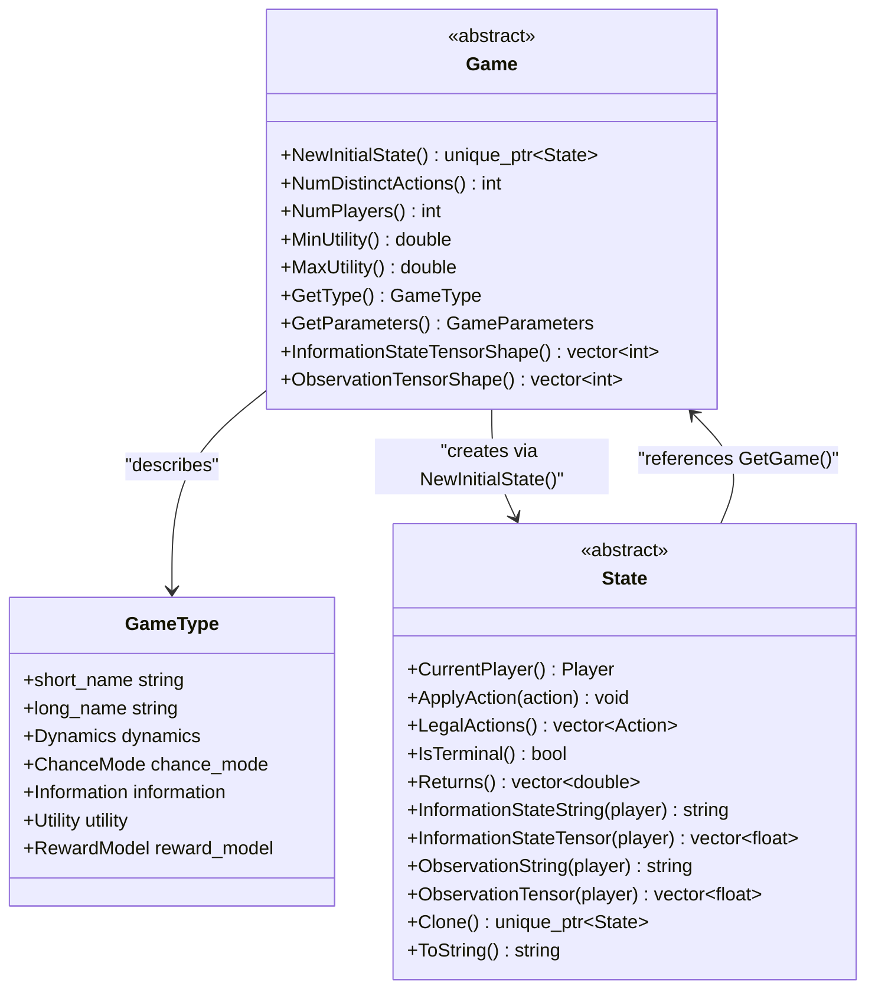

Sources: [open_spiel/spiel.h:1-158](), [open_spiel/spiel.cc:93-136]()

### GameType Properties

The `GameType` struct categorizes games using strict enums to determine compatible algorithms (e.g., CFR, MCTS, Minimax):

- **Dynamics**: `kSequential`, `kSimultaneous`, `kMeanField` [open_spiel/spiel.h:68-75]()
- **ChanceMode**: `kDeterministic`, `kExplicitStochastic`, `kSampledStochastic` [open_spiel/spiel.h:87-93]()
- **Information**: `kOneShot`, `kPerfectInformation`, `kImperfectInformation` [open_spiel/spiel.h:97-101]()
- **Utility**: `kZeroSum`, `kConstantSum`, `kGeneralSum`, `kIdentical` [open_spiel/spiel.h:105-110]()
- **RewardModel**: `kRewards`, `kTerminal` [open_spiel/spiel.h:116-119]()

Sources: [open_spiel/spiel.h:59-121](), [open_spiel/spiel.cc:93-125]()

### GameParameters System

Games are parameterized via `GameParameters` (a `std::map<std::string, GameParameter>`) [open_spiel/game_parameters.h:37](). `GameParameter` supports types `kInt`, `kDouble`, `kString`, `kBool`, and nested `kGame` [open_spiel/game_parameters.h:48](). Parameter validation is enforced during factory loading via `ValidateParams` [open_spiel/spiel.cc:65-89]().

Sources: [open_spiel/game_parameters.h:35-135](), [open_spiel/game_parameters.cc:35-118]()

---

## System Architecture

OpenSpiel relies on a decoupled architecture separating high-performance C++ game implementations from high-level Python research code through a pybind11 binding layer.

**Diagram: System Architecture and Data Flow (Code Entity Mapping)**

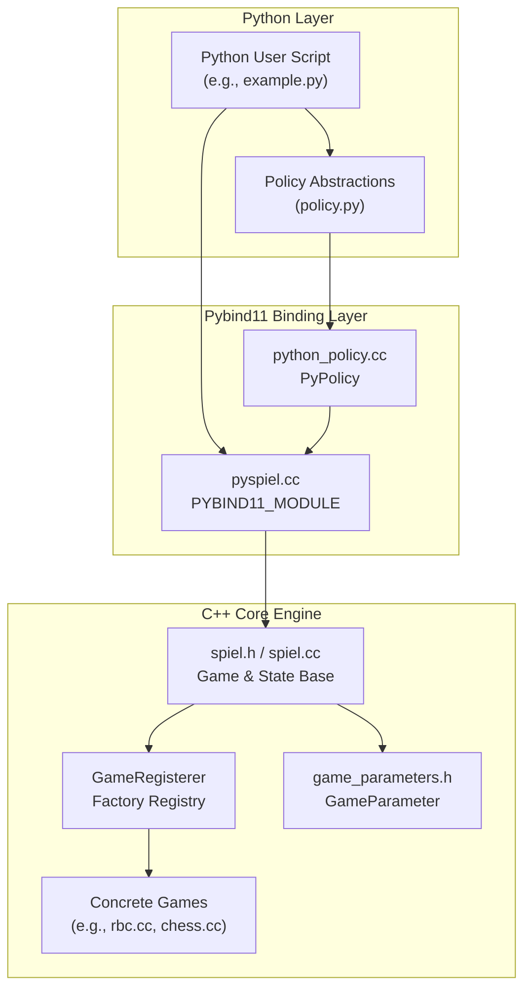

Sources: [open_spiel/spiel.h:1-158](), [open_spiel/spiel.cc:146-200](), [open_spiel/game_parameters.h:35-88]()

### C++ Core Engine
- **Game Registration**: Games self-register at startup using the `REGISTER_SPIEL_GAME` macro, adding entries to `GameRegisterer::factories()` [open_spiel/spiel.cc:146-170]().
- **State Traversal**: States support cloning (`Clone()`), undo (`UndoAction()`), and string/tensor serialization.

Sources: [open_spiel/spiel.cc:146-195](), [open_spiel/tests/basic_tests.h:46-64]()

---

## State Representation and Information

OpenSpiel distinguishes between three views of a game trajectory:
1. **History**: Full sequence of actions taken from the root state (`State::History()`) [open_spiel/integration_tests/playthroughs/rbc.txt:36]().
2. **Information State**: Player-specific view incorporating perfect recall (`InformationStateString()`, `InformationStateTensor()`) [open_spiel/spiel.h:130-131]().
3. **Observation**: Current perception vector or string, which may be Markovian (`ObservationString()`, `ObservationTensor()`) [open_spiel/spiel.h:137-138](), [open_spiel/games/rbc/rbc.cc:58-59]().

Sources: [open_spiel/spiel.h:127-139](), [open_spiel/games/rbc/rbc.cc:46-65]()

---

## Testing Infrastructure

The framework includes rigorous C++ testing suites under `open_spiel/tests/basic_tests.h` [open_spiel/tests/basic_tests.h:15-100]().
- `RandomSimTest`: Executes random playthroughs verifying legal actions, cloning, serialization, and observation consistency [open_spiel/tests/basic_tests.h:46-52]().
- `RandomSimTestWithUndo`: Exhaustively rolls back trajectories via `UndoAction()` to validate state reversibility [open_spiel/tests/basic_tests.h:64]().

Sources: [open_spiel/tests/basic_tests.h:30-81](), [open_spiel/tests/basic_tests.cc:66-172]()

---

# Page: Repository Layout and Developer Workflow

# Repository Layout and Developer Workflow

<details>
<summary>Relevant source files</summary>

The following files were used as context for generating this wiki page:

- [docs/alpha_rank.md](docs/alpha_rank.md)
- [docs/authors.md](docs/authors.md)
- [docs/contributing.md](docs/contributing.md)
- [docs/developer_guide.md](docs/developer_guide.md)
- [docs/intro.md](docs/intro.md)
- [docs/library.md](docs/library.md)
- [open_spiel/algorithms/trajectories.cc](open_spiel/algorithms/trajectories.cc)
- [open_spiel/examples/benchmark_game.cc](open_spiel/examples/benchmark_game.cc)
- [open_spiel/examples/example.cc](open_spiel/examples/example.cc)
- [open_spiel/examples/shared_library_example.cc](open_spiel/examples/shared_library_example.cc)
- [open_spiel/julia/CMakeLists.txt](open_spiel/julia/CMakeLists.txt)
- [open_spiel/python/algorithms/discounted_cfr.py](open_spiel/python/algorithms/discounted_cfr.py)
- [open_spiel/python/algorithms/fictitious_play.py](open_spiel/python/algorithms/fictitious_play.py)
- [open_spiel/python/algorithms/fictitious_play_test.py](open_spiel/python/algorithms/fictitious_play_test.py)
- [open_spiel/python/bots/bluechip_bridge_uncontested_bidding.py](open_spiel/python/bots/bluechip_bridge_uncontested_bidding.py)
- [open_spiel/python/bots/bluechip_bridge_uncontested_bidding_test.py](open_spiel/python/bots/bluechip_bridge_uncontested_bidding_test.py)
- [open_spiel/python/examples/bridge_uncontested_bidding_bluechip.py](open_spiel/python/examples/bridge_uncontested_bidding_bluechip.py)
- [open_spiel/python/examples/cfr_example.py](open_spiel/python/examples/cfr_example.py)
- [open_spiel/python/examples/example.py](open_spiel/python/examples/example.py)
- [open_spiel/python/examples/fictitious_play_example.py](open_spiel/python/examples/fictitious_play_example.py)
- [open_spiel/python/examples/get_all_states.py](open_spiel/python/examples/get_all_states.py)
- [open_spiel/python/examples/mccfr_cpp_example.py](open_spiel/python/examples/mccfr_cpp_example.py)

</details>


This page maps the directory structure of the OpenSpiel repository and details the developer workflow for extending the framework, contributing new games or algorithms, handling conditional dependencies, and maintaining quality standards.

---

## Directory Structure and Code Organization

OpenSpiel is organized into a C++ core under `open_spiel/` with a parallel and tightly integrated Python wrapper layer located in `open_spiel/python/` [docs/developer_guide.md:1-6](). The directory layout separates game definitions, solution algorithms, utilities, and integration tests.

| Directory Path | Description | Key Components |
| -------------- | ----------- | -------------- |
| `open_spiel/` | C++ core framework root | `spiel.h`, core game/state abstractions [docs/developer_guide.md:16]() |
| `open_spiel/games/` | C++ game implementations | `tic_tac_toe.cc`, `chess.cc`, poker variants [docs/developer_guide.md:17]() |
| `open_spiel/algorithms/` | C++ algorithm implementations | CFR, MCTS, best response, exploitability [docs/developer_guide.md:18]() |
| `open_spiel/python/` | Python binding layer & algorithms | `pyspiel.cc` bindings, `python/algorithms/`, `python/games/` [docs/developer_guide.md:5]() |
| `open_spiel/utils/` | Common C++ utility library | `spiel_utils.h`, file/logging, json, circular buffers [docs/developer_guide.md:10]() |
| `open_spiel/integration_tests/` | Generic Python/C++ integration tests | `playthrough_test.py`, regression suites [docs/developer_guide.md:9]() |
| `open_spiel/scripts/` | Development and build scripts | `install.sh`, `global_variables.sh`, `generate_new_playthrough.sh` [docs/developer_guide.md:11, 99]() |

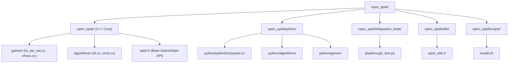
*Diagram 1: Repository Directory Structure and Core Module Mapping.*

Sources: `docs/developer_guide.md:1-26`, `docs/intro.md:20-32`

---

## Contribution Workflow: Adding a Game

Adding a new game involves copying a reference implementation, updating CMake build targets, registering the game, writing tests, and generating playthroughs for regression detection [docs/developer_guide.md:35-106]().

### Step-by-Step Implementation Procedure

1. **Select a Template**: Choose an existing reference implementation in `open_spiel/games/` or `open_spiel/python/games/` (e.g., `tic_tac_toe.cc` for perfect information or `kuhn_poker.cc` for imperfect information) [docs/developer_guide.md:42-48]().
2. **Copy and Rename**: Copy the header, source, and test files to `new_game.h`, `new_game.cc`, and `new_game_test.cc`. Update header guards, namespaces, class names (`TicTacToeGame` $\rightarrow$ `NewGameGame`, `TicTacToeState` $\rightarrow$ `NewGameState`), and set the short name to `new_game` in `new_game.cc` [docs/developer_guide.md:49-68]().
3. **Configure Build Targets**: Add the new source files and test targets to `open_spiel/games/CMakeLists.txt` (or update `open_spiel/python/CMakeLists.txt` for Python games) [docs/developer_guide.md:52-59]().
4. **Interactive Testing**: Verify game logic interactively via `open_spiel/tests/console_play_test.h` or run random simulations using `open_spiel/examples/example.cc` (`build/examples/example --game=new_game`) [docs/developer_guide.md:73-87](), [open_spiel/examples/example.cc:24-75]().
5. **Generate Playthrough**: Run `./open_spiel/scripts/generate_new_playthrough.sh new_game` to create a reference playthrough file used by `open_spiel/integration_tests/playthrough_test.py` to prevent future regressions [docs/developer_guide.md:98-105]().

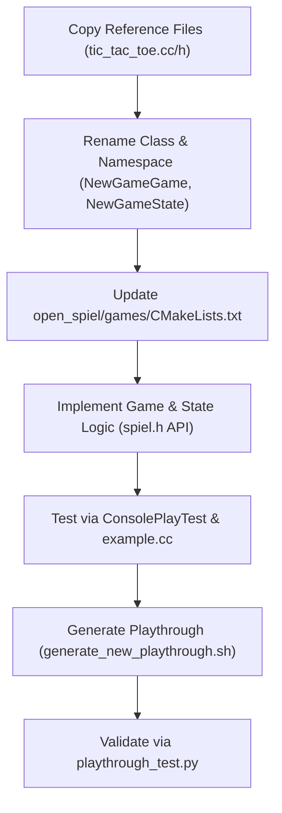
*Diagram 2: Game Contribution and Regression Workflow.*

Sources: `docs/developer_guide.md:35-106`, `open_spiel/examples/example.cc:24-75`

---

## Build Integration and Conditional Dependencies

OpenSpiel uses a single-source-of-truth configuration model for optional external dependencies (e.g., Hanabi, ACPC, JAX, PyTorch, OR-Tools) [docs/developer_guide.md:107-114](). 

- **Bash Environment Variables**: External dependencies are controlled via bash variables read by `install.sh` to clone repositories and by CMake to configure targets [docs/developer_guide.md:113-116]().
- **Light Defaults**: Dependencies are excluded by default to maintain fast installation and compilation times [docs/developer_guide.md:118-120]().
- **User Override Protection**: `scripts/global_variables.sh` defines configuration variables only if they are undefined, respecting custom user definitions in `.bashrc` or command-line flags [docs/developer_guide.md:121-125]().

To add a conditional dependency, update the root `CMakeLists.txt` with an `OFF`-default option and add the corresponding flag to `scripts/global_variables.sh` [docs/developer_guide.md:127-130]().

Sources: `docs/developer_guide.md:107-130`

---

## Code Style and Quality Assurance

Contributions must adhere to Google's C++ and Python style guides [docs/contributing.md:33-36](). Code formatting is checked via automated tooling configured in the repository:

- **Formatting Settings**: Managed by `pyink` (configured under `[tool.pyink]` in `pyproject.toml`) for Python and `clang-format` (via `.clang-format`) for C++ [docs/developer_guide.md:91-94]().
- **Linting Hooks**: Local pre-commit hooks can be installed using `pip install pre-commit` followed by `pre-commit install` (referencing `.pre-commit-config.yaml`) [docs/developer_guide.md:88-92](). C++ code can additionally be verified using `cpplint` [docs/developer_guide.md:94-95]().
- **Pull Request Process**: Approved pull requests are batched and merged regularly (typically every two weeks for general features, faster for bug fixes) [docs/contributing.md:49-57](). All contributions require a signed Contributor License Agreement (CLA) [docs/contributing.md:74-77]().

Sources: `docs/developer_guide.md:88-97`, `docs/contributing.md:33-77`

---

# Page: Build System and Development Environment

# Build System and Development Environment

<details>
<summary>Relevant source files</summary>

The following files were used as context for generating this wiki page:

- [.github/workflows/actions.yml](.github/workflows/actions.yml)
- [.github/workflows/wheels.yml](.github/workflows/wheels.yml)
- [.gitignore](.gitignore)
- [MANIFEST.in](MANIFEST.in)
- [README.md](README.md)
- [__init__.py](__init__.py)
- [docs/_static/OpenSpielC.png](docs/_static/OpenSpielC.png)
- [docs/_static/OpenSpielC_w800.png](docs/_static/OpenSpielC_w800.png)
- [docs/windows.md](docs/windows.md)
- [install.sh](install.sh)
- [open_spiel/CMakeLists.txt](open_spiel/CMakeLists.txt)
- [open_spiel/bots/CMakeLists.txt](open_spiel/bots/CMakeLists.txt)
- [open_spiel/games/hanabi/CMakeLists.txt](open_spiel/games/hanabi/CMakeLists.txt)
- [open_spiel/games/hanabi/README.md](open_spiel/games/hanabi/README.md)
- [open_spiel/scripts/build_and_run_tests.sh](open_spiel/scripts/build_and_run_tests.sh)
- [open_spiel/scripts/ci_script.sh](open_spiel/scripts/ci_script.sh)
- [open_spiel/scripts/global_variables.sh](open_spiel/scripts/global_variables.sh)
- [open_spiel/scripts/install.sh](open_spiel/scripts/install.sh)
- [open_spiel/scripts/python_extra_deps.sh](open_spiel/scripts/python_extra_deps.sh)
- [open_spiel/scripts/test_wheel.sh](open_spiel/scripts/test_wheel.sh)
- [pyproject.toml](pyproject.toml)
- [requirements.txt](requirements.txt)
- [setup.py](setup.py)

</details>


This page documents OpenSpiel's build system and development environment infrastructure, which serves as the foundation for building, testing, and distributing the framework across multiple platforms. The build system handles C++ compilation via CMake, Python package creation, dependency management, and automated testing through GitHub Actions.

For information about the Python-C++ integration layer specifically, see [Python Integration](#4). For details on the testing framework itself, see [Testing and Validation](#10).

Sources: [.github/workflows/wheels.yml:1-148](), [setup.py:1-145](), [open_spiel/scripts/install.sh:1-352](), [open_spiel/CMakeLists.txt:1-340]()

---

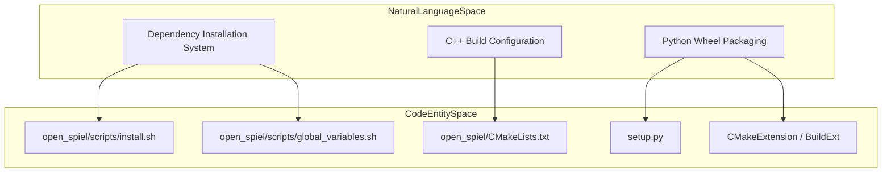
*Figure 1: Bridging high-level build components to underlying code entities.*

Sources: [open_spiel/scripts/install.sh:1-352](), [open_spiel/scripts/global_variables.sh:1-109](), [open_spiel/CMakeLists.txt:1-340](), [setup.py:1-169]()

---

## 2.1 Installation and Dependencies

The OpenSpiel installation infrastructure is orchestrated primarily through `install.sh` and configuration scripts like `global_variables.sh`. It provisions essential third-party repositories—such as `abseil-cpp`, `pybind11`, `nlohmann/json`, and bridge double dummy solvers (`dds`)—while offering optional support for specialized game environments and tools like Hanabi, Universal Poker (ACPC), JAX, PyTorch, and OR-Tools.

For detailed instructions on installing OpenSpiel, managing core and optional dependencies, and configuring system requirements, see [Installation and Dependencies](#2.1).

Sources: [open_spiel/scripts/install.sh:1-190](), [open_spiel/scripts/global_variables.sh:1-109]()

---

## 2.2 CMake Build System

OpenSpiel relies on a hierarchical CMake configuration centered around [open_spiel/CMakeLists.txt](). It implements conditional compilation features via the `openspiel_optional_dependency` macro, allowing developers to selectively include optional games and backend optimizations. The system supports three primary build types (`Debug`, `Testing`, and `Release`) tailored for development, validation, and maximum runtime performance.

For an in-depth explanation of the CMake configuration system, conditional targets, and compilation flags, see [CMake Build System](#2.2).

Sources: [open_spiel/CMakeLists.txt:1-154]()

---

## 2.3 Python Package Building

Python integration and distribution are handled through [setup.py]() using a custom setuptools extension architecture. Instead of relying on distutils to compile sources directly, OpenSpiel defines a `CMakeExtension` and a custom `BuildExt` command class that delegates compilation entirely to CMake, ensuring seamless cross-platform binary wheel generation for Linux and macOS.

For details on custom extension compilation, packaging scripts, and multi-platform wheel building, see [Python Package Building](#2.3).

Sources: [setup.py:1-169]()

---

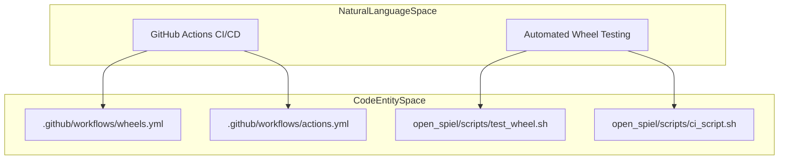
*Figure 2: Mapping CI/CD concepts to workflow and script entities.*

Sources: [.github/workflows/wheels.yml:1-155](), [.github/workflows/actions.yml:1-109](), [open_spiel/scripts/test_wheel.sh:1-109](), [open_spiel/scripts/ci_script.sh:1-46]()

---

## 2.4 CI/CD and Testing Pipeline

Continuous integration and delivery are governed by GitHub Actions workflows defined in `.github/workflows/wheels.yml` and `.github/workflows/actions.yml`. These workflows automate cross-platform compilation, execution of the comprehensive CTest test suite, and rigorous validation of built Python wheels across different Python versions and ML framework configurations.

For a thorough breakdown of CI workflows, automated testing harnesses, and wheel validation steps, see [CI/CD and Testing Pipeline](#2.4).

Sources: [.github/workflows/wheels.yml:1-155](), [.github/workflows/actions.yml:1-109]()

---

# Page: Installation and Dependencies

# Installation and Dependencies

<details>
<summary>Relevant source files</summary>

The following files were used as context for generating this wiki page:

- [.gitignore](.gitignore)
- [Dockerfile.base](Dockerfile.base)
- [docs/Makefile](docs/Makefile)
- [docs/api_reference.md](docs/api_reference.md)
- [docs/concepts.md](docs/concepts.md)
- [docs/fix_table_links.sh](docs/fix_table_links.sh)
- [docs/install.md](docs/install.md)
- [docs/requirements.readthedocs.txt](docs/requirements.readthedocs.txt)
- [install.sh](install.sh)
- [open_spiel/CMakeLists.txt](open_spiel/CMakeLists.txt)
- [open_spiel/bots/CMakeLists.txt](open_spiel/bots/CMakeLists.txt)
- [open_spiel/games/hanabi/CMakeLists.txt](open_spiel/games/hanabi/CMakeLists.txt)
- [open_spiel/games/hanabi/README.md](open_spiel/games/hanabi/README.md)
- [open_spiel/games/rbc/rbc.cc](open_spiel/games/rbc/rbc.cc)
- [open_spiel/games/rbc/rbc.h](open_spiel/games/rbc/rbc.h)
- [open_spiel/games/rbc/rbc_test.cc](open_spiel/games/rbc/rbc_test.cc)
- [open_spiel/integration_tests/playthroughs/rbc(board_size=4).txt](open_spiel/integration_tests/playthroughs/rbc(board_size=4).txt)
- [open_spiel/integration_tests/playthroughs/rbc(sense_border=true,sense_centered=true).txt](open_spiel/integration_tests/playthroughs/rbc(sense_border=true,sense_centered=true).txt)
- [open_spiel/integration_tests/playthroughs/rbc.txt](open_spiel/integration_tests/playthroughs/rbc.txt)
- [open_spiel/scripts/build_and_run_tests.sh](open_spiel/scripts/build_and_run_tests.sh)
- [open_spiel/scripts/global_variables.sh](open_spiel/scripts/global_variables.sh)
- [open_spiel/scripts/install.sh](open_spiel/scripts/install.sh)
- [readthedocs.yml](readthedocs.yml)

</details>


## Purpose and Scope

This document provides a comprehensive technical guide to installing OpenSpiel, managing its core and optional dependencies, and configuring the build environment. It details the execution flow of the installation infrastructure (`install.sh`), global build flags (`global_variables.sh`), conditional compilation macros in CMake (`open_spiel/CMakeLists.txt`), and the automated build and test orchestration pipeline (`build_and_run_tests.sh`). 

---

## System Requirements and Environment Setup

OpenSpiel requires a modern C++ compiler supporting C++20 (or C++17 depending on configuration) and a compatible Python 3 environment.

- **CMake**: Version 3.17 or newer is required to utilize modern `FindPython` modules and compiler standard definitions (`[open_spiel/CMakeLists.txt:1-5]()`).
- **C++ Compiler**: Clang (`clang++`) is recommended and enforced in scripts, though recent `g++` versions are also compatible (`[open_spiel/scripts/build_and_run_tests.sh:65-71]()`). On macOS, Xcode Command Line Tools provide `clang++` (`[docs/install.md:61-63]()`).
- **Python**: Python 3.11 or newer is required (`[docs/install.md:70-72]()`).

Sources: [open_spiel/CMakeLists.txt:1-5](), [open_spiel/scripts/build_and_run_tests.sh:65-71](), [docs/install.md:61-72]()

---

## Dependency Management Architecture (`install.sh`)

OpenSpiel handles third-party dependencies by cloning fixed releases or specific commits into subdirectories under `open_spiel/` rather than relying on Git submodules, avoiding metadata conflicts in internal mirroring systems (`[open_spiel/scripts/install.sh:82-87]()`).

### Dependency Download Flow

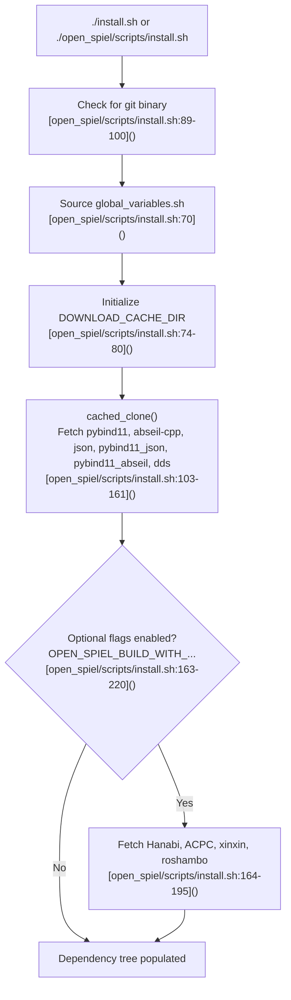

The script defines a `cached_clone()` utility function that caches git repositories locally in `download_cache/` (`[open_spiel/scripts/install.sh:103-116]()`). If a cached target exists, it copies from the cache rather than re-cloning from remote endpoints.

Sources: [open_spiel/scripts/install.sh:70-220]()

---

## Core Dependencies

The core framework relies on a minimal set of well-versioned C++ libraries and bindings helpers. These are automatically provisioned by `install.sh`.

| Library Entity | Code Directory | Version / Commit | Role in Architecture |
|----------------|----------------|------------------|----------------------|
| `abseil-cpp` | `open_spiel/abseil-cpp` | `$OPEN_SPIEL_ABSL_VERSION` (`20250814.1`) | Fundamental data structures, logging, status types (`[open_spiel/scripts/install.sh:20](), [open_spiel/scripts/global_variables.sh:33]()`) |
| `pybind11` | `pybind11` | `master` branch | C++/Python binding bridge (`[open_spiel/scripts/install.sh:122-125]()`) |
| `nlohmann/json` | `open_spiel/json` | `9cca280a` | JSON parsing and state serialization (`[open_spiel/scripts/install.sh:139-145]()`) |
| `pybind11_json` | `open_spiel/pybind11_json` | `d0bf434b` | Type conversion between `nlohmann::json` and Python dicts (`[open_spiel/scripts/install.sh:147-153]()`) |
| `pybind11_abseil` | `open_spiel/pybind11_abseil` | `73992b5` | Type conversion for Abseil types in Python bindings (`[open_spiel/scripts/install.sh:155-161]()`) |
| `dds` | `open_spiel/games/bridge/double_dummy_solver` | `develop` | Double Dummy Solver for Bridge game (`[open_spiel/scripts/install.sh:129-132]()`) |

Sources: [open_spiel/scripts/install.sh:20-161](), [open_spiel/scripts/global_variables.sh:33]()

---

## Optional Dependencies and CMake Integration

Optional game engines, communication protocols, and machine learning frameworks are managed via global environment variables defined in `global_variables.sh` (`[open_spiel/scripts/global_variables.sh:17-109]()`). These defaults are governed by `DEFAULT_OPTIONAL_DEPENDENCY` (`[open_spiel/scripts/global_variables.sh:27]`).

### CMake Macro Configuration

In `open_spiel/CMakeLists.txt`, conditional compilation is enforced via the `openspiel_optional_dependency` macro (`[open_spiel/CMakeLists.txt:94-107]()`). 

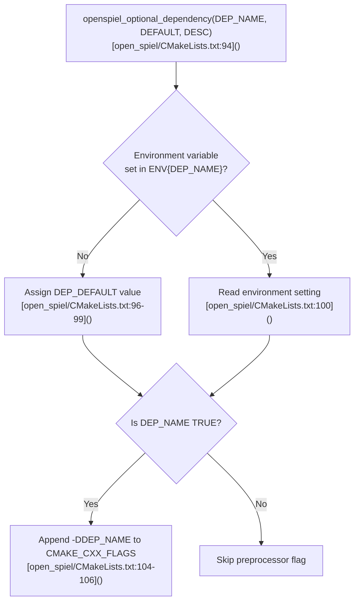

### Key Optional Dependencies

- **Hanabi (`OPEN_SPIEL_BUILD_WITH_HANABI`)**: Clones the Hanabi Learning Environment into `open_spiel/games/hanabi/hanabi-learning-environment` (`[open_spiel/scripts/install.sh:164-173]()`).
- **Universal Poker / ACPC (`OPEN_SPIEL_BUILD_WITH_ACPC`)**: Clones `project_acpc_server` into `open_spiel/games/universal_poker/acpc` (`[open_spiel/scripts/install.sh:178-181]()`).
- **OR-Tools (`OPEN_SPIEL_BUILD_WITH_ORTOOLS`)**: Integrates Google's C++ optimization library for linear programming and sequence-form solvers (`[open_spiel/scripts/global_variables.sh:95-103]()`).
- **LibTorch (`OPEN_SPIEL_BUILD_WITH_LIBTORCH`)**: Downloads precompiled libtorch binaries for C++ front-end neural network execution (`[open_spiel/scripts/global_variables.sh:53-89]()`).
- **Python ML Frameworks (`OPEN_SPIEL_ENABLE_JAX`, `OPEN_SPIEL_ENABLE_PYTORCH`)**: Automatically detected or forced via environment settings to incorporate tensor-based algorithms (`[open_spiel/CMakeLists.txt:131-141]()`).

Sources: [open_spiel/scripts/global_variables.sh:17-109](), [open_spiel/CMakeLists.txt:84-148](), [open_spiel/scripts/install.sh:164-190]()

---

## Build and Test Orchestration (`build_and_run_tests.sh`)

The script `open_spiel/scripts/build_and_run_tests.sh` orchestrates virtual environment setup, requirement installation, CMake configuration, compilation, and test execution (`[open_spiel/scripts/build_and_run_tests.sh:17-262]`).

### Execution Pipeline

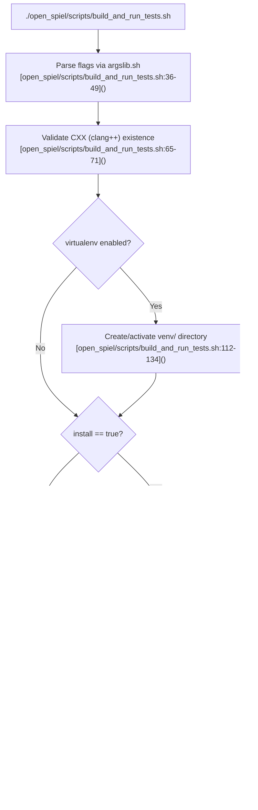

Sources: [open_spiel/scripts/build_and_run_tests.sh:1-261]()

---

## Verification and Troubleshooting

To verify that the installation and dependency linkage are successful, run the core test suite or test loading modules in Python:

```bash
# Verify Python bindings registration
python3 -c "import pyspiel; print(pyspiel.registered_games())"

# Run C++ and Python integration tests via CTest
cd build
ctest -V -R example_test
```

### Common Troubleshooting Steps
- **Missing Clang**: If `clang++` is missing, export `CXX=g++` or install clang (`[open_spiel/scripts/build_and_run_tests.sh:65-71]`, `[docs/install.md:28-40]()`).
- **ABI Mismatch with Abseil**: Ensure Abseil version matches `$OPEN_SPIEL_ABSL_VERSION` (`[open_spiel/scripts/install.sh:20]()`).
- **Python Extension Linkage on macOS**: Ensure `-undefined dynamic_lookup` is preserved in CXX flags for `pybind11` modules (`[open_spiel/CMakeLists.txt:63-67]()`).

Sources: [open_spiel/scripts/build_and_run_tests.sh:65-71](), [open_spiel/CMakeLists.txt:63-67](), [docs/install.md:28-57]()

---

# Page: CMake Build System

# CMake Build System

<details>
<summary>Relevant source files</summary>

The following files were used as context for generating this wiki page:

- [.gitignore](.gitignore)
- [install.sh](install.sh)
- [open_spiel/CMakeLists.txt](open_spiel/CMakeLists.txt)
- [open_spiel/bots/CMakeLists.txt](open_spiel/bots/CMakeLists.txt)
- [open_spiel/game_transforms/CMakeLists.txt](open_spiel/game_transforms/CMakeLists.txt)
- [open_spiel/game_transforms/game_wrapper.h](open_spiel/game_transforms/game_wrapper.h)
- [open_spiel/games/hanabi/CMakeLists.txt](open_spiel/games/hanabi/CMakeLists.txt)
- [open_spiel/games/hanabi/README.md](open_spiel/games/hanabi/README.md)
- [open_spiel/python/pybind11/algorithms_trajectories.cc](open_spiel/python/pybind11/algorithms_trajectories.cc)
- [open_spiel/python/pybind11/algorithms_trajectories.h](open_spiel/python/pybind11/algorithms_trajectories.h)
- [open_spiel/python/pybind11/bots.h](open_spiel/python/pybind11/bots.h)
- [open_spiel/python/pybind11/game_transforms.cc](open_spiel/python/pybind11/game_transforms.cc)
- [open_spiel/python/pybind11/game_transforms.h](open_spiel/python/pybind11/game_transforms.h)
- [open_spiel/python/pybind11/policy.h](open_spiel/python/pybind11/policy.h)
- [open_spiel/scripts/build_and_run_tests.sh](open_spiel/scripts/build_and_run_tests.sh)
- [open_spiel/scripts/global_variables.sh](open_spiel/scripts/global_variables.sh)
- [open_spiel/scripts/install.sh](open_spiel/scripts/install.sh)
- [open_spiel/utils/CMakeLists.txt](open_spiel/utils/CMakeLists.txt)
- [open_spiel/utils/circular_buffer.h](open_spiel/utils/circular_buffer.h)
- [open_spiel/utils/circular_buffer_test.cc](open_spiel/utils/circular_buffer_test.cc)
- [open_spiel/utils/serializable_circular_buffer.h](open_spiel/utils/serializable_circular_buffer.h)
- [open_spiel/utils/serializable_circular_buffer_test.cc](open_spiel/utils/serializable_circular_buffer_test.cc)

</details>


This page documents the CMake-based build system that compiles OpenSpiel's C++ core library, game implementations, algorithms, and Python bindings. It covers the configuration system, conditional compilation mechanisms, and how different components are assembled into build targets.

For information about installing dependencies before running CMake, see [Installation and Dependencies](#2.1). For details on how Python wheels are packaged using this CMake system, see [Python Package Building](#2.3).

## Purpose and Scope

The CMake build system serves as the primary compilation mechanism for OpenSpiel. It handles:

- Compiling the C++ core library (`open_spiel_core`) and all game/algorithm implementations [open_spiel/CMakeLists.txt:155-184]()
- Managing conditional compilation of optional dependencies (ACPC poker, Hanabi, OR-Tools, etc.) [open_spiel/CMakeLists.txt:94-148]()
- Building Python bindings via pybind11 as the `pyspiel` module [open_spiel/python/CMakeLists.txt:128-136]()
- Registering and running C++ and Python tests via CTest [open_spiel/CMakeLists.txt:153](), [open_spiel/python/CMakeLists.txt:181-372]()
- Supporting different build configurations (`Debug`, `Testing`, `Release`) [open_spiel/CMakeLists.txt:35-61]()

The system is invoked either directly via `cmake` commands or indirectly through `setup.py` when building Python wheels [setup.py:40-101]().

Sources: [open_spiel/CMakeLists.txt:35-61](), [open_spiel/CMakeLists.txt:94-148](), [open_spiel/CMakeLists.txt:155-184](), [open_spiel/python/CMakeLists.txt:128-136](), [open_spiel/python/CMakeLists.txt:181-372](), [setup.py:40-101]()

---

## CMake Configuration Overview

### Directory Structure

The CMake system follows a hierarchical structure with `CMakeLists.txt` files located across the repository subdirectories:

```
open_spiel/
├── CMakeLists.txt              # Top-level configuration
├── algorithms/CMakeLists.txt   # Algorithm implementations
├── bots/CMakeLists.txt         # Bot implementations  
├── games/CMakeLists.txt        # Game implementations
├── python/CMakeLists.txt       # Python bindings
├── utils/CMakeLists.txt        # Utility functions
└── tests/CMakeLists.txt        # Test infrastructure
```

The top-level `CMakeLists.txt` includes all subdirectories via `add_subdirectory()` commands and defines core build settings.

Sources: [open_spiel/CMakeLists.txt:1-340]()

### Build Types

OpenSpiel supports three build types controlled by the `BUILD_TYPE` environment variable:

| Build Type | Flags | Purpose |
|------------|-------|---------|
| **Debug** | `-g -Og` | Basic debugging with minimal optimization [open_spiel/CMakeLists.txt:43-47]() |
| **Testing** | `-O2` | Default for CI; keeps runtime checks but enables speed optimizations [open_spiel/CMakeLists.txt:49-54]() |
| **Release** | `-DNDEBUG -O3` | Production builds; disables debug checks, maximum optimization [open_spiel/CMakeLists.txt:56-61]() |

Sources: [open_spiel/CMakeLists.txt:35-61]()

---

## Core Build Targets

### Diagram: Core Target Architecture

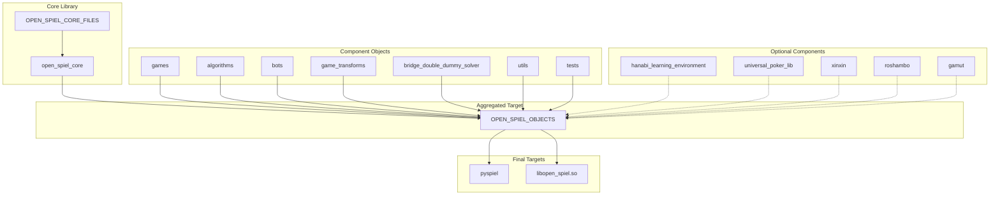

Sources: [open_spiel/CMakeLists.txt:155-262]()

### open_spiel_core Target

The `open_spiel_core` target is an OBJECT library containing the fundamental game engine abstractions defined in `OPEN_SPIEL_CORE_FILES`:

[open_spiel/CMakeLists.txt:155-182]()

Key files include:
- `spiel.h/cc` - Game and State abstract base classes
- `policy.h/cc` - Policy abstraction
- `game_parameters.h/cc` - Game parameter system
- `observer.h/cc` - Game observation system
- `spiel_utils.h/cc` - Utility functions

This target is compiled as position-independent code (`CMAKE_POSITION_INDEPENDENT_CODE ON`) to support Python extension building [open_spiel/CMakeLists.txt:80-81]().

Sources: [open_spiel/CMakeLists.txt:80-81](), [open_spiel/CMakeLists.txt:155-182]()

### OPEN_SPIEL_OBJECTS Collection

The `OPEN_SPIEL_OBJECTS` variable aggregates all compiled object files from core and subdirectories [open_spiel/CMakeLists.txt:222-247](). Conditional dependencies are appended based on build flags [open_spiel/CMakeLists.txt:233-262]().

Sources: [open_spiel/CMakeLists.txt:222-262]()

---

## Conditional Compilation System

### The openspiel_optional_dependency Macro

The core mechanism for conditional compilation is the `openspiel_optional_dependency` CMake macro:

[open_spiel/CMakeLists.txt:94-107]()

This macro:
1. Checks if an environment variable is set (e.g., `OPEN_SPIEL_BUILD_WITH_ACPC`) [open_spiel/CMakeLists.txt:96-100]()
2. Defaults to `DEP_DEFAULT` if not set [open_spiel/CMakeLists.txt:96-99]()
3. Passes the flag as a preprocessor definition (e.g., `-DOPEN_SPIEL_BUILD_WITH_ACPC`) [open_spiel/CMakeLists.txt:104-106]()
4. Prints colored status messages during configuration [open_spiel/CMakeLists.txt:97-101]()

### Diagram: Conditional Compilation Flow

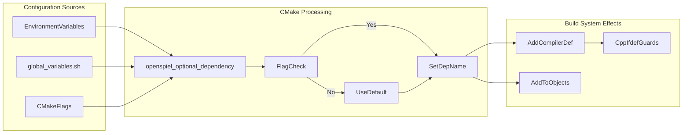

Sources: [open_spiel/CMakeLists.txt:94-107](), [open_spiel/scripts/global_variables.sh:1-109]()

### Optional Dependencies List

The following optional dependencies are defined:

| Dependency | Default | Description |
|------------|---------|-------------|
| `OPEN_SPIEL_BUILD_WITH_ACPC` | OFF | Universal Poker with ACPC server [open_spiel/CMakeLists.txt:110-111]() |
| `OPEN_SPIEL_BUILD_WITH_HANABI` | OFF | Hanabi learning environment [open_spiel/CMakeLists.txt:112-113]() |
| `OPEN_SPIEL_BUILD_WITH_JULIA` | OFF | Julia language bindings [open_spiel/CMakeLists.txt:114-115]() |
| `OPEN_SPIEL_BUILD_WITH_LIBNOP` | OFF | Serialization library support [open_spiel/CMakeLists.txt:116-117]() |
| `OPEN_SPIEL_BUILD_WITH_LIBTORCH` | OFF | PyTorch C++ API integration [open_spiel/CMakeLists.txt:118-119]() |
| `OPEN_SPIEL_BUILD_WITH_PYTHON` | ON | Python bindings (`pyspiel`) [open_spiel/CMakeLists.txt:120-121]() |
| `OPEN_SPIEL_BUILD_WITH_XINXIN` | OFF | XinXin Hearts bot [open_spiel/CMakeLists.txt:122-123]() |
| `OPEN_SPIEL_BUILD_WITH_ROSHAMBO` | OFF | RoShamBo competition bots [open_spiel/CMakeLists.txt:124-125]() |
| `OPEN_SPIEL_BUILD_WITH_GAMUT` | OFF | GAMUT game generator [open_spiel/CMakeLists.txt:126-127]() |
| `OPEN_SPIEL_BUILD_WITH_ORTOOLS` | OFF | OR-Tools optimization library [open_spiel/CMakeLists.txt:128-129]() |
| `OPEN_SPIEL_ENABLE_JAX` | AUTO | Enable JAX tests [open_spiel/CMakeLists.txt:137-138]() |
| `OPEN_SPIEL_ENABLE_PYTORCH` | AUTO | Enable PyTorch tests [open_spiel/CMakeLists.txt:139-140]() |
| `OPEN_SPIEL_ENABLE_PYTHON_MISC` | OFF | Enable misc Python tests [open_spiel/CMakeLists.txt:143-144]() |
| `OPEN_SPIEL_BUILDING_WHEEL` | OFF | Building Python wheel [open_spiel/CMakeLists.txt:146-147]() |

Sources: [open_spiel/CMakeLists.txt:110-148](), [open_spiel/scripts/global_variables.sh:25-109]()

---

## Python Extension Building

### Diagram: Python Extension Build Flow

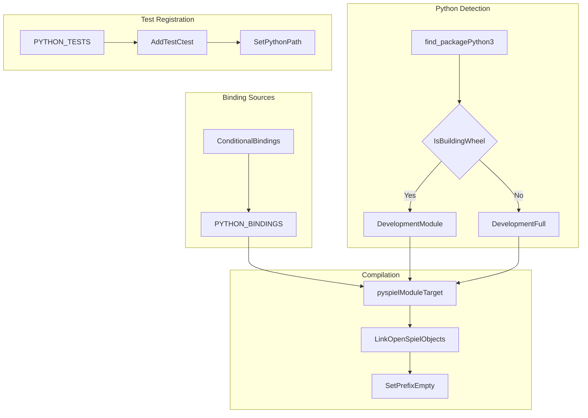

Sources: [open_spiel/python/CMakeLists.txt:1-388]()

### pyspiel MODULE Target

The final Python extension is built as:

[open_spiel/python/CMakeLists.txt:128-136]()

Key properties:
- **MODULE** type: loadable Python extension (not a shared library)
- **PREFIX ""**: Ensures output is `pyspiel.so` rather than `libpyspiel.so`
- Links all `OPEN_SPIEL_OBJECTS`, making the entire C++ library accessible from Python.

Sources: [open_spiel/python/CMakeLists.txt:128-136]()

---

## Build Invocation Patterns

### Diagram: CMake Invocation Methods

```mermaid
graph TB
    subgraph "Manual Build"
        ManualCMake["cmakeOpenSpiel"]
        ManualMake["makePyspiel"]
        ManualTest["ctest"]
    end
    
    subgraph "Build Script"
        BuildScript["build_and_run_tests.sh"]
        VirtualEnv["VirtualEnvSetup"]
        ScriptCMake["ConfigureCMake"]
        ScriptMake["MakeCompile"]
        ScriptCTest["RunCTest"]
    end
    
    subgraph "Python Wheel Build"
        SetupPy["setup.py"]
        CMakeExtension["CMakeExtension"]
        SubprocessCMake["SubprocessCMake"]
    end
    
    ManualCMake --> ManualMake
    ManualMake --> ManualTest
    
    BuildScript --> VirtualEnv
    VirtualEnv --> ScriptCMake
    ScriptCMake --> ScriptMake
    ScriptMake --> ScriptCTest
    
    SetupPy --> CMakeExtension
    CMakeExtension --> SubprocessCMake
```

Sources: [setup.py:76-101](), [open_spiel/scripts/build_and_run_tests.sh:1-261]()

---

## Summary

The CMake build system provides modular compilation via OBJECT libraries, conditional compilation via `openspiel_optional_dependency`, pybind11 integration for Python extensions, CTest integration, and cross-platform support.

Sources: [open_spiel/CMakeLists.txt:1-340](), [open_spiel/python/CMakeLists.txt:1-388](), [setup.py:1-145]()

---

# Page: Python Package Building

# Python Package Building

<details>
<summary>Relevant source files</summary>

The following files were used as context for generating this wiki page:

- [.github/workflows/actions.yml](.github/workflows/actions.yml)
- [.github/workflows/wheels.yml](.github/workflows/wheels.yml)
- [MANIFEST.in](MANIFEST.in)
- [README.md](README.md)
- [__init__.py](__init__.py)
- [docs/_static/OpenSpielC.png](docs/_static/OpenSpielC.png)
- [docs/_static/OpenSpielC_w800.png](docs/_static/OpenSpielC_w800.png)
- [docs/windows.md](docs/windows.md)
- [open_spiel/scripts/ci_script.sh](open_spiel/scripts/ci_script.sh)
- [open_spiel/scripts/python_extra_deps.sh](open_spiel/scripts/python_extra_deps.sh)
- [open_spiel/scripts/test_wheel.sh](open_spiel/scripts/test_wheel.sh)
- [pyproject.toml](pyproject.toml)
- [requirements.txt](requirements.txt)
- [setup.py](setup.py)

</details>


This page documents how OpenSpiel's Python package is built, including the custom `setup.py` mechanism that integrates CMake builds, the wheel building process for multiple platforms, and the testing infrastructure. For general build system details, see [CMake Build System](#2.2).

## Overview

OpenSpiel's Python package is built using a custom integration between Python's `setuptools` and CMake. The `setup.py` file defines custom extension classes that invoke CMake to compile the C++ core and Python bindings, then package everything into distributable wheel files.

Title: "Python Package Building Flow"
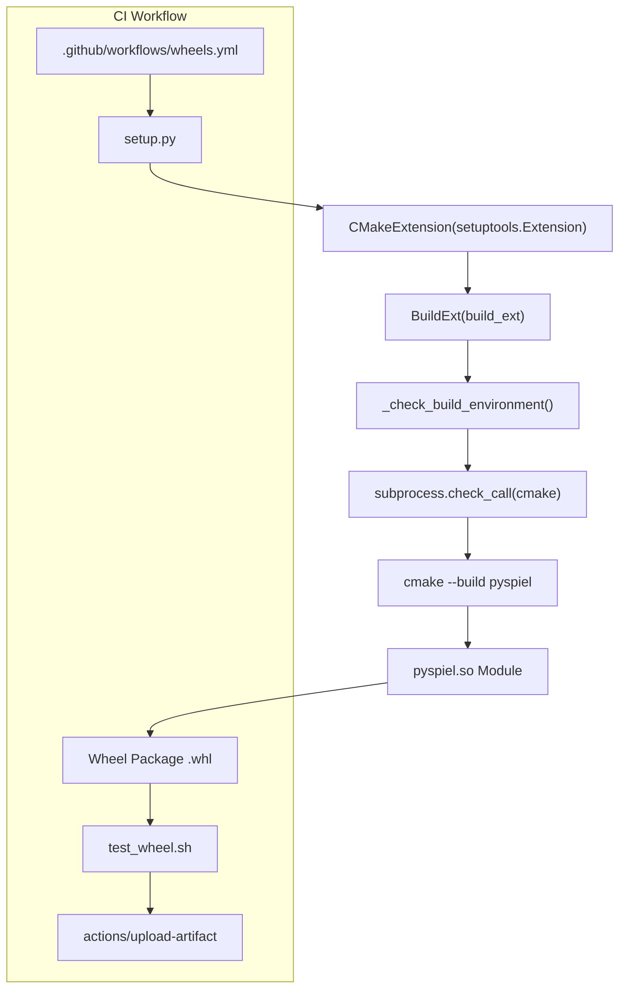
Sources: [setup.py:1-144](), [.github/workflows/wheels.yml:1-148](), [open_spiel/scripts/test_wheel.sh:1-93]()

## setup.py Architecture

The root `setup.py` file implements a custom build process that bridges Python packaging with CMake-based C++ compilation.

### Key Components

| Component | Purpose |
|-----------|---------|
| `CMakeExtension` | Extension class with no sources, delegates to CMake [setup.py:28-37]() |
| `BuildExt` | Custom `build_ext` command that invokes CMake [setup.py:40-101]() |
| `_get_requirements()` | Parses `requirements.txt` for dependencies [setup.py:128-136]() |
| Package metadata | Version, author, description, and extension setup [setup.py:153-169]() |

Sources: [setup.py:28-169]()

### CMakeExtension Class

The `CMakeExtension` class is a custom `setuptools.Extension` that stores the source directory but provides no source files, as all compilation is delegated to CMake:

```python
class CMakeExtension(setuptools.Extension):
  """An extension with no sources.

  We do not want distutils to handle any of the compilation (instead we rely
  on CMake), so we always pass an empty list to the constructor.
  """

  def __init__(self, name, sourcedir=""):
    super().__init__(name, sources=[])
    self.sourcedir = os.path.abspath(sourcedir)
```
Sources: [setup.py:28-37]()

Title: "CMakeExtension Class Hierarchy and Usage"
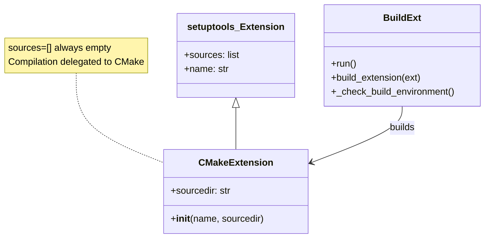
Sources: [setup.py:28-37](), [setup.py:40-101]()

### BuildExt Command

The `BuildExt` class overrides setuptools' default `build_ext` command to use CMake instead of compiling source files directly:

Title: "BuildExt Execution Flow"
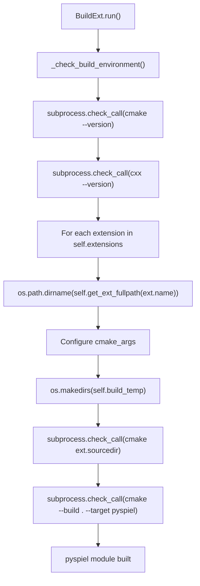
Sources: [setup.py:40-125]()

The implementation in [setup.py:46-125]() performs environment checks, configures CMake arguments (such as `-DPython3_EXECUTABLE={sys.executable}` and `-DCMAKE_BUILD_TYPE=Release`), and builds the target via `cmake --build`.

Sources: [setup.py:46-125]()

### Package Metadata and Dependencies

The setup call at the bottom of `setup.py` defines package metadata and dependencies:

| Parameter | Value |
|-----------|-------|
| `name` | `"open_spiel"` [setup.py:154]() |
| `version` | `"2.0.2"` [setup.py:155]() |
| `python_requires` | `">=3.11"` [setup.py:164]() |
| `install_requires` | Parsed from `requirements.txt` via `_get_requirements()` [setup.py:128-136]() |
| `ext_modules` | `[CMakeExtension("pyspiel", sourcedir="open_spiel")]` [setup.py:165]() |
| `cmdclass` | `{"build_ext": BuildExt}` [setup.py:166]() |
| `packages` | Found via `setuptools.find_packages()` [setup.py:168]() |

Sources: [setup.py:128-169]()

## Python CMake Integration

When `setup.py` invokes CMake, Python-specific binding targets and modules are compiled. The `pyspiel` module target is created as a `MODULE` library [open_spiel/python/CMakeLists.txt]().

Sources: [open_spiel/python/CMakeLists.txt:1-136]()

## Multi-Platform Wheel Building

OpenSpiel builds wheels for multiple platforms and Python versions using `cibuildwheel`, orchestrated by [.github/workflows/wheels.yml]().

Title: "Wheel Building Workflow Architecture"
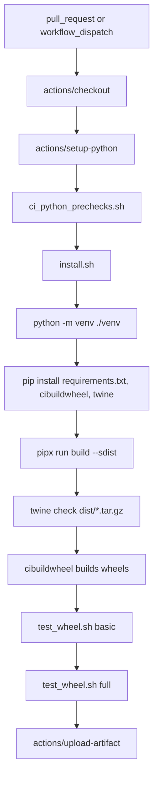
Sources: [.github/workflows/wheels.yml:10-153]()

### Build Matrix Configuration

The workflow uses a matrix strategy targeting Linux (x86_64 and aarch64 via `manylinux_2_28`) and macOS (arm64) for Python versions 3.11 through 3.14 [.github/workflows/wheels.yml:29-85]().

Sources: [.github/workflows/wheels.yml:29-85]()

## Wheel Testing

Wheels are validated using [open_spiel/scripts/test_wheel.sh]() in two modes: `basic` (core Python functionality) and `full` (with ML libraries like JAX and PyTorch installed) [.github/workflows/wheels.yml:86-145]().

Title: "Wheel Testing Execution Flow in test_wheel.sh"
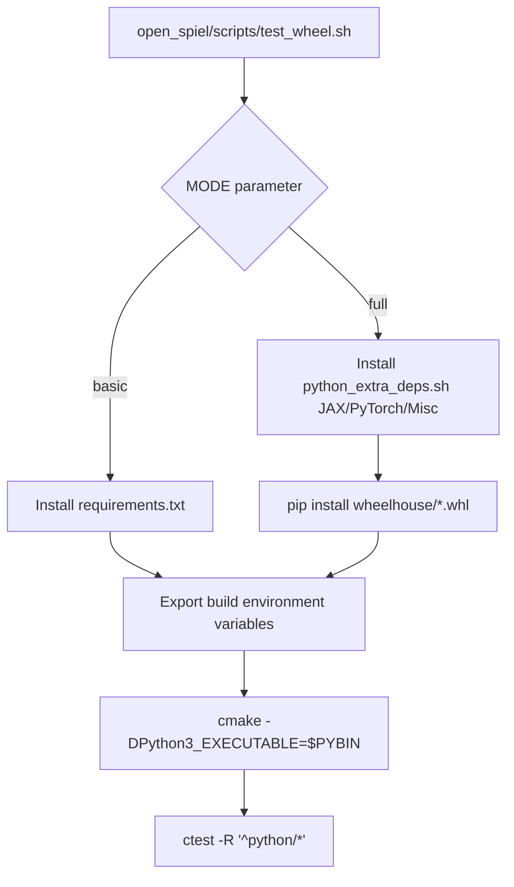
Sources: [open_spiel/scripts/test_wheel.sh:30-109]()

## Python Version-Specific Dependencies

The script [open_spiel/scripts/python_extra_deps.sh]() manages pinned package versions for JAX, PyTorch, and miscellaneous libraries depending on the detected Python interpreter version [open_spiel/scripts/python_extra_deps.sh:53-73]().

Sources: [open_spiel/scripts/python_extra_deps.sh:1-74]()

## Package Manifest

The [MANIFEST.in]() file specifies source distribution inclusions such as `requirements.txt`, `pybind11` headers, and C++ source files under `open_spiel/` [MANIFEST.in:1-19]().

Sources: [MANIFEST.in:1-19]()

## Artifact Uploading

Built source distributions (`dist/*.tar.gz`) and binary wheels (`./wheelhouse/*.whl`) are uploaded as workflow artifacts using `actions/upload-artifact` [.github/workflows/wheels.yml:147-153]().

Sources: [.github/workflows/wheels.yml:147-153]()

## Installation and Testing Scripts

Key helper scripts include [open_spiel/scripts/install.sh]() for cloning external dependencies and [open_spiel/scripts/build_and_run_tests.sh]() for local compilation and test execution.

Sources: [open_spiel/scripts/install.sh:1-143](), [open_spiel/scripts/build_and_run_tests.sh:1-251]()

## Continuous Integration

Continuous integration is managed via [.github/workflows/actions.yml]() and [open_spiel/scripts/ci_script.sh](), which set up virtual environments and execute test suites across matrix configurations [.github/workflows/actions.yml:1-109]().

Sources: [.github/workflows/actions.yml:1-109](), [open_spiel/scripts/ci_script.sh:1-46]()

## Dependency Management

Core dependencies are defined in [requirements.txt](), while optional machine learning dependencies are dynamically configured via [open_spiel/scripts/python_extra_deps.sh]() [requirements.txt:1-17](), [open_spiel/scripts/python_extra_deps.sh:1-74]().

Sources: [requirements.txt:1-17](), [open_spiel/scripts/python_extra_deps.sh:1-74]()

## Conclusion

OpenSpiel's Python packaging infrastructure seamlessly links setuptools, `CMakeExtension`, and binary wheel generation across platforms, supported by a comprehensive CI testing pipeline.

Sources: [setup.py:1-169](), [.github/workflows/wheels.yml:1-153]()

---

# Page: CI/CD and Testing Pipeline

# CI/CD and Testing Pipeline

<details>
<summary>Relevant source files</summary>

The following files were used as context for generating this wiki page:

- [.github/workflows/actions.yml](.github/workflows/actions.yml)
- [.github/workflows/wheels.yml](.github/workflows/wheels.yml)
- [MANIFEST.in](MANIFEST.in)
- [README.md](README.md)
- [__init__.py](__init__.py)
- [docs/_static/OpenSpielC.png](docs/_static/OpenSpielC.png)
- [docs/_static/OpenSpielC_w800.png](docs/_static/OpenSpielC_w800.png)
- [docs/windows.md](docs/windows.md)
- [open_spiel/scripts/ci_script.sh](open_spiel/scripts/ci_script.sh)
- [open_spiel/scripts/python_extra_deps.sh](open_spiel/scripts/python_extra_deps.sh)
- [open_spiel/scripts/test_wheel.sh](open_spiel/scripts/test_wheel.sh)
- [pyproject.toml](pyproject.toml)
- [requirements.txt](requirements.txt)
- [setup.py](setup.py)

</details>


## Purpose and Scope

This page documents the Continuous Integration and Continuous Deployment (CI/CD) infrastructure and testing pipeline for OpenSpiel. This system is responsible for automated building, testing, and packaging of OpenSpiel across multiple platforms and Python versions [.github/workflows/wheels.yml:1-8, .github/workflows/actions.yml:1-15]().

For information about the build system configuration itself (CMake, optional dependencies), see [CMake Build System](#2.2). For details on Python package structure and `setup.py` mechanics, see [Python Package Building](#2.3). For C++ and Python testing frameworks and test organization, see [Testing and Validation](#10) [.github/workflows/wheels.yml:1-8]().

Sources: [.github/workflows/wheels.yml:1-8](), [.github/workflows/actions.yml:1-15]()

## GitHub Actions Workflows

OpenSpiel uses two primary GitHub Actions workflows for automated testing and wheel building [.github/workflows/wheels.yml:1-16, .github/workflows/actions.yml:1-15]().

### Workflow Configuration

| Workflow | File | Triggers | Purpose |
|----------|------|----------|---------|
| `wheels` | [.github/workflows/wheels.yml:1-148]() | Pull requests, manual dispatch | Build and test Python wheels for distribution [.github/workflows/wheels.yml:1-22]() |
| `build_and_test` | [.github/workflows/actions.yml:1-80]() | Push to master, pull requests | Run comprehensive tests on multiple platforms [.github/workflows/actions.yml:1-15]() |

Sources: [.github/workflows/wheels.yml:1-22](), [.github/workflows/actions.yml:1-15]()

### Matrix Strategy

Both workflows use GitHub Actions matrix strategy to test multiple configurations [.github/workflows/wheels.yml:28-85, .github/workflows/actions.yml:20-69]().

```mermaid
graph TB
    subgraph "wheels.yml Matrix"
        WheelsMatrix["Matrix Strategy .github/workflows/wheels.yml"]
        Ubuntu2404["ubuntu-24.04 cp311-cp314 x86_64"]
        Ubuntu2404Arm["ubuntu-24.04-arm aarch64"]
        MacOS14["macos-14 arm64"]
        MacOS15["macos-15 cp314 arm64"]
    end
    
    subgraph "actions.yml Matrix"
        ActionsMatrix["Matrix Strategy .github/workflows/actions.yml"]
        Ubuntu2404Off["ubuntu-24.04 Python 3.12 OFF"]
        MacOS14Off["macos-14 Python 3.12 OFF"]
        Ubuntu2404On["ubuntu-24.04 Python 3.11 ON"]
        MacOS14On["macos-14 Python 3.11 OFF"]
    end
    
    WheelsMatrix --> Ubuntu2404
    WheelsMatrix --> Ubuntu2404Arm
    WheelsMatrix --> MacOS14
    WheelsMatrix --> MacOS15
    
    ActionsMatrix --> Ubuntu2404Off
    ActionsMatrix --> MacOS14Off
    ActionsMatrix --> Ubuntu2404On
    ActionsMatrix --> MacOS14On
```

Sources: [.github/workflows/wheels.yml:28-85](), [.github/workflows/actions.yml:20-69]()

### Environment Variables

Key environment variables control build behavior [.github/workflows/wheels.yml:72-88, .github/workflows/actions.yml:71-82]():

| Variable | Purpose | Default/Values |
|----------|---------|----------------|
| `OPEN_SPIEL_BUILDING_WHEEL` | Indicates wheel build mode [.github/workflows/wheels.yml:73]() | ON/OFF [.github/workflows/wheels.yml:73]() |
| `OPEN_SPIEL_BUILD_WITH_ACPC` | Enable ACPC poker support [.github/workflows/wheels.yml:74]() | ON/OFF [.github/workflows/wheels.yml:74]() |
| `OPEN_SPIEL_BUILD_WITH_HANABI` | Enable Hanabi game [.github/workflows/wheels.yml:75]() | ON/OFF [.github/workflows/wheels.yml:75]() |
| `OPEN_SPIEL_BUILD_WITH_ROSHAMBO` | Enable RoShamBo bots [.github/workflows/wheels.yml:76]() | ON/OFF [.github/workflows/wheels.yml:76]() |
| `OPEN_SPIEL_ENABLE_JAX` | Enable JAX framework tests [.github/workflows/actions.yml:72]() | ON/OFF/AUTO [.github/workflows/actions.yml:72]() |
| `OPEN_SPIEL_ENABLE_PYTORCH` | Enable PyTorch tests [.github/workflows/actions.yml:73]() | ON/OFF/AUTO [.github/workflows/actions.yml:73]() |
| `OPEN_SPIEL_ENABLE_PYTHON_MISC` | Enable misc Python deps [.github/workflows/actions.yml:74]() | ON/OFF [.github/workflows/actions.yml:74]() |
| `OPEN_SPIEL_ABSL_VERSION` | Abseil library version [.github/workflows/wheels.yml:77]() | "20250814.1" [.github/workflows/wheels.yml:77]() |

Sources: [.github/workflows/wheels.yml:72-88](), [.github/workflows/actions.yml:71-82]()

## Build Process Flow

### wheels.yml Workflow Steps

```mermaid
flowchart TD
    Start["Workflow Triggered .github/workflows/wheels.yml"]
    Checkout["actions/checkout@d23441a"]
    SetupPython["actions/setup-python@ece7cb0"]
    Install["Install Step open_spiel/scripts/ci_python_prechecks.sh"]
    BuildSDist["Build sdist pipx run build --sdist"]
    BuildWheels["Build bdist_wheel cibuildwheel"]
    BasicTests["Basic Tests open_spiel/scripts/test_wheel.sh basic"]
    FullTests["Full Tests open_spiel/scripts/test_wheel.sh full"]
    UploadArtifacts["Upload Artifacts actions/upload-artifact@b7c566a"]
    
    Start --> Checkout
    Checkout --> SetupPython
    SetupPython --> Install
    Install --> BuildSDist
    BuildSDist --> BuildWheels
    BuildWheels --> BasicTests
    BasicTests --> FullTests
    FullTests --> UploadArtifacts
    
    Install -.-> InstallDeps["install.sh Dependencies: pybind11, abseil-cpp, json, dds"]
    Install -.-> InstallOptional["Optional deps: Hanabi, ACPC, RoShamBo"]
    Install -.-> InstallPython["Python packages: requirements.txt, JAX/PyTorch, misc deps"]
    
    BuildWheels -.-> CIBWEnv["CIBW_ENVIRONMENT CIBW_BUILD CIBW_TEST_COMMAND"]
```

Sources: [.github/workflows/wheels.yml:90-153]()

### actions.yml Workflow Steps

```mermaid
flowchart TD
    Start["Workflow Triggered .github/workflows/actions.yml"]
    Checkout["actions/checkout@d23441a"]
    SetupPython["actions/setup-python@ece7cb0"]
    AdHocFix["Ad-hoc fix open_spiel/issues/606"]
    Install["install.sh"]
    BuildTest["open_spiel/scripts/ci_script.sh"]
    
    Start --> Checkout
    Checkout --> SetupPython
    SetupPython --> AdHocFix
    AdHocFix --> Install
    Install --> BuildTest
    
    BuildTest -.-> VenvSetup["Create venv Install deps"]
    BuildTest -.-> BuildAndRun["build_and_run_tests.sh --github_ci=true"]
    BuildAndRun -.-> CMakeBuild["CMake configuration"]
    BuildAndRun -.-> MakeBuild["make -j NPROC"]
    BuildAndRun -.-> CTest["ctest -j NPROC"]
```

Sources: [.github/workflows/actions.yml:83-109](), [open_spiel/scripts/ci_script.sh:1-46]()

## cibuildwheel Configuration

The `wheels.yml` workflow uses `cibuildwheel` to build platform-specific wheels [.github/workflows/wheels.yml:1-8, 132-137]().

### cibuildwheel Environment Variables

| Variable | Purpose | Example Value |
|----------|---------|---------------|
| `CIBW_BUILD` | Specify which wheels to build [.github/workflows/wheels.yml:44]() | `cp311-manylinux_x86_64 cp312-manylinux_x86_64 cp313-manylinux_x86_64 cp314-manylinux_x86_64` [.github/workflows/wheels.yml:44]() |
| `CIBW_MANYLINUX_X86_64_IMAGE` | Linux Docker image [.github/workflows/wheels.yml:83]() | `manylinux_2_28` [.github/workflows/wheels.yml:83]() |
| `CIBW_MANYLINUX_AARCH64_IMAGE` | Linux ARM64 Docker image [.github/workflows/wheels.yml:84]() | `manylinux_2_28` [.github/workflows/wheels.yml:84]() |
| `CIBW_ENVIRONMENT` | Environment for build [.github/workflows/wheels.yml:43]() | `OPEN_SPIEL_BUILDING_WHEEL='ON' OPEN_SPIEL_BUILD_WITH_ACPC='ON' ...` [.github/workflows/wheels.yml:43]() |
| `CIBW_BEFORE_TEST` | Pre-test command [.github/workflows/wheels.yml:86]() | `python -m pip install --upgrade pip` [.github/workflows/wheels.yml:86]() |
| `CIBW_TEST_COMMAND` | Test command [.github/workflows/wheels.yml:87]() | `/bin/bash {project}/open_spiel/scripts/test_wheel.sh basic {project}` [.github/workflows/wheels.yml:87]() |

Sources: [.github/workflows/wheels.yml:43-88]()

### Wheel Build Process

```mermaid
flowchart LR
    subgraph "cibuildwheel Execution"
        Source["Source Code setup.py"]
        Docker["manylinux_2_28 Docker image"]
        CMakeExt["CMakeExtension setup.py:28"]
        CMakeBuild["BuildExt.build_extension setup.py:77"]
        MakePyspiel["cmake --build . --target pyspiel setup.py:120"]
        Wheel["Python Wheel .whl"]
    end
    
    subgraph "Inside Docker/Host"
        InstallDeps["Install Dependencies abseil, pybind11"]
        ConfigureCMake["cmake -DPython3_EXECUTABLE setup.py:83"]
        CompileCpp["Compile C++ core setup.py:120"]
        LinkPython["Link pyspiel module setup.py:120"]
    end
    
    Source --> Docker
    Docker --> CMakeExt
    CMakeExt --> CMakeBuild
    CMakeBuild --> InstallDeps
    InstallDeps --> ConfigureCMake
    ConfigureCMake --> CompileCpp
    CompileCpp --> LinkPython
    LinkPython --> MakePyspiel
    MakePyspiel --> Wheel
```

Sources: [.github/workflows/wheels.yml:124-137](), [setup.py:28-126]()

## Testing Infrastructure

### Test Organization

OpenSpiel has a multi-layered testing approach [open_spiel/scripts/test_wheel.sh:109]().

```mermaid
graph TB
    subgraph "C++ Tests"
        BasicTests["basic_tests.h RandomSimTest"]
        GameTests["Per-game tests chess_test.cc"]
        AlgoTests["Algorithm tests cfr_test.cc"]
        CTest["CTest Runner open_spiel/scripts/test_wheel.sh:109"]
    end
    
    subgraph "Python Tests"
        CoreTests["Core tests pyspiel_test.py"]
        AlgoTestsPy["Algorithm tests cfr_test.py"]
        CondTests["Conditional tests JAX/PyTorch tests"]
        Pytest["pytest/unittest Runner"]
    end
    
    subgraph "Integration Tests"
        Playthrough["playthrough_test.py"]
        APITest["api_test.py"]
    end
    
    BasicTests --> CTest
    GameTests --> CTest
    AlgoTests --> CTest
    
    CoreTests --> Pytest
    AlgoTestsPy --> Pytest
    CondTests --> Pytest
    
    Playthrough --> Pytest
    APITest --> Pytest
```

Sources: [open_spiel/scripts/test_wheel.sh:109]()

### Test Execution Modes

The `test_wheel.sh` script supports two test modes [open_spiel/scripts/test_wheel.sh:21-60]():

| Mode | Purpose | Dependencies Installed | Tests Run |
|------|---------|----------------------|-----------|
| `basic` | Validate wheel functionality [open_spiel/scripts/test_wheel.sh:25]() | Core requirements only [open_spiel/scripts/test_wheel.sh:47-48]() | Python tests excluding ML-dependent tests [open_spiel/scripts/test_wheel.sh:25]() |
| `full` | Comprehensive validation [open_spiel/scripts/test_wheel.sh:26]() | Core + JAX + PyTorch + misc [open_spiel/scripts/test_wheel.sh:54-60]() | All Python tests including ML-dependent tests [open_spiel/scripts/test_wheel.sh:26]() |

Sources: [open_spiel/scripts/test_wheel.sh:21-60]()

## CI Script Execution Flow

### ci_script.sh Detailed Flow

```mermaid
flowchart TD
    Start["ci_script.sh invoked open_spiel/scripts/ci_script.sh:1"]
    
    subgraph "Environment Setup"
        DetectPyBin["Detect PYBIN python3 open_spiel/scripts/ci_script.sh:20"]
        SourceDeps["Source python_extra_deps.sh open_spiel/scripts/ci_script.sh:25"]
        CreateVenv["Create virtual environment venv open_spiel/scripts/ci_script.sh:27"]
        ActivateVenv["Activate venv open_spiel/scripts/ci_script.sh:28"]
    end
    
    subgraph "Dependency Installation"
        UpgradePip["pip install --upgrade pip open_spiel/scripts/ci_script.sh:30"]
        InstallCore["pip install -r requirements.txt open_spiel/scripts/ci_script.sh:36"]
        InstallJAX["OPEN_SPIEL_ENABLE_JAX JAX deps open_spiel/scripts/ci_script.sh:38"]
        InstallPyTorch["OPEN_SPIEL_ENABLE_PYTORCH PyTorch deps open_spiel/scripts/ci_script.sh:39"]
        InstallMisc["OPEN_SPIEL_ENABLE_PYTHON_MISC misc deps open_spiel/scripts/ci_script.sh:40"]
    end
    
    subgraph "Build and Test"
        RunBuildScript["build_and_run_tests.sh --github_ci=true open_spiel/scripts/ci_script.sh:44"]
    end
    
    Deactivate["deactivate venv open_spiel/scripts/ci_script.sh:46"]
    
    Start --> DetectPyBin
    DetectPyBin --> SourceDeps
    SourceDeps --> CreateVenv
    CreateVenv --> ActivateVenv
    ActivateVenv --> UpgradePip
    UpgradePip --> InstallCore
    InstallCore --> InstallJAX
    InstallJAX --> InstallPyTorch
    InstallPyTorch --> InstallMisc
    InstallMisc --> RunBuildScript
    RunBuildScript --> Deactivate
```

Sources: [open_spiel/scripts/ci_script.sh:1-46]()

## Dependency Resolution

### Python Version-Specific Dependencies

The `python_extra_deps.sh` script sets version-specific package versions [open_spiel/scripts/python_extra_deps.sh:17-73]():

```mermaid
flowchart TD
    Start["python_extra_deps.sh open_spiel/scripts/python_extra_deps.sh:1"]
    GetPyVer["Get Python version open_spiel/scripts/python_extra_deps.sh:31"]
    
    subgraph "Version Comparison"
    CheckLess312["Python < 3.12 open_spiel/scripts/python_extra_deps.sh:53"]
    CheckLess313["Python < 3.13 open_spiel/scripts/python_extra_deps.sh:58"]
    CheckLess314["Python < 3.14 open_spiel/scripts/python_extra_deps.sh:63"]
        Else314["Python >= 3.14 open_spiel/scripts/python_extra_deps.sh:69"]
    end
    
    subgraph "Dependency Sets"
        Set311["Python 3.11 torch==2.9.1 jax==0.8.1 open_spiel/scripts/python_extra_deps.sh:55"]
        Set312["Python 3.12 torch==2.9.1 jax==0.8.1 open_spiel/scripts/python_extra_deps.sh:60"]
        Set313["Python 3.13 torch==2.9.1 jax==0.8.1 open_spiel/scripts/python_extra_deps.sh:65"]
        Set314["Python > 3.13 torch==2.10.0 jax==0.9.0.1 open_spiel/scripts/python_extra_deps.sh:70"]
    end
    
    Start --> GetPyVer
    GetPyVer --> CheckLess312
    CheckLess312 -->|true| Set311
    CheckLess312 -->|false| CheckLess313
    CheckLess313 -->|true| Set312
    CheckLess313 -->|false| CheckLess314
    CheckLess314 -->|true| Set313
    CheckLess314 -->|false| Set314
```

Sources: [open_spiel/scripts/python_extra_deps.sh:1-73]()

## Wheel Validation Process

### test_wheel.sh Flow

```mermaid
flowchart TD
    Start["test_wheel.sh invoked open_spiel/scripts/test_wheel.sh:1"]
    
    subgraph "Environment Detection"
        DetectOS["Detect OS open_spiel/scripts/test_wheel.sh:34"]
        SetPyBin["Set PYBIN open_spiel/scripts/test_wheel.sh:37"]
    end
    
    subgraph "Dependency Installation"
        UpgradeSetuptools["pip install setuptools open_spiel/scripts/test_wheel.sh:44"]
        InstallReqs["pip install requirements.txt open_spiel/scripts/test_wheel.sh:48"]
        CheckMode["Check MODE open_spiel/scripts/test_wheel.sh:47"]
        InstallMLDeps["Install JAX, PyTorch open_spiel/scripts/test_wheel.sh:54"]
    end
    
    subgraph "Wheel Installation"
        DetectOSVer["Detect Python version open_spiel/scripts/test_wheel.sh:70"]
        FindWheel["Find wheel in wheelhouse open_spiel/scripts/test_wheel.sh:75"]
        InstallWheel["pip install wheel_file open_spiel/scripts/test_wheel.sh:91"]
    end
    
    subgraph "Test Execution"
        SetWheelEnv["Set OPEN_SPIEL_BUILDING_WHEEL=ON open_spiel/scripts/test_wheel.sh:94"]
        CreateBuildDir["mkdir build open_spiel/scripts/test_wheel.sh:98"]
        CMakeConfig["cmake -DPython3_EXECUTABLE open_spiel/scripts/test_wheel.sh:99"]
        RunCTest["ctest -R ^python/* open_spiel/scripts/test_wheel.sh:109"]
    end
    
    Start --> DetectOS
    DetectOS --> SetPyBin
    SetPyBin --> UpgradeSetuptools
    UpgradeSetuptools --> InstallReqs
    InstallReqs --> CheckMode
    CheckMode -->|full| InstallMLDeps
    CheckMode -->|basic| SetWheelEnv
    InstallMLDeps --> DetectOSVer
    DetectOSVer --> FindWheel
    FindWheel --> InstallWheel
    InstallWheel --> SetWheelEnv
    SetWheelEnv --> CreateBuildDir
    CreateBuildDir --> CMakeConfig
    CMakeConfig --> RunCTest
```

Sources: [open_spiel/scripts/test_wheel.sh:1-109]()

## setup.py Custom Build Extension

### CMakeExtension and BuildExt Classes

The `setup.py` file defines custom classes to integrate CMake with Python's setuptools [setup.py:28-44]():

```mermaid
classDiagram
    class setuptools_Extension {
        <<base class>>
    }
    
    class CMakeExtension {
        +__init__(name, sourcedir) setup.py:35
        +sourcedir : str setup.py:37
    }
    
    class build_ext {
        <<base class>>
    }
    
    class BuildExt {
        +run() setup.py:46
        +_check_build_environment() setup.py:51
        +build_extension(ext) setup.py:77
    }
    
    setuptools_Extension <|-- CMakeExtension
    build_ext <|-- BuildExt
```

**BuildExt.run() Flow:**

```mermaid
flowchart TD
    Start["BuildExt.run() setup.py:46"]
    CheckEnv["_check_build_environment() setup.py:51"]
    
    subgraph "For each extension"
        GetExtDir["Get extension directory setup.py:78"]
        DetectCXX["Detect CXX compiler setup.py:64"]
        SetCMakeArgs["cmake_args setup.py:82"]
        CreateBuildDir["Create build_temp setup.py:111"]
        RunCMake["subprocess.check_call cmake setup.py:115"]
        DetectJobs["Detect CPU count setup.py:107"]
        RunMake["subprocess.check_call cmake --build setup.py:120"]
    end
    
    Start --> CheckEnv
    CheckEnv --> GetExtDir
    GetExtDir --> DetectCXX
    DetectCXX --> SetCMakeArgs
    SetCMakeArgs --> CreateBuildDir
    CreateBuildDir --> RunCMake
    RunCMake --> DetectJobs
    DetectJobs --> RunMake
```

Sources: [setup.py:28-126]()

## Summary of Key Scripts and Their Roles

| Script | Primary Purpose | Key Functions |
|--------|----------------|---------------|
| `install.sh` | Install all dependencies (core + optional) [docs/windows.md:122]() | Clone repos, install packages, setup environments [docs/windows.md:122]() |
| `ci_script.sh` | Main CI entry point from GitHub Actions [open_spiel/scripts/ci_script.sh:1-46]() | Create venv, install deps, invoke build_and_run_tests.sh [open_spiel/scripts/ci_script.sh:27-44]() |
| `test_wheel.sh` | Validate Python wheels [.github/workflows/wheels.yml:87]() | Install wheel, run tests in clean environment [.github/workflows/wheels.yml:87](), [open_spiel/scripts/test_wheel.sh:1-109]() |
| `python_extra_deps.sh` | Define Python version-specific dependencies [open_spiel/scripts/python_extra_deps.sh:17-23]() | Export environment variables for JAX, PyTorch, misc packages [open_spiel/scripts/python_extra_deps.sh:53-73]() |

Sources: [docs/windows.md:122](), [open_spiel/scripts/ci_script.sh:1-46](), [.github/workflows/wheels.yml:87](), [open_spiel/scripts/test_wheel.sh:1-109](), [open_spiel/scripts/python_extra_deps.sh:17-73]()

---

# Page: Core C++ Engine

# Core C++ Engine

<details>
<summary>Relevant source files</summary>

The following files were used as context for generating this wiki page:

- [open_spiel/game_parameters.cc](open_spiel/game_parameters.cc)
- [open_spiel/game_parameters.h](open_spiel/game_parameters.h)
- [open_spiel/matrix_game.cc](open_spiel/matrix_game.cc)
- [open_spiel/matrix_game.h](open_spiel/matrix_game.h)
- [open_spiel/normal_form_game.h](open_spiel/normal_form_game.h)
- [open_spiel/simultaneous_move_game.h](open_spiel/simultaneous_move_game.h)
- [open_spiel/spiel.cc](open_spiel/spiel.cc)
- [open_spiel/spiel.h](open_spiel/spiel.h)
- [open_spiel/tensor_game.cc](open_spiel/tensor_game.cc)
- [open_spiel/tensor_game.h](open_spiel/tensor_game.h)
- [open_spiel/tests/basic_tests.cc](open_spiel/tests/basic_tests.cc)
- [open_spiel/tests/basic_tests.h](open_spiel/tests/basic_tests.h)
- [open_spiel/utils/tensor_view_test.cc](open_spiel/utils/tensor_view_test.cc)

</details>


## Purpose and Scope

The Core C++ Engine provides the fundamental abstractions and base classes upon which all games, algorithms, and Python bindings are built in OpenSpiel. It defines the runtime interfaces for navigating game trees, evaluating states, handling parameters, serializing states, generating observations, and utilizing core utility libraries.

As a parent page, this document provides a high-level overview of the core engine subsystems. For detailed technical information, see the child pages:
- [Game and State Abstractions](#3.1) — Detailed documentation of the `Game` and `State` base classes, virtual methods, and lifecycle.
- [Game Registration and Parameters](#3.2) — `GameType`, `GameInfo`, `GameParameters`, and the registration factory pattern (`REGISTER_SPIEL_GAME`).
- [Serialization and Testing Framework](#3.3) — State persistence, C++ testing utilities (`basic_tests.h`), and `RandomSimTest`.
- [Observers and Observation Tensors](#3.4) — The `Observer`/`Observation` framework, allocators, `SpanTensor`, and tensors.
- [Core Utilities Library](#3.5) — Utilities under `open_spiel/utils/` (`spiel_utils.h`, logging, JSON, circular buffers, caches).

Sources: [open_spiel/spiel.h:15-158](), [open_spiel/spiel.cc:15-47]()

---

## Architecture Overview

The C++ core architecture connects game metadata, stateful simulation, registration, and verification tools into a cohesive framework.

```mermaid
graph TB
    subgraph "Metadata&Config"
        GameType["GameType<br/>spiel.h:59-157"]
        GameParameters["GameParameters<br/>game_parameters.h:37"]
    end
    subgraph "CoreAbstractions"
        Game["Game<br/>spiel.h"]
        State["State<br/>spiel.h"]
        Observer["Observer<br/>observer.h"]
    end
    subgraph "Registry&Factory"
        GameRegisterer["GameRegisterer<br/>spiel.cc:146-170"]
        RegisterMacro["REGISTER_SPIEL_GAME"]
    end
    subgraph "Testing&Verification"
        RandomSimTest["RandomSimTest<br/>basic_tests.h:46-52"]
    end

    GameType --> Game
    GameParameters --> Game
    Game --> State
    Game --> Observer
    RegisterMacro --> GameRegisterer
    GameRegisterer --> Game
    Game --> RandomSimTest
```
Sources: [open_spiel/spiel.h:47-158](), [open_spiel/spiel.cc:146-194](), [open_spiel/tests/basic_tests.h:46-52]()

---

## 3.1 Game and State Abstractions

The `Game` and `State` classes serve as the core abstract base classes for every game implemented in OpenSpiel. A `Game` instance represents a static game type defined by parameters, providing factories for initial states (`NewInitialState()`) and query methods for action spaces, player counts, and tensor shapes. A `State` instance represents an ongoing trajectory node, handling action application (`ApplyAction()`, `ApplyActions()`), legality checks (`LegalActions()`), history tracking, and terminal utility returns (`Returns()`, `Rewards()`).

For detailed documentation of virtual methods, lifecycle management, and game mechanics, see [Game and State Abstractions](#3.1).

Sources: [open_spiel/spiel.h:240-923](), [open_spiel/spiel.cc:93-125]()

---

## 3.2 Game Registration and Parameters

OpenSpiel uses a static registration mechanism combined with a factory pattern to discover and instantiate games by name. The `GameType` struct specifies static properties (such as `dynamics`, `chance_mode`, `information`, and `utility`), while `GameParameters` and `GameParameter` provide type-safe configuration parsing and validation. Games register themselves globally using the `REGISTER_SPIEL_GAME` macro during program initialization, enabling dynamic loading via `LoadGame()`.

For complete details on game parameters, validation, and registration factories, see [Game Registration and Parameters](#3.2).

Sources: [open_spiel/spiel.h:47-157](), [open_spiel/game_parameters.h:37-183](), [open_spiel/spiel.cc:146-170]()

---

## 3.3 Serialization and Testing Framework

To support experiment resumption, distributed execution, and rigorous regression testing, OpenSpiel provides state serialization (`SerializeGameAndState()`, `State::Serialize()`) and deserialization routines. Furthermore, the testing framework defined in `basic_tests.h` provides robust validation tools such as `RandomSimTest`, `RandomSimTestWithUndo`, and `ResampleInfostateTest` to verify that game rules, legal action masks, cloning, and serialization invariants hold under random simulation.

For detailed coverage of serialization formats, FEN parsing, and test suites, see [Serialization and Testing Framework](#3.3).

Sources: [open_spiel/spiel.h:45-51](), [open_spiel/tests/basic_tests.h:41-82](), [open_spiel/tests/basic_tests.cc:142-180]()

---

## 3.4 Observers and Observation Tensors

OpenSpiel decouples game state representation from neural network features and string views via the `Observer` and `Observation` framework (`observer.h`). Observers query specific facets of a `State` (such as public information, private cards, or tensor encodings) and write them into flat memory spans (`SpanTensor` or allocators). This modular design allows multiple observation configurations (e.g., perfect recall info states vs. partial observations) to be attached to the same game without modifying the underlying `State` implementation.

For comprehensive documentation on observer allocators, tensor views, compression, and Python bindings, see [Observers and Observation Tensors](#3.4).

Sources: [open_spiel/observer.h](), [open_spiel/spiel.h:39]()

---

## 3.5 Core Utilities Library

The `open_spiel/utils/` directory provides essential foundational utilities used across the C++ core, games, and algorithms. These include `spiel_utils.h` (error handling like `SpielFatalError`, downcasting, and numeric helpers), file logging utilities, JSON parsing wrappers (`nlohmann::json`), circular buffers, thread-safe queues, LRU caches, and multi-dimensional tensor views (`TensorView`).

For documentation on utility classes, tensor view indexing, and helper functions, see [Core Utilities Library](#3.5).

Sources: [open_spiel/spiel_utils.h](), [open_spiel/utils/tensor_view.h](), [open_spiel/utils/tensor_view_test.cc:15-136]()

---

# Page: Game and State Abstractions

# Game and State Abstractions

<details>
<summary>Relevant source files</summary>

The following files were used as context for generating this wiki page:

- [open_spiel/game_parameters.cc](open_spiel/game_parameters.cc)
- [open_spiel/game_parameters.h](open_spiel/game_parameters.h)
- [open_spiel/matrix_game.cc](open_spiel/matrix_game.cc)
- [open_spiel/matrix_game.h](open_spiel/matrix_game.h)
- [open_spiel/normal_form_game.h](open_spiel/normal_form_game.h)
- [open_spiel/simultaneous_move_game.h](open_spiel/simultaneous_move_game.h)
- [open_spiel/spiel.cc](open_spiel/spiel.cc)
- [open_spiel/spiel.h](open_spiel/spiel.h)
- [open_spiel/tensor_game.cc](open_spiel/tensor_game.cc)
- [open_spiel/tensor_game.h](open_spiel/tensor_game.h)
- [open_spiel/tests/basic_tests.cc](open_spiel/tests/basic_tests.cc)
- [open_spiel/tests/basic_tests.h](open_spiel/tests/basic_tests.h)
- [open_spiel/utils/tensor_view_test.cc](open_spiel/utils/tensor_view_test.cc)

</details>


This page documents the fundamental C++ abstractions that define game mechanics in OpenSpiel: the `Game` and `State` base classes. These abstractions form the core interface that all games implement, enabling algorithms to work uniformly across different games. For information about how games are registered and loaded, see [Game Registration and Parameters](#3.2). For Python integration details, see [pyspiel Module and Bindings](#4.1).

## Purpose and Scope

The `Game` and `State` classes provide the essential API for:
- Creating initial game states
- Querying the current player and legal actions
- Advancing game states through action application
- Determining terminal states and computing payoffs
- Supporting both perfect and imperfect information games
- Handling deterministic, explicit stochastic, and sampled stochastic games

All concrete game implementations inherit from these base classes and override virtual methods to implement game-specific logic.

## Core Class Architecture

```mermaid
graph TB
    subgraph "Game Abstraction"
        Game["Game<br/>(abstract base class)<br/>spiel.h"]
        GameType["GameType<br/>(struct)<br/>spiel.h"]
        GameParameters["GameParameters<br/>(map&lt;string, GameParameter&gt;)<br/>game_parameters.h"]
    end
    
    subgraph "State Abstraction"
        State["State<br/>(abstract base class)<br/>spiel.h"]
        StateType["StateType<br/>(enum)<br/>spiel.cc"]
        PlayerAction["PlayerAction<br/>(struct)<br/>spiel.h"]
    end
    
    Game --> GameType
    Game --> GameParameters
    Game --> State
    State --> StateType
    State --> PlayerAction
```

**Relationship Between Game and State**

```mermaid
graph LR
    Game["Game"]
    InitialState["Initial State"]
    State1["State"]
    State2["State"]
    State3["State"]
    TerminalState["Terminal State"]
    
    Game -->|"NewInitialState()"| InitialState
    InitialState -->|"ApplyAction(a1)"| State1
    State1 -->|"ApplyAction(a2)"| State2
    State2 -->|"ApplyAction(a3)"| State3
    State3 -->|"ApplyAction(a4)"| TerminalState
    
    State1 -.->|"GetGame()"| Game
    State2 -.->|"GetGame()"| Game
    TerminalState -.->|"GetGame()"| Game
```

Sources: [open_spiel/spiel.h:210-440](), [open_spiel/game_parameters.h:37]()

## GameType and GameInfo

The `GameType` struct defines static properties of a game that do not depend on parameters:

| Field | Type | Description |
|-------|------|-------------|
| `short_name` | `std::string` | Unique identifier (e.g., "chess", "poker") |
| `long_name` | `std::string` | Human-readable name |
| `dynamics` | `Dynamics` enum | Sequential, Simultaneous, or MeanField |
| `chance_mode` | `ChanceMode` enum | Deterministic, ExplicitStochastic, or SampledStochastic |
| `information` | `Information` enum | OneShot, PerfectInformation, or ImperfectInformation |
| `utility` | `Utility` enum | ZeroSum, ConstantSum, GeneralSum, or Identical |
| `reward_model` | `RewardModel` enum | Rewards (RL-style) or Terminal (game-style) |
| `max_num_players` / `min_num_players` | `int` | Player count bounds |
| `provides_information_state_string` | `bool` | Supports info state strings |
| `provides_information_state_tensor` | `bool` | Supports info state tensors |
| `provides_observation_string` | `bool` | Supports observation strings |
| `provides_observation_tensor` | `bool` | Supports observation tensors |

Sources: [open_spiel/spiel.h:59-157]()

## The Game Class

```mermaid
graph TB
    subgraph "Game Methods"
        direction TB
        NewInitialState["NewInitialState()<br/>Creates root state"]
        NumDistinctActions["NumDistinctActions()<br/>Action space size"]
        NumPlayers["NumPlayers()<br/>Player count"]
        GetType["GetType()<br/>Returns GameType"]
        GetParameters["GetParameters()<br/>Returns GameParameters"]
        MaxGameLength["MaxGameLength()<br/>Max decision count"]
        InformationStateTensorShape["InformationStateTensorShape()<br/>Tensor dimensions"]
        ObservationTensorShape["ObservationTensorShape()<br/>Observation dimensions"]
        DeserializeState["DeserializeState(string)<br/>Reconstruct state from string"]
    end
```

Key `Game` methods:

- **`NewInitialState()`**: Creates the initial state of the game [open_spiel/spiel.h]()
- **`NewInitialState(const std::string&)`**: Creates initial state from a starting position string
- **`NumDistinctActions()`**: Returns the size of the action space for player nodes [open_spiel/spiel.h]()
- **`NumPlayers()`**: Number of players [open_spiel/spiel.h]()
- **`GetType()`**: Returns the `GameType` struct [open_spiel/spiel.h]()
- **`InformationStateTensorShape()` / `ObservationTensorShape()`**: Tensor dimensions for neural networks [open_spiel/spiel.h]()
- **`DeserializeState(const std::string&)`**: Reconstructs a state from serialized form [open_spiel/spiel.cc]()

Sources: [open_spiel/spiel.h:424-488](), [open_spiel/spiel.cc:452-506]()

## The State Class

The `State` class represents a single node in the game tree. Every state maintains:
- A shared pointer to its parent `Game` object
- The history of actions leading to this state
- The current move number

### Essential State Methods

```mermaid
graph TB
    subgraph "State Query Methods"
        CurrentPlayer["CurrentPlayer()<br/>Returns player to act<br/>or special ID"]
        IsTerminal["IsTerminal()<br/>Game ended?"]
        LegalActions["LegalActions()<br/>Available actions"]
        Returns["Returns()<br/>Cumulative payoffs"]
        Rewards["Rewards()<br/>Step rewards"]
    end
    
    subgraph "State Mutation Methods"
        ApplyAction["ApplyAction(action)<br/>Execute action<br/>modifies state"]
        ApplyActions["ApplyActions(actions)<br/>Simultaneous moves"]
        UndoAction["UndoAction(player, action)<br/>Rollback (optional)"]
    end
    
    subgraph "State Derivation Methods"
        Clone["Clone()<br/>Deep copy"]
        Child["Child(action)<br/>Clone + apply"]
    end
```

### Core Virtual Methods

| Method | Purpose | Must Override |
|--------|---------|---------------|
| `CurrentPlayer()` | Returns active player or special ID | Yes |
| `LegalActions()` | Returns list of legal actions | Yes |
| `ApplyAction(Action)` | Transitions state (calls `DoApplyAction`) | Via `DoApplyAction` |
| `IsTerminal()` | Checks if game has ended | Yes |
| `Returns()` | Returns cumulative payoffs | Yes |
| `ToString()` | String representation | Yes |
| `ActionToString(Player, Action)` | Human-readable action | Yes |
| `Clone()` | Creates deep copy | Yes |

Sources: [open_spiel/spiel.h:240-730](), [open_spiel/spiel.cc:304-450]()

## Player IDs and Node Types

OpenSpiel uses special player IDs to represent different node types:

```mermaid
graph TB
    subgraph "Player ID Constants"
        kInvalidPlayer["-3: kInvalidPlayer<br/>Invalid/uninitialized"]
        kSimultaneousPlayerId["-2: kSimultaneousPlayerId<br/>All players act"]
        kChancePlayerId["-1: kChancePlayerId<br/>Nature/chance node"]
        kMeanFieldPlayerId["-5: kMeanFieldPlayerId<br/>Mean field node"]
        kTerminalPlayerId["-4: kTerminalPlayerId<br/>Game ended"]
        NormalPlayer["0..N-1: Normal players"]
    end
    
    subgraph "State Type Checks"
        IsChanceNode["IsChanceNode()<br/>player == -1"]
        IsSimultaneousNode["IsSimultaneousNode()<br/>player == -2"]
        IsPlayerNode["IsPlayerNode()<br/>player >= 0"]
        IsTerminal["IsTerminal()<br/>player == -4"]
        IsMeanFieldNode["IsMeanFieldNode()<br/>player == -5"]
    end
    
    kChancePlayerId --> IsChanceNode
    kSimultaneousPlayerId --> IsSimultaneousNode
    NormalPlayer --> IsPlayerNode
    kTerminalPlayerId --> IsTerminal
    kMeanFieldPlayerId --> IsMeanFieldNode
```

The `StateType` enum provides a categorization: [open_spiel/spiel.cc:93-125]()

```cpp
enum class StateType {
  kTerminal,   // IsTerminal() == true
  kChance,     // IsChanceNode() == true
  kDecision,   // IsPlayerNode() == true
  kMeanField   // IsMeanFieldNode() == true
};
```

Sources: [open_spiel/spiel.cc:93-125](), [open_spiel/spiel.cc:115-125]()

## State Lifecycle and Action Application

```mermaid
sequenceDiagram
    participant Client
    participant State
    participant Game
    
    Client->>Game: NewInitialState()
    Game-->>Client: initial_state
    
    loop Until Terminal
        Client->>State: CurrentPlayer()
        State-->>Client: player_id
        
        Client->>State: LegalActions(player_id)
        State-->>Client: actions
        
        Client->>State: ApplyAction(action)
        State->>State: DoApplyAction(action)
        State->>State: history_.push_back({player, action})
        State->>State: ++move_number_
        
        Client->>State: IsTerminal()
        State-->>Client: bool
    end
    
    Client->>State: Returns()
    State-->>Client: payoffs
```

The action application flow:

1. **`ApplyAction(action_id)`** is the public interface
2. Internally calls **`DoApplyAction(action_id)`** (implemented by derived classes)
3. Updates `history_` with `{player, action}` pair
4. Increments `move_number_`

For simultaneous-move games, **`ApplyActions(std::vector<Action>)`** applies joint actions [open_spiel/simultaneous_move_game.h]().

Sources: [open_spiel/simultaneous_move_game.h:66-74](), [open_spiel/spiel.cc:390-443]()

## Legal Actions and Action Space

```mermaid
graph TB
    subgraph "Action Queries"
        LegalActions1["LegalActions()<br/>Actions for current player"]
        LegalActions2["LegalActions(player)<br/>Actions for specific player"]
        LegalActionsMask["LegalActionsMask(player)<br/>Binary mask vector"]
        ChanceOutcomes["ChanceOutcomes()<br/>Pairs of (action, probability)"]
    end
    
    subgraph "Action Space"
        NumDistinctActions["NumDistinctActions()<br/>From game.NumDistinctActions()"]
        MaxChanceOutcomes["MaxChanceOutcomes()<br/>From game.MaxChanceOutcomes()"]
    end
    
    subgraph "Action Conversion"
        ActionToString["ActionToString(player, action)<br/>Human-readable format"]
        StringToAction["StringToAction(player, string)<br/>Parse string to action"]
    end
    
    LegalActions1 --> ActionToString
    LegalActions2 --> ActionToString
    LegalActionsMask --> NumDistinctActions
    ChanceOutcomes --> MaxChanceOutcomes
    StringToAction --> LegalActions1
```

**Key properties:**

- Actions are integers in `[0, NumDistinctActions())` for player nodes
- Actions are integers in `[0, MaxChanceOutcomes())` for chance nodes
- Legal actions must be returned in ascending order
- `LegalActionsMask()` returns a binary vector of length `NumDistinctActions()` or `MaxChanceOutcomes()` [open_spiel/tests/basic_tests.cc:114-133]()

**Chance Nodes:**

At chance nodes (`IsChanceNode() == true`):
- **Explicit stochastic**: `ChanceOutcomes()` returns all possible outcomes with probabilities, and `ApplyAction()` is deterministic
- **Sampled stochastic**: `ChanceOutcomes()` returns a dummy single outcome, and `ApplyAction()` samples internally

Sources: [open_spiel/tests/basic_tests.cc:114-133](), [open_spiel/spiel.h:697-710]()

## Rewards and Returns

OpenSpiel distinguishes between step rewards (RL-style) and cumulative returns:

```mermaid
graph LR
    subgraph "Episode Timeline"
        S0["State 0"]
        S1["State 1"]
        S2["State 2"]
        S3["Terminal State"]
    end
    
    S0 -->|"action, r0"| S1
    S1 -->|"action, r1"| S2
    S2 -->|"action, r2"| S3
    
    S0 -.->|"Returns() = 0"| R0["Cumulative: 0"]
    S1 -.->|"Returns() = r0"| R1["Cumulative: r0"]
    S2 -.->|"Returns() = r0+r1"| R2["Cumulative: r0+r1"]
    S3 -.->|"Returns() = r0+r1+r2"| R3["Final: r0+r1+r2"]
```

**Key methods:**

- **`Rewards()`**: Returns the immediate reward vector from the most recent transition
  - Default: returns zero except at terminal states (where it returns `Returns()`)
  - Games with intermediate rewards must override this
- **`Returns()`**: Returns the cumulative sum of all rewards up to this state
  - Must be overridden by all games
  - Must satisfy: `Returns(St) = Sum(Rewards(S_0), Rewards(S_1), ..., Rewards(S_t))`
- **`PlayerReward(player)` / `PlayerReturn(player)`**: Single-player versions

**Reward Model:**
- `GameType::RewardModel::kRewards`: RL-style with step rewards
- `GameType::RewardModel::kTerminal`: Only final payoffs at terminal states

Sources: [open_spiel/spiel.h:385-424](), [open_spiel/tests/basic_tests.cc:193-220]()

## Information States and Observations

For imperfect information games, OpenSpiel provides two concepts:

```mermaid
graph TB
    subgraph "Perfect Recall"
        InfoState["Information State<br/>(perfect recall)<br/>Complete action-observation history"]
        InfoString["InformationStateString(player)<br/>String representation"]
        InfoTensor["InformationStateTensor(player)<br/>Vector representation"]
    end
    
    subgraph "Imperfect Recall (Optional)"
        Observation["Observation<br/>(may lack perfect recall)<br/>Current view of state"]
        ObsString["ObservationString(player)<br/>String representation"]
        ObsTensor["ObservationTensor(player)<br/>Vector representation"]
    end
    
    InfoState --> InfoString
    InfoState --> InfoTensor
    Observation --> ObsString
    Observation --> ObsTensor
    
    InfoState -.->|"provides more info"| Observation
```

**Information State Requirements:**
- Must be perfect-recall: different information states imply different future trajectories
- Different ground states with identical information for a player have the same information state
- Must be unique across players (e.g., prefix with player ID)
- Must be provided even at terminal states

**Observation Requirements:**
- May lack perfect recall (e.g., current board state in chess)
- Complete action-observation history must reconstruct the information state
- Observations are player-specific

**Tensor Shapes:**
- `Game::InformationStateTensorShape()` returns dimensions (e.g., `{2, 4, 3}`)
- Tensors use lexicographic ordering

Sources: [open_spiel/spiel.h:496-642](), [open_spiel/tests/basic_tests.cc:222-263]()

## State History

Each state maintains a history of actions:

```mermaid
classDiagram
    class State {
        +History() vector~Action~
        +FullHistory() vector~PlayerAction~
        +HistoryString() string
        +MoveNumber() int
        +IsInitialState() bool
    }
    
    class PlayerAction {
        +Player player
        +Action action
    }
    
    State *-- PlayerAction : history_
```

**History tracking:**
- `history_` stores `PlayerAction` structs containing `{player, action}` pairs
- **`History()`** returns action-only list (for backward compatibility)
- **`FullHistory()`** returns full `{player, action}` pairs
- **`MoveNumber()`** counts the number of moves (simultaneous moves count as one)
- **`IsInitialState()`** returns true if history is empty

Sources: [open_spiel/spiel.h:458-489](), [open_spiel/spiel.cc:390-422]()

## Serialization and Deserialization

```mermaid
graph LR
    subgraph "Game Serialization"
        Game1["Game object"]
        GameString["Game string<br/>name(param1=value1,...)"]
    end
    
    subgraph "State Serialization"
        State1["State object"]
        StateString["State string<br/>starting_state=X<br/>action1<br/>action2<br/>..."]
    end
    
    subgraph "Combined Serialization"
        Combined["[Meta]<br/>[Game]<br/>game_string<br/>[State]<br/>state_string"]
    end
    
    Game1 -->|"Serialize()"| GameString
    GameString -->|"DeserializeGame()"| Game1
    State1 -->|"Serialize()"| StateString
    StateString -->|"DeserializeState()"| State1
    Game1 --> Combined
    State1 --> Combined
    Combined -->|"DeserializeGameAndState()"| Game1
    Combined -->|"DeserializeGameAndState()"| State1
```

**State serialization**:
- Default implementation replays action history
- Does not work for sampled stochastic games (requires custom serialization)
- Format: optional `starting_state=...` followed by action IDs line-by-line

**Game serialization**:
- Returns game string (e.g., `"poker(players=2,betting=limit)"`)
- For sampled stochastic games, includes RNG state

**Combined serialization**:
- Format includes `[Meta]`, `[Game]`, and `[State]` sections
- Used by pickle in Python interface

Sources: [open_spiel/spiel.cc:360-379](), [open_spiel/spiel.cc:508-573](), [open_spiel/spiel.cc:719-733]()

## Implementing a New Game

To implement a new game, create classes derived from `Game` and `State`:

```mermaid
graph TB
    subgraph "Required Overrides"
        direction TB
        DoApplyAction["DoApplyAction(action)<br/>Update state logic"]
        CurrentPlayer["CurrentPlayer()<br/>Return active player"]
        LegalActions["LegalActions()<br/>Return legal moves"]
        IsTerminal["IsTerminal()<br/>Check if ended"]
        Returns["Returns()<br/>Compute payoffs"]
        ToString["ToString()<br/>String representation"]
        ActionToString["ActionToString(player, action)<br/>Format action"]
        Clone["Clone()<br/>Deep copy"]
    end
    
    subgraph "Optional Overrides"
        direction TB
        DoApplyActions["DoApplyActions(actions)<br/>Simultaneous moves"]
        UndoAction["UndoAction(player, action)<br/>Fast rollback"]
        InformationStateString["InformationStateString(player)<br/>Imperfect info"]
        InformationStateTensor["InformationStateTensor(player, values)<br/>Neural net input"]
        ChanceOutcomes["ChanceOutcomes()<br/>Chance nodes"]
        Serialize["Serialize()<br/>Custom serialization"]
    end
```

**Minimal implementation checklist:**

1. Define a `YourGameState` class inheriting from `State`
2. Define a `YourGame` class inheriting from `Game`
3. Override all pure virtual methods in both classes
4. Register the game using `REGISTER_SPIEL_GAME` macro
5. Implement `NewInitialState()` in your `Game` class to return your state type
6. Ensure action IDs are in range `[0, NumDistinctActions())`
7. Ensure `LegalActions()` returns actions in ascending order

**Testing:**
Use `RandomSimTest()` from [open_spiel/tests/basic_tests.h:46-51]() to validate:
- State transitions work correctly
- Terminal detection is accurate
- Returns satisfy utility constraints
- Legal actions are properly formatted
- Serialization works (if applicable)

Sources: [open_spiel/spiel.h:240-730](), [open_spiel/tests/basic_tests.h:46-51](), [open_spiel/tests/basic_tests.cc:305-537]()

---

# Page: Game Registration and Parameters

# Game Registration and Parameters

<details>
<summary>Relevant source files</summary>

The following files were used as context for generating this wiki page:

- [docs/games.md](docs/games.md)
- [open_spiel/game_parameters.cc](open_spiel/game_parameters.cc)
- [open_spiel/game_parameters.h](open_spiel/game_parameters.h)
- [open_spiel/games/CMakeLists.txt](open_spiel/games/CMakeLists.txt)
- [open_spiel/integration_tests/api_test.py](open_spiel/integration_tests/api_test.py)
- [open_spiel/integration_tests/playthroughs/catch.txt](open_spiel/integration_tests/playthroughs/catch.txt)
- [open_spiel/integration_tests/playthroughs/python_pursuit_evasion.txt](open_spiel/integration_tests/playthroughs/python_pursuit_evasion.txt)
- [open_spiel/integration_tests/playthroughs/xiangqi.txt](open_spiel/integration_tests/playthroughs/xiangqi.txt)
- [open_spiel/python/CMakeLists.txt](open_spiel/python/CMakeLists.txt)
- [open_spiel/python/games/__init__.py](open_spiel/python/games/__init__.py)
- [open_spiel/python/games/ant_foraging.py](open_spiel/python/games/ant_foraging.py)
- [open_spiel/python/games/ant_foraging_test.py](open_spiel/python/games/ant_foraging_test.py)
- [open_spiel/python/games/pursuit_evasion.py](open_spiel/python/games/pursuit_evasion.py)
- [open_spiel/python/games/pursuit_evasion_test.py](open_spiel/python/games/pursuit_evasion_test.py)
- [open_spiel/python/pybind11/pyspiel.cc](open_spiel/python/pybind11/pyspiel.cc)
- [open_spiel/python/tests/pyspiel_test.py](open_spiel/python/tests/pyspiel_test.py)
- [open_spiel/spiel.cc](open_spiel/spiel.cc)
- [open_spiel/spiel.h](open_spiel/spiel.h)
- [open_spiel/tests/basic_tests.cc](open_spiel/tests/basic_tests.cc)
- [open_spiel/tests/basic_tests.h](open_spiel/tests/basic_tests.h)
- [open_spiel/utils/tensor_view_test.cc](open_spiel/utils/tensor_view_test.cc)

</details>


This page documents the game registration system and parameter handling mechanisms in OpenSpiel. It covers how games declare themselves to the framework, how they specify their configurable parameters, and how users instantiate games with specific configurations.

For information about the Game and State base classes that registered games must implement, see [Game and State Abstractions](#3.1). For information about how games are built and compiled, see [CMake Build System](#2.2).

## Purpose and Scope

The game registration and parameter system provides:

- A **self-registration mechanism** where games automatically register themselves at startup using the `REGISTER_SPIEL_GAME` macro [open_spiel/spiel.h:151-224]()
- A **parameter specification system** that declares valid parameters, their types, and whether they are mandatory or optional [open_spiel/game_parameters.h:46-183]()
- A **factory pattern** that creates game instances from string specifications like `"kuhn_poker(players=3)"` [open_spiel/spiel.cc:150-170]()
- **Parameter validation** that ensures only valid parameters with correct types are passed to games [open_spiel/spiel.cc:65-89]()
- **String parsing and serialization** for converting between game specifications and parameter dictionaries [open_spiel/game_parameters.cc:120-151]()

Sources: [open_spiel/spiel.h:151-224](), [open_spiel/spiel.cc:65-170](), [open_spiel/game_parameters.h:46-183](), [open_spiel/game_parameters.cc:120-151]()

## Game Registration Architecture

### Registration Mechanism

Games register themselves using the `GameRegisterer` class and the `REGISTER_SPIEL_GAME` macro. Registration occurs at static initialization time before `main()` executes [open_spiel/spiel.cc:146-148]().

```mermaid
graph TB
    GameImpl["GameImplementation"]
    RegMacro["REGISTER_SPIEL_GAME"]
    GameType["GameTypeStruct"]
    Factory["CreateFunc"]
    GameReg["GameRegisterer"]
    FactoryMap["factoriesMap"]
    
    GameImpl --> RegMacro
    RegMacro --> GameType
    RegMacro --> Factory
    GameType --> GameReg
    Factory --> GameReg
    GameReg --> FactoryMap
    
    FactoryMap --> CreateByName["GameRegisterer::CreateByName"]
    CreateByName --> ValidateParams["ValidateParams"]
    CreateByName --> GameInstance["GameInstance"]
```
Sources: [open_spiel/spiel.h:151-224](), [open_spiel/spiel.cc:146-170]()

### GameRegisterer Class

The `GameRegisterer` class maintains a registry of all available games and provides factory methods for creating game instances [open_spiel/spiel.cc:150-170]().

| Method | Purpose |
|--------|---------|
| `CreateByName(short_name, params)` | Creates a game instance with specified parameters [open_spiel/spiel.cc:150-170]() |
| `RegisteredNames()` | Returns list of all registered game names [open_spiel/spiel.cc:182-184]() |
| `RegisteredGames()` | Returns list of all `GameType` objects [open_spiel/spiel.cc:188-194]() |
| `RegisteredConcreteGames()` | Returns only concrete games (excludes wrappers) [open_spiel/spiel.cc:196-202]() |
| `RegisterGame(game_type, creator)` | Registers a new game (called by macro) [open_spiel/spiel.cc:146-148]() |

Sources: [open_spiel/spiel.h:151-224](), [open_spiel/spiel.cc:146-202]()

### Registration Flow

```mermaid
sequenceDiagram
    participant Static as StaticInitialization
    participant Macro as REGISTER_SPIEL_GAME
    participant Ctor as GameRegisterer
    participant Map as factoriesMap
    participant User as UserCode
    
    Static->>Macro: "Expand macro"
    Macro->>Ctor: "Construct GameRegisterer"
    Ctor->>Map: "RegisterGame(type, creator)"
    User->>Map: "CreateByName(short_name, params)"
    Map->>Map: "ValidateParams()"
    Map->>User: "Return Game instance"
```
Sources: [open_spiel/spiel.cc:146-170]()

## GameParameter System

### GameParameter Class

The `GameParameter` class represents a single parameter value with type information. It supports five types [open_spiel/game_parameters.h:46-88]():

```mermaid
classDiagram
    class GameParameter {
        +Type type_
        +bool is_mandatory_
        +int int_value_
        +double double_value_
        +string string_value_
        +bool bool_value_
        +GameParameters game_value_
        +ToString() string
        +ToReprString() string
        +Serialize() string
        +value~T~() T
    }
    
    class Type {
        <<enumeration>>
        kUnset
        kInt
        kDouble
        kString
        kBool
        kGame
    }
    
    GameParameter --> Type
```
Sources: [open_spiel/game_parameters.h:46-88]()

### Parameter Type System

| Type | C++ Type | Example String | Usage |
|------|----------|----------------|-------|
| `kInt` | `int` | `"3"` | Player counts, grid sizes [open_spiel/game_parameters.h:53-55]() |
| `kDouble` | `double` | `"0.5"` | Probabilities, utilities [open_spiel/game_parameters.h:56-59]() |
| `kString` | `std::string` | `"nolimit"` | Game variants, file paths [open_spiel/game_parameters.h:60-78]() |
| `kBool` | `bool` | `"True"` or `"False"` | Feature flags [open_spiel/game_parameters.h:80-81]() |
| `kGame` | `GameParameters` | `"subgame(x=2)"` | Nested game specifications [open_spiel/game_parameters.h:83-87]() |

Sources: [open_spiel/game_parameters.h:48-88]()

## GameType and GameInfo

### GameType Structure

`GameType` describes **static** properties of a game that don't depend on parameters [open_spiel/spiel.h:52-58](). It includes a `parameter_specification` field that defines valid parameters [open_spiel/spiel.h:140]().

```mermaid
classDiagram
    class GameType {
        +string short_name
        +string long_name
        +Dynamics dynamics
        +ChanceMode chance_mode
        +Information information
        +Utility utility
        +RewardModel reward_model
        +int max_num_players
        +int min_num_players
        +GameParameters parameter_specification
    }
```
Sources: [open_spiel/spiel.h:59-140]()

## Parameter String Parsing

### String Format

Game specifications use the format: `game_name(param1=value1,param2=value2)` [open_spiel/game_parameters.cc:153-170]().

```mermaid
graph TB
    Input["GameString"]
    Parse["GameParametersFromString"]
    Dict["GameParametersMap"]
    
    Input --> Parse
    Parse --> Dict
    Parse --> TypeInfer["TypeInference"]
```
Sources: [open_spiel/game_parameters.cc:153-228]()

### Type Inference Rules

The parser infers parameter types from the string representation [open_spiel/game_parameters.cc:172-195]().

```mermaid
flowchart TD
    Start["StringValue"]
    IsTrue{"IsTrue"}
    IsInt{"IsInt"}
    IsDouble{"IsDouble"}
    EndsGame{"EndsGame"}
    
    Start --> IsTrue
    IsTrue -->|Yes| Bool["GameParameterBool"]
    IsTrue -->|No| IsInt
    IsInt -->|Yes| Int["GameParameterInt"]
    IsInt -->|No| IsDouble
    IsDouble -->|Yes| Double["GameParameterDouble"]
    IsDouble -->|No| EndsGame
    EndsGame -->|Yes| Game["GameParameterGame"]
    EndsGame -->|No| String["GameParameterString"]
```
Sources: [open_spiel/game_parameters.cc:172-195]()

## Parameter Validation

### Validation Process

When a game is created via `LoadGame()` or `CreateByName()`, parameters are validated against the game's `parameter_specification` [open_spiel/spiel.cc:65-89]().

```mermaid
sequenceDiagram
    participant User
    participant LoadGame
    participant CreateByName
    participant ValidateParams
    participant Factory
    
    User->>LoadGame: "LoadGame(string)"
    LoadGame->>CreateByName: "CreateByName(name, params)"
    CreateByName->>ValidateParams: "ValidateParams(params, spec)"
    ValidateParams->>Factory: "Call CreateFunc"
```
Sources: [open_spiel/spiel.cc:65-89](), [open_spiel/spiel.cc:150-170]()

## Loading Games

### LoadGame Functions

OpenSpiel provides several functions for loading games in `spiel.cc` [open_spiel/spiel.cc:260-302]().

Sources: [open_spiel/spiel.cc:260-302]()

## Testing Game Registration

### Test Infrastructure

The testing framework verifies game registration and parameter handling via `pyspiel_test.py` [open_spiel/python/tests/pyspiel_test.py:181-220]() and `basic_tests.cc` [open_spiel/tests/basic_tests.cc:142-145]().

Sources: [open_spiel/python/tests/pyspiel_test.py:181-220](), [open_spiel/tests/basic_tests.cc:142-145]()

---

# Page: Serialization and Testing Framework

# Serialization and Testing Framework

<details>
<summary>Relevant source files</summary>

The following files were used as context for generating this wiki page:

- [open_spiel/game_parameters.cc](open_spiel/game_parameters.cc)
- [open_spiel/game_parameters.h](open_spiel/game_parameters.h)
- [open_spiel/games/crossword/crossword.cc](open_spiel/games/crossword/crossword.cc)
- [open_spiel/games/crossword/crossword.h](open_spiel/games/crossword/crossword.h)
- [open_spiel/games/crossword/crossword_board.cc](open_spiel/games/crossword/crossword_board.cc)
- [open_spiel/games/crossword/crossword_board.h](open_spiel/games/crossword/crossword_board.h)
- [open_spiel/games/crossword/crossword_default_puzzle.h](open_spiel/games/crossword/crossword_default_puzzle.h)
- [open_spiel/games/crossword/crossword_test.cc](open_spiel/games/crossword/crossword_test.cc)
- [open_spiel/games/tic_tac_toe/tic_tac_toe.cc](open_spiel/games/tic_tac_toe/tic_tac_toe.cc)
- [open_spiel/games/tic_tac_toe/tic_tac_toe.h](open_spiel/games/tic_tac_toe/tic_tac_toe.h)
- [open_spiel/games/tic_tac_toe/tic_tac_toe_test.cc](open_spiel/games/tic_tac_toe/tic_tac_toe_test.cc)
- [open_spiel/python/pybind11/games_crossword.cc](open_spiel/python/pybind11/games_crossword.cc)
- [open_spiel/python/pybind11/games_tic_tac_toe.cc](open_spiel/python/pybind11/games_tic_tac_toe.cc)
- [open_spiel/python/tests/games_crossword_test.py](open_spiel/python/tests/games_crossword_test.py)
- [open_spiel/python/tests/games_tic_tac_toe_test.py](open_spiel/python/tests/games_tic_tac_toe_test.py)
- [open_spiel/spiel.cc](open_spiel/spiel.cc)
- [open_spiel/spiel.h](open_spiel/spiel.h)
- [open_spiel/tests/CMakeLists.txt](open_spiel/tests/CMakeLists.txt)
- [open_spiel/tests/action_struct_tests.cc](open_spiel/tests/action_struct_tests.cc)
- [open_spiel/tests/action_struct_tests.h](open_spiel/tests/action_struct_tests.h)
- [open_spiel/tests/basic_tests.cc](open_spiel/tests/basic_tests.cc)
- [open_spiel/tests/basic_tests.h](open_spiel/tests/basic_tests.h)
- [open_spiel/utils/tensor_view_test.cc](open_spiel/utils/tensor_view_test.cc)

</details>


## Overview

The serialization and testing framework provides utilities for persisting game and state information and comprehensively validating game implementations. This system enables debugging, replay functionality, and ensures that all games in OpenSpiel meet quality standards.

For information about the Game and State abstractions themselves, see [Game and State Abstractions](#3.1). For details on game registration, see [Game Registration and Parameters](#3.2).

Sources: [open_spiel/spiel.h](), [open_spiel/spiel.cc]()

## Serialization System

The serialization framework converts games and states to/from string representations for persistence, transmission, and debugging. The system supports both generic history-based serialization and game-specific formats.

### Core Serialization Architecture

```mermaid
graph TB
    subgraph "Serialization Entry Points"
        SerGameState["SerializeGameAndState()<br/>spiel.cc"]
        DeserGameState["DeserializeGameAndState()<br/>spiel.cc"]
        DeserGame["DeserializeGame()<br/>spiel.cc"]
    end
    
    subgraph "Game-Level Methods"
        GameSerialize["Game::Serialize()<br/>spiel.cc"]
        GameToString["Game::ToString()<br/>spiel.cc"]
        GameDeserialize["Game::DeserializeState()<br/>spiel.cc"]
    end
    
    subgraph "State-Level Methods"
        StateSerialize["State::Serialize()<br/>spiel.cc"]
    end
    
    subgraph "Parameter Serialization"
        GameParamsToString["GameParametersToString()<br/>game_parameters.cc"]
        GameParamsFromString["GameParametersFromString()<br/>game_parameters.cc"]
    end
    
    subgraph "Serialized Format"
        MetaSection["[Meta]<br/>Version info"]
        GameSection["[Game]<br/>name(params)"]
        RNGSection["[GameRNGState]<br/>Optional"]
        StateSection["[State]<br/>History or custom"]
    end
    
    SerGameState --> GameSerialize
    SerGameState --> StateSerialize
    SerGameState --> MetaSection
    SerGameState --> GameSection
    SerGameState --> StateSection
    
    GameSerialize --> GameToString
    GameSerialize --> RNGSection
    GameToString --> GameParamsToString
    
    DeserGameState --> DeserGame
    DeserGameState --> GameDeserialize
    DeserGame --> GameParamsFromString
    
    StateSerialize --> GameDeserialize
```

Sources: [open_spiel/spiel.cc:360-379](), [open_spiel/spiel.cc:466-528](), [open_spiel/spiel.cc:719-732](), [open_spiel/game_parameters.cc:153-228]()

### Game Serialization

Games serialize to a compact string representation consisting of the game name and parameters. For games with sampled stochastic chance mode, the RNG state is also included.

**Format Structure:**
```
name(param1=value1,param2=value2)
[GameRNGState]
<rng_state_string>
```

**Implementation Details:**

| Method | Location | Purpose |
|--------|----------|---------|
| `Game::Serialize()` | [open_spiel/spiel.cc]() | Main serialization entry point |
| `Game::ToString()` | [open_spiel/spiel.cc]() | Converts game to parameter string |
| `DeserializeGame()` | [open_spiel/spiel.cc]() | Reconstructs game from string |
| `GameParametersToString()` | [open_spiel/game_parameters.cc]() | Converts parameters to string |
| `GameParametersFromString()` | [open_spiel/game_parameters.cc]() | Parses parameter string |

Sources: [open_spiel/spiel.cc:719-732](), [open_spiel/spiel.cc:238-258](), [open_spiel/game_parameters.cc:153-228]()

### State Serialization

State serialization supports two approaches:

1. **History-Based (Default):** Stores the sequence of actions from the initial state
2. **Custom:** Game-specific formats for efficiency or special requirements

**Default History-Based Serialization:**

The default implementation in `State::Serialize()` [open_spiel/spiel.cc]() converts the state history to a newline-separated list of action IDs:

```
starting_state=<optional_initial_state_string>
<action_0>
<action_1>
...
<action_n>
```

For simultaneous games, multiple action IDs appear sequentially (one per player).

**Deserialization Process:**

`Game::DeserializeState()` [open_spiel/spiel.cc]() reconstructs the state by:
1. Creating the initial state (optionally from a custom starting state string)
2. Replaying each action in sequence
3. Handling simultaneous moves by reading multiple action IDs

```mermaid
sequenceDiagram
    participant Client
    participant Game
    participant State
    
    Client->>Game: DeserializeState(str)
    Game->>Game: Parse starting_state (optional)
    Game->>State: NewInitialState(starting_state_str)
    
    loop For each action in history
        alt Simultaneous Node
            Game->>Game: Read N action IDs
            Game->>State: ApplyActions([a1, a2, ..., aN])
        else Sequential Node
            Game->>Game: Read 1 action ID
            Game->>State: ApplyAction(action)
        end
    end
    
    Game-->>Client: Return reconstructed state
```

Sources: [open_spiel/spiel.cc:360-379](), [open_spiel/spiel.cc:466-506]()

### Game-Specific Serialization

Some games implement custom serialization formats for efficiency or compatibility with external tools. Chess uses Forsyth-Edwards Notation (FEN), a standard chess position format.

**Chess FEN Format:**

FEN encodes the complete game state in a single line with six fields:

```
rnbqkbnr/pppppppp/8/8/8/8/PPPPPPPP/RNBQKBNR w KQkq - 0 1
```

| Field | Example | Description |
|-------|---------|-------------|
| Piece Placement | `rnbqkbnr/pppppppp/8/...` | Board state (rank 8 to rank 1) |
| Active Color | `w` | Side to move (w/b) |
| Castling Rights | `KQkq` | Available castling (K/Q/k/q or -) |
| En Passant | `-` or `e3` | En passant target square |
| Halfmove Clock | `0` | Moves since pawn move or capture |
| Fullmove Number | `1` | Full move count |

**Implementation:**

The `ChessBoard::BoardFromFEN()` [open_spiel/games/chess/chess_board.cc]() static method parses FEN strings:

```mermaid
graph TB
    FENInput["FEN String Input"]
    Split["Split by spaces<br/>6 fields expected"]
    
    ParseBoard["Parse Piece Placement<br/>chess_board.cc"]
    ParseColor["Parse Side to Move<br/>chess_board.cc"]
    ParseCastling["Parse Castling Rights<br/>chess_board.cc"]
    ParseEP["Parse En Passant<br/>chess_board.cc"]
    ParseCounters["Parse Move Counters<br/>chess_board.cc"]
    
    ValidateBoard["Validate Board<br/>chess_board.cc"]
    ChessBoard["ChessBoard Object"]
    
    FENInput --> Split
    Split --> ParseBoard
    Split --> ParseColor
    Split --> ParseCastling
    Split --> ParseEP
    Split --> ParseCounters
    
    ParseBoard --> ValidateBoard
    ParseColor --> ValidateBoard
    ParseCastling --> ValidateBoard
    ParseEP --> ValidateBoard
    ParseCounters --> ValidateBoard
    
    ValidateBoard --> ChessBoard
```

**Castling Rights Handling:**

Chess supports both standard FEN (`KQkq`) and Shredder-FEN notation (file letters like `Hg`) for Chess960 compatibility [open_spiel/games/chess/chess_board.cc]():

- Standard: `K/Q` (white kingside/queenside), `k/q` (black kingside/queenside)
- Shredder: Capital/lowercase letters indicate rook file position

Sources: [open_spiel/games/chess/chess_board.cc](), [open_spiel/games/chess/chess_board.h]()

### Serialization Limitations

The default history-based serialization has important limitations documented in [open_spiel/spiel.cc]():

**Unsupported Game Types:**

| Game Type | Reason | Solution |
|-----------|--------|----------|
| Sampled Stochastic | History doesn't include sampled outcomes | Implement custom `Serialize()`/`DeserializeState()` |
| Mean Field | Distribution history not stored | Implement custom `Serialize()`/`DeserializeState()` |

**Validation Checks:**

```cpp
// From State::Serialize() [open_spiel/spiel.cc]
SPIEL_CHECK_NE(game_->GetType().chance_mode,
               GameType::ChanceMode::kSampledStochastic);
SPIEL_CHECK_NE(game_->GetType().dynamics, GameType::Dynamics::kMeanField);
```

Games requiring custom serialization must override:
- `State::Serialize()` - Convert state to string
- `Game::DeserializeState()` - Reconstruct state from string

Sources: [open_spiel/spiel.cc:360-379](), [open_spiel/spiel.cc:466-506]()

### Complete Serialization Format

`SerializeGameAndState()` [open_spiel/spiel.cc]() produces a structured format with metadata:

```
# Automatically generated by OpenSpiel SerializeGameAndState
[Meta]
Version: 1

[Game]
name(params)

[State]
starting_state=<optional>
<action_history>
```

This format enables:
- Version tracking for backward compatibility
- Human-readable debugging output
- Integration test fixtures (playthrough files)

Sources: [open_spiel/spiel.cc:508-528]()

## Testing Framework

The testing framework provides comprehensive validation of game implementations through randomized simulation. The system is exposed to both C++ and Python tests via utilities defined in `basic_tests.h` [open_spiel/tests/basic_tests.h]().

### RandomSimTest Entry Point

```mermaid
graph LR
    subgraph "Test Interfaces"
        CppTest["C++ Test<br/>basic_tests.h"]
        PyTest["Python Test<br/>games_sim_test.py"]
    end
    
    subgraph "Core Implementation"
        RandomSimTest["RandomSimTest()<br/>basic_tests.cc"]
        RandomSim["RandomSimulation()<br/>basic_tests.cc"]
    end
    
    subgraph "Python Binding"
        PyBind["random_sim_test<br/>pyspiel.cc"]
    end
    
    CppTest --> RandomSimTest
    PyTest --> PyBind
    PyBind --> RandomSimTest
    RandomSimTest --> RandomSim
    
    RandomSim -.->|"num_sims times"| RandomSim
```

**Function Signature:**

```cpp
void RandomSimTest(
    const Game& game,
    int num_sims,
    bool serialize = true,
    bool verbose = true,
    bool mask_test = true,
    const std::function<void(const State&)>& state_checker_fn = &DefaultStateChecker,
    int mean_field_population = -1,
    std::shared_ptr<Observer> observer = nullptr,
    const State* initial_state = nullptr
);
```

| Parameter | Purpose |
|-----------|---------|
| `game` | Game instance to test |
| `num_sims` | Number of random playthroughs |
| `serialize` | Test serialization at power-of-2 history lengths |
| `verbose` | Print debug information |
| `mask_test` | Validate legal action masks |
| `state_checker_fn` | Custom validation function called at each state |
| `mean_field_population` | Population ID for mean field games (-1 = not MFG) |
| `observer` | Optional observer for observation testing |
| `initial_state` | Optional starting state for simulation |

Sources: [open_spiel/tests/basic_tests.h:46-52](), [open_spiel/tests/basic_tests.cc:540-578]()

### Simulation Flow

The `RandomSimulation()` function [open_spiel/tests/basic_tests.cc]() executes a complete random game playthrough with extensive validation:

```mermaid
stateDiagram-v2
    [*] --> InitialState: game.NewInitialState()
    
    InitialState --> CheckState: state_checker_fn(state)
    
    CheckState --> TestClone: Clone and compare
    TestClone --> TestSerialization: If serialize && power-of-2
    TestSerialization --> CheckNode: Determine node type
    
    state Decision {
        CheckNode --> ChanceNode: IsChanceNode()
        CheckNode --> SimultaneousNode: IsSimultaneousNode()
        CheckNode --> MeanFieldNode: IsMeanFieldNode()
        CheckNode --> PlayerNode: IsPlayerNode()
    }
    
    ChanceNode --> SampleChance: SampleAction(ChanceOutcomes())
    SampleChance --> ApplyAction
    
    SimultaneousNode --> SampleEachPlayer: For each player
    SampleEachPlayer --> ApplyActions
    
    MeanFieldNode --> UpdateDistribution: Random distribution
    UpdateDistribution --> CheckState
    
    PlayerNode --> SampleAction: Random legal action
    SampleAction --> ApplyAction
    
    ApplyAction --> TestUndo: If undo && power-of-2
    ApplyActions --> CheckState
    
    TestUndo --> CheckState
    UpdateDistribution --> CheckState
    
    CheckState --> CheckTerminal: IsTerminal()?
    CheckTerminal --> CheckState: No
    CheckTerminal --> ValidateReturns: Yes
    
    ValidateReturns --> [*]
```

Sources: [open_spiel/tests/basic_tests.cc:305-537]()

### Test Coverage

The testing framework validates numerous aspects of game implementations:

**At Every State:**

| Validation | Implementation | Location |
|------------|----------------|----------|
| Clone consistency | Compare `ToString()` and `History()` | [open_spiel/tests/basic_tests.cc]() |
| Legal actions sorted | `CheckLegalActionsAreSorted()` | [open_spiel/tests/basic_tests.cc]() |
| Action string uniqueness | `CheckActionStringsAreUnique()` | [open_spiel/tests/basic_tests.cc]() |
| Empty actions for non-players | Turn-based games only | [open_spiel/tests/basic_tests.cc]() |
| Observables validity | `CheckObservables()` | [open_spiel/tests/basic_tests.cc]() |
| Legal action masks | `LegalActionsMaskTest()` | [open_spiel/tests/basic_tests.cc]() |

**At Terminal States:**

| Validation | Purpose | Location |
|------------|---------|----------|
| Current player is terminal | `SPIEL_CHECK_EQ(state->CurrentPlayer(), kTerminalPlayerId)` | [open_spiel/tests/basic_tests.cc]() |
| Returns sum validation | `CheckReturnsSum()` | [open_spiel/tests/basic_tests.cc]() |
| Returns within bounds | `MinUtility()` ≤ return ≤ `MaxUtility()` | [open_spiel/tests/basic_tests.cc]() |
| Episode returns match | Cumulative rewards equal final returns | [open_spiel/tests/basic_tests.cc]() |
| History consistency | `TestHistoryContainsActions()` | [open_spiel/tests/basic_tests.cc]() |

**Conditional Tests:**

| Test | When Executed | Location |
|------|---------------|----------|
| Serialization | Power-of-2 history lengths | [open_spiel/tests/basic_tests.cc]() |
| Undo | Power-of-2 history lengths | [open_spiel/tests/basic_tests.cc]() |
| Observer | If observer provided | [open_spiel/tests/basic_tests.cc]() |

Sources: [open_spiel/tests/basic_tests.cc:305-537]()

### Clone Testing

Clone validation ensures `State::Clone()` produces identical copies [open_spiel/tests/basic_tests.cc]():

```cpp
void ApplyActionTestClone(const Game& game, State* state, Action action) {
  std::unique_ptr<State> clone = state->Clone();
  state->ApplyActionWithLegalityCheck(action);
  clone->ApplyActionWithLegalityCheck(action);
  SPIEL_CHECK_EQ(state->ToString(), clone->ToString());
  SPIEL_CHECK_EQ(state->History(), clone->History());
}
```

This tests that:
1. Clone creates an independent copy
2. Same actions produce identical results
3. String representation matches
4. History matches

Sources: [open_spiel/tests/basic_tests.cc:66-85]()

### Serialization Testing

When enabled, serialization testing occurs at history lengths that are powers of 2 [open_spiel/tests/basic_tests.cc]():

```cpp
if (serialize && (history.size() < 10 || IsPowerOfTwo(history.size()))) {
  TestSerializeDeserialize(game, state.get());
}
```

**TestSerializeDeserialize Implementation:**

```mermaid
sequenceDiagram
    participant Test
    participant Serialize
    participant Deserialize
    participant Compare
    
    Test->>Serialize: SerializeGameAndState(game, state)
    Serialize-->>Test: serialized_string
    
    Test->>Deserialize: DeserializeGameAndState(serialized_string)
    Deserialize-->>Test: (game2, state2)
    
    Test->>Compare: game.ToString() == game2.ToString()
    Test->>Compare: state.ToString() == state2.ToString()
    
    Note over Test: Both must match or test fails
```

Sources: [open_spiel/tests/basic_tests.cc:174-180](), [open_spiel/tests/basic_tests.cc:374-376]()

### Undo Testing

Undo testing validates that `UndoAction()` correctly reverses moves [open_spiel/tests/basic_tests.cc]():

```cpp
void TestUndo(std::unique_ptr<State> state,
              const std::vector<HistoryItem>& history) {
  for (auto prev = history.rbegin(); prev != history.rend(); ++prev) {
    state->UndoAction(prev->player, prev->action);
    SPIEL_CHECK_EQ(state->ToString(), prev->state->ToString());
    SPIEL_CHECK_EQ(state->History(), prev->state->History());
    SPIEL_CHECK_EQ(state->MoveNumber(), prev->state->MoveNumber());
  }
}
```

The test:
1. Stores a clone at each history position
2. Unwinds the entire history backward
3. Compares each undone state to the stored clone
4. Validates `ToString()`, `History()`, and `MoveNumber()` match

**Note:** Full undo testing via `RandomSimTestWithUndo()` is very expensive ($O(n^2)$ in game length) and should be used sparingly [open_spiel/tests/basic_tests.h]().

Sources: [open_spiel/tests/basic_tests.cc:161-172](), [open_spiel/tests/basic_tests.h:59-64]()

### Observable Validation

`CheckObservables()` [open_spiel/tests/basic_tests.cc]() validates information state and observation methods for all players:

```mermaid
graph TB
    CheckObs["CheckObservables()"]
    
    subgraph "For Each Player"
        CheckInfoTensor["InformationStateTensor(p)<br/>if provides_information_state_tensor"]
        CheckObsTensor["ObservationTensor(p)<br/>if provides_observation_tensor"]
        CheckInfoString["InformationStateString(p)<br/>if provides_information_state_string"]
        CheckObsString["ObservationString(p)<br/>if provides_observation_string"]
        CheckObserver["observer->SetFrom(state, p)<br/>if observer != nullptr"]
    end
    
    ValidateSize["Validate tensor sizes<br/>match game specs"]
    ValidateFinite["All values std::isfinite()"]
    
    CheckObs --> CheckInfoTensor
    CheckObs --> CheckObsTensor
    CheckObs --> CheckInfoString
    CheckObs --> CheckObsString
    CheckObs --> CheckObserver
    
    CheckInfoTensor --> ValidateSize
    CheckObsTensor --> ValidateSize
    CheckInfoTensor --> ValidateFinite
    CheckObsTensor --> ValidateFinite
```

**Tensor Validation:**
- Size must match `Game::InformationStateTensorSize()` or `Game::ObservationTensorSize()`
- All values must be finite (`std::isfinite()`)
- Called at every state including terminals

**String Validation:**
- Functions must not crash/throw
- No specific format requirements (implementation-dependent)

Sources: [open_spiel/tests/basic_tests.cc:234-263]()

### Legal Actions Validation

Multiple validations ensure legal actions are correctly implemented:

**Sorted Order Check:**

Legal actions must be in ascending order [open_spiel/tests/basic_tests.cc]():

```cpp
void CheckLegalActionsAreSorted(const Game& game, State& state) {
  // ... implementation checks actions[i] < actions[i+1]
}
```

**Mask Consistency Check:**

`LegalActionsMaskTest()` [open_spiel/tests/basic_tests.cc]() validates that:
1. Mask length matches `NumDistinctActions()` (player nodes) or `MaxChanceOutcomes()` (chance nodes)
2. Mask contains only 0 or 1
3. Exactly one 1 for each legal action
4. Number of 1s equals `LegalActions().size()`

**Action String Uniqueness:**

`CheckActionStringsAreUnique()` [open_spiel/tests/basic_tests.cc]() ensures no duplicate action strings for a player at a state.

Sources: [open_spiel/tests/basic_tests.cc:114-133](), [open_spiel/tests/basic_tests.cc:552-577](), [open_spiel/tests/basic_tests.cc:265-288]()

### State Checker Pattern

The state checker pattern allows custom validation logic to be injected into simulations:

```cpp
void DefaultStateChecker(const State& state) {}  // No-op

void CustomChecker(const State& state) {
  // Custom validation logic
  SPIEL_CHECK_TRUE(some_property(state));
}

// Usage:
RandomSimTest(game, 100, true, false, true, CustomChecker);
```

**Use Cases:**
- Game-specific invariant checking
- Performance profiling
- Custom logging
- Domain-specific validation

The checker is called at every state in the simulation [open_spiel/tests/basic_tests.cc]().

Sources: [open_spiel/tests/basic_tests.h:30-32](), [open_spiel/tests/basic_tests.cc:139](), [open_spiel/tests/basic_tests.cc:354]()

### Mean Field Game Support

Mean field games require special handling during simulation [open_spiel/tests/basic_tests.cc]():

```cpp
if (mean_field_population == -1) {
  state = game.NewInitialState();
} else {
  state = game.NewInitialStateForPopulation(mean_field_population);
}
```

At mean field nodes, a random distribution is generated and applied [open_spiel/tests/basic_tests.cc]():

```cpp
if (state->CurrentPlayer() == open_spiel::kMeanFieldPlayerId) {
  auto support = state->DistributionSupport();
  state->UpdateDistribution(RandomDistribution(support.size(), rng));
}
```

Sources: [open_spiel/tests/basic_tests.cc:291-303](), [open_spiel/tests/basic_tests.cc:339-345](), [open_spiel/tests/basic_tests.cc:443-445]()

## Python Integration

The serialization and testing framework is fully accessible from Python through pybind11 bindings.

### Pickle Support

OpenSpiel implements Python pickle protocol for `Game` and `State` objects [open_spiel/python/pybind11/games_tic_tac_toe.cc]():

**State Pickle:**

```python
# Pickle automatically calls:
# __getstate__: SerializeGameAndState()
# __setstate__: DeserializeGameAndState()

import pickle
state = game.new_initial_state()
state.apply_action(0)

# Serialize
pickled = pickle.dumps(state)

# Deserialize
restored_state = pickle.loads(pickled)
```

**Game Pickle:**

```python
# Similar protocol for Game objects
pickled_game = pickle.dumps(game)
restored_game = pickle.loads(pickled_game)
```

Sources: [open_spiel/python/pybind11/games_tic_tac_toe.cc:83-104]()

### Python Bindings

Direct access to serialization and testing functions is provided in the `pyspiel` module.

**Python Usage Example:**

```python
import pyspiel

# Serialization
game = pyspiel.load_game("tic_tac_toe")
state = game.new_initial_state()
state.apply_action(0)

serialized = pyspiel.serialize_game_and_state(game, state)

# Deserialization
restored_game, restored_state = pyspiel.deserialize_game_and_state(serialized)

# Testing
pyspiel.random_sim_test(
    game,
    num_sims=100,
    serialize=True,
    verbose=False,
    mask_test=True,
    state_checker_fn=lambda s: None  # Custom checker
)
```

Sources: [open_spiel/python/pybind11/games_tic_tac_toe.cc]()

### Integration Test Playthroughs

OpenSpiel includes integration test fixtures as serialized game playthroughs in text files under `open_spiel/integration_tests/playthroughs/`.

**Structure:**

```
game: chess

GameType.chance_mode = ChanceMode.DETERMINISTIC
GameType.dynamics = Dynamics.SEQUENTIAL
...

# State 0
# rnbqkbnr/pppppppp/8/8/8/8/PPPPPPPP/RNBQKBNR w KQkq - 0 1
IsTerminal() = False
History() = []
...

# Apply action "Nh3"
action: 3576

# State 1
# rnbqkbnr/pppppppp/8/8/8/7N/PPPPPPPP/RNBQKB1R b KQkq - 1 1
IsTerminal() = False
History() = [3576]
...
```

These files serve as:
- Regression tests for game implementations
- Documentation of game behavior
- Debugging reference for state transitions
- Serialization format examples

Sources: [open_spiel/tests/basic_tests.h](), [open_spiel/spiel.h]()

---

# Page: Observers and Observation Tensors

# Observers and Observation Tensors

<details>
<summary>Relevant source files</summary>

The following files were used as context for generating this wiki page:

- [open_spiel/games/yacht/yacht.cc](open_spiel/games/yacht/yacht.cc)
- [open_spiel/games/yacht/yacht.h](open_spiel/games/yacht/yacht.h)
- [open_spiel/games/yacht/yacht_test.cc](open_spiel/games/yacht/yacht_test.cc)
- [open_spiel/observer.cc](open_spiel/observer.cc)
- [open_spiel/observer.h](open_spiel/observer.h)
- [open_spiel/python/algorithms/generate_playthrough.py](open_spiel/python/algorithms/generate_playthrough.py)
- [open_spiel/python/observation.py](open_spiel/python/observation.py)
- [open_spiel/python/pybind11/observer.cc](open_spiel/python/pybind11/observer.cc)
- [open_spiel/python/tests/games_sim_test.py](open_spiel/python/tests/games_sim_test.py)
- [open_spiel/python/tests/observation_test.py](open_spiel/python/tests/observation_test.py)

</details>


## Purpose and Scope
This document details the Observer and Observation framework in OpenSpiel (`open_spiel/observer.h` and `open_spiel/observer.cc`), which provides a flexible, modular system for extracting tensor representations and string views of game states. It covers the core C++ abstraction classes (`Observer`, `Observation`, `SpanTensor`, and `Allocator`), observation compression mechanisms, and the Python observation API (`open_spiel/python/observation.py` and `open_spiel/python/pybind11/observer.cc`).

---

## 1. The C++ Observer and Observation Architecture

The Observer framework separates the definition of *how* a game state is observed from the *container* that holds the resulting data. 

*   `Observer`: An abstract base class that defines methods to write tensor representations (`WriteTensor`) and string representations (`StringFrom`) for a given `State` and player [open_spiel/observer.h]().
*   `Observation`: A high-level helper class that aggregates a `Game`, an `Observer`, and a contiguous block of memory to store and manipulate observation outputs [open_spiel/observer.h]().
*   `IIGObservationType`: A configuration structure defining imperfect-information observation requirements, such as `perfect_recall`, `public_info`, and `private_info` (`PrivateInfoType::kNone`, `PrivateInfoType::kSinglePlayer`, `PrivateInfoType::kAllPlayers`) [open_spiel/observer.cc:95-108]().

### C++ Usage Pattern
To extract observations in C++, instantiate an observer via the game factory, create an `Observation` wrapper, and update it per state/player trajectory [open_spiel/observer.h:22-31]():

```cpp
auto observer = game->MakeObserver(iig_obs_type, params);
Observation observation(*game, observer);

// Within trajectory loop:
observation.SetFrom(state, player);
absl::Span<float> tensor_data = observation.Tensor();
std::string str_obs = observation.StringFrom(state, player);
```

```mermaid
graph TD
    sub5["Code Entity Space"]
    Game["Game::MakeObserver()"] -->|Returns| Observer["Observer"]
    Observer -->|Used by| Observation["Observation"]
    Observation -->|Calls SetFrom| State["State"]
    Observation -->|Allocates via| Allocator["Allocator"]
    Allocator -->|Populates| SpanTensor["SpanTensor"]

    sub4["Natural Language Space"]
    G["Game Object"] -->|Creates| O["Observer Strategy"]
    O -->|Wraps in| Obs["Observation Container"]
    Obs -->|Extracts Tensor from| S["Game State"]
```
*Sources: `open_spiel/observer.h` [18-43](), `open_spiel/observer.cc` [125-175]()*

---

## 2. Allocators and SpanTensor Management

Observations require efficient memory handling without unnecessary allocations during training loops. OpenSpiel accomplishes this using non-owning tensor views and specialized allocators.

*   `SpanTensorInfo`: Encapsulates metadata for a named tensor chunk, including its name and multi-dimensional shape (`absl::InlinedVector<int, 4>`), along with size and memory footprint (`nbytes()`) [open_spiel/observer.h:68-102]().
*   `SpanTensor`: A non-owning view over an external float buffer [open_spiel/observer.h:104-108](). It provides multi-dimensional indexing via `at(...)` accessors up to 4 dimensions [open_spiel/observer.h:126-152]().
*   `Allocator`: An abstract interface for memory providers [open_spiel/observer.h:159-169]().
*   `ContiguousAllocator`: Owns a pre-allocated fixed-size buffer (`absl::Span<float>`), zero-initializes it, and dispenses `SpanTensor` views sequentially upon request [open_spiel/observer.h:174-185](), [open_spiel/observer.cc:28-35]().
*   `TrackingVectorAllocator`: Dynamically tracks tensor names and shapes when observation sizes are variable [open_spiel/observer.h:187-191]().

```mermaid
graph TD
    sub2["Code Entity Space"]
    ContiguousAllocator["ContiguousAllocator"] -->|Dispenses chunks| SpanTensor["SpanTensor"]
    SpanTensor -->|Wraps buffer slice| Data["absl::Span<float> data_"]
    SpanTensorInfo -->|Provides shape/name| SpanTensor

    sub1["Natural Language Space"]
    CA["Pre-allocated Memory Block"] -->|Slices into| ST["Named Tensor View"]
```
*Sources: `open_spiel/observer.h` [68-185](), `open_spiel/observer.cc` [28-35]()*

---

## 3. Observation Compression

To support efficient logging, replay storage, and network transport of observations (especially binary information states in games like Leduc Poker), the `Observation` class supports lossless compression and decompression [open_spiel/python/tests/observation_test.py:166-176]().

*   `Observation::Compress()`: Serializes the underlying observation buffer or bitmask into a byte string [open_spiel/python/pybind11/observer.cc:85-86]().
*   `Observation::Decompress()`: Restores the observation state from a compressed byte payload [open_spiel/python/pybind11/observer.cc:87]().

*Sources: `open_spiel/python/pybind11/observer.cc` [85-88](), `open_spiel/python/tests/observation_test.py` [166-176]()*

---

## 4. Python Observation API and Bindings

Python bindings expose the C++ observer framework through pybind11 in `open_spiel/python/pybind11/observer.cc` and wrap them in a user-friendly API via `open_spiel/python/observation.py`.

### Key Python Classes and Functions
*   `pyspiel.Observer`: Binds the C++ `Observer` base class [open_spiel/python/pybind11/observer.cc:30-31]().
*   `pyspiel.SpanTensorInfo`: Exposes `name`, `shape`, and `__str__` properties [open_spiel/python/pybind11/observer.cc:33-39]().
*   `pyspiel.SpanTensor`: Exposes `name`, `shape`, and zero-copy NumPy array views via `observation.tensor` and `observation.dict` [open_spiel/python/pybind11/observer.cc:41-69]().
*   `make_observation(game, imperfect_information_observation_type, params)`: Factory function returning an `_Observation` instance [open_spiel/python/observation.py:94-123]().
*   `_Observation`: Python wrapper providing three primary access patterns [open_spiel/python/observation.py:63-92]():
    1. Flat 1-D NumPy array via `observation.tensor` [open_spiel/python/observation.py:45]().
    2. Dictionary of reshaped NumPy arrays sharing underlying memory via `observation.dict` [open_spiel/python/observation.py:46-48]().
    3. Human-readable string via `observation.string_from(state, player)` [open_spiel/python/observation.py:49]().

```mermaid
graph TD
    sub3["Code Entity Space"]
    MakeObs["make_observation()"] -->|Instantiates| PyObs["_Observation"]
    PyObs -->|Wraps C++ class| CppObs["pyspiel._Observation"]
    CppObs -->|Exposes zero-copy buffer| NumPy["numpy.ndarray (observation.tensor)"]
    CppObs -->|Exposes named slices| Dict["dict of numpy.ndarray (observation.dict)"]

    sub6["Natural Language Space"]
    PythonUser["Python Client Code"] -->|Calls API| MakeFunction["Observation Factory"]
    MakeFunction -->|Accesses| FlatTensor["Flat Array & Named Dictionary Views"]
```
*Sources: `open_spiel/python/observation.py` [44-123](), `open_spiel/python/pybind11/observer.cc` [30-97]()*

---

# Page: Core Utilities Library

# Core Utilities Library

<details>
<summary>Relevant source files</summary>

The following files were used as context for generating this wiki page:

- [open_spiel/algorithms/alpha_zero_torch/README.md](open_spiel/algorithms/alpha_zero_torch/README.md)
- [open_spiel/algorithms/alpha_zero_torch/alpha_zero.h](open_spiel/algorithms/alpha_zero_torch/alpha_zero.h)
- [open_spiel/algorithms/alpha_zero_torch/device_manager.h](open_spiel/algorithms/alpha_zero_torch/device_manager.h)
- [open_spiel/algorithms/state_distribution.cc](open_spiel/algorithms/state_distribution.cc)
- [open_spiel/algorithms/state_distribution.h](open_spiel/algorithms/state_distribution.h)
- [open_spiel/algorithms/state_distribution_test.cc](open_spiel/algorithms/state_distribution_test.cc)
- [open_spiel/spiel_utils.cc](open_spiel/spiel_utils.cc)
- [open_spiel/spiel_utils.h](open_spiel/spiel_utils.h)
- [open_spiel/utils/CMakeLists.txt](open_spiel/utils/CMakeLists.txt)
- [open_spiel/utils/circular_buffer.h](open_spiel/utils/circular_buffer.h)
- [open_spiel/utils/circular_buffer_test.cc](open_spiel/utils/circular_buffer_test.cc)
- [open_spiel/utils/data_logger.cc](open_spiel/utils/data_logger.cc)
- [open_spiel/utils/data_logger.h](open_spiel/utils/data_logger.h)
- [open_spiel/utils/data_logger_test.cc](open_spiel/utils/data_logger_test.cc)
- [open_spiel/utils/file.cc](open_spiel/utils/file.cc)
- [open_spiel/utils/file.h](open_spiel/utils/file.h)
- [open_spiel/utils/file_test.cc](open_spiel/utils/file_test.cc)
- [open_spiel/utils/json.cc](open_spiel/utils/json.cc)
- [open_spiel/utils/json.h](open_spiel/utils/json.h)
- [open_spiel/utils/json_test.cc](open_spiel/utils/json_test.cc)
- [open_spiel/utils/logger.h](open_spiel/utils/logger.h)
- [open_spiel/utils/logger_test.cc](open_spiel/utils/logger_test.cc)
- [open_spiel/utils/lru_cache.h](open_spiel/utils/lru_cache.h)
- [open_spiel/utils/lru_cache_test.cc](open_spiel/utils/lru_cache_test.cc)
- [open_spiel/utils/serializable_circular_buffer.h](open_spiel/utils/serializable_circular_buffer.h)
- [open_spiel/utils/serializable_circular_buffer_test.cc](open_spiel/utils/serializable_circular_buffer_test.cc)
- [open_spiel/utils/threaded_queue.h](open_spiel/utils/threaded_queue.h)
- [open_spiel/utils/threaded_queue_test.cc](open_spiel/utils/threaded_queue_test.cc)

</details>


## Purpose and Scope

The `open_spiel/utils` library (`open_spiel/utils/CMakeLists.txt` [open_spiel/utils/CMakeLists.txt:1-29]()) provides foundational, highly optimized, cross-platform utility classes and functions utilized across the OpenSpiel C++ core, game implementations, and algorithms. This package includes file I/O abstractions, error handling mechanisms, container formatting extensions, a lightweight JSON parser, specialized data structures (circular buffers, threaded queues, LRU caches), and tensor view wrappers.

---

## 1. Core General Utilities (`spiel_utils`)

The primary header `open_spiel/spiel_utils.h` [open_spiel/spiel_utils.h:42-140]() defines globally available types, streaming operator overloads for standard containers (`std::vector`, `std::array`, `std::unique_ptr`, `absl::optional`, `absl::Span`) [open_spiel/spiel_utils.h:51-64](), error handlers, and mathematical helpers.

### Key Functions and Abstractions
* **Error Handling**: `SpielFatalError` logs an error message via a configurable `ErrorHandler` function pointer and terminates execution [open_spiel/spiel_utils.cc:119-137]().
* **Action Ranking/Unranking**: Mixed-base indexing functions `RankActionMixedBase` and `UnrankActionMixedBase` convert multi-dimensional action components to and from flat `Action` (`int64_t`) integers [open_spiel/spiel_utils.h:149-153]().
* **Random Sampling**: `SamplerFromRng` draws samples from a discrete probability distribution span using an underlying random number generator [open_spiel/spiel_utils.cc:183-199]().
* **Double Formatting**: `FormatDouble` formats floating-point values to prevent exponential notation and clean up trailing zeros [open_spiel/spiel_utils.cc:100-117]().

```mermaid
graph TD
    A["spiel_utils.h"] --> B["Container Ostream Overloads"]
    A --> C["Error Management (SpielFatalError)"]
    A --> D["Mixed Base Ranking (RankActionMixedBase)"]
    A --> E["Probability Sampler (SamplerFromRng)"]
```
*Sources: `open_spiel/spiel_utils.h` [open_spiel/spiel_utils.h:42-181](), `open_spiel/spiel_utils.cc` [open_spiel/spiel_utils.cc:30-201]()*

---

## 2. File Management and I/O (`file`)

The `open_spiel::file` namespace (`open_spiel/utils/file.h` [open_spiel/utils/file.h:28-57]()) provides a portable file stream wrapper (`File`) and directory operations designed for cross-platform compatibility (Linux, macOS, Windows).

### The `File` Class
The `File` class wraps `std::FILE*` behind a move-only RAII interface that automatically handles flushing and closing file descriptors upon destruction [open_spiel/utils/file.h:32-38]():
* `Read(std::int64_t count)`: Reads a fixed number of bytes [open_spiel/utils/file.cc:71-76]().
* `ReadContents()` / `Write()`: Convenience methods for reading or writing full string contents [open_spiel/utils/file.cc:78-86]().
* `Seek()` / `Tell()`: Pointer offset navigation [open_spiel/utils/file.cc:66-69]().

### Directory and Utility Functions
* `Exists(path)`, `IsDirectory(path)`: Check file system node types [open_spiel/utils/file.cc:108-111](), [open_spiel/utils/file.cc:128-131]().
* `Mkdir(path)`, `Mkdirs(path)`: Create single or recursive directory structures [open_spiel/utils/file.cc:133-155]().
* `ListDir(path, recursive)`: Retrieve directory contents sorted alphabetically [open_spiel/utils/file.cc:172-201]().

```mermaid
graph TD
    sub5["Code Entity Space"]
    sub5 --> F[file.h]
    F --> G[File Class]
    F --> H[Mkdirs / Mkdir]
    F --> I[ReadContentsFromFile]
    G --> J[std::FILE Ptr]
    H --> K[Filesystem API]
```
*Sources: `open_spiel/utils/file.h` [open_spiel/utils/file.h:28-82](), `open_spiel/utils/file.cc` [open_spiel/utils/file.cc:45-203]()*

---

## 3. Lightweight JSON Parser (`json`)

The `open_spiel::json` namespace (`open_spiel/utils/json.h` [open_spiel/utils/json.h:1-100]()) provides a self-contained JSON parser and value container variant supporting nulls, booleans, int64 numbers, doubles, strings, arrays, and string-keyed objects.

### Implementation Details
* **Parsing**: `ParseValue` consumes `absl::string_view` inputs, recursively handling whitespace, objects (`{}`), arrays (`[]`), strings with escape sequence processing, and numeric parsing via Abseil string conversion utilities [open_spiel/utils/json.cc:31-212]().
* **Error Checking**: Malformed inputs trigger assertion checks or return `std::nullopt` depending on parser contexts [open_spiel/utils/json.cc:64-72]().

```mermaid
graph TD
    sub6["Code Entity Space"]
    sub6 --> J[json.h]
    J --> K[ParseValue]
    K --> L[ParseObject]
    K --> M[ParseArray]
    K --> N[ParseNumber]
    K --> O[ParseString]
```
*Sources: `open_spiel/utils/json.cc` [open_spiel/utils/json.cc:27-231]()*

---

## 4. Specialized Data Structures

OpenSpiel includes specialized high-performance containers tailored for reinforcement learning and search algorithms.

### Circular Buffer (`circular_buffer.h`)
`CircularBuffer<T>` implements a fixed-capacity FIFO buffer [open_spiel/utils/circular_buffer.h:26-70]():
* `Add(const T& value)`: Appends an element, overwriting the oldest entry when capacity (`max_size_`) is exceeded [open_spiel/utils/circular_buffer.h:33-40]().
* `Sample(std::mt19937* rng, int num)`: Draws uniform random samples without replacement from the buffer using `std::sample` [open_spiel/utils/circular_buffer.h:43-48]().

### Threaded Queue (`threaded_queue.h`)
`ThreadedQueue` provides a thread-safe producer-consumer queue supporting blocking and non-blocking insertion and extraction, essential for parallel actor-learner architectures.

### LRU Cache (`lru_cache.h`)
`LRUCache` provides a bounded key-value cache that evicts the least recently accessed items, commonly used in state-space expansion and transposition tables during search.

```mermaid
graph TD
    sub7["Code Entity Space"]
    sub7 --> CB[CircularBuffer]
    sub7 --> TQ[ThreadedQueue]
    sub7 --> LRU[LRUCache]
    CB -->|Sample| RL["RL Buffers / Reservoir"]
    TQ -->|Push/Pop| TH["Multi-threaded Workers"]
    LRU -->|Get/Put| TT["Transposition Tables / Search"]
```
*Sources: `open_spiel/utils/circular_buffer.h` [open_spiel/utils/circular_buffer.h:26-70](), `open_spiel/utils/CMakeLists.txt` [open_spiel/utils/CMakeLists.txt:1-29]()*

---

## 5. Tensor Views (`tensor_view.h`)

The `tensor_view.h` header provides multidimensional indexing wrappers over raw memory buffers (such as `std::vector<float>`). It allows algorithms and neural network observation builders to index multi-dimensional shapes using standard coordinate tuples without allocating separate nested container structures.

*Sources: `open_spiel/utils/CMakeLists.txt` [open_spiel/utils/CMakeLists.txt:1-29]()*

---

# Page: Python Integration

# Python Integration

<details>
<summary>Relevant source files</summary>

The following files were used as context for generating this wiki page:

- [docs/games.md](docs/games.md)
- [open_spiel/games/CMakeLists.txt](open_spiel/games/CMakeLists.txt)
- [open_spiel/integration_tests/api_test.py](open_spiel/integration_tests/api_test.py)
- [open_spiel/integration_tests/playthroughs/catch.txt](open_spiel/integration_tests/playthroughs/catch.txt)
- [open_spiel/integration_tests/playthroughs/python_pursuit_evasion.txt](open_spiel/integration_tests/playthroughs/python_pursuit_evasion.txt)
- [open_spiel/integration_tests/playthroughs/xiangqi.txt](open_spiel/integration_tests/playthroughs/xiangqi.txt)
- [open_spiel/python/CMakeLists.txt](open_spiel/python/CMakeLists.txt)
- [open_spiel/python/examples/query_example.py](open_spiel/python/examples/query_example.py)
- [open_spiel/python/games/__init__.py](open_spiel/python/games/__init__.py)
- [open_spiel/python/games/ant_foraging.py](open_spiel/python/games/ant_foraging.py)
- [open_spiel/python/games/ant_foraging_test.py](open_spiel/python/games/ant_foraging_test.py)
- [open_spiel/python/games/pursuit_evasion.py](open_spiel/python/games/pursuit_evasion.py)
- [open_spiel/python/games/pursuit_evasion_test.py](open_spiel/python/games/pursuit_evasion_test.py)
- [open_spiel/python/pybind11/games_backgammon.cc](open_spiel/python/pybind11/games_backgammon.cc)
- [open_spiel/python/pybind11/games_bridge.cc](open_spiel/python/pybind11/games_bridge.cc)
- [open_spiel/python/pybind11/games_dots_and_boxes.cc](open_spiel/python/pybind11/games_dots_and_boxes.cc)
- [open_spiel/python/pybind11/games_dots_and_boxes.h](open_spiel/python/pybind11/games_dots_and_boxes.h)
- [open_spiel/python/pybind11/games_negotiation.cc](open_spiel/python/pybind11/games_negotiation.cc)
- [open_spiel/python/pybind11/games_negotiation.h](open_spiel/python/pybind11/games_negotiation.h)
- [open_spiel/python/pybind11/games_tarok.cc](open_spiel/python/pybind11/games_tarok.cc)
- [open_spiel/python/pybind11/games_tarok.h](open_spiel/python/pybind11/games_tarok.h)
- [open_spiel/python/pybind11/pybind11.h](open_spiel/python/pybind11/pybind11.h)
- [open_spiel/python/pybind11/pyspiel.cc](open_spiel/python/pybind11/pyspiel.cc)
- [open_spiel/python/tests/pyspiel_test.py](open_spiel/python/tests/pyspiel_test.py)

</details>


This page covers section 4 of the OpenSpiel wiki, explaining how Python interfaces with the C++ core through `pybind11`, how bindings and policy classes are structured, how the testing infrastructure validates the Python layer, and how games can be implemented purely in Python using trampoline classes.

As a parent page, this document provides a high-level overview of the Python integration architecture and sub-topics, linking to child pages for in-depth technical details.

## Overview and Child Pages

Python integration in OpenSpiel is centered around the `pyspiel` extension module, which wraps the C++ core structures (`Game`, `State`, `Observer`, `Policy`, `Bot`) into idiomatic Python objects via `pybind11`. 

The Python integration ecosystem is divided into four main areas, detailed in their respective child pages:
- [pyspiel Module and Bindings](#4.1) — Explains the module structure, pybind11 wrapping files (`open_spiel/python/CMakeLists.txt`), type conversions, and per-game binding files (`open_spiel/python/pybind11/pyspiel.cc`).
- [Python Policy Classes](#4.2) — Covers the Python `Policy` abstraction, `TabularPolicy`, `UniformRandomPolicy`, and bidirectional conversion utilities between Python and C++ policies.
- [Python Testing Infrastructure](#4.3) — Documents general unit tests like `pyspiel_test.py`, state traversal tests in `api_test.py`, simulation tests, and C++/Python stack validation.
- [Python-Defined Games](#4.4) — Details `python_games.cc` trampolines and pure Python game implementations (`tic_tac_toe.py`, `kuhn_poker.py`, `liars_poker.py`, chat games, and `pokerkit_wrapper`).

Sources: [open_spiel/python/CMakeLists.txt:1-125](), [open_spiel/python/pybind11/pyspiel.cc:1-118]()

## Architecture of the Python Binding Layer

The binding infrastructure relies on compiling C++ objects into a loadable Python module (`pyspiel`) using custom CMake rules and `pybind11`.

```mermaid
flowchart TD
    subgraph CppCore["C++ Core Engine"]
        Game["open_spiel::Game"]
        State["open_spiel::State"]
        Policy["open_spiel::Policy"]
    end

    subgraph PyBindLayer["pybind11 Binding Layer"]
        PyspielCC["open_spiel/python/pybind11/pyspiel.cc"]
        GameBindings["open_spiel/python/pybind11/games_*.cc"]
        PolicyCC["open_spiel/python/pybind11/policy.cc"]
    end

    subgraph PythonLayer["pyspiel Python Module"]
        PyGame["pyspiel.Game"]
        PyState["pyspiel.State"]
        PyPolicy["pyspiel.Policy"]
    end

    Game --> PyspielCC
    State --> PyspielCC
    Game --> GameBindings
    Policy --> PolicyCC

    PyspielCC --> PyGame
    PyspielCC --> PyState
    GameBindings --> PyGame
    PolicyCC --> PyPolicy
```

Sources: [open_spiel/python/CMakeLists.txt:28-116](), [open_spiel/python/pybind11/pyspiel.cc:39-80]()

## Child Page Summary

### 4.1 pyspiel Module and Bindings
The `pyspiel` module exposes snake-case wrappers for C++ methods (e.g., `CurrentPlayer()` becomes `current_player()`). Specific games and algorithms have dedicated binding source files under `open_spiel/python/pybind11/` (such as `games_bridge.cc` or `games_dots_and_boxes.cc`), which register subclasses with pickle support and custom tensor buffer protocols.
- For details, see [pyspiel Module and Bindings](#4.1).
- Sources: [open_spiel/python/CMakeLists.txt:28-125](), [open_spiel/python/pybind11/games_bridge.cc:30-79]()

### 4.2 Python Policy Classes
OpenSpiel defines a base `Policy` interface in Python alongside concrete utility classes like `TabularPolicy` and `UniformRandomPolicy`. Converters allow transparent translation between Python dictionary-backed policies and native C++ `Policy` implementations.
- For details, see [Python Policy Classes](#4.2).
- Sources: [open_spiel/python/tests/pyspiel_test.py:23](), [open_spiel/python/CMakeLists.txt:104-105]()

### 4.3 Python Testing Infrastructure
Verification tests like `pyspiel_test.py` and `api_test.py` assert that all registered games (mandatory and optional) conform to the API specifications, support serialization/deserialization, and maintain tree invariant properties across full-tree traversals.
- For details, see [Python Testing Infrastructure](#4.3).
- Sources: [open_spiel/python/tests/pyspiel_test.py:179-205](), [open_spiel/integration_tests/api_test.py:38-75]()

### 4.4 Python-Defined Games
Using C++ trampoline mechanisms defined in `python_games.cc`, developers can implement games entirely in Python (such as `tic_tac_toe.py`, `kuhn_poker.py`, and `pokerkit_wrapper.py`) while retaining full compatibility with C++ search algorithms, reinforcement learning environments, and playthrough checkers.
- For details, see [Python-Defined Games](#4.4).
- Sources: [open_spiel/python/pybind11/python_games.cc](), [open_spiel/python/games/__init__.py:15-39]()

---

# Page: pyspiel Module and Bindings

# pyspiel Module and Bindings

<details>
<summary>Relevant source files</summary>

The following files were used as context for generating this wiki page:

- [docs/games.md](docs/games.md)
- [open_spiel/games/CMakeLists.txt](open_spiel/games/CMakeLists.txt)
- [open_spiel/integration_tests/api_test.py](open_spiel/integration_tests/api_test.py)
- [open_spiel/integration_tests/playthroughs/catch.txt](open_spiel/integration_tests/playthroughs/catch.txt)
- [open_spiel/integration_tests/playthroughs/python_pursuit_evasion.txt](open_spiel/integration_tests/playthroughs/python_pursuit_evasion.txt)
- [open_spiel/integration_tests/playthroughs/xiangqi.txt](open_spiel/integration_tests/playthroughs/xiangqi.txt)
- [open_spiel/python/CMakeLists.txt](open_spiel/python/CMakeLists.txt)
- [open_spiel/python/examples/query_example.py](open_spiel/python/examples/query_example.py)
- [open_spiel/python/games/__init__.py](open_spiel/python/games/__init__.py)
- [open_spiel/python/games/ant_foraging.py](open_spiel/python/games/ant_foraging.py)
- [open_spiel/python/games/ant_foraging_test.py](open_spiel/python/games/ant_foraging_test.py)
- [open_spiel/python/games/pursuit_evasion.py](open_spiel/python/games/pursuit_evasion.py)
- [open_spiel/python/games/pursuit_evasion_test.py](open_spiel/python/games/pursuit_evasion_test.py)
- [open_spiel/python/pybind11/games_backgammon.cc](open_spiel/python/pybind11/games_backgammon.cc)
- [open_spiel/python/pybind11/games_bridge.cc](open_spiel/python/pybind11/games_bridge.cc)
- [open_spiel/python/pybind11/games_dots_and_boxes.cc](open_spiel/python/pybind11/games_dots_and_boxes.cc)
- [open_spiel/python/pybind11/games_dots_and_boxes.h](open_spiel/python/pybind11/games_dots_and_boxes.h)
- [open_spiel/python/pybind11/games_euchre.cc](open_spiel/python/pybind11/games_euchre.cc)
- [open_spiel/python/pybind11/games_euchre.h](open_spiel/python/pybind11/games_euchre.h)
- [open_spiel/python/pybind11/games_negotiation.cc](open_spiel/python/pybind11/games_negotiation.cc)
- [open_spiel/python/pybind11/games_negotiation.h](open_spiel/python/pybind11/games_negotiation.h)
- [open_spiel/python/pybind11/games_tarok.cc](open_spiel/python/pybind11/games_tarok.cc)
- [open_spiel/python/pybind11/games_tarok.h](open_spiel/python/pybind11/games_tarok.h)
- [open_spiel/python/pybind11/pybind11.h](open_spiel/python/pybind11/pybind11.h)
- [open_spiel/python/pybind11/pyspiel.cc](open_spiel/python/pybind11/pyspiel.cc)
- [open_spiel/python/tests/games_euchre_test.py](open_spiel/python/tests/games_euchre_test.py)
- [open_spiel/python/tests/pyspiel_test.py](open_spiel/python/tests/pyspiel_test.py)

</details>


The `pyspiel` module serves as the primary Python interface to the OpenSpiel framework, providing robust `pybind11` wrappers around the C++ core [open_spiel/python/pybind11/pyspiel.cc:112-117](). This section details the module structure, how core abstractions (`Game`, `State`, policies) and per-game binding files are integrated, and how type conversions bridge C++ and Python ecosystems.

---

## 1. pyspiel Architecture and Module Layout

The `pyspiel` extension module is compiled from a central dispatcher file (`open_spiel/python/pybind11/pyspiel.cc`) combined with numerous modular binding files specified in `open_spiel/python/CMakeLists.txt` [open_spiel/python/CMakeLists.txt:28-116](). 

The architecture bridges high-performance C++ game implementations with Python algorithms and user scripts through `pybind11`.

```mermaid
graph TD
    subgraph "NaturalLanguageSpace"
        GameConcept["GameDefinition"]
        StateConcept["GameInstanceState"]
        GameSpecific["CardGameOrBoardSpecificAPI"]
    end

    subgraph "CodeEntitySpace"
        CppGame["open_spiel::Game"]
        CppState["open_spiel::State"]
        GameSubmodule["pyspiel.euchric_or_bridge_submodule"]
    end

    GameConcept --> CppGame
    StateConcept --> CppState
    GameSpecific --> GameSubmodule

    subgraph "BindingLayer"
        PyBind["open_spiel/python/pybind11/pyspiel.cc"]
        CMakeSpec["open_spiel/python/CMakeLists.txt"]
    end

    CppGame --> PyBind
    CppState --> PyBind
    GameSubmodule --> PyBind
    CMakeSpec --> PyBind
```

Sources: [open_spiel/python/CMakeLists.txt:28-116](), [open_spiel/python/pybind11/pyspiel.cc:35-80]()

---

## 2. pybind11 Bindings for Game, State, and Core API

The core C++ engine classes (`Game`, `State`, `Observer`, etc.) are exposed directly to Python with snake_case method naming conventions matching Python standards while preserving the underlying C++ semantics [open_spiel/python/pybind11/pyspiel.cc:112-117]().

### Exception Handling and Player IDs
C++ fatal errors and exceptions are translated into Python exceptions via `SpielException`, ensuring that failures inside C++ code propagate cleanly into Python tracebacks [open_spiel/python/pybind11/pyspiel.cc:127-138](). Special player identifiers are exposed as a Python `IntEnum` called `PlayerId` containing constants like `CHANCE`, `TERMINAL`, `SIMULTANEOUS`, and `INVALID` [open_spiel/python/pybind11/pyspiel.cc:140-159]().

```mermaid
graph TD
    subgraph "CodeEntitySpace"
        LoadGameFunc["open_spiel::LoadGame"]
        PyModuleInit["open_spiel::pyspiel"]
        IntEnumPlayer["CreatePlayerIdIntEnum"]
    end

    subgraph "PythonRuntime"
        PythonScript["import pyspiel"]
        PythonGameLoad["pyspiel.load_game"]
        PythonPlayerId["pyspiel.PlayerId"]
    end

    PythonScript --> PyModuleInit
    PythonGameLoad --> LoadGameFunc
    PythonPlayerId --> IntEnumPlayer
```

Sources: [open_spiel/python/pybind11/pyspiel.cc:127-159]()

---

## 3. Per-Game Binding Files and Submodules

While general game interactions use the generic `Game` and `State` interfaces, many complex games (such as Euchre, Bridge, and Chess) require game-specific helper functions, action enumerations, and custom pickling logic. These are organized into dedicated files under `open_spiel/python/pybind11/` and registered as submodules or member attributes of `pyspiel`.

For instance, the Euchre game bindings define card ranks, suits, phases, and specific state accessors in `open_spiel/python/pybind11/games_euchre.cc` [open_spiel/python/pybind11/games_euchre.cc:34-133](), while Bridge exposes contract utilities and tensor writing methods in `open_spiel/python/pybind11/games_bridge.cc` [open_spiel/python/pybind11/games_bridge.cc:30-79]().

```mermaid
graph TD
    subgraph "CodeEntitySpace"
        EuchreInit["open_spiel::init_pyspiel_games_euchre"]
        BridgeInit["open_spiel::init_pyspiel_games_bridge"]
        EuchreStateBind["euchre::EuchreState"]
        BridgeStateBind["bridge::BridgeState"]
    end

    subgraph "PythonBindings"
        PyspielSubmodule["pyspiel.euchre"]
        BridgeMethods["BridgeState methods"]
    end

    EuchreInit --> PyspielSubmodule
    BridgeInit --> BridgeMethods
    EuchreStateBind --> PyspielSubmodule
    BridgeStateBind --> BridgeMethods
```

Sources: [open_spiel/python/pybind11/games_euchre.cc:34-133](), [open_spiel/python/pybind11/games_bridge.cc:30-79]()

---

## 4. Type Conversions and Abseil Integration

To seamlessly move data between C++ and Python, `pyspiel` leverages `pybind11_abseil` type casters [open_spiel/python/pybind11/pyspiel.cc:90-93](). 

- **Optional and Span Types:** C++ structures returning `absl::optional` or accepting `absl::Span` (such as observation tensor writing) are automatically converted to Python `None`, optional values, or NumPy arrays via buffer protocol bindings [open_spiel/python/pybind11/games_bridge.cc:36-46]().
- **JSON and Parameters:** Game parameters and configuration dictionaries leverage `nlohmann/json` integration via `pybind11_json` [open_spiel/python/pybind11/pyspiel.cc:87]().
- **Pickling Support:** Game and state classes implement custom `py::pickle` state get/set handlers [open_spiel/python/pybind11/games_euchre.cc:104-132](), enabling states to be serialized, deep-copied, and saved using Python's standard `pickle` module.

Sources: [open_spiel/python/pybind11/pyspiel.cc:87-93](), [open_spiel/python/pybind11/games_bridge.cc:36-58](), [open_spiel/python/pybind11/games_euchre.cc:104-132]()

---

# Page: Python Policy Classes

# Python Policy Classes

<details>
<summary>Relevant source files</summary>

The following files were used as context for generating this wiki page:

- [open_spiel/algorithms/CMakeLists.txt](open_spiel/algorithms/CMakeLists.txt)
- [open_spiel/algorithms/cfr.cc](open_spiel/algorithms/cfr.cc)
- [open_spiel/algorithms/cfr.h](open_spiel/algorithms/cfr.h)
- [open_spiel/algorithms/cfr_br.cc](open_spiel/algorithms/cfr_br.cc)
- [open_spiel/algorithms/cfr_br.h](open_spiel/algorithms/cfr_br.h)
- [open_spiel/algorithms/cfr_br_test.cc](open_spiel/algorithms/cfr_br_test.cc)
- [open_spiel/algorithms/cfr_test.cc](open_spiel/algorithms/cfr_test.cc)
- [open_spiel/algorithms/corr_dist.cc](open_spiel/algorithms/corr_dist.cc)
- [open_spiel/algorithms/corr_dist.h](open_spiel/algorithms/corr_dist.h)
- [open_spiel/algorithms/corr_dist_test.cc](open_spiel/algorithms/corr_dist_test.cc)
- [open_spiel/examples/CMakeLists.txt](open_spiel/examples/CMakeLists.txt)
- [open_spiel/games/universal_poker/CMakeLists.txt](open_spiel/games/universal_poker/CMakeLists.txt)
- [open_spiel/policy.cc](open_spiel/policy.cc)
- [open_spiel/policy.h](open_spiel/policy.h)
- [open_spiel/python/algorithms/cfr.py](open_spiel/python/algorithms/cfr.py)
- [open_spiel/python/algorithms/cfr_test.py](open_spiel/python/algorithms/cfr_test.py)
- [open_spiel/python/bots/policy.py](open_spiel/python/bots/policy.py)
- [open_spiel/python/policy.py](open_spiel/python/policy.py)
- [open_spiel/python/pybind11/algorithms_corr_dist.cc](open_spiel/python/pybind11/algorithms_corr_dist.cc)
- [open_spiel/python/pybind11/policy.cc](open_spiel/python/pybind11/policy.cc)
- [open_spiel/python/pybind11/python_policy.cc](open_spiel/python/pybind11/python_policy.cc)
- [open_spiel/python/pybind11/python_policy.h](open_spiel/python/pybind11/python_policy.h)
- [open_spiel/python/tests/policy_test.py](open_spiel/python/tests/policy_test.py)
- [open_spiel/tests/spiel_test.cc](open_spiel/tests/spiel_test.cc)

</details>


## Purpose and Scope

This page documents the Python policy classes provided in `open_spiel/python/policy.py` [open_spiel/python/policy.py:1-16](), which define standard representations for policies in OpenSpiel. These classes provide a unified interface for passing policies into algorithms such as CFR, exploitability computation, and best response calculations.

For information about the C++ Policy base class and pybind11 bindings, see [pyspiel Module and Bindings](#4.1). For CFR-specific policy implementations (`CFRAveragePolicy`, `CFRCurrentPolicy`), see [CFR Algorithms](#6.2).

---

## Policy Abstraction

### Base Policy Class

The `Policy` base class defines the standard interface for all policy implementations [open_spiel/python/policy.py:97-107](). The primary method is `action_probabilities(state, player_id=None)` [open_spiel/python/policy.py:122](), which returns a dictionary mapping actions to probabilities.

**Core Interface:**

```mermaid
classDiagram
    class Policy {
        +__init__(game, player_ids, random_state)
        +action_probabilities(state, player_id) dict
        +__call__(state, player_id) dict
        +sample_action(state, player_id) Action
        +to_tabular(states) TabularPolicy
    }
    
    class TabularPolicy {
        +action_probability_array numpy.ndarray
        +state_lookup dict
        +legal_actions_mask numpy.ndarray
        +states_per_player list
        +states list
        +state_in numpy.ndarray
        +policy_for_key(key) array
        +to_dict() dict
    }
    
    class UniformRandomPolicy {
        +action_probabilities(state, player_id) dict
    }
    
    class FirstActionPolicy {
        +action_probabilities(state, player_id) dict
    }
    
    Policy <|-- TabularPolicy
    Policy <|-- UniformRandomPolicy
    Policy <|-- FirstActionPolicy
```
Sources: [open_spiel/python/policy.py:97-196]()

### Key Methods

The `Policy` class provides several key methods:

| Method | Return Type | Description |
|--------|-------------|-------------|
| `action_probabilities(state, player_id)` [open_spiel/python/policy.py:122]() | `dict` | Returns `{action: probability}` for all legal actions |
| `__call__(state, player_id)` [open_spiel/python/policy.py:147]() | `dict` | Alias for `action_probabilities()` |
| `sample_action(state, player_id)` [open_spiel/python/policy.py:160]() | `Action` | Samples an action from the policy distribution |
| `to_tabular(states)` [open_spiel/python/policy.py:178]() | `TabularPolicy` | Converts this policy to a tabular representation |

**Important Convention:** As of May 2020, `action_probabilities()` should return all legal actions with their probabilities (summing to 1) [open_spiel/python/policy.py:125-135](). However, algorithms should not strictly rely on this convention being enforced for all policy implementations.

Sources: [open_spiel/python/policy.py:122-196]()

---

## TabularPolicy Implementation

### Overview

`TabularPolicy` is the primary concrete policy implementation, storing an explicit policy for each information state as a 2D numpy array of shape `(num_states, num_actions)`. This representation is convenient for tabular solution methods like CFR.

### Data Structure

```mermaid
graph TB
    subgraph "TabularPolicy Structure"
        APA["action_probability_array<br/>(num_states, num_actions)"]
        SL["state_lookup<br/>dict: str -> int"]
        LAM["legal_actions_mask<br/>(num_states, num_actions)"]
        SPP["states_per_player<br/>list of lists"]
        States["states<br/>list of State objects"]
        SI["state_in<br/>(num_states, state_vector_size)"]
    end
    
    SL -->|"index"| APA
    SL -->|"index"| LAM
    SL -->|"index"| SI
    SPP -->|"contains keys for"| SL
    States -->|"ordered by index"| APA
```
Sources: [open_spiel/python/policy.py:228-248]()

### Key Attributes

| Attribute | Type | Description |
|-----------|------|-------------|
| `action_probability_array` | `numpy.ndarray` | Shape `(num_states, num_actions)`, stores `P(a|s)` |
| `state_lookup` | `dict` | Maps state key string to index in arrays |
| `legal_actions_mask` | `numpy.ndarray` | Binary mask of legal actions per state |
| `states_per_player` | `list` | Per-player list of state key strings |
| `states` | `list` | Ordered list of `State` objects |
| `state_in` | `numpy.ndarray` or `None` | Information state tensor representations |

Sources: [open_spiel/python/policy.py:228-248]()

### Initialization and State Keys

`TabularPolicy` uses information state strings as keys when available, otherwise observation strings:

```mermaid
flowchart TD
    Init["TabularPolicy.__init__(game, players)"]
    GetStates["get_all_states.get_all_states()"]
    Loop["For each state"]
    CheckPlayer["Is simultaneous or<br/>player == current_player?"]
    CheckLegal["Any legal actions?"]
    GetKey["_state_key(state, player)"]
    AddEntry["Add to state_lookup,<br/>states_per_player,<br/>legal_actions_list"]
    CreateArrays["Create numpy arrays:<br/>legal_actions_mask,<br/>action_probability_array"]
    
    Init --> GetStates
    GetStates --> Loop
    Loop --> CheckPlayer
    CheckPlayer -->|Yes| CheckLegal
    CheckPlayer -->|No| Loop
    CheckLegal -->|Yes| GetKey
    CheckLegal -->|No| Loop
    GetKey --> AddEntry
    AddEntry --> Loop
    Loop -->|Done| CreateArrays
```
Sources: [open_spiel/python/policy.py:250-304](), [open_spiel/python/policy.py:305-315]()

The `_state_key()` method [open_spiel/python/policy.py:305-315]() determines the key based on game capabilities:

1. If `provides_information_state_string`: uses `state.information_state_string(player)`
2. Else if `provides_observation_string`: uses `state.observation_string(player)`
3. Otherwise: uses `str(state)`

### Accessing and Modifying Policies

**Accessing State Policies:**

```mermaid
graph LR
    User["User Code"]
    AP["action_probabilities(state, player_id)"]
    PFK["policy_for_key(key)"]
    Array["action_probability_array[index]"]
    
    User --> AP
    AP --> PFK
    PFK --> Array
    
    User2["Direct Access"]
    User2 --> PFK
```
Sources: [open_spiel/python/policy.py:317-345]()

**Methods:**
- `action_probabilities(state, player_id)`: Returns `{action: prob}` dict for legal actions only
- `policy_for_key(key)`: Returns a slice of `action_probability_array` for a given state key
- `state_index(state)`: Returns the array index for a state

**Modifying Policies:**

The `policy_for_key()` method returns a slice (view) of the backing array, allowing in-place modification:

```python
# Example from docstring
tabular_policy.policy_for_key(s)[:] = [0.1, 0.5, 0.4]
```

### Utility Methods

| Method | Description |
|--------|-------------|
| `to_dict()` | Returns `{infostate_key: [(action, prob), ...]}` dictionary |
| `__copy__(copy_action_probability_array)` | Shallow copy with optional deep copy of probability array |
| `copy_with_noise(alpha, beta, random_state)` | Returns noisy copy with temperature-controlled mixing |

The `copy_with_noise()` method [open_spiel/python/policy.py:389-417]() is particularly useful for exploration:
- Generates random distribution via softmax with temperature `beta`
- Mixes with original policy using `(1-alpha) * old + alpha * random`

Sources: [open_spiel/python/policy.py:347-417]()

---

## Other Policy Implementations

### UniformRandomPolicy

Returns uniform probability over all legal actions [open_spiel/python/policy.py:420-451](). Computed dynamically, so suitable for large games where tabular representation would be infeasible.

```mermaid
classDiagram
    class UniformRandomPolicy {
        +__init__(game)
        +action_probabilities(state, player_id) dict
    }
    
    note for UniformRandomPolicy "Returns 1/|legal_actions|<br/>for each legal action"
```
Sources: [open_spiel/python/policy.py:420-451]()

```python
# Simplified implementation
def action_probabilities(self, state, player_id=None):
    legal_actions = state.legal_actions() if player_id is None 
                    else state.legal_actions(player_id)
    if not legal_actions:
        return {0: 1.0}
    probability = 1 / len(legal_actions)
    return {action: probability for action in legal_actions}
```

### FirstActionPolicy

Deterministic policy that always selects the lowest-numbered legal action [open_spiel/python/policy.py:454-470]().

```python
def action_probabilities(self, state, player_id=None):
    legal_actions = state.legal_actions() if player_id is None 
                    else state.legal_actions(player_id)
    if not legal_actions:
        return {0: 1.0}
    min_action = min(legal_actions)
    return {action: 1.0 if action == min_action else 0.0 
            for action in legal_actions}
```
Sources: [open_spiel/python/policy.py:454-470]()

---

## Simultaneous Move Game Support

### Joint Action Probabilities

For simultaneous-move games, OpenSpiel provides utilities to compute joint action probabilities [open_spiel/python/policy.py:53-94]():

```mermaid
flowchart LR
    State["Simultaneous State"]
    JAPA["joint_action_probabilities_aux()"]
    Players["Per-player<br/>action_probabilities"]
    Product["Cartesian Product"]
    JointProbs["Joint action,<br/>probability pairs"]
    
    State --> JAPA
    JAPA --> Players
    Players --> Product
    Product --> JointProbs
```
Sources: [open_spiel/python/policy.py:53-94]()

**Functions:**
- `joint_action_probabilities_aux(state, policy)` [open_spiel/python/policy.py:53-73](): Returns separate lists of actions and probabilities per player
- `joint_action_probabilities(state, policy)` [open_spiel/python/policy.py:76-94](): Yields `(action_tuple, joint_prob)` pairs

### Helper Functions

`child(state, action)` [open_spiel/python/policy.py:43-50](): Handles both sequential and simultaneous nodes by checking if action is iterable.

---

## Python-C++ Policy Conversion

### Conversion Architecture

```mermaid
graph TB
    subgraph "Python Layer"
        PyTab["policy.TabularPolicy<br/>(numpy arrays)"]
        PyCallable["Callable Policy"]
    end
    
    subgraph "C++ Layer"
        CppTab["pyspiel.TabularPolicy<br/>(map-based)"]
        CppPolicy["C++ Policy Interface"]
    end
    
    PyTab -->|"python_policy_to_pyspiel_policy()"| CppTab
    CppTab -->|"pyspiel_policy_to_python_policy()"| PyTab
    PyCallable -->|"tabular_policy_from_callable()"| PyTab
    PyTab --> CppPolicy
    
    style PyTab fill:#e1f5e1
    style CppTab fill:#e1e5f5
```
Sources: [open_spiel/python/policy.py:522-602]()

### Conversion Functions

#### Python to C++

`python_policy_to_pyspiel_policy(python_tabular_policy)` [open_spiel/python/policy.py:550-562]():

Converts Python `TabularPolicy` (numpy array-based) to C++ `pyspiel.TabularPolicy` (map-based).

```python
# Conversion logic (simplified)
infostates_to_probabilities = dict()
for infostate, index in python_tabular_policy.state_lookup.items():
    probs = python_tabular_policy.action_probability_array[index]
    legals = python_tabular_policy.legal_actions_mask[index]
    
    action_probs = []
    for action, (prob, is_legal) in enumerate(zip(probs, legals)):
        if is_legal == 1:
            action_probs.append((action, prob))
    infostates_to_probabilities[infostate] = action_probs
return pyspiel.TabularPolicy(infostates_to_probabilities)
```

#### C++ to Python

`pyspiel_policy_to_python_policy(game, pyspiel_tabular_policy, players=None)` [open_spiel/python/policy.py:522-547]():

Converts C++ `pyspiel.TabularPolicy` to Python `TabularPolicy`.

```python
policy = TabularPolicy(game, players=players)
for item in pyspiel_tabular_policy.policy_table().items():
    info_state_str, actions_probs = item
    if players is not None and info_state_str not in policy.state_lookup:
        continue
    state_policy = policy.policy_for_key(info_state_str)
    if actions_probs:
        state_policy[:] = 0.0  # Ensure policy is zero by default
    for action, prob in actions_probs:
        state_policy[action] = prob
return policy
```

Sources: [open_spiel/python/policy.py:522-562]()

### Callable to TabularPolicy

`tabular_policy_from_callable(game, callable_policy, players=None)` [open_spiel/python/policy.py:495-519]():

Converts a legacy callable (state -> action probabilities) to a `TabularPolicy`.

Sources: [open_spiel/python/policy.py:495-519]()

---

## Policy Merging and Utilities

### Merging Policies

`merge_tabular_policies(tabular_policies, game)` [open_spiel/python/policy.py:577-602]():

Merges per-player policies into a single joint policy. Missing states are filled with uniform random policy.

```mermaid
flowchart TD
    Input["List of n TabularPolicy<br/>(one per player)"]
    Create["Create unified TabularPolicy(game)"]
    Loop["For each player p"]
    States["For each state in<br/>merged_policy.states_per_player[p]"]
    Check["State exists in<br/>tabular_policies[p]?"]
    Copy["Copy policy from<br/>tabular_policies[p]"]
    Uniform["Keep uniform policy"]
    Output["Merged TabularPolicy"]
    
    Input --> Create
    Create --> Loop
    Loop --> States
    States --> Check
    Check -->|Yes| Copy
    Check -->|No| Uniform
    Copy --> States
    Uniform --> States
    States --> Loop
    Loop --> Output
```
Sources: [open_spiel/python/policy.py:577-602]()

### State Enumeration

`get_tabular_policy_states(game)` [open_spiel/python/policy.py:473-492]():

Returns all states for a tabular policy, handling special cases:
- For mean field games: uses `observation_string(DEFAULT_PLAYER_ID)`
- For other games: uses `history_str()`

Sources: [open_spiel/python/policy.py:473-492]()

---

## Usage Patterns

### Creating and Using Policies

```mermaid
sequenceDiagram
    participant User
    participant TabularPolicy
    participant Algorithm
    participant Game
    
    User->>Game: load_game("kuhn_poker")
    User->>TabularPolicy: TabularPolicy(game)
    Note over TabularPolicy: Initializes with<br/>uniform random policy
    
    User->>Algorithm: cfr.CFRSolver(game)
    loop iterations
        Algorithm->>TabularPolicy: action_probabilities(state)
        TabularPolicy-->>Algorithm: {action: prob}
        Algorithm->>TabularPolicy: Update via policy_for_key()
    end
    
    Algorithm->>User: solver.average_policy()
    User->>TabularPolicy: action_probabilities(state)
    TabularPolicy-->>User: {action: prob}
```
Sources: [open_spiel/python/policy.py:97-602](), [open_spiel/python/algorithms/cfr.py:227-256]()

### Common Patterns

**Pattern 1: Modifying a TabularPolicy**

```python
# Get state policy
info_state_str = state.information_state_string(player)
state_policy = tabular_policy.policy_for_key(info_state_str)

# Modify in-place
state_policy[:] = new_probabilities  # Assign all
state_policy[action] = probability   # Assign one action
```

**Pattern 2: Converting Between Python and C++**

```python
# Python -> C++ (for use in C++ algorithms)
python_policy = TabularPolicy(game)
cpp_policy = policy.python_policy_to_pyspiel_policy(python_policy)

# C++ -> Python (for analysis)
cpp_solver_policy = cfr_solver.average_policy()
python_policy = policy.pyspiel_policy_to_python_policy(
    game, cpp_solver_policy
)
```

**Pattern 3: Creating Noisy Policies for Exploration**

```python
original_policy = TabularPolicy(game)
# Mix 30% uniform noise with temperature 1.0
noisy_policy = original_policy.copy_with_noise(
    alpha=0.3, 
    beta=1.0,
    random_state=np.random.RandomState(seed)
)
```

Sources: [open_spiel/python/policy.py:213-226](), [open_spiel/python/policy.py:389-417](), [open_spiel/python/policy.py:550-575]()

---

# Page: Python Testing Infrastructure

# Python Testing Infrastructure

<details>
<summary>Relevant source files</summary>

The following files were used as context for generating this wiki page:

- [docs/games.md](docs/games.md)
- [open_spiel/games/CMakeLists.txt](open_spiel/games/CMakeLists.txt)
- [open_spiel/games/yacht/yacht.cc](open_spiel/games/yacht/yacht.cc)
- [open_spiel/games/yacht/yacht.h](open_spiel/games/yacht/yacht.h)
- [open_spiel/games/yacht/yacht_test.cc](open_spiel/games/yacht/yacht_test.cc)
- [open_spiel/integration_tests/api_test.py](open_spiel/integration_tests/api_test.py)
- [open_spiel/integration_tests/playthroughs/catch.txt](open_spiel/integration_tests/playthroughs/catch.txt)
- [open_spiel/integration_tests/playthroughs/python_pursuit_evasion.txt](open_spiel/integration_tests/playthroughs/python_pursuit_evasion.txt)
- [open_spiel/integration_tests/playthroughs/xiangqi.txt](open_spiel/integration_tests/playthroughs/xiangqi.txt)
- [open_spiel/observer.cc](open_spiel/observer.cc)
- [open_spiel/observer.h](open_spiel/observer.h)
- [open_spiel/python/CMakeLists.txt](open_spiel/python/CMakeLists.txt)
- [open_spiel/python/algorithms/generate_playthrough.py](open_spiel/python/algorithms/generate_playthrough.py)
- [open_spiel/python/games/__init__.py](open_spiel/python/games/__init__.py)
- [open_spiel/python/games/ant_foraging.py](open_spiel/python/games/ant_foraging.py)
- [open_spiel/python/games/ant_foraging_test.py](open_spiel/python/games/ant_foraging_test.py)
- [open_spiel/python/games/pursuit_evasion.py](open_spiel/python/games/pursuit_evasion.py)
- [open_spiel/python/games/pursuit_evasion_test.py](open_spiel/python/games/pursuit_evasion_test.py)
- [open_spiel/python/observation.py](open_spiel/python/observation.py)
- [open_spiel/python/pybind11/observer.cc](open_spiel/python/pybind11/observer.cc)
- [open_spiel/python/pybind11/pyspiel.cc](open_spiel/python/pybind11/pyspiel.cc)
- [open_spiel/python/tests/games_sim_test.py](open_spiel/python/tests/games_sim_test.py)
- [open_spiel/python/tests/observation_test.py](open_spiel/python/tests/observation_test.py)
- [open_spiel/python/tests/pyspiel_test.py](open_spiel/python/tests/pyspiel_test.py)

</details>


## Purpose and Scope

This document describes the Python testing infrastructure in OpenSpiel, focusing on how Python tests validate the entire stack including Python bindings, game implementations, and algorithm correctness. For information about the C++ testing framework, see [C++ Testing Framework](#10.1). For details on the Python bindings themselves, see [pyspiel Module and Bindings](#4.1).

The Python testing infrastructure serves multiple critical functions:
- Validates Python-C++ bindings work correctly via [open_spiel/python/tests/pyspiel_test.py:14-16]()
- Ensures game implementations behave as expected [open_spiel/python/tests/games_sim_test.py:101-167]()
- Tests serialization and deserialization [open_spiel/python/tests/games_sim_test.py:124-138]()
- Verifies algorithm implementations and cross-language equivalence
- Provides regression testing through playthrough files [open_spiel/python/algorithms/generate_playthrough.py:16-22]()

Sources: [open_spiel/python/tests/pyspiel_test.py:1-455](), [open_spiel/python/tests/games_sim_test.py:1-167]()

---

## Test Organization and Structure

### Directory Layout

```mermaid
graph TB
    subgraph "Python Test Files"
        PythonTests["open_spiel/python/tests/"]
        PySpielTest["pyspiel_test.py<br/>Core API tests"]
        GamesSimTest["games_sim_test.py<br/>Game simulation tests"]
    end
    
    subgraph "Integration Tests"
        Playthroughs["open_spiel/integration_tests/"]
        PlaythroughFiles["playthroughs/*.txt files<br/>Full game traces"]
        ApiTest["api_test.py<br/>Full tree invariants"]
    end
    
    subgraph "Test Execution"
        Pytest["pytest / unittest"]
        Actions["GitHub Actions<br/>actions.yml"]
    end
    
    PythonTests --> PySpielTest
    PythonTests --> GamesSimTest
    Playthroughs --> PlaythroughFiles
    Playthroughs --> ApiTest
    
    PySpielTest --> Pytest
    GamesSimTest --> Pytest
    ApiTest --> Pytest
    PlaythroughFiles --> GamesSimTest
    
    Pytest --> Actions
```

Sources: [open_spiel/python/tests/pyspiel_test.py:1-455](), [open_spiel/python/tests/games_sim_test.py:38-98](), [open_spiel/integration_tests/api_test.py:33-104]()

### Test Framework

Python tests use two primary testing frameworks:
- **unittest**: Python's built-in testing framework [open_spiel/integration_tests/api_test.py:17-17]()
- **absl.testing**: Google's Abseil testing framework with `absltest` and `parameterized` utilities [open_spiel/python/tests/pyspiel_test.py:19-20]()

Tests are parameterized using `absl.testing.parameterized.TestCase` for running the same test logic across multiple games or configurations [open_spiel/python/tests/pyspiel_test.py:179-180]().

Sources: [open_spiel/python/tests/pyspiel_test.py:18-20](), [open_spiel/integration_tests/api_test.py:21-22]()

---

## Core Test Files

### pyspiel_test.py - Core API Tests

The main test file for validating the `pyspiel` Python module and its bindings to the C++ core [open_spiel/python/tests/pyspiel_test.py:14-14]().

#### Test Class Structure

```mermaid
classDiagram
    class PyspielTest {
        +test_registered_names_is_sorted()
        +test_registered_names_contains_expected_games()
        +test_default_loadable()
        +test_game_serialize_deserialize()
        +test_game_structs()
    }
    class GamesSimTest {
        +apply_action()
        +apply_action_test_clone()
        +serialize_deserialize()
        +sim_game()
    }
    class EnforceAPIOnFullTreeBase {
        +setUpClass()
        +test_legal_actions_empty()
        +test_number_of_nodes()
        +test_current_player_returns_terminal_player_on_terminal_nodes()
        +test_information_state_no_argument_raises_on_terminal_nodes()
        +test_game_is_perfect_recall()
    }
    PyspielTest -- GamesSimTest : verifies stack
    GamesSimTest -- EnforceAPIOnFullTreeBase : complementary integration checks
```

Sources: [open_spiel/python/tests/pyspiel_test.py:179-183](), [open_spiel/python/tests/games_sim_test.py:101-138](), [open_spiel/integration_tests/api_test.py:107-187]()

#### Key Test Categories in pyspiel_test.py

| Test Method | Purpose | Key Assertions |
|-------------|---------|----------------|
| `test_registered_names_is_sorted` | Ensures game registry is alphabetically sorted | `assertSequenceEqual(names, sorted(names))` [open_spiel/python/tests/pyspiel_test.py:181-183]() |
| `test_registered_names_contains_expected_games` | Verifies mandatory games are present | Checks against `EXPECTED_MANDATORY_GAMES` [open_spiel/python/tests/pyspiel_test.py:185-197]() |
| `test_default_loadable` | Identifies games requiring parameters | Validates `game.default_loadable` property [open_spiel/python/tests/pyspiel_test.py:206-214]() |

Sources: [open_spiel/python/tests/pyspiel_test.py:181-214]()

#### Expected Games Registry

The test defines `EXPECTED_MANDATORY_GAMES`, a frozen set of all games that must be registered in a standard OpenSpiel build [open_spiel/python/tests/pyspiel_test.py:35-176](). This list excludes:
- Optional games controlled by build flags (Hanabi, Universal Poker) [open_spiel/python/tests/pyspiel_test.py:189-195]()
- Fully optional Python games in `_FULLY_OPTIONAL_PYTHON_GAMES` [open_spiel/python/tests/pyspiel_test.py:28-32]()

Sources: [open_spiel/python/tests/pyspiel_test.py:28-176]()

### games_sim_test.py - Game Simulation Tests

Tests game implementations through randomized simulation, ensuring:
- Games can be played from start to finish via `sim_game()` [open_spiel/python/tests/games_sim_test.py:139-151]()
- Serialization/deserialization works correctly across native OpenSpiel and Python `pickle` [open_spiel/python/tests/games_sim_test.py:124-137]()
- Clone methods preserve state string representations and history [open_spiel/python/tests/games_sim_test.py:110-122]()

Sources: [open_spiel/python/tests/games_sim_test.py:101-167]()

---

## Test Categories and Patterns

### Game Registration and Discovery Tests

These tests validate the game registry system exposed via `pyspiel.registered_names()` and `pyspiel.registered_games()` [open_spiel/python/tests/pyspiel_test.py:182-212]().

Sources: [open_spiel/python/tests/pyspiel_test.py:181-214]()

### Serialization and Deserialization Tests

Critical for ensuring game states and configurations can be saved and restored across processes [open_spiel/python/tests/games_sim_test.py:124-138]():

```mermaid
graph LR
    subgraph "Serialization Verification"
        GameState["pyspiel.serialize_game_and_state(game, state)"]
        Deserialized["pyspiel.deserialize_game_and_state(ser_str)"]
        PickleState["pickle.dumps(state) / pickle.loads(...)"]
        PickleGame["pickle.dumps(game) / pickle.loads(...)"]
    end
    GameState --> Deserialized
    Deserialized --> MatchCheck["Assert str(game) == str(new_game)<br/>Assert str(state) == str(new_state)"]
    PickleState --> MatchCheckState["Assert str(state) == str(unpickled_state)"]
```

Sources: [open_spiel/python/tests/games_sim_test.py:124-160]()

### Structured Data and Invariant Tests

Tests for verifying structural properties across full game trees [open_spiel/integration_tests/api_test.py:107-130]() (such as in `api_test.py` via `EnforceAPIOnFullTreeBase`), ensuring that terminal nodes report empty legal actions [open_spiel/integration_tests/api_test.py:131-136](), correct terminal players [open_spiel/integration_tests/api_test.py:175-178](), and proper adherence to perfect recall [open_spiel/integration_tests/api_test.py:186-187]().

Sources: [open_spiel/integration_tests/api_test.py:107-187]()

---

## Integration Testing with Playthrough Files

Playthrough files provide complete game traces for deterministic replay and regression testing, located under `open_spiel/integration_tests/playthroughs/` [open_spiel/python/algorithms/generate_playthrough.py:18-22](). They record states, legal actions, histories, rewards, returns, and tensor observations [open_spiel/python/algorithms/generate_playthrough.py:102-134]().

Sources: [open_spiel/python/algorithms/generate_playthrough.py:16-158]()

---

## Test Execution and CI/CD Integration

### Running Tests Locally

```bash
# Run all Python tests via pytest
pytest open_spiel/python/tests/

# Run specific test file
pytest open_spiel/python/tests/pyspiel_test.py

# Run game simulation tests
pytest open_spiel/python/tests/games_sim_test.py
```

Sources: High-level Diagram 6

### CI Integration

The CI pipeline executes both C++ test suites (via CTest) and Python test suites (via `pytest`) across various build options (such as enabling optional flags like `OPEN_SPIEL_BUILD_WITH_ACPC` [open_spiel/python/tests/pyspiel_test.py:192-195]() or `OPEN_SPIEL_BUILD_WITH_HANABI` [open_spiel/python/tests/pyspiel_test.py:189-191]()).

Sources: [open_spiel/python/tests/pyspiel_test.py:179-220]()

---

# Page: Python-Defined Games

# Python-Defined Games

<details>
<summary>Relevant source files</summary>

The following files were used as context for generating this wiki page:

- [open_spiel/games/pokerkit_wrapper/pokerkit_wrapper_struct.h](open_spiel/games/pokerkit_wrapper/pokerkit_wrapper_struct.h)
- [open_spiel/games/pokerkit_wrapper/pokerkit_wrapper_struct_test.cc](open_spiel/games/pokerkit_wrapper/pokerkit_wrapper_struct_test.cc)
- [open_spiel/games/repeated_pokerkit/repeated_pokerkit_struct.h](open_spiel/games/repeated_pokerkit/repeated_pokerkit_struct.h)
- [open_spiel/games/repeated_pokerkit/repeated_pokerkit_struct_test.cc](open_spiel/games/repeated_pokerkit/repeated_pokerkit_struct_test.cc)
- [open_spiel/integration_tests/playthroughs/chat_game.txt](open_spiel/integration_tests/playthroughs/chat_game.txt)
- [open_spiel/integration_tests/playthroughs/python_hangman.txt](open_spiel/integration_tests/playthroughs/python_hangman.txt)
- [open_spiel/integration_tests/playthroughs/python_iterated_prisoners_dilemma.txt](open_spiel/integration_tests/playthroughs/python_iterated_prisoners_dilemma.txt)
- [open_spiel/integration_tests/playthroughs/python_iterated_prisoners_dilemma_turn_based.txt](open_spiel/integration_tests/playthroughs/python_iterated_prisoners_dilemma_turn_based.txt)
- [open_spiel/integration_tests/playthroughs/python_kuhn_poker.txt](open_spiel/integration_tests/playthroughs/python_kuhn_poker.txt)
- [open_spiel/integration_tests/playthroughs/python_liars_poker.txt](open_spiel/integration_tests/playthroughs/python_liars_poker.txt)
- [open_spiel/integration_tests/playthroughs/python_pokerkit_wrapper_acpc_style.txt](open_spiel/integration_tests/playthroughs/python_pokerkit_wrapper_acpc_style.txt)
- [open_spiel/integration_tests/playthroughs/python_tic_tac_toe.txt](open_spiel/integration_tests/playthroughs/python_tic_tac_toe.txt)
- [open_spiel/python/algorithms/expected_game_score.py](open_spiel/python/algorithms/expected_game_score.py)
- [open_spiel/python/algorithms/expected_game_score_test.py](open_spiel/python/algorithms/expected_game_score_test.py)
- [open_spiel/python/algorithms/sample_some_states.py](open_spiel/python/algorithms/sample_some_states.py)
- [open_spiel/python/algorithms/sample_some_states_test.py](open_spiel/python/algorithms/sample_some_states_test.py)
- [open_spiel/python/examples/chat_game_cfr_example.py](open_spiel/python/examples/chat_game_cfr_example.py)
- [open_spiel/python/examples/chat_game_psro_example.py](open_spiel/python/examples/chat_game_psro_example.py)
- [open_spiel/python/games/README.md](open_spiel/python/games/README.md)
- [open_spiel/python/games/chat_game.py](open_spiel/python/games/chat_game.py)
- [open_spiel/python/games/chat_game_test.py](open_spiel/python/games/chat_game_test.py)
- [open_spiel/python/games/chat_games/chat_game_base.py](open_spiel/python/games/chat_games/chat_game_base.py)
- [open_spiel/python/games/chat_games/envs/utils/text.py](open_spiel/python/games/chat_games/envs/utils/text.py)
- [open_spiel/python/games/chat_games/utils/logging_utils.py](open_spiel/python/games/chat_games/utils/logging_utils.py)
- [open_spiel/python/games/chat_games/utils/test_utils.py](open_spiel/python/games/chat_games/utils/test_utils.py)
- [open_spiel/python/games/hangman.py](open_spiel/python/games/hangman.py)
- [open_spiel/python/games/hangman_test.py](open_spiel/python/games/hangman_test.py)
- [open_spiel/python/games/iterated_prisoners_dilemma.py](open_spiel/python/games/iterated_prisoners_dilemma.py)
- [open_spiel/python/games/iterated_prisoners_dilemma_test.py](open_spiel/python/games/iterated_prisoners_dilemma_test.py)
- [open_spiel/python/games/kuhn_poker.py](open_spiel/python/games/kuhn_poker.py)
- [open_spiel/python/games/kuhn_poker_test.py](open_spiel/python/games/kuhn_poker_test.py)
- [open_spiel/python/games/liars_poker.py](open_spiel/python/games/liars_poker.py)
- [open_spiel/python/games/liars_poker_test.py](open_spiel/python/games/liars_poker_test.py)
- [open_spiel/python/games/pokerkit_wrapper.py](open_spiel/python/games/pokerkit_wrapper.py)
- [open_spiel/python/games/pokerkit_wrapper_test.py](open_spiel/python/games/pokerkit_wrapper_test.py)
- [open_spiel/python/games/tic_tac_toe.py](open_spiel/python/games/tic_tac_toe.py)
- [open_spiel/python/games/tic_tac_toe_test.py](open_spiel/python/games/tic_tac_toe_test.py)
- [open_spiel/python/pybind11/games_pokerkit_wrapper.cc](open_spiel/python/pybind11/games_pokerkit_wrapper.cc)
- [open_spiel/python/pybind11/games_pokerkit_wrapper.h](open_spiel/python/pybind11/games_pokerkit_wrapper.h)
- [open_spiel/python/pybind11/games_repeated_pokerkit.cc](open_spiel/python/pybind11/games_repeated_pokerkit.cc)
- [open_spiel/python/pybind11/python_games.cc](open_spiel/python/pybind11/python_games.cc)
- [open_spiel/python/pybind11/python_games.h](open_spiel/python/pybind11/python_games.h)
- [open_spiel/python/voting/ranked_pairs.py](open_spiel/python/voting/ranked_pairs.py)

</details>


## Purpose and Scope

This page documents the Python-defined games infrastructure in OpenSpiel. While most core games and algorithms are written in high-performance C++, OpenSpiel provides a robust pybind11-based trampoline mechanism (`python_games.cc` and `python_games.h`) that allows game designers and researchers to implement new games purely in Python. This capability is ideal for rapid prototyping, small-scale games, complex multi-agent environments involving Large Language Models (`chat_games`), or wrappers around external Python poker libraries (`pokerkit_wrapper`).

---

## 1. The Pybind11 Trampoline Architecture (`python_games.cc` & `python_games.h`)

To enable C++ algorithms to interact with Python-implemented games as native `Game` and `State` objects, OpenSpiel uses pybind11 trampolines. The `PyGame` class [open_spiel/python/pybind11/python_games.h:71-113]() and `PyState` class [open_spiel/python/pybind11/python_games.h:116-157]() inherit from the C++ `Game` and `State` base classes while mixing in `py::trampoline_self_life_support`.

When a C++ caller invokes virtual methods like `NewInitialState()` or `CurrentPlayer()`, pybind11 dispatches the call to the corresponding Python-defined methods (`new_initial_state`, `current_player`, `_apply_action`, etc.) using macros such as `PYBIND11_OVERLOAD_PURE_NAME` [open_spiel/python/pybind11/python_games.cc:52-54]() and `PYBIND11_OVERRIDE_NAME` [open_spiel/python/pybind11/python_games.cc:81-83]().

### State Cloning Mechanism
State cloning in `PyState::Clone()` [open_spiel/python/pybind11/python_games.cc:156-176]() requires synchronizing both the Python-side attributes and the C++ base properties. It initializes a fresh initial state on the game, copies all Python dictionary attributes via `copy.deepcopy` [open_spiel/python/pybind11/python_games.cc:161-165](), and copies C++ tracking fields like `history_` and `move_number_` [open_spiel/python/pybind11/python_games.cc:171-174]().

```mermaid
title "Code Entity Space: C++ to Python Trampoline Architecture"
graph TD
    CppCaller["C++ Algorithm / Core Engine"] -->|Calls Virtual Method| PyGame[open_spiel/python/pybind11/python_games.cc:PyGame]
    CppCaller -->|Calls State Virtual| PyState[open_spiel/python/pybind11/python_games.cc:PyState]
    
    subgraph Trampoline Layer
        PyGame -->|PYBIND11_OVERLOAD_PURE_NAME| GameOverride["Python Game Class (e.g., TicTacToeGame)"]
        PyState -->|PYBIND11_OVERLOAD_PURE_NAME| StateOverride["Python State Class (e.g., TicTacToeState)"]
    end

    subgraph State Management
        PyState -->|Clone()| CopyLogic[open_spiel/python/pybind11/python_games.cc:156-176]
        CopyLogic -->|deepcopy py attrs| PythonDict["Python State Attributes"]
        CopyLogic -->|copy history_| CppHistory["C++ history_ & move_number_"]
    end
```
*Sources: [open_spiel/python/pybind11/python_games.h:71-157](), [open_spiel/python/pybind11/python_games.cc:47-183]()*

---

## 2. Pure Python Game Implementations

OpenSpiel includes several canonical games implemented purely in Python to demonstrate deterministic, stochastic, sequential, and simultaneous game paradigms.

### Tic-Tac-Toe (`tic_tac_toe.py`)
`TicTacToeGame` and `TicTacToeState` implement a deterministic, perfect-information sequential game [open_spiel/python/games/tic_tac_toe.py:68-190](). It defines game metadata via `pyspiel.GameType` and `pyspiel.GameInfo` [open_spiel/python/games/tic_tac_toe.py:43-65](), implements legal action generation over a 3x3 grid [open_spiel/python/games/tic_tac_toe.py:169-172](), and handles action application and terminal checking [open_spiel/python/games/tic_tac_toe.py:173-190]().

### Kuhn Poker (`kuhn_poker.py`)
`KuhnPokerGame` and `KuhnPokerState` demonstrate a sequential game featuring chance nodes (dealing cards) and imperfect information [open_spiel/python/games/kuhn_poker.py:69-167](). Chance outcomes and probabilities are returned via `chance_outcomes()` [open_spiel/python/games/kuhn_poker.py:115-121](), and returns are calculated based on pot contributions and card showdown values [open_spiel/python/games/kuhn_poker.py:149-162]().

### Liar's Poker (`liars_poker.py`)
`LiarsPoker` and `LiarsPokerState` implement a more complex multi-player imperfect-information game with structured bidding history tensors [open_spiel/python/games/liars_poker.py:54-196](). It maintains internal NumPy arrays for bid and challenge histories [open_spiel/python/games/liars_poker.py:113-116]() and provides observation tensors suitable for deep reinforcement learning.

```mermaid
title "Python Game State Execution Data Flow"
graph TD
    Start[Game.new_initial_state] --> InitState[State Constructor]
    InitState --> CheckPlayer{State.current_player}
    
    CheckPlayer -->|CHANCE| ChanceNode[State.chance_outcomes]
    ChanceNode --> SampleOutcome[Sample Action / Outcome]
    SampleOutcome --> ApplyChance[State._apply_action]
    
    CheckPlayer -->|SEQUENTIAL_PLAYER| SeqActions[State._legal_actions]
    SeqActions --> ChooseAction[Select Action]
    ChooseAction --> ApplySeq[State._apply_action]
    
    CheckPlayer -->|SIMULTANEOUS| SimultaneousActions[Collect Player Actions]
    SimultaneousActions --> ApplySim[State._apply_actions]
    
    ApplyChance --> CheckTerm{State.is_terminal}
    ApplySeq --> CheckTerm
    ApplySim --> CheckTerm
    
    CheckTerm -->|False| CheckPlayer
    CheckTerm -->|True| ComputeReturns[State.returns / rewards]
```
*Sources: [open_spiel/python/games/tic_tac_toe.py:68-190](), [open_spiel/python/games/kuhn_poker.py:69-167](), [open_spiel/python/games/liars_poker.py:54-196]()*

---

## 3. Advanced Python Games: Chat Games and Pokerkit Wrappers

Beyond simple board and card games, Python-defined games support advanced research domains:

* **Chat Games (`chat_game_base.py`)**: Establishes a base environment for conversational and LLM-driven multi-agent games [open_spiel/python/games/chat_games/chat_game_base.py:15-150](). It configures general-sum utilities, dynamic dialogue histories, and factored observations.
* **Pokerkit Wrappers (`pokerkit_wrapper.py`)**: Integrates the external `pokerkit` library into OpenSpiel, supporting game variants like No-Limit Texas Hold'em, Fixed Limit Texas Hold'em, Omaha, Stud, and Razz [open_spiel/python/games/pokerkit_wrapper.py:16-83](). It translates `pokerkit` states and actions into OpenSpiel-compatible sequential game trees.

| Game Module | File Path | Information Type | Dynamics | Key Parameters |
| :--- | :--- | :--- | :--- | :--- |
| **Tic-Tac-Toe** | `open_spiel/python/games/tic_tac_toe.py` | Perfect | Sequential | None |
| **Kuhn Poker** | `open_spiel/python/games/kuhn_poker.py` | Imperfect | Sequential | None |
| **Liar's Poker** | `open_spiel/python/games/liars_poker.py` | Imperfect | Sequential | `players`, `hand_length`, `num_digits` |
| **Iterated Prisoners Dilemma** | `open_spiel/python/games/iterated_prisoners_dilemma.py` | Perfect | Simultaneous | `termination_probability`, `max_game_length` |
| **Chat Games** | `open_spiel/python/games/chat_games/chat_game_base.py` | Imperfect | Sequential | `num_players`, `num_max_replies` |
| **Pokerkit Wrapper** | `open_spiel/python/games/pokerkit_wrapper.py` | Imperfect | Sequential | `variant`, `num_players`, `blinds`, `stack_sizes` |

*Sources: [open_spiel/python/games/tic_tac_toe.py:43-57](), [open_spiel/python/games/kuhn_poker.py:44-58](), [open_spiel/python/games/liars_poker.py:32-51](), [open_spiel/python/games/iterated_prisoners_dilemma.py:30-45](), [open_spiel/python/games/chat_games/chat_game_base.py:76-96](), [open_spiel/python/games/pokerkit_wrapper.py:130-176]() *

---

## 4. Testing and Validation Infrastructure

Python-defined games undergo rigorous validation to ensure they conform to the standard OpenSpiel C++/Python API contract. 

* **Simulation Tests**: `pyspiel.random_sim_test()` is invoked directly in unit tests like `TicTacToeTest.test_game_from_cc` [open_spiel/python/games/tic_tac_toe_test.py:60-63]() and `PokerkitWrapperTest.test_game_from_cc` [open_spiel/python/games/pokerkit_wrapper_test.py:100-104]() to execute random rollouts and check invariant compliance.
* **Playthrough Comparisons**: Playthrough text files (e.g., [open_spiel/integration_tests/playthroughs/python_liars_poker.txt]()) record exact game states, history strings, and observation tensors, allowing automated regression tests to verify parity between Python implementations and C++ expectations.

```mermaid
title "Code Entity Space: Python Game Testing Pipeline"
graph TD
    TestFile["Test Script (e.g. tic_tac_toe_test.py)"] -->|Loads Game via pyspiel| LoadGame[pyspiel.load_game]
    LoadGame --> PyGameRegistry["PyGame Registry / Factory"]
    PyGameRegistry -->|Instantiates| PyGameInstance["PyGame & PyState"]
    
    TestFile -->|Random Simulation| RandomSim[pyspiel.random_sim_test]
    TestFile -->|State Comparison| AllStates[get_all_states]
    TestFile -->|Tensor Verification| TensorCheck[np.testing.assert_array_equal]
    
    RandomSim --> PyStateCalls["PyState Method Calls (LegalActions, ApplyAction)"]
    AllStates --> PyStateCalls
    TensorCheck --> ObservationApi["Observation API & Tensors"]
```
*Sources: [open_spiel/python/games/tic_tac_toe_test.py:60-98](), [open_spiel/python/games/pokerkit_wrapper_test.py:100-104]() *

*Sources: [open_spiel/python/pybind11/python_games.cc](), [open_spiel/python/pybind11/python_games.h](), [open_spiel/python/games/tic_tac_toe.py](), [open_spiel/python/games/kuhn_poker.py](), [open_spiel/python/games/liars_poker.py](), [open_spiel/python/games/chat_games/chat_game_base.py](), [open_spiel/python/games/pokerkit_wrapper.py]()*

---

# Page: Game Implementations

# Game Implementations

<details>
<summary>Relevant source files</summary>

The following files were used as context for generating this wiki page:

- [docs/games.md](docs/games.md)
- [open_spiel/games/CMakeLists.txt](open_spiel/games/CMakeLists.txt)
- [open_spiel/integration_tests/api_test.py](open_spiel/integration_tests/api_test.py)
- [open_spiel/integration_tests/playthroughs/catch.txt](open_spiel/integration_tests/playthroughs/catch.txt)
- [open_spiel/integration_tests/playthroughs/chess.txt](open_spiel/integration_tests/playthroughs/chess.txt)
- [open_spiel/integration_tests/playthroughs/cliff_walking.txt](open_spiel/integration_tests/playthroughs/cliff_walking.txt)
- [open_spiel/integration_tests/playthroughs/clobber.txt](open_spiel/integration_tests/playthroughs/clobber.txt)
- [open_spiel/integration_tests/playthroughs/cursor_go(board_size=5,max_cursor_moves=7).txt](open_spiel/integration_tests/playthroughs/cursor_go(board_size=5,max_cursor_moves=7).txt)
- [open_spiel/integration_tests/playthroughs/dark_chess(board_size=4).txt](open_spiel/integration_tests/playthroughs/dark_chess(board_size=4).txt)
- [open_spiel/integration_tests/playthroughs/dark_chess.txt](open_spiel/integration_tests/playthroughs/dark_chess.txt)
- [open_spiel/integration_tests/playthroughs/deep_sea.txt](open_spiel/integration_tests/playthroughs/deep_sea.txt)
- [open_spiel/integration_tests/playthroughs/go.txt](open_spiel/integration_tests/playthroughs/go.txt)
- [open_spiel/integration_tests/playthroughs/python_pursuit_evasion.txt](open_spiel/integration_tests/playthroughs/python_pursuit_evasion.txt)
- [open_spiel/integration_tests/playthroughs/xiangqi.txt](open_spiel/integration_tests/playthroughs/xiangqi.txt)
- [open_spiel/python/CMakeLists.txt](open_spiel/python/CMakeLists.txt)
- [open_spiel/python/games/__init__.py](open_spiel/python/games/__init__.py)
- [open_spiel/python/games/ant_foraging.py](open_spiel/python/games/ant_foraging.py)
- [open_spiel/python/games/ant_foraging_test.py](open_spiel/python/games/ant_foraging_test.py)
- [open_spiel/python/games/pursuit_evasion.py](open_spiel/python/games/pursuit_evasion.py)
- [open_spiel/python/games/pursuit_evasion_test.py](open_spiel/python/games/pursuit_evasion_test.py)
- [open_spiel/python/pybind11/pyspiel.cc](open_spiel/python/pybind11/pyspiel.cc)
- [open_spiel/python/tests/pyspiel_test.py](open_spiel/python/tests/pyspiel_test.py)

</details>


OpenSpiel hosts a diverse collection of game implementations spanning classic board games, card games, economic auctions, stochastic environments, game transforms, and mean-field/routing games. Every game adheres to the core `Game` and `State` abstractions, ensuring interoperability with the framework's solvers, reinforcement learning environments, and analytical tools.

For details on how individual games are registered and exposed, see `open_spiel/python/pybind11/pyspiel.cc` [open_spiel/python/pybind11/pyspiel.cc:46-74]() and `open_spiel/python/CMakeLists.txt` [open_spiel/python/CMakeLists.txt:28-124]().

Sources: [open_spiel/python/pybind11/pyspiel.cc:46-74](), [open_spiel/python/CMakeLists.txt:28-124]().

## Game Organization and Architecture

Games in OpenSpiel are organized under `open_spiel/games/` [open_spiel/games/CMakeLists.txt:1-241](), where each game implements C++ base classes or Python wrappers [open_spiel/python/games/__init__.py:15-54](). They are thoroughly cataloged and tested through automated integration tests and playthroughs [open_spiel/integration_tests/api_test.py:36-44]().

Diagram: Game Architecture Mapping
```mermaid
graph TD
    subgraph "Game Architecture Space"
        GameClass["open_spiel::Game\nClass"] --> StateClass["open_spiel::State\nClass"]
        GameRegister["REGISTER_SPIEL_GAME\nMacro"] --> PyBindModule["pyspiel Module\nopen_spiel/python/pybind11/pyspiel.cc"]
    end
```
Sources: [open_spiel/python/pybind11/pyspiel.cc:46-74](), [open_spiel/games/CMakeLists.txt:1-241]().

---

## 5.1. Chess and Variants

OpenSpiel includes robust implementations of chess and multiple variants, featuring custom move generators, FEN parsing, and specialized board state representations. Supported variants include standard chess, antichess, dark chess, kriegspiel, crazyhouse, and Chess960 (RBC).

For details, see [Chess and Variants](#5.1).

Diagram: Chess Code Entity Association
```mermaid
graph TD
    subgraph "Code Entity Space"
        ChessCC["open_spiel/games/chess/chess.cc"] --> ChessBoard["open_spiel/games/chess/chess_board.h"]
        DarkChessCC["open_spiel/games/dark_chess/dark_chess.cc"] --> ChessCommon["open_spiel/games/chess/chess_common.h"]
        RBC["open_spiel/games/rbc/rbc.cc"] --> ChessBoard
    end
```
Sources: [open_spiel/games/CMakeLists.txt:37-43](), [open_spiel/games/CMakeLists.txt:76-77](), [open_spiel/games/CMakeLists.txt:202-203]().

---

## 5.2. Poker Games

Poker implementations range from simplified toy games like Kuhn and Leduc poker to comprehensive universal poker engines with ACPC (Annual Computer Poker Competition) integration, as well as wrappers around external Python libraries like `pokerkit`.

For details, see [Poker Games](#5.2).

Diagram: Poker Implementation Modules
```mermaid
graph TD
    subgraph "Code Entity Space"
        Leduc["open_spiel/games/leduc_poker/leduc_poker.cc"] --> CardSet["open_spiel/games/leduc_poker/repeated_leduc_poker.cc"]
        UniversalPoker["open_spiel/python/pybind11/games_universal_poker.cc"] --> PyBindPyspiel["open_spiel/python/pybind11/pyspiel.cc"]
    end
```
Sources: [open_spiel/python/pybind11/pyspiel.cc:101-104](), [open_spiel/games/CMakeLists.txt:137-140]().

---

## 5.3. Board Games

Board game implementations cover classic games of perfect and imperfect information such as Go, Hex, Connect Four, Gomoku, Twixt, Checkers, Backgammon, 2048, and Ultimate Tic-Tac-Toe, each defining specific action encodings and observation tensors.

For details, see [Board Games](#5.3).

Sources: [open_spiel/games/CMakeLists.txt:6-7](), [open_spiel/games/CMakeLists.txt:33-34](), [open_spiel/games/CMakeLists.txt:53-54](), [open_spiel/games/CMakeLists.txt:106-109](), [open_spiel/games/CMakeLists.txt:123-124](), [open_spiel/games/CMakeLists.txt:238-241]().

---

## 5.4. Card Games

Trick-taking and card games are well-represented with Bridge (and Tiny Bridge), Hearts, Gin Rummy, Euchre, Dou Dizhu, Crazy Eights, Go Fish, Blackjack, and Yacht. These implementations handle complex dealing, hand evaluation, and scoring rules.

For details, see [Card Games](#5.4).

Sources: [open_spiel/games/CMakeLists.txt:17-18](), [open_spiel/games/CMakeLists.txt:23-28](), [open_spiel/games/CMakeLists.txt:66-67](), [open_spiel/games/CMakeLists.txt:88-91](), [open_spiel/games/CMakeLists.txt:96-97]().

---

## 5.5. Game Transforms

OpenSpiel provides a powerful game transformation system using the `WrappedGame` and `WrappedState` pattern. Transforms include turning simultaneous games into sequential ones (`turn_based_simultaneous`), creating repeated games, misère play, zero-sum conversions, adding noise, cached game trees, starting at specific states, and computing restricted Nash responses.

For details, see [Game Transforms](#5.5).

Sources: [open_spiel/python/pybind11/pyspiel.cc:32](), [open_spiel/python/tests/pyspiel_test.py:150-153]().

---

## 5.6. Mean Field and Routing Games

Mean-field game (MFG) implementations model large populations of interacting agents, including crowd modelling, predator-prey dynamics, periodic aversion, and linear-quadratic MFG models, alongside dynamic routing games implemented in both C++ and Python.

For details, see [Mean Field and Routing Games](#5.6).

Sources: [open_spiel/games/CMakeLists.txt:84-87](), [open_spiel/games/CMakeLists.txt:156-163](), [open_spiel/python/tests/pyspiel_test.py:111-115]().

---

## 5.7. Imperfect-Information and Misc Games

This category covers imperfect-information board games (such as Phantom Tic-Tac-Toe and Go, Dark Hex), economic and bargaining games, and generic extensive-form/normal-form game formats (EFG, NFG, GAMUT, matrix, and tensor games).

For details, see [Imperfect-Information and Misc Games](#5.7).

Sources: [open_spiel/games/CMakeLists.txt:78-79](), [open_spiel/games/CMakeLists.txt:92-95](), [open_spiel/games/CMakeLists.txt:190-193]().

---

# Page: Chess and Variants

# Chess and Variants

<details>
<summary>Relevant source files</summary>

The following files were used as context for generating this wiki page:

- [open_spiel/bots/uci/CMakeLists.txt](open_spiel/bots/uci/CMakeLists.txt)
- [open_spiel/bots/uci/random_uci_bot.cc](open_spiel/bots/uci/random_uci_bot.cc)
- [open_spiel/bots/uci/uci_bot.cc](open_spiel/bots/uci/uci_bot.cc)
- [open_spiel/bots/uci/uci_bot.h](open_spiel/bots/uci/uci_bot.h)
- [open_spiel/bots/uci/uci_bot_test.cc](open_spiel/bots/uci/uci_bot_test.cc)
- [open_spiel/games/chess/chess.cc](open_spiel/games/chess/chess.cc)
- [open_spiel/games/chess/chess.h](open_spiel/games/chess/chess.h)
- [open_spiel/games/chess/chess_board.cc](open_spiel/games/chess/chess_board.cc)
- [open_spiel/games/chess/chess_board.h](open_spiel/games/chess/chess_board.h)
- [open_spiel/games/chess/chess_common.h](open_spiel/games/chess/chess_common.h)
- [open_spiel/games/chess/chess_test.cc](open_spiel/games/chess/chess_test.cc)
- [open_spiel/games/crazyhouse/crazyhouse.cc](open_spiel/games/crazyhouse/crazyhouse.cc)
- [open_spiel/games/crazyhouse/crazyhouse.h](open_spiel/games/crazyhouse/crazyhouse.h)
- [open_spiel/games/crazyhouse/crazyhouse_board.cc](open_spiel/games/crazyhouse/crazyhouse_board.cc)
- [open_spiel/games/crazyhouse/crazyhouse_board.h](open_spiel/games/crazyhouse/crazyhouse_board.h)
- [open_spiel/games/crazyhouse/crazyhouse_common.cc](open_spiel/games/crazyhouse/crazyhouse_common.cc)
- [open_spiel/games/crazyhouse/crazyhouse_common.h](open_spiel/games/crazyhouse/crazyhouse_common.h)
- [open_spiel/games/crazyhouse/crazyhouse_test.cc](open_spiel/games/crazyhouse/crazyhouse_test.cc)
- [open_spiel/games/dark_chess/dark_chess.cc](open_spiel/games/dark_chess/dark_chess.cc)
- [open_spiel/games/deep_sea/deep_sea.cc](open_spiel/games/deep_sea/deep_sea.cc)
- [open_spiel/games/kriegspiel/kriegspiel.cc](open_spiel/games/kriegspiel/kriegspiel.cc)
- [open_spiel/games/kriegspiel/kriegspiel.h](open_spiel/games/kriegspiel/kriegspiel.h)
- [open_spiel/games/kriegspiel/kriegspiel_test.cc](open_spiel/games/kriegspiel/kriegspiel_test.cc)
- [open_spiel/games/laser_tag/laser_tag.cc](open_spiel/games/laser_tag/laser_tag.cc)
- [open_spiel/games/shogi/shogi.cc](open_spiel/games/shogi/shogi.cc)
- [open_spiel/games/shogi/shogi.h](open_spiel/games/shogi/shogi.h)
- [open_spiel/games/shogi/shogi_board.cc](open_spiel/games/shogi/shogi_board.cc)
- [open_spiel/games/shogi/shogi_board.h](open_spiel/games/shogi/shogi_board.h)
- [open_spiel/games/shogi/shogi_test.cc](open_spiel/games/shogi/shogi_test.cc)
- [open_spiel/integration_tests/playthroughs/kriegspiel(board_size=4).txt](open_spiel/integration_tests/playthroughs/kriegspiel(board_size=4).txt)
- [open_spiel/integration_tests/playthroughs/shogi.txt](open_spiel/integration_tests/playthroughs/shogi.txt)
- [open_spiel/python/pybind11/games_chess.cc](open_spiel/python/pybind11/games_chess.cc)
- [open_spiel/python/pybind11/games_crazyhouse.cc](open_spiel/python/pybind11/games_crazyhouse.cc)
- [open_spiel/python/pybind11/games_crazyhouse.h](open_spiel/python/pybind11/games_crazyhouse.h)
- [open_spiel/python/pybind11/games_shogi.cc](open_spiel/python/pybind11/games_shogi.cc)
- [open_spiel/python/pybind11/games_shogi.h](open_spiel/python/pybind11/games_shogi.h)
- [open_spiel/python/tests/games_chess_test.py](open_spiel/python/tests/games_chess_test.py)
- [open_spiel/python/tests/games_crazyhouse_test.py](open_spiel/python/tests/games_crazyhouse_test.py)
- [open_spiel/python/tests/games_shogi_test.py](open_spiel/python/tests/games_shogi_test.py)

</details>


This document covers the Chess implementation in OpenSpiel, including the core `ChessBoard` class [open_spiel/games/chess/chess_board.h:137](), move generation algorithms, notation parsing, and chess variants (Dark Chess, Kriegspiel, Crazyhouse, and Random Board Chess / RBC). The implementation provides a complete, high-performance chess engine with support for standard rules, Chess960, and various game configurations.

For general game implementation patterns, see [Game Implementations](#5). For integration with algorithms like CFR, see [Algorithms and Solution Concepts](#6).

---

## Core Architecture

The chess implementation is built around a self-contained `ChessBoard` class [open_spiel/games/chess/chess_board.h:137]() that encapsulates all board state and move generation logic. This class is independent of OpenSpiel's `Game` and `State` abstractions, making it reusable and testable in isolation.

### ChessBoard Class Structure

```mermaid
classDiagram
    class ChessBoard {
        -array~Piece~ board_
        -Color to_play_
        -Square ep_square_
        -int32_t irreversible_move_counter_
        -int32_t move_number_
        -castling_rights_ [2]
        -uint64_t zobrist_hash_
        -int board_size_
        -bool king_in_check_allowed_
        -bool allow_pass_move_
        -bool allow_king_promotion_
        
        +BoardFromFEN(string) ChessBoard
        +ToFEN() string
        +GenerateLegalMoves(MoveYieldFn)
        +GeneratePseudoLegalMoves(MoveYieldFn, settings)
        +ApplyMove(Move)
        +TestApplyMove(Move) bool
        +ParseSANMove(string) Move
        +ParseLANMove(string) Move
        +InCheck() bool
        +HasSufficientMaterial() bool
        +UnderAttack(Square, Color) bool
    }
    
    class Piece {
        +Color color
        +PieceType type
        +ToString() string
        +ToUnicode() string
    }
    
    class Move {
        +Square from
        +Square to
        +Piece piece
        +PieceType promotion_type
        +CastlingDirection castle_dir
        +ToString() string
        +ToLAN(bool chess960, ChessBoard*) string
        +ToSAN(ChessBoard&) string
        +is_castling() bool
    }
    
    class Square {
        +int8_t x
        +int8_t y
        +ToString() string
    }
    
    ChessBoard --> Piece : contains 64
    ChessBoard --> Move : generates
    Move --> Square : from/to
    Move --> Piece : piece
```

**Sources:** [open_spiel/games/chess/chess_board.h:257-570](), [open_spiel/games/chess/chess_board.h:86-105](), [open_spiel/games/chess/chess_board.h:139-219]()

---

## Piece and Square Representation

### Core Data Structures

The implementation uses compact data structures for efficient board representation:

| Type | Definition | Values | Purpose |
|------|-----------|--------|---------|
| `Color` | `enum class` | `kBlack=0`, `kWhite=1`, `kEmpty=2` | Player color and empty squares |
| `PieceType` | `enum class` | `kEmpty=0`, `kKing=1`, `kQueen=2`, `kRook=3`, `kBishop=4`, `kKnight=5`, `kPawn=6` | Type of chess piece |
| `Square` | `struct` | `int8_t x, y` | Board position (file, rank) |
| `Offset` | `struct` | `int8_t x_offset, y_offset` | Relative movement vector |
| `Piece` | `struct` | `Color color, PieceType type` | Complete piece representation |

```mermaid
graph TB
    subgraph "Board Representation"
        Board["board_[64]<br/>std::array&lt;Piece, 64&gt;"]
        Piece["Piece struct<br/>{Color, PieceType}"]
        Square["Square struct<br/>{x: file, y: rank}"]
    end
    
    subgraph "Board State"
        ToPlay["to_play_<br/>Color"]
        EP["ep_square_<br/>Square"]
        Castling["castling_rights_[2]<br/>{left, right}"]
        Counter["irreversible_move_counter_<br/>int32_t"]
        MoveNum["move_number_<br/>int32_t"]
        Hash["zobrist_hash_<br/>uint64_t"]
    end
    
    Board --> Piece
    Board --> Square
    ToPlay --> Board
    EP --> Board
    Castling --> Board
    Counter --> Board
    MoveNum --> Board
    Hash --> Board
```

**Sources:** [open_spiel/games/chess/chess_board.h:41-67](), [open_spiel/games/chess/chess_board.h:86-98](), [open_spiel/games/chess/chess_common.h:28-70]()

### FEN Notation Support

The `ChessBoard` class provides comprehensive Forsyth-Edwards Notation (FEN) support for serialization and deserialization:

**FEN String Format:**
```
<piece placement> <side to move> <castling> <en passant> <halfmove clock> <fullmove number>
```

**Example:** `rnbqkbnr/pppppppp/8/8/8/8/PPPPPPPP/RNBQKBNR w KQkq - 0 1`

Key functions:
- `BoardFromFEN(const std::string& fen, ...)` - Static factory method [open_spiel/games/chess/chess_board.cc:376-530]()
- `ToFEN(bool shredder)` - Serialize to FEN string [open_spiel/games/chess/chess_board.h:445]()
- Supports both standard FEN and Shredder-FEN for Chess960 castling notation [open_spiel/games/chess/chess_board.cc:453-509]()

**Sources:** [open_spiel/games/chess/chess_board.h:263-268](), [open_spiel/games/chess/chess_board.h:443-445](), [open_spiel/games/chess/chess_board.cc:376-530]()

---

## Move Generation

### Legal vs Pseudo-Legal Moves

The implementation distinguishes between legal and pseudo-legal moves:

```mermaid
graph LR
    subgraph "Move Generation Pipeline"
        GLM["GenerateLegalMoves()"]
        GPLM["GeneratePseudoLegalMoves()"]
        Filter["King Safety Filter"]
        Yield["MoveYieldFn callback"]
    end
    
    GLM --> GPLM
    GPLM --> Filter
    Filter --> Yield
    
    Note1["Pseudo-legal: May leave king in check"]
    Note2["Legal: King safety verified"]
    
    GPLM -.-> Note1
    GLM -.-> Note2
```

**Pseudo-legal moves** are moves that follow piece movement rules but may leave the king in check. They are generated efficiently without king safety verification.

**Legal moves** filter out pseudo-legal moves that would result in the moving player's king being in check. The filtering is done by:
1. Applying each pseudo-legal move to a board copy [open_spiel/games/chess/chess_board.cc:559]()
2. Checking if the king is under attack [open_spiel/games/chess/chess_board.cc:565]()
3. Only yielding moves where the king is safe [open_spiel/games/chess/chess_board.cc:568]()

**Sources:** [open_spiel/games/chess/chess_board.cc:545-573](), [open_spiel/games/chess/chess_board.cc:575-680](), [open_spiel/games/chess/chess_board.h:309-316]()

### Move Generation Settings

The `PseudoLegalMoveSettings` enum controls how moves interact with opponent pieces:

| Setting | Behavior | Use Case |
|---------|----------|----------|
| `kAcknowledgeEnemyPieces` | Standard legal moves - pieces blocked by opponents | Normal chess |
| `kBreachEnemyPieces` | Pieces can "move through" unseen opponents | Kriegspiel, RBC variants |

**Sources:** [open_spiel/games/chess/chess_board.h:238-249]()

### Piece-Specific Move Generation

The implementation uses templated private methods for each piece type:

```mermaid
graph TB
    GPLM["GeneratePseudoLegalMoves()"]
    
    subgraph "Piece Generators"
        King["GenerateKingDestinations_()"]
        Castle["GenerateCastlingDestinations_()"]
        Queen["GenerateQueenDestinations_()"]
        Rook["GenerateRookDestinations_()"]
        Bishop["GenerateBishopDestinations_()"]
        Knight["GenerateKnightDestinations_()"]
        Pawn["GeneratePawnDestinations_()"]
        PawnCapt["GeneratePawnCaptureDestinations_()"]
    end
    
    Ray["GenerateRayDestinations_()<br/>Helper for sliding pieces"]
    
    GPLM --> King
    GPLM --> Castle
    GPLM --> Queen
    GPLM --> Rook
    GPLM --> Bishop
    GPLM --> Knight
    GPLM --> Pawn
    GPLM --> PawnCapt
    
    Queen --> Ray
    Rook --> Ray
    Bishop --> Ray
```

**Key implementation details:**
- **Callback-based generation:** All methods accept a `MoveYieldFn` callback that receives each generated move [open_spiel/games/chess/chess_board.h:308]()
- **Early termination:** Callbacks return `bool` to indicate whether to continue generation [open_spiel/games/chess/chess_board.h:580-583]()
- **Ray-based sliding:** Rooks, bishops, and queens use `GenerateRayDestinations_()` helper [open_spiel/games/chess/chess_board.h:540-542]()

**Sources:** [open_spiel/games/chess/chess_board.h:490-542](), [open_spiel/games/chess/chess_board.cc:575-680]()

---

## Special Moves and Rules

### Castling

Castling is fully supported including Chess960 (Fischer Random Chess):

**Features:**
- Separate castling rights tracking for each player and direction [open_spiel/games/chess/chess_board.h:564-567]()
- `castling_rights_[2]` stores optional rook square for each direction [open_spiel/games/chess/chess_board.h:564-567]()
- Validation includes:
  - King and rook haven't moved
  - Squares between are empty [open_spiel/games/chess/chess_board.cc:498-505]()
  - King not in check and doesn't pass through check
  - Supports both standard FEN (`KQkq`) and Shredder-FEN (`AHah`) notation [open_spiel/games/chess/chess_board.cc:463-509]()

**Sources:** [open_spiel/games/chess/chess_board.cc:463-509](), [open_spiel/games/chess/chess_board.h:495-504](), [open_spiel/games/chess/chess_board.h:564-567]()

### En Passant

En passant captures are tracked through the `ep_square_` member:

- Set to the square a pawn passes over during a double-move [open_spiel/games/chess/chess_board.h:279]()
- Only set if actually threatened by an opponent pawn [open_spiel/games/chess/chess_board.cc:518-523]()
- Reset after any non-pawn move or any capture [open_spiel/games/chess/chess_board.h:279]()

**Sources:** [open_spiel/games/chess/chess_board.h:279-280](), [open_spiel/games/chess/chess_board.cc:511-524]()

### Pawn Promotion

Promotions are encoded in the `Move` struct with `promotion_type`:

**Supported promotion types:**
- Queen, Rook, Bishop, Knight (standard)
- King promotion (optional, for variants like Antichess) [open_spiel/games/chess/chess_board.h:435]()

**Generation:** When a pawn reaches promotion rank, multiple moves are generated—one for each valid promotion type [open_spiel/games/chess/chess_board.cc:643-650]()

**Sources:** [open_spiel/games/chess/chess_board.cc:643-665](), [open_spiel/games/chess/chess_board.h:435]()

### Irreversible Move Counter (50-Move Rule)

The `irreversible_move_counter_` tracks half-moves since last pawn move or capture for the 50-move draw rule:

- Incremented on each move [open_spiel/games/chess/chess_board.h:282]()
- Reset to 0 on pawn moves or captures
- Used to determine draws by repetition

**Sources:** [open_spiel/games/chess/chess_board.h:282](), [open_spiel/games/chess/chess_board.cc:526]()

---

## Move Notation Parsing

The implementation supports both Standard Algebraic Notation (SAN) and Long Algebraic Notation (LAN).

### Standard Algebraic Notation (SAN)

SAN is human-readable and concise, used in PGN files:

**Format Components:**
| Component | Example | Notes |
|-----------|---------|-------|
| Piece type | `N`, `B`, `R`, `Q`, `K` | Omitted for pawns |
| Disambiguation | `Nbd7`, `R1a3`, `Qh4e1` | File, rank, or both if needed |
| Capture indicator | `x` | Optional |
| Destination square | `e4`, `d5` | Always present |
| Promotion | `=Q`, `=N` | For pawn promotions |
| Check/Checkmate | `+`, `#` | Annotations |
| Castling | `O-O`, `O-O-O` | Kingside, Queenside |

**Examples:** `e4`, `Nf3`, `Bxf7+`, `exd8=Q#`, `O-O-O`

**Parsing Algorithm:**
1. Handle castling notation first [open_spiel/games/chess/chess_board.cc:915-941]()
2. Strip annotations (check/mate markers) [open_spiel/games/chess/chess_board.cc:943]()
3. Extract piece type (default to pawn) [open_spiel/games/chess/chess_board.cc:951-961]()
4. Parse destination square from end [open_spiel/games/chess/chess_board.cc:964-980]()
5. Extract disambiguation (file/rank) if present [open_spiel/games/chess/chess_board.cc:989-1002]()
6. Match against all legal moves [open_spiel/games/chess/chess_board.cc:1016-1026]()

**Sources:** [open_spiel/games/chess/chess_board.cc:909-1032](), [open_spiel/games/chess/chess_board.h:170-210]()

### Long Algebraic Notation (LAN)

LAN is unambiguous and used by UCI chess engines:

**Format:** `<from><to>[promotion]`
- Examples: `e2e4`, `g1f3`, `e7e8q`
- Chess960 castling: `e1h1` (king square to rook square) [open_spiel/games/chess/chess_board.cc:1067-1076]()

**Parsing:** Direct square extraction with optional promotion character [open_spiel/games/chess/chess_board.cc:1034-1093]()

**Sources:** [open_spiel/games/chess/chess_board.cc:1034-1093](), [open_spiel/games/chess/chess_board.h:159-162]()

### Move Serialization

The `Move` class provides multiple serialization formats:

```mermaid
graph LR
    Move["Move struct"]
    
    subgraph "Output Formats"
        ToString["ToString()<br/>Human-readable"]
        ToLAN["ToLAN(chess960)<br/>UCI protocol"]
        ToSAN["ToSAN(board)<br/>PGN format"]
    end
    
    Move --> ToString
    Move --> ToLAN
    Move --> ToSAN
    
    Board["ChessBoard reference<br/>Required for SAN"]
    
    ToSAN -.requires.-> Board
```

**Sources:** [open_spiel/games/chess/chess_board.cc:194-226](), [open_spiel/games/chess/chess_board.cc:228-360]()

---

## Optimization Features

### Zobrist Hashing

The implementation uses Zobrist hashing for efficient position comparison and repetition detection:

**Hash Composition:**
- Each piece type, color, and square has a random 64-bit value
- Board state hashed via XOR of component values
- Incremental updates on move application [open_spiel/games/chess/chess_board.h:569]()

**Zobrist table structure:**
```cpp
ZobristTableU64<kPieceTypes, kColors, kMaxBoardSize, kMaxBoardSize>
```

**Sources:** [open_spiel/games/chess/chess_board.h:38-39](), [open_spiel/games/chess/chess_board.h:569](), [open_spiel/games/chess/chess_common.h:123-170]()

### Breaching Moves (Kriegspiel and RBC Support)

For imperfect information variants, the implementation supports "breaching moves" where pieces can attempt to move through unseen opponents:

**Key functions:**
- `IsBreachingMove(Move)` - Detects if move passes through occupied squares [open_spiel/games/chess/chess_board.cc:746-780]()
- `BreachingMoveToCaptureMove(Move*)` - Converts breaching move to actual capture [open_spiel/games/chess/chess_board.cc:782-802]()

**Usage:** In Kriegspiel, a player can attempt `Rc1c8` even if blocked by an opponent at `c4`. The system detects this and converts it to `Rc1c4` (capture).

**Sources:** [open_spiel/games/chess/chess_board.cc:746-802](), [open_spiel/games/chess/chess_board.h:462-463]()

### Sufficient Material Detection

The `HasSufficientMaterial()` method implements FIDE's insufficient material rules:

**Draw conditions detected:**
1. King vs King
2. King + Bishop vs King
3. King + Knight vs King  
4. King + Bishops vs King + Bishops (all same color squares) [open_spiel/games/chess/chess_board.cc:804-887]()

**Sources:** [open_spiel/games/chess/chess_board.cc:804-887](), [open_spiel/games/chess/chess_board.h:346-358]()

---

## Chess Variants

OpenSpiel provides implementations for several popular chess variants:

```mermaid
graph TD
    BaseGame["ChessGame / ChessState<br/>open_spiel/games/chess/chess.h"]
    DarkChess["Dark Chess<br/>open_spiel/games/dark_chess/dark_chess.cc"]
    Kriegspiel["Kriegspiel<br/>open_spiel/games/kriegspiel/kriegspiel.h"]
    Crazyhouse["Crazyhouse<br/>open_spiel/games/crazyhouse/crazyhouse.h"]
    RBC["Random Board Chess / RBC<br/>(via GameParameters)"]
    
    BaseGame --> DarkChess
    BaseGame --> Kriegspiel
    BaseGame --> Crazyhouse
    BaseGame --> RBC
```

**Sources:** [open_spiel/games/chess/chess.h](), [open_spiel/games/dark_chess/dark_chess.cc](), [open_spiel/games/kriegspiel/kriegspiel.h](), [open_spiel/games/crazyhouse/crazyhouse.h]()

### Dark Chess

Dark Chess is an imperfect information variant where players only observe squares their pieces can attack or move to.

**Key Features:**
- Players see their own pieces completely
- Enemy pieces only visible if attacked/observable [open_spiel/integration_tests/playthroughs/dark_chess.txt:41-42]()
- Observation representation includes `public_*_pieces` and `private_*_pieces` planes [open_spiel/integration_tests/playthroughs/dark_chess.txt:27]()
- Uses `ToDarkFEN()` for position serialization with `?` for unknown squares [open_spiel/games/chess/chess_board.h:459]()

**Observation Structure:**

| Plane Type | Purpose |
|------------|---------|
| `public_K_pieces` through `public_empty_pieces` | Pieces visible to both players |
| `private_K_pieces` through `private_empty_pieces` | Current player's known pieces |
| `private_unknown_squares` | Squares with unknown content |
| `private_left_castling`, `private_right_castling` | Per-player castling rights |

**Example observation string:**
```
rnbqkbnr/pppppppp/8/8/????????/????????/????????/???????? w kq - 0 1
```
(Black's perspective - only sees opponent's back ranks)

**Sources:** [open_spiel/integration_tests/playthroughs/dark_chess.txt:1-42](), [open_spiel/games/chess/chess_board.h:459-460]()

### Kriegspiel

Kriegspiel is a double-blind chess variant where players cannot see opponent pieces at all. A referee announces certain information.

**Information Types:**

```mermaid
graph TB
    subgraph "Referee Announcements"
        Illegal["Illegal Move<br/>public_illegal"]
        Capture["Capture<br/>public_capture_type"]
        CaptSquare["Captured Square<br/>public_captured_square"]
        Check["Check Direction(s)<br/>public_check_one/two"]
        PawnTries["Pawn Try Counts<br/>public_pawn_tries"]
    end
    
    subgraph "Private Information"
        OwnPieces["Own Pieces<br/>private_*_pieces"]
        Unknown["Unknown Squares<br/>private_unknown_squares"]
        LastMove["Last Move Info<br/>private_last_move_*"]
    end
```

**Observation Tensor Components:**
- **Public Information** (shared between players):
  - `public_illegal`: Last move was illegal [open_spiel/integration_tests/playthroughs/kriegspiel(board_size=4).txt:46]()
  - `public_capture_type`: None/Normal/EnPassant [open_spiel/integration_tests/playthroughs/kriegspiel(board_size=4).txt:47]()
  - `public_check_one`, `public_check_two`: Check directions [open_spiel/integration_tests/playthroughs/kriegspiel(board_size=4).txt:52-53]()
  - `public_pawn_tries`: Count of pawn diagonal tries [open_spiel/integration_tests/playthroughs/kriegspiel(board_size=4).txt:55]()

- **Private Information** (per-player):
  - Own piece positions
  - Unknown square mask
  - Last move details (for inference)

**Breaching Moves:** Players can attempt moves through unknown squares. The system handles this via `IsBreachingMove()` and converts to actual captures.

**Sources:** [open_spiel/integration_tests/playthroughs/kriegspiel(board_size=4).txt:1-55](), [open_spiel/integration_tests/playthroughs/kriegspiel(board_size=4).txt:221-236]()

### Crazyhouse

Crazyhouse is a chess variant where captured pieces change color and can be dropped back onto the board as a move.

**Key Features:**
- **Pockets:** Each player maintains a pocket of captured pieces (`open_spiel/games/crazyhouse/crazyhouse_board.h`) [open_spiel/games/crazyhouse/crazyhouse.cc]().
- **Drops:** In addition to standard board moves, players can drop a piece from their pocket onto any empty square (with restrictions on pawn drops on rank 1/8).
- **Promotions & Drops:** When promoted pieces are captured, they revert to unpromoted pawns/pieces when added to a pocket.
- **Game Parameters:** Supports parameters such as `insanity`, `sticky_promotions`, and `king_of_hill` [open_spiel/games/crazyhouse/crazyhouse.cc:66-69]().

**Sources:** [open_spiel/games/crazyhouse/crazyhouse.cc:51-70](), [open_spiel/games/crazyhouse/crazyhouse_board.cc](), [open_spiel/python/pybind11/games_crazyhouse.cc]()

### Random Board Chess (RBC) and Chess960

OpenSpiel supports randomized initial piece placements via Chess960 and Random Board Chess configurations.

**Key Features:**
- **Chance Nodes:** In Chess960, if an initial FEN is not explicitly provided, the root state is a chance node [open_spiel/games/chess/chess.cc:121-123]() with 960 equally probable outcomes (`ChanceOutcomes()`) corresponding to the standard 960 Fischer Random starting positions [open_spiel/games/chess/chess.cc:127-136]().
- **Castling Notation:** Supports Shredder-FEN notation (`AHah` or file-based rights) to specify asymmetric or non-standard castling rook positions [open_spiel/games/chess/chess_board.cc:41-43]().
- **LAN / SAN Integration:** `Move::ToLAN()` and move parsers accept a `chess960` flag to correctly interpret castling moves as king-to-rook squares [open_spiel/games/chess/chess_board.h:161-162]().

**Sources:** [open_spiel/games/chess/chess.cc:60-62](), [open_spiel/games/chess/chess.cc:121-136](), [open_spiel/games/chess/chess_board.cc:41-43](), [open_spiel/python/pybind11/games_chess.cc:112]()

---

## Configuration Options

The `ChessBoard` constructor accepts several configuration parameters:

| Parameter | Type | Default | Purpose |
|-----------|------|---------|---------|
| `board_size` | `int` | 8 | Board dimension (supports 4-8) |
| `king_in_check_allowed` | `bool` | `false` | Allow king to stay in check (variants) |
| `allow_pass_move` | `bool` | `false` | Enable pass action (RBC variant) |
| `allow_king_promotion` | `bool` | `false` | Allow pawn→king promotion (Antichess) |

**Sources:** [open_spiel/games/chess/chess_board.h:259-261](), [open_spiel/games/chess/chess_board.cc:362-374]()

### Board Size Support

The implementation supports board sizes from 4x4 to 8x8:
- Constants defined in [open_spiel/games/chess/chess_board.h:229-234]()
- Default FENs provided for 8x8 and 4x4 boards [open_spiel/games/chess/chess_board.h:232-234]()
- Smaller boards used primarily for testing and faster computation

**Sources:** [open_spiel/games/chess/chess_board.h:229-234]()

---

## Integration Testing

The implementation includes comprehensive integration tests via playthrough files:

**Test Coverage:**
- **Standard Chess**: Full game sequences with move validation [open_spiel/integration_tests/playthroughs/chess.txt]()
- **Dark Chess**: Observation string validation [open_spiel/integration_tests/playthroughs/dark_chess.txt]()
- **Dark Chess (4x4)**: Smaller board variant [open_spiel/integration_tests/playthroughs/dark_chess(board_size=4).txt]()
- **Kriegspiel (4x4)**: Imperfect information with referee announcements [open_spiel/integration_tests/playthroughs/kriegspiel(board_size=4).txt]()

Each playthrough file contains:
- Game parameters and configuration
- State-by-state progression
- Observation tensors (full numeric arrays)
- Legal actions at each state
- String representations of board positions

**Sources:** [open_spiel/integration_tests/playthroughs/chess.txt:1-32](), [open_spiel/integration_tests/playthroughs/dark_chess.txt:1-32](), [open_spiel/integration_tests/playthroughs/kriegspiel(board_size=4).txt:1-32]()

---

# Page: Poker Games

# Poker Games

<details>
<summary>Relevant source files</summary>

The following files were used as context for generating this wiki page:

- [open_spiel/canonical_game_strings.cc](open_spiel/canonical_game_strings.cc)
- [open_spiel/canonical_game_strings.h](open_spiel/canonical_game_strings.h)
- [open_spiel/examples/universal_poker_mccfr_acpc_gamedef_example.cc](open_spiel/examples/universal_poker_mccfr_acpc_gamedef_example.cc)
- [open_spiel/games/hearts/hearts.h](open_spiel/games/hearts/hearts.h)
- [open_spiel/games/leduc_poker/leduc_poker.cc](open_spiel/games/leduc_poker/leduc_poker.cc)
- [open_spiel/games/leduc_poker/leduc_poker.h](open_spiel/games/leduc_poker/leduc_poker.h)
- [open_spiel/games/leduc_poker/leduc_poker_test.cc](open_spiel/games/leduc_poker/leduc_poker_test.cc)
- [open_spiel/games/universal_poker/acpc_cpp/acpc_game.cc](open_spiel/games/universal_poker/acpc_cpp/acpc_game.cc)
- [open_spiel/games/universal_poker/acpc_cpp/acpc_game.h](open_spiel/games/universal_poker/acpc_cpp/acpc_game.h)
- [open_spiel/games/universal_poker/acpc_cpp/acpc_game_test.cc](open_spiel/games/universal_poker/acpc_cpp/acpc_game_test.cc)
- [open_spiel/games/universal_poker/logic/card_set.cc](open_spiel/games/universal_poker/logic/card_set.cc)
- [open_spiel/games/universal_poker/logic/card_set.h](open_spiel/games/universal_poker/logic/card_set.h)
- [open_spiel/games/universal_poker/logic/card_set_test.cc](open_spiel/games/universal_poker/logic/card_set_test.cc)
- [open_spiel/games/universal_poker/logic/gamedef.cc](open_spiel/games/universal_poker/logic/gamedef.cc)
- [open_spiel/games/universal_poker/logic/gamedef.h](open_spiel/games/universal_poker/logic/gamedef.h)
- [open_spiel/games/universal_poker/logic/gamedef_test.cc](open_spiel/games/universal_poker/logic/gamedef_test.cc)
- [open_spiel/games/universal_poker/repeated_poker.cc](open_spiel/games/universal_poker/repeated_poker.cc)
- [open_spiel/games/universal_poker/repeated_poker.h](open_spiel/games/universal_poker/repeated_poker.h)
- [open_spiel/games/universal_poker/repeated_poker_test.cc](open_spiel/games/universal_poker/repeated_poker_test.cc)
- [open_spiel/games/universal_poker/universal_poker.cc](open_spiel/games/universal_poker/universal_poker.cc)
- [open_spiel/games/universal_poker/universal_poker.h](open_spiel/games/universal_poker/universal_poker.h)
- [open_spiel/games/universal_poker/universal_poker_test.cc](open_spiel/games/universal_poker/universal_poker_test.cc)
- [open_spiel/integration_tests/playthroughs/bridge_uncontested_bidding-2NT.txt](open_spiel/integration_tests/playthroughs/bridge_uncontested_bidding-2NT.txt)
- [open_spiel/integration_tests/playthroughs/bridge_uncontested_bidding.txt](open_spiel/integration_tests/playthroughs/bridge_uncontested_bidding.txt)
- [open_spiel/integration_tests/playthroughs/leduc_poker_1540482260.txt](open_spiel/integration_tests/playthroughs/leduc_poker_1540482260.txt)
- [open_spiel/integration_tests/playthroughs/leduc_poker_3977671846.txt](open_spiel/integration_tests/playthroughs/leduc_poker_3977671846.txt)
- [open_spiel/integration_tests/playthroughs/leduc_poker_3p.txt](open_spiel/integration_tests/playthroughs/leduc_poker_3p.txt)
- [open_spiel/integration_tests/playthroughs/leduc_poker_3p_single_tensor.txt](open_spiel/integration_tests/playthroughs/leduc_poker_3p_single_tensor.txt)
- [open_spiel/integration_tests/playthroughs/leduc_poker_773740114.txt](open_spiel/integration_tests/playthroughs/leduc_poker_773740114.txt)
- [open_spiel/integration_tests/playthroughs/negotiation(rng_seed=100,utterance_dim=2,num_symbols=3).txt](open_spiel/integration_tests/playthroughs/negotiation(rng_seed=100,utterance_dim=2,num_symbols=3).txt)
- [open_spiel/integration_tests/playthroughs/repeated_poker(max_num_hands=10,reset_stacks=True,rotate_dealer=True,universal_poker_game_string=universal_poker(betting=nolimit,bettingAbstraction=fullgame,blind=100](open_spiel/integration_tests/playthroughs/repeated_poker(max_num_hands=10,reset_stacks=True,rotate_dealer=True,universal_poker_game_string=universal_poker(betting=nolimit,bettingAbstraction=fullgame,blind=100)
- [open_spiel/integration_tests/playthroughs/repeated_pokerkit_nolimit_holdem_cash_game.txt](open_spiel/integration_tests/playthroughs/repeated_pokerkit_nolimit_holdem_cash_game.txt)
- [open_spiel/integration_tests/playthroughs/repeated_pokerkit_nolimit_holdem_tournament.txt](open_spiel/integration_tests/playthroughs/repeated_pokerkit_nolimit_holdem_tournament.txt)
- [open_spiel/integration_tests/playthroughs/repeated_pokerkit_plo_cash_game.txt](open_spiel/integration_tests/playthroughs/repeated_pokerkit_plo_cash_game.txt)
- [open_spiel/integration_tests/playthroughs/repeated_pokerkit_plo_tournament.txt](open_spiel/integration_tests/playthroughs/repeated_pokerkit_plo_tournament.txt)
- [open_spiel/integration_tests/playthroughs/repeated_pokerkit_razz_cash_game.txt](open_spiel/integration_tests/playthroughs/repeated_pokerkit_razz_cash_game.txt)
- [open_spiel/integration_tests/playthroughs/repeated_pokerkit_razz_tournament.txt](open_spiel/integration_tests/playthroughs/repeated_pokerkit_razz_tournament.txt)
- [open_spiel/integration_tests/playthroughs/repeated_pokerkit_seven_card_stud_cash_game.txt](open_spiel/integration_tests/playthroughs/repeated_pokerkit_seven_card_stud_cash_game.txt)
- [open_spiel/integration_tests/playthroughs/repeated_pokerkit_seven_card_stud_tournament.txt](open_spiel/integration_tests/playthroughs/repeated_pokerkit_seven_card_stud_tournament.txt)
- [open_spiel/integration_tests/playthroughs/universal_poker(bettingAbstraction=fullgame).txt](open_spiel/integration_tests/playthroughs/universal_poker(bettingAbstraction=fullgame).txt)
- [open_spiel/integration_tests/playthroughs/universal_poker.txt](open_spiel/integration_tests/playthroughs/universal_poker.txt)
- [open_spiel/python/games/repeated_pokerkit.py](open_spiel/python/games/repeated_pokerkit.py)
- [open_spiel/python/games/repeated_pokerkit_test.py](open_spiel/python/games/repeated_pokerkit_test.py)
- [open_spiel/python/pybind11/games_hearts.cc](open_spiel/python/pybind11/games_hearts.cc)
- [open_spiel/python/pybind11/games_repeated_poker.cc](open_spiel/python/pybind11/games_repeated_poker.cc)
- [open_spiel/python/pybind11/games_repeated_poker.h](open_spiel/python/pybind11/games_repeated_poker.h)
- [open_spiel/python/pybind11/games_universal_poker.cc](open_spiel/python/pybind11/games_universal_poker.cc)
- [open_spiel/python/pybind11/games_universal_poker.h](open_spiel/python/pybind11/games_universal_poker.h)
- [open_spiel/python/tests/games_hearts_test.py](open_spiel/python/tests/games_hearts_test.py)
- [open_spiel/python/tests/games_repeated_poker_test.py](open_spiel/python/tests/games_repeated_poker_test.py)
- [open_spiel/python/tests/games_universal_poker_test.py](open_spiel/python/tests/games_universal_poker_test.py)

</details>


## Purpose and Scope
This page documents the poker game implementations in OpenSpiel, focusing on Universal Poker with ACPC integration, ACPCGame/ACPCState, CardSet, Leduc poker, repeated poker, and Python pokerkit wrappers.

Sources: [open_spiel/games/universal_poker/universal_poker.cc:1-171](), [open_spiel/games/leduc_poker/leduc_poker.cc:1-50]()

---

## Architecture Overview
OpenSpiel's poker framework comprises C++ core games (Universal Poker, Leduc Poker, Repeated Poker) and Python-based wrappers (Pokerkit wrappers, Repeated Pokerkit).

```mermaid
graph TB
    subgraph "Universal & Leduc Poker"
        UPGame["UniversalPokerGame<br/>universal_poker.h"]
        LeducGame["LeducPokerGame<br/>leduc_poker.h"]
    end

    subgraph "ACPC Integration Layer"
        ACPCGame["ACPCGame<br/>acpc_game.h:34-78"]
        ACPCState["ACPCState<br/>acpc_game.h:80-154"]
    end

    subgraph "Card Utilities"
        CardSet["CardSet<br/>card_set.h:55-91"]
    end

    subgraph "Repeated & Pokerkit"
        RepeatedPoker["RepeatedPokerState<br/>repeated_poker.h:110-154"]
        PokerkitWrapper["python_pokerkit_wrapper<br/>pokerkit_wrapper.py"]
        RepeatedPokerkit["python_repeated_pokerkit<br/>repeated_pokerkit.py:17-109"]
    end

    UPGame --> ACPCGame
    UPGame --> CardSet
    ACPCGame --> ACPCState
    RepeatedPoker --> UPGame
    RepeatedPokerkit --> PokerkitWrapper
```

Sources: [open_spiel/games/universal_poker/acpc_cpp/acpc_game.h:34-154](), [open_spiel/games/universal_poker/logic/card_set.h:55-91](), [open_spiel/python/games/repeated_pokerkit.py:17-109]()

---

## ACPC Integration (Universal Poker)

### ACPCGame and ACPCState
Universal Poker wraps the Annual Computer Poker Competition (ACPC) server project to support highly configurable poker variants (limit/no-limit Texas Hold'em, Kuhn poker, etc.).

`ACPCGame` parses game definitions (`GAMEDEF`) and wraps `project_acpc_server::Game`. `ACPCState` manages the betting sequence, pot sizes, chip stacks, and round transitions.

**Key Methods and Data Members**

| Class | Method/Member | Purpose | File Reference |
|-------|---------------|---------|----------------|
| `ACPCGame` | `ACPCGame(const std::string& gameDef)` | Constructs game from GAMEDEF string | [acpc_game.cc:73-75]() |
| `ACPCGame` | `IsLimitGame()` | Returns true for limit betting | [acpc_game.h:41-43]() |
| `ACPCGame` | `NumRounds()` | Total number of betting rounds | [acpc_game.h:46]() |
| `ACPCState` | `CurrentPlayer()` | Player to act or first player in new round | [acpc_game.h:93]() |
| `ACPCState` | `Money(const uint8_t player)` | Remaining chips for player | [acpc_game.h:95]() |
| `ACPCState` | `IsFinished()` | Returns true if state is terminal | [acpc_game.h:106]() |

Sources: [open_spiel/games/universal_poker/acpc_cpp/acpc_game.h:34-154](), [open_spiel/games/universal_poker/acpc_cpp/acpc_game.cc:73-126]()

---

## Card Representation (`CardSet`)
`CardSet` provides an efficient bitfield-based representation for sets of poker cards using 64 bits (`uint64_t cards`), partitioned by suit (`uint16_t bySuit[kMaxSuits]`). It integrates with ACPC's `evalHandTables` for hand ranking.

```mermaid
graph TB
    subgraph "CardSet Class"
        CSObj["CardSet object"]
        CSUnion["CardSetUnion cs"]
    end
    
    subgraph "Union Representation"
        Cards64["uint64_t cards<br/>(64-bit bitfield)"]
        BySuit["uint16_t bySuit[4]<br/>(4 × 16-bit fields)"]
    end
    
    CSObj --> CSUnion
    CSUnion --> Cards64
    CSUnion --> BySuit
```

Sources: [open_spiel/games/universal_poker/logic/card_set.h:55-91](), [open_spiel/games/universal_poker/logic/card_set.cc:50-64]()

---

## Leduc Poker
Leduc Poker is a simplified poker game implemented natively in C++ (`open_spiel/games/leduc_poker/leduc_poker.cc`) featuring a 6-card deck (2 suits, 3 ranks: King, Queen, Jack) across two betting rounds with pot limit rules.

Sources: [open_spiel/games/leduc_poker/leduc_poker.cc:1-100](), [open_spiel/integration_tests/playthroughs/leduc_poker_3977671846.txt:1-35]()

---

## Repeated Poker and Pokerkit Wrappers
OpenSpiel supports multi-hand repeated poker and tournament simulation through `RepeatedPokerState` [open_spiel/games/universal_poker/repeated_poker.h:110-154]() and Python wrappers (`python_repeated_pokerkit` in `open_spiel/python/games/repeated_pokerkit.py`) wrapping the `pokerkit` library for various poker variants.

Sources: [open_spiel/games/universal_poker/repeated_poker.h:92-154](), [open_spiel/python/games/repeated_pokerkit.py:17-109]()

---

# Page: Board Games

# Board Games

<details>
<summary>Relevant source files</summary>

The following files were used as context for generating this wiki page:

- [open_spiel/game_transforms/add_noise.h](open_spiel/game_transforms/add_noise.h)
- [open_spiel/game_transforms/add_noise_test.cc](open_spiel/game_transforms/add_noise_test.cc)
- [open_spiel/games/backgammon/backgammon.cc](open_spiel/games/backgammon/backgammon.cc)
- [open_spiel/games/backgammon/backgammon.h](open_spiel/games/backgammon/backgammon.h)
- [open_spiel/games/backgammon/backgammon_test.cc](open_spiel/games/backgammon/backgammon_test.cc)
- [open_spiel/games/checkers/checkers.cc](open_spiel/games/checkers/checkers.cc)
- [open_spiel/games/checkers/checkers.h](open_spiel/games/checkers/checkers.h)
- [open_spiel/games/connect_four/connect_four.cc](open_spiel/games/connect_four/connect_four.cc)
- [open_spiel/games/connect_four/connect_four.h](open_spiel/games/connect_four/connect_four.h)
- [open_spiel/games/connect_four/connect_four_test.cc](open_spiel/games/connect_four/connect_four_test.cc)
- [open_spiel/games/dark_hex/dark_hex.cc](open_spiel/games/dark_hex/dark_hex.cc)
- [open_spiel/games/go/go.cc](open_spiel/games/go/go.cc)
- [open_spiel/games/go/go.h](open_spiel/games/go/go.h)
- [open_spiel/games/go/go_board.cc](open_spiel/games/go/go_board.cc)
- [open_spiel/games/go/go_board.h](open_spiel/games/go/go_board.h)
- [open_spiel/games/gomoku/gomoku.cc](open_spiel/games/gomoku/gomoku.cc)
- [open_spiel/games/gomoku/gomoku.h](open_spiel/games/gomoku/gomoku.h)
- [open_spiel/games/gomoku/gomoku_grid.h](open_spiel/games/gomoku/gomoku_grid.h)
- [open_spiel/games/gomoku/gomoku_test.cc](open_spiel/games/gomoku/gomoku_test.cc)
- [open_spiel/games/hex/hex.cc](open_spiel/games/hex/hex.cc)
- [open_spiel/games/hex/hex.h](open_spiel/games/hex/hex.h)
- [open_spiel/games/hex/hex_test.cc](open_spiel/games/hex/hex_test.cc)
- [open_spiel/games/mancala/mancala.cc](open_spiel/games/mancala/mancala.cc)
- [open_spiel/games/mancala/mancala.h](open_spiel/games/mancala/mancala.h)
- [open_spiel/games/twenty_forty_eight/2048.cc](open_spiel/games/twenty_forty_eight/2048.cc)
- [open_spiel/games/twenty_forty_eight/2048.h](open_spiel/games/twenty_forty_eight/2048.h)
- [open_spiel/games/twenty_forty_eight/2048_test.cc](open_spiel/games/twenty_forty_eight/2048_test.cc)
- [open_spiel/games/twixt/twixt.cc](open_spiel/games/twixt/twixt.cc)
- [open_spiel/games/twixt/twixt.h](open_spiel/games/twixt/twixt.h)
- [open_spiel/games/twixt/twixt_test.cc](open_spiel/games/twixt/twixt_test.cc)
- [open_spiel/games/twixt/twixtboard.cc](open_spiel/games/twixt/twixtboard.cc)
- [open_spiel/games/twixt/twixtboard.h](open_spiel/games/twixt/twixtboard.h)
- [open_spiel/games/twixt/twixtcell.h](open_spiel/games/twixt/twixtcell.h)
- [open_spiel/games/ultimate_tic_tac_toe/ultimate_tic_tac_toe.cc](open_spiel/games/ultimate_tic_tac_toe/ultimate_tic_tac_toe.cc)
- [open_spiel/games/ultimate_tic_tac_toe/ultimate_tic_tac_toe.h](open_spiel/games/ultimate_tic_tac_toe/ultimate_tic_tac_toe.h)
- [open_spiel/games/ultimate_tic_tac_toe/ultimate_tic_tac_toe_test.cc](open_spiel/games/ultimate_tic_tac_toe/ultimate_tic_tac_toe_test.cc)
- [open_spiel/integration_tests/playthroughs/2048.txt](open_spiel/integration_tests/playthroughs/2048.txt)
- [open_spiel/integration_tests/playthroughs/add_noise(epsilon=1.,seed=1,game=kuhn_poker()).txt](open_spiel/integration_tests/playthroughs/add_noise(epsilon=1.,seed=1,game=kuhn_poker()).txt)
- [open_spiel/integration_tests/playthroughs/backgammon.txt](open_spiel/integration_tests/playthroughs/backgammon.txt)
- [open_spiel/integration_tests/playthroughs/breakthrough.txt](open_spiel/integration_tests/playthroughs/breakthrough.txt)
- [open_spiel/integration_tests/playthroughs/checkers.txt](open_spiel/integration_tests/playthroughs/checkers.txt)
- [open_spiel/integration_tests/playthroughs/connect_four.txt](open_spiel/integration_tests/playthroughs/connect_four.txt)
- [open_spiel/integration_tests/playthroughs/connect_four_start_at.txt](open_spiel/integration_tests/playthroughs/connect_four_start_at.txt)
- [open_spiel/integration_tests/playthroughs/dark_hex(num_rows=5,num_cols=3).txt](open_spiel/integration_tests/playthroughs/dark_hex(num_rows=5,num_cols=3).txt)
- [open_spiel/integration_tests/playthroughs/dark_hex_ir(board_size=3).txt](open_spiel/integration_tests/playthroughs/dark_hex_ir(board_size=3).txt)
- [open_spiel/integration_tests/playthroughs/dark_hex_reveal_turn_long.txt](open_spiel/integration_tests/playthroughs/dark_hex_reveal_turn_long.txt)
- [open_spiel/integration_tests/playthroughs/gomoku.txt](open_spiel/integration_tests/playthroughs/gomoku.txt)
- [open_spiel/integration_tests/playthroughs/hex(board_size=5).txt](open_spiel/integration_tests/playthroughs/hex(board_size=5).txt)
- [open_spiel/integration_tests/playthroughs/laser_tag(horizon=20).txt](open_spiel/integration_tests/playthroughs/laser_tag(horizon=20).txt)
- [open_spiel/integration_tests/playthroughs/mancala.txt](open_spiel/integration_tests/playthroughs/mancala.txt)
- [open_spiel/integration_tests/playthroughs/markov_soccer.txt](open_spiel/integration_tests/playthroughs/markov_soccer.txt)
- [open_spiel/integration_tests/playthroughs/misere(game=pig(players=3,horizon=20,winscore=6)).txt](open_spiel/integration_tests/playthroughs/misere(game=pig(players=3,horizon=20,winscore=6)).txt)
- [open_spiel/integration_tests/playthroughs/oware.txt](open_spiel/integration_tests/playthroughs/oware.txt)
- [open_spiel/integration_tests/playthroughs/pig_3p.txt](open_spiel/integration_tests/playthroughs/pig_3p.txt)
- [open_spiel/integration_tests/playthroughs/pig_4p.txt](open_spiel/integration_tests/playthroughs/pig_4p.txt)
- [open_spiel/integration_tests/playthroughs/pig_5p.txt](open_spiel/integration_tests/playthroughs/pig_5p.txt)
- [open_spiel/integration_tests/playthroughs/twixt.txt](open_spiel/integration_tests/playthroughs/twixt.txt)
- [open_spiel/integration_tests/playthroughs/ultimate_tic_tac_toe.txt](open_spiel/integration_tests/playthroughs/ultimate_tic_tac_toe.txt)
- [open_spiel/python/pybind11/games_connect_four.cc](open_spiel/python/pybind11/games_connect_four.cc)
- [open_spiel/python/pybind11/games_go.cc](open_spiel/python/pybind11/games_go.cc)
- [open_spiel/python/pybind11/games_gomoku.cc](open_spiel/python/pybind11/games_gomoku.cc)
- [open_spiel/python/pybind11/games_gomoku.h](open_spiel/python/pybind11/games_gomoku.h)
- [open_spiel/python/tests/games_connect_four_test.py](open_spiel/python/tests/games_connect_four_test.py)
- [open_spiel/python/tests/games_go_test.py](open_spiel/python/tests/games_go_test.py)
- [open_spiel/python/tests/games_gomoku_test.py](open_spiel/python/tests/games_gomoku_test.py)

</details>


## Purpose and Scope

This page documents the board game implementations in OpenSpiel, covering **Go**, **Hex**, **Connect Four**, **Gomoku**, **Twixt**, **Checkers**, **Backgammon**, **2048**, and **Ultimate Tic-Tac-Toe**, along with their respective action encodings and mechanics. For poker games, see [Poker Games](#5.2). For chess variants, see [Chess and Variants](#5.1). For card games, see [Card Games](#5.4).

Board games in OpenSpiel are characterized by:
- Deterministic or stochastic turn-based dynamics
- Explicit board/grid structures with topological constraints (e.g., hexagonal grids, gravity, bridge connections)
- Well-defined action encoding schemes mapped to board coordinates or game choices
- Terminal win/loss/draw evaluation or numeric score aggregation

Sources: [open_spiel/games/go/go.h](), [open_spiel/games/hex/hex.h](), [open_spiel/games/connect_four/connect_four.h](), [open_spiel/games/gomoku/gomoku.h](), [open_spiel/games/twixt/twixtboard.h](), [open_spiel/games/twenty_forty_eight/2048.h](), [open_spiel/games/checkers/checkers.h]()

## Common Architecture

All board game implementations in OpenSpiel inherit from the core `Game` and `State` abstractions defined in [open_spiel/spiel.h](). Each game implements:

| Component | Purpose | Example Methods |
|-----------|---------|-----------------|
| Game class | Factory and metadata | `NewInitialState()`, `NumDistinctActions()`, `MaxGameLength()` |
| State class | Game state and logic | `LegalActions()`, `ApplyAction()`, `IsTerminal()`, `Returns()` |
| Registration | Self-registration in game registry | `REGISTER_SPIEL_GAME` macro |
| Observation | Tensor representations | `ObservationTensor()`, `ObservationString()` |

Sources: [open_spiel/games/gomoku/gomoku.cc:39-64](), [open_spiel/games/connect_four/connect_four.cc:36-61](), [open_spiel/games/twenty_forty_eight/2048.cc:36-59]()

### Game Registration Pattern

```mermaid
graph TB
    GameType["GameType Definition kGameType"]
    Factory["Factory Function Factory(params)"]
    Register["REGISTER_SPIEL_GAME kGameType, Factory"]
    Registry["GameRegistry Singleton"]
    
    GameType --> Factory
    Factory --> Register
    Register --> Registry
    
    UserCode["User: LoadGame(short_name)"]
    UserCode --> Registry
    Registry --> Factory
    Factory --> GameInstance["Game Instance"]
```

**Game Registration Flow**

Sources: [open_spiel/games/gomoku/gomoku.cc:39-64](), [open_spiel/games/connect_four/connect_four.cc:36-61]()

---

## Grid, Connection, and Board Games

### Go
Go is implemented in `open_spiel/games/go/`. Internally, the board uses a padded representation (`21*21` virtual points with guard rails around the edge) to simplify neighbor traversal and boundary checking [open_spiel/games/go/go_board.cc:141-156]().
- **Action Space**: `board_size * board_size + 1` (where the final action index represents a pass).
- **Liberties & Captures**: Handled via group tracking algorithms that monitor stone groups and their shared liberties.
- **Rules**: Supports Tromp-Taylor scoring and komi parameters.

Sources: [open_spiel/games/go/go.h](), [open_spiel/games/go/go_board.h:38-67](), [open_spiel/games/go/go_board.cc:141-156]()

### Gomoku
Gomoku (Five in a Row) is implemented in `open_spiel/games/gomoku/` and supports multi-dimensional grids, arbitrary connect lengths, anti-gomoku rules, and wrap-around topology [open_spiel/games/gomoku/gomoku.cc:39-57]().
- **Zobrist Hashing**: `GomokuGame` initializes a Zobrist transposition table during construction to maintain state hash values incrementally [open_spiel/games/gomoku/gomoku.cc:109-116]().
- **Action Unflattening**: Multi-dimensional actions are flattened to a single integer and unflattened via coordinate strides [open_spiel/games/gomoku/gomoku.cc:118-128]().

```mermaid
graph TD
    GameParams["GameParameters size, dims, connect, anti, wrap"] --> GameInit["GomokuGame constructor"]
    GameInit --> Zobrist["Initialize Zobrist Hash Table"]
    Zobrist --> Strides["Compute Coordinate Strides"]
    Strides --> Reg["REGISTER_SPIEL_GAME"]
```

**Gomoku Initialization Flow**

Sources: [open_spiel/games/gomoku/gomoku.cc:39-116]()

### Hex
Hex is a connection game played on a rhombus grid of hexagons [open_spiel/games/hex/hex.cc]().
- **State Evaluation**: `HexState::PlayerAndActionToState` tracks edge connectedness (`CellState::kBlackNorth`, `CellState::kBlackSouth`, `CellState::kWhiteWest`, `CellState::kWhiteEast`) to determine winning paths upon placing a stone [open_spiel/games/hex/hex.cc:108-171]().
- **Swap Rule**: Supports the "pie rule" (`swap` parameter) allowing the second player to swap positions with the first player after the first move.

Sources: [open_spiel/games/hex/hex.h](), [open_spiel/games/hex/hex.cc:108-171]()

### Connect Four
Connect Four is implemented in `open_spiel/games/connect_four/` [open_spiel/games/connect_four/connect_four.cc]().
- **Gravity Mechanics**: When a column action is applied, the piece drops to the lowest unoccupied row in that column [open_spiel/games/connect_four/connect_four.cc:130-136]().
- **Line Detection**: `HasLineFrom` checks horizontal, vertical, and both diagonal directions for `x_in_row` consecutive matching pieces [open_spiel/games/connect_four/connect_four.cc:163-185]().

Sources: [open_spiel/games/connect_four/connect_four.h](), [open_spiel/games/connect_four/connect_four.cc:130-196]()

### Twixt
Twixt is a connection game involving pegs and bridging links [open_spiel/games/twixt/twixtboard.h]().
- **Link Descriptors**: Manages diagonal jumps (like knight moves in chess) and checks crossing links via `BlockerMap` [open_spiel/games/twixt/twixtboard.h:38-42](), [open_spiel/games/twixt/twixtboard.h:142-151]().
- **Pathfinding**: Explores local graphs to verify unbroken connections between opposite board borders.

Sources: [open_spiel/games/twixt/twixtboard.h:38-151](), [open_spiel/games/twixt/twixtboard.cc]()

### Ultimate Tic-Tac-Toe
Ultimate Tic-Tac-Toe combines a 3×3 meta-board with nine 3×3 local Tic-Tac-Toe board instances [open_spiel/games/ultimate_tic_tac_toe/ultimate_tic_tac_toe.cc]().
- **Composed States**: `UltimateTTTState` wraps nine local states (`local_states_`) and evaluates local terminal conditions to update the `meta_board_` [open_spiel/games/ultimate_tic_tac_toe/ultimate_tic_tac_toe.cc:61-109]().
- **Forced Board Routing**: If the local board played in is already terminal, the player may choose any non-terminal local board (`current_state_ < 0`) [open_spiel/games/ultimate_tic_tac_toe/ultimate_tic_tac_toe.cc:68-75](), [open_spiel/games/ultimate_tic_tac_toe/ultimate_tic_tac_toe.cc:113-121]().

Sources: [open_spiel/games/ultimate_tic_tac_toe/ultimate_tic_tac_toe.h](), [open_spiel/games/ultimate_tic_tac_toe/ultimate_tic_tac_toe.cc:61-125]()

---

## Classic Board, Tile, and Stochastic Games

### Checkers
Checkers is implemented in `open_spiel/games/checkers/`. 
- **Mandatory Captures**: Move generation enforces capturing rules; if any capture is available, non-capturing moves are excluded [open_spiel/integration_tests/playthroughs/checkers.txt:19-75]().
- **Action Encoding**: Packs source and destination coordinates into a single integer in the range `[0, 511]` for an 8×8 board.

Sources: [open_spiel/games/checkers/checkers.h](), [open_spiel/integration_tests/playthroughs/checkers.txt:1-75]()

### Backgammon
Backgammon is a stochastic board game implemented in `open_spiel/games/backgammon/` [open_spiel/games/backgammon/backgammon.cc]().
- **Chance Nodes**: Dice rolls are modeled explicitly via chance nodes (`GameType::ChanceMode::kExplicitStochastic`) with 36 possible outcomes for 2 dice [open_spiel/integration_tests/playthroughs/backgammon.txt:3-21]().
- **Action Space**: 1,352 distinct actions representing legal checkers movements for a given dice roll [open_spiel/integration_tests/playthroughs/backgammon.txt:19-20]().

Sources: [open_spiel/games/backgammon/backgammon.cc](), [open_spiel/integration_tests/playthroughs/backgammon.txt:1-65]()

### 2048
2048 is a single-player sliding tile puzzle game on a 4×4 grid [open_spiel/games/twenty_forty_eight/2048.h]().
- **Chance Outcomes**: After each valid slide, a chance node spawns a new tile (2 with 90% probability, 4 with 10% probability) across available empty cells (up to 33 distinct chance outcomes) [open_spiel/integration_tests/playthroughs/2048.txt:21-49]().
- **Action Encoding**: 4 discrete actions (`kMoveUp`, `kMoveRight`, `kMoveDown`, `kMoveLeft`) [open_spiel/integration_tests/playthroughs/2048.txt:19-20]().

Sources: [open_spiel/games/twenty_forty_eight/2048.h:18-51](), [open_spiel/integration_tests/playthroughs/2048.cc:33-51](), [open_spiel/integration_tests/playthroughs/2048.txt:1-51]()

---

## Action Encodings Across Board Games

The following table summarizes the action encoding strategies used across the core board game implementations:

| Game | Action Space Size | Encoding Scheme | Example Actions |
|------|-------------------|-----------------|-----------------|
| **Go** | `board_size^2 + 1` | Flat grid index + Pass | `0` to `80` (9x9 grid), `81` = Pass |
| **Gomoku** | `size^dims` | Multi-dimensional stride flattening | Flat index mapped via coordinate strides |
| **Hex** | `num_rows * num_cols` | Row-major cell index | `0` to `24` (5x5 grid) |
| **Connect Four** | `columns` | Column index | `0` to `6` |
| **Twixt** | `board_size^2` | Board cell index (excluding corners) | Peg placement coordinates |
| **Checkers** | `columns * rows * 2 * columns * rows * 2` | Packed coordinate integer | `336` (`c3b4`) |
| **Backgammon** | 1,352 | Compound move index for dice roll | `24` (roll: 45) |
| **2048** | 4 | Directional enum | `0` (Up), `1` (Right), `2` (Down), `3` (Left) |
| **Ultimate TTT** | 9 (meta) or 9 (local) | Local board selection or cell index | Choose board or play cell |

Sources: [open_spiel/games/go/go_board.cc:144-156](), [open_spiel/games/gomoku/gomoku.cc:118-128](), [open_spiel/games/connect_four/connect_four.cc:147-156](), [open_spiel/integration_tests/playthroughs/checkers.txt:19-75](), [open_spiel/integration_tests/playthroughs/backgammon.txt:19-20](), [open_spiel/integration_tests/playthroughs/2048.txt:19-20]()

---

# Page: Card Games

# Card Games

<details>
<summary>Relevant source files</summary>

The following files were used as context for generating this wiki page:

- [open_spiel/algorithms/get_all_states.cc](open_spiel/algorithms/get_all_states.cc)
- [open_spiel/examples/value_iteration_example.cc](open_spiel/examples/value_iteration_example.cc)
- [open_spiel/games/blackjack/blackjack.cc](open_spiel/games/blackjack/blackjack.cc)
- [open_spiel/games/blackjack/blackjack.h](open_spiel/games/blackjack/blackjack.h)
- [open_spiel/games/blackjack/blackjack_test.cc](open_spiel/games/blackjack/blackjack_test.cc)
- [open_spiel/games/bridge/bridge.cc](open_spiel/games/bridge/bridge.cc)
- [open_spiel/games/bridge/bridge.h](open_spiel/games/bridge/bridge.h)
- [open_spiel/games/bridge/bridge_test.cc](open_spiel/games/bridge/bridge_test.cc)
- [open_spiel/games/crazy_eights/crazy_eights.cc](open_spiel/games/crazy_eights/crazy_eights.cc)
- [open_spiel/games/crazy_eights/crazy_eights.h](open_spiel/games/crazy_eights/crazy_eights.h)
- [open_spiel/games/crazy_eights/crazy_eights_test.cc](open_spiel/games/crazy_eights/crazy_eights_test.cc)
- [open_spiel/games/dou_dizhu/dou_dizhu.cc](open_spiel/games/dou_dizhu/dou_dizhu.cc)
- [open_spiel/games/dou_dizhu/dou_dizhu_test.cc](open_spiel/games/dou_dizhu/dou_dizhu_test.cc)
- [open_spiel/games/dou_dizhu/dou_dizhu_utils.cc](open_spiel/games/dou_dizhu/dou_dizhu_utils.cc)
- [open_spiel/games/dou_dizhu/dou_dizhu_utils.h](open_spiel/games/dou_dizhu/dou_dizhu_utils.h)
- [open_spiel/games/dou_dizhu/dou_dizhu_utils_test.cc](open_spiel/games/dou_dizhu/dou_dizhu_utils_test.cc)
- [open_spiel/games/gin_rummy/gin_rummy.cc](open_spiel/games/gin_rummy/gin_rummy.cc)
- [open_spiel/games/gin_rummy/gin_rummy.h](open_spiel/games/gin_rummy/gin_rummy.h)
- [open_spiel/games/gin_rummy/gin_rummy_test.cc](open_spiel/games/gin_rummy/gin_rummy_test.cc)
- [open_spiel/games/gin_rummy/gin_rummy_utils.cc](open_spiel/games/gin_rummy/gin_rummy_utils.cc)
- [open_spiel/games/gin_rummy/gin_rummy_utils.h](open_spiel/games/gin_rummy/gin_rummy_utils.h)
- [open_spiel/games/go_fish/go_fish.cc](open_spiel/games/go_fish/go_fish.cc)
- [open_spiel/games/go_fish/go_fish.h](open_spiel/games/go_fish/go_fish.h)
- [open_spiel/games/go_fish/go_fish_test.cc](open_spiel/games/go_fish/go_fish_test.cc)
- [open_spiel/integration_tests/playthroughs/blackjack.txt](open_spiel/integration_tests/playthroughs/blackjack.txt)
- [open_spiel/integration_tests/playthroughs/bridge(use_double_dummy_result=false).txt](open_spiel/integration_tests/playthroughs/bridge(use_double_dummy_result=false).txt)
- [open_spiel/integration_tests/playthroughs/bridge.txt](open_spiel/integration_tests/playthroughs/bridge.txt)
- [open_spiel/integration_tests/playthroughs/coop_to_1p(game=tiny_bridge_2p()).txt](open_spiel/integration_tests/playthroughs/coop_to_1p(game=tiny_bridge_2p()).txt)
- [open_spiel/integration_tests/playthroughs/coop_to_1p(game=tiny_hanabi()).txt](open_spiel/integration_tests/playthroughs/coop_to_1p(game=tiny_hanabi()).txt)
- [open_spiel/integration_tests/playthroughs/crazy_eights.txt](open_spiel/integration_tests/playthroughs/crazy_eights.txt)
- [open_spiel/integration_tests/playthroughs/dou_dizhu.txt](open_spiel/integration_tests/playthroughs/dou_dizhu.txt)
- [open_spiel/integration_tests/playthroughs/gin_rummy.txt](open_spiel/integration_tests/playthroughs/gin_rummy.txt)
- [open_spiel/integration_tests/playthroughs/go_fish.txt](open_spiel/integration_tests/playthroughs/go_fish.txt)
- [open_spiel/integration_tests/playthroughs/hearts.txt](open_spiel/integration_tests/playthroughs/hearts.txt)
- [open_spiel/integration_tests/playthroughs/oh_hell.txt](open_spiel/integration_tests/playthroughs/oh_hell.txt)
- [open_spiel/integration_tests/playthroughs/skat.txt](open_spiel/integration_tests/playthroughs/skat.txt)
- [open_spiel/integration_tests/playthroughs/tiny_bridge_2p(abstracted=true).txt](open_spiel/integration_tests/playthroughs/tiny_bridge_2p(abstracted=true).txt)
- [open_spiel/integration_tests/playthroughs/tiny_bridge_2p.txt](open_spiel/integration_tests/playthroughs/tiny_bridge_2p.txt)
- [open_spiel/integration_tests/playthroughs/tiny_bridge_4p.txt](open_spiel/integration_tests/playthroughs/tiny_bridge_4p.txt)
- [open_spiel/python/algorithms/boltzmann_tabular_qlearner.py](open_spiel/python/algorithms/boltzmann_tabular_qlearner.py)
- [open_spiel/python/algorithms/boltzmann_tabular_qlearner_test.py](open_spiel/python/algorithms/boltzmann_tabular_qlearner_test.py)
- [open_spiel/python/algorithms/tabular_qlearner.py](open_spiel/python/algorithms/tabular_qlearner.py)
- [open_spiel/python/algorithms/tabular_qlearner_test.py](open_spiel/python/algorithms/tabular_qlearner_test.py)
- [open_spiel/python/examples/independent_tabular_qlearning.py](open_spiel/python/examples/independent_tabular_qlearning.py)
- [open_spiel/python/examples/tic_tac_toe_qlearner.py](open_spiel/python/examples/tic_tac_toe_qlearner.py)
- [open_spiel/python/pybind11/games_blackjack.cc](open_spiel/python/pybind11/games_blackjack.cc)
- [open_spiel/python/pybind11/games_blackjack.h](open_spiel/python/pybind11/games_blackjack.h)
- [open_spiel/python/pybind11/games_crazy_eights.cc](open_spiel/python/pybind11/games_crazy_eights.cc)
- [open_spiel/python/pybind11/games_crazy_eights.h](open_spiel/python/pybind11/games_crazy_eights.h)
- [open_spiel/python/pybind11/games_gin_rummy.cc](open_spiel/python/pybind11/games_gin_rummy.cc)
- [open_spiel/python/pybind11/games_go_fish.cc](open_spiel/python/pybind11/games_go_fish.cc)
- [open_spiel/python/pybind11/games_go_fish.h](open_spiel/python/pybind11/games_go_fish.h)
- [open_spiel/python/rl_tools.py](open_spiel/python/rl_tools.py)
- [open_spiel/python/tests/games_blackjack_test.py](open_spiel/python/tests/games_blackjack_test.py)
- [open_spiel/python/tests/games_bridge_test.py](open_spiel/python/tests/games_bridge_test.py)
- [open_spiel/python/tests/games_crazy_eights_test.py](open_spiel/python/tests/games_crazy_eights_test.py)
- [open_spiel/python/tests/games_gin_rummy_test.py](open_spiel/python/tests/games_gin_rummy_test.py)
- [open_spiel/python/tests/games_go_fish_test.py](open_spiel/python/tests/games_go_fish_test.py)
- [open_spiel/utils/tensor_view.h](open_spiel/utils/tensor_view.h)

</details>


The purpose and scope of this page is to document non-poker trick-taking and card game implementations within OpenSpiel. This includes complex multi-player trick-taking games like Bridge (and Tiny Bridge), climbing games like Dou Dizhu, melding games like Gin Rummy, and simpler or single-player card games such as Blackjack, Go Fish, Hearts, Crazy Eights, Euchre, and Yacht.

---

## 1. Contract Bridge and Tiny Bridge

Contract Bridge is a complex four-player partnership trick-taking game with explicit stochastic chance nodes (card dealing), imperfect information, and an extensive action space (bidding and card play). OpenSpiel provides a full implementation in C++ (`bridge.cc`/`bridge.h`) along with smaller variants (`tiny_bridge_2p`, `tiny_bridge_4p`).

### Key Classes and Data Flow

The C++ core defines `BridgeGame` and `BridgeState` [open_spiel/games/bridge/bridge.cc:93-94](). The game can optionally replace the full play phase with a double-dummy solver result via the `use_double_dummy_result` parameter [open_spiel/games/bridge/bridge.cc:80-82], leveraging an embedded double-dummy solver library [open_spiel/games/bridge/bridge.cc:39-42].

```mermaid
graph TD
    subgraph "Natural Language Space"
        GameName["Contract Bridge Game"]
        BiddingPhase["Bidding & Auction Phase"]
        PlayPhase["Trick Play Phase"]
        ScoringSys["Contract Scoring & Vulnerability"]
    end

    subgraph "Code Entity Space"
        BridgeGameClass["open_spiel/bridge::BridgeGame"]
        BridgeStateClass["open_spiel/bridge::BridgeState"]
        DoubleDummy["open_spiel/bridge::double_dummy_solver"]
        BridgeScoring["open_spiel/bridge::BridgeScoring"]
    end

    GameName --> BridgeGameClass
    BiddingPhase --> BridgeStateClass
    PlayPhase --> BridgeStateClass
    PlayPhase --> DoubleDummy
    ScoringSys --> BridgeScoring
    BridgeGameClass --> BridgeStateClass
```
Sources:
- [open_spiel/games/bridge/bridge.cc:39-98]()
- [open_spiel/games/bridge/bridge_scoring.h:1-30]()

### Configuration Parameters

The `BridgeGame` accepts several game parameters defined in `kGameType`:
* `use_double_dummy_result` (bool, default `true`): Replaces the play phase with a computed perfect-information result [open_spiel/games/bridge/bridge.cc:80-82].
* `dealer` (int, 0..3, default `0`): Specifies the dealing seat [open_spiel/games/bridge/bridge.cc:83-84].
* `dealer_vul` / `non_dealer_vul` (bool): Vulnerability configurations [open_spiel/games/bridge/bridge.cc:85-88].
* `num_tricks_in_observation` (int, default `2`): History length captured in observation tensors [open_spiel/games/bridge/bridge.cc:89-90].

Python bindings and tests validate contract strings, scoring computations, and public/private observation tensors [open_spiel/python/tests/games_bridge_test.py:29-182]().

Sources:
- [open_spiel/games/bridge/bridge.cc:65-91]()
- [open_spiel/python/tests/games_bridge_test.py:27-182]()

---

## 2. Gin Rummy

Gin Rummy is a two-player card game where players aim to form melds (sets and runs) and minimize unmatched cards (deadwood). 

### Python Bindings and Data Structures

The Python interface is exposed via pybind11 in `games_gin_rummy.cc` [open_spiel/python/pybind11/games_gin_rummy.cc:35-63](). It defines structured wrappers for state and observation properties:
* `GinRummyStateStruct` and `GinRummyObservationStruct`: Expose `phase`, `current_player`, `knock_card`, `upcard`, `stock_size`, `hands`, `discard_pile`, `deadwood`, and `knocked` [open_spiel/python/pybind11/games_gin_rummy.cc:45-60].
* `Phase` Enum: Tracks progression through `DEAL`, `FIRST_UPCARD`, `DRAW`, `DISCARD`, `KNOCK`, `LAYOFF`, `WALL`, and `GAME_OVER` [open_spiel/python/pybind11/games_gin_rummy.cc:91-100].

```mermaid
classDiagram
    class GinRummyGame {
        +Oklahoma() bool
        +KnockCard() int
    }
    
    class GinRummyState {
        +CurrentPhase() Phase
        +CurrentPlayer() Player
        +Hands() vector<vector<int>>
        +Deadwood(player) vector<int>
        +Knocked() bool
        +ToStruct() GinRummyStateStruct
    }
    
    class GinRummyStateStruct {
        +phase Phase
        +hands vector<vector<int>>
        +deadwood vector<int>
        +discard_pile vector<int>
    }
    
    GinRummyGame "1" --> "*" GinRummyState : creates
    GinRummyState --> GinRummyStateStruct : serializes
```
Sources:
- [open_spiel/python/pybind11/games_gin_rummy.cc:35-153]()

Sources:
- [open_spiel/python/pybind11/games_gin_rummy.cc:35-153]()

---

## 3. Dou Dizhu

Dou Dizhu is a popular three-player Chinese climbing card game played with a 54-card deck (including two jokers). 

### Utilities and Action Encoding

Because Dou Dizhu has an extremely large action space (over 26,000 distinct actions), its logic relies heavily on helper utilities defined in `dou_dizhu_utils.h` [open_spiel/games/dou_dizhu/dou_dizhu_utils.h:15-28]:
* **Phases**: `Phase::kDeal`, `Phase::kAuction`, `Phase::kPlay`, `Phase::kGameOver` [open_spiel/games/dou_dizhu/dou_dizhu_utils.h:24].
* **Hand Parameter Structs**:
  * `SingleRankHandParams`: Encapsulates single-rank combinations (solos, pairs, trios, bombs) [open_spiel/games/dou_dizhu/dou_dizhu_utils.h:108-113].
  * `ChainOnlyHandParams`: Encapsulates consecutive rank chains (solo chains, pair chains, airplanes) [open_spiel/games/dou_dizhu/dou_dizhu_utils.h:117-124].
  * `TrioCombParams`: Encapsulates composite combinations like trios or airplanes with kickers [open_spiel/games/dou_dizhu/dou_dizhu_utils.h:127-138].

```mermaid
graph TD
    subgraph "Dou Dizhu Architecture"
        DouDizhuGame["DouDizhuGame"]
        DouDizhuState["DouDizhuState"]
        Utils["open_spiel/dou_dizhu::DouDizhuUtils"]
        ActionSearch["SearchForLegalActions"]
    end

    subgraph "Hand Parameterization"
        SingleRank["SingleRankHandParams"]
        ChainOnly["ChainOnlyHandParams"]
        TrioComb["TrioCombParams"]
    end

    DouDizhuGame --> DouDizhuState
    DouDizhuState --> Utils
    Utils --> ActionSearch
    ActionSearch --> SingleRank
    ActionSearch --> ChainOnly
    ActionSearch --> TrioComb
```
Sources:
- [open_spiel/games/dou_dizhu/dou_dizhu_utils.h:24-175]()

Sources:
- [open_spiel/games/dou_dizhu/dou_dizhu_utils.h:24-175]()

---

## 4. Blackjack

Blackjack is implemented as a single-player game against a dealer, incorporating chance nodes for card dealing and imperfect information (the dealer's down card) [open_spiel/games/blackjack/blackjack.h:28-30].

### Implementation Details

The core logic resides in `BlackjackGame` and `BlackjackState` [open_spiel/games/blackjack/blackjack.h:46-112]:
* **Phases**: `kInitialDeal`, `kPlayerTurn`, `kDealerTurn` [open_spiel/games/blackjack/blackjack.h:44].
* **Actions**: `ActionType::kHit` (0) and `ActionType::kStand` (1) [open_spiel/games/blackjack/blackjack.h:42].
* **Resampling**: Supports `ResampleFromInfostate` to sample consistent hidden dealer cards given the player's information state [open_spiel/games/blackjack/blackjack.cc:155-185].

| Class / Function | Role / Description |
|------------------|--------------------|
| `BlackjackGame` | Factory class configuring 1 player, general sum utility, and observation tensor shape [open_spiel/games/blackjack/blackjack.h:112-135]. |
| `BlackjackState` | Manages game turns, hand totals (`GetBestPlayerTotal`), dealer interaction, and terminal returns [open_spiel/games/blackjack/blackjack.h:48-110]. |
| `ResampleFromInfostate` | Resamples the unobserved dealer down card consistent with history [open_spiel/games/blackjack/blackjack.cc:155-185]. |

Sources:
- [open_spiel/games/blackjack/blackjack.cc:52-185]()
- [open_spiel/games/blackjack/blackjack.h:35-135]()

---

## 5. Go Fish

Go Fish is a multi-player matching card game supporting 2 to 10 players [open_spiel/games/go_fish/go_fish.cc:44-45]. 

### State Machine and Phases

`GoFishState` manages the round progression through specific internal phases [open_spiel/games/go_fish/go_fish.cc:71-83]:
* `kDeal`: Initial distribution of cards.
* `kFish`: Fishing phase when a requested card is absent.
* `kAsk`: Active player asking another player for a rank.
* `kEmptyDraw`: Handling empty stock scenarios.
* `kTerminal`: Game over / scoring.

Configuration parameters include `players`, `ranks`, `suits`, `initial_cards`, `most_books_wins`, `end_on_first_out`, and `ask_after_empty_draw` [open_spiel/games/go_fish/go_fish.cc:50-57].

Sources:
- [open_spiel/games/go_fish/go_fish.cc:37-142]()

---

## 6. Other Card Games

OpenSpiel also includes modular implementations for several other classic card games:
* **Hearts**: Multi-player trick-taking game penalizing specific penalty cards (queen of spades and hearts).
* **Crazy Eights**: Shedding-style card game where players match rank or suit of the top discard.
* **Euchre**: Trump-based trick-taking card game for four players in partnerships.
* **Yacht**: Dice/card hybrid scoring game included in recreation suites.

Sources:
- [open_spiel/integration_tests/playthroughs/hearts.txt:1-30]()
- [open_spiel/integration_tests/playthroughs/crazy_eights.txt:1-30]()

---

# Page: Game Transforms

# Game Transforms

<details>
<summary>Relevant source files</summary>

The following files were used as context for generating this wiki page:

- [open_spiel/game_transforms/CMakeLists.txt](open_spiel/game_transforms/CMakeLists.txt)
- [open_spiel/game_transforms/add_noise.cc](open_spiel/game_transforms/add_noise.cc)
- [open_spiel/game_transforms/cached_tree.cc](open_spiel/game_transforms/cached_tree.cc)
- [open_spiel/game_transforms/cached_tree.h](open_spiel/game_transforms/cached_tree.h)
- [open_spiel/game_transforms/cached_tree_test.cc](open_spiel/game_transforms/cached_tree_test.cc)
- [open_spiel/game_transforms/coop_to_1p.cc](open_spiel/game_transforms/coop_to_1p.cc)
- [open_spiel/game_transforms/game_wrapper.h](open_spiel/game_transforms/game_wrapper.h)
- [open_spiel/game_transforms/misere.cc](open_spiel/game_transforms/misere.cc)
- [open_spiel/game_transforms/normal_form_extensive_game.cc](open_spiel/game_transforms/normal_form_extensive_game.cc)
- [open_spiel/game_transforms/repeated_game.cc](open_spiel/game_transforms/repeated_game.cc)
- [open_spiel/game_transforms/repeated_game.h](open_spiel/game_transforms/repeated_game.h)
- [open_spiel/game_transforms/repeated_game_test.cc](open_spiel/game_transforms/repeated_game_test.cc)
- [open_spiel/game_transforms/restricted_nash_response.cc](open_spiel/game_transforms/restricted_nash_response.cc)
- [open_spiel/game_transforms/restricted_nash_response.h](open_spiel/game_transforms/restricted_nash_response.h)
- [open_spiel/game_transforms/restricted_nash_response_test.cc](open_spiel/game_transforms/restricted_nash_response_test.cc)
- [open_spiel/game_transforms/start_at.cc](open_spiel/game_transforms/start_at.cc)
- [open_spiel/game_transforms/start_at.h](open_spiel/game_transforms/start_at.h)
- [open_spiel/game_transforms/start_at_test.cc](open_spiel/game_transforms/start_at_test.cc)
- [open_spiel/game_transforms/turn_based_simultaneous_game.cc](open_spiel/game_transforms/turn_based_simultaneous_game.cc)
- [open_spiel/game_transforms/turn_based_simultaneous_game.h](open_spiel/game_transforms/turn_based_simultaneous_game.h)
- [open_spiel/game_transforms/turn_based_simultaneous_game_test.cc](open_spiel/game_transforms/turn_based_simultaneous_game_test.cc)
- [open_spiel/game_transforms/zerosum.cc](open_spiel/game_transforms/zerosum.cc)
- [open_spiel/integration_tests/playthrough_test.py](open_spiel/integration_tests/playthrough_test.py)
- [open_spiel/integration_tests/playthroughs/cached_tree(game=tic_tac_toe()).txt](open_spiel/integration_tests/playthroughs/cached_tree(game=tic_tac_toe()).txt)
- [open_spiel/integration_tests/playthroughs/repeated_game(stage_game=matrix_rps(),num_repetitions=10).txt](open_spiel/integration_tests/playthroughs/repeated_game(stage_game=matrix_rps(),num_repetitions=10).txt)
- [open_spiel/python/pybind11/algorithms_trajectories.cc](open_spiel/python/pybind11/algorithms_trajectories.cc)
- [open_spiel/python/pybind11/algorithms_trajectories.h](open_spiel/python/pybind11/algorithms_trajectories.h)
- [open_spiel/python/pybind11/bots.h](open_spiel/python/pybind11/bots.h)
- [open_spiel/python/pybind11/game_transforms.cc](open_spiel/python/pybind11/game_transforms.cc)
- [open_spiel/python/pybind11/game_transforms.h](open_spiel/python/pybind11/game_transforms.h)
- [open_spiel/python/pybind11/policy.h](open_spiel/python/pybind11/policy.h)
- [open_spiel/python/tests/game_transforms_test.py](open_spiel/python/tests/game_transforms_test.py)

</details>


## Purpose and Scope

Game transforms are a system in OpenSpiel that allows existing games to be modified or extended without changing the original game implementation. They use a wrapper pattern to intercept and modify game behavior, such as altering utilities, changing observations, converting simultaneous games to turn-based format, creating repeated games, or adding noise and restricted Nash response structures.

This page documents the game transformation system, focusing on the `WrappedGame` and `WrappedState` base classes, concrete transform implementations (`turn_based_simultaneous`, `repeated_game`, `misere`, `zerosum`, `add_noise`, `cached_tree`, `start_at`, and `restricted_nash_response`), and their Python bindings. For information about specific base game implementations, see [Game Implementations](#5).

**Sources:** [open_spiel/game_transforms/game_wrapper.h:30-165](), [open_spiel/game_transforms/turn_based_simultaneous_game.cc:38-63]()

---

## Architecture Overview

The game transform system is built on a wrapper pattern that allows composition of game modifications. A transformed game wraps an underlying base game and delegates most operations to it while selectively overriding specific behaviors.

### Core Components

| Component | Purpose | Location |
|-----------|---------|----------|
| `WrappedGame` | Base class for transformed games | [open_spiel/game_transforms/game_wrapper.h:121-165]() |
| `WrappedState` | Base class for transformed game states | [open_spiel/game_transforms/game_wrapper.h:35-119]() |
| Transform implementations | Specific transforms (e.g., `TurnBasedSimultaneousState`, `RepeatedState`) | [open_spiel/game_transforms/]() |

**Wrapper Pattern Diagram**

```mermaid
graph TB
    Client["Client Code"]
    
    subgraph "Game Transform Layer"
        TransformGame["WrappedGame<br/>(e.g., RestrictedNashResponseGame)"]
        TransformState["WrappedState<br/>(e.g., RestrictedNashResponseState)"]
    end
    
    subgraph "Base Game Layer"
        BaseGame["Game<br/>(e.g., KuhnPokerGame)"]
        BaseState["State<br/>(e.g., KuhnPokerState)"]
    end
    
    Client -->|"LoadGame('restricted_nash_response(...)')"| TransformGame
    Client -->|"NewInitialState()"| TransformState
    
    TransformGame -->|"game_"| BaseGame
    TransformState -->|"state_"| BaseState
    
    TransformGame -.->|"creates"| TransformState
    BaseGame -.->|"creates"| BaseState
```

**Sources:** [open_spiel/game_transforms/game_wrapper.h:35-165]()

---

## The WrappedGame and WrappedState Pattern

### WrappedState

The `WrappedState` class is the base class for all transformed game states (`[open_spiel/game_transforms/game_wrapper.h:35-119]()`). It contains a `std::unique_ptr<State> state_` pointing to the underlying base state and delegates most operations to it.

**Key Characteristics:**
- **Delegation**: Methods such as `CurrentPlayer()`, `LegalActions()`, `ActionToString()`, `ToString()`, `IsTerminal()`, `Rewards()`, and `Returns()` forward directly to `state_` [open_spiel/game_transforms/game_wrapper.h:42-63]().
- **Selective Override**: Transform implementations override only the methods they need to modify (e.g., altering chance outcomes or player turn ordering).
- **Cloning & Undo**: Methods like `Clone()` and `UndoAction()` manage the wrapped state lifecycle safely [open_spiel/game_transforms/game_wrapper.h:82-87]().

**Sources:** [open_spiel/game_transforms/game_wrapper.h:35-119]()

### WrappedGame

The `WrappedGame` class wraps an entire game (`[open_spiel/game_transforms/game_wrapper.h:121-165]()`), delegating structural properties like `NumDistinctActions()`, `MaxChanceOutcomes()`, `NumPlayers()`, `MinUtility()`, and `MaxUtility()` to `game_`.

**Sources:** [open_spiel/game_transforms/game_wrapper.h:121-165]()

---

## Key Game Transforms

OpenSpiel provides a rich set of built-in game transforms defined under `open_spiel/game_transforms/` [open_spiel/game_transforms/CMakeLists.txt:1-24]().

### 1. Turn-Based Simultaneous Game (`turn_based_simultaneous_game`)
Converts a simultaneous-move game into a sequential, turn-based extensive-form game with imperfect information (`[open_spiel/game_transforms/turn_based_simultaneous_game.cc:38-63]()`).
- **Implementation**: `TurnBasedSimultaneousState` buffers individual players' actions during simultaneous nodes using an `action_vector_` until all players have moved, after which it applies the joint action to the underlying simultaneous game state (`[open_spiel/game_transforms/turn_based_simultaneous_game.cc:65-130]()`).
- **Loading**: Loaded via `load_game_as_turn_based` or `turn_based_simultaneous_game(game=...)` (`[open_spiel/python/pybind11/game_transforms.cc:34-41]()`).

**Sources:** [open_spiel/game_transforms/turn_based_simultaneous_game.cc:1-130](), [open_spiel/python/pybind11/game_transforms.cc:34-52]()

### 2. Repeated Game (`repeated_game`)
Creates an n-step repeated game from a normal-form stage game (`[open_spiel/game_transforms/repeated_game.h:25-37]()`).
- **Parameters**: `stage_game` (the base game), `num_repetitions` (int), `recall` (int, default 1), and `enable_infostate` (bool) (`[open_spiel/game_transforms/repeated_game.cc:33-60]()`).
- **State Tracking**: `RepeatedState` maintains `actions_history_` and `rewards_history_` across rounds, providing custom observation strings and tensors reflecting the sliding window of past actions (`[open_spiel/game_transforms/repeated_game.cc:71-167]()`).

**Sources:** [open_spiel/game_transforms/repeated_game.h:25-111](), [open_spiel/game_transforms/repeated_game.cc:33-167]()

### 3. Restricted Nash Response (`restricted_nash_response`)
Implements the Restricted Nash Response (RNR) model by Johanson et al. (`[open_spiel/game_transforms/restricted_nash_response.h:28-36]()`).
- **Mechanism**: Introduces an initial chance node that decides with probability $p$ whether a specified `fixed_player` plays a fixed baseline strategy or remains free (`[open_spiel/game_transforms/restricted_nash_response.cc:35-189]()`).
- **Parameters**: `game`, `fixed_player`, and `p` (`[open_spiel/game_transforms/restricted_nash_response.cc:49-51]`).

**Sources:** [open_spiel/game_transforms/restricted_nash_response.h:28-122](), [open_spiel/game_transforms/restricted_nash_response.cc:35-189]()

### 4. Other Standard Transforms
- **`misere`**: Modifies win/loss conditions (e.g., losing instead of winning in games like Nim).
- **`zerosum`**: Forces utility sums to zero or enforces zero-sum properties.
- **`add_noise`**: Adds uniform random noise $\epsilon$ to terminal utilities for robustness testing (`[open_spiel/integration_tests/playthroughs/add_noise(epsilon=1.,seed=1,game=kuhn_poker()).txt:1-34]()`).
- **`cached_tree`**: Pre-caches game trees to accelerate traversal during search and reinforcement learning algorithms.
- **`start_at`**: Truncates or initializes games starting from a specific state in the game history.

**Sources:** [open_spiel/game_transforms/CMakeLists.txt:1-24](), [open_spiel/python/pybind11/game_transforms.cc:66-80]()

---

## Python Bindings and Integration

Game transforms are fully exposed to Python through `pybind11` in `open_spiel/python/pybind11/game_transforms.cc` (`[open_spiel/python/pybind11/game_transforms.cc:33-81]()`).

```mermaid
graph LR
    PyClient["Python Script / Solver"] -->|"pyspiel.load_game('turn_based_simultaneous_game(...)')"| PyBind["pybind11 Bindings<br/>(game_transforms.cc)"]
    PyBind -->|"LoadGameAsTurnBased()"| CppTransform["TurnBasedSimultaneousGame<br/>(turn_based_simultaneous_game.cc)"]
    CppTransform -->|"Wraps"| BaseGame["Base Game Engine<br/>(spiel.cc)"]
```

**Sources:** [open_spiel/python/pybind11/game_transforms.cc:33-81]()

---

## Testing and Validation

Game transforms are tested using both C++ test binaries and Python integration test suites:
- **C++ Tests**: Each transform has dedicated test executables registered in CMake, such as `turn_based_simultaneous_game_test` and `repeated_game_test` (`[open_spiel/game_transforms/CMakeLists.txt:33-91]()`).
- **Python Tests**: `open_spiel/python/tests/game_transforms_test.py` validates creation, simulation, and CFR execution on transformed games (`[open_spiel/python/tests/game_transforms_test.py:30-134]()`).
- **Playthroughs**: Regression tests compare gameplay playthrough outputs against expected text logs (`[open_spiel/integration_tests/playthrough_test.py:26-35]()`).

**Sources:** [open_spiel/game_transforms/CMakeLists.txt:27-91](), [open_spiel/python/tests/game_transforms_test.py:30-134](), [open_spiel/integration_tests/playthrough_test.py:26-35]()

---

# Page: Mean Field and Routing Games

# Mean Field and Routing Games

<details>
<summary>Relevant source files</summary>

The following files were used as context for generating this wiki page:

- [open_spiel/games/dynamic_routing/dynamic_routing_data.cc](open_spiel/games/dynamic_routing/dynamic_routing_data.cc)
- [open_spiel/games/dynamic_routing/dynamic_routing_data.h](open_spiel/games/dynamic_routing/dynamic_routing_data.h)
- [open_spiel/games/dynamic_routing/dynamic_routing_data_test.cc](open_spiel/games/dynamic_routing/dynamic_routing_data_test.cc)
- [open_spiel/games/dynamic_routing/dynamic_routing_utils.cc](open_spiel/games/dynamic_routing/dynamic_routing_utils.cc)
- [open_spiel/games/dynamic_routing/dynamic_routing_utils.h](open_spiel/games/dynamic_routing/dynamic_routing_utils.h)
- [open_spiel/games/dynamic_routing/dynamic_routing_utils_test.cc](open_spiel/games/dynamic_routing/dynamic_routing_utils_test.cc)
- [open_spiel/games/mfg/README.md](open_spiel/games/mfg/README.md)
- [open_spiel/games/mfg/crowd_modelling.cc](open_spiel/games/mfg/crowd_modelling.cc)
- [open_spiel/games/mfg/crowd_modelling.h](open_spiel/games/mfg/crowd_modelling.h)
- [open_spiel/games/mfg/crowd_modelling_2d.cc](open_spiel/games/mfg/crowd_modelling_2d.cc)
- [open_spiel/games/mfg/crowd_modelling_2d.h](open_spiel/games/mfg/crowd_modelling_2d.h)
- [open_spiel/games/mfg/crowd_modelling_2d_test.cc](open_spiel/games/mfg/crowd_modelling_2d_test.cc)
- [open_spiel/games/mfg/crowd_modelling_test.cc](open_spiel/games/mfg/crowd_modelling_test.cc)
- [open_spiel/games/mfg/dynamic_routing.cc](open_spiel/games/mfg/dynamic_routing.cc)
- [open_spiel/games/mfg/dynamic_routing.h](open_spiel/games/mfg/dynamic_routing.h)
- [open_spiel/games/mfg/dynamic_routing_test.cc](open_spiel/games/mfg/dynamic_routing_test.cc)
- [open_spiel/integration_tests/playthroughs/mfg_crowd_modelling.txt](open_spiel/integration_tests/playthroughs/mfg_crowd_modelling.txt)
- [open_spiel/integration_tests/playthroughs/mfg_crowd_modelling_2d.txt](open_spiel/integration_tests/playthroughs/mfg_crowd_modelling_2d.txt)
- [open_spiel/integration_tests/playthroughs/mfg_dynamic_routing.txt](open_spiel/integration_tests/playthroughs/mfg_dynamic_routing.txt)
- [open_spiel/integration_tests/playthroughs/python_dynamic_routing.txt](open_spiel/integration_tests/playthroughs/python_dynamic_routing.txt)
- [open_spiel/integration_tests/playthroughs/python_mfg_crowd_modelling.txt](open_spiel/integration_tests/playthroughs/python_mfg_crowd_modelling.txt)
- [open_spiel/integration_tests/playthroughs/python_mfg_dynamic_routing.txt](open_spiel/integration_tests/playthroughs/python_mfg_dynamic_routing.txt)
- [open_spiel/integration_tests/playthroughs/python_mfg_periodic_aversion.txt](open_spiel/integration_tests/playthroughs/python_mfg_periodic_aversion.txt)
- [open_spiel/integration_tests/playthroughs/python_mfg_predator_prey.txt](open_spiel/integration_tests/playthroughs/python_mfg_predator_prey.txt)
- [open_spiel/python/games/dynamic_routing.py](open_spiel/python/games/dynamic_routing.py)
- [open_spiel/python/games/dynamic_routing_data.py](open_spiel/python/games/dynamic_routing_data.py)
- [open_spiel/python/games/dynamic_routing_test.py](open_spiel/python/games/dynamic_routing_test.py)
- [open_spiel/python/games/dynamic_routing_to_mean_field_game.py](open_spiel/python/games/dynamic_routing_to_mean_field_game.py)
- [open_spiel/python/games/dynamic_routing_to_mean_field_game_test.py](open_spiel/python/games/dynamic_routing_to_mean_field_game_test.py)
- [open_spiel/python/games/dynamic_routing_utils.py](open_spiel/python/games/dynamic_routing_utils.py)
- [open_spiel/python/games/dynamic_routing_utils_test.py](open_spiel/python/games/dynamic_routing_utils_test.py)
- [open_spiel/python/mfg/games/__init__.py](open_spiel/python/mfg/games/__init__.py)
- [open_spiel/python/mfg/games/crowd_avoidance.py](open_spiel/python/mfg/games/crowd_avoidance.py)
- [open_spiel/python/mfg/games/crowd_modelling.py](open_spiel/python/mfg/games/crowd_modelling.py)
- [open_spiel/python/mfg/games/crowd_modelling_test.py](open_spiel/python/mfg/games/crowd_modelling_test.py)
- [open_spiel/python/mfg/games/dynamic_routing.py](open_spiel/python/mfg/games/dynamic_routing.py)
- [open_spiel/python/mfg/games/dynamic_routing_test.py](open_spiel/python/mfg/games/dynamic_routing_test.py)
- [open_spiel/python/mfg/games/factory.py](open_spiel/python/mfg/games/factory.py)
- [open_spiel/python/mfg/games/factory_test.py](open_spiel/python/mfg/games/factory_test.py)
- [open_spiel/python/mfg/games/linear_quadratic.py](open_spiel/python/mfg/games/linear_quadratic.py)
- [open_spiel/python/mfg/games/linear_quadratic_test.py](open_spiel/python/mfg/games/linear_quadratic_test.py)
- [open_spiel/python/mfg/games/periodic_aversion.py](open_spiel/python/mfg/games/periodic_aversion.py)
- [open_spiel/python/mfg/games/periodic_aversion_test.py](open_spiel/python/mfg/games/periodic_aversion_test.py)
- [open_spiel/python/mfg/games/predator_prey.py](open_spiel/python/mfg/games/predator_prey.py)
- [open_spiel/python/mfg/games/predator_prey_test.py](open_spiel/python/mfg/games/predator_prey_test.py)

</details>


## Purpose and Scope
This page documents the Mean Field Game (MFG) and dynamic routing game frameworks implemented in both C++ and Python within OpenSpiel. Mean Field Games model interactions between a representative agent and a mass of symmetric or multi-population agents characterized by a state distribution. Dynamic routing games extend these concepts to traffic networks where vehicles choose routes based on network congestion.

---

## 1. Mean Field Game Architecture & Abstractions

OpenSpiel represents MFGs using specialized `GameType` flags, distinct player IDs for chance and mean field distributions, and lifecycle hooks that alternate between agent actions, stochastic transitions, and population distribution updates.

- `GameType::Dynamics::kMeanField` specifies that the game incorporates a mean-field component [open_spiel/games/mfg/crowd_modelling.cc:38]().
- `kMeanFieldPlayerId` designates the phase where the environment updates the population distribution [open_spiel/games/mfg/crowd_modelling.cc:66]().
- `UpdateDistribution()` passes the current population distribution vector into the state [open_spiel/games/mfg/crowd_modelling.cc:163-169]().

### MFG Sequence Diagram

```mermaid
graph TD
    subgraph "Code Entity Space"
        A[NewInitialState] --> B[IsChanceNode]
        B -->|Init State| C[ChanceOutcomes]
        C --> D[DoApplyAction]
        D --> E[CurrentPlayer]
        E -->|Player Action| F[DoApplyAction]
        F --> G[IsMeanFieldNode]
        G -->|Update Distribution| H[UpdateDistribution]
        H --> E
    end
```
*Sources: [open_spiel/games/mfg/crowd_modelling.cc:83-169](), [open_spiel/python/mfg/games/crowd_modelling.py:81-170]()*

Sources: [open_spiel/games/mfg/crowd_modelling.cc:38-169](), [open_spiel/python/mfg/games/crowd_modelling.py:81-170]()

---

## 2. Crowd Modelling Games (C++ & Python)

Crowd modelling games simulate agents moving on a 1D grid or 2D area trying to reach targets while avoiding congestion and overcrowding.

### 1D Crowd Modelling
- C++ implementation: `mfg_crowd_modelling` [open_spiel/games/mfg/crowd_modelling.cc:36-37]()
- Python implementation: `python_mfg_crowd_modelling` [open_spiel/python/mfg/games/crowd_modelling.py:38-41]()
- State transitions handle movement actions `{-1, 0, 1}` and incorporate negative log-density congestion penalties: `r_mu = -std::log(distribution_[x_] + kEpsilon)` [open_spiel/games/mfg/crowd_modelling.cc:173-181]().

### 2D Crowd Modelling
- C++ implementation: `mfg_crowd_modelling_2d` [open_spiel/games/mfg/crowd_modelling_2d.cc:61-63]()
- Supports advanced configuration parameters such as `size`, `horizon`, `forbidden_states`, `initial_distribution`, `positional_reward`, `noise_intensity`, and `crowd_aversion_coef` [open_spiel/games/mfg/crowd_modelling_2d.cc:75-91]().

Sources: [open_spiel/games/mfg/crowd_modelling.cc:36-185](), [open_spiel/games/mfg/crowd_modelling_2d.cc:61-93](), [open_spiel/python/mfg/games/crowd_modelling.py:38-53]()

---

## 3. Multi-Population & Complex Interaction Games

OpenSpiel includes several multi-population and specialized MFG benchmarks implemented in Python:

### Predator-Prey MFG
- Registered as `python_mfg_predator_prey` [open_spiel/python/mfg/games/predator_prey.py:153-169]().
- Simulates multiple populations with asymmetric reward matrices where populations are attracted to or avoid other populations (e.g., three or four population setups) [open_spiel/python/mfg/games/predator_prey.py:48-104]().
- Supports geometries like basic squares and tori (`Geometry.SQUARE`, `Geometry.TORUS`) [open_spiel/python/mfg/games/predator_prey.py:40-43]().

### Periodic Aversion and Linear-Quadratic Games
- Registered as `python_mfg_periodic_aversion` and `mean_field_lin_quad` [open_spiel/python/mfg/games/factory.py:82-86]().
- `linear_quadratic.py` implements linear-quadratic mean-field games with analytical or iterative solutions [open_spiel/python/mfg/games/linear_quadratic.py:1-40]().

Sources: [open_spiel/python/mfg/games/predator_prey.py:40-169](), [open_spiel/python/mfg/games/factory.py:32-88](), [open_spiel/python/mfg/games/linear_quadratic.py:1-50]()

---

## 4. Dynamic Routing Games

Dynamic routing games model traffic equilibrium where population blocks (origin-destination demands) choose paths through a network over time.

- C++ implementation: `mfg_dynamic_routing` [open_spiel/games/mfg/dynamic_routing.cc:44-46]()
- Python implementation: `python_mfg_dynamic_routing` [open_spiel/python/mfg/games/dynamic_routing.py:50-66]()
- Utilizes network structures and origin-destination demand definitions from `dynamic_routing_data.py` and `dynamic_routing_utils.py` [open_spiel/python/games/dynamic_routing_data.py:1-30](), [open_spiel/python/games/dynamic_routing_utils.py:1-40]().

### Routing Game Flow

```mermaid
graph TD
    subgraph "Code Entity Space"
        FX[factory.py: create_game_with_setting] --> DR[dynamic_routing.py: MeanFieldRoutingGame]
        DR --> OD[OriginDestinationDemand]
        OD --> ST[MeanFieldRoutingGameState]
        ST --> CH[ChanceOutcomes]
        ST --> LA[LegalActions]
    end
```
*Sources: [open_spiel/python/mfg/games/factory.py:103-131](), [open_spiel/python/mfg/games/dynamic_routing.py:119-170]()*

Sources: [open_spiel/games/mfg/dynamic_routing.cc:44-65](), [open_spiel/python/mfg/games/dynamic_routing.py:50-66](), [open_spiel/python/mfg/games/factory.py:103-131]()

---

## 5. Factory and Configuration Infrastructure

MFG games and benchmarks are centrally managed via `open_spiel/python/mfg/games/factory.py`, which maps configuration names to parameter dictionaries and network definitions.

- `GAME_SETTINGS` stores preset parameters for `crowd_avoidance`, `crowd_modelling_2d_10x10`, `dynamic_routing_braess`, `predator_prey_5x5x3`, `linear_quadratic`, and `periodic_aversion` [open_spiel/python/mfg/games/factory.py:32-77]().
- `create_game_with_setting()` instantiates either C++ or Python MFG games with custom parameters or network configurations [open_spiel/python/mfg/games/factory.py:103-131]().

Sources: [open_spiel/python/mfg/games/factory.py:32-131]()

---

# Page: Imperfect-Information and Misc Games

# Imperfect-Information and Misc Games

<details>
<summary>Relevant source files</summary>

The following files were used as context for generating this wiki page:

- [open_spiel/algorithms/fsicfr.cc](open_spiel/algorithms/fsicfr.cc)
- [open_spiel/algorithms/fsicfr.h](open_spiel/algorithms/fsicfr.h)
- [open_spiel/algorithms/is_mcts.cc](open_spiel/algorithms/is_mcts.cc)
- [open_spiel/algorithms/is_mcts.h](open_spiel/algorithms/is_mcts.h)
- [open_spiel/algorithms/is_mcts_test.cc](open_spiel/algorithms/is_mcts_test.cc)
- [open_spiel/examples/fsicfr_liars_dice.cc](open_spiel/examples/fsicfr_liars_dice.cc)
- [open_spiel/examples/imperfect_recall_mccfr.cc](open_spiel/examples/imperfect_recall_mccfr.cc)
- [open_spiel/games/bargaining/bargaining.cc](open_spiel/games/bargaining/bargaining.cc)
- [open_spiel/games/bargaining/bargaining.h](open_spiel/games/bargaining/bargaining.h)
- [open_spiel/games/bargaining/bargaining_instance_generator.cc](open_spiel/games/bargaining/bargaining_instance_generator.cc)
- [open_spiel/games/bargaining/bargaining_instances1000.txt](open_spiel/games/bargaining/bargaining_instances1000.txt)
- [open_spiel/games/bargaining/bargaining_test.cc](open_spiel/games/bargaining/bargaining_test.cc)
- [open_spiel/games/phantom_go/phantom_go_board.cc](open_spiel/games/phantom_go/phantom_go_board.cc)
- [open_spiel/games/phantom_go/phantom_go_board.h](open_spiel/games/phantom_go/phantom_go_board.h)
- [open_spiel/integration_tests/playthroughs/bargaining.txt](open_spiel/integration_tests/playthroughs/bargaining.txt)
- [open_spiel/integration_tests/playthroughs/goofspiel.txt](open_spiel/integration_tests/playthroughs/goofspiel.txt)
- [open_spiel/integration_tests/playthroughs/goofspiel_egocentric.txt](open_spiel/integration_tests/playthroughs/goofspiel_egocentric.txt)
- [open_spiel/integration_tests/playthroughs/goofspiel_random_points_order.txt](open_spiel/integration_tests/playthroughs/goofspiel_random_points_order.txt)
- [open_spiel/integration_tests/playthroughs/goofspiel_turn_based.txt](open_spiel/integration_tests/playthroughs/goofspiel_turn_based.txt)
- [open_spiel/integration_tests/playthroughs/liars_dice_ir.txt](open_spiel/integration_tests/playthroughs/liars_dice_ir.txt)
- [open_spiel/integration_tests/playthroughs/phantom_go.txt](open_spiel/integration_tests/playthroughs/phantom_go.txt)
- [open_spiel/integration_tests/playthroughs/phantom_ttt.txt](open_spiel/integration_tests/playthroughs/phantom_ttt.txt)
- [open_spiel/integration_tests/playthroughs/phantom_ttt_ir.txt](open_spiel/integration_tests/playthroughs/phantom_ttt_ir.txt)
- [open_spiel/matrix_game.cc](open_spiel/matrix_game.cc)
- [open_spiel/matrix_game.h](open_spiel/matrix_game.h)
- [open_spiel/normal_form_game.h](open_spiel/normal_form_game.h)
- [open_spiel/python/bots/is_mcts_test.py](open_spiel/python/bots/is_mcts_test.py)
- [open_spiel/python/pybind11/games_bargaining.cc](open_spiel/python/pybind11/games_bargaining.cc)
- [open_spiel/python/pybind11/games_bargaining.h](open_spiel/python/pybind11/games_bargaining.h)
- [open_spiel/python/pybind11/utils.h](open_spiel/python/pybind11/utils.h)
- [open_spiel/python/tests/games_bargaining_test.py](open_spiel/python/tests/games_bargaining_test.py)
- [open_spiel/simultaneous_move_game.h](open_spiel/simultaneous_move_game.h)
- [open_spiel/tensor_game.cc](open_spiel/tensor_game.cc)
- [open_spiel/tensor_game.h](open_spiel/tensor_game.h)

</details>


## Purpose and Scope
This page covers the implementation details of imperfect-information games (such as Phantom Tic-Tac-Toe, Phantom Go, Bargaining, and Goofspiel) and generic game representations (including Matrix games, Tensor games, Normal-Form games, and standard Extensive-Form/GAMUT formats). These games evaluate algorithms dealing with hidden information, incomplete belief states, and simultaneous or sequential imperfect-recall structures.

---

## 1. Tactical and Board Games with Hidden Information (Phantom Games)

Phantom games extend perfect-information board games (like Tic-Tac-Toe, Go, and Hex) by introducing hidden moves or referee-enforced capture validation. For instance, in **Phantom Tic-Tac-Toe** (`phantom_ttt`) and **Phantom Go** (`phantom_go`), players attempt to place stones on a board, but conflicting or illegal moves result in hidden failures (e.g., trying to play on an occupied square where the opponent secretly placed a stone reports an invalid move or a miss, depending on the observation type).

In **Phantom Go**, the board is represented internally via a virtual coordinate system with guard rails to avoid bounds checking [open_spiel/games/phantom_go/phantom_go_board.h:36-39]():
- `PhantomGoBoard` manages liberties, chains, ko points, and player observation masks [open_spiel/games/phantom_go/phantom_go_board.h:105-188]().
- The translation between OpenSpiel flat actions and virtual board indices is handled via `VirtualActionToAction` and `ActionToVirtualAction` [open_spiel/games/phantom_go/phantom_go_board.h:76-79]().

### Natural Language Space to Code Entity Space: Phantom Go & Board Architecture

```mermaid
graph TD
    A["Natural Language: Phantom Go Game"] --> B["OpenSpiel Game Wrapper: phantom_go"]
    B --> C["Virtual Coordinate System: PhantomGoBoard"]
    C --> D["Liberties & Chains Engine: PhantomGoBoard::PseudoLiberty"]
    C --> E["Observation Masking: PhantomGoBoard::GetObservationByID"]
    
    sub: "Code Entities"
    B --> F["open_spiel/games/phantom_go/phantom_go_board.h"]
    C --> G["open_spiel/games/phantom_go/phantom_go_board.cc"]
```
*Sources: `open_spiel/games/phantom_go/phantom_go_board.h`, `open_spiel/games/phantom_go/phantom_go_board.cc`*

---

## 2. Economic and Bidding Games

### Bargaining
The **Bargaining** game (`bargaining`) models two players dividing a pool of items under private valuations [open_spiel/games/bargaining/bargaining.cc:40-60](). 
- **Game Type**: Sequential dynamics, explicit stochastic chance mode, imperfect information, and general-sum utility [open_spiel/games/bargaining/bargaining.cc:41-60]().
- **Instances**: Game instances containing item pools and player valuations are loaded from text files or generated via `bargaining_instance_generator.cc` [open_spiel/games/bargaining/bargaining.cc:56-60]().
- **State Class**: `BargainingState` tracks offers, agreements, turns, and implements `ResampleFromInfostate` to allow Bayesian updates and information-set-based search [open_spiel/games/bargaining/bargaining.cc:171-193]().
- **Python Bindings**: Exposed via `open_spiel/python/pybind11/games_bargaining.cc`, providing serialization, `Instance`, and `Offer` helper classes [open_spiel/python/pybind11/games_bargaining.cc:29-87]().

### Goofspiel
**Goofspiel** (Game of Strategy) is a bidding card game where players compete for point cards using secret hands of matching rank [open_spiel/integration_tests/playthroughs/goofspiel.txt:1-17]().
- Configurable via parameters such as `num_cards`, `points_order` (ascending/descending), and `imp_info` (enabling imperfect information where hidden hands or bidding histories are partially masked) [open_spiel/integration_tests/playthroughs/goofspiel.txt:9]().
- Can be wrapped in `turn_based_simultaneous_game` to transform its simultaneous bidding phase into sequential turns [open_spiel/integration_tests/playthroughs/goofspiel_turn_based.txt:1]().

---

## 3. Generic Game Formats, Matrix, and Tensor Games

OpenSpiel provides structured classes for normal-form and matrix representations.

- **NormalFormGame**: Base class for games where players move simultaneously and utilities depend directly on the joint action vector [open_spiel/matrix_game.h:25]().
- **MatrixGame**: Specialization for 2-player normal-form games backed by explicit row and column payoff matrices [open_spiel/matrix_game.h:43-54](). It provides helper utilities like `FlattenMatrix`, `RowUtility`, `ColUtility`, and `ApproxEqual` [open_spiel/matrix_game.h:40-162]().
- **TensorGame**: Extends matrix games to multi-player settings using multi-dimensional tensors for utility representations [open_spiel/tensor_game.h]().

### Natural Language Space to Code Entity Space: Matrix and Tensor Game Structure

```mermaid
graph TD
    A["Natural Language: 2-Player Normal Form Payoff Matrix"] --> B["C++ Class: MatrixGame"]
    B --> C["Base Class: NormalFormGame"]
    B --> D["Row/Col Utilities Storage: row_utilities_, col_utilities_"]
    B --> E["State Evaluation: MatrixState"]
    
    sub: "Code Entities"
    B --> F["open_spiel/matrix_game.h"]
    E --> G["open_spiel/matrix_game.cc"]
    C --> H["open_spiel/normal_form_game.h"]
```
*Sources: `open_spiel/matrix_game.h`, `open_spiel/normal_form_game.h`*

---

## 4. Algorithms for Imperfect Information: IS-MCTS

Information Set Monte Carlo Tree Search (**IS-MCTS**) is a prominent search algorithm for imperfect-information games implemented in `open_spiel/algorithms/is_mcts.cc` and `open_spiel/algorithms/is_mcts.h` [open_spiel/algorithms/is_mcts.h:29-30]().

- **Key Classes**:
  - `ISMCTSBot`: Implements the `Bot` interface, supporting search runs over sampled world states [open_spiel/algorithms/is_mcts.h:63-98]().
  - `ISMCTSNode`: Maintains visit counts and return sums across tree nodes keyed by information states or observation strings (`ISMCTSStateKey`) [open_spiel/algorithms/is_mcts.h:38-58]().
- **Resampling**: Requires `State::ResampleFromInfostate` to generate consistent world samples compatible with the current player's information state during tree exploration [open_spiel/algorithms/is_mcts.h:75-76]().
- **Final Policies**: Supports multiple policy derivation types via `ISMCTSFinalPolicyType` (`kNormalizedVisitCount`, `kMaxVisitCount`, `kMaxValue`) [open_spiel/algorithms/is_mcts.h:43-47]().

```mermaid
sequenceDiagram
    participant Bot as ISMCTSBot
    participant State as State::ResampleFromInfostate
    participant Tree as ISMCTSNode Tree
    
    Bot->>State: Sample consistent world state at root
    State-->>Bot: Return sampled State instance
    loop For max_simulations or time limit
        Bot->>Tree: Traverse tree using UCB selection (SelectActionUCB)
        Bot->>Tree: Expand node / Evaluate via Rollout Evaluator
        Bot->>Tree: Backpropagate simulation returns
    end
    Bot->>Tree: Extract final policy (GetFinalPolicy)
```
*Sources: `open_spiel/algorithms/is_mcts.h`, `open_spiel/algorithms/is_mcts.cc`*

---

# Page: Algorithms and Solution Concepts

# Algorithms and Solution Concepts

<details>
<summary>Relevant source files</summary>

The following files were used as context for generating this wiki page:

- [docs/algorithms.md](docs/algorithms.md)
- [open_spiel/algorithms/CMakeLists.txt](open_spiel/algorithms/CMakeLists.txt)
- [open_spiel/algorithms/corr_dist.cc](open_spiel/algorithms/corr_dist.cc)
- [open_spiel/algorithms/corr_dist.h](open_spiel/algorithms/corr_dist.h)
- [open_spiel/algorithms/corr_dist_test.cc](open_spiel/algorithms/corr_dist_test.cc)
- [open_spiel/examples/CMakeLists.txt](open_spiel/examples/CMakeLists.txt)
- [open_spiel/games/universal_poker/CMakeLists.txt](open_spiel/games/universal_poker/CMakeLists.txt)
- [open_spiel/python/algorithms/cfr.py](open_spiel/python/algorithms/cfr.py)
- [open_spiel/python/algorithms/cfr_test.py](open_spiel/python/algorithms/cfr_test.py)
- [open_spiel/python/examples/escher.py](open_spiel/python/examples/escher.py)
- [open_spiel/python/mfg/algorithms/boltzmann_policy_iteration.py](open_spiel/python/mfg/algorithms/boltzmann_policy_iteration.py)
- [open_spiel/python/mfg/algorithms/boltzmann_policy_iteration_test.py](open_spiel/python/mfg/algorithms/boltzmann_policy_iteration_test.py)
- [open_spiel/python/mfg/algorithms/mirror_descent.py](open_spiel/python/mfg/algorithms/mirror_descent.py)
- [open_spiel/python/mfg/algorithms/munchausen_mirror_descent.py](open_spiel/python/mfg/algorithms/munchausen_mirror_descent.py)
- [open_spiel/python/mfg/algorithms/munchausen_mirror_descent_test.py](open_spiel/python/mfg/algorithms/munchausen_mirror_descent_test.py)
- [open_spiel/python/policy.py](open_spiel/python/policy.py)
- [open_spiel/python/pybind11/algorithms_corr_dist.cc](open_spiel/python/pybind11/algorithms_corr_dist.cc)
- [open_spiel/python/pytorch/escher.py](open_spiel/python/pytorch/escher.py)
- [open_spiel/python/pytorch/escher_test.py](open_spiel/python/pytorch/escher_test.py)

</details>


This page provides a high-level overview of the algorithms, solution concepts, and analysis tools implemented in OpenSpiel for solving, evaluating, and studying games. OpenSpiel contains a wide variety of algorithms ranging from classical search and tabular counterfactual regret minimization to deep reinforcement learning, mean-field game solvers, and correlation device distance metrics.

As a parent page, this document summarizes each major algorithmic domain and links to detailed child pages for in-end implementations and technical depth.

## Algorithm Ecosystem Overview

The algorithms in OpenSpiel bridge core game representations (`Game`, `State`) with high-level evaluation metrics and optimization solvers.

```mermaid
flowchart TD
    subgraph Core["Core Engine"]
        Game["pyspiel.Game"]
        State["pyspiel.State"]
    end

    subgraph SolutionConcepts["Solution Concepts"]
        NashEq["Nash Equilibrium"]
        CE["Correlated Equilibria (CE, CCE, EFCE, EFCCE)"]
        MFG["Mean Field Equilibria"]
    end

    subgraph ChildPages["Algorithmic Domains (Child Pages)"]
        CP1["6.1 Policy Abstraction"]
        CP2["6.2 CFR Algorithms"]
        CP3["6.3 Deep CFR & Neural Networks"]
        CP4["6.4 Best Response & Exploitability"]
        CP5["6.5 Search: MCTS & AlphaZero"]
        CP6["6.6 Optimization & Equilibrium Solvers"]
        CP7["6.7 Mean Field Game Algorithms"]
    end

    Game --> CP1
    Game --> CP2
    Game --> CP3
    Game --> CP4
    Game --> CP5
    Game --> CP6
    Game --> CP7
    CP2 --> NashEq
    CP4 --> CE
    CP7 --> MFG
```

Sources: [open_spiel/python/policy.py:97-122](), [open_spiel/algorithms/cfr.h:15-50](), [open_spiel/algorithms/corr_dist.h:24-75]()

---

## 6.1 Policy Abstraction

Policies define how players make decisions, mapping game states or information states to probability distributions over legal actions. OpenSpiel provides both C++ and Python policy abstractions supporting tabular representations, uniform random baselines, aggregated policies, and utility functions for sampling and conversion.

For details and concrete implementations, see [Policy Abstraction](#6.1).

Sources: [open_spiel/python/policy.py:97-186](), [open_spiel/policy.h:30-100]()

---

## 6.2 CFR Algorithms

Counterfactual Regret Minimization (CFR) is a foundational family of iterative algorithms for computing approximate Nash equilibria in extensive-form imperfect-information games. OpenSpiel implements standard CFR, CFR+, CFR-BR, discounted CFR, and Monte Carlo Counterfactual Regret Minimization (MCCFR) using external and outcome sampling in both C++ and Python.

For details on solvers, update rules, and sampling strategies, see [CFR Algorithms](#6.2).

Sources: [open_spiel/algorithms/cfr.h:30-147](), [open_spiel/python/algorithms/cfr.py:126-186]()

---

## 6.3 Deep CFR with Neural Networks

For games with state spaces too large for tabular storage, OpenSpiel provides deep learning-based approximations of CFR, such as Deep CFR implemented in JAX and PyTorch, alongside related methods like RCFR and Neural Replicator Dynamics (NeuRD). These systems utilize Multi-Layer Perceptrons (MLPs), reservoir replay buffers (`ReservoirBuffer`), and customized training loops.

For neural network architectures, buffer mechanics, and training flows, see [Deep CFR with Neural Networks](#6.3).

Sources: [open_spiel/python/pytorch/escher.py:37-128]()

---

## 6.4 Best Response and Exploitability

To quantify how far an arbitrary policy is from a Nash equilibrium, OpenSpiel implements `TabularBestResponse`, MDP-based best response solvers (`tabular_best_response_mdp.cc`), exploitability metrics, NashConv, infostate trees, state distributions, and correlation device metrics (CE, CCE, EFCE, EFCCE).

For mathematical definitions, distance functions, and correlation device builders, see [Best Response and Exploitability](#6.4).

Sources: [open_spiel/algorithms/corr_dist.h:27-115](), [open_spiel/algorithms/corr_dist.cc:44-140]()

---

## 6.5 Search Algorithms: MCTS and AlphaZero

For online decision-making and planning, OpenSpiel supplies Monte Carlo Tree Search (MCTS), Information Set MCTS (IS-MCTS), Minimax with Alpha-Beta pruning, and full AlphaZero stacks implemented in JAX (`model_linen`/`model_nnx`) and libtorch.

For search node expansions, evaluator integrations, and neural network game loops, see [Search Algorithms: MCTS and AlphaZero](#6.5).

Sources: [docs/algorithms.md:10-26](), [open_spiel/algorithms/CMakeLists.txt:46-55]()

---

## 6.6 Optimization and Equilibrium Solvers

For normal-form and restricted sequential games, OpenSpiel includes linear programming (LP) solvers via OR-Tools backends (`lp_solver`, sequence-form LP), matrix Nash solvers, Stackelberg equilibrium solvers, nash averaging, Magnetic Mirror Descent (MMD) with dilated entropy, and coalitional game modules.

For LP formulation details and game-theoretic optimization tools, see [Optimization and Equilibrium Solvers](#6.6).

Sources: [docs/algorithms.md:17-26](), [open_spiel/algorithms/CMakeLists.txt:83-85]()

---

## 6.7 Mean Field Game Algorithms

Mean Field Games (MFGs) model interactions between a very large population of symmetric agents. OpenSpiel implements specialized MFG algorithms including fictitious play, mirror descent, Munchausen deep mirror descent, best response value calculations, Nash convergence evaluations, and distribution propagation.

For MFG-specific state dynamics and iterative solvers, see [Mean Field Game Algorithms](#6.7).

Sources: [open_spiel/python/mfg/algorithms/mirror_descent.py:33-171]()

---

# Page: Policy Abstraction

# Policy Abstraction

<details>
<summary>Relevant source files</summary>

The following files were used as context for generating this wiki page:

- [open_spiel/algorithms/CMakeLists.txt](open_spiel/algorithms/CMakeLists.txt)
- [open_spiel/algorithms/cfr.cc](open_spiel/algorithms/cfr.cc)
- [open_spiel/algorithms/cfr.h](open_spiel/algorithms/cfr.h)
- [open_spiel/algorithms/cfr_br.cc](open_spiel/algorithms/cfr_br.cc)
- [open_spiel/algorithms/cfr_br.h](open_spiel/algorithms/cfr_br.h)
- [open_spiel/algorithms/cfr_br_test.cc](open_spiel/algorithms/cfr_br_test.cc)
- [open_spiel/algorithms/cfr_test.cc](open_spiel/algorithms/cfr_test.cc)
- [open_spiel/algorithms/corr_dist.cc](open_spiel/algorithms/corr_dist.cc)
- [open_spiel/algorithms/corr_dist.h](open_spiel/algorithms/corr_dist.h)
- [open_spiel/algorithms/corr_dist_test.cc](open_spiel/algorithms/corr_dist_test.cc)
- [open_spiel/examples/CMakeLists.txt](open_spiel/examples/CMakeLists.txt)
- [open_spiel/games/universal_poker/CMakeLists.txt](open_spiel/games/universal_poker/CMakeLists.txt)
- [open_spiel/policy.cc](open_spiel/policy.cc)
- [open_spiel/policy.h](open_spiel/policy.h)
- [open_spiel/python/algorithms/best_response.py](open_spiel/python/algorithms/best_response.py)
- [open_spiel/python/algorithms/best_response_test.py](open_spiel/python/algorithms/best_response_test.py)
- [open_spiel/python/algorithms/cfr.py](open_spiel/python/algorithms/cfr.py)
- [open_spiel/python/algorithms/cfr_test.py](open_spiel/python/algorithms/cfr_test.py)
- [open_spiel/python/algorithms/discounted_cfr_test.py](open_spiel/python/algorithms/discounted_cfr_test.py)
- [open_spiel/python/algorithms/exploitability.py](open_spiel/python/algorithms/exploitability.py)
- [open_spiel/python/algorithms/get_all_states.py](open_spiel/python/algorithms/get_all_states.py)
- [open_spiel/python/algorithms/get_all_states_test.py](open_spiel/python/algorithms/get_all_states_test.py)
- [open_spiel/python/algorithms/noisy_policy.py](open_spiel/python/algorithms/noisy_policy.py)
- [open_spiel/python/algorithms/noisy_policy_test.py](open_spiel/python/algorithms/noisy_policy_test.py)
- [open_spiel/python/algorithms/policy_aggregator.py](open_spiel/python/algorithms/policy_aggregator.py)
- [open_spiel/python/algorithms/policy_aggregator_joint.py](open_spiel/python/algorithms/policy_aggregator_joint.py)
- [open_spiel/python/algorithms/policy_aggregator_joint_test.py](open_spiel/python/algorithms/policy_aggregator_joint_test.py)
- [open_spiel/python/algorithms/policy_aggregator_test.py](open_spiel/python/algorithms/policy_aggregator_test.py)
- [open_spiel/python/bots/policy.py](open_spiel/python/bots/policy.py)
- [open_spiel/python/examples/policy_aggregator_example.py](open_spiel/python/examples/policy_aggregator_example.py)
- [open_spiel/python/mfg/algorithms/distribution_test.py](open_spiel/python/mfg/algorithms/distribution_test.py)
- [open_spiel/python/policy.py](open_spiel/python/policy.py)
- [open_spiel/python/pybind11/algorithms_corr_dist.cc](open_spiel/python/pybind11/algorithms_corr_dist.cc)
- [open_spiel/python/pybind11/policy.cc](open_spiel/python/pybind11/policy.cc)
- [open_spiel/python/pybind11/python_policy.cc](open_spiel/python/pybind11/python_policy.cc)
- [open_spiel/python/pybind11/python_policy.h](open_spiel/python/pybind11/python_policy.h)
- [open_spiel/python/tests/policy_test.py](open_spiel/python/tests/policy_test.py)
- [open_spiel/tests/spiel_test.cc](open_spiel/tests/spiel_test.cc)

</details>


## Purpose and Scope

Policies in OpenSpiel represent strategies that players follow when making decisions in games. A policy maps game states (or information states) to probability distributions over available actions. This page documents the policy interfaces and concrete implementations in OpenSpiel (`TabularPolicy`, `UniformPolicy`, `FirstActionPolicy`, `PreferredActionPolicy`, `PartialTabularPolicy`, and algorithm-specific CFR policies like `CFRAveragePolicy` and `CFRCurrentPolicy`), policy utility functions, and their Python bindings and interoperability.

Sources: [open_spiel/policy.h:1-29](), [open_spiel/python/policy.py:16-32]()

## Policy Interfaces and Core Concepts

At the core of OpenSpiel's policy system is the abstract `Policy` class defined in `open_spiel/policy.h`. It defines the interface that all C++ policy implementations must follow. Policies can work with either `State` objects or information state strings.

```mermaid
classDiagram
    class Policy {
        <<abstract>>
        +GetStatePolicy(State) ActionsAndProbs
        +GetStatePolicy(State, Player) ActionsAndProbs
        +GetStatePolicy(string) ActionsAndProbs
        +GetStatePolicyAsMap(State) Map_Action_double
        +GetStatePolicyAsMap(string) Map_Action_double
        +GetStatePolicyAsParallelVectors(State) Pair_Actions_Probs
        +Serialize(int, string) string
    }
    
    Policy <|-- TabularPolicy
    Policy <|-- UniformPolicy
    Policy <|-- FirstActionPolicy
    Policy <|-- PreferredActionPolicy
    
    TabularPolicy <|-- PartialTabularPolicy
    
    class TabularPolicy {
        -policy_table_ Map_string_ActionsAndProbs
        +PolicyTable() Map_string_ActionsAndProbs
        +SetProb(string, Action, double)
        +SetStatePolicy(string, ActionsAndProbs)
    }
    
    class UniformPolicy {
        +GetStatePolicy(State, Player) ActionsAndProbs
    }
    
    class FirstActionPolicy {
        +GetStatePolicy(State, Player) ActionsAndProbs
    }
    
    class PreferredActionPolicy {
        -preference_order_ vector_Action
        +GetStatePolicy(State, Player) ActionsAndProbs
    }
    
    class PartialTabularPolicy {
        -fallback_policy_ Policy
        +GetStatePolicy(State) ActionsAndProbs
        +GetStatePolicy(string) ActionsAndProbs
    }
```

Sources: [open_spiel/policy.h:69-147](), [open_spiel/policy.h:158-311]()

### Key Types and Methods

- **`ActionsAndProbs`**: Defined as `std::vector<std::pair<Action, double>>`, representing a policy distribution over legal actions.
- **`Policy` Virtual Methods**:
  - `GetStatePolicy(const State& state)`: Returns action probabilities for the current player at the given state [open_spiel/policy.h:116-118]().
  - `GetStatePolicy(const State& state, Player player)`: Returns action probabilities for a specified player at the given state [open_spiel/policy.h:123-126]().
  - `GetStatePolicy(const std::string& info_state)`: Returns action probabilities for an information state string [open_spiel/policy.h:132-134]().
  - `GetStatePolicyAsMap`: Returns the policy as an `std::unordered_map<Action, double>` [open_spiel/policy.h:95-102]().
  - `Serialize(int double_precision, std::string delimiter)`: Serializes the policy to a string [open_spiel/policy.h:143-146]().

Sources: [open_spiel/policy.h:69-147]()

## Concrete Policy Implementations

### TabularPolicy

`TabularPolicy` explicitly stores action probabilities for every information state in an internal hash map (`policy_table_`) [open_spiel/policy.h:158-200](). It is suitable for games with a manageable number of information states.

```mermaid
flowchart TD
    subgraph TabularPolicy["TabularPolicy"]
        direction LR
        InfoStates["InformationStateStrings"] --> PolicyTable["policy_table_"]
        PolicyTable --> ActionProbs["ActionsAndProbs"]
    end
    
    subgraph StateManagement["State Resolution"]
        GameState["State"] --> InfoState["InformationStateString"]
        InfoState --> Lookup["Table Lookup"]
        Lookup --> Probabilities["Action Probabilities"]
    end
    
    InfoState --> InfoStates
    Probabilities --> ActionProbs
```

Sources: [open_spiel/policy.h:158-200](), [open_spiel/policy.cc:158-230]()

Key features of `TabularPolicy`:
- Maps information state strings (`std::string`) to `ActionsAndProbs` [open_spiel/policy.h:158-180]().
- Supports serialization and deserialization via `DeserializeTabularPolicy` [open_spiel/policy.h:185-210]().

### Other Standard Policy Types

1. **`UniformPolicy`**: Returns equal probabilities for all legal actions via `UniformStatePolicy` [open_spiel/policy.h:318-340]().
2. **`FirstActionPolicy`**: Always assigns probability 1.0 to the first legal action and 0.0 to others [open_spiel/policy.h:342-360]().
3. **`PreferredActionPolicy`**: Takes actions according to a provided preference order vector [open_spiel/policy.h:362-380]().
4. **`PartialTabularPolicy`**: Uses a tabular policy where defined, falling back to a secondary `fallback_policy_` for unvisited or unknown information states [open_spiel/policy.h:382-418]().

Sources: [open_spiel/policy.h:318-418](), [open_spiel/policy.cc:231-273]()

### CFR Policy Implementations

Algorithms such as Counterfactual Regret Minimization (`CFRSolver`) maintain cumulative regrets and policies in `CFRInfoStateValues` tables [open_spiel/algorithms/cfr.h:42-104](). These are exposed via two specialized policy wrappers:
- **`CFRAveragePolicy`**: Extracts the average policy accumulated over iterations, which converges to a Nash equilibrium [open_spiel/algorithms/cfr.h:123-147]().
- **`CFRCurrentPolicy`**: Extracts the current policy derived from regret-matching at the latest iteration [open_spiel/algorithms/cfr.h:149-171]().

```mermaid
flowchart TB
    subgraph CFRCore["CFR Engine"]
        ValuesTable["CFRInfoStateValuesTable"]
    end
    
    subgraph PolicyWrappers["CFR Policy Classes"]
        CFRAveragePolicy["CFRAveragePolicy"]
        CFRCurrentPolicy["CFRCurrentPolicy"]
    end
    
    ValuesTable -->|"cumulative_policy"| CFRAveragePolicy
    ValuesTable -->|"current_policy"| CFRCurrentPolicy
    
    CFRAveragePolicy -->|"AsTabular()"| TabularPolicy["TabularPolicy"]
    CFRCurrentPolicy -->|"AsTabular()"| TabularPolicy
```

Sources: [open_spiel/algorithms/cfr.h:103-171](), [open_spiel/algorithms/cfr.cc:68-189]()

Sources: [open_spiel/algorithms/cfr.h:42-171](), [open_spiel/algorithms/cfr.cc:68-189]()

## Policy Utility Functions

Openspiel provides utility functions in `open_spiel/policy.h` and `open_spiel/policy.cc`:
- **Policy Creation**: `UniformStatePolicy`, `FirstActionStatePolicy`, `GetDeterministicPolicy`, `ToDeterministicPolicy` [open_spiel/policy.h:41-60]().
- **Policy Comparison**: `StatePoliciesEqual` checks if two `ActionsAndProbs` match within a float tolerance [open_spiel/policy.h:63-65]().
- **Serialization**: `DeserializePolicy` parses serialized policy strings back into concrete policy instances [open_spiel/policy.h:149-150]().

Sources: [open_spiel/policy.h:31-66](), [open_spiel/policy.cc:41-156]()

## Python Policy Framework and Interoperability

OpenSpiel exposes its policy framework to Python via `pyspiel` and `open_spiel.python.policy` [open_spiel/python/policy.py:16-32](), [open_spiel/python/pybind11/policy.cc:51-101]().

```mermaid
classDiagram
    class PyPolicy {
        +game
        +player_ids
        +action_probabilities(state, player_id)
        +__call__(state, player_id)
        +sample_action(state, player_id)
        +to_tabular(states)
    }
    
    class PyTabularPolicy {
        +action_probability_array
        +state_lookup
        +policy_for_key(key)
        +action_probabilities(state, player_id)
    }
    
    class PyUniformRandomPolicy {
        +action_probabilities(state, player_id)
    }
    
    PyPolicy <|-- PyTabularPolicy
    PyPolicy <|-- PyUniformRandomPolicy
```

Sources: [open_spiel/python/policy.py:97-176](), [open_spiel/python/policy.py:178-397]()

### C++ and Python Interoperability

Python policies can inherit from `pyspiel.Policy` (utilizing pybind11 trampolines) [open_spiel/python/pybind11/policy.cc:52](), and translation helpers allow converting between Python tabular policies and C++ tabular policies [open_spiel/python/pybind11/python_policy.cc]().

Sources: [open_spiel/python/pybind11/policy.cc:51-137](), [open_spiel/python/tests/policy_test.py:52-137]()

---

# Page: CFR Algorithms

# CFR Algorithms

<details>
<summary>Relevant source files</summary>

The following files were used as context for generating this wiki page:

- [open_spiel/algorithms/cfr.cc](open_spiel/algorithms/cfr.cc)
- [open_spiel/algorithms/cfr.h](open_spiel/algorithms/cfr.h)
- [open_spiel/algorithms/cfr_br.cc](open_spiel/algorithms/cfr_br.cc)
- [open_spiel/algorithms/cfr_br.h](open_spiel/algorithms/cfr_br.h)
- [open_spiel/algorithms/cfr_br_test.cc](open_spiel/algorithms/cfr_br_test.cc)
- [open_spiel/algorithms/cfr_test.cc](open_spiel/algorithms/cfr_test.cc)
- [open_spiel/algorithms/external_sampling_mccfr.cc](open_spiel/algorithms/external_sampling_mccfr.cc)
- [open_spiel/algorithms/external_sampling_mccfr.h](open_spiel/algorithms/external_sampling_mccfr.h)
- [open_spiel/algorithms/external_sampling_mccfr_test.cc](open_spiel/algorithms/external_sampling_mccfr_test.cc)
- [open_spiel/algorithms/outcome_sampling_mccfr.cc](open_spiel/algorithms/outcome_sampling_mccfr.cc)
- [open_spiel/algorithms/outcome_sampling_mccfr.h](open_spiel/algorithms/outcome_sampling_mccfr.h)
- [open_spiel/algorithms/outcome_sampling_mccfr_test.cc](open_spiel/algorithms/outcome_sampling_mccfr_test.cc)
- [open_spiel/examples/cfr_example.cc](open_spiel/examples/cfr_example.cc)
- [open_spiel/examples/cfr_multi_equilibria_example.cc](open_spiel/examples/cfr_multi_equilibria_example.cc)
- [open_spiel/policy.cc](open_spiel/policy.cc)
- [open_spiel/policy.h](open_spiel/policy.h)
- [open_spiel/python/algorithms/efr.py](open_spiel/python/algorithms/efr.py)
- [open_spiel/python/algorithms/efr_test.py](open_spiel/python/algorithms/efr_test.py)
- [open_spiel/python/algorithms/external_sampling_mccfr.py](open_spiel/python/algorithms/external_sampling_mccfr.py)
- [open_spiel/python/algorithms/external_sampling_mccfr_test.py](open_spiel/python/algorithms/external_sampling_mccfr_test.py)
- [open_spiel/python/algorithms/mccfr.py](open_spiel/python/algorithms/mccfr.py)
- [open_spiel/python/algorithms/outcome_sampling_mccfr.py](open_spiel/python/algorithms/outcome_sampling_mccfr.py)
- [open_spiel/python/algorithms/outcome_sampling_mccfr_test.py](open_spiel/python/algorithms/outcome_sampling_mccfr_test.py)
- [open_spiel/python/bots/policy.py](open_spiel/python/bots/policy.py)
- [open_spiel/python/examples/mccfr_example.py](open_spiel/python/examples/mccfr_example.py)
- [open_spiel/python/pybind11/policy.cc](open_spiel/python/pybind11/policy.cc)
- [open_spiel/python/pybind11/python_policy.cc](open_spiel/python/pybind11/python_policy.cc)
- [open_spiel/python/pybind11/python_policy.h](open_spiel/python/pybind11/python_policy.h)
- [open_spiel/python/tests/policy_test.py](open_spiel/python/tests/policy_test.py)
- [open_spiel/tests/spiel_test.cc](open_spiel/tests/spiel_test.cc)

</details>


This document details OpenSpiel's implementation of Counterfactual Regret Minimization (CFR) algorithms and their variants (CFR+, CFR-BR, Discounted CFR, and Monte Carlo CFR with external and outcome sampling) for computing approximate Nash equilibria in sequential imperfect-information games. OpenSpiel provides robust implementations in both C++ and Python.

Sources: [open_spiel/algorithms/cfr.h:1-383](), [open_spiel/algorithms/cfr.cc:1-781]().

## Overview of CFR

Counterfactual Regret Minimization (CFR) is an iterative self-play algorithm that minimizes counterfactual regret at each information state to converge to a Nash equilibrium policy in two-player zero-sum (and select multi-player/general-sum) games.

The core loop involves:
1. Traversing the game tree to compute counterfactual values for each legal action at each information state.
2. Updating cumulative regrets based on the difference between action values and state values.
3. Applying regret-matching to generate the current iteration's strategy.
4. Accumulating policies over iterations to form an average policy that converges to a Nash equilibrium.

```mermaid
flowchart TD
    subgraph "CFR Iteration Loop [open_spiel/algorithms/cfr.cc]"
        Start["EvaluateAndUpdatePolicy()"] --> ComputeCFR["ComputeCounterFactualRegret()\n[open_spiel/algorithms/cfr.cc]"]
        ComputeCFR --> UpdateRegret["Update cumulative_regrets\n[open_spiel/algorithms/cfr.h]"]
        UpdateRegret --> RegretMatching["ApplyRegretMatching()\n[open_spiel/algorithms/cfr.cc]"]
        RegretMatching --> UpdatePolicy["Update cumulative_policy\n[open_spiel/algorithms/cfr.h]"]
        UpdatePolicy --> Converged{"Converged?"}
        Converged -- "No" --> ComputeCFR
        Converged -- "Yes" --> End["Return CFRAveragePolicy\n[open_spiel/algorithms/cfr.h]"]
    end
```

Sources: [open_spiel/algorithms/cfr.h:42-147](), [open_spiel/algorithms/cfr.cc:263-408]().

---

## C++ CFR Class Hierarchy and Implementations

OpenSpiel's C++ CFR engine is rooted in the base class `CFRSolverBase` defined in `open_spiel/algorithms/cfr.h`. Subclasses implement specific algorithmic variants like `CFRSolver`, `CFRPlusSolver`, and `CFRBRSolver`.

### Class Diagram

```mermaid
classDiagram
    class CFRSolverBase {
        <<open_spiel/algorithms/cfr.h>>
        +Game game_
        +CFRInfoStateValuesTable info_states_
        +int iteration_
        +EvaluateAndUpdatePolicy()
        +ComputeCounterFactualRegret()
        +AveragePolicy() shared_ptr~Policy~
        +CurrentPolicy() shared_ptr~Policy~
        +Serialize() string
    }
    
    class CFRSolver {
        <<open_spiel/algorithms/cfr.h>>
        +CFRSolver(Game)
        #SerializeThisType()
    }
    
    class CFRPlusSolver {
        <<open_spiel/algorithms/cfr.h>>
        +CFRPlusSolver(Game)
        #SerializeThisType()
    }
    
    class CFRBRSolver {
        <<open_spiel/algorithms/cfr_br.h>>
        -vector~TabularBestResponse~ best_response_computers_
        +CFRBRSolver(Game)
        +EvaluateAndUpdatePolicy()
    }
    
    class CFRInfoStateValues {
        <<open_spiel/algorithms/cfr.h>>
        +vector~Action~ legal_actions
        +vector~double~ cumulative_regrets
        +vector~double~ cumulative_policy
        +vector~double~ current_policy
        +ApplyRegretMatching()
        +ApplyRegretMatchingPlusReset()
    }
    
    CFRSolverBase <|-- CFRSolver
    CFRSolverBase <|-- CFRPlusSolver
    CFRSolverBase <|-- CFRBRSolver
    CFRSolverBase --> CFRInfoStateValues : "info_states_"
```

Sources: [open_spiel/algorithms/cfr.h:42-383](), [open_spiel/algorithms/cfr_br.h:15-52]().

### Solver Variants in C++

1. **Standard CFR (`CFRSolver`)**: Uses standard regret matching, uniform or linear averaging, and alternating updates across players [open_spiel/algorithms/cfr.h:310-327]().
2. **CFR+ (`CFRPlusSolver`)**: Configured with `regret_matching_plus = true`, `linear_averaging = true`, and alternating updates [open_spiel/algorithms/cfr.h:336-356](). Negative regrets are reset to zero after each update via `ApplyRegretMatchingPlusReset()` [open_spiel/algorithms/cfr.cc:683-697]().
3. **CFR-BR (`CFRBRSolver`)**: Integrates `TabularBestResponse` computers for each player [open_spiel/algorithms/cfr_br.h:34-52](). At each iteration, players best-respond to the opponents' current policies, accelerating convergence in specific game classes [open_spiel/algorithms/cfr_br.cc:23-93]().

Sources: [open_spiel/algorithms/cfr.h:310-356](), [open_spiel/algorithms/cfr_br.cc:23-93]().

---

## Python CFR Implementations

Python counterparts are implemented in `open_spiel/python/algorithms/cfr.py` mirroring the C++ logic.

### Python Class Hierarchy

```mermaid
classDiagram
    class _CFRSolverBase {
        <<open_spiel/python/algorithms/cfr.py>>
        +Game _game
        +dict _info_state_nodes
        +TabularPolicy _current_policy
        +TabularPolicy _average_policy
        +int _iteration
        +evaluate_and_update_policy()
        +current_policy()
        +average_policy()
    }
    
    class CFRSolver {
        <<open_spiel/python/algorithms/cfr.py>>
        regret_matching_plus=False
        linear_averaging=False
    }
    
    class CFRPlusSolver {
        <<open_spiel/python/algorithms/cfr.py>>
        regret_matching_plus=True
        linear_averaging=True
    }
    
    class _InfoStateNode {
        <<open_spiel/python/algorithms/cfr.py>>
        +list legal_actions
        +dict cumulative_regret
        +dict cumulative_policy
    }
    
    _CFRSolverBase <|-- CFRSolver
    _CFRSolverBase <|-- CFRPlusSolver
    _CFRSolverBase --> _InfoStateNode : "_info_state_nodes"
```

Sources: [open_spiel/python/algorithms/cfr.py:126-528]().

---

## Monte Carlo CFR (MCCFR)

For large games where full game tree traversal is intractable, OpenSpiel provides Monte Carlo Counterfactual Regret Minimization (MCCFR) in both C++ and Python. MCCFR samples subsets of the game tree per iteration.

### Sampling Strategies

1. **External Sampling (`ExternalSamplingMCCFRSolver`)**:
   - Opponent and chance nodes are sampled (one action is chosen according to the current policy or chance probabilities).
   - The update player traverses *all* legal actions at their own information states.
   - Implemented in C++ [open_spiel/algorithms/external_sampling_mccfr.cc:40-80]() and Python [open_spiel/python/algorithms/mccfr.py]().

2. **Outcome Sampling (`OutcomeSamplingSolver`)**:
   - Only a single trajectory (outcome) is sampled per episode across all players and chance events.
   - Uses importance sampling weights (tail reaches divided by sample reaches) to provide unbiased estimates of counterfactual values.
   - Implemented in Python (`open_spiel/python/algorithms/outcome_sampling_mccfr.py`) [open_spiel/python/algorithms/outcome_sampling_mccfr.py:22-47]() and C++ (`open_spiel/algorithms/outcome_sampling_mccfr.cc`).

```mermaid
flowchart TD
    subgraph "MCCFR Sampling Architecture"
        MCCFRBase["MCCFR Solver Base\n[open_spiel/algorithms/external_sampling_mccfr.cc]"]
        ExtSamp["External Sampling Solver\n- Samples opponent/chance\n- Walks all player actions"]
        OutSamp["Outcome Sampling Solver\n- Samples single trajectory\n- Importance sampling weights"]
        
        MCCFRBase --> ExtSamp
        MCCFRBase --> OutSamp
    end
```

Sources: [open_spiel/algorithms/external_sampling_mccfr.cc:40-80](), [open_spiel/python/algorithms/outcome_sampling_mccfr.py:22-47]().

---

## Discounted CFR and Advanced Options

OpenSpiel supports **Discounted CFR (DCFR)** through parameters in `CFRSolverBase` [open_spiel/algorithms/cfr.h:188-307](). DCFR discounts regrets and cumulative strategies across iterations using parameters $\alpha$, $\beta$, and $\gamma$:
- **Regret discounting**: $R^T = \frac{T^\alpha}{T^\alpha + 1} R^{T-1} + \Delta R^T$
- **Strategy discounting**: $\sigma^T = \frac{T^\beta}{(T^\beta + \gamma)} \sigma^{T-1} + \sigma_t$

Additional configuration options include:
- `linear_averaging`: Weights iteration $t$ strategy by $t$ [open_spiel/algorithms/cfr.cc:263-282]().
- `random_initial_regrets`: Initializes cumulative regrets with small random noise to break symmetry in self-play [open_spiel/algorithms/cfr.cc:31-32]().

Sources: [open_spiel/algorithms/cfr.h:188-307](), [open_spiel/algorithms/cfr.cc:31-32, 263-282]().

---

## Policy Extraction, Serialization, and Usage

### Policy Classes
Solvers expose policies via two primary classes inheriting from `Policy` (`open_spiel/policy.h`):
- `CFRAveragePolicy`: Extracts the time-averaged strategy, converging to Nash equilibrium [open_spiel/algorithms/cfr.h:123-147]().
- `CFRCurrentPolicy`: Extracts the strategy from the most recent iteration [open_spiel/algorithms/cfr.h:150-171]().

### Serialization
CFR solvers support full serialization of the game, solver type, iteration count, and `CFRInfoStateValuesTable` [open_spiel/algorithms/cfr.cc:34-120]().

### C++ Usage Example
```cpp
#include "open_spiel/algorithms/cfr.h"
#include "open_spiel/algorithms/tabular_exploitability.h"

std::shared_ptr<const Game> game = LoadGame("kuhn_poker");
algorithms::CFRSolver solver(*game);
for (int i = 0; i < 300; ++i) {
  solver.EvaluateAndUpdatePolicy();
}
std::shared_ptr<Policy> avg_policy = solver.AveragePolicy();
double expl = algorithms::Exploitability(*game, *avg_policy);
```

Sources: [open_spiel/algorithms/cfr.h:123-171](), [open_spiel/algorithms/cfr.cc:34-120](), [open_spiel/algorithms/cfr_test.cc:53-62]().

---

# Page: Deep CFR with Neural Networks

# Deep CFR with Neural Networks

<details>
<summary>Relevant source files</summary>

The following files were used as context for generating this wiki page:

- [open_spiel/colabs/rcfr_pytorch_flax.ipynb](open_spiel/colabs/rcfr_pytorch_flax.ipynb)
- [open_spiel/python/coalitional_games/least_core_lagrangian_test.py](open_spiel/python/coalitional_games/least_core_lagrangian_test.py)
- [open_spiel/python/examples/deep_cfr_jax.py](open_spiel/python/examples/deep_cfr_jax.py)
- [open_spiel/python/examples/deep_cfr_pytorch.py](open_spiel/python/examples/deep_cfr_pytorch.py)
- [open_spiel/python/jax/deep_cfr.py](open_spiel/python/jax/deep_cfr.py)
- [open_spiel/python/jax/deep_cfr_jax_test.py](open_spiel/python/jax/deep_cfr_jax_test.py)
- [open_spiel/python/jax/rcfr.py](open_spiel/python/jax/rcfr.py)
- [open_spiel/python/jax/rcfr_jax_test.py](open_spiel/python/jax/rcfr_jax_test.py)
- [open_spiel/python/pytorch/__init__.py](open_spiel/python/pytorch/__init__.py)
- [open_spiel/python/pytorch/deep_cfr.py](open_spiel/python/pytorch/deep_cfr.py)
- [open_spiel/python/pytorch/deep_cfr_pytorch_test.py](open_spiel/python/pytorch/deep_cfr_pytorch_test.py)
- [open_spiel/python/pytorch/neurd.py](open_spiel/python/pytorch/neurd.py)
- [open_spiel/python/pytorch/neurd_pytorch_test.py](open_spiel/python/pytorch/neurd_pytorch_test.py)
- [open_spiel/python/pytorch/rcfr.py](open_spiel/python/pytorch/rcfr.py)
- [open_spiel/python/pytorch/rcfr_pytorch_test.py](open_spiel/python/pytorch/rcfr_pytorch_test.py)

</details>


## Purpose and Scope

This document describes the Deep Counterfactual Regret Minimization (Deep CFR) algorithm implementations in OpenSpiel, alongside related function-approximation regret minimization and policy gradient techniques such as Regression Counterfactual Regret Minimization (RCFR) and Neural Replicator Dynamics (NeuRD). These algorithms replace tabular data structures with neural networks to handle large games.

For information about tabular CFR algorithms, see [CFR Algorithms](#6.2). For policy abstractions and best response computations, see [Policy Abstraction](#6.1) and [Best Response and Exploitability](#6.4).

**Sources:** [open_spiel/python/jax/deep_cfr.py:15-30](), [open_spiel/python/pytorch/deep_cfr.py:15-24](), [open_spiel/python/pytorch/rcfr.py:15-38](), [open_spiel/python/pytorch/neurd.py:14-25]()

## Algorithm Overview

### Deep CFR
Deep CFR extends Counterfactual Regret Minimization by using neural networks to generalize across information sets [open_spiel/python/jax/deep_cfr.py:15-23](). The algorithm maintains:
- **Advantage Networks**: One per player, predicting counterfactual regrets for each action.
- **Policy Network**: A single shared network predicting the average strategy across players.
- **Reservoir Buffers**: Experience replay buffers storing training samples.

### RCFR (Regression Counterfactual Regret Minimization)
RCFR replaces the table of regrets with a profile of regression models mapping sequence features to regrets [open_spiel/python/pytorch/rcfr.py:15-24](). The average policy is still tracked exactly with a full game-size table, and average exploitability decreases as model accuracy improves.

### NeuRD (Neural Replicator Dynamics)
NeuRD incorporates deep function approximation into policy gradient-like extensions of replicator dynamics and the hedge algorithm [open_spiel/python/pytorch/neurd.py:14-24]().

**Sources:** [open_spiel/python/jax/deep_cfr.py:15-30](), [open_spiel/python/pytorch/deep_cfr.py:15-24](), [open_spiel/python/pytorch/rcfr.py:15-38](), [open_spiel/python/pytorch/neurd.py:14-25]()

## Implementation Architecture

OpenSpiel provides independent implementations of Deep CFR in JAX and PyTorch, plus RCFR and NeuRD support:

| Algorithm / Framework | Path | Key Components |
|----------------------|------|----------------|
| Deep CFR (JAX) | `open_spiel/python/jax/deep_cfr.py` | `DeepCFRSolver`, `MLP`, `ReservoirBuffer` |
| Deep CFR (PyTorch) | `open_spiel/python/pytorch/deep_cfr.py` | `DeepCFRSolver`, `MLP`, `ReservoirBuffer` |
| RCFR (PyTorch/JAX) | `open_spiel/python/pytorch/rcfr.py` | `RootStateWrapper`, `DeepRcfrModel`, `ReservoirBuffer` |
| NeuRD (PyTorch) | `open_spiel/python/pytorch/neurd.py` | `DeepNeurdModel`, `CounterfactualNeurdSolver`, `train` |

**Sources:** [open_spiel/python/jax/deep_cfr.py:1-50](), [open_spiel/python/pytorch/deep_cfr.py:1-50](), [open_spiel/python/pytorch/rcfr.py:40-120](), [open_spiel/python/pytorch/neurd.py:50-118]()

### High-Level Component Architecture

```mermaid
graph TB
    subgraph "DeepCFRSolver"
        Solver["DeepCFRSolver<br/>(policy.Policy)"]
        
        subgraph "Networks"
            AdvNetP0["Advantage Network<br/>Player 0<br/>MLP"]
            AdvNetP1["Advantage Network<br/>Player 1<br/>MLP"]
            PolicyNet["Policy Network<br/>Shared<br/>MLP"]
        end
        
        subgraph "Memory Buffers"
            AdvMemP0["Advantage Memory<br/>Player 0<br/>ReservoirBuffer"]
            AdvMemP1["Advantage Memory<br/>Player 1<br/>ReservoirBuffer"]
            StratMem["Strategy Memory<br/>Shared<br/>ReservoirBuffer"]
        end
    end
    
    subgraph "RCFR and NeuRD Modules"
        RootWrap["RootStateWrapper<br/>rcfr.py"]
        RcfrModel["DeepRcfrModel<br/>rcfr.py"]
        NeurdModel["DeepNeurdModel<br/>neurd.py"]
    end
    
    Solver --> AdvNetP0
    Solver --> AdvNetP1
    Solver --> PolicyNet
    Solver --> AdvMemP0
    Solver --> AdvMemP1
    Solver --> StratMem
```

**Sources:** [open_spiel/python/jax/deep_cfr.py:224-358](), [open_spiel/python/pytorch/deep_cfr.py:209-324](), [open_spiel/python/pytorch/rcfr.py:94-165](), [open_spiel/python/pytorch/neurd.py:50-118]()

## Core Components

### MLP Architectures

Both Deep CFR implementations use Multi-Layer Perceptrons (MLPs) with hidden layers, ReLU activations, and layer normalization prior to the output layer [open_spiel/python/jax/deep_cfr.py:174-214](), [open_spiel/python/pytorch/deep_cfr.py:66-108]().

- **JAX MLP (`open_spiel/python/jax/deep_cfr.py`)**: Built using `flax.nnx` with Glorot uniform initialization and `nn.LayerNorm` [open_spiel/python/jax/deep_cfr.py:174-214]().
- **PyTorch MLP (`open_spiel/python/pytorch/deep_cfr.py`)**: Built using `torch.nn.Sequential` with a `reset()` method supporting weight reinitialization [open_spiel/python/pytorch/deep_cfr.py:66-119]().
- **RCFR & NeuRD Models (`open_spiel/python/pytorch/rcfr.py` & `neurd.py`)**: Provide support for residual blocks, factorized linear layers, and autoencoding variants [open_spiel/python/pytorch/neurd.py:50-118]().

**Sources:** [open_spiel/python/jax/deep_cfr.py:174-214](), [open_spiel/python/pytorch/deep_cfr.py:66-119](), [open_spiel/python/pytorch/neurd.py:50-118]()

### ReservoirBuffer

The reservoir sampling buffer enables uniform sampling over streaming data to prevent overfitting [open_spiel/python/jax/deep_cfr.py:84-172](), [open_spiel/python/pytorch/deep_cfr.py:121-207]().

- **JAX `ReservoirBuffer`**: Functional implementation returning immutable `ReservoirBufferState` via `jax.jit` compiled static methods (`init`, `append`, `sample`) [open_spiel/python/jax/deep_cfr.py:84-172]().
- **PyTorch `ReservoirBuffer`**: Object-oriented implementation with in-place `append`, `sample`, `shuffle`, and `clear` methods [open_spiel/python/pytorch/deep_cfr.py:121-214]().

**Sources:** [open_spiel/python/jax/deep_cfr.py:84-172](), [open_spiel/python/pytorch/deep_cfr.py:121-207]()

### RCFR Root State Wrapper

`RootStateWrapper` in `open_spiel/python/pytorch/rcfr.py` analyzes subgames at a root state, enumerates player sequence features, maps information states to sequence indices, and caches terminal values [open_spiel/python/pytorch/rcfr.py:94-165]().

**Sources:** [open_spiel/python/pytorch/rcfr.py:94-165]()

## Training Processes

### Deep CFR Training Loop
The Deep CFR training loop alternates between:
1. **Tree Traversal**: External sampling tree traversal (`_traverse_game_tree`) collecting `AdvantageMemory` and `StrategyMemory` samples [open_spiel/python/jax/deep_cfr.py:538-600](), [open_spiel/python/pytorch/deep_cfr.py:406-474]().
2. **Advantage Training**: Training advantage networks on collected samples, optionally reinitializing network weights each iteration [open_spiel/python/jax/deep_cfr.py:363-391](), [open_spiel/python/pytorch/deep_cfr.py:533-573]().
3. **Policy Training**: Training the average policy network on collected strategy memory at the final step [open_spiel/python/jax/deep_cfr.py:395-430](), [open_spiel/python/pytorch/deep_cfr.py:575-611]().

**Sources:** [open_spiel/python/jax/deep_cfr.py:506-600](), [open_spiel/python/pytorch/deep_cfr.py:349-474]()

### NeuRD Training
`neurd.train()` trains neural replicator dynamics models using cross-entropy loss over thresholded counterfactual regrets with optional autoencoder regularization [open_spiel/python/pytorch/neurd.py:139-166]().

**Sources:** [open_spiel/python/pytorch/neurd.py:139-166]()

## Usage Examples

### Deep CFR with PyTorch Example

```python
import pyspiel
from open_spiel.python.pytorch import deep_cfr
from open_spiel.python import policy

game = pyspiel.load_game("kuhn_poker")
solver = deep_cfr.DeepCFRSolver(
    game,
    policy_network_layers=(64,),
    advantage_network_layers=(64,),
    num_iterations=10,
    num_traversals=100,
    learning_rate=1e-3,
)
solver.solve()
```

**Sources:** [open_spiel/python/examples/deep_cfr_pytorch.py:52-72]()

### Deep CFR with JAX Example

```python
import pyspiel
from open_spiel.python.jax import deep_cfr

game = pyspiel.load_game("kuhn_poker")
solver = deep_cfr.DeepCFRSolver(
    game,
    policy_network_layers=(64,),
    advantage_network_layers=(64,),
    num_iterations=10,
    num_traversals=100,
    learning_rate=1e-3,
)
solver.solve()
```

**Sources:** [open_spiel/python/examples/deep_cfr_jax.py:52-72]()

## Testing

Comprehensive test suites validate Deep CFR, RCFR, and NeuRD implementations:
- **JAX Deep CFR Tests**: `open_spiel/python/jax/deep_cfr_jax_test.py` [open_spiel/python/jax/deep_cfr_jax_test.py:24-68]()
- **PyTorch Deep CFR Tests**: `open_spiel/python/pytorch/deep_cfr_pytorch_test.py` [open_spiel/python/pytorch/deep_cfr_pytorch_test.py:28-68]()
- **RCFR & NeuRD Tests**: `open_spiel/python/pytorch/rcfr_pytorch_test.py`, `neurd_pytorch_test.py` [open_spiel/python/pytorch/rcfr_pytorch_test.py:45-94](), [open_spiel/python/pytorch/neurd_pytorch_test.py:36-64]()

**Sources:** [open_spiel/python/jax/deep_cfr_jax_test.py:24-68](), [open_spiel/python/pytorch/deep_cfr_pytorch_test.py:28-68](), [open_spiel/python/pytorch/rcfr_pytorch_test.py:45-94](), [open_spiel/python/pytorch/neurd_pytorch_test.py:36-64]()

---

# Page: Best Response and Exploitability

# Best Response and Exploitability

<details>
<summary>Relevant source files</summary>

The following files were used as context for generating this wiki page:

- [.clang-format](.clang-format)
- [.cmake-format.yaml](.cmake-format.yaml)
- [.pre-commit-config.yaml](.pre-commit-config.yaml)
- [open_spiel/algorithms/best_response.cc](open_spiel/algorithms/best_response.cc)
- [open_spiel/algorithms/best_response.h](open_spiel/algorithms/best_response.h)
- [open_spiel/algorithms/best_response_test.cc](open_spiel/algorithms/best_response_test.cc)
- [open_spiel/algorithms/expected_returns.cc](open_spiel/algorithms/expected_returns.cc)
- [open_spiel/algorithms/expected_returns.h](open_spiel/algorithms/expected_returns.h)
- [open_spiel/algorithms/history_tree.cc](open_spiel/algorithms/history_tree.cc)
- [open_spiel/algorithms/history_tree.h](open_spiel/algorithms/history_tree.h)
- [open_spiel/algorithms/history_tree_test.cc](open_spiel/algorithms/history_tree_test.cc)
- [open_spiel/algorithms/infostate_tree.cc](open_spiel/algorithms/infostate_tree.cc)
- [open_spiel/algorithms/infostate_tree.h](open_spiel/algorithms/infostate_tree.h)
- [open_spiel/algorithms/infostate_tree_test.cc](open_spiel/algorithms/infostate_tree_test.cc)
- [open_spiel/algorithms/observation_history.cc](open_spiel/algorithms/observation_history.cc)
- [open_spiel/algorithms/observation_history.h](open_spiel/algorithms/observation_history.h)
- [open_spiel/algorithms/observation_history_test.cc](open_spiel/algorithms/observation_history_test.cc)
- [open_spiel/algorithms/oos.cc](open_spiel/algorithms/oos.cc)
- [open_spiel/algorithms/oos.h](open_spiel/algorithms/oos.h)
- [open_spiel/algorithms/oos_test.cc](open_spiel/algorithms/oos_test.cc)
- [open_spiel/algorithms/state_distribution.cc](open_spiel/algorithms/state_distribution.cc)
- [open_spiel/algorithms/state_distribution.h](open_spiel/algorithms/state_distribution.h)
- [open_spiel/algorithms/state_distribution_test.cc](open_spiel/algorithms/state_distribution_test.cc)
- [open_spiel/algorithms/tabular_best_response_mdp.cc](open_spiel/algorithms/tabular_best_response_mdp.cc)
- [open_spiel/algorithms/tabular_best_response_mdp.h](open_spiel/algorithms/tabular_best_response_mdp.h)
- [open_spiel/algorithms/tabular_best_response_mdp_test.cc](open_spiel/algorithms/tabular_best_response_mdp_test.cc)
- [open_spiel/algorithms/tabular_exploitability.cc](open_spiel/algorithms/tabular_exploitability.cc)
- [open_spiel/algorithms/tabular_exploitability.h](open_spiel/algorithms/tabular_exploitability.h)
- [open_spiel/algorithms/tabular_exploitability_test.cc](open_spiel/algorithms/tabular_exploitability_test.cc)
- [open_spiel/examples/count_all_states.cc](open_spiel/examples/count_all_states.cc)
- [open_spiel/games/pathfinding/pathfinding.cc](open_spiel/games/pathfinding/pathfinding.cc)
- [open_spiel/python/algorithms/action_value.py](open_spiel/python/algorithms/action_value.py)
- [open_spiel/python/algorithms/action_value_test.py](open_spiel/python/algorithms/action_value_test.py)
- [open_spiel/python/algorithms/action_value_vs_best_response.py](open_spiel/python/algorithms/action_value_vs_best_response.py)
- [open_spiel/python/algorithms/action_value_vs_best_response_test.py](open_spiel/python/algorithms/action_value_vs_best_response_test.py)
- [open_spiel/python/algorithms/best_response.py](open_spiel/python/algorithms/best_response.py)
- [open_spiel/python/algorithms/best_response_test.py](open_spiel/python/algorithms/best_response_test.py)
- [open_spiel/python/algorithms/cfr_br.py](open_spiel/python/algorithms/cfr_br.py)
- [open_spiel/python/algorithms/cfr_br_test.py](open_spiel/python/algorithms/cfr_br_test.py)
- [open_spiel/python/algorithms/discounted_cfr_test.py](open_spiel/python/algorithms/discounted_cfr_test.py)
- [open_spiel/python/algorithms/exploitability.py](open_spiel/python/algorithms/exploitability.py)
- [open_spiel/python/algorithms/exploitability_test.py](open_spiel/python/algorithms/exploitability_test.py)
- [open_spiel/python/algorithms/get_all_states.py](open_spiel/python/algorithms/get_all_states.py)
- [open_spiel/python/algorithms/get_all_states_test.py](open_spiel/python/algorithms/get_all_states_test.py)
- [open_spiel/python/algorithms/infostate_tree_test.py](open_spiel/python/algorithms/infostate_tree_test.py)
- [open_spiel/python/algorithms/noisy_policy.py](open_spiel/python/algorithms/noisy_policy.py)
- [open_spiel/python/algorithms/noisy_policy_test.py](open_spiel/python/algorithms/noisy_policy_test.py)
- [open_spiel/python/algorithms/policy_aggregator.py](open_spiel/python/algorithms/policy_aggregator.py)
- [open_spiel/python/algorithms/policy_aggregator_joint.py](open_spiel/python/algorithms/policy_aggregator_joint.py)
- [open_spiel/python/algorithms/policy_aggregator_joint_test.py](open_spiel/python/algorithms/policy_aggregator_joint_test.py)
- [open_spiel/python/algorithms/policy_aggregator_test.py](open_spiel/python/algorithms/policy_aggregator_test.py)
- [open_spiel/python/algorithms/policy_utils.py](open_spiel/python/algorithms/policy_utils.py)
- [open_spiel/python/examples/policy_aggregator_example.py](open_spiel/python/examples/policy_aggregator_example.py)
- [open_spiel/python/games/data.py](open_spiel/python/games/data.py)
- [open_spiel/python/mfg/algorithms/distribution_test.py](open_spiel/python/mfg/algorithms/distribution_test.py)
- [open_spiel/python/pybind11/algorithms_infostate_tree.cc](open_spiel/python/pybind11/algorithms_infostate_tree.cc)
- [open_spiel/python/pybind11/algorithms_infostate_tree.h](open_spiel/python/pybind11/algorithms_infostate_tree.h)
- [open_spiel/spiel_utils.cc](open_spiel/spiel_utils.cc)
- [open_spiel/spiel_utils.h](open_spiel/spiel_utils.h)

</details>


## Purpose and Scope

This document details the implementation and mathematical foundations of **best response** computation, **exploitability**, **NashConv**, **information-state trees**, **state distributions**, and **correlation device concepts** (such as Correlated Equilibrium and Coarse Correlated Equilibrium distances) within OpenSpiel. These tools are critical for evaluating policy convergence, analyzing multi-agent strategies, and assessing distances from game-theoretic solution concepts.

Sources: [open_spiel/algorithms/best_response.h](), [open_spiel/algorithms/tabular_exploitability.h](), [open_spiel/algorithms/infostate_tree.h](), [open_spiel/algorithms/state_distribution.h]()

---

## Core Concepts

### Best Response

A **best response** for player $i$ against a fixed joint opponent policy $\pi_{-i}$ is a policy $\pi_i^*$ that maximizes player $i$'s expected utility:

$$\pi_i^* = \arg\max_{\pi_i} U_i(\pi_i, \pi_{-i})$$

In imperfect-information games, OpenSpiel computes best responses by traversing the game tree, aggregating action values across information states, and selecting the actions yielding maximal returns.

### Exploitability and NashConv

*   **Exploitability**: Defined for two-player zero-sum (or constant-sum) games, measuring the sum of the value gains that each player can achieve by unilaterally deviating to a best response:
    $$\text{Exploitability}(\pi) = \sum_{i=1}^{n} \left( V_i^{\text{BR}}(\pi_{-i}) - V_i^{\pi}(\pi) \right)$$
*   **NashConv**: A generalization of exploitability to n-player general-sum games, computing the sum of deviation incentives without requiring zero-sum conditions.

Sources: [open_spiel/python/pybind11/policy.cc:391-443](), [open_spiel/algorithms/cfr_test.cc:49-51]()

---

## Architecture and Code Entity Mapping

The following diagram bridges natural language game-theoretic concepts to the concrete C++ and Python classes and functions in the OpenSpiel repository.

```mermaid
graph TB
    subgraph "NaturalLanguageSpace"
        BRConcept[""Best Response Policy""]
        ExploitConcept[""Exploitability Metric""]
        NashConvConcept[""Nash Convergence""]
        TreeConcept[""Information-State Tree""]
    end

    subgraph "CodeEntitySpace"
        TBR["open_spiel::algorithms::TabularBestResponse<br/>open_spiel/algorithms/best_response.h"]
        TBRMDP["open_spiel::algorithms::TabularBestResponseMDP<br/>open_spiel/algorithms/tabular_best_response_mdp.h"]
        ExploitFn["open_spiel::algorithms::Exploitability()<br/>open_spiel/algorithms/tabular_exploitability.h"]
        NashConvFn["open_spiel::algorithms::NashConv()<br/>open_spiel/algorithms/tabular_exploitability.h"]
        InfoTree["open_spiel::algorithms::InfostateTree<br/>open_spiel/algorithms/infostate_tree.h"]
        StateDist["open_spiel::algorithms::GetStateDistribution()<br/>open_spiel/algorithms/state_distribution.h"]
    end

    BRConcept --> TBR
    BRConcept --> TBRMDP
    ExploitConcept --> ExploitFn
    NashConvConcept --> NashConvFn
    TreeConcept --> InfoTree
    TreeConcept --> StateDist
```

Sources: [open_spiel/algorithms/best_response.h](), [open_spiel/algorithms/tabular_best_response_mdp.h](), [open_spiel/algorithms/infostate_tree.h](), [open_spiel/algorithms/state_distribution.h]()

---

## Information-State Trees and State Distributions

### Infostate Trees

Imperfect-information algorithms often require structured representations of games from an acting player's perspective. `InfostateTree` organizes histories into a tree structure composed of `InfostateNode` instances (`[open_spiel/algorithms/infostate_tree.h:27-62]()`, `[open_spiel/algorithms/infostate_tree.cc:42-68]()`).

Nodes are categorized via `InfostateNodeType` (`[open_spiel/algorithms/infostate_tree.h:84-88]()`):
*   `kDecisionInfostateNode`: Nodes where the acting player selects actions.
*   `kObservationInfostateNode`: Nodes where observations are received (chance outcomes, opponent actions, or private state updates).
*   `kTerminalInfostateNode`: Leaf nodes storing terminal utilities and cumulative chance reach probabilities.

```mermaid
graph TD
    Root["InfostateTree<br/>kDummyRootNodeInfostate"] --> ObsNode["InfostateNode<br/>kObservationInfostateNode"]
    ObsNode --> DecNode["InfostateNode<br/>kDecisionInfostateNode"]
    DecNode --> ActionA["Action a1"]
    DecNode --> ActionB["Action a2"]
    ActionA --> TermNode["InfostateNode<br/>kTerminalInfostateNode"]
    ActionB --> ObsNode2["InfostateNode<br/>kObservationInfostateNode"]
```

Sources: [open_spiel/algorithms/infostate_tree.h:27-88](), [open_spiel/algorithms/infostate_tree.cc:42-68]()

### State Distributions and Beliefs

Computing best responses and counterfactual values requires evaluating beliefs over histories consistent with a given information state. `GetStateDistribution` and `UpdateIncrementalStateDistribution` perform this task (`[open_spiel/algorithms/state_distribution.h:26-63]()`).

```mermaid
graph LR
    State["State & state"] --> CheckInfo["Check Perfect Recall & Information State"]
    CheckInfo --> BFS["Traverse Histories / BFS or Incremental Update"]
    BFS --> Dist["HistoryDistribution<br/>Pr(h | s, pi_-i)"]
```

Sources: [open_spiel/algorithms/state_distribution.h:26-63](), [open_spiel/algorithms/state_distribution.cc:142-172]()

---

## C++ Implementation

### TabularBestResponse Class

`TabularBestResponse` computes the best response for a designated player against an arbitrary opponent policy (`[open_spiel/python/pybind11/policy.cc:138-161]()`).

**Key Methods:**
*   `Value(const State& state)`: Returns the value of the best response from a given state.
*   `GetBestResponsePolicy()`: Returns the computed best response wrapped in a `TabularPolicy`.
*   `GetBestResponseActions()`: Maps information state strings to optimal actions.

Sources: [open_spiel/python/pybind11/policy.cc:138-161]()

### TabularBestResponseMDP and Metrics

`TabularBestResponseMDP` evaluates all players simultaneously, outputting a `TabularBestResponseMDPInfo` structure containing individual best response values, deviation incentives, `nash_conv`, and `exploitability` (`[open_spiel/python/pybind11/policy.cc:336-354]()`).

```cpp
struct TabularBestResponseMDPInfo {
  std::vector<double> br_values;
  std::vector<TabularPolicy> br_policies;
  std::vector<double> on_policy_values;
  std::vector<double> deviation_incentives;
  double nash_conv;
  double exploitability;
};
```

Sources: [open_spiel/python/pybind11/policy.cc:336-354]()

---

## Python Interface and Wrappers

Python bindings expose `TabularBestResponse`, `TabularBestResponseMDP`, `exploitability`, and `nash_conv` via `pyspiel` and helper modules in `open_spiel.python.algorithms` (`[open_spiel/python/algorithms/best_response.py]`, `[open_spiel/python/algorithms/exploitability.py]()`).

```python
import pyspiel

game = pyspiel.load_game("kuhn_poker")
policy = pyspiel.TabularPolicy(game)

# Compute exploitability and NashConv in Python
exploit = pyspiel.exploitability(game, policy)
nashconv = pyspiel.nash_conv(game, policy)
```

Sources: [open_spiel/python/pybind11/policy.cc:391-443](), [open_spiel/python/algorithms/best_response.py]()

---

## Correlation Devices and Equilibrium Distances

Beyond standard Nash equilibrium metrics, OpenSpiel implements distance measures to various correlation devices in `open_spiel/algorithms/corr_dist.h`:
*   **CCE (Coarse Correlated Equilibrium)**
*   **CE (Correlated Equilibrium)**
*   **EFCE (Extensive-Form Correlated Equilibrium)**
*   **EFCCE (Extensive-Form Coarse Correlated Equilibrium)**

These solvers use linear programming or best-response verification over augmented game structures to calculate the minimum deviation incentive.

Sources: [open_spiel/algorithms/corr_dist.h:1-120]()

---

## Testing and Validation

Both C++ and Python testing suites validate best response and exploitability calculations against known game values (such as Kuhn and Leduc poker):

*   C++ tests: `[open_spiel/algorithms/state_distribution_test.cc]()`, `[open_spiel/algorithms/cfr_test.cc:49-62]()`
*   Python tests: `[open_spiel/python/algorithms/best_response_test.py:30-119]()`, `[open_spiel/python/algorithms/exploitability_test.py]()`

Sources: [open_spiel/algorithms/state_distribution_test.cc](), [open_spiel/python/algorithms/best_response_test.py:30-119]()

---

# Page: Search Algorithms: MCTS and AlphaZero

# Search Algorithms: MCTS and AlphaZero

<details>
<summary>Relevant source files</summary>

The following files were used as context for generating this wiki page:

- [open_spiel/algorithms/alpha_zero_torch/alpha_zero.cc](open_spiel/algorithms/alpha_zero_torch/alpha_zero.cc)
- [open_spiel/algorithms/alpha_zero_torch/model.cc](open_spiel/algorithms/alpha_zero_torch/model.cc)
- [open_spiel/algorithms/alpha_zero_torch/model.h](open_spiel/algorithms/alpha_zero_torch/model.h)
- [open_spiel/algorithms/alpha_zero_torch/model_test.cc](open_spiel/algorithms/alpha_zero_torch/model_test.cc)
- [open_spiel/algorithms/alpha_zero_torch/vpevaluator.cc](open_spiel/algorithms/alpha_zero_torch/vpevaluator.cc)
- [open_spiel/algorithms/alpha_zero_torch/vpnet.cc](open_spiel/algorithms/alpha_zero_torch/vpnet.cc)
- [open_spiel/algorithms/alpha_zero_torch/vpnet.h](open_spiel/algorithms/alpha_zero_torch/vpnet.h)
- [open_spiel/algorithms/alpha_zero_torch/vpnet_test.cc](open_spiel/algorithms/alpha_zero_torch/vpnet_test.cc)
- [open_spiel/algorithms/evaluate_bots.cc](open_spiel/algorithms/evaluate_bots.cc)
- [open_spiel/algorithms/evaluate_bots.h](open_spiel/algorithms/evaluate_bots.h)
- [open_spiel/algorithms/is_mcts.cc](open_spiel/algorithms/is_mcts.cc)
- [open_spiel/algorithms/is_mcts.h](open_spiel/algorithms/is_mcts.h)
- [open_spiel/algorithms/is_mcts_test.cc](open_spiel/algorithms/is_mcts_test.cc)
- [open_spiel/algorithms/mcts.cc](open_spiel/algorithms/mcts.cc)
- [open_spiel/algorithms/mcts.h](open_spiel/algorithms/mcts.h)
- [open_spiel/algorithms/mcts_test.cc](open_spiel/algorithms/mcts_test.cc)
- [open_spiel/examples/alpha_zero_torch_example.cc](open_spiel/examples/alpha_zero_torch_example.cc)
- [open_spiel/examples/alpha_zero_torch_game_example.cc](open_spiel/examples/alpha_zero_torch_game_example.cc)
- [open_spiel/examples/mcts_example.cc](open_spiel/examples/mcts_example.cc)
- [open_spiel/games/phantom_go/phantom_go_board.cc](open_spiel/games/phantom_go/phantom_go_board.cc)
- [open_spiel/games/phantom_go/phantom_go_board.h](open_spiel/games/phantom_go/phantom_go_board.h)
- [open_spiel/integration_tests/playthroughs/phantom_go.txt](open_spiel/integration_tests/playthroughs/phantom_go.txt)
- [open_spiel/python/algorithms/alpha_zero/README.md](open_spiel/python/algorithms/alpha_zero/README.md)
- [open_spiel/python/algorithms/alpha_zero/alpha_zero.py](open_spiel/python/algorithms/alpha_zero/alpha_zero.py)
- [open_spiel/python/algorithms/alpha_zero/evaluator.py](open_spiel/python/algorithms/alpha_zero/evaluator.py)
- [open_spiel/python/algorithms/alpha_zero/evaluator_test.py](open_spiel/python/algorithms/alpha_zero/evaluator_test.py)
- [open_spiel/python/algorithms/alpha_zero/export_model.py](open_spiel/python/algorithms/alpha_zero/export_model.py)
- [open_spiel/python/algorithms/alpha_zero/model_linen.py](open_spiel/python/algorithms/alpha_zero/model_linen.py)
- [open_spiel/python/algorithms/alpha_zero/model_nnx.py](open_spiel/python/algorithms/alpha_zero/model_nnx.py)
- [open_spiel/python/algorithms/alpha_zero/model_test.py](open_spiel/python/algorithms/alpha_zero/model_test.py)
- [open_spiel/python/algorithms/alpha_zero/replay_buffer.py](open_spiel/python/algorithms/alpha_zero/replay_buffer.py)
- [open_spiel/python/algorithms/alpha_zero/utils.py](open_spiel/python/algorithms/alpha_zero/utils.py)
- [open_spiel/python/algorithms/ismcts.py](open_spiel/python/algorithms/ismcts.py)
- [open_spiel/python/algorithms/ismcts_agent_test.py](open_spiel/python/algorithms/ismcts_agent_test.py)
- [open_spiel/python/algorithms/ismcts_test.py](open_spiel/python/algorithms/ismcts_test.py)
- [open_spiel/python/algorithms/mcts.py](open_spiel/python/algorithms/mcts.py)
- [open_spiel/python/algorithms/mcts_test.py](open_spiel/python/algorithms/mcts_test.py)
- [open_spiel/python/bots/human.py](open_spiel/python/bots/human.py)
- [open_spiel/python/bots/is_mcts_test.py](open_spiel/python/bots/is_mcts_test.py)
- [open_spiel/python/examples/alpha_zero.py](open_spiel/python/examples/alpha_zero.py)
- [open_spiel/python/examples/mcts.py](open_spiel/python/examples/mcts.py)

</details>


This page documents the search algorithms implemented in OpenSpiel, specifically focusing on Monte Carlo Tree Search (MCTS), Information Set MCTS (IS-MCTS) in both C++ and Python, and the AlphaZero training framework implemented in JAX (supporting both Flaz Linen and NNX APIs) and LibTorch.

## Monte Carlo Tree Search (MCTS) in C++ and Python

OpenSpiel provides both C++ and Python implementations of vanilla MCTS and PUCT-guided MCTS with support for MCTS-Solver. The core abstractions include an evaluation interface, rollouts, search nodes, and bot wrappers.

### Core Classes and Data Flow

The MCTS framework revolves around several core components defined in `open_spiel/algorithms/mcts.h` [open_spiel/algorithms/mcts.h:1-164]() and `open_spiel/python/algorithms/mcts.py` [open_spiel/python/algorithms/mcts.py:1-187]():

*   `Evaluator`: An abstract interface [open_spiel/algorithms/mcts.h:83-92]() defining `Evaluate(const State& state)` (returning player values) and `Prior(const State& state)` (returning action probabilities).
*   `RandomRolloutEvaluator`: A concrete `Evaluator` subclass that performs random playouts until terminal states to estimate leaf values [open_spiel/algorithms/mcts.h:97-111]().
*   `SearchNode`: Represents a node in the search tree, storing the `explore_count`, `total_reward`, `outcome`, child nodes, and priority values [open_spiel/algorithms/mcts.h:114-146]().
*   `MCTSBot`: A `Bot` implementation that executes MCTS search upon receiving a state observation [open_spiel/algorithms/mcts.h:149-164]().

```mermaid
graph TB
    subgraph "Code Entity Space: MCTS Core"
        MCTSBot["MCTSBot<br/>open_spiel/algorithms/mcts.h"]
        Evaluator["Evaluator<br/>open_spiel/algorithms/mcts.h"]
        RolloutEval["RandomRolloutEvaluator<br/>open_spiel/algorithms/mcts.cc"]
        Node["SearchNode<br/>open_spiel/algorithms/mcts.cc"]
        UCT["UCTValue / PUCTValue<br/>open_spiel/algorithms/mcts.cc"]
    end
    
    subgraph "Game Engine"
        State["State<br/>open_spiel/spiel.h"]
    end

    MCTSBot --> Evaluator
    Evaluator --> RolloutEval
    MCTSBot --> Node
    Node --> UCT
    Node --> State
```

Sources: [open_spiel/algorithms/mcts.h:74-164](), [open_spiel/algorithms/mcts.cc:37-112]()

### Selection Formulas: UCT and PUCT

`SearchNode` implements both the Upper Confidence Bound applied to Trees (UCT) and Polynomial Upper Confidence Trees (PUCT) formulas:

*   **UCT Value**: `total_reward / explore_count + uct_c * std::sqrt(std::log(parent_explore_count) / explore_count)` [open_spiel/algorithms/mcts.cc:90-101]()
*   **PUCT Value**: `(total_reward / explore_count) + uct_c * prior * std::sqrt(parent_explore_count) / (explore_count + 1)` [open_spiel/algorithms/mcts.cc:103-112]()

Unseen actions (`explore_count == 0`) return infinity in UCT, ensuring exploration priority [open_spiel/algorithms/mcts.cc:95-95](). MCTS-Solver logic backs up proven terminal states (wins, losses, draws) across max^n tree backups [open_spiel/algorithms/mcts.h:53-60]().

Sources: [open_spiel/algorithms/mcts.cc:90-112](), [open_spiel/algorithms/mcts.h:29-60]()

## Information Set MCTS (IS-MCTS)

For imperfect-information games (e.g., Kuhn Poker, Leduc Poker), OpenSpiel implements Information Set MCTS (`ISMCTS`) in C++ (`open_spiel/algorithms/is_mcts.cc`) [open_spiel/algorithms/is_mcts.cc:1-390]() and Python (`open_spiel/python/algorithms/ismcts.py`).

### Key Abstractions in IS-MCTS

*   `ISMCTSBot`: Coordinates search by sampling consistent world states from the current player's information set and building a search tree keyed on information states or observation strings [open_spiel/algorithms/is_mcts.cc:35-50]().
*   `GetStateKey`: Generates lookup keys using either `state.InformationStateString()` or `state.ObservationString()` depending on configuration [open_spiel/algorithms/is_mcts.cc:59-65]().
*   `ISMCTSFinalPolicyType`: Determines how the final policy is extracted from visit counts or values (`kNormalizedVisitCount`, `kMaxVisitCount`, `kMaxValue`) [open_spiel/algorithms/is_mcts.cc:124-176]().

```mermaid
graph TB
    subgraph "Code Entity Space: IS-MCTS"
        Bot["ISMCTSBot<br/>open_spiel/algorithms/is_mcts.cc"]
        RunSearch["RunSearch()<br/>open_spiel/algorithms/is_mcts.cc"]
        SampleState["SampleRootState()<br/>open_spiel/algorithms/is_mcts.cc"]
        Simulate["RunSimulation()<br/>open_spiel/algorithms/is_mcts.cc"]
        GetPolicy["GetFinalPolicy()<br/>open_spiel/algorithms/is_mcts.cc"]
    end
    
    Bot --> RunSearch
    RunSearch --> SampleState
    SampleState --> Simulate
    RunSearch --> GetPolicy
```

Sources: [open_spiel/algorithms/is_mcts.cc:35-106]()

## AlphaZero Architecture in JAX

OpenSpiel provides a comprehensive JAX-based AlphaZero implementation (`open_spiel/python/algorithms/alpha_zero/`) supporting multi-process actors, asynchronous learners, replay buffers, and neural network model architectures.

### System Architecture and Data Flow

The training pipeline spawns multiple actors running MCTS with neural network evaluation, feeding trajectories into a centralized replay buffer consumed by a JAX learner [open_spiel/python/algorithms/alpha_zero/alpha_zero.py:15-32]().

```mermaid
graph TB
    subgraph "Code Entity Space: AlphaZero JAX"
        Main["alpha_zero.py<br/>_init_model_from_config()"]
        Actor["_play_game()<br/>open_spiel/python/algorithms/alpha_zero/alpha_zero.py"]
        Buffer["Buffer<br/>open_spiel/python/algorithms/alpha_zero/replay_buffer.py"]
        LinenModel["AlphaZeroModel<br/>open_spiel/python/algorithms/alpha_zero/model_linen.py"]
        NNXModel["Model<br/>open_spiel/python/algorithms/alpha_zero/model_nnx.py"]
        Selector["api_selector()<br/>open_spiel/python/algorithms/alpha_zero/utils.py"]
    end

    Main --> Selector
    Selector --> LinenModel
    Selector --> NNXModel
    Actor --> Buffer
    Buffer --> Main
```

Sources: [open_spiel/python/algorithms/alpha_zero/alpha_zero.py:15-155](), [open_spiel/python/algorithms/alpha_zero/replay_buffer.py:122-172]()

### Neural Network Backends (`model_linen` and `model_nnx`)

AlphaZero supports two primary Flax API backends selected via `Config.nn_api_version` (`"linen"` or `"nnx"`) [open_spiel/python/algorithms/alpha_zero/alpha_zero.py:140-140]():

*   **Linen API (`model_linen.py`)**: Uses functional Flax modules (`nn.Module`) with explicit state and parameter passing for training steps (`AlphaZeroModel`) [open_spiel/python/algorithms/alpha_zero/model_linen.py:159-208]().
*   **NNX API (`model_nnx.py`)**: Uses object-oriented stateful Flax NNX modules with integrated optimizers (`optax`) and batch normalization stats (`ConvBlock`, `ResidualBlock`, `PolicyHead`, `ValueHead`) [open_spiel/python/algorithms/alpha_zero/model_nnx.py:114-227]().

Sources: [open_spiel/python/algorithms/alpha_zero/model_linen.py:159-208](), [open_spiel/python/algorithms/alpha_zero/model_nnx.py:114-176]()

### Replay Buffer (`replay_buffer.py`)

The buffer implementation (`Buffer`) provides fixed-size storage with uniform sampling and JAX JIT-compiled operations (`init`, `append`, `sample`) [open_spiel/python/algorithms/alpha_zero/replay_buffer.py:122-172]().

Sources: [open_spiel/python/algorithms/alpha_zero/replay_buffer.py:30-172]()

## AlphaZero in C++ and LibTorch

In addition to the JAX implementation, OpenSpiel includes a C++ native AlphaZero implementation backed by LibTorch (`open_spiel/algorithms/alpha_zero_torch/`) [open_spiel/algorithms/alpha_zero_torch/alpha_zero.cc]().

### C++ Torch Components

*   `VPNet`: The Value-Policy Neural Network module defined in `vpnet.h` and `vpnet.cc`, handling forward passes and weight serialization.
*   `VPEvaluator`: Wraps `VPNet` as an MCTS evaluator (`Evaluator` interface counterpart in C++).
*   `Model`: Manages optimizer updates and training batches using LibTorch tensors.

Sources: [open_spiel/algorithms/alpha_zero_torch/vpnet.h](), [open_spiel/algorithms/alpha_zero_torch/model.h]()

---

# Page: Optimization and Equilibrium Solvers

# Optimization and Equilibrium Solvers

<details>
<summary>Relevant source files</summary>

The following files were used as context for generating this wiki page:

- [open_spiel/algorithms/ortools/CMakeLists.txt](open_spiel/algorithms/ortools/CMakeLists.txt)
- [open_spiel/algorithms/ortools/lp_solver.cc](open_spiel/algorithms/ortools/lp_solver.cc)
- [open_spiel/algorithms/ortools/lp_solver.h](open_spiel/algorithms/ortools/lp_solver.h)
- [open_spiel/algorithms/ortools/lp_solver_test.cc](open_spiel/algorithms/ortools/lp_solver_test.cc)
- [open_spiel/algorithms/ortools/sequence_form_lp.cc](open_spiel/algorithms/ortools/sequence_form_lp.cc)
- [open_spiel/algorithms/ortools/sequence_form_lp.h](open_spiel/algorithms/ortools/sequence_form_lp.h)
- [open_spiel/algorithms/ortools/sequence_form_lp_test.cc](open_spiel/algorithms/ortools/sequence_form_lp_test.cc)
- [open_spiel/algorithms/ortools/simple_lp_solver_example.cc](open_spiel/algorithms/ortools/simple_lp_solver_example.cc)
- [open_spiel/games/efg_game/games/guess_the_ace.efg](open_spiel/games/efg_game/games/guess_the_ace.efg)
- [open_spiel/games/efg_game/games/kuhn_poker_with_raise.efg](open_spiel/games/efg_game/games/kuhn_poker_with_raise.efg)
- [open_spiel/python/algorithms/lp_solver.py](open_spiel/python/algorithms/lp_solver.py)
- [open_spiel/python/algorithms/lp_solver_test.py](open_spiel/python/algorithms/lp_solver_test.py)
- [open_spiel/python/algorithms/matrix_nash.py](open_spiel/python/algorithms/matrix_nash.py)
- [open_spiel/python/algorithms/mmd_dilated.py](open_spiel/python/algorithms/mmd_dilated.py)
- [open_spiel/python/algorithms/mmd_dilated_test.py](open_spiel/python/algorithms/mmd_dilated_test.py)
- [open_spiel/python/algorithms/nash_averaging.py](open_spiel/python/algorithms/nash_averaging.py)
- [open_spiel/python/algorithms/nash_averaging_test.py](open_spiel/python/algorithms/nash_averaging_test.py)
- [open_spiel/python/algorithms/sequence_form_lp.py](open_spiel/python/algorithms/sequence_form_lp.py)
- [open_spiel/python/algorithms/sequence_form_lp_test.py](open_spiel/python/algorithms/sequence_form_lp_test.py)
- [open_spiel/python/algorithms/sequence_form_utils.py](open_spiel/python/algorithms/sequence_form_utils.py)
- [open_spiel/python/algorithms/sequence_form_utils_test.py](open_spiel/python/algorithms/sequence_form_utils_test.py)
- [open_spiel/python/algorithms/stackelberg_lp.py](open_spiel/python/algorithms/stackelberg_lp.py)
- [open_spiel/python/algorithms/stackelberg_lp_test.py](open_spiel/python/algorithms/stackelberg_lp_test.py)
- [open_spiel/python/coalitional_games/least_core_lp_test.py](open_spiel/python/coalitional_games/least_core_lp_test.py)
- [open_spiel/python/coalitional_games/wvg_test.py](open_spiel/python/coalitional_games/wvg_test.py)
- [open_spiel/python/egt/dynamics.py](open_spiel/python/egt/dynamics.py)
- [open_spiel/python/egt/visualization.py](open_spiel/python/egt/visualization.py)
- [open_spiel/python/examples/lp_solve_example.py](open_spiel/python/examples/lp_solve_example.py)
- [open_spiel/python/examples/matrix_nash_example.py](open_spiel/python/examples/matrix_nash_example.py)
- [open_spiel/python/examples/mmd_example.py](open_spiel/python/examples/mmd_example.py)
- [open_spiel/python/examples/mmd_matrix_example.py](open_spiel/python/examples/mmd_matrix_example.py)
- [open_spiel/python/examples/mmd_nash_example.py](open_spiel/python/examples/mmd_nash_example.py)

</details>


This section documents the optimization infrastructure, linear programming (LP) backends, and equilibrium solvers implemented in OpenSpiel. These tools enable exact and approximate solution of normal-form, extensive-form, Stackelberg, coalitional, and regularized games using both Python interfaces (backed by `cvxpy`) and high-performance C++ implementations (backed by Google OR-Tools).

---

## 1. Linear Programming (LP) Solvers: Matrix and Sequence Form

OpenSpiel provides LP-based solvers for zero-sum games in both normal-form (matrix games) and extensive-form (sequence-form LPs). 

### Python LP Interface (`lp_solver.py` & `sequence_form_lp.py`)
The Python implementation `open_spiel/python/algorithms/lp_solver.py` defines a `LinearProgram` abstraction wrapping `cvxpy` to construct linear programs with custom objective types (`ObjectiveType`) and constraints (`ConstraintType`), supporting solvers like `ECOS` and `OSQP` [open_spiel/python/algorithms/lp_solver.py:1-60](). For extensive-form games, `open_spiel/python/algorithms/sequence_form_lp.py` implements sequence-form linear programming, allowing the calculation of Nash equilibria and sequential equilibria in tree-form games.

### C++ OR-Tools Backends (`lp_solver.cc` & `sequence_form_lp.cc`)
For C++, OpenSpiel integrates Google OR-Tools under `open_spiel/algorithms/ortools/` [open_spiel/algorithms/ortools/CMakeLists.txt:1-20](). 
* `open_spiel/algorithms/ortools/lp_solver.cc` implements `SolveZeroSumMatrixGame()`, setting up strategy variables, sum-to-one constraints, and payoff constraints for GLOP [open_spiel/algorithms/ortools/lp_solver.cc:54-133](). It also provides `ComputeCorrelatedEquilibrium()` for normal-form games [open_spiel/algorithms/ortools/lp_solver.cc:135-175]().
* `open_spiel/algorithms/ortools/sequence_form_lp.cc` defines `SequenceFormLpSpecification`, which builds reach-probability constraints and counterfactual value constraints recursively over `InfostateTree` objects [open_spiel/algorithms/ortools/sequence_form_lp.cc:32-170]().

```mermaid
graph TD
    A["NaturalLanguage:ZeroSumMatrixGame"] --> B["CodeEntity:lp_solver.cc::SolveZeroSumMatrixGame"]
    C["NaturalLanguage:SequenceFormLP"] --> D["CodeEntity:sequence_form_lp.cc::SequenceFormLpSpecification"]
    E["NaturalLanguage:PythonCVXPYLP"] --> F["CodeEntity:lp_solver.py::LinearProgram"]
    G["NaturalLanguage:CorrelatedEquilibrium"] --> H["CodeEntity:lp_solver.cc::ComputeCorrelatedEquilibrium"]
```

Sources:
- `open_spiel/python/algorithms/lp_solver.py` [open_spiel/python/algorithms/lp_solver.py:1-218]()
- `open_spiel/python/algorithms/sequence_form_lp.py` [open_spiel/python/algorithms/sequence_form_lp.py:1-163]()
- `open_spiel/algorithms/ortools/lp_solver.cc` [open_spiel/algorithms/ortools/lp_solver.cc:1-175]()
- `open_spiel/algorithms/ortools/sequence_form_lp.cc` [open_spiel/algorithms/ortools/sequence_form_lp.cc:1-177]()

---

## 2. Matrix Nash Equilibria and Stackelberg Solvers

For normal-form games, OpenSpiel supplies modules to compute Nash equilibria and Strong Stackelberg Equilibria (SSE).

* **Matrix Nash**: Solved via support enumeration or linear programming utilities in `open_spiel/python/algorithms/matrix_nash.py`.
* **Stackelberg Solver**: `open_spiel/python/algorithms/stackelberg_lp.py` implements `solve_stackelberg()`, which computes the optimal commitment strategy for a leader in a two-player normal-form game [open_spiel/python/algorithms/stackelberg_lp.py:20-51](). The implementation guarantees that the leader's payoff under an SSE is at least as high as in any standard Nash equilibrium [open_spiel/python/algorithms/stackelberg_lp.py:59-67]().

Sources:
- `open_spiel/python/algorithms/stackelberg_lp.py` [open_spiel/python/algorithms/stackelberg_lp.py:1-71]()

---

## 3. Axiomatic Strategy Evaluation via Nash Averaging

Nash averaging provides an axiomatic evaluation metric for populations of agents or tasks in two-player zero-sum settings [open_spiel/python/algorithms/nash_averaging.py:14-18](). Implemented in `open_spiel/python/algorithms/nash_averaging.py`, it supports both Agent-vs-Agent (AvA) and Agent-vs-Task (AvT) paradigms [open_spiel/python/algorithms/nash_averaging.py:135-164]().

### Key Functions
* `_max_entropy_symmetric_nash(p_mat, eps)`: Uses `cvxpy` to maximize entropy subject to zero-sum constraints for symmetric matrices [open_spiel/python/algorithms/nash_averaging.py:26-51]().
* `_max_entropy_symmetric_nash_avt(p_mat, num_agents, num_tasks, eps)`: Computes maxent symmetric Nash distributions over joint agent-task strategy profiles [open_spiel/python/algorithms/nash_averaging.py:54-105]().
* `nash_averaging(game, eps, a_v_a)`: Extracts game payoff arrays via `game_payoffs_array()` and dispatches to AvA or AvT solvers [open_spiel/python/algorithms/nash_averaging.py:135-164]().

Tested rigorously in `open_spiel/python/algorithms/nash_averaging_test.py` across transitive games, rock-paper-scissors, and games with dominated strategies [open_spiel/python/algorithms/nash_averaging_test.py:23-120]().

Sources:
- `open_spiel/python/algorithms/nash_averaging.py` [open_spiel/python/algorithms/nash_averaging.py:1-164]()
- `open_spiel/python/algorithms/nash_averaging_test.py` [open_spiel/python/algorithms/nash_averaging_test.py:1-122]()

---

## 4. Gradient-Based Sequence Form Solvers: Magnetic Mirror Descent

OpenSpiel includes regularized mirror descent algorithms operating over the sequence form with dilated entropy, implemented in `open_spiel/python/algorithms/mmd_dilated.py` [open_spiel/python/algorithms/mmd_dilated.py:15-30]().

### Core Class: `MMDDilatedEnt`
`MMDDilatedEnt` tracks sequence-form policies and computes Bregman divergences and dilated entropy gradients [open_spiel/python/algorithms/mmd_dilated.py:91-176](). 

```mermaid
graph TD
    A["NaturalLanguage:MMDIterationLoop"] --> B["CodeEntity:mmd_dilated.py::MMDDilatedEnt.__init__"]
    B --> C["CodeEntity:sequence_form_utils.py::construct_vars"]
    C --> D["CodeEntity:mmd_dilated.py::dilated_dgf_divergence"]
    D --> E["CodeEntity:mmd_dilated.py::MMDDilatedEnt"]
```

Sources:
- `open_spiel/python/algorithms/mmd_dilated.py` [open_spiel/python/algorithms/mmd_dilated.py:1-206]()
- `open_spiel/python/algorithms/sequence_form_utils.py` [open_spiel/python/algorithms/sequence_form_utils.py:1-90]()

---

## 5. Coalitional Games and Core LPs

OpenSpiel models cooperative and coalitional games, providing LP formulations to analyze the core and least core.
* **Least Core**: `open_spiel/python/coalitional_games/least_core_lp_test.py` tests least-core computations via linear programming.
* **Weighted Voting Games (WVG)**: `open_spiel/python/coalitional_games/wvg_test.py` provides validation for characteristic function calculations and solution concepts in voting games.

Sources:
- `open_spiel/python/coalitional_games/least_core_lp_test.py` [open_spiel/python/coalitional_games/least_core_lp_test.py:1-50]()
- `open_spiel/python/coalitional_games/wvg_test.py` [open_spiel/python/coalitional_games/wvg_test.py:1-50]()

---

# Page: Mean Field Game Algorithms

# Mean Field Game Algorithms

<details>
<summary>Relevant source files</summary>

The following files were used as context for generating this wiki page:

- [docs/algorithms.md](docs/algorithms.md)
- [open_spiel/python/coalitional_games/least_core_lagrangian.py](open_spiel/python/coalitional_games/least_core_lagrangian.py)
- [open_spiel/python/examples/escher.py](open_spiel/python/examples/escher.py)
- [open_spiel/python/mfg/algorithms/average_network_fictitious_play.py](open_spiel/python/mfg/algorithms/average_network_fictitious_play.py)
- [open_spiel/python/mfg/algorithms/average_network_fictitious_play_test.py](open_spiel/python/mfg/algorithms/average_network_fictitious_play_test.py)
- [open_spiel/python/mfg/algorithms/best_response_value.py](open_spiel/python/mfg/algorithms/best_response_value.py)
- [open_spiel/python/mfg/algorithms/best_response_value_test.py](open_spiel/python/mfg/algorithms/best_response_value_test.py)
- [open_spiel/python/mfg/algorithms/boltzmann_policy_iteration.py](open_spiel/python/mfg/algorithms/boltzmann_policy_iteration.py)
- [open_spiel/python/mfg/algorithms/boltzmann_policy_iteration_test.py](open_spiel/python/mfg/algorithms/boltzmann_policy_iteration_test.py)
- [open_spiel/python/mfg/algorithms/distribution.py](open_spiel/python/mfg/algorithms/distribution.py)
- [open_spiel/python/mfg/algorithms/fictitious_play.py](open_spiel/python/mfg/algorithms/fictitious_play.py)
- [open_spiel/python/mfg/algorithms/fictitious_play_test.py](open_spiel/python/mfg/algorithms/fictitious_play_test.py)
- [open_spiel/python/mfg/algorithms/greedy_policy.py](open_spiel/python/mfg/algorithms/greedy_policy.py)
- [open_spiel/python/mfg/algorithms/greedy_policy_test.py](open_spiel/python/mfg/algorithms/greedy_policy_test.py)
- [open_spiel/python/mfg/algorithms/mirror_descent.py](open_spiel/python/mfg/algorithms/mirror_descent.py)
- [open_spiel/python/mfg/algorithms/mirror_descent_test.py](open_spiel/python/mfg/algorithms/mirror_descent_test.py)
- [open_spiel/python/mfg/algorithms/munchausen_deep_mirror_descent.py](open_spiel/python/mfg/algorithms/munchausen_deep_mirror_descent.py)
- [open_spiel/python/mfg/algorithms/munchausen_deep_mirror_descent_test.py](open_spiel/python/mfg/algorithms/munchausen_deep_mirror_descent_test.py)
- [open_spiel/python/mfg/algorithms/munchausen_mirror_descent.py](open_spiel/python/mfg/algorithms/munchausen_mirror_descent.py)
- [open_spiel/python/mfg/algorithms/munchausen_mirror_descent_test.py](open_spiel/python/mfg/algorithms/munchausen_mirror_descent_test.py)
- [open_spiel/python/mfg/algorithms/nash_conv.py](open_spiel/python/mfg/algorithms/nash_conv.py)
- [open_spiel/python/mfg/algorithms/nash_conv_test.py](open_spiel/python/mfg/algorithms/nash_conv_test.py)
- [open_spiel/python/mfg/algorithms/policy_value.py](open_spiel/python/mfg/algorithms/policy_value.py)
- [open_spiel/python/mfg/algorithms/policy_value_test.py](open_spiel/python/mfg/algorithms/policy_value_test.py)
- [open_spiel/python/mfg/distribution.py](open_spiel/python/mfg/distribution.py)
- [open_spiel/python/mfg/examples/mfg_average_network_fp_jax.py](open_spiel/python/mfg/examples/mfg_average_network_fp_jax.py)
- [open_spiel/python/mfg/examples/mfg_dqn_fp_jax.py](open_spiel/python/mfg/examples/mfg_dqn_fp_jax.py)
- [open_spiel/python/mfg/examples/mfg_dqn_jax.py](open_spiel/python/mfg/examples/mfg_dqn_jax.py)
- [open_spiel/python/mfg/examples/mfg_fictitious_play.py](open_spiel/python/mfg/examples/mfg_fictitious_play.py)
- [open_spiel/python/mfg/examples/mfg_mirror_descent.py](open_spiel/python/mfg/examples/mfg_mirror_descent.py)
- [open_spiel/python/mfg/examples/mfg_munchausen_domd_jax.py](open_spiel/python/mfg/examples/mfg_munchausen_domd_jax.py)
- [open_spiel/python/mfg/tabular_distribution.py](open_spiel/python/mfg/tabular_distribution.py)
- [open_spiel/python/mfg/utils.py](open_spiel/python/mfg/utils.py)
- [open_spiel/python/mfg/value.py](open_spiel/python/mfg/value.py)
- [open_spiel/python/pytorch/escher.py](open_spiel/python/pytorch/escher.py)
- [open_spiel/python/pytorch/escher_test.py](open_spiel/python/pytorch/escher_test.py)
- [open_spiel/python/tests/mfg_implementation_test/mfg_test.py](open_spiel/python/tests/mfg_implementation_test/mfg_test.py)
- [open_spiel/python/utils/training.py](open_spiel/python/utils/training.py)

</details>


## Purpose and Scope

This page documents the Mean Field Game (MFG) algorithms implemented in OpenSpiel (`open_spiel/python/mfg/algorithms/`). Mean Field Games model large populations of interacting agents where individual agents have negligible impact on the aggregate population state, but the population distribution affects individual payoffs. This page covers core distribution tracking, policy evaluation, best response computation, tabular equilibrium solvers (Fictitious Play and Mirror Descent), deep RL-based solvers (Munchausen Deep Mirror Descent), and solution quality verification via `NashConv`.

---

## 1. Distribution and Value Computation Framework

MFG algorithms rely on computing population state distributions (forward pass) and evaluating value functions (backward pass). 

### Distribution Tracking

The distribution of a policy over states is computed using `DistributionPolicy`, which implements a forward propagation step across chance, decision, and mean-field nodes.

- **`DistributionPolicy`**: Located in `[open_spiel/python/mfg/algorithms/distribution.py:39-91]()`, it evaluates the state distribution induced by a given `policy_module.Policy`. It propagates state weights forward until terminal states are reached.
- **`_one_forward_step`**: Defined in `[open_spiel/python/mfg/algorithms/distribution.py:122-144]()`, it handles transition updates for chance nodes, decision nodes, and `StateType.MEAN_FIELD` nodes where `state.update_distribution(dist)` is invoked.

### Policy and Best Response Value Functions

- **`PolicyValue`**: Located in `[open_spiel/python/mfg/algorithms/policy_value.py:23-100]()`, `PolicyValue` performs a backward pass to compute the expected return of a fixed policy against a fixed population distribution.
- **`BestResponse`**: Located in `[open_spiel/python/mfg/algorithms/best_response_value.py:23-109]()`, `BestResponse` inherits from `value.ValueFunction` and computes the optimal value function for an agent reacting against a fixed population distribution (`_distribution`). At decision nodes, it takes the maximum over legal actions [[open_spiel/python/mfg/algorithms/best_response_value.py:97-103]()].

```mermaid
graph TD
  Root["Root States"] --> Forward["DistributionPolicy._one_forward_step"]
  Forward --> MeanField["StateType.MEAN_FIELD"]
  MeanField --> Support["state.distribution_support()"]
  Support --> Backward["BestResponse.eval_state"]
  Backward --> Terminal["Terminal State Rewards"]
  
  subgraph "Code Entities"
  Forward
  MeanField
  Support
  Backward
  Terminal
  end
```
*Figure 1: Forward-backward data flow between distribution evaluation and best response computation.*

Sources: 
- `[open_spiel/python/mfg/algorithms/distribution.py:39-144]()`
- `[open_spiel/python/mfg/algorithms/policy_value.py:23-100]()`
- `[open_spiel/python/mfg/algorithms/best_response_value.py:23-109]()`

---

## 2. Iterative Equilibrium Solvers: Fictitious Play and Mirror Descent

OpenSpiel provides tabular iterative solvers that converge to Mean Field Equilibrium (MFE).

### Fictitious Play

`FictitiousPlay` (`[open_spiel/python/mfg/algorithms/fictitious_play.py:108-186]()`) maintains an aggregate policy through iterative best-response updates:
1. Computes the distribution of the current policy [[open_spiel/python/mfg/algorithms/fictitious_play.py:155-155]()].
2. Computes the best response value or policy [[open_spiel/python/mfg/algorithms/fictitious_play.py:157-162]()].
3. Updates the policy using either a greedy policy or a softmax policy with temperature [[open_spiel/python/mfg/algorithms/fictitious_play.py:165-171]()].
4. Merges past policies using `MergedPolicy` (`[open_spiel/python/mfg/algorithms/fictitious_play.py:53-105]()`) weighted by the learning rate schedule [[open_spiel/python/mfg/algorithms/fictitious_play.py:175-186]()].

### Mirror Descent

`MirrorDescent` (`[open_spiel/python/mfg/algorithms/mirror_descent.py:75-171]()`) performs online mirror descent on the simplex:
- **`eval_state`**: Evaluates state values and accumulates weighted values in `_cumulative_state_value` [[open_spiel/python/mfg/algorithms/mirror_descent.py:137-148]()].
- **`ProjectedPolicy`**: Located in `[open_spiel/python/mfg/algorithms/mirror_descent.py:33-72]()`, this class maps cumulative state values to action probabilities via `softmax_projection` [[open_spiel/python/mfg/algorithms/mirror_descent.py:26-30]()] over legal action values [[open_spiel/python/mfg/algorithms/mirror_descent.py:65-72]()].

```mermaid
graph TD
  MD["MirrorDescent.iteration"] --> Eval["MirrorDescent.eval_state"]
  Eval --> CumVal["_cumulative_state_value.add_value"]
  CumVal --> Proj["MirrorDescent.get_projected_policy"]
  Proj --> Poly["ProjectedPolicy.action_probabilities"]
  Poly --> Softmax["softmax_projection"]

  subgraph "Code Entities"
  MD
  Eval
  CumVal
  Proj
  Poly
  Softmax
  end
```
*Figure 2: Control flow of Mirror Descent iterations and policy projection.*

Sources:
- `[open_spiel/python/mfg/algorithms/fictitious_play.py:53-186]()`
- `[open_spiel/python/mfg/algorithms/mirror_descent.py:26-171]()`

---

## 3. Deep Reinforcement Learning for MFG: Munchausen Deep Mirror Descent

For large or continuous state spaces where tabular representations are intractable, OpenSpiel provides deep RL adaptations combining Deep Q-Networks (DQN) with mirror descent regularizers.

- **`MunchausenDQN`**: Implemented in `[open_spiel/python/mfg/algorithms/munchausen_deep_mirror_descent.py:52-186]()`, this agent integrates Munchausen reinforcement learning penalties ($\tau$ temperature and $\alpha$ scaling) into the DQN target computation.
- **Network Architecture**: Utilizes Haiku MLPs (`hk.nets.MLP`) to approximate Q-values over information states, supporting both `mse` and `huber` loss functions with optional gradient clipping [[open_spiel/python/mfg/algorithms/munchausen_deep_mirror_descent.py:130-170]()].
- **Training Loops**: Example scripts such as `[open_spiel/python/mfg/examples/mfg_munchausen_domd_jax.py]()` and `[open_spiel/python/mfg/examples/mfg_dqn_jax.py]()` instantiate environments with fixed or evolving MFG population distributions (`rl_environment.Environment`).

Sources:
- `[open_spiel/python/mfg/algorithms/munchausen_deep_mirror_descent.py:52-186]()`
- `[open_spiel/python/mfg/examples/mfg_dqn_jax.py:82-171]()`
- `[open_spiel/python/mfg/examples/mfg_munchausen_domd_jax.py:127-181]()`

---

## 4. Evaluation and Solution Quality: NashConv

To measure the quality of an approximate Mean Field Equilibrium, OpenSpiel implements `NashConv`.

- **`NashConv` Class**: Defined in `[open_spiel/python/mfg/algorithms/nash_conv.py:28-82]()`.
- **Computation**: Combines `DistributionPolicy`, `PolicyValue`, and `BestResponse` to compute exploitability [[open_spiel/python/mfg/algorithms/nash_conv.py:46-58]()].
- **`nash_conv()` Method**: Returns the difference between the best response value and the policy value summed over root states [[open_spiel/python/mfg/algorithms/nash_conv.py:60-69]()]:

$$\text{NashConv}(\pi) = \sum_{s \in S_0} \left( V^{\text{BR}(\mu_\pi)}(s) - V^\pi(s) \right)$$

where $\mu_\pi$ is the distribution induced by policy $\pi$.

Sources:
- `[open_spiel/python/mfg/algorithms/nash_conv.py:28-82]()`

---

# Page: Reinforcement Learning and Multiagent Training

# Reinforcement Learning and Multiagent Training

<details>
<summary>Relevant source files</summary>

The following files were used as context for generating this wiki page:

- [open_spiel/python/examples/ppo_example.py](open_spiel/python/examples/ppo_example.py)
- [open_spiel/python/jax/boltzmann_dqn.py](open_spiel/python/jax/boltzmann_dqn.py)
- [open_spiel/python/jax/boltzmann_dqn_jax_test.py](open_spiel/python/jax/boltzmann_dqn_jax_test.py)
- [open_spiel/python/jax/dqn.py](open_spiel/python/jax/dqn.py)
- [open_spiel/python/jax/dqn_jax_test.py](open_spiel/python/jax/dqn_jax_test.py)
- [open_spiel/python/jax/nfsp.py](open_spiel/python/jax/nfsp.py)
- [open_spiel/python/jax/nfsp_jax_test.py](open_spiel/python/jax/nfsp_jax_test.py)
- [open_spiel/python/pytorch/boltzmann_dqn.py](open_spiel/python/pytorch/boltzmann_dqn.py)
- [open_spiel/python/pytorch/boltzmann_dqn_pytorch_test.py](open_spiel/python/pytorch/boltzmann_dqn_pytorch_test.py)
- [open_spiel/python/pytorch/dqn.py](open_spiel/python/pytorch/dqn.py)
- [open_spiel/python/pytorch/dqn_pytorch_test.py](open_spiel/python/pytorch/dqn_pytorch_test.py)
- [open_spiel/python/pytorch/nfsp.py](open_spiel/python/pytorch/nfsp.py)
- [open_spiel/python/pytorch/nfsp_pytorch_test.py](open_spiel/python/pytorch/nfsp_pytorch_test.py)
- [open_spiel/python/pytorch/ppo.py](open_spiel/python/pytorch/ppo.py)
- [open_spiel/python/pytorch/ppo_pytorch_test.py](open_spiel/python/pytorch/ppo_pytorch_test.py)
- [open_spiel/python/rl_environment.py](open_spiel/python/rl_environment.py)
- [open_spiel/python/tests/rl_environment_test.py](open_spiel/python/tests/rl_environment_test.py)
- [open_spiel/python/utils/reservoir_buffer.py](open_spiel/python/utils/reservoir_buffer.py)
- [open_spiel/python/vector_env.py](open_spiel/python/vector_env.py)

</details>


## Purpose and Scope

The Reinforcement Learning (RL) and multiagent training stack in OpenSpiel provides standard abstractions, environments, deep and tabular RL agents, and population-based training frameworks (such as PSRO). This layer bridges the game-theoretic core engine (`pyspiel`) with modern machine learning frameworks like JAX and PyTorch, enabling single-agent and multiagent reinforcement learning experiments across diverse game types.

This page serves as a high-level parent overview of tabular RL, deep RL, environment wrappers, and population-based training subsystems. For implementation details, algorithm specifics, and code examples, please refer to the designated child pages:
- [RL Environment API](#7.1)
- [Deep RL Agents (JAX and PyTorch)](#7.2)
- [Tabular RL Agents](#7.3)
- [PSRO and Population-Based Methods](#7.4)

Sources: [`open_spiel/python/rl_environment.py:1-45`]()

---

## 7.1. RL Environment API

The RL environment layer wraps OpenSpiel's game engine into an RL-friendly interface similar to standard gym APIs, supporting both turn-based and simultaneous-move games [`open_spiel/python/rl_environment.py:16-45`](). Interactions are structured around `reset` and `step` methods which yield a `TimeStep` namedtuple containing observations, rewards, discounts, and step types [`open_spiel/python/rl_environment.py:76-96`](). 

Additionally, vector environments (`SyncVectorEnv`) facilitate parallel rollouts for algorithms like PPO [`open_spiel/python/pytorch/ppo.py:162-165`](), while specialized wrappers handle iterated matrix games and exploration schedules.

For complete details, see [RL Environment API](#7.1).

Sources: [`open_spiel/python/rl_environment.py:1-183`](), [`open_spiel/python/tests/rl_environment_test.py:1-154`]()

---

## 7.2. Deep RL Agents (JAX and PyTorch)

OpenSpiel implements a broad suite of Deep RL algorithms in both JAX (using Flax NNX) and PyTorch. These include Deep Q-Networks (DQN) [`open_spiel/python/pytorch/dqn.py:209-213`](), [`open_spiel/python/jax/dqn.py:1-15`](), Boltzmann variants [`open_spiel/python/jax/boltzmann_dqn.py:14-31`](), Neural Fictitious Self-Play (NFSP) [`open_spiel/python/jax/nfsp.py:15-21`](), [`open_spiel/python/pytorch/nfsp.py:15-18`](), and Proximal Policy Optimization (PPO) [`open_spiel/python/pytorch/ppo.py:15-22`]. 

Agents handle action masking, replay buffers (including uniform and reservoir sampling buffers), and loss minimization against information state tensors or observations. C++ implementations like `dqn_torch` are also available for performance-critical scenarios.

For complete details, see [Deep RL Agents (JAX and PyTorch)](#7.2).

Sources: [`open_spiel/python/pytorch/dqn.py:1-231`](), [`open_spiel/python/jax/dqn.py:1-150`](), [`open_spiel/python/jax/nfsp.py:1-165`](), [`open_spiel/python/pytorch/ppo.py:1-209`]()

---

## 7.3. Tabular RL Agents

For small-scale games and tabular settings, OpenSpiel provides lightweight C++ and Python implementations of classical RL algorithms such as Tabular Q-Learning and SARSA, alongside Boltzmann exploration variants. These agents operate directly on discrete information states or states without neural function approximation, serving as fast baselines and pedagogical examples within `open_spiel/python/examples/` and C++ utilities.

For complete details, see [Tabular RL Agents](#7.3).

Sources: [`open_spiel/python/rl_agent.py:1-50`]()

---

## 7.4. PSRO and Population-Based Methods

Multiagent learning in general-sum and extensive-form games often requires population-based training. OpenSpiel implements Policy-Space Response Oracles (PSRO v2), supporting flexible oracle definitions, meta-strategy solvers, and strategy selectors. Extensions such as Joint PSRO (JPSRO) and opponent-shaping algorithms like Learning with Opponent-Learning Awareness (LOLA) enable advanced multiagent dynamics and equilibrium approximation.

For complete details, see [PSRO and Population-Based Methods](#7.4).

Sources: [`open_spiel/python/rl_environment.py:1-50`]()

---

## RL Stack Architecture and Data Flow

Title: "OpenSpiel RL Stack Architecture and Component Relationships"

```mermaid
graph TD
    subgraph CoreEngine ["Game Engine Core"]
        PyspielGame["pyspiel.Game"]
        PyspielState["pyspiel.State"]
    end

    subgraph RLEnvironment ["RL Environment Layer"]
        Env["rl_environment.Environment"]
        TimeStep["rl_environment.TimeStep"]
        VecEnv["vector_env.SyncVectorEnv"]
    end

    subgraph Agents ["Deep & Tabular RL Agents"]
        DQN_JAX["jax.dqn.DQN"]
        DQN_PT["pytorch.dqn.DQN"]
        NFSP["nfsp.NFSP"]
        PPO["pytorch.ppo.PPO"]
    end

    subgraph Population ["Multiagent & Population"]
        PSRO["PSRO / JPSRO"]
        Oracles["Best Response Oracles"]
    end

    PyspielGame --> Env
    Env -->|Yields| TimeStep
    VecEnv --> Env
    TimeStep -->|Observations & Rewards| Agents
    Agents -->|Actions| Env
    PSRO --> Oracles
    Oracles --> Agents
```

Sources: [`open_spiel/python/rl_environment.py:1-45`](), [`open_spiel/python/pytorch/dqn.py:209-231`](), [`open_spiel/python/jax/dqn.py:1-150`](), [`open_spiel/python/pytorch/ppo.py:157-209`]()

---

# Page: RL Environment API

# RL Environment API

<details>
<summary>Relevant source files</summary>

The following files were used as context for generating this wiki page:

- [open_spiel/python/environments/iterated_matrix_game.py](open_spiel/python/environments/iterated_matrix_game.py)
- [open_spiel/python/examples/opponent_shaping/lola_iterated_matrix_games_jax.py](open_spiel/python/examples/opponent_shaping/lola_iterated_matrix_games_jax.py)
- [open_spiel/python/examples/opponent_shaping/requirements.txt](open_spiel/python/examples/opponent_shaping/requirements.txt)
- [open_spiel/python/examples/ppo_example.py](open_spiel/python/examples/ppo_example.py)
- [open_spiel/python/jax/opponent_shaping.py](open_spiel/python/jax/opponent_shaping.py)
- [open_spiel/python/jax/opponent_shaping_jax_test.py](open_spiel/python/jax/opponent_shaping_jax_test.py)
- [open_spiel/python/pytorch/ppo.py](open_spiel/python/pytorch/ppo.py)
- [open_spiel/python/pytorch/ppo_pytorch_test.py](open_spiel/python/pytorch/ppo_pytorch_test.py)
- [open_spiel/python/rl_environment.py](open_spiel/python/rl_environment.py)
- [open_spiel/python/tests/rl_environment_test.py](open_spiel/python/tests/rl_environment_test.py)
- [open_spiel/python/vector_env.py](open_spiel/python/vector_env.py)

</details>


## Purpose and Scope

The Reinforcement Learning (RL) Environment API in OpenSpiel provides an RL-friendly wrapper around the core C++ game engine (`pyspiel`). Implemented primarily in `open_spiel/python/rl_environment.py` [open_spiel/python/rl_environment.py:14-19](), this API normalizes interactions for both turn-based and simultaneous-move games, handling chance nodes automatically and standardizing state, action, reward, and observation representations into standard Python data structures compatible with deep reinforcement learning frameworks (such as JAX and PyTorch).

---

## 1. The `Environment` Class and Lifecycle

The central abstraction of the module is the `Environment` class [open_spiel/python/rl_environment.py:158-183](), which wraps an underlying `pyspiel.Game` instance. 

### Key Initialization Parameters
An `Environment` is instantiated with a game name or a pre-loaded `pyspiel.Game` instance, along with several optional configuration parameters [open_spiel/python/rl_environment.py:161-170]():
- `game`: A string game name (e.g., `"tic_tac_toe"`, `"kuhn_poker"`) or a `pyspiel.Game` object [open_spiel/python/rl_environment.py:174]().
- `discount`: Float discount factor applied to non-initial steps (defaults to `1.0`) [open_spiel/python/rl_environment.py:175]().
- `chance_event_sampler`: An optional callable object (defaulting to `ChanceEventSampler`) used to resolve stochastic chance nodes in the game tree [open_spiel/python/rl_environment.py:146-150]().
- `observation_type`: Specifies whether observations should use `ObservationType.OBSERVATION` (`observation_tensor`) or `ObservationType.INFORMATION_STATE` (`information_state_tensor`) [open_spiel/python/rl_environment.py:152-156]().
- `include_full_state`: Boolean indicating whether to include serialized OpenSpiel state strings in observations for debugging [open_spiel/python/rl_environment.py:166, 180-181]().

### Core Methods
- `reset()`: Resets the game to its initial state, automatically executing internal chance nodes until a decision node or terminal state is reached, and returns the initial `TimeStep` [open_spiel/python/rl_environment.py:18-19]().
- `step(actions)`: Advances the environment by processing player actions [open_spiel/python/rl_environment.py:18-19](). In turn-based games, `actions` is expected to be a singleton list containing the action for the current player [open_spiel/python/rl_environment.py:32-33](). In simultaneous-move games, it accepts a list of actions—one per player [open_spiel/python/rl_environment.py:39-40]().
- `get_state()` / `set_state(state)`: Serializes or restores the internal OpenSpiel state, allowing state transfer between identical game instances [open_spiel/python/tests/rl_environment_test.py:123-126]().

### Exception Hierarchy
The module defines custom exceptions for robust error handling during environment interactions [open_spiel/python/rl_environment.py:58-74]():
- `RLEnvironmentError`: Base exception class [open_spiel/python/rl_environment.py:60-61]().
- `IllegalActionError`: Raised when an agent attempts an illegal action [open_spiel/python/rl_environment.py:64-65]().
- `InvalidStateError`: Raised when state transfers occur between incompatible games or configurations [open_spiel/python/rl_environment.py:68-69]().
- `InvalidParameterError`: Raised upon receiving invalid constructor or step parameters [open_spiel/python/rl_environment.py:72-73]().

```mermaid
graph TD
    UserCode["User / Agent Code"] -->|Calls reset() / step()| Env["Environment (rl_environment.py)"]
    Env -->|Wraps & Controls| PyspielGame["pyspiel.Game / State"]
    PyspielGame -->|Resolves Chance Nodes| ChanceSampler["ChanceEventSampler"]
    Env -->|Emits| TimeStruct["TimeStep"]
    
    sub5["Code Entity Space"]
    EnvClass["open_spiel.python.rl_environment.Environment"] --> PyspielLoad["pyspiel.load_game"]
    EnvClass --> TimeStepTuple["open_spiel.python.rl_environment.TimeStep"]
    TimeStepTuple --> StepEnum["open_spiel.python.rl_environment.StepType"]
    
    classDef default stroke:#000,fill:#fff;
```
*Fig 1: Environment interaction flow connecting the Python wrapper `Environment` to underlying C++ `pyspiel` bindings.*

**Sources:** `open_spiel/python/rl_environment.py` [open_spiel/python/rl_environment.py:1-183](), `open_spiel/python/tests/rl_environment_test.py` [open_spiel/python/tests/rl_environment_test.py:21-150]()

---

## 2. Data Structures: `TimeStep`, `StepType`, and Observations

Every call to `reset()` and `step()` yields a `TimeStep` named tuple containing trajectory data for the current interaction step [open_spiel/python/rl_environment.py:76-96]().

### `TimeStep` Attributes and Methods
- `observations`: A dictionary containing [open_spiel/python/rl_environment.py:22-30, 90]():
  - `info_state`: Information state tensor or list per player [open_spiel/python/rl_environment.py:23-26]().
  - `legal_actions`: Lists of legal action IDs for each player [open_spiel/python/rl_environment.py:27-29]().
  - `current_player`: Zero-based integer index of the active player, or `SIMULTANEOUS_PLAYER_ID` (`-2`) for simultaneous-move games [open_spiel/python/rl_environment.py:30, 41-42]().
  - `serialized_state`: Optional serialized game state string if `include_full_state=True` [open_spiel/python/rl_environment.py:180-181]().
- `rewards`: A list of scalar rewards (one per player), or `None` if `step_type` is `StepType.FIRST` [open_spiel/python/rl_environment.py:91-92]().
- `discounts`: A list of discount factor scalars in `[0, 1]` (one per player), or `None` at `StepType.FIRST` [open_spiel/python/rl_environment.py:93-94]().
- `step_type`: A `StepType` enum value indicating sequence status [open_spiel/python/rl_environment.py:95]().

### `StepType` Enum
The `StepType` enumeration categorizes sequence progression [open_spiel/python/rl_environment.py:115-130]():
- `StepType.FIRST`: Denotes the initial `TimeStep` returned by `reset()` [open_spiel/python/rl_environment.py:118]().
- `StepType.MID`: Denotes intermediate steps during trajectory execution [open_spiel/python/rl_environment.py:119]().
- `StepType.LAST`: Denotes terminal states where the episode concludes [open_spiel/python/rl_environment.py:120]().

**Sources:** `open_spiel/python/rl_environment.py` [open_spiel/python/rl_environment.py:76-130]()

---

## 3. Vectorized Environments (`vector_env.py`)

To accelerate deep RL training (such as PPO), OpenSpiel provides a synchronous vector environment wrapper in `open_spiel/python/vector_env.py` [open_spiel/python/vector_env.py:14-17]().

### `SyncVectorEnv` Class
`SyncVectorEnv` manages a list of `Environment` instances [open_spiel/python/vector_env.py:17-28](). Games do not execute concurrently via multi-threading; instead, computational speedups are achieved by batching forward passes across multiple environments simultaneously [open_spiel/python/vector_env.py:20-22]().

Key methods:
- `step(step_outputs, reset_if_done=False)`: Executes actions across all constituent environments [open_spiel/python/vector_env.py:40-41](). If `reset_if_done` is `True`, terminated environments are automatically reset [open_spiel/python/vector_env.py:45-46, 64-65](). Returns `time_steps`, `reward`, `done`, and `unreset_time_steps` [open_spiel/python/vector_env.py:48-52]().
- `reset(envs_to_reset=None)`: Resets specified or all underlying environments [open_spiel/python/vector_env.py:69-77]().

**Sources:** `open_spiel/python/vector_env.py` [open_spiel/python/vector_env.py:1-78]()

---

## 4. Iterated Matrix Game Environments (`iterated_matrix_game.py`)

For studying multi-agent reinforcement learning (MARL) dynamics, OpenSpiel implements specialized vectorized environments for iterated normal form (matrix) games in `open_spiel/python/environments/iterated_matrix_game.py` [open_spiel/python/environments/iterated_matrix_game.py:15-20]().

### `IteratedMatrixGame` Class
The `IteratedMatrixGame` class inherits from or mirrors the `Environment` API and supports automatic internal vectorization over a specified `batch_size` [open_spiel/python/environments/iterated_matrix_game.py:30-34]().
- Configured via a `payoff_matrix` (`np.ndarray`), number of `iterations`, `batch_size`, and whether to include remaining iterations in the observation vector [open_spiel/python/environments/iterated_matrix_game.py:36-42]().
- Pre-defined factory functions simplify common experimental setups [open_spiel/python/environments/iterated_matrix_game.py:17-19]():
  - `IteratedPrisonersDilemma(iterations, batch_size)` [open_spiel/python/environments/iterated_matrix_game.py:171-177]()
  - `IteratedMatchingPennies(iterations, batch_size)` [open_spiel/python/environments/iterated_matrix_game.py:180-186]()

**Sources:** `open_spiel/python/environments/iterated_matrix_game.py` [open_spiel/python/environments/iterated_matrix_game.py:1-186]()

---

## 5. Integration in Deep RL Training Pipelines

The RL Environment API serves as the foundational data provider for algorithms such as PPO [open_spiel/python/pytorch/ppo.py:158](), DQN, and Opponent Shaping (LOLA/DiCE) [open_spiel/python/jax/opponent_shaping.py:15]().

```mermaid
graph TD
    PPOAlgo["open_spiel.python.pytorch.ppo.PPO"] -->|Calls step()| SyncEnv["open_spiel.python.vector_env.SyncVectorEnv"]
    SyncEnv -->|Wraps List of| BaseEnv["open_spiel.python.rl_environment.Environment"]
    BaseEnv -->|Produces| TS["open_spiel.python.rl_environment.TimeStep"]
    TS -->|Consumed by| AgentNet["open_spiel.python.pytorch.ppo.PPOAgent"]
    AgentNet -->|Outputs Action| PPOAlgo
    
    classDef default stroke:#000,fill:#fff;
```
*Fig 2: Architecture mapping between vector environments, RL agents, and training loops.*

**Sources:** `open_spiel/python/pytorch/ppo.py` [open_spiel/python/pytorch/ppo.py:157-209](), `open_spiel/python/vector_env.py` [open_spiel/python/vector_env.py:17-78](), `open_spiel/python/rl_environment.py` [open_spiel/python/rl_environment.py:76-183]()

---

# Page: Deep RL Agents (JAX and PyTorch)

# Deep RL Agents (JAX and PyTorch)

<details>
<summary>Relevant source files</summary>

The following files were used as context for generating this wiki page:

- [open_spiel/algorithms/alpha_zero_torch/CMakeLists.txt](open_spiel/algorithms/alpha_zero_torch/CMakeLists.txt)
- [open_spiel/algorithms/alpha_zero_torch/vpevaluator.h](open_spiel/algorithms/alpha_zero_torch/vpevaluator.h)
- [open_spiel/algorithms/dqn_torch/CMakeLists.txt](open_spiel/algorithms/dqn_torch/CMakeLists.txt)
- [open_spiel/algorithms/dqn_torch/dqn.cc](open_spiel/algorithms/dqn_torch/dqn.cc)
- [open_spiel/algorithms/dqn_torch/dqn.h](open_spiel/algorithms/dqn_torch/dqn.h)
- [open_spiel/algorithms/dqn_torch/dqn_torch_test.cc](open_spiel/algorithms/dqn_torch/dqn_torch_test.cc)
- [open_spiel/algorithms/dqn_torch/simple_nets.cc](open_spiel/algorithms/dqn_torch/simple_nets.cc)
- [open_spiel/algorithms/dqn_torch/simple_nets.h](open_spiel/algorithms/dqn_torch/simple_nets.h)
- [open_spiel/examples/dqn_torch_example.cc](open_spiel/examples/dqn_torch_example.cc)
- [open_spiel/python/egt/heuristic_payoff_table.py](open_spiel/python/egt/heuristic_payoff_table.py)
- [open_spiel/python/examples/ppo_example.py](open_spiel/python/examples/ppo_example.py)
- [open_spiel/python/jax/boltzmann_dqn.py](open_spiel/python/jax/boltzmann_dqn.py)
- [open_spiel/python/jax/boltzmann_dqn_jax_test.py](open_spiel/python/jax/boltzmann_dqn_jax_test.py)
- [open_spiel/python/jax/dqn.py](open_spiel/python/jax/dqn.py)
- [open_spiel/python/jax/dqn_jax_test.py](open_spiel/python/jax/dqn_jax_test.py)
- [open_spiel/python/jax/nfsp.py](open_spiel/python/jax/nfsp.py)
- [open_spiel/python/jax/nfsp_jax_test.py](open_spiel/python/jax/nfsp_jax_test.py)
- [open_spiel/python/pytorch/boltzmann_dqn.py](open_spiel/python/pytorch/boltzmann_dqn.py)
- [open_spiel/python/pytorch/boltzmann_dqn_pytorch_test.py](open_spiel/python/pytorch/boltzmann_dqn_pytorch_test.py)
- [open_spiel/python/pytorch/dqn.py](open_spiel/python/pytorch/dqn.py)
- [open_spiel/python/pytorch/dqn_pytorch_test.py](open_spiel/python/pytorch/dqn_pytorch_test.py)
- [open_spiel/python/pytorch/eva.py](open_spiel/python/pytorch/eva.py)
- [open_spiel/python/pytorch/eva_pytorch_test.py](open_spiel/python/pytorch/eva_pytorch_test.py)
- [open_spiel/python/pytorch/losses/rl_losses.py](open_spiel/python/pytorch/losses/rl_losses.py)
- [open_spiel/python/pytorch/losses/rl_losses_pytorch_test.py](open_spiel/python/pytorch/losses/rl_losses_pytorch_test.py)
- [open_spiel/python/pytorch/nfsp.py](open_spiel/python/pytorch/nfsp.py)
- [open_spiel/python/pytorch/nfsp_pytorch_test.py](open_spiel/python/pytorch/nfsp_pytorch_test.py)
- [open_spiel/python/pytorch/policy_gradient.py](open_spiel/python/pytorch/policy_gradient.py)
- [open_spiel/python/pytorch/policy_gradient_pytorch_test.py](open_spiel/python/pytorch/policy_gradient_pytorch_test.py)
- [open_spiel/python/pytorch/ppo.py](open_spiel/python/pytorch/ppo.py)
- [open_spiel/python/pytorch/ppo_pytorch_test.py](open_spiel/python/pytorch/ppo_pytorch_test.py)
- [open_spiel/python/rl_environment.py](open_spiel/python/rl_environment.py)
- [open_spiel/python/tests/rl_environment_test.py](open_spiel/python/tests/rl_environment_test.py)
- [open_spiel/python/utils/reservoir_buffer.py](open_spiel/python/utils/reservoir_buffer.py)
- [open_spiel/python/vector_env.py](open_spiel/python/vector_env.py)

</details>


## Purpose and Scope

This page documents the deep reinforcement learning (RL) infrastructure and agent implementations available in OpenSpiel across C++, JAX, and PyTorch. OpenSpiel provides deep RL algorithms for both single-agent and multi-agent environments, supporting multi-agent learning techniques like Neural Fictitious Self-Play (NFSP), Deep Q-Networks (DQN), Boltzmann DQN, Policy Gradients, Proximal Policy Optimization (PPO), and Expected Value Advantage (EVA).

---

## 1. Overview of Deep RL Stack and Environment API

OpenSpiel wraps its core game mechanics into an RL-friendly environment via `open_spiel/python/rl_environment.py`. The `Environment` class standardizes interactions through `reset()` and `step()` methods which return a `TimeStep` structure containing observations, rewards, discounts, and step types.

- **`TimeStep`**: A named tuple containing `observations` (a dict per player with `info_state`, `legal_actions`, `current_player`, and optionally `serialized_state`), `rewards`, `discounts`, and `step_type` (`StepType.FIRST`, `MID`, `LAST`) `[open_spiel/python/rl_environment.py:76-114]()`.
- **`Environment`**: Handles stepping through turn-based and simultaneous games, managing chance outcomes via `ChanceEventSampler` `[open_spiel/python/rl_environment.py:158-183]()`.

```mermaid
graph TD
  A["Environment"] -->|reset / step| B["TimeStep"]
  B --> C["Observations (info_state, legal_actions)"]
  B --> D["Rewards & Discounts"]
  B --> E["StepType (FIRST, MID, LAST)"]

  sub_sources_1["Sources: open_spiel/python/rl_environment.py:76-183"]
```
Sources: open_spiel/python/rl_environment.py:76-183

---

## 2. Deep Q-Network (DQN) Implementations

OpenSpiel features DQN implementations in C++ (LibTorch) and Python (using both JAX and PyTorch).

### C++ LibTorch DQN (`open_spiel/algorithms/dqn_torch/`)
- **`Agent`**: Base interface defining `Step(const State& state, bool is_evaluation)` `[open_spiel/algorithms/dqn_torch/dqn.h:70-75]()`.
- **`DQN`**: Core Q-learning agent implemented using LibTorch. It manages a circular replay buffer (`CircularBuffer<Transition>`), epsilon-greedy exploration, a target network updated periodically, and SGD optimization `[open_spiel/algorithms/dqn_torch/dqn.h:96-146]()`.
- **`DQNSettings`**: Struct configuring hyperparameters like learning rate, network hidden layer sizes, target network update frequency, and replay buffer capacity `[open_spiel/algorithms/dqn_torch/dqn.h:47-65]()`.

```mermaid
graph TD
  subgraph CppDQN ["C++ DQN Entity Space"]
    S["State"] -->|Step| D["torch_dqn::DQN"]
    D -->|AddTransition| RB["CircularBuffer<Transition>"]
    D -->|Forward/Loss| Net["torch_dqn::MLP q_network_"]
    Net -->|Target Sync| TargetNet["torch_dqn::MLP target_q_network_"]
    D -->|Optimizer| Opt["torch::optim::SGD optimizer_"]
  end

  sub_sources_2["Sources: open_spiel/algorithms/dqn_torch/dqn.h:47-146, open_spiel/algorithms/dqn_torch/dqn.cc:49-144"]
```
Sources: open_spiel/algorithms/dqn_torch/dqn.h:47-146, open_spiel/algorithms/dqn_torch/dqn.cc:49-144

### Python DQN (JAX and PyTorch)
- **`open_spiel/python/jax/dqn.py`**: Implements JAX-based DQN using `Flax NNX` (`nn.Module`), `Optax` optimizers, and a functional JIT-compiled ring buffer (`ReplayBuffer`) `[open_spiel/python/jax/dqn.py:33-140]()`.
- **`open_spiel/python/pytorch/dqn.py`**: Implements PyTorch-based DQN subclassing `rl_agent.AbstractAgent`, featuring configurable MLP networks, loss types (`Loss.MSE`, `Loss.HUBER`), and optimizers (`Optimiser.SGD`, `ADAM`, `RMSPROP`) `[open_spiel/python/pytorch/dqn.py:209-231]()`.

---

## 3. Boltzmann DQN and NFSP (Neural Fictitious Self-Play)

### Boltzmann DQN
Boltzmann DQN replaces epsilon-greedy exploration with a softmax (Boltzmann) policy over unregularized action values parameterized by a temperature parameter `eta` `[open_spiel/python/jax/boltzmann_dqn.py:14-46]()`.
- **JAX Variant (`open_spiel/python/jax/boltzmann_dqn.py`)**: Subclasses `dqn.DQN` and overrides action selection using `_boltzmann_action_probs()` with numerical stability adjustments and target network tracking `[open_spiel/python/jax/boltzmann_dqn.py:30-115]()`.
- **PyTorch Variant (`open_spiel/python/pytorch/boltzmann_dqn.py`)**: Similarly implements softmax policy exploration with temperature scaling.

```mermaid
graph TD
  subgraph BoltzmannSpace ["Boltzmann DQN Entity Space"]
    TS["TimeStep"] -->|_act_epsilon_greedy| BDQN["BoltzmannDQN"]
    BDQN -->|Compute Q-values| Net["_q_network"]
    Net -->|Scale by eta / Softmax| Soft["nn.softmax"]
    Soft -->|Sample Action| Act["Action"]
  end

  sub_sources_3["Sources: open_spiel/python/jax/boltzmann_dqn.py:30-116"]
```
Sources: open_spiel/python/jax/boltzmann_dqn.py:30-116

### Neural Fictitious Self-Play (NFSP)
NFSP combines deep RL with fictitious self-play in imperfect-information games by maintaining two separate policies: a best-response policy trained via DQN (using a Reinforcement Learning memory buffer) and an average policy trained via supervised learning (using a `ReservoirBuffer`) `[open_spiel/python/jax/nfsp.py:15-162]()`.
- **`ReservoirBuffer`**: Implements uniform sampling over a stream of variable or fixed-length data using reservoir sampling algorithms `[open_spiel/python/jax/nfsp.py:68-156]()`.
- **`NFSP` Agent**: Switches between best-response and average-policy behavior according to an anticipatory parameter `anticipatory_param` `[open_spiel/python/jax/nfsp.py:158-217]()`.

---

## 4. Policy Gradients, PPO, and EVA (PyTorch)

OpenSpiel implements multiple policy gradient algorithms designed for multi-agent and partially observable settings under `open_spiel/python/pytorch/policy_gradient.py`:

- **Q-based Policy Gradient (QPG)**: Uses all actions weighted by policy probabilities to estimate baselines and advantages:
  $$\text{baseline} = \sum_a \pi_a Q_a, \quad \text{loss} = -\sum_a \pi_a (Q_a - \text{baseline})$$
- **Regret Policy Gradient (RPG)** & **Regret Matching Policy Gradient (RMPG)**: Derived from Counterfactual Regret Minimization (CFR), utilizing thresholded positive regrets (`relu(Q_a - baseline)`).
- **Advantage Actor Critic (A2C)**: Standard actor-critic using value function baselines to reduce variance on taken actions `[open_spiel/python/pytorch/policy_gradient.py:16-70]()`.

Additional policy-based architectures include:
- **PPO (`open_spiel/python/pytorch/ppo.py`)**: Proximal Policy Optimization implementation for stable policy updates.
- **EVA (`open_spiel/python/pytorch/eva.py`)**: Expected Value Advantage agent implementation.

```mermaid
graph TD
  subgraph PGSpace ["Policy Gradient Code Entity Space"]
    TS["TimeStep"] -->|step| PG["PolicyGradient"]
    PG -->|Policy Head| PiNet["_pi_network"]
    PG -->|Critic Head| CriticNet["_critic_network"]
    PG -->|Loss Computation| Loss["rl_losses.py"]
    Loss -->|A2C / QPG / RPG / RMPG / NeurD| Opt["torch.optim.Optimizer"]
  end

  sub_sources_4["Sources: open_spiel/python/pytorch/policy_gradient.py:117-174"]
```
Sources: open_spiel/python/pytorch/policy_gradient.py:117-174

---

# Page: Tabular RL Agents

# Tabular RL Agents

<details>
<summary>Relevant source files</summary>

The following files were used as context for generating this wiki page:

- [open_spiel/algorithms/tabular_q_learning.cc](open_spiel/algorithms/tabular_q_learning.cc)
- [open_spiel/algorithms/tabular_q_learning.h](open_spiel/algorithms/tabular_q_learning.h)
- [open_spiel/algorithms/tabular_q_learning_test.cc](open_spiel/algorithms/tabular_q_learning_test.cc)
- [open_spiel/algorithms/tabular_sarsa.cc](open_spiel/algorithms/tabular_sarsa.cc)
- [open_spiel/algorithms/tabular_sarsa.h](open_spiel/algorithms/tabular_sarsa.h)
- [open_spiel/algorithms/tabular_sarsa_test.cc](open_spiel/algorithms/tabular_sarsa_test.cc)
- [open_spiel/examples/tabular_q_learning_example.cc](open_spiel/examples/tabular_q_learning_example.cc)
- [open_spiel/examples/tabular_sarsa_example.cc](open_spiel/examples/tabular_sarsa_example.cc)
- [open_spiel/games/blackjack/blackjack.cc](open_spiel/games/blackjack/blackjack.cc)
- [open_spiel/games/blackjack/blackjack.h](open_spiel/games/blackjack/blackjack.h)
- [open_spiel/games/blackjack/blackjack_test.cc](open_spiel/games/blackjack/blackjack_test.cc)
- [open_spiel/integration_tests/playthroughs/blackjack.txt](open_spiel/integration_tests/playthroughs/blackjack.txt)
- [open_spiel/python/algorithms/boltzmann_tabular_qlearner.py](open_spiel/python/algorithms/boltzmann_tabular_qlearner.py)
- [open_spiel/python/algorithms/boltzmann_tabular_qlearner_test.py](open_spiel/python/algorithms/boltzmann_tabular_qlearner_test.py)
- [open_spiel/python/algorithms/tabular_qlearner.py](open_spiel/python/algorithms/tabular_qlearner.py)
- [open_spiel/python/algorithms/tabular_qlearner_test.py](open_spiel/python/algorithms/tabular_qlearner_test.py)
- [open_spiel/python/examples/independent_tabular_qlearning.py](open_spiel/python/examples/independent_tabular_qlearning.py)
- [open_spiel/python/examples/tic_tac_toe_qlearner.py](open_spiel/python/examples/tic_tac_toe_qlearner.py)
- [open_spiel/python/pybind11/games_blackjack.cc](open_spiel/python/pybind11/games_blackjack.cc)
- [open_spiel/python/pybind11/games_blackjack.h](open_spiel/python/pybind11/games_blackjack.h)
- [open_spiel/python/rl_tools.py](open_spiel/python/rl_tools.py)
- [open_spiel/python/tests/games_blackjack_test.py](open_spiel/python/tests/games_blackjack_test.py)

</details>


## Purpose and Scope
This document details the tabular reinforcement learning (RL) implementations in OpenSpiel, covering both the C++ solver algorithms (`TabularQLearningSolver` and `TabularSarsaSolver`) and their Python agent counterparts (`QLearner` and `BoltzmannQLearner`). These classes provide exact tabular estimation of action-value functions ($Q$-values) for sequential single-player and two-player zero-sum games, supporting $\lambda$-returns, eligibility traces, and alternative exploration strategies such as Boltzmann (softmax) exploration.

---

## 1. C++ Tabular RL Solvers
OpenSpiel provides high-performance C++ implementations of tabular Q-learning and SARSA in `open_spiel/algorithms/tabular_q_learning.h` and `open_spiel/algorithms/tabular_sarsa.h`. These solvers are designed for sequential, perfect-information, 1-player or 2-player zero-sum games.

### Core Architecture and Data Structures
The solvers maintain tabular $Q$-values and eligibility traces using Abseil flat hash maps keyed by state-action pairs:
- `values_`: Maps `std::pair<std::string, Action>` to `double` representing $Q(s, a)$.
- `eligibility_traces_`: Maps `std::pair<std::string, Action>` to `double` for temporal difference learning with $\lambda$-returns (Watkins's $Q(\lambda)$ and SARSA($\lambda$)).

```
┌────────────────────────────────────────────────────────┐
│               Natural Language Concept                 │
│   (Tabular Q-Learning Solver with Eligibility Traces)  │
└───────────────────────────┬────────────────────────────┘
                            │ mapped to code entities
                            ▼
┌────────────────────────────────────────────────────────┐
│                   Code Entity Space                    │
│                                                        │
│  - Class: open_spiel::algorithms::TabularQLearningSolver│
│    [open_spiel/algorithms/tabular_q_learning.h:46-93]()│
│  - Method: RunIteration()                              │
│    [open_spiel/algorithms/tabular_q_learning.cc:136-181]()│
│  - Storage: values_ (absl::flat_hash_map)              │
│    [open_spiel/algorithms/tabular_q_learning.h:90-92]()│
└────────────────────────────────────────────────────────┘
```
**Diagram 1:** Bridging natural language tabular Q-learning concepts to C++ code entities.

Sources:
- `[open_spiel/algorithms/tabular_q_learning.h:46-93]()`
- `[open_spiel/algorithms/tabular_q_learning.cc:136-181]()`

### Execution Flow in C++ Solvers
During each iteration (`RunIteration()`), the solver:
1. Samples an initial state using `game_->NewInitialState()` and advances past chance nodes via `SampleUntilNextStateOrTerminal()` (`[open_spiel/algorithms/tabular_q_learning.cc:75-81]()`).
2. Selects actions using an $\epsilon$-greedy policy via `SampleActionFromEpsilonGreedyPolicy()` (`[open_spiel/algorithms/tabular_q_learning.cc:58-73]()`).
3. Computes the TD error and updates $Q$-values and eligibility traces when $\lambda > 0$, or standard single-step updates when $\lambda = 0$ (`[open_spiel/algorithms/tabular_q_learning.cc:164-181]()`).

Sources:
- `[open_spiel/algorithms/tabular_q_learning.cc:75-181]()`
- `[open_spiel/algorithms/tabular_sarsa.cc:128-181]()`

---

## 2. Python Tabular RL Agents
Python agents interface with OpenSpiel's `rl_environment` through `rl_agent.AbstractAgent` subclasses located in `open_spiel/python/algorithms/`.

### QLearner (`tabular_qlearner.py`)
The `QLearner` class (`[open_spiel/python/algorithms/tabular_qlearner.py:36-164]`) implements tabular Q-learning for single-player games (or centralized multi-player setups).
- **State Representation**: Uses stringified information states (`str(time_step.observations["info_state"])`) or state overrides (`[open_spiel/python/algorithms/tabular_qlearner.py:115-125]()`).
- **Action Selection**: Implements epsilon-greedy exploration via `_epsilon_greedy()` (`[open_spiel/python/algorithms/tabular_qlearner.py:66-87]()`).
- **Learning Step**: Updates $Q$-values on `step()` calls based on the observed reward, discount factor, and maximum future $Q$-value (`[open_spiel/python/algorithms/tabular_qlearner.py:136-148]()`).

```
┌────────────────────────────────────────────────────────┐
│               Natural Language Concept                 │
│       (Python Tabular Q-Learning Agent & Softmax)      │
└───────────────────────────┬────────────────────────────┘
                            │ mapped to code entities
                            ▼
┌────────────────────────────────────────────────────────┐
│                   Code Entity Space                    │
│                                                        │
│  - Class: open_spiel.python.algorithms.tabular_qlearner.QLearner│
│    [open_spiel/python/algorithms/tabular_qlearner.py:36-164]()│
│  - Class: open_spiel.python.algorithms.boltzmann_tabular_qlearner.BoltzmannQLearner│
│    [open_spiel/python/algorithms/boltzmann_tabular_qlearner.py:29-92]()│
│  - Method: _softmax()                                  │
│    [open_spiel/python/algorithms/boltzmann_tabular_qlearner.py:54-89]()│
└────────────────────────────────────────────────────────┘
```
**Diagram 2:** Bridging natural language Python RL agents and Boltzmann exploration to code entities.

Sources:
- `[open_spiel/python/algorithms/tabular_qlearner.py:36-164]()`
- `[open_spiel/python/algorithms/boltzmann_tabular_qlearner.py:29-92]()`

### BoltzmannQLearner (`boltzmann_tabular_qlearner.py`)
`BoltzmannQLearner` extends `QLearner` by replacing $\epsilon$-greedy exploration with Boltzmann (softmax) action selection (`[open_spiel/python/algorithms/boltzmann_tabular_qlearner.py:29-92]()`).
- **Numerical Stability**: Subtracts the maximum logit before exponentiation to prevent numerical overflow (`[open_spiel/python/algorithms/boltzmann_tabular_qlearner.py:71-76]()`).
- **Temperature Schedule**: Uses temperature schedules (passed via `temperature_schedule`) to control exploration intensity.

Sources:
- `[open_spiel/python/algorithms/boltzmann_tabular_qlearner.py:29-92]()`

---

## 3. Example Scripts and Usage
Tabular RL agents and solvers are accompanied by standalone examples demonstrating their configuration and training loops:
- **C++ Examples**: `open_spiel/examples/tabular_q_learning_example.cc` and `open_spiel/examples/tabular_sarsa_example.cc` illustrate solver setup, iteration execution, and evaluation on compatible games.
- **Python Examples**: `open_spiel/python/examples/tic_tac_toe_qlearner.py` and `open_spiel/python/examples/independent_tabular_qlearning.py` demonstrate training an `rl_environment` agent over multiple episodes.

Sources:
- `[open_spiel/python/algorithms/tabular_qlearner.py:39]()`
- `[open_spiel/python/algorithms/boltzmann_tabular_qlearner.py:32]()`

---

# Page: PSRO and Population-Based Methods

# PSRO and Population-Based Methods

<details>
<summary>Relevant source files</summary>

The following files were used as context for generating this wiki page:

- [open_spiel/python/algorithms/jpsro.py](open_spiel/python/algorithms/jpsro.py)
- [open_spiel/python/algorithms/jpsro_test.py](open_spiel/python/algorithms/jpsro_test.py)
- [open_spiel/python/algorithms/psro_v2/abstract_meta_trainer.py](open_spiel/python/algorithms/psro_v2/abstract_meta_trainer.py)
- [open_spiel/python/algorithms/psro_v2/best_response_oracle.py](open_spiel/python/algorithms/psro_v2/best_response_oracle.py)
- [open_spiel/python/algorithms/psro_v2/best_response_oracle_test.py](open_spiel/python/algorithms/psro_v2/best_response_oracle_test.py)
- [open_spiel/python/algorithms/psro_v2/meta_strategies.py](open_spiel/python/algorithms/psro_v2/meta_strategies.py)
- [open_spiel/python/algorithms/psro_v2/optimization_oracle.py](open_spiel/python/algorithms/psro_v2/optimization_oracle.py)
- [open_spiel/python/algorithms/psro_v2/psro_v2.py](open_spiel/python/algorithms/psro_v2/psro_v2.py)
- [open_spiel/python/algorithms/psro_v2/rl_oracle.py](open_spiel/python/algorithms/psro_v2/rl_oracle.py)
- [open_spiel/python/algorithms/psro_v2/rl_policy.py](open_spiel/python/algorithms/psro_v2/rl_policy.py)
- [open_spiel/python/algorithms/psro_v2/strategy_selectors.py](open_spiel/python/algorithms/psro_v2/strategy_selectors.py)
- [open_spiel/python/algorithms/psro_v2/strategy_selectors_test.py](open_spiel/python/algorithms/psro_v2/strategy_selectors_test.py)
- [open_spiel/python/algorithms/psro_v2/utils.py](open_spiel/python/algorithms/psro_v2/utils.py)
- [open_spiel/python/environments/iterated_matrix_game.py](open_spiel/python/environments/iterated_matrix_game.py)
- [open_spiel/python/examples/jpsro.py](open_spiel/python/examples/jpsro.py)
- [open_spiel/python/examples/opponent_shaping/lola_iterated_matrix_games_jax.py](open_spiel/python/examples/opponent_shaping/lola_iterated_matrix_games_jax.py)
- [open_spiel/python/examples/opponent_shaping/requirements.txt](open_spiel/python/examples/opponent_shaping/requirements.txt)
- [open_spiel/python/examples/psro_v2_example.py](open_spiel/python/examples/psro_v2_example.py)
- [open_spiel/python/jax/opponent_shaping.py](open_spiel/python/jax/opponent_shaping.py)
- [open_spiel/python/jax/opponent_shaping_jax_test.py](open_spiel/python/jax/opponent_shaping_jax_test.py)

</details>


This page documents OpenSpiel's reinforcement learning and evolutionary game theory stack for population-based training, specifically focusing on Policy-Space Response Oracles v2 (PSRO v2), Joint Policy-Space Response Oracles (JPSRO), opponent shaping algorithms (LOLA and DiCE), and supporting iterated game environments.

---

## 1. PSRO v2 Architecture and Core Components

Policy-Space Response Oracles (PSRO) generalize double oracle methods by iteratively training best-response policies against a meta-strategy distribution over a growing population of policies. OpenSpiel's modular implementation, **PSRO v2**, supports $N$-player general-sum games, arbitrary meta-solvers, custom rectifiers, and approximate deep RL oracles.

### Core Classes and Control Flow

The backbone of PSRO v2 is split between `AbstractMetaTrainer` and `PSROSolver`.
- `AbstractMetaTrainer` (`[open_spiel/python/algorithms/psro_v2/abstract_meta_trainer.py:92-169]()`) handles game initialization, population tracking, and abstract iteration steps.
- `PSROSolver` (`[open_spiel/python/algorithms/psro_v2/psro_v2.py:53-150]()`) inherits from `AbstractMetaTrainer` and implements concrete strategy sampling, reward matrix updates, and rectification logic via `TRAIN_TARGET_SELECTORS` (`[open_spiel/python/algorithms/psro_v2/psro_v2.py:46-49]()`).

```mermaid
graph TD
    A["AbstractMetaTrainer"] -->|Inherits| B["PSROSolver"]
    B -->|Uses| C["meta_strategies.py"]
    B -->|Uses| D["strategy_selectors.py"]
    B -->|Invokes| E["RLOracle"]
    E -->|Wraps Agent via| F["RLPolicy"]
    
    subgraph "Code Entity Mapping"
    A["AbstractMetaTrainer: open_spiel/python/algorithms/psro_v2/abstract_meta_trainer.py"]
    B["PSROSolver: open_spiel/python/algorithms/psro_v2/psro_v2.py"]
    C["Meta Strategies: open_spiel/python/algorithms/psro_v2/meta_strategies.py"]
    D["Strategy Selectors: open_spiel/python/algorithms/psro_v2/strategy_selectors.py"]
    E["RLOracle: open_spiel/python/algorithms/psro_v2/rl_oracle.py"]
    F["RLPolicy: open_spiel/python/algorithms/psro_v2/rl_policy.py"]
    end
```
*Figure 1: PSRO v2 Class Architecture and Code Entities.*

Sources: `[open_spiel/python/algorithms/psro_v2/abstract_meta_trainer.py:92-169]()`, `[open_spiel/python/algorithms/psro_v2/psro_v2.py:46-150]()`

### Meta-Strategies and Solvers

Meta-strategies determine the selection probability distribution over the population of policies for each player. OpenSpiel implements several meta-solvers in `[open_spiel/python/algorithms/psro_v2/meta_strategies.py:195-201()`:
- `uniform_strategy` (`[open_spiel/python/algorithms/psro_v2/meta_strategies.py:28-47]()`): Uniform probability distribution over all discovered policies.
- `uniform_biased_strategy` (`[open_spiel/python/algorithms/psro_v2/meta_strategies.py:56-81]()`): Biased towards more recently added policies.
- `nash_strategy` (`[open_spiel/python/algorithms/psro_v2/meta_strategies.py:112-146]()`): Computes a Nash equilibrium using linear programming (`[open_spiel/python/algorithms/lp_solver.py]()`), restricted to 2-player zero-sum games.
- `prd_strategy` (`[open_spiel/python/algorithms/psro_v2/meta_strategies.py:148-170]()`): Projected Replicator Dynamics for general-sum or multi-player games.
- `rm_strategy` (`[open_spiel/python/algorithms/psro_v2/meta_strategies.py:172-193]()`): Regret Matching meta-strategy computation.

Sources: `[open_spiel/python/algorithms/psro_v2/meta_strategies.py:28-201]()`

### Oracles and Policy Wrapping

Oracles generate new responses against the current meta-strategy distribution.
- `RLOracle` (`[open_spiel/python/algorithms/psro_v2/rl_oracle.py:73-104()`): Manages approximate best-response training using deep reinforcement learning algorithms (such as DQN or Policy Gradient). It handles episode sampling (`[open_spiel/python/algorithms/psro_v2/rl_oracle.py:106-138]()`) and tracks training progress via `update_episodes_per_oracles` (`[open_spiel/python/algorithms/psro_v2/rl_oracle.py:26-40]()`).
- `RLPolicy` (`[open_spiel/python/algorithms/psro_v2/rl_policy.py:42-155()`): Wraps any OpenSpiel RL agent (`rl_agent.AbstractAgent`) into a standard `policy.Policy` object, allowing deep RL agents to interoperate seamlessly with tabular policies and game evaluation tools.

Sources: `[open_spiel/python/algorithms/psro_v2/rl_oracle.py:26-138]()`, `[open_spiel/python/algorithms/psro_v2/rl_policy.py:42-155]()`

---

## 2. Joint Policy-Space Response Oracles (JPSRO)

Joint Policy-Space Response Oracles (`[open_spiel/python/algorithms/jpsro.py:15-33]`) extend PSRO to handle multi-agent training beyond zero-sum games by optimizing over *joint* policy spaces using Correlated Equilibrium (CE) and Coarse Correlated Equilibrium (CCE) meta-solvers (`[open_spiel/python/algorithms/jpsro.py:93-124]`).

### Key Features of JPSRO

- **Meta-Solvers**: Supports advanced equilibrium finders including Maximum Gini CE/CCE (`mgce`, `mgcce`), Maximum Welfare CE/CCE (`mwce`, `mwcce`), and Alpha-Rank (`alpharank`) (`[open_spiel/python/algorithms/jpsro.py:103-124]()`).
- **Dominated Strategy Elimination**: Implements helper functions like `_eliminate_dominated_payoff` (`[open_spiel/python/algorithms/jpsro.py:148-183]()`) to prune strictly or weakly dominated joint strategies from the meta-game tensor before equilibrium calculation.
- **Configurable Best-Response Selections**: Controlled via command-line flags or library arguments in `[open_spiel/python/examples/jpsro.py:90-116]()`, supporting selection modes such as `largest_gap`, `all_novel`, and `random` (`[open_spiel/python/algorithms/jpsro.py:96-102]()`).

```mermaid
graph TD
    A["jpsro.py: JPSRO Driver"] -->|Loads Game| B["pyspiel.load_game"]
    A -->|Computes Meta-Game| C["_eliminate_dominated_payoff"]
    C -->|Solvers: mgce / alpharank| D["Meta-Solver Distribution"]
    D -->|Selects Best Response| E["New Joint Policy Appended"]
    
    subgraph "JPSRO Module Entities"
    A["open_spiel/python/examples/jpsro.py"]
    C["open_spiel/python/algorithms/jpsro.py"]
    end
```
*Figure 2: JPSRO Execution and Dominated Strategy Elimination Pipeline.*

Sources: `[open_spiel/python/algorithms/jpsro.py:15-183]()`, `[open_spiel/python/examples/jpsro.py:67-116]()`

---

## 3. Opponent Shaping and Higher-Order Gradients (LOLA / DiCE)

OpenSpiel provides JAX-based implementations of opponent shaping algorithms, specifically **LOLA** (Learning with Opponent-Learning Awareness) and **DiCE** (Differentiable Monte Carlo Estimators), located in `[open_spiel/python/jax/opponent_shaping.py:15-24]()`.

### Architecture and Data Structures

- `TrainState` (`[open_spiel/python/jax/opponent_shaping.py:65-78()`): Encapsulates policy parameters, policy optimizer states, critic parameters, and critic optimizer states in dictionaries keyed by agent ID.
- `TransitionBatch` (`[open_spiel/python/jax/opponent_shaping.py:49-63()`): Stores batched rollout transitions including information states, actions, rewards, and legal action masks.
- `get_critic_update_fn` (`[open_spiel/python/jax/opponent_shaping.py:113-180()`): Computes temporal-difference (TD) error loss and applies gradient updates to critic networks across minibatches.
- `get_dice_update_fn` (`[open_spiel/python/jax/opponent_shaping.py:183-208()`): Implements the DiCE policy gradient update accounting for opponent adaptation via lookaheads (`n_lookaheads`).

Sources: `[open_spiel/python/jax/opponent_shaping.py:49-180]()`

---

## 4. Iterated Game Environments

To train reinforcement learning agents, PSRO oracles, and opponent shaping models on normal-form games, OpenSpiel provides the `IteratedMatrixGame` environment (`[open_spiel/python/environments/iterated_matrix_game.py:30-42]()`).

### Features

- Automatically vectorizes normal-form games for batch training (`[open_spiel/python/environments/iterated_matrix_game.py:15-20]()`).
- Provides pre-defined factories for common iterated games:
  - `IteratedPrisonersDilemma` (`[open_spiel/python/environments/iterated_matrix_game.py:171-177]()`)
  - `IteratedMatchingPennies` (`[open_spiel/python/environments/iterated_matrix_game.py:180-186]()`)
- Implements standard `Environment` APIs (`step`, `reset`, `observation_spec`, `action_spec`) compatible with both JAX agents and PSRO oracles (`[open_spiel/python/environments/iterated_matrix_game.py:61-168]()`).

Sources: `[open_spiel/python/environments/iterated_matrix_game.py:30-186]()`

---

# Page: Bots, Evaluation and Analysis Tools

# Bots, Evaluation and Analysis Tools

<details>
<summary>Relevant source files</summary>

The following files were used as context for generating this wiki page:

- [open_spiel/algorithms/evaluate_bots_test.cc](open_spiel/algorithms/evaluate_bots_test.cc)
- [open_spiel/bots/roshambo/CMakeLists.txt](open_spiel/bots/roshambo/CMakeLists.txt)
- [open_spiel/bots/roshambo/README.md](open_spiel/bots/roshambo/README.md)
- [open_spiel/bots/roshambo/roshambo_bot.cc](open_spiel/bots/roshambo/roshambo_bot.cc)
- [open_spiel/bots/roshambo/roshambo_bot.h](open_spiel/bots/roshambo/roshambo_bot.h)
- [open_spiel/bots/roshambo/roshambo_bot_test.cc](open_spiel/bots/roshambo/roshambo_bot_test.cc)
- [open_spiel/python/algorithms/evaluate_bots.py](open_spiel/python/algorithms/evaluate_bots.py)
- [open_spiel/python/algorithms/evaluate_bots_test.py](open_spiel/python/algorithms/evaluate_bots_test.py)
- [open_spiel/python/bots/uniform_random.py](open_spiel/python/bots/uniform_random.py)
- [open_spiel/python/bots/uniform_random_test.py](open_spiel/python/bots/uniform_random_test.py)
- [open_spiel/python/egt/alpharank.py](open_spiel/python/egt/alpharank.py)
- [open_spiel/python/egt/alpharank_test.py](open_spiel/python/egt/alpharank_test.py)
- [open_spiel/python/egt/alpharank_visualizer.py](open_spiel/python/egt/alpharank_visualizer.py)
- [open_spiel/python/egt/heuristic_payoff_table_test.py](open_spiel/python/egt/heuristic_payoff_table_test.py)
- [open_spiel/python/egt/utils.py](open_spiel/python/egt/utils.py)
- [open_spiel/python/egt/utils_test.py](open_spiel/python/egt/utils_test.py)
- [open_spiel/python/egt/visualization_test.py](open_spiel/python/egt/visualization_test.py)
- [open_spiel/python/pybind11/bots.cc](open_spiel/python/pybind11/bots.cc)
- [open_spiel/python/tests/bot_test.py](open_spiel/python/tests/bot_test.py)
- [open_spiel/spiel_bots.cc](open_spiel/spiel_bots.cc)
- [open_spiel/spiel_bots.h](open_spiel/spiel_bots.h)

</details>


This page provides an overview of OpenSpiel's bot interface, evaluation harnesses, and analysis/visualization tooling. OpenSpiel defines a standardized C++ and Python `Bot` abstraction for playing games, along with tools for evaluating bot performance, performing empirical game-theoretic analysis (EGT), conducting social choice and voting analysis, and working with examples and research datasets.

This is a parent page. For deep technical details, refer to the child pages:
- **Bot Interface and Implementations**: [Bot Interface and Implementations](#8.1) — Document `spiel_bots.h` Bot API, uniform random, human, UCI, GTP, RoShamBo, xinxin bots, scenarios, and `EvaluateBots`.
- **Empirical Game Theory and Visualization**: [Empirical Game Theory and Visualization](#8.2) — Document the `egt/` package (`alpharank`, dynamics, heuristic payoff tables, visualization) and tree visualization/gambit export utilities.
- **Voting and Social Choice**: [Voting and Social Choice](#8.3) — Document the `python/voting` package: base abstractions, STV, Kemeny-Young, ranked pairs, Copeland, maximal lotteries, and examples.
- **Examples, Colabs and Research Data**: [Examples, Colabs and Research Data](#8.4) — Guide to `open_spiel/examples`, `python/examples`, colab notebooks, meta-CFR research code, and `paper_data` experiments.

---

## 8.1 Bot Interface and Implementations

OpenSpiel provides a uniform API for bots that can play games, make decisions, expose policies, and interact with arbitrary states. The core abstract base class `Bot` is defined in `open_spiel/spiel_bots.h` [open_spiel/spiel_bots.h:73-73]() and exposed to Python via `open_spiel/python/pybind11/bots.cc` [open_spiel/python/pybind11/bots.cc:54-68](). 

Key features of the `Bot` interface include:
- **Decision Making**: `Step(const State& state)` [open_spiel/spiel_bots.h:80-80]() returns a chosen `Action`, while `StepVerbose()` [open_spiel/spiel_bots.h:85-87]() can return debugging or logging information alongside the action.
- **State Synchronization**: `InformAction()` [open_spiel/spiel_bots.h:110-111]() and `InformActions()` [open_spiel/spiel_bots.h:114-115]() allow stateful bots to track actions taken by other players.
- **Reset and Cloning**: `Restart()` [open_spiel/spiel_bots.h:118-118]() and `RestartAt(const State& state)` [open_spiel/spiel_bots.h:121-123]() configure the bot for a specific trajectory or arbitrary game state.
- **Policy Exposure**: `ProvidesPolicy()` [open_spiel/spiel_bots.h:144-144]() and `GetPolicy()` [open_spiel/spiel_bots.h:145-155]() allow bots to expose explicit stochasticity (distributions over actions).

Built-in bot implementations include uniform random bots, policy-backed bots, fixed action preference bots, UCI-compliant chess bots, GTP-compliant Go bots, and International RoShamBo Programming Competition bots [open_spiel/bots/roshambo/roshambo_bot.h:18-24](). Bot evaluation harnesses [open_spiel/algorithms/evaluate_bots.h]() simulate matches between multiple bots and return utility outcomes [open_spiel/python/tests/bot_test.py:41-44]().

For details, see [Bot Interface and Implementations](#8.1).

```mermaid
graph TD
    A["Bot"] --> B["UniformRandomBot"]
    A --> C["PolicyBot"]
    A --> D["MCTSBot"]
    A --> E["ISMCTSBot"]
    A --> F["RoshamboBot"]
    A --> G["UCIBot"]
    
    subgraph "Core API [open_spiel/spiel_bots.h]"
    A
    end
    
    subgraph "Bindings [open_spiel/python/pybind11/bots.cc]"
    B
    C
    D
    E
    end
```
**Figure 8.1.1**: Overview of the C++ and Python `Bot` class hierarchy.
Sources: `open_spiel/spiel_bots.h`, `open_spiel/python/pybind11/bots.cc`

---

## 8.2 Empirical Game Theory and Visualization

The `open_spiel/python/egt` package provides tools for Empirical Game Theory (EGT). EGT allows researchers to analyze large-scale multi-agent interactions by sampling heuristic payoff tables (HPTs) from deep reinforcement learning simulations or tournaments, and subsequently computing game-theoretic solution concepts.

Key components in `egt/` include:
- **Alpha-Rank**: Implemented in `open_spiel/python/egt/alpharank.py` [open_spiel/python/egt/alpharank.py:15-24](), Alpha-Rank computes continuous-time Markov chain stationary distributions over strategy profiles in empirical games.
- **Heuristic Payoff Tables (HPT)**: Compact representations of empirical game data supporting multi-population and n-strategy interactions [open_spiel/python/egt/alpharank.py:33-58]().
- **Visualization**: `alpharank_visualizer.py` [open_spiel/python/egt/alpharank_visualizer.py:15-20]() provides network graphs and population dynamics plotting utilities using `networkx` and `matplotlib`.

For details, see [Empirical Game Theory and Visualization](#8.2).

```mermaid
graph LR
    A["Empirical Match Data"] --> B["Heuristic Payoff Table (HPT)"]
    B --> C["alpharank.py"]
    C --> D["Fixation Probabilities & Markov Chain"]
    D --> E["alpharank_visualizer.py (NetworkPlot)"]
    
    subgraph "EGT Package [open_spiel/python/egt/]"
    B
    C
    D
    E
    end
```
**Figure 8.2.1**: Empirical Game Theory data processing pipeline.
Sources: `open_spiel/python/egt/alpharank.py`, `open_spiel/python/egt/alpharank_visualizer.py`, `open_spiel/python/egt/utils.py`

---

## 8.3 Voting and Social Choice

OpenSpiel includes a voting and social choice package (`python/voting`) that models collective decision-making systems. It implements various voting rules and preference aggregation algorithms, making it possible to evaluate social choice mechanisms alongside game-theoretic scenarios.

Supported voting rules and utilities include:
- Single Transferable Vote (STV)
- Kemeny-Young aggregation
- Ranked pairs (Tideman method)
- Copeland method
- Maximal lotteries

For details, see [Voting and Social Choice](#8.3).

```mermaid
graph TD
    A["Preferences / Ballots"] --> B["python/voting Package"]
    B --> C["Single Transferable Vote (STV)"]
    B --> D["Kemeny-Young"]
    B --> E["Ranked Pairs"]
    B --> F["Maximal Lotteries"]
```
**Figure 8.3.1**: Voting rules and social choice algorithms in `python/voting`.
Sources: `open_spiel/python/voting/`

---

## 8.4 Examples, Colabs and Research Data

OpenSpiel provides a rich set of runnable scripts, Jupyter notebooks, and experimental datasets to help researchers understand and apply the framework:
- **C++ Examples**: Located in `open_spiel/examples/`, demonstrating basic game simulation, MCTS, and CFR solvers.
- **Python Examples**: Located in `python/examples/`, covering deep RL, AlphaZero, NFSP, and EGT analyses.
- **Colab Notebooks**: Interactive tutorials guiding users through core abstractions, policy training, and analysis.
- **Research Code & Experiments**: Includes meta-CFR implementations and `paper_data` artifacts reproducing published research experiments.

For details, see [Examples, Colabs and Research Data](#8.4).

```mermaid
graph TD
    A["OpenSpiel Framework"] --> B["open_spiel/examples/ (C++)"]
    A --> C["python/examples/ (Python)"]
    A --> D["Jupyter Colab Notebooks"]
    A --> E["paper_data / Meta-CFR Code"]
```
**Figure 8.4.1**: Educational and research assets in OpenSpiel.
Sources: `open_spiel/examples/`, `python/examples/`

---

# Page: Bot Interface and Implementations

# Bot Interface and Implementations

<details>
<summary>Relevant source files</summary>

The following files were used as context for generating this wiki page:

- [open_spiel/algorithms/evaluate_bots_test.cc](open_spiel/algorithms/evaluate_bots_test.cc)
- [open_spiel/bots/roshambo/CMakeLists.txt](open_spiel/bots/roshambo/CMakeLists.txt)
- [open_spiel/bots/roshambo/README.md](open_spiel/bots/roshambo/README.md)
- [open_spiel/bots/roshambo/roshambo_bot.cc](open_spiel/bots/roshambo/roshambo_bot.cc)
- [open_spiel/bots/roshambo/roshambo_bot.h](open_spiel/bots/roshambo/roshambo_bot.h)
- [open_spiel/bots/roshambo/roshambo_bot_test.cc](open_spiel/bots/roshambo/roshambo_bot_test.cc)
- [open_spiel/bots/uci/CMakeLists.txt](open_spiel/bots/uci/CMakeLists.txt)
- [open_spiel/bots/uci/random_uci_bot.cc](open_spiel/bots/uci/random_uci_bot.cc)
- [open_spiel/bots/uci/uci_bot.cc](open_spiel/bots/uci/uci_bot.cc)
- [open_spiel/bots/uci/uci_bot.h](open_spiel/bots/uci/uci_bot.h)
- [open_spiel/bots/uci/uci_bot_test.cc](open_spiel/bots/uci/uci_bot_test.cc)
- [open_spiel/colabs/OpenSpielTutorial.ipynb](open_spiel/colabs/OpenSpielTutorial.ipynb)
- [open_spiel/colabs/install_open_spiel.ipynb](open_spiel/colabs/install_open_spiel.ipynb)
- [open_spiel/colabs/open_spiel_gemma.ipynb](open_spiel/colabs/open_spiel_gemma.ipynb)
- [open_spiel/colabs/open_spiel_hf_llm.ipynb](open_spiel/colabs/open_spiel_hf_llm.ipynb)
- [open_spiel/colabs/research_dqn_flax_pt.ipynb](open_spiel/colabs/research_dqn_flax_pt.ipynb)
- [open_spiel/colabs/research_nfsp_flax_pt.ipynb](open_spiel/colabs/research_nfsp_flax_pt.ipynb)
- [open_spiel/colabs/test_universal_poker.ipynb](open_spiel/colabs/test_universal_poker.ipynb)
- [open_spiel/games/chess/chess.cc](open_spiel/games/chess/chess.cc)
- [open_spiel/games/chess/chess.h](open_spiel/games/chess/chess.h)
- [open_spiel/games/chess/chess_board.cc](open_spiel/games/chess/chess_board.cc)
- [open_spiel/games/chess/chess_board.h](open_spiel/games/chess/chess_board.h)
- [open_spiel/games/chess/chess_common.h](open_spiel/games/chess/chess_common.h)
- [open_spiel/games/chess/chess_test.cc](open_spiel/games/chess/chess_test.cc)
- [open_spiel/python/algorithms/evaluate_bots.py](open_spiel/python/algorithms/evaluate_bots.py)
- [open_spiel/python/algorithms/evaluate_bots_test.py](open_spiel/python/algorithms/evaluate_bots_test.py)
- [open_spiel/python/bots/scenarios.py](open_spiel/python/bots/scenarios.py)
- [open_spiel/python/bots/uniform_random.py](open_spiel/python/bots/uniform_random.py)
- [open_spiel/python/bots/uniform_random_test.py](open_spiel/python/bots/uniform_random_test.py)
- [open_spiel/python/examples/play_scenarios.py](open_spiel/python/examples/play_scenarios.py)
- [open_spiel/python/pybind11/bots.cc](open_spiel/python/pybind11/bots.cc)
- [open_spiel/python/pybind11/games_chess.cc](open_spiel/python/pybind11/games_chess.cc)
- [open_spiel/python/tests/bot_test.py](open_spiel/python/tests/bot_test.py)
- [open_spiel/python/tests/games_chess_test.py](open_spiel/python/tests/games_chess_test.py)
- [open_spiel/python/utils/spawn.py](open_spiel/python/utils/spawn.py)
- [open_spiel/python/utils/spawn_test.py](open_spiel/python/utils/spawn_test.py)
- [open_spiel/spiel_bots.cc](open_spiel/spiel_bots.cc)
- [open_spiel/spiel_bots.h](open_spiel/spiel_bots.h)

</details>


This page documents the Bot API and concrete bot implementations within OpenSpiel (`open_spiel/spiel_bots.h`). Bots in OpenSpiel are modular agents capable of playing games, exposing action selection policies, supporting state resetting for search or evaluation, and interacting with external game engines via standardized protocols like UCI or GTP.

---

## 1. The Core `Bot` API (`spiel_bots.h`)

The fundamental abstraction for any agent that plays a game in OpenSpiel is the `Bot` base class defined in `open_spiel/spiel_bots.h`. The `Bot` interface supports diverse use cases including agent-vs-agent simulation, human-in-the-loop play, MCTS rollouts, and policy extraction.

```
+-----------------------------------------------------------------+
|                       open_spiel::Bot                           |
|-----------------------------------------------------------------+
| + Step(state: State&) -> Action                                 |
| + StepVerbose(state: State&) -> pair<Action, string>            |
| + InformAction(state: State&, player: Player, action: Action)   |
| + Restart()                                                     |
| + RestartAt(state: State&)                                      |
| + ProvidesPolicy() -> bool                                      |
| + GetPolicy(state: State&) -> ActionsAndProbs                   |
| + StepWithPolicy(state: State&) -> pair<ActionsAndProbs, Action>|
| + IsClonable() -> bool                                          |
| + Clone() -> unique_ptr<Bot>                                    |
+-----------------------------------------------------------------+
       ^                           ^                     ^
       |                           |                     |
+--------------------+   +-------------------+   +----------------+
|  UniformRandomBot  |   |     PolicyBot     |     |     UCIBot     |
+--------------------+   +-------------------+   +----------------+
```

### Key Virtual Methods
* `Step(const State& state)`: Given a game `State`, returns the chosen `Action` [open_spiel/spiel_bots.h:80]().
* `StepVerbose(const State& state)`: Returns both the chosen action and a verbose description string (such as search info or evaluation metrics) [open_spiel/spiel_bots.h:85-87]().
* `InformAction(const State& state, Player player_id, Action action)`: Notifies stateful bots that an opponent or teammate executed an action, allowing the bot to update its internal trajectory tracking without re-inspecting history [open_spiel/spiel_bots.h:110-111]().
* `Restart()`: Resets the bot to its initial state for a new trajectory [open_spiel/spiel_bots.h:118]().
* `RestartAt(const State& state)`: Configures the bot to assume an arbitrary specified game state, critical for sub-tree search algorithms [open_spiel/spiel_bots.h:119-123]().
* `ProvidesPolicy()` & `GetPolicy(const State& state)`: Exposes explicit stochasticity by returning the agent's probability distribution over legal actions (`ActionsAndProbs`) [open_spiel/spiel_bots.h:144-155]().

Sources: [open_spiel/spiel_bots.h:73-163]()

---

## 2. Standard and Built-in Bots

OpenSpiel provides several lightweight built-in bots implemented directly in `open_spiel/spiel_bots.cc`:

| Class Name | Description | Key Features |
| :--- | :--- | :--- |
| `UniformRandomBot` | Uniformly samples among legal actions [open_spiel/spiel_bots.cc:41-80]() | Stateless, provides explicit policy |
| `StatefulRandomBot` | Wraps random action selection while validating internal state consistency against the game runner [open_spiel/spiel_bots.cc:84-124]() | Used for testing `InformAction` contract compliance |
| `PolicyBot` | Evaluates moves according to an injected `Policy` object [open_spiel/spiel_bots.cc:126-156]() | Connects tabular or neural network policies to the Bot API |
| `FixedActionPreferenceBot` | Chooses the first available action from a pre-defined priority list [open_spiel/spiel_bots.cc:158-188]() | Useful for deterministic scripting and simple test scenarios |

```
+-----------------------------------------------------------------+
|                       open_spiel::UniformRandomBot              |
|-----------------------------------------------------------------+
| - player_id_: Player                                            |
| - rng_: std::mt19937                                            |
|-----------------------------------------------------------------+
| + Step(state: State&) -> Action                                 |
| + GetPolicy(state: State&) -> ActionsAndProbs                   |
| + StepWithPolicy(state: State&) -> pair<ActionsAndProbs, Action>|
+-----------------------------------------------------------------+
```

Sources: [open_spiel/spiel_bots.cc:41-188](), [open_spiel/spiel_bots.h:27-28]()

---

## 3. Protocol-Based and Specialized Domain Bots

For domains requiring integration with external engines or domain-specific heuristics, OpenSpiel provides specialized wrapper bots:

### Universal Chess Interface (`UCIBot`)
The `UCIBot` class (`open_spiel/bots/uci/uci_bot.h`) spawns external UCI-compliant chess engines (e.g., Stockfish, Ethereal) as subprocesses and communicates via standard input/output pipes using the UCI text protocol.

```
+-----------------------------------------------------------------+
|                       open_spiel::uci::UCIBot                   |
|-----------------------------------------------------------------+
| - pid_: pid_t                                                   |
| - output_fd_: int                                               |
| - input_stream_: FILE*                                          |
| - search_limit_value_: int                                      |
| - ponder_: bool                                                 |
|-----------------------------------------------------------------+
| + Step(state: State&) -> Action                                 |
| + StepVerbose(state: State&) -> pair<Action, string>            |
| + Position(fen: string, moves: vector<string>)                  |
| - StartProcess(bot_binary_path: string)                         |
| - Go() -> pair<string, optional<string>>                        |
+-----------------------------------------------------------------+
```

* **Position Tracking**: Translates OpenSpiel `ChessState` objects into FEN strings and LAN move lists using `PositionFromState` [open_spiel/bots/uci/uci_bot.cc:96-107]().
* **Pondering**: Supports opponent-turn thinking (`go ponder`) and ponder-hit coordination [open_spiel/bots/uci/uci_bot.cc:116-138]().

### RoShamBo Bots
Integrated via optional build flags (`OPEN_SPIEL_BUILD_WITH_ROSHAMBO`), RoShamBo bots implement classic iterated Rock-Paper-Scissors tournament strategies (such as rotatebot, copybot, and frequency-matching heuristic bots) [open_spiel/python/pybind11/bots.cc:39-41]().

### Gin Rummy and Xinxin Bots
Specialized game-playing bots like `SimpleGinRummyBot` provide domain-specific heuristic play for complex card and board environments [open_spiel/python/pybind11/bots.cc:26]().

Sources: [open_spiel/bots/uci/uci_bot.h:48-107](), [open_spiel/bots/uci/uci_bot.cc:49-142](), [open_spiel/python/pybind11/bots.cc:26-41]()

---

## 4. Scenarios and Match Evaluation (`EvaluateBots`)

### Match Evaluation (`EvaluateBots`)
To evaluate bot performance or pit bots against each other, OpenSpiel provides evaluation utilities in `open_spiel/algorithms/evaluate_bots.h` (exposed in Python via `pyspiel.evaluate_bots`) [open_spiel/python/pybind11/bots.cc:23](). 

```python
import pyspiel

game = pyspiel.load_game("kuhn_poker")
bots = [
    pyspiel.load_bot("uniform_random", game, 0),
    pyspiel.load_bot("uniform_random", game, 1),
]
returns = pyspiel.evaluate_bots(game.new_initial_state(), bots, seed=42)
```

### Python Scenarios (`open_spiel/python/bots/scenarios.py`)
Python scenario utilities define structured game setups and execution scripts where human players or different bot configurations interact across episodes, supporting interactive debugging, playthrough generation, and tournament logging [open_spiel/python/bots/scenarios.py]().

Sources: [open_spiel/python/pybind11/bots.cc:23](), [open_spiel/python/tests/bot_test.py:35-46](), [open_spiel/python/bots/scenarios.py]()

---

# Page: Empirical Game Theory and Visualization

# Empirical Game Theory and Visualization

<details>
<summary>Relevant source files</summary>

The following files were used as context for generating this wiki page:

- [open_spiel/python/egt/alpharank.py](open_spiel/python/egt/alpharank.py)
- [open_spiel/python/egt/alpharank_test.py](open_spiel/python/egt/alpharank_test.py)
- [open_spiel/python/egt/alpharank_visualizer.py](open_spiel/python/egt/alpharank_visualizer.py)
- [open_spiel/python/egt/heuristic_payoff_table_test.py](open_spiel/python/egt/heuristic_payoff_table_test.py)
- [open_spiel/python/egt/utils.py](open_spiel/python/egt/utils.py)
- [open_spiel/python/egt/utils_test.py](open_spiel/python/egt/utils_test.py)
- [open_spiel/python/egt/visualization_test.py](open_spiel/python/egt/visualization_test.py)
- [open_spiel/python/examples/cfr_cpp_example.py](open_spiel/python/examples/cfr_cpp_example.py)
- [open_spiel/python/examples/dqn_breakthrough_jax.py](open_spiel/python/examples/dqn_breakthrough_jax.py)
- [open_spiel/python/examples/dqn_breakthrough_pytorch.py](open_spiel/python/examples/dqn_breakthrough_pytorch.py)
- [open_spiel/python/examples/dqn_skat_example.py](open_spiel/python/examples/dqn_skat_example.py)
- [open_spiel/python/examples/gambit_example.py](open_spiel/python/examples/gambit_example.py)
- [open_spiel/python/examples/nego_nbs_example.py](open_spiel/python/examples/nego_nbs_example.py)
- [open_spiel/python/examples/nfsp_leduc_pytorch.py](open_spiel/python/examples/nfsp_leduc_pytorch.py)
- [open_spiel/python/examples/rl_response.py](open_spiel/python/examples/rl_response.py)
- [open_spiel/python/examples/rrps_poprl/poprl_main.py](open_spiel/python/examples/rrps_poprl/poprl_main.py)
- [open_spiel/python/examples/treeviz_example.py](open_spiel/python/examples/treeviz_example.py)
- [open_spiel/python/examples/universal_poker_cfr_cpp_load_from_acpc_gamedef_example.py](open_spiel/python/examples/universal_poker_cfr_cpp_load_from_acpc_gamedef_example.py)
- [open_spiel/python/visualizations/__init__.py](open_spiel/python/visualizations/__init__.py)
- [open_spiel/python/visualizations/treeviz.py](open_spiel/python/visualizations/treeviz.py)

</details>


## Purpose and Scope

This page documents the empirical game theory (EGT) package located in `open_spiel/python/egt/`, game tree visualization utilities in `open_spiel/python/visualizations/treeviz.py`, and Gambit game-tree export utilities in `open_spiel/python/algorithms/gambit/`. These tools bridge multi-agent reinforcement learning (MARL), population-based training (such as PSRO), game-theoretic solution concepts, and qualitative analysis by evaluating empirical payoff tables, computing Alpha-Rank stationary distributions, rendering interaction networks, and exporting extensive-form games for external solvers.

---

## Empirical Game Theory (`egt/`) Architecture

The `egt/` package implements methods to analyze empirical games where exact analytical payoff matrices are unavailable or derived from simulation outcomes (e.g., population-based evaluations). 

### Key Modules and Data Flow

```mermaid
graph TD
    GameData["Simulation / Payoff Data"] --> HPT["heuristic_payoff_table.py"]
    HPT --> AlphaRank["alpharank.py"]
    Utils["utils.py"] --> AlphaRank
    AlphaRank --> Viz["alpharank_visualizer.py"]
    Viz --> NetworkPlot["NetworkPlot (NetworkX/Matplotlib)"]
```
*Sources: `[open_spiel/python/egt/alpharank.py:15-31]`, `[open_spiel/python/egt/alpharank_visualizer.py:42-81]`, `[open_spiel/python/egt/utils_test.py:151-161]()`*

### Heuristic Payoff Tables (`heuristic_payoff_table.py`)
Heuristic payoff tables (HPTs) store empirical payoffs for multi-population or single-population games as a function of the strategy distribution across players. 
- `_PayoffTableInterface`: Base interface for querying payoff profiles given strategy distributions.
- `from_matrix_game()`: Converts standard matrix games into HPT format `[open_spiel/python/egt/alpharank_test.py:58-61]()`.

### Alpha-Rank (`alpharank.py`)
Alpha-Rank computes stationary distributions ($\pi$) for general games with n-strategy interactions by modeling population evolutionary dynamics via a Markov chain of fixation probabilities `[open_spiel/python/egt/alpharank.py:15-24]()`.
- `_get_payoff()`: Retrieves the payoff for an agent given a pure strategy profile or an HPT distribution `[open_spiel/python/egt/alpharank.py:33-74]()`.
- `_get_singlepop_2player_fitness()`: Computes agent fitness in finite populations of competitors for 2-player symmetric games `[open_spiel/python/egt/alpharank.py:76-113]()`.
- `_get_rho_sr()`: Calculates fixation probability of a rogue strategy $r$ in a population playing $s$ using Fermi distribution temperature parameter $\alpha$ `[open_spiel/python/egt/alpharank.py:115-166]()`.
- `compute()`: Main entry point returning fixation probabilities, transition matrix, stationary distribution $\pi$, and related metrics.
- `sweep_pi_vs_alpha()`: Sweeps the selection intensity parameter $\alpha$ to track robustness of stationary distributions, with built-in recovery handlers for degenerate or reducible Markov chains `[open_spiel/python/egt/alpharank_test.py:95-177]()`.

### Alpha-Rank Visualizer (`alpharank_visualizer.py`)
`NetworkPlot` renders the Alpha-Rank interaction network using `NetworkX` and `Matplotlib` `[open_spiel/python/egt/alpharank_visualizer.py:42-81]()`.
- `__init__()`: Initializes node coordinates, edge colors proportional to fixation flows, and stationary distribution heatmaps (`plt.cm.Blues`) `[open_spiel/python/egt/alpharank_visualizer.py:45-81]()`.
- `_draw_network()`: Draws nodes, directed edges with arrows, edge labels, and population strategy profiles `[open_spiel/python/egt/alpharank_visualizer.py:98-180]()`.

### EGT Utilities (`utils.py`)
Provides helper functions for simplex sampling, lexicographical row sorting, profile-to-ID mappings, and constant-sum verification `[open_spiel/python/egt/utils_test.py:61-188]()`.
- `distribute()`: Implements stars-and-bars combinatorics for distribution generation `[open_spiel/python/egt/utils_test.py:67-78]()`.
- `get_id_from_strat_profile()` / `get_strat_profile_from_id()`: Maps pure strategy profiles to linear integer IDs and vice versa `[open_spiel/python/egt/utils_test.py:111-135]()`.
- `check_is_constant_sum()`: Verifies if empirical payoff tables form a constant-sum game `[open_spiel/python/egt/utils_test.py:151-161]()`.

*Sources: `[open_spiel/python/egt/alpharank.py:1-166]`, `[open_spiel/python/egt/alpharank_visualizer.py:42-180]`, `[open_spiel/python/egt/utils_test.py:61-188]`, `[open_spiel/python/egt/alpharank_test.py:33-177]()`*

---

## Game Tree Visualization (`treeviz.py`)

OpenSpiel provides game tree visualization utilities using `pygraphviz` to render extensive-form games into image files (`.png`, `.pdf`) or interactive notebook graphs `[open_spiel/python/visualizations/treeviz.py:15-42]()`.

```mermaid
graph TD
    GameLoad["pyspiel.load_game"] --> GameTreeInit["treeviz.GameTree(game)"]
    GameTreeInit --> Traverse["Recursive Tree Traversal (_build_tree)"]
    Traverse --> NodeDec["default_node_decorator(state)"]
    Traverse --> EdgeDec["default_edge_decorator(parent, child, action)"]
    NodeDec --> AGraph["pygraphviz.AGraph"]
    EdgeDec --> AGraph
    AGraph --> Grouping["Infoset / Public Set Clustering"]
    Grouping --> Output["Draw / Export (.png, .pdf, string)"]
```
*Sources: `[open_spiel/python/visualizations/treeviz.py:52-190]`, `[open_spiel/python/examples/treeviz_example.py:52-90]()`*

### Key Classes and Functions
- `GameTree`: Subclasses `pygraphviz.AGraph` to construct a directed graph representation of a `pyspiel.Game` `[open_spiel/python/visualizations/treeviz.py:110-144]()`.
  - Supports `depth_limit`, `group_terminal`, `group_infosets`, and `group_pubsets` parameters `[open_spiel/python/visualizations/treeviz.py:130-141]()`.
  - Automatically clusters nodes belonging to the same information set or public observation set into dashed subgraphs (`add_subgraph`) `[open_spiel/python/visualizations/treeviz.py:176-189]()`.
- `default_node_decorator(state)`: Populates graphviz node styling attributes (`shape`, `width`, `height`, `label`). Terminal nodes are represented as diamonds, chance nodes as small points, and player nodes as squares or ellipses colored by player ID `[open_spiel/python/visualizations/treeviz.py:52-83]()`.
- `default_edge_decorator(parent, unused_child, action)`: Decorates edges with action labels and player-specific colors `[open_spiel/python/visualizations/treeviz.py:86-107]()`.

### Example Usage (`treeviz_example.py`)
`treeviz_example.py` loads sequential games (reloading simultaneous games as turn-based if needed), applies custom decorators (e.g., zero-sum returns display), and exports the rendered tree `[open_spiel/python/examples/treeviz_example.py:44-90]()`.

*Sources: `[open_spiel/python/visualizations/treeviz.py:52-190]`, `[open_spiel/python/examples/treeviz_example.py:44-90]()`*

---

## Gambit Export Utilities (`export_gambit.py`)

To interface OpenSpiel with external game-theoretic software (such as Gambit for computing exact Nash equilibria via sequence-form linear programming or Lemke-Howson algorithms), OpenSpiel provides extensive-form game export utilities.

- `export_gambit(game)`: Translates a `pyspiel.Game` instance into Gambit's `.efg` (Extensive Form Game) file format string `[open_spiel/python/examples/gambit_example.py:49-49]()`.
- `gambit_example.py`: Demonstrates loading any OpenSpiel game, converting it via `export_gambit`, and either printing the `.efg` markup to `stdout` or saving it to disk `[open_spiel/python/examples/gambit_example.py:38-55]()`.

*Sources: `[open_spiel/python/examples/gambit_example.py:24-55]()`*

---

# Page: Voting and Social Choice

# Voting and Social Choice

<details>
<summary>Relevant source files</summary>

The following files were used as context for generating this wiki page:

- [open_spiel/python/voting/approval.py](open_spiel/python/voting/approval.py)
- [open_spiel/python/voting/approval_test.py](open_spiel/python/voting/approval_test.py)
- [open_spiel/python/voting/base.py](open_spiel/python/voting/base.py)
- [open_spiel/python/voting/base_test.py](open_spiel/python/voting/base_test.py)
- [open_spiel/python/voting/copeland_test.py](open_spiel/python/voting/copeland_test.py)
- [open_spiel/python/voting/examples/__init__.py](open_spiel/python/voting/examples/__init__.py)
- [open_spiel/python/voting/examples/atari.py](open_spiel/python/voting/examples/atari.py)
- [open_spiel/python/voting/examples/atari_datasets.py](open_spiel/python/voting/examples/atari_datasets.py)
- [open_spiel/python/voting/examples/example.py](open_spiel/python/voting/examples/example.py)
- [open_spiel/python/voting/kemeny_young.py](open_spiel/python/voting/kemeny_young.py)
- [open_spiel/python/voting/kemeny_young_test.py](open_spiel/python/voting/kemeny_young_test.py)
- [open_spiel/python/voting/maximal_lotteries.py](open_spiel/python/voting/maximal_lotteries.py)
- [open_spiel/python/voting/maximal_lotteries_test.py](open_spiel/python/voting/maximal_lotteries_test.py)
- [open_spiel/python/voting/pairwise_helpers.py](open_spiel/python/voting/pairwise_helpers.py)
- [open_spiel/python/voting/ranked_pairs_test.py](open_spiel/python/voting/ranked_pairs_test.py)
- [open_spiel/python/voting/stv.py](open_spiel/python/voting/stv.py)

</details>


## Purpose and Scope

The `open_spiel/python/voting` package implements voting rules, preference profiles, and social choice theoretic algorithms within OpenSpiel. While originally designed for aggregating multi-agent evaluations and empirical game theory datasets (such as ranking Atari reinforcement learning agents across multiple game environments), the package provides a standalone library for collective decision-making, preference aggregation, and Condorcet-consistent voting mechanisms.

---

## 1. Base Abstractions: Profiles and Preferences

The foundation of the voting package is located in `open_spiel/python/voting/base.py`, which defines core data structures for representing alternatives, individual votes, and aggregated preference profiles.

### Key Data Structures and Classes

- **`AlternativeId`**: A type alias supporting strings or integers as identifiers for voting candidates or alternatives (`Union[str, int]`) [open_spiel/python/voting/base.py:22-23]().
- **`PreferenceList`**: A list of alternative IDs representing a strict preference ordering (`List[AlternativeId]`) [open_spiel/python/voting/base.py:25-26]().
- **`WeightedVote`**: A `NamedTuple` combining an integer vote weight (number of voters sharing the preference) with a `PreferenceList` [open_spiel/python/voting/base.py:33-36]().
- **`PreferenceProfile`**: The primary container class managing collection of votes, alternative registrations, preference matrices, margin matrices, and Condorcet winner detection [open_spiel/python/voting/base.py:38-171]().

```
+--------------------------------------------------------------------------------+
|                           PreferenceProfile                                     |
|  - _votes: List[WeightedVote]                                                   |
|  - _alternatives_dict: Dict[AlternativeId, int]                                 |
|  - _alternatives_ids: List[AlternativeId]                                       |
+---------------------------------------------------------------------------------+
          |                                                       |
          v                                                       v
  add_vote() / add_vote_from_values()                    margin_matrix() / pref_matrix()
          |                                                       |
          v                                                       v
  Registers alternatives & weights                       Computes pairwise win/loss counts
```

Sources: `open_spiel/python/voting/base.py`

### Profile Methods and Operations

`PreferenceProfile` provides several core analytical methods:
- `add_vote(vote, weight)`: Adds a single weighted vote or preference list to the profile, automatically registering new alternatives [open_spiel/python/voting/base.py:111-139]().
- `add_vote_from_values(values, tie_tolerance, weight)`: Converts numeric scores (e.g., agent scores across games) into a preference ordering, handling ties via small random perturbations [open_spiel/python/voting/base.py:140-171]().
- `margin_matrix()`: Computes the pairwise margin matrix $M$, where $M[i, j]$ represents the number of voters who prefer alternative $i$ over alternative $j$ minus those who prefer $j$ over $i$ [open_spiel/python/voting/base_test.py:123-130]().
- `condorcet_winner(strong, margin_matrix)`: Determines if a weak or strong Condorcet winner exists (an alternative that beats every other alternative in pairwise comparisons) [open_spiel/python/voting/base_test.py:133-142]().

Sources: `open_spiel/python/voting/base.py`, `open_spiel/python/voting/base_test.py`

---

## 2. Election Methods and Social Choice Rules

The package implements a diverse suite of voting rules, all adhering to a common interface defined by base voting classes. Each method processes a `PreferenceProfile` and returns a ranked outcome.

### Single Transferable Vote (STV)

Implemented in `open_spiel/python/voting/stv.py`, the Single Transferable Vote system (`STVVoting`) supports multi-winner elections using a quota-based elimination and surplus-transfer mechanism [open_spiel/python/voting/stv.py:40-173]().

- **`MutableVote`**: Wraps a vote with an active index pointing to the voter's current preferred uneliminated candidate [open_spiel/python/voting/stv.py:23-38]().
- **Quota Calculation**: Uses the Droop quota formula: $\text{quota} = \lfloor\frac{\text{total\_votes}}{\text{num\_winners} + 1}\rfloor + 1$ [open_spiel/python/voting/stv.py:127]().
- **Elimination and Surplus Transfer**: In each round, votes are tallied. If a candidate reaches the quota, they win a seat, and their surplus votes are transferred down to lower preferences; otherwise, the lowest-ranking candidate is eliminated [open_spiel/python/voting/stv.py:145-173]().

Sources: `open_spiel/python/voting/stv.py`

### Kemeny-Young Method

Implemented in `open_spiel/python/voting/kemeny_young.py`, `KemenyYoungVoting` finds the global consensus ranking that maximizes the agreement with pairwise preference counts (maximizing Kemeny score) [open_spiel/python/voting/kemeny_young.py:25-74]().

- Iterates over all possible permutations of alternatives [open_spiel/python/voting/kemeny_young.py:64]().
- Evaluates the total score of each permutation using the preference matrix [open_spiel/python/voting/kemeny_young.py:34-47]().
- Returns the optimal ranking and score array [open_spiel/python/voting/kemeny_young.py:71-74]().

Sources: `open_spiel/python/voting/kemeny_young.py`, `open_spiel/python/voting/kemeny_young_test.py`

### Maximal Lotteries (Fishburn's Rule)

Implemented in `open_spiel/python/voting/maximal_lotteries.py`, `MaximalLotteriesVoting` computes a minimax lottery distribution over alternatives by treating the margin matrix as a zero-sum game [open_spiel/python/voting/maximal_lotteries.py:26-146]().

- **Matrix Game Formulation**: Converts the margin matrix into a zero-sum tensor game using `pyspiel.create_tensor_game([matrix, -matrix])` [open_spiel/python/voting/maximal_lotteries.py:40-41]().
- **LP Solver Integration**: Solves for the Nash equilibrium (minimax mixed strategy) of the margin game via `lp_solver.solve_zero_sum_matrix_game()` [open_spiel/python/voting/maximal_lotteries.py:43-48]().
- **Iterative Maximal Lotteries (IML)**: Supports iterative elimination of weakly dominated strategies across subgames to produce a full hierarchical ranking [open_spiel/python/voting/maximal_lotteries.py:75-146]().

Sources: `open_spiel/python/voting/maximal_lotteries.py`, `open_spiel/python/voting/maximal_lotteries_test.py`

### Code Entity Relationship Diagram

```
+---------------------------------------------------------------------------------+
|                                 base.AbstractVotingMethod                       |
|  - run_election(profile: PreferenceProfile) -> RankOutcome                      |
+---------------------------------------------------------------------------------+
         ^                          ^                            ^
         |                          |                            |
+------------------------+  +------------------------+  +-------------------------+
|      STVVoting         |  |   KemenyYoungVoting    |  | MaximalLotteriesVoting  |
|  - _num_winners        |  |  - _score()            |  |  - _solve_game()        |
|  - _remove_winning_votes| |  - _permutation_to...  |  |  - _iterate()           |
+------------------------+  +------------------------+  +-------------------------+
```

Sources: `open_spiel/python/voting/base.py`, `open_spiel/python/voting/stv.py`, `open_spiel/python/voting/kemeny_young.py`, `open_spiel/python/voting/maximal_lotteries.py`

---

## 3. Pairwise Helpers and Dataset Utilities

The voting package includes data processing utilities to handle empirical matrices and dataset formatting.

- **Profile Balancing (`pairwise_helpers.py`)**: `balance_profile()` adjusts uneven preference profiles where pairwise matchup counts vary, standardizing matchups while preserving win rates in expectation [open_spiel/python/voting/pairwise_helpers.py:21-70]().
- **Atari Dataset Parsers (`atari_datasets.py`)**: The `DataSet` container and `parse_atari_table()` parse text-based performance tables from deep reinforcement learning literature (e.g., Rainbow, Agent57, Muesli) into tabular structures compatible with `PreferenceProfile` [open_spiel/python/voting/examples/atari_datasets.py:28-151]().

Sources: `open_spiel/python/voting/pairwise_helpers.py`, `open_spiel/python/voting/examples/atari_datasets.py`

---

## 4. Examples and Analysis Applications

The package provides standalone execution scripts and tutorials demonstrating how voting rules evaluate multi-agent performance.

- **Basic Example (`open_spiel/python/voting/examples/example.py`)**: Demonstrates constructing a `PreferenceProfile` with `WeightedVote` instances, inspecting alternative maps, checking Condorcet winners, and executing Copeland voting [open_spiel/python/voting/examples/example.py:28-93]().
- **Atari Analysis (`open_spiel/python/voting/examples/atari.py`)**: Loads Atari DQN/Rainbow evaluation tables, runs nine distinct voting rules (Approval, Borda, Copeland, Kemeny-Young, Maximal Lotteries, Plurality, Ranked Pairs, Schulze, STV), and executes Soft Condorcet Optimization (SCO) using both Python and C++ solvers [open_spiel/python/voting/examples/atari.py:43-149]().

Sources: `open_spiel/python/voting/examples/example.py`, `open_spiel/python/voting/examples/atari.py`

---

# Page: Examples, Colabs and Research Data

# Examples, Colabs and Research Data

<details>
<summary>Relevant source files</summary>

The following files were used as context for generating this wiki page:

- [open_spiel/algorithms/trajectories.cc](open_spiel/algorithms/trajectories.cc)
- [open_spiel/colabs/CFR_and_REINFORCE.ipynb](open_spiel/colabs/CFR_and_REINFORCE.ipynb)
- [open_spiel/colabs/OpenSpielTutorial.ipynb](open_spiel/colabs/OpenSpielTutorial.ipynb)
- [open_spiel/colabs/crowd_modelling_4rooms_MFGsurvey.ipynb](open_spiel/colabs/crowd_modelling_4rooms_MFGsurvey.ipynb)
- [open_spiel/colabs/install_open_spiel.ipynb](open_spiel/colabs/install_open_spiel.ipynb)
- [open_spiel/colabs/open_spiel_gemma.ipynb](open_spiel/colabs/open_spiel_gemma.ipynb)
- [open_spiel/colabs/open_spiel_hf_llm.ipynb](open_spiel/colabs/open_spiel_hf_llm.ipynb)
- [open_spiel/colabs/research_dqn_flax_pt.ipynb](open_spiel/colabs/research_dqn_flax_pt.ipynb)
- [open_spiel/colabs/research_nfsp_flax_pt.ipynb](open_spiel/colabs/research_nfsp_flax_pt.ipynb)
- [open_spiel/colabs/test_universal_poker.ipynb](open_spiel/colabs/test_universal_poker.ipynb)
- [open_spiel/data/paper_data/routing_game_experiments/Experiments.ipynb](open_spiel/data/paper_data/routing_game_experiments/Experiments.ipynb)
- [open_spiel/data/paper_data/routing_game_experiments/readme.md](open_spiel/data/paper_data/routing_game_experiments/readme.md)
- [open_spiel/data/paper_data/routing_game_experiments/utils.py](open_spiel/data/paper_data/routing_game_experiments/utils.py)
- [open_spiel/examples/benchmark_game.cc](open_spiel/examples/benchmark_game.cc)
- [open_spiel/examples/example.cc](open_spiel/examples/example.cc)
- [open_spiel/python/algorithms/adidas_utils/solvers/nonsymmetric/pg.py](open_spiel/python/algorithms/adidas_utils/solvers/nonsymmetric/pg.py)
- [open_spiel/python/algorithms/adidas_utils/solvers/nonsymmetric/qre.py](open_spiel/python/algorithms/adidas_utils/solvers/nonsymmetric/qre.py)
- [open_spiel/python/algorithms/adidas_utils/solvers/nonsymmetric/qre_anneal.py](open_spiel/python/algorithms/adidas_utils/solvers/nonsymmetric/qre_anneal.py)
- [open_spiel/python/algorithms/adidas_utils/solvers/nonsymmetric/regmatch.py](open_spiel/python/algorithms/adidas_utils/solvers/nonsymmetric/regmatch.py)
- [open_spiel/python/algorithms/adidas_utils/solvers/symmetric/ate.py](open_spiel/python/algorithms/adidas_utils/solvers/symmetric/ate.py)
- [open_spiel/python/algorithms/adidas_utils/solvers/symmetric/ate_anneal.py](open_spiel/python/algorithms/adidas_utils/solvers/symmetric/ate_anneal.py)
- [open_spiel/python/algorithms/adidas_utils/solvers/symmetric/ped.py](open_spiel/python/algorithms/adidas_utils/solvers/symmetric/ped.py)
- [open_spiel/python/algorithms/adidas_utils/solvers/symmetric/pg.py](open_spiel/python/algorithms/adidas_utils/solvers/symmetric/pg.py)
- [open_spiel/python/algorithms/adidas_utils/solvers/symmetric/qre.py](open_spiel/python/algorithms/adidas_utils/solvers/symmetric/qre.py)
- [open_spiel/python/algorithms/adidas_utils/solvers/symmetric/qre_anneal.py](open_spiel/python/algorithms/adidas_utils/solvers/symmetric/qre_anneal.py)
- [open_spiel/python/algorithms/adidas_utils/solvers/symmetric/qre_anneal_noaux.py](open_spiel/python/algorithms/adidas_utils/solvers/symmetric/qre_anneal_noaux.py)
- [open_spiel/python/algorithms/adidas_utils/solvers/symmetric/regmatch.py](open_spiel/python/algorithms/adidas_utils/solvers/symmetric/regmatch.py)
- [open_spiel/python/algorithms/discounted_cfr.py](open_spiel/python/algorithms/discounted_cfr.py)
- [open_spiel/python/algorithms/fictitious_play.py](open_spiel/python/algorithms/fictitious_play.py)
- [open_spiel/python/algorithms/fictitious_play_test.py](open_spiel/python/algorithms/fictitious_play_test.py)
- [open_spiel/python/bots/bluechip_bridge_uncontested_bidding.py](open_spiel/python/bots/bluechip_bridge_uncontested_bidding.py)
- [open_spiel/python/bots/bluechip_bridge_uncontested_bidding_test.py](open_spiel/python/bots/bluechip_bridge_uncontested_bidding_test.py)
- [open_spiel/python/bots/scenarios.py](open_spiel/python/bots/scenarios.py)
- [open_spiel/python/examples/bridge_uncontested_bidding_bluechip.py](open_spiel/python/examples/bridge_uncontested_bidding_bluechip.py)
- [open_spiel/python/examples/cfr_example.py](open_spiel/python/examples/cfr_example.py)
- [open_spiel/python/examples/example.py](open_spiel/python/examples/example.py)
- [open_spiel/python/examples/fictitious_play_example.py](open_spiel/python/examples/fictitious_play_example.py)
- [open_spiel/python/examples/get_all_states.py](open_spiel/python/examples/get_all_states.py)
- [open_spiel/python/examples/mccfr_cpp_example.py](open_spiel/python/examples/mccfr_cpp_example.py)
- [open_spiel/python/examples/meta_cfr/sequential_games/cfr.py](open_spiel/python/examples/meta_cfr/sequential_games/cfr.py)
- [open_spiel/python/examples/meta_cfr/sequential_games/cfr_test.py](open_spiel/python/examples/meta_cfr/sequential_games/cfr_test.py)
- [open_spiel/python/examples/meta_cfr/sequential_games/dataset_generator.py](open_spiel/python/examples/meta_cfr/sequential_games/dataset_generator.py)
- [open_spiel/python/examples/meta_cfr/sequential_games/game_tree_utils.py](open_spiel/python/examples/meta_cfr/sequential_games/game_tree_utils.py)
- [open_spiel/python/examples/meta_cfr/sequential_games/meta_learning.py](open_spiel/python/examples/meta_cfr/sequential_games/meta_learning.py)
- [open_spiel/python/examples/meta_cfr/sequential_games/models.py](open_spiel/python/examples/meta_cfr/sequential_games/models.py)
- [open_spiel/python/examples/meta_cfr/sequential_games/openspiel_api.py](open_spiel/python/examples/meta_cfr/sequential_games/openspiel_api.py)
- [open_spiel/python/examples/meta_cfr/sequential_games/typing.py](open_spiel/python/examples/meta_cfr/sequential_games/typing.py)
- [open_spiel/python/examples/meta_cfr/sequential_games/utils.py](open_spiel/python/examples/meta_cfr/sequential_games/utils.py)
- [open_spiel/python/examples/meta_cfr/sequential_games/world_representation.py](open_spiel/python/examples/meta_cfr/sequential_games/world_representation.py)
- [open_spiel/python/examples/play_scenarios.py](open_spiel/python/examples/play_scenarios.py)
- [open_spiel/python/utils/data_logger.py](open_spiel/python/utils/data_logger.py)
- [open_spiel/python/utils/file_logger.py](open_spiel/python/utils/file_logger.py)
- [open_spiel/python/utils/file_logger_test.py](open_spiel/python/utils/file_logger_test.py)
- [open_spiel/python/utils/spawn.py](open_spiel/python/utils/spawn.py)
- [open_spiel/python/utils/spawn_test.py](open_spiel/python/utils/spawn_test.py)
- [open_spiel/python/utils/stats.py](open_spiel/python/utils/stats.py)

</details>


## Purpose and Scope

This page serves as a comprehensive reference for the executable examples, interactive Colab notebooks, advanced research codebases (such as Meta-CFR), and reproducible research paper data included in the OpenSpiel framework. These resources bridge abstract game theory abstractions with concrete implementations, providing developers and researchers with reference designs for game evaluation, performance benchmarking, meta-learning algorithms, and empirical multi-agent experiments.

Sources:
- `open_spiel/examples/example.cc:1-25`
- `open_spiel/python/examples/example.py:1-30`
- `open_spiel/data/paper_data/routing_game_experiments/readme.md:1-25`

---

## C++ Examples (`open_spiel/examples/`)

The `open_spiel/examples/` directory contains standalone C++ binaries that demonstrate how to interact directly with the OpenSpiel core C++ API without Python wrappers. The primary examples are `example.cc` and `benchmark_game.cc`.

### `example.cc`: Basic Game Simulation Loop
`open_spiel/examples/example.cc` implements a complete random simulation loop for any registered game. It parses command-line flags using Abseil (`absl::ParseCommandLine`), lists registered games via `open_spiel::RegisteredGames()`, and instantiates a game instance via `open_spiel::LoadGame()` [open_spiel/examples/example.cc:40-67]().

During the simulation loop, the code inspects the state type using virtual methods on `open_spiel::State` [open_spiel/examples/example.cc:80-165]():
- **Chance Nodes (`state->IsChanceNode()`)**: Queries outcomes via `state->ChanceOutcomes()` and samples an action using `open_spiel::SampleAction()` [open_spiel/examples/example.cc:83-91]().
- **Mean Field Nodes (`state->IsMeanFieldNode()`)**: Updates distribution support using `state->UpdateDistribution()` [open_spiel/examples/example.cc:92-99]().
- **Simultaneous Nodes (`state->IsSimultaneousNode()`)**: Iterates over all players, queries legal actions, optionally formats information state tensors (`state->InformationStateTensor()`), and applies a joint action vector via `state->ApplyActions()` [open_spiel/examples/example.cc:100-135]().
- **Decision Nodes**: Samples a uniform random legal action and advances the state via `state->ApplyAction()` [open_spiel/examples/example.cc:136-162]().

### `benchmark_game.cc`: Performance Benchmarking
`open_spiel/examples/benchmark_game.cc` measures execution speed by running thousands of random simulations (`open_spiel::RandomSimulation()`) across multiple attempts [open_spiel/examples/benchmark_game.cc:32-153](). It measures throughput in terms of simulations per second and moves per second using Abseil time utilities (`absl::Now()`, `absl::ToDoubleSeconds`) [open_spiel/examples/benchmark_game.cc:128-140]().

```mermaid
graph TD
    A["main()"] --> B["absl::ParseCommandLine()"]
    B --> C["open_spiel::LoadGame()"]
    C --> D["game->NewInitialState()"]
    D --> E{state->IsTerminal()}
    E -- No --> F{state->IsChanceNode()}
    F -- Yes --> G["state->ChanceOutcomes()"]
    F -- No --> H{state->IsSimultaneousNode()}
    H -- Yes --> I["state->ApplyActions()"]
    H -- No --> J["state->ApplyAction()"]
    G --> E
    I --> E
    J --> E
    E -- Yes --> K["state->Returns()"]

    classDef default stroke:#000,fill:#fff;
```
*Diagram 1: Control flow of C++ game simulation in `open_spiel/examples/example.cc`.*

Sources:
- `open_spiel/examples/example.cc:1-173`
- `open_spiel/examples/benchmark_game.cc:1-154`

---

## Python Examples (`python/examples/`)

Python examples under `open_spiel/python/examples/` demonstrate how to use the `pyspiel` module and Python-native algorithms.

### `example.py`: Pythonic Simulation
`open_spiel/python/examples/example.py` mirrors the C++ `example.cc` logic using Python bindings [open_spiel/python/examples/example.py:1-89](). It loads games via `pyspiel.load_game(FLAGS.game_string)` [open_spiel/python/examples/example.py:40](), loops until `state.is_terminal()` [open_spiel/python/examples/example.py:48](), and handles chance, simultaneous, and decision nodes using NumPy random sampling (`np.random.choice`) and Python lists [open_spiel/python/examples/example.py:51-79]().

Other scripts in this directory (such as `cfr_example.py`, `fictitious_play_example.py`, and `mccfr_cpp_example.py`) provide reference implementations for solving tabular and extensive-form games using algorithms from `open_spiel.python.algorithms`.

Sources:
- `open_spiel/python/examples/example.py:1-90`

---

## Colab Notebooks (`open_spiel/colabs/`)

The `open_spiel/colabs/` directory contains interactive Jupyter/Colab notebooks designed for Google Colaboratory and local Jupyter environments.

### Key Notebooks
- `install_open_spiel.ipynb`: Guides users through installing OpenSpiel via pip (`%pip install --upgrade open_spiel`) and executing a basic random rollout in Tic-Tac-Toe [open_spiel/colabs/install_open_spiel.ipynb:1-117]().
- `test_universal_poker.ipynb`: Demonstrates Universal Poker integration, ACPC game definition parsing (`load_universal_poker_from_acpc_gamedef`), bot evaluation (`pyspiel.evaluate_bots`), and exploitability comparison between native and ACPC games [open_spiel/colabs/test_universal_poker.ipynb:1-324]().
- `OpenSpielTutorial.ipynb`: Comprehensive framework tutorial covering core concepts, information states, and solvers.
- LLM Integration Notebooks (`open_spiel_hf_llm.ipynb`, `open_spiel_gemma.ipynb`): Showcase how to interface Large Language Models with OpenSpiel game environments.

```mermaid
graph TD
    A["User Environment"] -->|"%pip install open_spiel"| B["open_spiel/colabs/install_open_spiel.ipynb"]
    A -->|Universal Poker Test| C["open_spiel/colabs/test_universal_poker.ipynb"]
    B --> D["pyspiel.load_game()"]
    C --> E["pyspiel.universal_poker"]
    C --> F["open_spiel.python.algorithms.cfr"]
    
    classDef default stroke:#000,fill:#fff;
```
*Diagram 2: Relationship between Colab notebooks and `pyspiel` code entities.*

Sources:
- `open_spiel/colabs/install_open_spiel.ipynb:1-118`
- `open_spiel/colabs/test_universal_poker.ipynb:1-325`

---

## Meta-CFR Research Code (`python/examples/meta_cfr/`)

The `python/examples/meta_cfr/sequential_games/` directory contains research code implementing Meta Counterfactual Regret Minimization (Meta-CFR) using JAX, Haiku, and Optax [open_spiel/python/examples/meta_cfr/sequential_games/meta_learning.py:1-57]().

### Key Modules and Data Flow
- `meta_learning.py`: Defines the main meta-training loop, batching logic, and policy updates [open_spiel/python/examples/meta_cfr/sequential_games/meta_learning.py:37-180]().
- `cfr.py`: Implements tabular and neural-guided CFR iterations over sequential game trees.
- `models.py`: Defines neural network architectures (MLP and LSTM models) using `haiku` (`hk`) for predicting regret updates or policy improvements.
- `dataset_generator.py`: Generates training tasks and game perturbations across sequential games like Leduc Poker.

Data flow during meta-training involves computing one-hot representations and regret vectors (`compute_next_policy_invariants`), batching inputs (`utils.get_batched_input`), querying the Haiku neural network (`utils.get_network_output_batched`), and deriving the subsequent policy [open_spiel/python/examples/meta_cfr/sequential_games/meta_learning.py:73-178]().

Sources:
- `open_spiel/python/examples/meta_cfr/sequential_games/meta_learning.py:1-455`

---

## Paper Data and Reproducible Experiments (`open_spiel/data/paper_data/`)

OpenSpiel bundles data and reproduction scripts for published academic papers under `open_spiel/data/paper_data/`.

### Routing Game Experiments
The routing game experiments subdirectory (`open_spiel/data/paper_data/routing_game_experiments/`) reproduces experiments from Cabannes et al., *Solving N-player dynamic routing games with congestion: a mean field approach* [open_spiel/data/paper_data/routing_game_experiments/readme.md:1-24]().

- `readme.md`: Provides instructions for setting up the environment, installing OpenSpiel, and running `Experiments.ipynb` [open_spiel/data/paper_data/routing_game_experiments/readme.md:1-24]().
- `Experiments.ipynb`: An interactive Jupyter notebook reproducing the Braess paradox, computation time scaling between N-player CFR and Mean Field Game (MFG) Online Mirror Descent, and Sioux Falls traffic network simulations [open_spiel/data/paper_data/routing_game_experiments/Experiments.ipynb:1-792]().
- `utils.py`: Provides helper functions (`create_games`, `create_braess_network`) that instantiate `DynamicRoutingGame` (as an N-player game), convert it to turn-based form (`pyspiel.convert_to_turn_based`), and construct corresponding `MeanFieldRoutingGame` instances [open_spiel/data/paper_data/routing_game_experiments/utils.py:46-78]().

Sources:
- `open_spiel/data/paper_data/routing_game_experiments/readme.md:1-25`
- `open_spiel/data/paper_data/routing_game_experiments/Experiments.ipynb:1-793`
- `open_spiel/data/paper_data/routing_game_experiments/utils.py:1-202`

---

# Page: Language Bindings Beyond Python

# Language Bindings Beyond Python

<details>
<summary>Relevant source files</summary>

The following files were used as context for generating this wiki page:

- [open_spiel/examples/gtp.cc](open_spiel/examples/gtp.cc)
- [open_spiel/julia/Project.toml](open_spiel/julia/Project.toml)
- [open_spiel/julia/deps/deps.jl](open_spiel/julia/deps/deps.jl)
- [open_spiel/julia/src/OpenSpiel.jl](open_spiel/julia/src/OpenSpiel.jl)
- [open_spiel/julia/src/patch.jl](open_spiel/julia/src/patch.jl)
- [open_spiel/julia/test/bots.jl](open_spiel/julia/test/bots.jl)
- [open_spiel/julia/test/games_api.jl](open_spiel/julia/test/games_api.jl)
- [open_spiel/julia/test/games_simulation.jl](open_spiel/julia/test/games_simulation.jl)
- [open_spiel/julia/test/runtests.jl](open_spiel/julia/test/runtests.jl)
- [open_spiel/julia/wrapper/spieljl.cc](open_spiel/julia/wrapper/spieljl.cc)
- [open_spiel/python/bots/gtp.py](open_spiel/python/bots/gtp.py)
- [open_spiel/rust/CMakeLists.txt](open_spiel/rust/CMakeLists.txt)
- [open_spiel/rust/Cargo.toml](open_spiel/rust/Cargo.toml)
- [open_spiel/rust/build.rs](open_spiel/rust/build.rs)
- [open_spiel/rust/src/example.rs](open_spiel/rust/src/example.rs)
- [open_spiel/rust/src/open_spiel_bindings.rs](open_spiel/rust/src/open_spiel_bindings.rs)
- [open_spiel/rust/src/rust_open_spiel.cc](open_spiel/rust/src/rust_open_spiel.cc)
- [open_spiel/rust/src/rust_open_spiel.h](open_spiel/rust/src/rust_open_spiel.h)
- [open_spiel/rust/src/rust_open_spiel.rs](open_spiel/rust/src/rust_open_spiel.rs)

</details>


While Python is the primary scripting and research interface for OpenSpiel, the C++ core is designed with modularity in mind, allowing games, states, bots, and evaluation utilities to be exposed to other programming languages. OpenSpiel provides first-class language bindings for **Julia**, **Rust**, **Go**, and a pure **C shared library API**. These bindings enable researchers and developers to integrate OpenSpiel into high-performance or alternative ecosystem workflows without leaving their preferred language.

This parent page provides a high-level overview of the multi-language binding architecture. For deep technical details, implementation specifics, and testing guides, please refer to the child pages:
- **[Julia Bindings](#9.1)** — Document `open_spiel/julia`: `spieljl.cc` wrapper, `OpenSpiel.jl` package, tests, and build integration.
- **[Rust, Go and C API](#9.2)** — Document the Rust crate bindings, Go bindings, integration tests, and the shared-library C API example.

---

## Architecture of Non-Python Bindings

OpenSpiel bridges its C++ core to other languages using two primary strategies:
1. **Direct C++ Interoperability (Julia)**: Using CxxWrap.jl, Julia directly interfaces with compiled C++ symbols, mapping C++ classes, vectors, and memory wrappers into native Julia types.
2. **Pure C API Layer (Rust, Go, C Shared Library)**: Exposing an `extern "C"` procedural interface (`rust_open_spiel.h`) that wraps C++ memory allocations behind opaque pointers (`void*`), which are then safely consumed by Rust, Go, or external C programs.

```mermaid
graph TD
    subgraph "C++ Core Engine"
        Game["open_spiel::Game"]
        State["open_spiel::State"]
        Bot["open_spiel::Bot"]
    end

    subgraph "Language Binding Layers"
        CxxWrap["CxxWrap.jl Wrapper (spieljl.cc)"]
        CApi["Pure C API Layer (rust_open_spiel.cc)"]
    end

    subgraph "Target Languages"
        Julia["Julia Ecosystem (OpenSpiel.jl)"]
        Rust["Rust Ecosystem (rust_open_spiel.rs)"]
        Go["Go Ecosystem"]
        C["C Shared Library"]
    end

    Game --> CxxWrap
    State --> CxxWrap
    Bot --> CxxWrap
    CxxWrap --> Julia

    Game --> CApi
    State --> CApi
    Bot --> CApi
    CApi --> Rust
    CApi --> Go
    CApi --> C
```

**Sources:** `[open_spiel/julia/wrapper/spieljl.cc:1-120]()`, `[open_spiel/rust/src/rust_open_spiel.h:15-90]()`, `[open_spiel/rust/src/rust_open_spiel.cc:65-142]()`

---

## Julia Bindings Overview

The Julia integration (`open_spiel/julia`) exposes the OpenSpiel C++ core via the `CxxWrap.jl` library. The wrapper file `open_spiel/julia/wrapper/spieljl.cc` registers core classes such as `Game`, `State`, `Policy`, `Bot`, and various solvers (`CFRSolver`, `MCTSBot`) with Julia types.

Key aspects of the Julia integration include:
- **Package Structure**: Managed via `open_spiel/julia/Project.toml`, providing an idiomatic `OpenSpiel.jl` interface.
- **Type Patching**: `open_spiel/julia/src/patch.jl` hooks into Julia's `Base` methods (e.g., `show`, `copy`, `deepcopy`) to provide seamless printing and state duplication.
- **Simulation and Testing**: Comprehensive test suites (`open_spiel/julia/test/games_simulation.jl`, `open_spiel/julia/test/bots.jl`) exercise registered games, simulate game trees, and validate search algorithms like MCTS.

For details, see [Julia Bindings](#9.1).

**Sources:** `[open_spiel/julia/wrapper/spieljl.cc:1-174]()`, `[open_spiel/julia/Project.toml:1-19]()`, `[open_spiel/julia/src/patch.jl:1-68]()`, `[open_spiel/julia/test/games_simulation.jl:1-50]()`

---

## Rust, Go and C API Overview

To support languages without direct C++ interop libraries, OpenSpiel implements a C-compatible procedural wrapper (`open_spiel/rust/src/rust_open_spiel.cc` and `rust_open_spiel.h`). This layer flattens C++ objects into opaque pointers managed through explicit creation and destruction functions (`NewGameParameters`, `LoadGame`, `DeleteGame`, `DeleteState`).

- **Rust Crate**: Located in `open_spiel/rust`, it includes `rust_open_spiel.rs` which implements safe Rust wrappers over the raw bindings (`open_spiel_bindings.rs`), managing memory safely through `Drop` traits.
- **Go Bindings**: Expose equivalent game state exploration and bot stepping capabilities.
- **C Shared Library**: Allows arbitrary C applications to load games, query legal actions, apply moves, and extract observation tensors.

For details, see [Rust, Go and C API](#9.2).

**Sources:** `[open_spiel/rust/src/rust_open_spiel.h:15-89]()`, `[open_spiel/rust/src/rust_open_spiel.cc:65-142]()`, `[open_spiel/rust/src/rust_open_spiel.rs:19-75]()`

---

# Page: Julia Bindings

# Julia Bindings

<details>
<summary>Relevant source files</summary>

The following files were used as context for generating this wiki page:

- [docs/index.rst](docs/index.rst)
- [docs/julia.md](docs/julia.md)
- [open_spiel/examples/gtp.cc](open_spiel/examples/gtp.cc)
- [open_spiel/julia/Project.toml](open_spiel/julia/Project.toml)
- [open_spiel/julia/README.md](open_spiel/julia/README.md)
- [open_spiel/julia/deps/deps.jl](open_spiel/julia/deps/deps.jl)
- [open_spiel/julia/src/OpenSpiel.jl](open_spiel/julia/src/OpenSpiel.jl)
- [open_spiel/julia/src/patch.jl](open_spiel/julia/src/patch.jl)
- [open_spiel/julia/test/bots.jl](open_spiel/julia/test/bots.jl)
- [open_spiel/julia/test/cfr.jl](open_spiel/julia/test/cfr.jl)
- [open_spiel/julia/test/games_api.jl](open_spiel/julia/test/games_api.jl)
- [open_spiel/julia/test/games_simulation.jl](open_spiel/julia/test/games_simulation.jl)
- [open_spiel/julia/test/runtests.jl](open_spiel/julia/test/runtests.jl)
- [open_spiel/julia/test/trajector.jl](open_spiel/julia/test/trajector.jl)
- [open_spiel/julia/wrapper/spieljl.cc](open_spiel/julia/wrapper/spieljl.cc)
- [open_spiel/python/bots/gtp.py](open_spiel/python/bots/gtp.py)

</details>


The Julia bindings for OpenSpiel provide a native interface for the Julia language to interact with the C++ game engine core. Most APIs closely mirror their Python and C++ counterparts, while embracing Julia idioms such as `AbstractArray` inputs, operator overloading, and keyword arguments for convenience [docs/julia.md:1-6](). 

---

## Architecture and C++ Wrapper (`spieljl.cc`)

The bridge between OpenSpiel's C++ core and Julia is built using [CxxWrap.jl](https://github.com/JuliaInterop/CxxWrap.jl) via the shared library wrapper source file `open_spiel/julia/wrapper/spieljl.cc` [open_spiel/julia/README.md:6-9](). 

The wrapper defines inheritance hierarchies using `jlcxx::SuperType` and mirrors C++ enums and classes using `jlcxx::IsMirroredType`. For instance, game types, state types, parameters, and algorithms such as MCTS and CFR are explicitly mapped into the Julia runtime environment:

```cpp
template <>
struct SuperType<open_spiel::SimMoveGame> {
  typedef open_spiel::Game type;
};
template <>
struct SuperType<open_spiel::algorithms::MCTSBot> {
  typedef open_spiel::Bot type;
};
```
*[open_spiel/julia/wrapper/spieljl.cc:36-77]()

Inside `define_julia_module`, STL containers like `std::vector` and `std::pair` are specialized for Julia vector and pair types, and C++ classes such as `GameParameter`, `State`, and `Game` are registered with constructors and member methods [open_spiel/julia/wrapper/spieljl.cc:117-152]().

### Component Architecture Diagram
The following diagram illustrates how Julia user scripts interact with the compiled C++ wrapper module and underlying OpenSpiel game engine abstractions:

```mermaid
graph TD
    subgraph "Julia User Space"
        JS[UserScript.jl] --> OS[OpenSpiel.jlModule]
        OS --> P[patch.jlHelpers]
    end

    subgraph "FFI CxxWrap Layer"
        OS --> CJ[CxxWrap.jl]
        CJ --> SO[libspieljl.soSharedLibrary]
    end

    subgraph "C++ Core OpenSpiel"
        SO --> CC[spieljl.ccWrapper]
        CC --> GM[GameBaseClass]
        CC --> ST[StateBaseClass]
        CC --> BT[BotAndAlgorithms]
    end

    classDef default fill:#fff,stroke:#000,stroke-width:1px;
    class JS,OS,P,CJ,SO,CC,GM,ST,BT default;
```
*Sources: [open_spiel/julia/wrapper/spieljl.cc:117-174](), [open_spiel/julia/src/OpenSpiel.jl:1-32](), [open_spiel/julia/README.md:6-9]()*

---

## The OpenSpiel.jl Package (`OpenSpiel.jl` and `patch.jl`)

The Julia package resides under `open_spiel/julia/` and is defined by its package configuration file `Project.toml`, which depends on `CxxWrap` [open_spiel/julia/Project.toml:1-19]().

### Module Initialization (`OpenSpiel.jl`)
The root module file `open_spiel/julia/src/OpenSpiel.jl` loads the binary dependency artifact (`deps.jl`), wraps the shared library module via `@wrapmodule`, includes patch routines, and exports all public symbols:

```julia
module OpenSpiel
include("$(@__DIR__)/../deps/deps.jl")
using CxxWrap
@wrapmodule(LIB_OPEN_SPIEL)
include("patch.jl")
# ... export loop ...
end
```
*[open_spiel/julia/src/OpenSpiel.jl:1-32]()

### Ergonomic Patches (`patch.jl`)
Because CxxWrap exposes low-level C++ semantics directly, `open_spiel/julia/src/patch.jl` introduces Julia-friendly overloads and data structure converters [docs/julia.md:102-105](). Key features include:
- **String and Show Overloads**: Formats `Game`, `State`, and `GameParameter` objects cleanly using `to_string()` and `to_repr_string()` [open_spiel/julia/src/patch.jl:1-3]().
- **Keyword Argument Support for Game Loading**: Allows loading games with named parameters (e.g., `load_game("kuhn_poker")` or parameter maps) [open_spiel/julia/src/patch.jl:52-68]().
- **Vector-based Action Application**: Automatically converts Julia vectors of actions into C++ `StdVector` instances [open_spiel/julia/src/patch.jl:10-28]().
- **Dictionary Bridging**: Wraps `std::map` and `std::unordered_map` into `StdMap`, making them behave like Julia `AbstractDict` types [open_spiel/julia/src/patch.jl:35-50]().

### Indexing Conventions and Data Structures
OpenSpiel C++ APIs are **0-based** (e.g., player IDs start at `0`), whereas Julia conventions are predominantly **1-based**. Bridge types like `StdVector` and helper functions handle index translations where appropriate, but callers interacting directly with native player IDs must account for zero-indexing [docs/julia.md:102-106]().

### Data Flow and Type Conversion Diagram
```mermaid
graph TD
    JVec["Julia AbstractVector"] --> Conv["patch.jl apply_action()"]
    Conv --> StdV["CxxWrap StdVector"]
    StdV --> CppCore["C++ OpenSpiel apply_actions()"]

    Kwargs["Julia Keyword Arguments (kw...)"] --> LoadPat["patch.jl load_game()"]
    LoadPat --> MapConv["StdMap{StdString, GameParameter}"]
    MapConv --> CppLoad["OpenSpiel::LoadGame()"]

    classDef default fill:#fff,stroke:#000,stroke-width:1px;
    class JVec,Conv,StdV,CppCore,Kwargs,LoadPat,MapConv,CppLoad default;
```
*Sources: [open_spiel/julia/src/patch.jl:10-68]()*, [docs/julia.md:102-106]()*

---

## Build System and Integration

The Julia wrapper is integrated into OpenSpiel's CMake build architecture. 

### Configuration and Installation
To build OpenSpiel with Julia support:
1. Edit `open_spiel/scripts/global_variables.sh` and set `OPEN_SPIEL_BUILD_WITH_JULIA=ON` [docs/julia.md:14-16]().
2. Run the root installation script `./install.sh`, which provisions dependencies and checks for a compatible Julia installation (v1.3+) [docs/julia.md:17-21]().
3. Build and test the codebase using `./open_spiel/scripts/build_and_run_tests.sh` [docs/julia.md:23-27]().
4. Register the local package in the Julia REPL via `] dev ./open_spiel/julia` [docs/julia.md:29]().

Sources: [docs/julia.md:14-29]()

---

## Testing Framework

The Julia test suite is orchestrated by `open_spiel/julia/test/runtests.jl`, which runs comprehensive checks across game APIs, simulations, bots, and algorithms [open_spiel/julia/test/runtests.jl:37-43]().

- **`games_api.jl`**: Validates registered game attributes, game creation parameters, Kuhn poker sequence testing, and matrix game conversions [open_spiel/julia/test/games_api.jl:1-84]().
- **`games_simulation.jl`**: Iterates through all loadable games (`registered_games()`), simulates complete game trajectories from initial states to terminal states, tests state cloning, history consistency, serialization/deserialization, and simultaneous move handling [open_spiel/julia/test/games_simulation.jl:1-141]().
- **`bots.jl`**: Tests `MCTSBot` behavior across games like Tic-Tac-Toe, Catch, and Pig, validating search tree outcomes and bot evaluations [open_spiel/julia/test/bots.jl:1-88]().
- **`cfr.jl` & `trajector.jl`**: Tests counterfactual regret minimization solvers and trajectory collection utilities.

Sources: [open_spiel/julia/test/runtests.jl:1-43](), [open_spiel/julia/test/games_api.jl:1-84](), [open_spiel/julia/test/games_simulation.jl:1-141](), [open_spiel/julia/test/bots.jl:1-88]()

---

# Page: Rust, Go and C API

# Rust, Go and C API

<details>
<summary>Relevant source files</summary>

The following files were used as context for generating this wiki page:

- [docs/alpha_rank.md](docs/alpha_rank.md)
- [docs/authors.md](docs/authors.md)
- [docs/contributing.md](docs/contributing.md)
- [docs/developer_guide.md](docs/developer_guide.md)
- [docs/intro.md](docs/intro.md)
- [docs/library.md](docs/library.md)
- [open_spiel/examples/shared_library_example.cc](open_spiel/examples/shared_library_example.cc)
- [open_spiel/julia/CMakeLists.txt](open_spiel/julia/CMakeLists.txt)
- [open_spiel/libnop/CMakeLists.txt](open_spiel/libnop/CMakeLists.txt)
- [open_spiel/libnop/libnop_integration_test.cc](open_spiel/libnop/libnop_integration_test.cc)
- [open_spiel/libtorch/.gitignore](open_spiel/libtorch/.gitignore)
- [open_spiel/libtorch/CMakeLists.txt](open_spiel/libtorch/CMakeLists.txt)
- [open_spiel/libtorch/torch_integration_test.cc](open_spiel/libtorch/torch_integration_test.cc)
- [open_spiel/rust/CMakeLists.txt](open_spiel/rust/CMakeLists.txt)
- [open_spiel/rust/Cargo.toml](open_spiel/rust/Cargo.toml)
- [open_spiel/rust/build.rs](open_spiel/rust/build.rs)
- [open_spiel/rust/src/example.rs](open_spiel/rust/src/example.rs)
- [open_spiel/rust/src/open_spiel_bindings.rs](open_spiel/rust/src/open_spiel_bindings.rs)
- [open_spiel/rust/src/rust_open_spiel.cc](open_spiel/rust/src/rust_open_spiel.cc)
- [open_spiel/rust/src/rust_open_spiel.h](open_spiel/rust/src/rust_open_spiel.h)
- [open_spiel/rust/src/rust_open_spiel.rs](open_spiel/rust/src/rust_open_spiel.rs)

</details>


## Purpose and Scope

OpenSpiel provides multi-language support beyond Python to enable high-performance embedding, alternative language research, and standalone library usage [docs/intro.md:20-33](). This page documents the low-level C shared library API, the Rust crate bindings, and integration tests for external libraries such as LibTorch and Libnop.

---

## The Shared-Library C API

To allow other programming languages (such as Rust and Julia) or standalone C++ programs to interact with OpenSpiel without recompiling the entire framework, OpenSpiel exposes a pure C API (`extern "C"`) in `open_spiel/rust/src/rust_open_spiel.h` [open_spiel/rust/src/rust_open_spiel.h:18-21]() and implemented in `open_spiel/rust/src/rust_open_spiel.cc` [open_spiel/rust/src/rust_open_spiel.cc:65-65]().

### Core C API Abstractions

The C API bridges object-oriented C++ classes (`open_spiel::Game`, `open_spiel::State`, `open_spiel::GameParameters`, `open_spiel::Bot`) into opaque `void*` pointers. Because `open_spiel::Game` is managed via `std::shared_ptr`, the C wrapper defines a helper struct `GamePointerHolder` to safely manage lifetimes [open_spiel/rust/src/rust_open_spiel.cc:43-46]():

```cpp
struct GamePointerHolder {
  std::shared_ptr<const Game> ptr;
};
```

Memory allocation across the C boundary uses explicit buffer copying [open_spiel/rust/src/rust_open_spiel.cc:48-61]():
- `AllocBuf`: Serializes C++ vectors (e.g., tensor shapes, legal actions) into dynamically allocated C arrays via `malloc`.
- `AllocAndCopyString`: Copies `std::string` data into null-terminated C-style strings that must be freed by the caller.

### Shared Library Example (`shared_library_example.cc`)

As documented in the library usage guide [docs/library.md:27-40](), OpenSpiel can be compiled as a shared library (`libopen_spiel.so` or `lib_openspiel.dylib`):

```bash
BUILD_SHARED_LIB=ON CXX=clang++ cmake -DPython3_EXECUTABLE=$(which python3) -DCMAKE_CXX_COMPILER=${CXX} ../open_spiel
make -j$(nproc) open_spiel
```

Client applications can then dynamically link against `libopen_spiel` and load games at runtime without direct dependency on the OpenSpiel source tree [docs/library.md:55-72]().

```mermaid
graph TD
    sub5["Shared Library Layer"]
    sub5 -->|LoadGame| nodeA[LoadGame]
    nodeA --> nodeB["GamePointerHolder"]
    nodeB --> nodeC["open_spiel::Game"]
    nodeC --> nodeD["open_spiel::State"]
    nodeD --> nodeE[StateApplyAction]
    nodeD --> nodeF[StateLegalActions]

    style sub5 fill:none,stroke:#000,stroke-width:2px
    style nodeA fill:none,stroke:#000,stroke-width:1px
    style nodeB fill:none,stroke:#000,stroke-width:1px
    style nodeC fill:none,stroke:#000,stroke-width:1px
    style nodeD fill:none,stroke:#000,stroke-width:1px
    style nodeE fill:none,stroke:#000,stroke-width:1px
    style nodeF fill:none,stroke:#000,stroke-width:1px
```

*Diagram 1: C API execution and pointer translation flow bridging external callers to the C++ core.*

Sources:
- `open_spiel/rust/src/rust_open_spiel.h` [open_spiel/rust/src/rust_open_spiel.h:1-90]()
- `open_spiel/rust/src/rust_open_spiel.cc` [open_spiel/rust/src/rust_open_spiel.cc:1-63]()
- `docs/library.md` [docs/library.md:1-77]()

---

## Rust Crate Bindings

The Rust crate (`open_spiel/rust/`) builds on top of the shared C API. It consists of raw bindings generated via bindindgen (`open_spiel/rust/src/open_spiel_bindings.rs`) and an idiomatic Rust object wrapper (`open_spiel/rust/src/rust_open_spiel.rs`).

### Safe Rust Wrappers

The Rust crate wraps opaque raw pointers into safe structs:
- `GameParameters`: Manages game configuration parameters (integers, doubles, strings) [open_spiel/rust/src/rust_open_spiel.rs:19-21]().
- `Game`: Represents an loaded game instance [open_spiel/rust/src/rust_open_spiel.rs:27-29]().
- `State`: Represents a game state [open_spiel/rust/src/rust_open_spiel.rs:23-25]() supporting actions (`apply_action`) [open_spiel/rust/src/rust_open_spiel.rs:147-149](), cloning (`clone`) [open_spiel/rust/src/rust_open_spiel.rs:89-91](), legal actions (`legal_actions`) [open_spiel/rust/src/rust_open_spiel.rs:121-129](), and observation tensors (`observation_tensor`) [open_spiel/rust/src/rust_open_spiel.rs:184-193]().
- `Bot`: Wraps OpenSpiel bots for automated play [open_spiel/rust/src/rust_open_spiel.rs:31-33]().

### Memory Management and Thread Safety

- **Drop Trait**: Rust wrappers automatically clean up underlying C++ allocations by invoking destructors like `DeleteGameParameters` [open_spiel/rust/src/rust_open_spiel.rs:71-75]() and `DeleteState` [open_spiel/rust/src/rust_open_spiel.rs:212-216]().
- **String Conversion**: `convert_and_free_cstring` safely converts raw C character buffers into owned Rust `String` instances and frees the C buffer [open_spiel/rust/src/rust_open_spiel.rs:11-17]().
- **Concurrency**: `GameParameters` and `State` implement `Send` and `Sync` to allow multi-threaded access across Rust threads [open_spiel/rust/src/rust_open_spiel.rs:77-78](), [open_spiel/rust/src/rust_open_spiel.rs:218-219]().

```mermaid
graph TD
    sub6["Rust Crate Architecture"]
    sub6 --> nodeRust[rust_open_spiel.rs]
    nodeRust -->|calls extern C| nodeBindings[open_spiel_bindings.rs]
    nodeBindings -->|links| nodeCC[rust_open_spiel.cc]
    nodeCC --> nodeCore[OpenSpiel C++ Core]

    style sub6 fill:none,stroke:#000,stroke-width:2px
    style nodeRust fill:none,stroke:#000,stroke-width:1px
    style nodeBindings fill:none,stroke:#000,stroke-width:1px
    style nodeCC fill:none,stroke:#000,stroke-width:1px
    style nodeCore fill:none,stroke:#000,stroke-width:1px
```

*Diagram 2: Relationship between Rust wrappers, bindings, and the C++ core.*

Sources:
- `open_spiel/rust/src/rust_open_spiel.rs` [open_spiel/rust/src/rust_open_spiel.rs:1-223]()
- `open_spiel/rust/src/open_spiel_bindings.rs` [open_spiel/rust/src/open_spiel_bindings.rs:1-210]()

---

## Libtorch and Libnop Integration Tests

OpenSpiel includes integration tests for optional C++ dependencies to ensure compatibility with third-party tensor libraries and serialization frameworks.

### LibTorch Integration Test (`torch_integration_test.cc`)
Located in `open_spiel/libtorch/torch_integration_test.cc` [open_spiel/libtorch/torch_integration_test.cc:1-34](), this test verifies that PyTorch C++ (`libtorch`) tensors can be allocated, manipulated, and computed correctly alongside OpenSpiel:
- `TestMatrixMultiplication` performs random tensor creation (`torch::rand`), identity multiplication, and checks tensor element summation using `SPIEL_CHECK_EQ` [open_spiel/libtorch/torch_integration_test.cc:24-30]().

### Libnop Integration Test (`libnop_integration_test.cc`)
Located in `open_spiel/libnop/libnop_integration_test.cc` [open_spiel/libnop/libnop_integration_test.cc:1-65](), this test validates integration with Google's `libnop` (Notice-Oriented Serialization):
- Defines a contrived template structure `UserDefined<T>` with private members and `NOP_STRUCTURE` serialization macros [open_spiel/libnop/libnop_integration_test.cc:30-45]().
- `TestSerialization` tests streaming serialization of objects and arrays using `nop::StreamWriter` and `nop::Serializer` [open_spiel/libnop/libnop_integration_test.cc:47-59]().

Sources:
- `open_spiel/libtorch/torch_integration_test.cc` [open_spiel/libtorch/torch_integration_test.cc:1-34]()
- `open_spiel/libnop/libnop_integration_test.cc` [open_spiel/libnop/libnop_integration_test.cc:1-65]()

---

# Page: Testing and Validation

# Testing and Validation

<details>
<summary>Relevant source files</summary>

The following files were used as context for generating this wiki page:

- [open_spiel/game_parameters.cc](open_spiel/game_parameters.cc)
- [open_spiel/game_parameters.h](open_spiel/game_parameters.h)
- [open_spiel/game_transforms/add_noise.cc](open_spiel/game_transforms/add_noise.cc)
- [open_spiel/game_transforms/cached_tree.cc](open_spiel/game_transforms/cached_tree.cc)
- [open_spiel/game_transforms/coop_to_1p.cc](open_spiel/game_transforms/coop_to_1p.cc)
- [open_spiel/game_transforms/misere.cc](open_spiel/game_transforms/misere.cc)
- [open_spiel/game_transforms/normal_form_extensive_game.cc](open_spiel/game_transforms/normal_form_extensive_game.cc)
- [open_spiel/game_transforms/restricted_nash_response.cc](open_spiel/game_transforms/restricted_nash_response.cc)
- [open_spiel/game_transforms/restricted_nash_response.h](open_spiel/game_transforms/restricted_nash_response.h)
- [open_spiel/game_transforms/restricted_nash_response_test.cc](open_spiel/game_transforms/restricted_nash_response_test.cc)
- [open_spiel/game_transforms/turn_based_simultaneous_game.cc](open_spiel/game_transforms/turn_based_simultaneous_game.cc)
- [open_spiel/game_transforms/turn_based_simultaneous_game.h](open_spiel/game_transforms/turn_based_simultaneous_game.h)
- [open_spiel/game_transforms/turn_based_simultaneous_game_test.cc](open_spiel/game_transforms/turn_based_simultaneous_game_test.cc)
- [open_spiel/game_transforms/zerosum.cc](open_spiel/game_transforms/zerosum.cc)
- [open_spiel/integration_tests/playthrough_test.py](open_spiel/integration_tests/playthrough_test.py)
- [open_spiel/spiel.cc](open_spiel/spiel.cc)
- [open_spiel/spiel.h](open_spiel/spiel.h)
- [open_spiel/tests/basic_tests.cc](open_spiel/tests/basic_tests.cc)
- [open_spiel/tests/basic_tests.h](open_spiel/tests/basic_tests.h)
- [open_spiel/utils/tensor_view_test.cc](open_spiel/utils/tensor_view_test.cc)

</details>


## Purpose and Scope

This page provides an overview of OpenSpiel's comprehensive testing infrastructure, which ensures the correctness, robustness, and regression-free evolution of game implementations, algorithms, and multi-language bindings. Because OpenSpiel combines a high-performance C++ core with an extensive Python interface, its validation strategy spans unit tests, randomized simulation harnesses, exact game-tree checks, and serialized playthrough comparisons.

For deep technical details on specific testing domains, refer to the following child pages:
- [C++ Testing Framework](#10.1) — Detailed coverage of `basic_tests.h` utilities, `RandomSimTest`, action struct tests, and CTest integration.
- [Python Testing Suite](#10.2) — Detailed coverage of `games_sim_test.py`, `api_test.py`, C++/Python equivalence, and pytest execution.
- [Integration Tests and Playthroughs](#10.3) — Detailed coverage of the playthrough recording system, `generate_playthrough.py`, and regression testing pipelines.

Sources: [open_spiel/tests/basic_tests.h:15-53](), [open_spiel/integration_tests/playthrough_test.py:15-25]()

---

## Testing Architecture Overview

OpenSpiel employs a multi-tiered testing strategy. C++ components are validated directly via unit tests integrated into CMake/CTest, while Python components leverage Abseil-based test runners (`absltest`) to execute simulation loops and verify bindings.

```mermaid
flowchart TD
    subgraph TestInfrastructure["Testing Infrastructure"]
        direction TB
        CPP["C++ Testing Core"] --> CTest["CTest / CMake Execution"]
        CPP --> BasicTests["open_spiel/tests/basic_tests.h"]
        
        PY["Python Test Suite"] --> AbsTest["absltest / pytest"]
        PY --> SimTest["open_spiel/python/tests/games_sim_test.py"]
        PY --> PlayTest["open_spiel/integration_tests/playthrough_test.py"]
    end
    
    subgraph TargetSystems["Code Entities Under Test"]
        Games["Game Implementations (games/)"]
        Algs["Algorithms (algorithms/)"]
        Bindings["Python Bindings (pyspiel)"]
    end
    
    BasicTests -.-> Games
    SimTest -.-> Games
    PlayTest -.-> Games
    AbsTest -.-> Bindings
    CTest -.-> Algs
```

Sources: [open_spiel/tests/basic_tests.h:30-80](), [open_spiel/python/tests/games_sim_test.py:71-110](), [open_spiel/integration_tests/playthrough_test.py:73-96]()

---

## 10.1 C++ Testing Framework

The C++ testing layer provides fundamental validation utilities for game mechanics, cloning, serialization, and undo operations. Game developers write unit tests utilizing headers defined in `open_spiel/tests/basic_tests.h`, which provide functions like `LoadGameTest()`, `RandomSimTest()`, and `TestSerializeDeserialize()` [open_spiel/tests/basic_tests.h:33-81]().

For detailed documentation on C++ testing utilities, simulation routines, and CTest configuration, see [C++ Testing Framework](#10.1).

Sources: [open_spiel/tests/basic_tests.h:33-81]()

---

## 10.2 Python Testing Suite

Python tests bridge the C++ core and Python environment via the `pyspiel` module, validating that game APIs, tensor allocations, and algorithms behave identically across language boundaries [open_spiel/python/tests/games_sim_test.py:15-40](). The test suite uses parameterized test cases over registered games to ensure broad coverage without boilerplate duplication.

For detailed documentation on `games_sim_test.py`, `api_test.py`, and C++/Python equivalence checks, see [Python Testing Suite](#10.2).

Sources: [open_spiel/python/tests/games_sim_test.py:15-40]()

---

## 10.3 Integration Tests and Playthroughs

Integration tests and playthroughs guarantee long-term stability and catch regressions in game state transitions [open_spiel/integration_tests/playthrough_test.py:15-30](). The playthrough system (`generate_playthrough.py`) records sequences of actions and expected string outputs, allowing automated tests to verify that game rules have not changed unexpectedly over time.

For detailed documentation on the playthrough format, `generate_playthrough.py`, and regression verification, see [Integration Tests and Playthroughs](#10.3).

Sources: [open_spiel/integration_tests/playthrough_test.py:15-30]()

---

# Page: C++ Testing Framework

# C++ Testing Framework

<details>
<summary>Relevant source files</summary>

The following files were used as context for generating this wiki page:

- [open_spiel/game_parameters.cc](open_spiel/game_parameters.cc)
- [open_spiel/game_parameters.h](open_spiel/game_parameters.h)
- [open_spiel/games/crossword/crossword.cc](open_spiel/games/crossword/crossword.cc)
- [open_spiel/games/crossword/crossword.h](open_spiel/games/crossword/crossword.h)
- [open_spiel/games/crossword/crossword_board.cc](open_spiel/games/crossword/crossword_board.cc)
- [open_spiel/games/crossword/crossword_board.h](open_spiel/games/crossword/crossword_board.h)
- [open_spiel/games/crossword/crossword_default_puzzle.h](open_spiel/games/crossword/crossword_default_puzzle.h)
- [open_spiel/games/crossword/crossword_test.cc](open_spiel/games/crossword/crossword_test.cc)
- [open_spiel/games/tic_tac_toe/tic_tac_toe.cc](open_spiel/games/tic_tac_toe/tic_tac_toe.cc)
- [open_spiel/games/tic_tac_toe/tic_tac_toe.h](open_spiel/games/tic_tac_toe/tic_tac_toe.h)
- [open_spiel/games/tic_tac_toe/tic_tac_toe_test.cc](open_spiel/games/tic_tac_toe/tic_tac_toe_test.cc)
- [open_spiel/python/pybind11/games_crossword.cc](open_spiel/python/pybind11/games_crossword.cc)
- [open_spiel/python/pybind11/games_tic_tac_toe.cc](open_spiel/python/pybind11/games_tic_tac_toe.cc)
- [open_spiel/python/tests/games_crossword_test.py](open_spiel/python/tests/games_crossword_test.py)
- [open_spiel/python/tests/games_tic_tac_toe_test.py](open_spiel/python/tests/games_tic_tac_toe_test.py)
- [open_spiel/spiel.cc](open_spiel/spiel.cc)
- [open_spiel/spiel.h](open_spiel/spiel.h)
- [open_spiel/tests/CMakeLists.txt](open_spiel/tests/CMakeLists.txt)
- [open_spiel/tests/action_struct_tests.cc](open_spiel/tests/action_struct_tests.cc)
- [open_spiel/tests/action_struct_tests.h](open_spiel/tests/action_struct_tests.h)
- [open_spiel/tests/basic_tests.cc](open_spiel/tests/basic_tests.cc)
- [open_spiel/tests/basic_tests.h](open_spiel/tests/basic_tests.h)
- [open_spiel/utils/tensor_view_test.cc](open_spiel/utils/tensor_view_test.cc)

</details>


## Purpose and Scope

The C++ Testing Framework provides a comprehensive suite of utilities for validating game implementations, state transitions, serialization correctness, and API compliance across OpenSpiel core abstractions. These utilities are primarily defined in `open_spiel/tests/basic_tests.h` [open_spiel/tests/basic_tests.h:1-100]() and `open_spiel/tests/basic_tests.cc` [open_spiel/tests/basic_tests.cc:1-38](), along with action struct validation utilities in `open_spiel/tests/action_struct_tests.h` [open_spiel/tests/CMakeLists.txt:1-10](). 

This page covers the C++ testing infrastructure, validation helper functions, `RandomSimTest` execution flow, action struct tests, per-game test structures, and CTest integration.

Sources: `[open_spiel/tests/basic_tests.h:1-100]()`, `[open_spiel/tests/basic_tests.cc:1-38]()`, `[open_spiel/tests/CMakeLists.txt:1-10]()`

---

## Core Testing Utilities (`basic_tests.h`)

The testing framework is organized under the `open_spiel::testing` namespace and exposes high-level test runners as well as granular state validators.

### Diagram: Testing Utility Architecture
```mermaid
graph TB
    subgraph "High-Level Test Runners"
        LoadGameTest["LoadGameTest(const std::string& game_name)"]
        RandomSimTest["RandomSimTest(const Game& game, int num_sims, ...)"]
        ChanceOutcomesTest["ChanceOutcomesTest(const Game& game)"]
        NoChanceOutcomesTest["NoChanceOutcomesTest(const Game& game)"]
        RandomSimTestWithUndo["RandomSimTestWithUndo(const Game& game, int num_sims)"]
        CheckChanceOutcomes["CheckChanceOutcomes(const Game& game)"]
    end
    
    subgraph "Validation Helpers"
        ApplyActionTestClone["ApplyActionTestClone()"]
        LegalActionsIsEmptyForOtherPlayers["LegalActionsIsEmptyForOtherPlayers()"]
        LegalActionsMaskTest["LegalActionsMaskTest()"]
        TestSerializeDeserialize["TestSerializeDeserialize()"]
        CheckLegalActionsAreSorted["CheckLegalActionsAreSorted()"]
    end
    
    RandomSimTest --> ApplyActionTestClone
    RandomSimTest --> LegalActionsIsEmptyForOtherPlayers
    RandomSimTest --> LegalActionsMaskTest
    RandomSimTest --> TestSerializeDeserialize
    RandomSimTest --> CheckLegalActionsAreSorted
    
    style RandomSimTest fill:#f5f5f5
    style LoadGameTest fill:#f5f5f5
```
Sources: `[open_spiel/tests/basic_tests.h:25-97]()`, `[open_spiel/tests/basic_tests.cc:40-138]()`

---

## Simulation and Validation Engines (`RandomSimTest`)

### `RandomSimTest`
`RandomSimTest` executes `num_sims` random simulations from the initial state to terminal nodes. At each step, it validates:
* **Legal Actions Sorting:** Verifies that `LegalActions()` returns sorted action vectors via `CheckLegalActionsAreSorted()` [open_spiel/tests/basic_tests.h:94-96]().
* **Turn-Based Invariants:** Ensures non-current players have zero legal actions in sequential games via `LegalActionsIsEmptyForOtherPlayers()` [open_spiel/tests/basic_tests.cc:90-112]().
* **Action Masking:** Validates `LegalActionsMask()` against `LegalActions()` via `LegalActionsMaskTest()` [open_spiel/tests/basic_tests.cc:114-133]().
* **Cloning Integrity:** Asserts that `State::Clone()` preserves `ToString()` and `History()` output identically via `ApplyActionTestClone()` [open_spiel/tests/basic_tests.cc:66-85]().
* **Serialization Round-Trip:** Periodically tests `SerializeGameAndState()` and `DeserializeGameAndState()` [open_spiel/tests/basic_tests.cc:174-180]().

### `RandomSimTestWithUndo`
`RandomSimTestWithUndo` performs random simulations while exercising `State::UndoAction()`. For every step, it rewinds the entire game history back to the root using `UndoAction()` and asserts that reconstructed intermediate states match historical records [open_spiel/tests/basic_tests.cc:161-172](). Due to $O(n^2)$ complexity, it is intended for targeted regression testing rather than bulk execution.

Sources: `[open_spiel/tests/basic_tests.h:42-64]()`, `[open_spiel/tests/basic_tests.cc:66-180]()`

---

## Action Struct Tests

Games that implement structured actions (such as `TicTacToeActionStruct` [open_spiel/games/tic_tac_toe/tic_tac_toe.h:70-75]() or `CrosswordActionStruct` [open_spiel/python/pybind11/games_crossword.cc:53-62]()) use action struct utilities. 

The testing framework verifies conversion consistency between primitive `Action` IDs and structured representations:
* `ActionToStruct(Player player, Action action_id)` [open_spiel/games/tic_tac_toe/tic_tac_toe.h:115-116]()
* `StructToActions(const ActionStruct& action_struct)` [open_spiel/games/tic_tac_toe/tic_tac_toe.h:117-118]()

Action struct test suites validate that deserializing JSON-backed or native struct representations and mapping them back to discrete actions produces identical game transitions.

Sources: `[open_spiel/tests/CMakeLists.txt:1-10]`, `[open_spiel/games/tic_tac_toe/tic_tac_toe.h:70-75]`, `[open_spiel/games/tic_tac_toe/tic_tac_toe.cc:197-212]()`

---

## Per-Game Test Structure

Each concrete game implementation provides a dedicated test binary (e.g., `tic_tac_toe_test.cc`, `yacht_test.cc`) linking against `open_spiel` and the `tests` library object target `open_spiel/tests/CMakeLists.txt` [open_spiel/tests/CMakeLists.txt:1-10]().

### Diagram: Per-Game Test Execution Flow
```mermaid
graph LR
    Main["main(int argc, char** argv)"] --> Init["open_spiel::Init()"]
    Init --> LoadTest["testing::LoadGameTest()"]
    Init --> SimTest["testing::RandomSimTest()"]
    Init --> CustomGameLogic["Custom Game Assertions<br/>(e.g. SetState(), Score computation)"]
    
    subgraph "open_spiel/tests"
        LoadTest
        SimTest
    end
    
    subgraph "open_spiel/games/tic_tac_toe"
        CustomGameLogic --> TicTacToeState["TicTacToeState"]
    end
    
    style Main fill:#f5f5f5
    style SimTest fill:#f5f5f5
```
Sources: `[open_spiel/tests/CMakeLists.txt:1-10]`, `[open_spiel/games/tic_tac_toe/tic_tac_toe.h:78-130]()`

---

## CTest Integration

OpenSpiel integrates its test executables into CMake's CTest framework [open_spiel/tests/CMakeLists.txt:1-28](). 

Each game test is defined as an executable target and registered using `add_test()`:
```cmake
add_executable(spiel_test spiel_test.cc $<TARGET_OBJECTS:tests> ${OPEN_SPIEL_OBJECTS})
add_test(spiel_test spiel_test)
```

Test suites are executed using standard CTest commands:
* `ctest` runs all registered unit tests.
* `ctest -R <game_name>` filters tests matching specific patterns.

Sources: `[open_spiel/tests/CMakeLists.txt:12-19]()`

---

## Test Validation Summary

| Validation Check | Core Function / Routine | Description |
| :--- | :--- | :--- |
| Game Loading | `LoadGameTest()` [open_spiel/tests/basic_tests.h:34]() | Verifies game registration and instantiation. |
| Simulation & Consistency | `RandomSimTest()` [open_spiel/tests/basic_tests.h:46]() | Runs full random playouts, validating clones, legality, masks, and terminal returns. |
| Reversibility | `RandomSimTestWithUndo()` [open_spiel/tests/basic_tests.h:64]() | Replays history backward via `UndoAction()`. |
| Serialization | `TestSerializeDeserialize()` [open_spiel/tests/basic_tests.cc:174]() | Validates round-trip serialization and state reconstruction. |
| Action Structs | `StructToActions()` / `ActionToStruct()` [open_spiel/games/tic_tac_toe/tic_tac_toe.h:115-118]() | Verifies bidirectional mapping between structured objects and action IDs. |

Sources: `[open_spiel/tests/basic_tests.h:34-96]`, `[open_spiel/tests/basic_tests.cc:174-180]`, `[open_spiel/games/tic_tac_toe/tic_tac_toe.h:115-118]()`

---

# Page: Python Testing Suite

# Python Testing Suite

<details>
<summary>Relevant source files</summary>

The following files were used as context for generating this wiki page:

- [docs/games.md](docs/games.md)
- [open_spiel/games/CMakeLists.txt](open_spiel/games/CMakeLists.txt)
- [open_spiel/games/yacht/yacht.cc](open_spiel/games/yacht/yacht.cc)
- [open_spiel/games/yacht/yacht.h](open_spiel/games/yacht/yacht.h)
- [open_spiel/games/yacht/yacht_test.cc](open_spiel/games/yacht/yacht_test.cc)
- [open_spiel/integration_tests/api_test.py](open_spiel/integration_tests/api_test.py)
- [open_spiel/integration_tests/playthroughs/catch.txt](open_spiel/integration_tests/playthroughs/catch.txt)
- [open_spiel/integration_tests/playthroughs/python_pursuit_evasion.txt](open_spiel/integration_tests/playthroughs/python_pursuit_evasion.txt)
- [open_spiel/integration_tests/playthroughs/xiangqi.txt](open_spiel/integration_tests/playthroughs/xiangqi.txt)
- [open_spiel/observer.cc](open_spiel/observer.cc)
- [open_spiel/observer.h](open_spiel/observer.h)
- [open_spiel/python/CMakeLists.txt](open_spiel/python/CMakeLists.txt)
- [open_spiel/python/algorithms/generate_playthrough.py](open_spiel/python/algorithms/generate_playthrough.py)
- [open_spiel/python/games/__init__.py](open_spiel/python/games/__init__.py)
- [open_spiel/python/games/ant_foraging.py](open_spiel/python/games/ant_foraging.py)
- [open_spiel/python/games/ant_foraging_test.py](open_spiel/python/games/ant_foraging_test.py)
- [open_spiel/python/games/pursuit_evasion.py](open_spiel/python/games/pursuit_evasion.py)
- [open_spiel/python/games/pursuit_evasion_test.py](open_spiel/python/games/pursuit_evasion_test.py)
- [open_spiel/python/observation.py](open_spiel/python/observation.py)
- [open_spiel/python/pybind11/observer.cc](open_spiel/python/pybind11/observer.cc)
- [open_spiel/python/pybind11/pyspiel.cc](open_spiel/python/pybind11/pyspiel.cc)
- [open_spiel/python/tests/games_sim_test.py](open_spiel/python/tests/games_sim_test.py)
- [open_spiel/python/tests/observation_test.py](open_spiel/python/tests/observation_test.py)
- [open_spiel/python/tests/pyspiel_test.py](open_spiel/python/tests/pyspiel_test.py)

</details>


## Purpose and Scope

This document describes the Python testing infrastructure in OpenSpiel. The Python testing suite validates the entire Python layer, including:

- Core `pyspiel` bindings and game registration
- Game simulation and serialization (`games_sim_test.py`)
- Python algorithm implementations and CFR convergence (`cfr_test.py`)
- C++/Python implementation equivalence
- Policy classes and conversion utilities
- Integration tests via playthrough files and full-tree API validation (`api_test.py`)

The Python tests primarily use the `absl.testing` framework (which extends `unittest`) and are executed via `pytest` in the CI/CD pipeline. For C++ testing infrastructure, see [C++ Testing Framework](#10.1).

## Python Testing Infrastructure Overview

The Python testing suite is organized into several test modules under `open_spiel/python/tests/` and `open_spiel/integration_tests/`:

| Test Module | Purpose | Key Features |
|-------------|---------|--------------|
| `open_spiel/python/tests/pyspiel_test.py` | Core bindings validation | Game registration, API correctness, parameter parsing |
| `open_spiel/python/tests/games_sim_test.py` | Game simulation tests | Random playouts, serialization, state validation |
| `open_spiel/integration_tests/api_test.py` | Full-tree invariant verification | Exhaustive state traversal, legal action checks, perfect recall |
| `open_spiel/python/algorithms/cfr_test.py` | CFR algorithm tests | Convergence, C++/Python equivalence, exploitability |

**Python Testing Architecture**

```mermaid
flowchart TB
    subgraph "Test Execution"
        Pytest["pytest"] --> AbslTest["absltest.main()"]
        AbslTest --> TestCases["Test Case Classes"]
    end
    
    subgraph "Core Tests"
        PyspielTest["open_spiel/python/tests/pyspiel_test.py"] --> GameRegistry["Game Registration Tests"]
        PyspielTest --> APITests["API Correctness Tests"]
        PyspielTest --> ParamTests["Parameter Parsing Tests"]
        PyspielTest --> SerialTests["Serialization Tests"]
    end
    
    subgraph "Integration and Sim Tests"
        GamesSimTest["open_spiel/python/tests/games_sim_test.py"] --> RandomSim["Random Simulations"]
        GamesSimTest --> StateSerialization["State Serialization"]
        ApiTest["open_spiel/integration_tests/api_test.py"] --> FullTree["EnforceAPIOnFullTreeBase"]
    end
    
    subgraph "Algorithm Tests"
        CFRTest["open_spiel/python/algorithms/cfr_test.py"] --> PythonCFR["Python CFR Tests"]
        CFRTest --> EquivalenceTests["C++/Python Equivalence"]
        CFRTest --> CorrDistTests["Correlation Distance Tests"]
    end
    
    Pytest --> PyspielTest
    Pytest --> CFRTest
    Pytest --> GamesSimTest
    Pytest --> ApiTest
```

Sources:
- [open_spiel/python/tests/pyspiel_test.py:1-455]()
- [open_spiel/python/tests/games_sim_test.py:1-167]()
- [open_spiel/integration_tests/api_test.py:1-187]()
- [open_spiel/python/algorithms/cfr_test.py:1-329]()

## Core pyspiel Tests (`pyspiel_test.py`)

The `open_spiel/python/tests/pyspiel_test.py` module validates fundamental Python bindings, game registration, parameter parsing, and serialization.

### Game Registration Tests

The test suite verifies that all mandatory games are registered and accessible via `pyspiel.registered_names()` [open_spiel/python/tests/pyspiel_test.py:181-205](). Conditional optional games (such as Hanabi or Universal Poker via ACPC) are included conditionally based on environment variables [open_spiel/python/tests/pyspiel_test.py:189-195]().

Sources:
- [open_spiel/python/tests/pyspiel_test.py:34-176]()
- [open_spiel/python/tests/pyspiel_test.py:181-205]()

### Game Simulation and Serialization (`games_sim_test.py`)

The `open_spiel/python/tests/games_sim_test.py` module exercises registered games through random simulations, verifying:
- Native OpenSpiel game and state serialization via `pyspiel.serialize_game_and_state()` [open_spiel/python/tests/games_sim_test.py:127-132]().
- Python `pickle` serialization of both `Game` and `State` objects [open_spiel/python/tests/games_sim_test.py:133-160]().
- Clone consistency, checking that `state.clone()` matches history and string representations [open_spiel/python/tests/games_sim_test.py:110-123]().

Sources:
- [open_spiel/python/tests/games_sim_test.py:101-167]()

## Integration Tests and Full-Tree Verification (`api_test.py`)

The `open_spiel/integration_tests/api_test.py` module provides rigorous validation of game semantics across entire game trees using `EnforceAPIOnFullTreeBase` [open_spiel/integration_tests/api_test.py:107-112]().

```mermaid
flowchart TD
    Load["pyspiel.load_game(game_string)"] --> GenStates["get_all_states.get_all_states()"]
    GenStates --> StateSet["Set of all State objects"]
    StateSet --> T1["test_legal_actions_empty()"]
    StateSet --> T2["test_number_of_nodes()"]
    StateSet --> T3["test_current_player_returns_terminal_player_on_terminal_nodes()"]
    StateSet --> T4["test_information_state_no_argument_raises_on_terminal_nodes()"]
    StateSet --> T5["test_game_is_perfect_recall()"]
```

Sources:
- [open_spiel/integration_tests/api_test.py:107-187]()

Key checks performed on full game trees include:
- Verifying that terminal states return empty `legal_actions()` for all players [open_spiel/integration_tests/api_test.py:131-141]().
- Ensuring non-current players receive empty legal action lists in sequential games [open_spiel/integration_tests/api_test.py:150-156]().
- Asserting node counts (chance, playable, terminal) match reference dictionaries (`TOTAL_NUM_STATES`) [open_spiel/integration_tests/api_test.py:158-174]().
- Confirming terminal nodes return `pyspiel.PlayerId.TERMINAL` as their current player [open_spiel/integration_tests/api_test.py:175-179]().

Sources:
- [open_spiel/integration_tests/api_test.py:125-187]()

## Python Algorithm Tests and Equivalence Verification

Algorithm implementations in `open_spiel/python/algorithms/` (such as `cfr.py`) are tested for convergence properties and C++/Python equivalence [open_spiel/python/algorithms/cfr_test.py:241-272]().

```mermaid
flowchart LR
    subgraph "Execution Engines"
        CPP["pyspiel.CFRSolver"]
        PY["cfr.CFRSolver"]
    end
    
    subgraph "Verification Step"
        CPP --> Iter["Evaluate and Update Policy"]
        PY --> Iter
        Iter --> Compare["Compare NashConv / Exploitability"]
        Compare --> Assert["self.assertAlmostEqual(cpp_expl, python_expl, places=10)"]
    end
```

Sources:
- [open_spiel/python/algorithms/cfr_test.py:241-272]()

## pytest Integration and CI/CD

Python tests are managed via `pytest` and execute standard `absltest` test cases. Local execution is performed as follows:

```bash
# Run all Python tests
pytest open_spiel/python/

# Run specific integration test
pytest open_spiel/integration_tests/api_test.py
```

Sources:
- [open_spiel/python/tests/pyspiel_test.py:19-20]()
- [open_spiel/integration_tests/api_test.py:21-23]()

---

# Page: Integration Tests and Playthroughs

# Integration Tests and Playthroughs

<details>
<summary>Relevant source files</summary>

The following files were used as context for generating this wiki page:

- [open_spiel/game_transforms/add_noise.cc](open_spiel/game_transforms/add_noise.cc)
- [open_spiel/game_transforms/cached_tree.cc](open_spiel/game_transforms/cached_tree.cc)
- [open_spiel/game_transforms/coop_to_1p.cc](open_spiel/game_transforms/coop_to_1p.cc)
- [open_spiel/game_transforms/misere.cc](open_spiel/game_transforms/misere.cc)
- [open_spiel/game_transforms/normal_form_extensive_game.cc](open_spiel/game_transforms/normal_form_extensive_game.cc)
- [open_spiel/game_transforms/restricted_nash_response.cc](open_spiel/game_transforms/restricted_nash_response.cc)
- [open_spiel/game_transforms/restricted_nash_response.h](open_spiel/game_transforms/restricted_nash_response.h)
- [open_spiel/game_transforms/restricted_nash_response_test.cc](open_spiel/game_transforms/restricted_nash_response_test.cc)
- [open_spiel/game_transforms/turn_based_simultaneous_game.cc](open_spiel/game_transforms/turn_based_simultaneous_game.cc)
- [open_spiel/game_transforms/turn_based_simultaneous_game.h](open_spiel/game_transforms/turn_based_simultaneous_game.h)
- [open_spiel/game_transforms/turn_based_simultaneous_game_test.cc](open_spiel/game_transforms/turn_based_simultaneous_game_test.cc)
- [open_spiel/game_transforms/zerosum.cc](open_spiel/game_transforms/zerosum.cc)
- [open_spiel/games/yacht/yacht.cc](open_spiel/games/yacht/yacht.cc)
- [open_spiel/games/yacht/yacht.h](open_spiel/games/yacht/yacht.h)
- [open_spiel/games/yacht/yacht_test.cc](open_spiel/games/yacht/yacht_test.cc)
- [open_spiel/integration_tests/playthrough_test.py](open_spiel/integration_tests/playthrough_test.py)
- [open_spiel/integration_tests/playthroughs/chess.txt](open_spiel/integration_tests/playthroughs/chess.txt)
- [open_spiel/integration_tests/playthroughs/cliff_walking.txt](open_spiel/integration_tests/playthroughs/cliff_walking.txt)
- [open_spiel/integration_tests/playthroughs/clobber.txt](open_spiel/integration_tests/playthroughs/clobber.txt)
- [open_spiel/integration_tests/playthroughs/cursor_go(board_size=5,max_cursor_moves=7).txt](open_spiel/integration_tests/playthroughs/cursor_go(board_size=5,max_cursor_moves=7).txt)
- [open_spiel/integration_tests/playthroughs/dark_chess(board_size=4).txt](open_spiel/integration_tests/playthroughs/dark_chess(board_size=4).txt)
- [open_spiel/integration_tests/playthroughs/dark_chess.txt](open_spiel/integration_tests/playthroughs/dark_chess.txt)
- [open_spiel/integration_tests/playthroughs/deep_sea.txt](open_spiel/integration_tests/playthroughs/deep_sea.txt)
- [open_spiel/integration_tests/playthroughs/go.txt](open_spiel/integration_tests/playthroughs/go.txt)
- [open_spiel/observer.cc](open_spiel/observer.cc)
- [open_spiel/observer.h](open_spiel/observer.h)
- [open_spiel/python/algorithms/generate_playthrough.py](open_spiel/python/algorithms/generate_playthrough.py)
- [open_spiel/python/observation.py](open_spiel/python/observation.py)
- [open_spiel/python/pybind11/observer.cc](open_spiel/python/pybind11/observer.cc)
- [open_spiel/python/tests/games_sim_test.py](open_spiel/python/tests/games_sim_test.py)
- [open_spiel/python/tests/observation_test.py](open_spiel/python/tests/observation_test.py)

</details>


## Purpose and Scope

This document describes OpenSpiel's integration testing system, with a focus on the **playthrough** mechanism—a comprehensive regression testing framework that captures complete game execution traces. Playthroughs verify that game implementations produce consistent outputs across all observable state properties, including serialization, observation tensors, legal actions, and game metadata.

For information about C++ unit testing utilities and game-specific tests, see [C++ Testing Framework](#10.1) [open_spiel/games/yacht/yacht_test.cc:31-40](). For Python-level unit tests and algorithm validation, see [Python Testing Suite](#10.2) [open_spiel/python/tests/games_sim_test.py:101-167]().

Sources: [open_spiel/integration_tests/playthroughs/chess.txt:1-100](), [open_spiel/integration_tests/playthroughs/go.txt:1-100]()

```mermaid
graph TB
    subgraph "Playthrough Generation"
        GameImpl["Game Implementation<br/>(C++ or Python)"]
        Generator["open_spiel/python/algorithms/generate_playthrough.py"]
        PlayFile["Playthrough File<br/>open_spiel/integration_tests/playthroughs/*.txt"]
    end
    
    subgraph "Playthrough File Content"
        Header["Game Metadata<br/>GameType properties<br/>NumDistinctActions, etc."]
        States["State Sequence<br/>State 0, 1, 2, ..."]
        StateData["Per-State Data:<br/>- Board representation<br/>- History()<br/>- ObservationString()<br/>- ObservationTensor()<br/>- LegalActions()<br/>- IsTerminal(), etc."]
    end
    
    subgraph "Regression Testing"
        TestRunner["Test Execution<br/>open_spiel/integration_tests/playthrough_test.py"]
        Comparison["Compare Output<br/>vs. Playthrough File"]
        Result["Pass/Fail<br/>Detect Regressions"]
    end
    
    GameImpl --> Generator
    Generator --> PlayFile
    PlayFile --> Header
    PlayFile --> States
    States --> StateData
    
    PlayFile --> TestRunner
    GameImpl --> TestRunner
    TestRunner --> Comparison
    Comparison --> Result
```

Sources: [open_spiel/integration_tests/playthroughs/chess.txt:1-100](), [open_spiel/integration_tests/playthrough_test.py:73-96]()

## Playthrough System Overview

The playthrough system provides deterministic regression tests for every game in OpenSpiel via `generate_playthrough.py` and `playthrough_test.py` [open_spiel/python/algorithms/generate_playthrough.py:1-40](), [open_spiel/integration_tests/playthrough_test.py:15-73](). Each playthrough file captures a complete trace of game execution, recording every state transition and all observable properties at each step. These files serve dual purposes: they act as executable documentation showing how games work, and they function as comprehensive regression tests that detect any changes in game behavior.

Sources: [open_spiel/python/algorithms/generate_playthrough.py:137-158](), [open_spiel/integration_tests/playthrough_test.py:73-96]()

```mermaid
graph LR
    subgraph "Code Entity Space"
        GP[generate_playthrough.py] -->|replay| PT[playthrough_test.py]
        PT -->|runs| GST[GamesSimTest]
        PS[pyspiel.load_game] -->|creates| ST[State]
        ST -->|ObservationTensor| OBS[Observer / SpanTensor]
    end

    subgraph "Natural Language Space"
        PT -.->|"Validates regression via trace files"| TR["Playthrough Files (*.txt)"]
        TR -.->|"Encodes expected state trajectory"| ST
    end
```

Sources: [open_spiel/python/algorithms/generate_playthrough.py:137-158](), [open_spiel/integration_tests/playthrough_test.py:73-96](), [open_spiel/observer.cc:125-181]()

## Playthrough File Format

### File Structure

Each playthrough file follows a standardized format that begins with game metadata and proceeds through a sequence of states [open_spiel/integration_tests/playthroughs/go.txt:1-54]().

**Header Section:**
- Game name and parameters (e.g., `game: chess`, `game: go(board_size=7,komi=4.5)`) [open_spiel/integration_tests/playthroughs/go.txt:1-1](), [open_spiel/integration_tests/playthroughs/chess.txt:1-1]()
- `GameType` properties (`chance_mode`, `dynamics`, `information`, `utility`, etc.) [open_spiel/integration_tests/playthroughs/go.txt:3-17]()
- Game configuration (`NumDistinctActions()`, `PolicyTensorShape()`, `NumPlayers()`, etc.) [open_spiel/integration_tests/playthroughs/go.txt:19-31]()

**State Section:**
Each state in the playthrough captures:
- State number and board representation (for board games) [open_spiel/integration_tests/playthroughs/go.txt:33-43]()
- Core state properties: `IsTerminal()`, `History()`, `IsChanceNode()`, `CurrentPlayer()` [open_spiel/integration_tests/playthroughs/go.txt:44-49]()
- Information state strings per player: `InformationStateString(player)` [open_spiel/integration_tests/playthroughs/go.txt:50-51]()
- Observation strings per player: `ObservationString(player)` [open_spiel/integration_tests/playthroughs/go.txt:52-53]()
- Observation tensors per player: `ObservationTensor(player)` (formatted for readability via `generate_playthrough.py` formatters) [open_spiel/python/algorithms/generate_playthrough.py:102-135](), [open_spiel/integration_tests/playthroughs/go.txt:54-69]()
- Game outcomes: `Rewards()`, `Returns()` [open_spiel/integration_tests/playthroughs/go.txt:70-71]()
- Available actions: `LegalActions()`, `StringLegalActions()` [open_spiel/integration_tests/playthroughs/go.txt:72-73]()

Sources: [open_spiel/integration_tests/playthroughs/go.txt:1-74](), [open_spiel/python/algorithms/generate_playthrough.py:102-135]()

### Example: Go Playthrough

```text
game: go(board_size=7,komi=4.5)

GameType.chance_mode = ChanceMode.DETERMINISTIC
GameType.dynamics = Dynamics.SEQUENTIAL
GameType.information = Information.PERFECT_INFORMATION
...
NumDistinctActions() = 50
NumPlayers() = 2

# State 0
# GoState(komi=4.5, to_play=B, history.size()=0)
IsTerminal() = False
History() = []
CurrentPlayer() = 0
ObservationString(0) = "GoState(komi=4.5, to_play=B, history.size()=0)\n..."
LegalActions() = [0, 1, 2, ..., 49]
StringLegalActions() = ["B a1", "B b1", ..., "B PASS"]

# Apply action "B d4"
action: 24

# State 1
...
```

Sources: [open_spiel/integration_tests/playthroughs/go.txt:1-77]()

## Observation Tensor Format

Observation tensors are rendered in a human-readable format showing the spatial structure of board games using `_format_tensor` and `_format_vec` utilities defined in `generate_playthrough.py` [open_spiel/python/algorithms/generate_playthrough.py:65-135]().

```python
def _format_value(v):
  if v == 0:
    return "◯"
  elif v == 1:
    return "◉"
  else:
    return ValueError("Values must all be 0 or 1")
```

The `◉` symbol indicates the presence of a feature or piece at that position, while `◯` indicates absence. Tensors are decomposed into planes matching shapes defined by `ObservationTensorShape()` [open_spiel/integration_tests/playthroughs/go.txt:27-29]().

Sources: [open_spiel/python/algorithms/generate_playthrough.py:55-83](), [open_spiel/integration_tests/playthroughs/go.txt:27-69]()

## Integration Test Execution

```mermaid
graph LR
    subgraph "Python Test Suite"
        PlaythroughTest["PlaythroughTest<br/>open_spiel/integration_tests/playthrough_test.py"]
        GamesSimTest["GamesSimTest<br/>open_spiel/python/tests/games_sim_test.py"]
    end
    
    subgraph "Test Artifacts"
        Registry["pyspiel.registered_names()"]
        Playfiles["open_spiel/integration_tests/playthroughs/*.txt"]
    end
    
    subgraph "Validation"
        Replay["generate_playthrough.replay()"]
        Asserts["self.assertMultiLineEqual()"]
    end
    
    PlaythroughTest --> Playfiles
    PlaythroughTest --> Replay
    Replay --> Asserts
    GamesSimTest --> Registry
```

Sources: [open_spiel/integration_tests/playthrough_test.py:73-96](), [open_spiel/python/tests/games_sim_test.py:38-43]()

## Game Registration Tests

Integration tests in `pyspiel_test.py` and `games_sim_test.py` check registry integrity, attribute conformance, serialization round-trips, and simulation safety under random action rollouts up to `MAX_ACTIONS_PER_GAME = 1000` [open_spiel/python/tests/games_sim_test.py:36-67]().

Sources: [open_spiel/python/tests/games_sim_test.py:36-138]()

## Test Organization

```mermaid
graph TB
    subgraph "C++ Layer"
        BasicTests["basic_tests.h<br/>RandomSimTest"]
        GameTests["yacht_test.cc<br/>chess_test.cc"]
        CTests["CTest CTestExec"]
    end
    
    subgraph "Python Integration Layer"
        SimTest["games_sim_test.py"]
        PlayTest["playthrough_test.py"]
        GenPlay["generate_playthrough.py"]
    end
    
    subgraph "Data Storage"
        TxtFiles["open_spiel/integration_tests/playthroughs/*.txt"]
    end
    
    BasicTests --> GameTests
    GameTests --> CTests
    GenPlay --> TxtFiles
    TxtFiles --> PlayTest
    SimTest --> TxtFiles
```

Sources: [open_spiel/python/tests/games_sim_test.py:101-167](), [open_spiel/integration_tests/playthrough_test.py:73-109](), [open_spiel/games/yacht/yacht_test.cc:31-40]()

Sources: [open_spiel/python/tests/games_sim_test.py:1-167](), [open_spiel/integration_tests/playthrough_test.py:1-127](), [open_spiel/python/algorithms/generate_playthrough.py:1-158]()

---

# Page: Glossary

# Glossary

<details>
<summary>Relevant source files</summary>

The following files were used as context for generating this wiki page:

- [docs/algorithms.md](docs/algorithms.md)
- [open_spiel/algorithms/CMakeLists.txt](open_spiel/algorithms/CMakeLists.txt)
- [open_spiel/algorithms/cfr.cc](open_spiel/algorithms/cfr.cc)
- [open_spiel/algorithms/cfr.h](open_spiel/algorithms/cfr.h)
- [open_spiel/algorithms/cfr_br.cc](open_spiel/algorithms/cfr_br.cc)
- [open_spiel/algorithms/cfr_br.h](open_spiel/algorithms/cfr_br.h)
- [open_spiel/algorithms/cfr_br_test.cc](open_spiel/algorithms/cfr_br_test.cc)
- [open_spiel/algorithms/cfr_test.cc](open_spiel/algorithms/cfr_test.cc)
- [open_spiel/algorithms/corr_dist.cc](open_spiel/algorithms/corr_dist.cc)
- [open_spiel/algorithms/corr_dist.h](open_spiel/algorithms/corr_dist.h)
- [open_spiel/algorithms/corr_dist_test.cc](open_spiel/algorithms/corr_dist_test.cc)
- [open_spiel/examples/CMakeLists.txt](open_spiel/examples/CMakeLists.txt)
- [open_spiel/game_parameters.cc](open_spiel/game_parameters.cc)
- [open_spiel/game_parameters.h](open_spiel/game_parameters.h)
- [open_spiel/games/universal_poker/CMakeLists.txt](open_spiel/games/universal_poker/CMakeLists.txt)
- [open_spiel/policy.cc](open_spiel/policy.cc)
- [open_spiel/policy.h](open_spiel/policy.h)
- [open_spiel/python/algorithms/cfr.py](open_spiel/python/algorithms/cfr.py)
- [open_spiel/python/algorithms/cfr_test.py](open_spiel/python/algorithms/cfr_test.py)
- [open_spiel/python/bots/policy.py](open_spiel/python/bots/policy.py)
- [open_spiel/python/examples/escher.py](open_spiel/python/examples/escher.py)
- [open_spiel/python/mfg/algorithms/boltzmann_policy_iteration.py](open_spiel/python/mfg/algorithms/boltzmann_policy_iteration.py)
- [open_spiel/python/mfg/algorithms/boltzmann_policy_iteration_test.py](open_spiel/python/mfg/algorithms/boltzmann_policy_iteration_test.py)
- [open_spiel/python/mfg/algorithms/mirror_descent.py](open_spiel/python/mfg/algorithms/mirror_descent.py)
- [open_spiel/python/mfg/algorithms/munchausen_mirror_descent.py](open_spiel/python/mfg/algorithms/munchausen_mirror_descent.py)
- [open_spiel/python/mfg/algorithms/munchausen_mirror_descent_test.py](open_spiel/python/mfg/algorithms/munchausen_mirror_descent_test.py)
- [open_spiel/python/policy.py](open_spiel/python/policy.py)
- [open_spiel/python/pybind11/algorithms_corr_dist.cc](open_spiel/python/pybind11/algorithms_corr_dist.cc)
- [open_spiel/python/pybind11/policy.cc](open_spiel/python/pybind11/policy.cc)
- [open_spiel/python/pybind11/python_policy.cc](open_spiel/python/pybind11/python_policy.cc)
- [open_spiel/python/pybind11/python_policy.h](open_spiel/python/pybind11/python_policy.h)
- [open_spiel/python/pytorch/escher.py](open_spiel/python/pytorch/escher.py)
- [open_spiel/python/pytorch/escher_test.py](open_spiel/python/pytorch/escher_test.py)
- [open_spiel/python/tests/policy_test.py](open_spiel/python/tests/policy_test.py)
- [open_spiel/spiel.cc](open_spiel/spiel.cc)
- [open_spiel/spiel.h](open_spiel/spiel.h)
- [open_spiel/tests/basic_tests.cc](open_spiel/tests/basic_tests.cc)
- [open_spiel/tests/basic_tests.h](open_spiel/tests/basic_tests.h)
- [open_spiel/tests/spiel_test.cc](open_spiel/tests/spiel_test.cc)
- [open_spiel/utils/tensor_view_test.cc](open_spiel/utils/tensor_view_test.cc)

</details>


## Purpose and Scope
This page defines codebase-specific terms, jargon, abbreviations, and game-theoretic concepts used across the OpenSpiel C++ core and Python bindings. It maps high-level game theory and infrastructure terminology to their concrete implementations, classes, and functions within the repository.

---

## 1. Core Game Theory and Abstractions

### Action
An integer (`int64_t`) representing a discrete move or choice available to a player or chance entity at a given state. Actions are indexed from `0` to `NumDistinctActions() - 1`.
- **Sources:** `[open_spiel/spiel.h:]()`

### Chance Node
A special state in a game tree where nature or random chance determines the transition (e.g., rolling dice, dealing cards). In OpenSpiel, chance nodes have `CurrentPlayer() == kChancePlayerId` (or can be identified via `State::IsChanceNode()`). Game types specify how chance is handled via `GameType::ChanceMode` (`kDeterministic`, `kExplicitStochastic`, or `kSampledStochastic`).
- **Sources:** `[open_spiel/spiel.h:87-94](), [open_spiel/spiel.cc:115-117]()`

### Game
The static specification and factory for a particular game ruleset. Encapsulated by the abstract base class `Game`, which defines properties like player counts, action bounds, and creates initial states.
- **Sources:** `[open_spiel/spiel.h:]()`

### Information State (Infostate)
A perfect-recall history of the game from the perspective of a single player, containing everything that player has observed and done. Used in imperfect-information games where players do not have full visibility of the true `State`. Accessible via `State::InformationStateString()` and `State::InformationStateTensor()`.
- **Sources:** `[open_spiel/spiel.h:127-131]()`

### Observation
A compressed or partial view of the game state (a subset of the information state) visible to a player. Unlike information states, observations do not strictly require perfect recall unless combined across time, but remembering a sequence of observations and actions must reconstruct the infostate.
- **Sources:** `[open_spiel/spiel.h:134-138](), [open_spiel/observer.h]()`

### State
The dynamic, mutable representation of a game at a specific point in its tree. A `State` tracks the current player, history of actions, legality of moves, rewards, and terminal status.
- **Sources:** `[open_spiel/spiel.h:]()`

---

Diagram: Natural Language Concept to C++ Core Entities
```mermaid
graph TD
    subgraph NaturalLanguage["Natural Language Concepts"]
        NL_Game["Game Ruleset"]
        NL_State["Game Position"]
        NL_Chance["Chance / Random Event"]
        NL_Info["Player's Private View"]
    end

    subgraph CodeSpace["C++ Code Entities"]
        CPP_Game["open_spiel::Game"]
        CPP_State["open_spiel::State"]
        CPP_IsChance["open_spiel::State::IsChanceNode()"]
        CPP_Infostate["open_spiel::State::InformationStateString()"]
    end

    NL_Game --> CPP_Game
    NL_State --> CPP_State
    NL_Chance --> CPP_IsChance
    NL_Info --> CPP_Infostate
```
*Sources: `[open_spiel/spiel.h:52-140]()`*

---

## 2. Algorithms and Solution Concepts

### CFR (Counterfactual Regret Minimization)
An iterative gradient-like algorithm designed to compute approximate Nash equilibria in large imperfect-information extensive-form games (such as poker). It accumulates counterfactual regrets for each action at every information state and uses regret matching to update the policy.
- **Sources:** `[open_spiel/algorithms/cfr.h:42-98](), [open_spiel/python/algorithms/cfr.py:15-23]()`

### Exploitability
A measure of how far a strategy profile is from a Nash equilibrium, defined as the sum of the utility gains each player could achieve by unilaterally switching to a best response.
- **Sources:** `[open_spiel/python/pybind11/policy.cc:42-47]()`

### MCTS (Monte Carlo Tree Search) & IS-MCTS
Search algorithms that build a partial game tree using random rollouts or neural network evaluations. Information Set MCTS (`IS-MCTS`) extends standard MCTS to imperfect-information games by determinizing the game state from the perspective of the acting player.
- **Sources:** `[docs/algorithms.md:12-16]()`

### NashConv (Nash Convergence)
The sum over all players of each player's exploitability. In two-player zero-sum games, NashConv is equivalent to total exploitability. A NashConv of `0.0` represents a true Nash equilibrium.
- **Sources:** `[open_spiel/python/pybind11/policy.cc:43]()`

### MFG (Mean Field Games)
A class of games modeling interactions between a very large number of small, anonymous agents. OpenSpiel includes experimental support for MFG via `GameType::Dynamics::kMeanField`, introducing mean-field distribution nodes alongside decision nodes.
- **Sources:** `[open_spiel/spiel.h:71-73](), [open_spiel/spiel.cc:95-98]()`

### PSRO (Policy-Space Response Oracles)
A population-based multi-agent reinforcement learning algorithm that frames game solving as empirical game theory. It iteratively trains best-response policies against a meta-distribution over a growing population of historical policies.
- **Sources:** `[open_spiel/examples/CMakeLists.txt]()`

---

Diagram: Algorithm & Solver Architecture
```mermaid
graph TD
    subgraph AlgoSpace["Algorithm Layer"]
        CFR["CFRSolverBase"]
        BR["TabularBestResponse"]
        Eval["Exploitability / NashConv"]
    end

    subgraph PolicySpace["Policy Layer"]
        Pol["open_spiel::Policy"]
        AvgPol["open_spiel::algorithms::CFRAveragePolicy"]
        TabPol["open_spiel::TabularPolicy"]
    end

    CFR --> AvgPol
    AvgPol --> TabPol
    TabPol --> BR
    BR --> Eval
```
*Sources: `[open_spiel/algorithms/cfr.h:123-147](), [open_spiel/python/pybind11/policy.cc:39-46]()`*

---

## 3. Formats, Protocols, and Integrations

### ACPC (Annual Computer Poker Competition)
A standard file format and client-server protocol suite for defining and playing imperfect-information poker games. OpenSpiel integrates ACPC game definitions through the `universal_poker` game module.
- **Sources:** `[open_spiel/examples/CMakeLists.txt:7-10]()`

### FEN (Forsyth-Edwards Notation)
A standard text-based notation used to describe a particular board position of a chess game (piece placement, active color, castling availability, en passant target, halfmove clock, and fullmove number). Used heavily in OpenSpiel's chess implementations for serialization and state parsing.

### EFG / NFG
Extensive Form Game (`.efg`) and Normal Form Game (`.nfg`) file formats. OpenSpiel provides parsers and writers to import and export games in these standard tabular/tree formats (often compatible with Gambit).
- **Sources:** `[open_spiel/algorithms/CMakeLists.txt:50-51]()`

---

## 4. Codebase and Testing Infrastructure

### Observer / Observation Tensor
C++ classes responsible for extracting tensor or string representations of observations or information states from a `State`. Allocators and `SpanTensor` structures handle memory efficiently for deep learning pipelines.
- **Sources:** `[open_spiel/spiel.h:39](), [open_spiel/observer.h]()`

### Playthrough
An automated integration testing mechanism consisting of a recorded sequence of states, actions, and expected outputs. Playthroughs are generated using `generate_playthrough.py` and validated during regression tests to ensure game mechanics remain consistent across code changes.

### TabularPolicy
A policy representation that explicitly stores probability distributions for states or information states in a tabular lookup structure (either a hash map in C++ or a dense numpy array in Python).
- **Sources:** `[open_spiel/policy.h:152-155](), [open_spiel/python/policy.py:21-23]()`

---
*Sources:* `[open_spiel/spiel.h](), [open_spiel/policy.h](), [open_spiel/algorithms/cfr.h](), [open_spiel/python/policy.py]()`