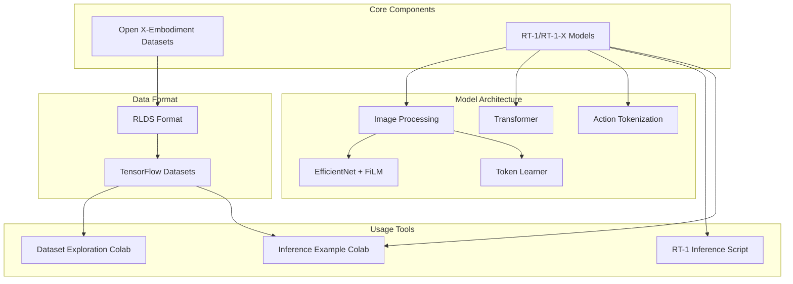
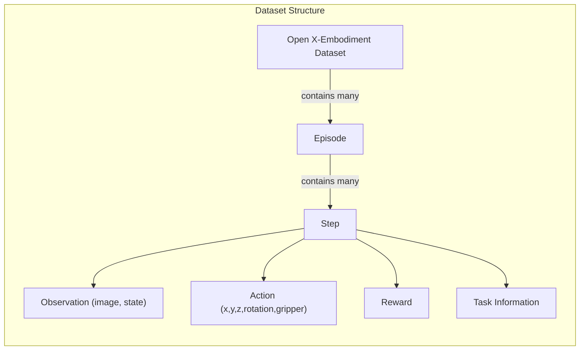
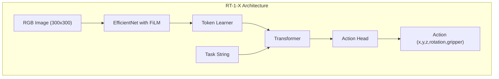
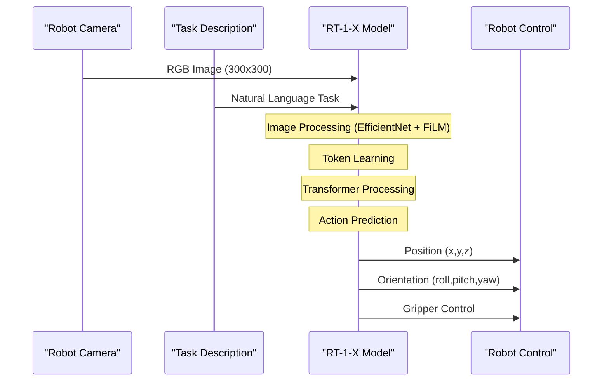
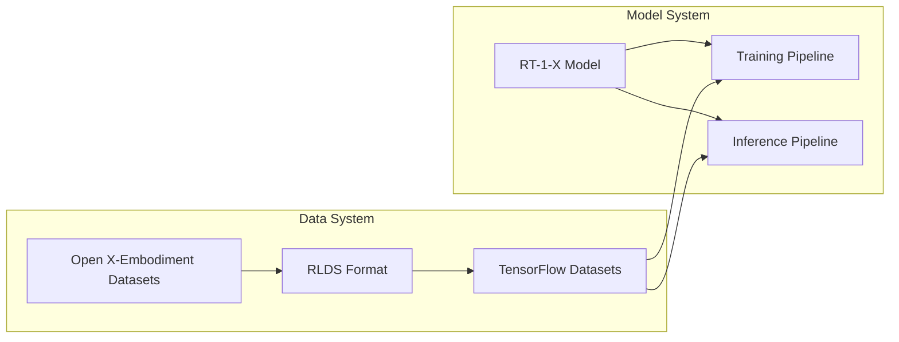

<!-- source: DeepWiki mcp.deepwiki.com · repo google-deepmind/open_x_embodiment · page 1 Open X-Embodiment Overview · fetched 2026-10-26 -->

# Open X-Embodiment Overview

Relevant source files

The following files were used as context for generating this wiki page:

- [README.md](README.md)
- [colabs/Open_X_Embodiment_Datasets.ipynb](colabs/Open_X_Embodiment_Datasets.ipynb)
- [imgs/teaser.png](imgs/teaser.png)

This page provides a high-level overview of the Open X-Embodiment project, which aims to unify diverse robotic datasets into a common format and provide models that can learn from this unified data. It explains the key components, system architecture, and relationships between different parts of the project. For detailed information about accessing and using specific datasets, see [Datasets](#2), and for information about using the RT-1-X model, see [Using RT-1-X](#4).

## Purpose and Problem Statement

Open X-Embodiment addresses a key challenge in robotics: the fragmentation of robotic data across different formats, embodiments, and tasks. The project provides:

1. A unified framework for diverse robotic datasets in a common format
2. Pre-trained models (RT-1-X) that can transfer knowledge across different robot embodiments
3. Tools and examples for working with these datasets and models

By standardizing diverse robotic datasets and creating models that can generalize across different robots, Open X-Embodiment enables more effective cross-embodiment learning and reduces the need for robot-specific data collection.

Sources: [README.md:4-7]()

## System Architecture Overview

Sources: [README.md:5-7](), [README.md:23-37]()

## Dataset System

Open X-Embodiment provides a large collection of robotic datasets from diverse sources, all converted into a unified format. This standardization enables researchers to train models across different robot embodiments and tasks.

### Dataset Format

All datasets follow the RLDS (Reinforcement Learning Datasets) episode format, which structures robotic data into episodes containing:

- Observations (images, robot state)
- Actions (robot commands)
- Rewards
- Task information

This unified format makes it easier to consume data from different robots and tasks for training and inference.

Sources: [README.md:11-13]()

### Dataset Access and Exploration

Datasets can be accessed using TensorFlow Datasets (`tfds`) or by directly downloading from Google Cloud Storage. The project provides a Colab notebook for exploring and visualizing the datasets.

Sources: [README.md:15-17](), [README.md:47-55]()

## RT-1-X Model System

RT-1-X (Robotics Transformer 1-X) is a model trained on the Open X-Embodiment dataset that can generalize across different robot embodiments. It takes visual input and natural language task descriptions and outputs robot actions.

### Model Architecture

Sources: [README.md:26-32](), [README.md:33-37]()

### Input and Output Space

The model operates with the following input and output spaces:

**Input Space:**
- RGB image from robot workspace camera
- Task string (natural language description)

**Output Space:**
- 7-dimensional action space:
  - Position (x, y, z)
  - Orientation (roll, pitch, yaw)
  - Gripper opening value

Sources: [README.md:26-32](), [README.md:33-37]()

## Data Flow During Inference

The following diagram illustrates how data flows through the system during inference:

Sources: [README.md:26-32](), [README.md:33-37]()

## Components and Tools

The following table outlines the key components and tools available in the Open X-Embodiment project:

| Component | Description | Access Method |
|-----------|-------------|---------------|
| Datasets | Collection of robotic datasets in RLDS format | `tfds.load(dataset_name)` or direct download |
| Dataset Colab | Notebook for exploring and visualizing datasets | GitHub repository |
| RT-1-X TensorFlow Checkpoint | Pre-trained model for inference | Inference Colab |
| RT-1-X JAX Checkpoint | Alternative checkpoint format | Direct download via `gsutil` |
| Inference Example Script | Python script for running inference with RT-1-X | GitHub repository |

Sources: [README.md:11-21](), [README.md:23-43]()

## Dataset and Model Relationship

Sources: [README.md:11-21](), [README.md:23-43]()

## Citation and License

When using Open X-Embodiment, proper citation is requested for both the overall project and the specific datasets used. The project is released under the Apache License 2.0 for software and Creative Commons Attribution 4.0 for other materials.

Sources: [README.md:59-73]()

---

