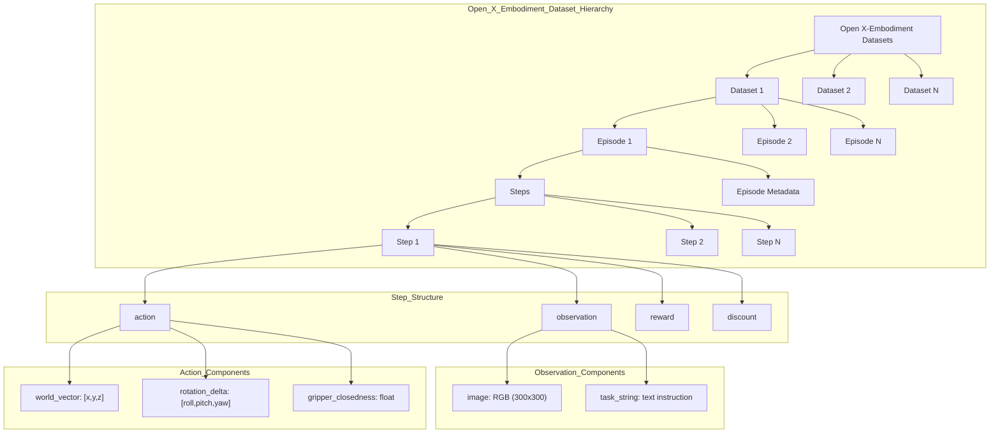
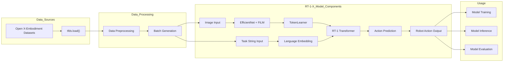

<!-- source: DeepWiki mcp.deepwiki.com · repo google-deepmind/open_x_embodiment · page 2 Datasets · fetched 2026-10-26 -->

# Datasets

<details>
<summary>Relevant source files</summary>

The following files were used as context for generating this wiki page:

- [README.md](README.md)
- [colabs/Open_X_Embodiment_Datasets.ipynb](colabs/Open_X_Embodiment_Datasets.ipynb)

</details>


## Purpose and Scope

The Open X-Embodiment datasets provide a standardized collection of robotics data from diverse sources, unified in the RLDS (Reinforcement Learning Datasets) format. This document provides an overview of these datasets, their structure, and their role within the Open X-Embodiment system. For detailed information about the dataset format, see [Dataset Format and Structure](#2.1). For instructions on accessing and using the datasets, see [Accessing and Using Datasets](#2.2).

## Dataset Organization

Open X-Embodiment aims to provide all open-sourced robotic data in a unified format for downstream consumption. The data is structured using the RLDS episode format, which organizes robot interactions as sequences of episodes and steps.

Dataset Organizational Structure:


Sources:
- [README.md:11-13]()
- [README.md:25-37]()

## RLDS Format Details

The RLDS format provides a standardized structure for reinforcement learning datasets. In the context of Open X-Embodiment, this format includes:

### Data Components

| Component | Description | Data Type |
|-----------|-------------|-----------|
| Episodes | Collection of episode sequences | List of episodes |
| Episode Metadata | Additional information about the episode | Varies by dataset |
| Steps | Sequence of timesteps in an episode | List of steps |
| Observation | What the robot perceives at a given timestep | Dictionary |
| - image | RGB image from robot's workspace camera | 300x300x3 tensor |
| - task_string | Natural language instruction | String |
| Action | The robot's action at that timestep | Dictionary |
| - world_vector | Position coordinates (x, y, z) | 3-element vector |
| - rotation_delta | Rotation angles (roll, pitch, yaw) | 3-element vector |
| - gripper_closedness | Value indicating gripper state | Float |
| Reward | Reward received (if applicable) | Float |
| Discount | Value used in reinforcement learning (if applicable) | Float |

Sources:
- [README.md:11-13]()
- [README.md:25-37]()

## Observation and Action Spaces

### Observation Space

The observation space in the datasets consists of:

1. **RGB Image**: A 300x300 pixel image from the robot's workspace camera, capturing the current state of the environment.
2. **Task String**: A natural language instruction describing the task to be performed (e.g., "pick up the blue block").

The image provides visual information about the current state, while the task string communicates what action the robot should perform. The model currently does not use additional camera sources such as wrist cameras, in-hand cameras, or depth information.

### Action Space

The action space consists of seven variables representing the gripper movement:

1. **Position (x, y, z)**: 3D coordinates for the gripper's position.
2. **Rotation (roll, pitch, yaw)**: Rotation angles for the gripper.
3. **Gripper Openness**: A value indicating how open or closed the gripper should be.

Each variable can represent either an absolute value, a delta change, or a velocity, depending on the specific dataset and robot controller.

Sources:
- [README.md:25-31]()
- [README.md:33-37]()

## Dataset Integration with RT-1-X

The datasets serve as the foundation for training and evaluating the RT-1-X model. The following diagram illustrates the data flow from datasets to model training and inference:

Dataset to RT-1-X Pipeline:


Sources:
- [README.md:25-37]()
- [README.md:37-41]()

## Accessing Datasets

The datasets can be accessed using TensorFlow Datasets (TFDS):

```python
import tensorflow_datasets as tfds

# Load a specific dataset
dataset = tfds.load('dataset_name')

# Iterate through episodes
for episode in dataset:
    # Access steps in the episode
    steps = episode['steps']
    
    # Process each step
    for step in steps:
        observation = step['observation']
        action = step['action']
        
        # Access specific components
        image = observation['image']
        task_string = observation['task_string']
```

If you encounter issues loading a dataset with `tfds.load()`, you can download it manually:

```bash
gsutil -m cp -r gs://gdm-robotics-open-x-embodiment/{dataset_name} ~/tensorflow_datasets/
```

After downloading, you can use the regular `tfds.load({dataset_name})` command to access the dataset.

Sources:
- [README.md:15-17]()
- [README.md:47-57]()

## Available Datasets

A comprehensive list of all datasets included in the Open X-Embodiment project, along with their metadata, can be found in the [dataset spreadsheet](https://docs.google.com/spreadsheets/d/1rPBD77tk60AEIGZrGSODwyyzs5FgCU9Uz3h-3_t2A9g/edit#gid=0) referenced in the README. These datasets come from various research institutions and cover a wide range of robotic platforms and tasks.

For exploring and visualizing the datasets, the Open X-Embodiment project provides a self-contained [Dataset Exploration Colab](https://colab.research.google.com/github/google-deepmind/open_x_embodiment/blob/main/colabs/Open_X_Embodiment_Datasets.ipynb) that demonstrates:

1. How to visualize episodes from each dataset
2. How to create batches of data ready for training and inference
3. How to process observation and action data

Sources:
- [README.md:15-17]()
- [README.md:19-21]()

---

