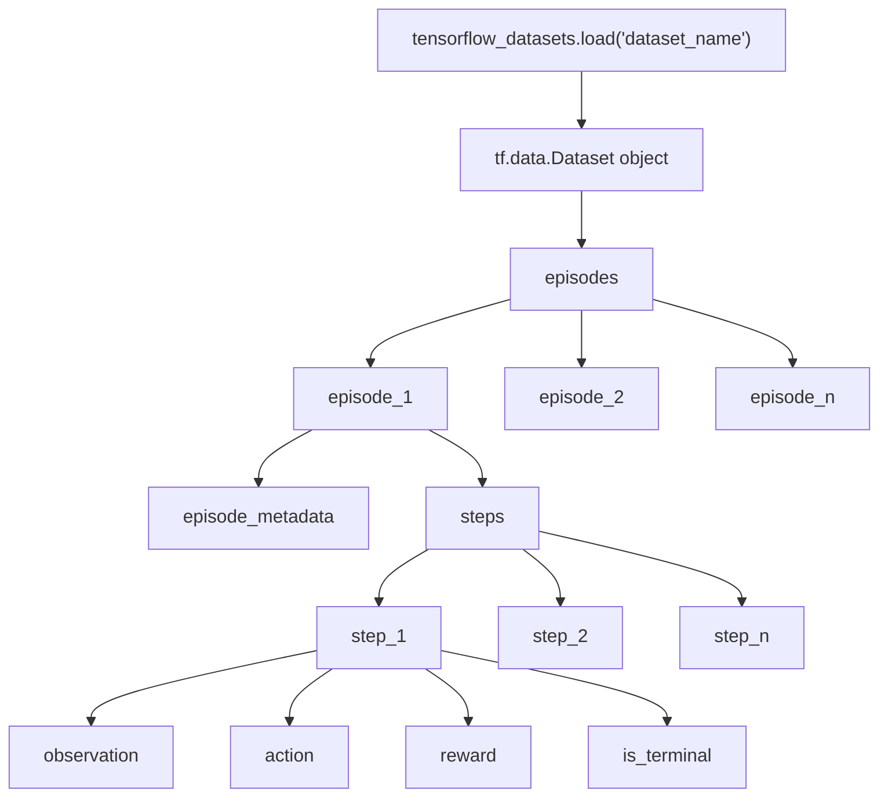
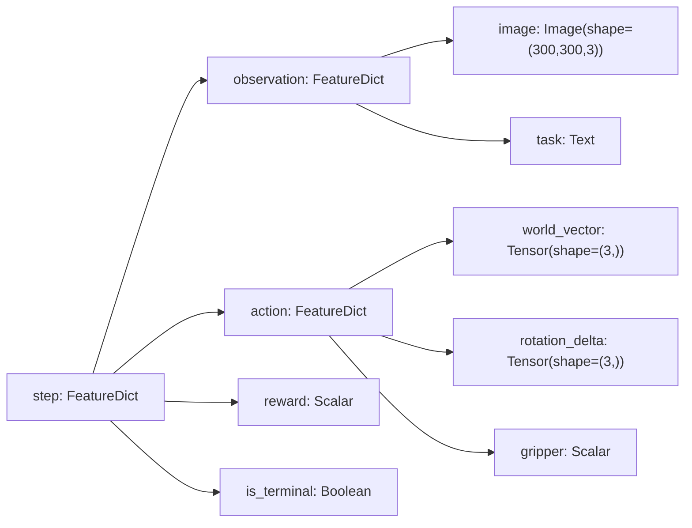
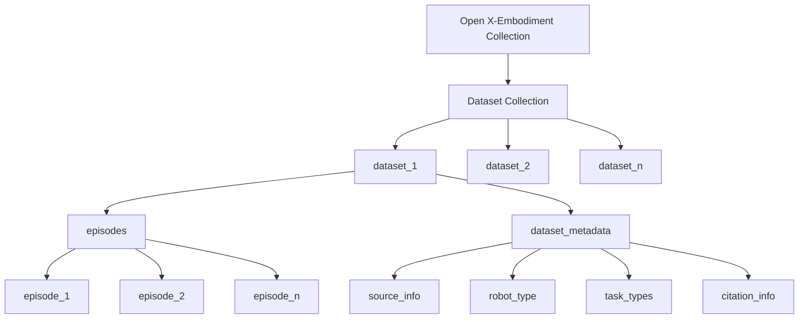
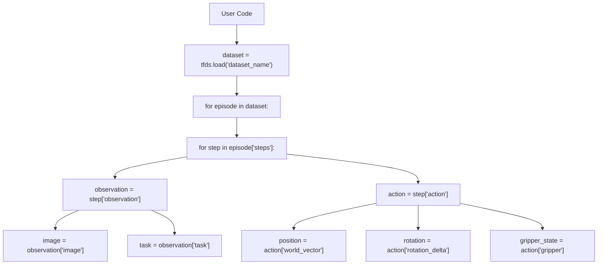

<!-- source: DeepWiki mcp.deepwiki.com · repo google-deepmind/open_x_embodiment · page 2.1 Dataset Format and Structure · fetched 2026-10-26 -->

# Dataset Format and Structure

<details>
<summary>Relevant source files</summary>

The following files were used as context for generating this wiki page:

- [README.md](README.md)
- [colabs/Open_X_Embodiment_Datasets.ipynb](colabs/Open_X_Embodiment_Datasets.ipynb)

</details>


## Purpose and Overview

This document details the standardized format and structure of datasets in the Open X-Embodiment project. It explains the RLDS (Robotics Learning Data Storage) format, episode structure, and data organization used to unify diverse robotic datasets. For information on how to download and use these datasets, see [Accessing and Using Datasets](#2.2).

## RLDS Format Overview

All Open X-Embodiment datasets use the RLDS format, which provides a consistent structure for robotics learning data. As stated in the documentation: "Each data set is represented as a sequence of episodes, where each episode is represented using the RLDS episode format."

Sources: [README.md:13]()

The RLDS format is implemented through TensorFlow Datasets (TFDS) and organizes data in a hierarchical structure, allowing for consistent representation across diverse robot types and task domains.

Title: RLDS Dataset Structure Hierarchy


Sources: [README.md:11-13]()

## Episode Structure

An episode represents a complete sequence of robot interactions for a specific task. Each episode contains:

1. **Metadata**: Information about the episode
2. **Steps**: A sequence of interaction steps

Each step in an episode contains several components:

Title: Episode Step Data Structure


Sources: [README.md:25-35]()

### Observation Space

The observation space consists of the following components:

| Component | Description | Data Type | Shape |
|-----------|-------------|-----------|-------|
| image | RGB image from workspace camera | uint8 tensor | (300, 300, 3) |
| task | Text description of the task | string | Variable length |

The observation space captures what the robot perceives at each step. As noted in the documentation: "The model takes as input a RGB image from the robot workspace camera and a task string describing the task that the robot is supposed to perform."

Sources: [README.md:27-29]()

### Action Space

The action space includes seven variables for gripper movement:

| Component | Description | Data Type | Shape |
|-----------|-------------|-----------|-------|
| world_vector | Position (x, y, z) | float tensor | (3,) |
| rotation_delta | Rotation (roll, pitch, yaw) | float tensor | (3,) |
| gripper | Gripper opening state | float scalar | Single value |

Each variable can represent either "the absolute value, the delta change to the dimension value or the velocity of the dimension."

Sources: [README.md:35-36]()

## Data Organization and Storage

The Open X-Embodiment datasets are structured as TensorFlow Datasets (TFDS) and stored in Google Cloud Storage. The datasets are organized hierarchically:

Title: Dataset Organization Structure


Sources: [README.md:21]()

A list of all included datasets and their metadata is available in a dataset spreadsheet referenced in the documentation. This includes information about the source, robot type, tasks performed, and citation details.

## Accessing Dataset Entries

The typical data access pattern follows this flow:

Title: Dataset Access Flow


Sources: [README.md:38]()

If a dataset cannot be found using the standard `tfds.load()` method, it can be downloaded manually using gsutil:

```
gsutil -m cp -r gs://gdm-robotics-open-x-embodiment/{dataset_name} ~/tensorflow_datasets/
```

After downloading, the dataset can be accessed using the regular `tfds.load({dataset_name})` command.

Sources: [README.md:47-57]()

## Example Dataset Exploration

The Open X-Embodiment project provides a colab notebook for dataset exploration that demonstrates:
- How to visualize episodes from each dataset
- How to create batches of data ready for training and inference

This notebook serves as a practical guide to working with the dataset format and structure described in this document.

Sources: [README.md:15-17]()

## Summary

The RLDS format provides a standardized structure for robot learning datasets in the Open X-Embodiment project. This unified format enables easier consumption of diverse robotic data for downstream tasks, particularly for cross-embodiment learning. The hierarchical organization of datasets into episodes and steps, with standardized observation and action spaces, allows for consistent handling of data regardless of the robot type or task domain.

---

