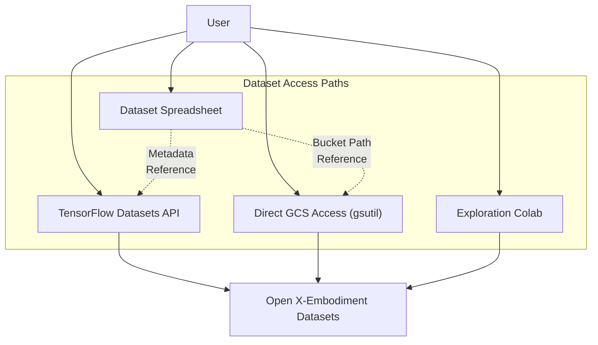
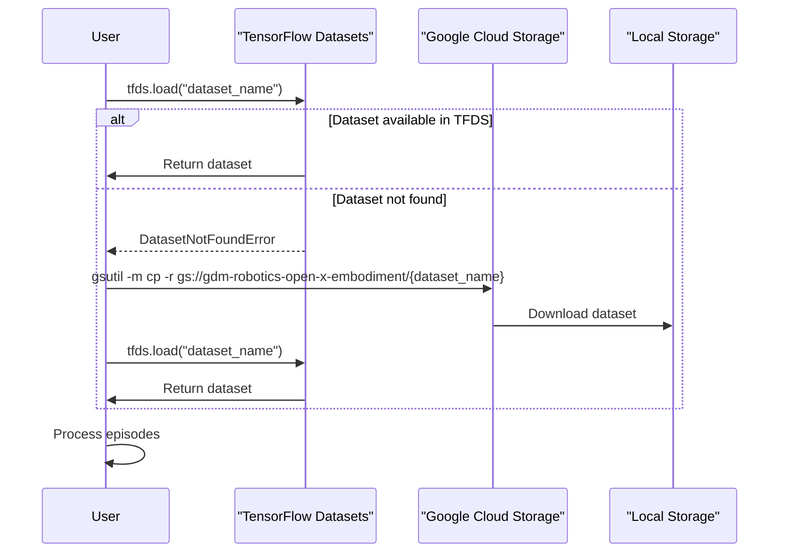
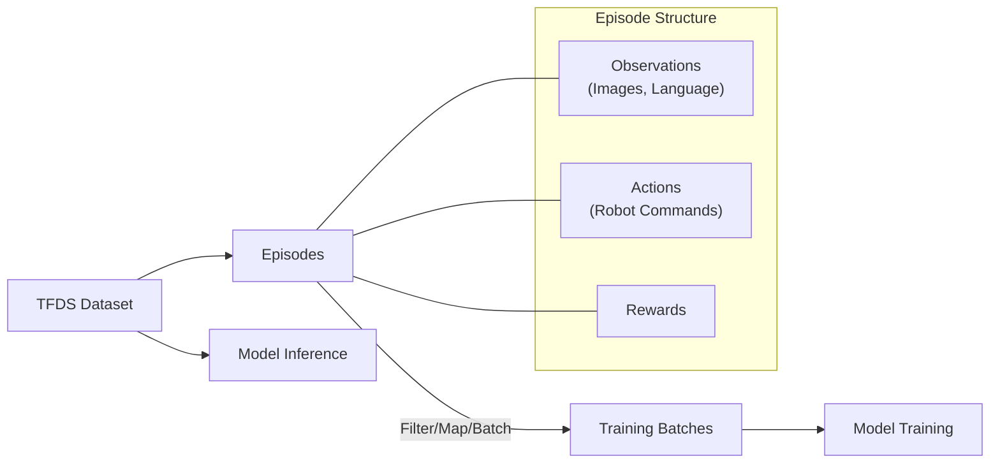
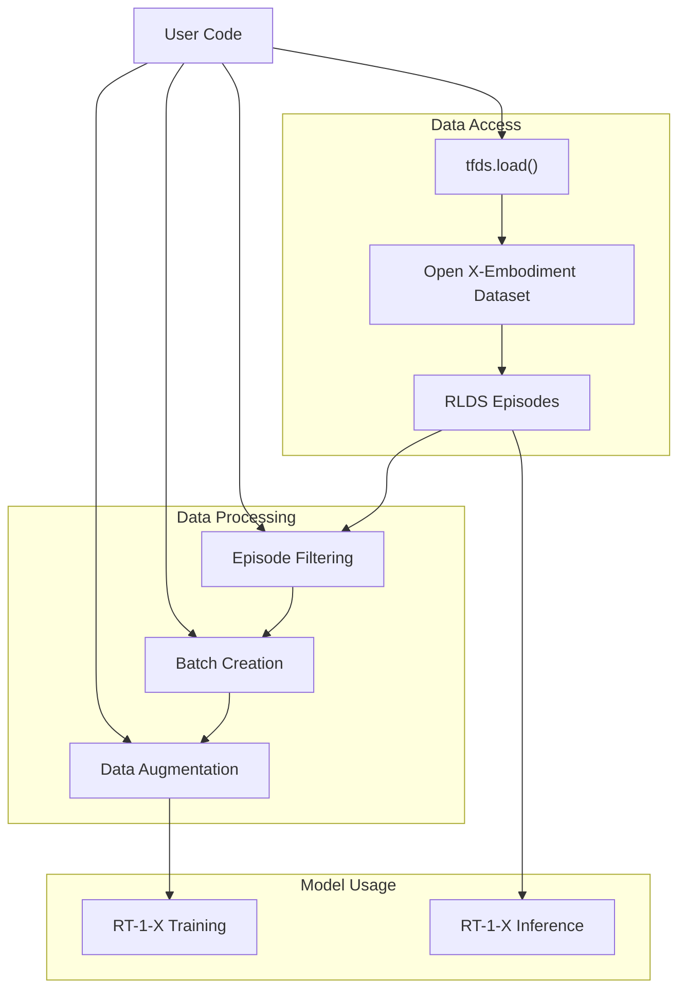

<!-- source: DeepWiki mcp.deepwiki.com · repo google-deepmind/open_x_embodiment · page 2.2 Accessing and Using Datasets · fetched 2026-10-26 -->

# Accessing and Using Datasets

<details>
<summary>Relevant source files</summary>

The following files were used as context for generating this wiki page:

- [README.md](README.md)
- [colabs/Open_X_Embodiment_Datasets.ipynb](colabs/Open_X_Embodiment_Datasets.ipynb)

</details>


This document provides comprehensive instructions for accessing, downloading, and utilizing the Open X-Embodiment datasets. It covers the practical aspects of working with these datasets, including how to load them using TensorFlow Datasets, troubleshooting common issues, and basic usage patterns. For information about the internal structure and format of the datasets, see [Dataset Format and Structure](#2.1).

## Dataset Availability

The Open X-Embodiment project provides multiple robotics datasets in a unified format, making them accessible for training and research. All datasets are stored in the RLDS (Reinforcement Learning Datasets) format, which standardizes the representation of robotic data.



### Available Datasets

A comprehensive list of available datasets and their metadata is maintained in a public spreadsheet. This resource provides details such as dataset size, robot type, task categories, and citation information.

To explore the available datasets, refer to the [dataset spreadsheet](https://docs.google.com/spreadsheets/d/1rPBD77tk60AEIGZrGSODwyyzs5FgCU9Uz3h-3_t2A9g/edit#gid=0) mentioned in the README.

Sources: [README.md:19-21]()

## Accessing Datasets

There are two primary methods for accessing the Open X-Embodiment datasets:

1. **Using TensorFlow Datasets (TFDS)**: The recommended approach for most use cases
2. **Direct download using gsutil**: Alternative method for manual access

### Using TensorFlow Datasets

The datasets are registered with TensorFlow Datasets, allowing for straightforward loading with the `tfds.load()` function:

```python
import tensorflow_datasets as tfds

# Load a specific dataset
dataset = tfds.load('dataset_name')

# Iterate through episodes
for episode in dataset:
    # Process episode data
    ...
```

Sources: [README.md:47-57]()

### Direct Download with gsutil

If you encounter issues with the TFDS API, you can download datasets directly from Google Cloud Storage:

```bash
gsutil -m cp -r gs://gdm-robotics-open-x-embodiment/{dataset_name} ~/tensorflow_datasets/
```

After downloading, you can use the regular `tfds.load()` function to access the dataset.

Sources: [README.md:53-57]()

## Dataset Access Workflow

The following diagram illustrates the typical workflow for accessing and using the Open X-Embodiment datasets:



Sources: [README.md:47-57]()

## Troubleshooting Dataset Access

### Dataset Not Found Error

If you encounter a `DatasetNotFoundError` when attempting to load a dataset:

```
tensorflow_datasets.core.registered.DatasetNotFoundError: Dataset {dataset_name} not found.
```

Follow these steps:

1. Download the dataset manually using gsutil:
   ```bash
   gsutil -m cp -r gs://gdm-robotics-open-x-embodiment/{dataset_name} ~/tensorflow_datasets/
   ```

2. Try loading the dataset again using `tfds.load()`.

Sources: [README.md:47-57]()

## Working with Datasets

Once you've successfully loaded a dataset, you can work with it using standard TensorFlow data processing techniques.



### Dataset Exploration

The project provides a self-contained Colab notebook that demonstrates:

1. How to visualize episodes from each dataset
2. How to create data batches ready for training and inference
3. Basic data exploration techniques

This notebook serves as a practical guide for getting started with the datasets.

You can access the exploration notebook at: [Open_X_Embodiment_Datasets.ipynb](https://colab.research.google.com/github/google-deepmind/open_x_embodiment/blob/main/colabs/Open_X_Embodiment_Datasets.ipynb)

Sources: [README.md:15-17]()

### Data Format and Usage

The datasets follow the RLDS episode format, where each episode contains sequences of:

- **Observations**: RGB images from the robot's workspace camera
- **Actions**: Robot movement commands (typically 7-dimensional vectors)
- **Task strings**: Natural language descriptions of tasks
- **Rewards**: Feedback signals (when available)

Each episode represents a complete sequence of interactions for a specific task.

Sources: [README.md:11-13](), [README.md:25-31]()

## Example Usage

Below is a basic example of how to load and iterate through a dataset:

```python
import tensorflow_datasets as tfds

# Load a specific dataset
dataset = tfds.load('bridge_dataset_torch')

# Take a few episodes for exploration
for episode_idx, episode in enumerate(dataset.take(3)):
    print(f"Episode {episode_idx}:")
    
    # Access step data
    for step_idx, step in enumerate(episode['steps']):
        # Access observation data (usually contains image)
        observation = step['observation']
        
        # Access action data (robot commands)
        action = step['action']
        
        # Process or visualize as needed
        # ...
```

For complete examples of data processing and visualization, refer to the exploration Colab notebook.

## Data Integration into Training and Inference

The following diagram illustrates how the datasets integrate into the training and inference pipelines of the RT-1-X model:



Sources: [README.md:37-38]()

## Citation and Usage Policies

When using the Open X-Embodiment datasets in research, please cite the appropriate papers:

1. The main Open X-Embodiment paper for overall usage
2. The specific dataset papers for any individual datasets used

The [dataset spreadsheet](https://docs.google.com/spreadsheets/d/1rPBD77tk60AEIGZrGSODwyyzs5FgCU9Uz3h-3_t2A9g/edit#gid=0) contains citation information for each dataset.

Sources: [README.md:59-61]()

## Conclusion

The Open X-Embodiment datasets provide a standardized way to access diverse robotic data for research and development. By following the access methods outlined in this document, you can efficiently work with these datasets for training models, running inference, or conducting research.

For a detailed explanation of the dataset internal format and structure, refer to [Dataset Format and Structure](#2.1). For examples of using these datasets with the RT-1-X model, see [Inference Examples](#4.1) and [Training Examples](#4.2).

Sources: [README.md:5-7]()

---

