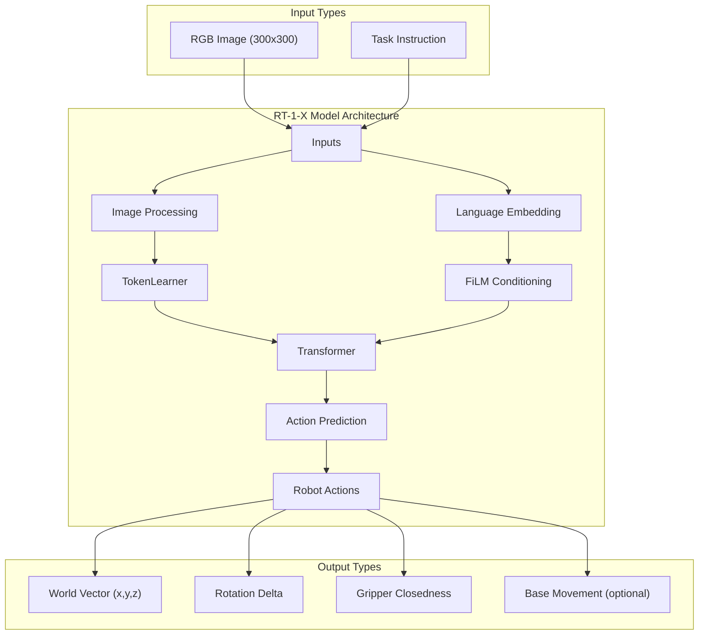
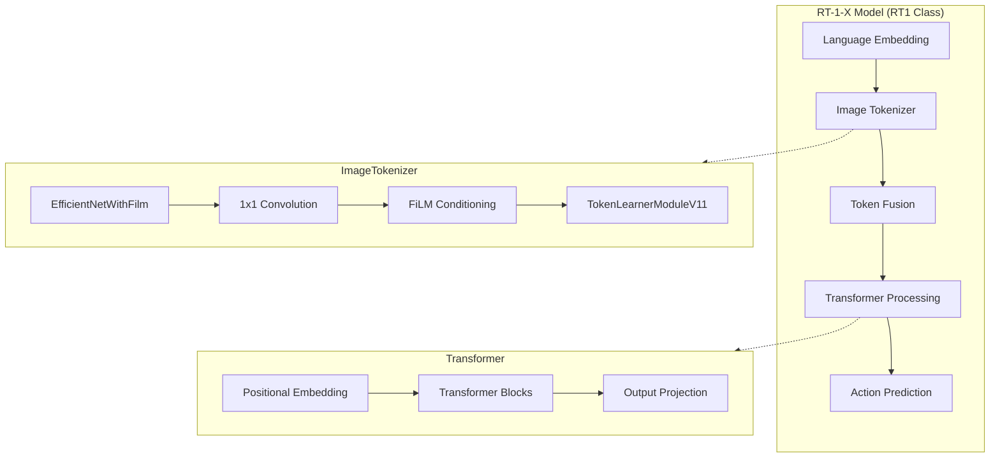
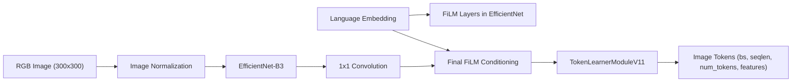
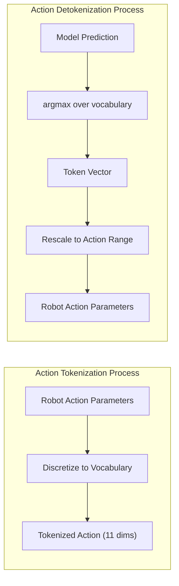
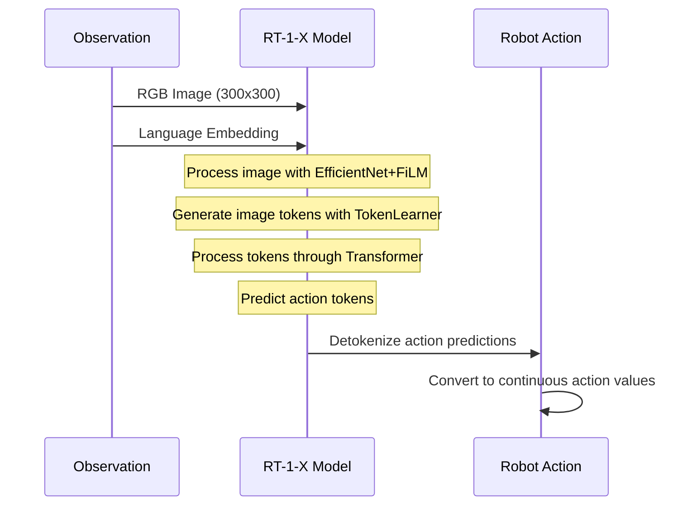
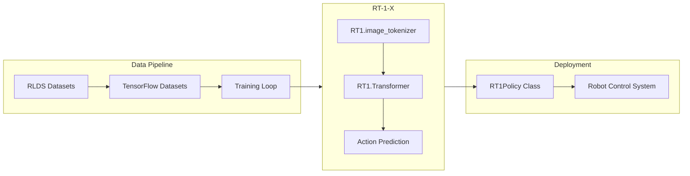

<!-- source: DeepWiki mcp.deepwiki.com · repo google-deepmind/open_x_embodiment · page 3 RT-1-X Model · fetched 2026-10-26 -->

# RT-1-X Model

Relevant source files

The following files were used as context for generating this wiki page:

- [README.md](README.md)
- [models/rt1.py](models/rt1.py)
- [models/rt1_inference_example.py](models/rt1_inference_example.py)

This document provides a technical overview of the RT-1-X model architecture and capabilities. RT-1-X is a robotics transformer model designed to map visual inputs and language instructions to robot actions, enabling generalization across different robots and tasks. For details about using the RT-1-X model for inference or training, see [Using RT-1-X](#4).

## Overview

RT-1-X is an evolution of the RT-1 (Robotics Transformer) model, with improvements as described in the RT-X paper (https://arxiv.org/abs/2310.08864). The model takes RGB camera images and natural language instructions as input and outputs robot action parameters.

Sources: [models/rt1.py:357-552](), [README.md:23-37]()

## Model Architecture

The RT-1-X model consists of several key components that process visual and language inputs to produce robot actions:

Sources: [models/rt1.py:357-482](), [models/rt1.py:114-189](), [models/rt1.py:71-111]()

### Main Components

The RT-1-X model (`RT1` class) integrates the following core components:

1. **Image Tokenizer**: Processes RGB images using EfficientNet with FiLM conditioning and TokenLearner
2. **Transformer**: Processes the sequence of image tokens and optional action tokens  
3. **Action Tokenization**: Converts model outputs to robot action parameters

The model can be configured with various parameters:
- Number of transformer layers (default: 8)
- Layer size (default: 128)
- Number of attention heads (default: 8)
- Vocabulary size for action discretization (default: 256)
- Number of image tokens (default: 8)
- Number of action tokens (default: 11)

Sources: [models/rt1.py:357-382](), [models/rt1_inference_example.py:153-164]()

## Image Processing Pipeline

The image processing pipeline transforms raw RGB images into tokens that can be processed by the transformer architecture:

The image processing steps are:

1. **Image Normalization**: Scales image to match EfficientNet requirements
2. **EfficientNet-B3 with FiLM**: Processes the image with language conditioning via FiLM layers
3. **1x1 Convolution**: Projects features to the desired dimension
4. **Final FiLM Conditioning**: Another conditioning layer after feature projection
5. **Token Learner**: Reduces spatial dimensions into a fixed number of tokens

The `TokenLearnerModuleV11` module uses a MLP with GELU activation to implement spatial attention, which transforms the spatial features into a fixed number of tokens that can be processed by the transformer.

Sources: [models/rt1.py:114-189](), [models/rt1.py:192-254]()

## Action System

The RT-1-X model outputs a set of action parameters that control the robot. These actions are tokenized for the model to predict and then detokenized during inference:

### Action Space

The action space consists of the following dimensions:

| Action Component | Shape | Range | Description |
|------------------|-------|-------|-------------|
| terminate_episode | (3,) | [0,1,2] | Mode selection (0: terminate, 1: arm+gripper, 2: base) |
| world_vector | (3,) | [-2.0, 2.0] | Position in world coordinates (x,y,z) |
| rotation_delta | (3,) | [-π/2, π/2] | Rotation change in radians |
| gripper_closedness_action | (1,) | [-1.0, 1.0] | Gripper state (closed to open) |
| base_displacement_vertical_rotation | (1,) | [-π, π] | Base rotation |
| base_displacement_vector | (2,) | [-1.0, 1.0] | Base movement vector |

The action tokenization process:
1. Takes continuous action values and clips them to predefined ranges
2. Normalizes values to [0,1] range
3. Scales to the vocabulary size and converts to integer tokens

During inference, the model outputs logits over the vocabulary for each action dimension, which are then converted back to continuous action values.

Sources: [models/rt1.py:257-354](), [README.md:33-37]()

## Inference Process

The inference process with RT-1-X follows this sequence:

The RT-1-X inference implementation:

1. Takes an observation containing an RGB image and language embedding
2. Processes the image through the image tokenizer
3. Runs the transformer to predict action tokens
4. Detokenizes the action predictions
5. Returns a dictionary with continuous action values

The policy uses a sequence length (history window) of observations to make predictions, though in the default configuration the model doesn't use action history (controlled by the `include_prev_timesteps_actions` parameter).

Sources: [models/rt1_inference_example.py:23-145](), [models/rt1.py:384-482]()

## Model Configuration

The RT-1-X model can be configured with different parameters than the original RT-1 model:

| Parameter | RT-1 | RT-1-X | Description |
|-----------|------|--------|-------------|
| world_vector_range | (-1.0, 1.0) | (-2.0, 2.0) | Range for world position values |
| num_image_tokens | 8 | 81 | Number of image tokens |
| vocab_size | 256 | 512 | Size of action vocabulary |
| layer_size | 128 | 256 | Size of transformer layers |

The RT-1-X model also uses Token Learner to reduce the spatial dimensions of image features to a fixed number of tokens, which allows for more efficient processing in the transformer.

Sources: [models/rt1_inference_example.py:153-164](), [models/rt1.py:357-382]()

## Integration with Open X-Embodiment

RT-1-X is designed to work with the Open X-Embodiment datasets, which provide robotic data in a unified RLDS format. The model serves as a bridge between the standardized datasets and robot control systems, enabling transfer learning across different robot embodiments.

The RT-1-X model checkpoint is available for download and can be used for inference using the provided example script. For more details about using RT-1-X for inference or training, refer to [Using RT-1-X](#4).

Sources: [README.md:23-43](), [models/rt1_inference_example.py:1-182]()

---

