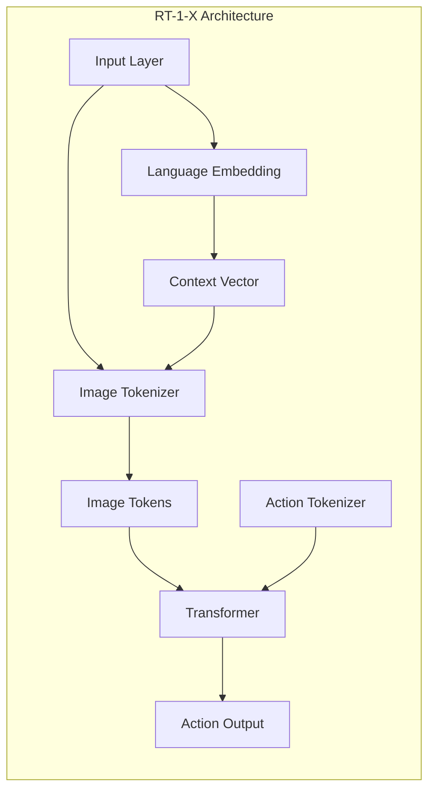
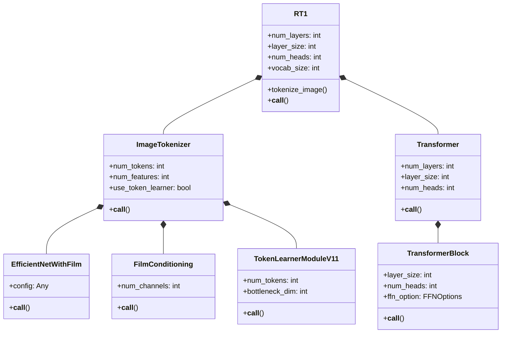
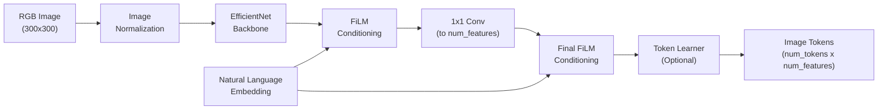
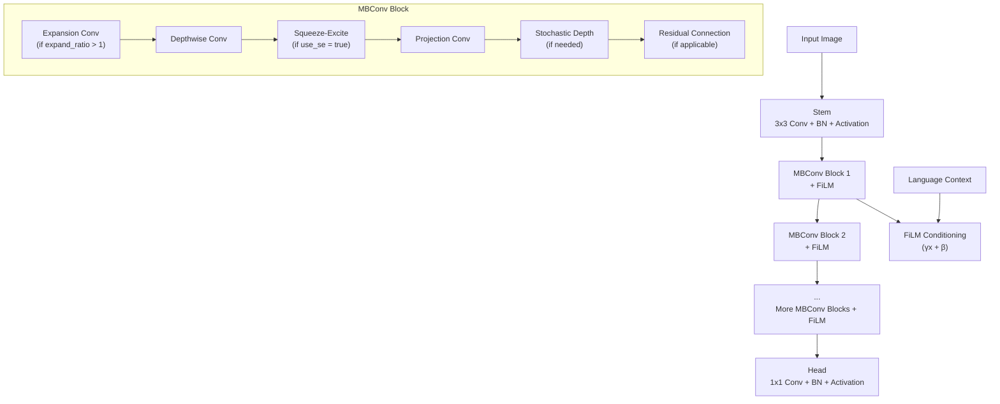
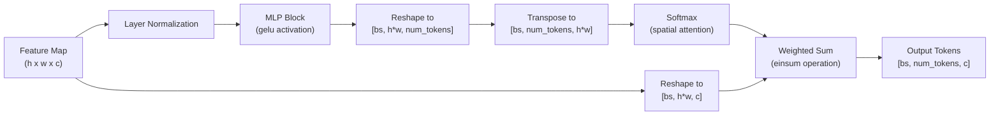
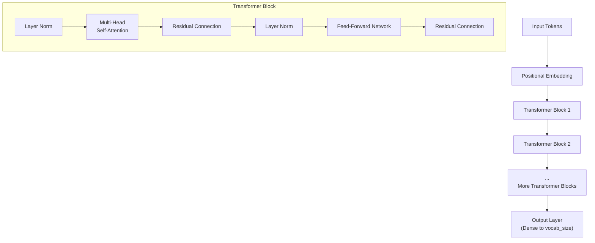
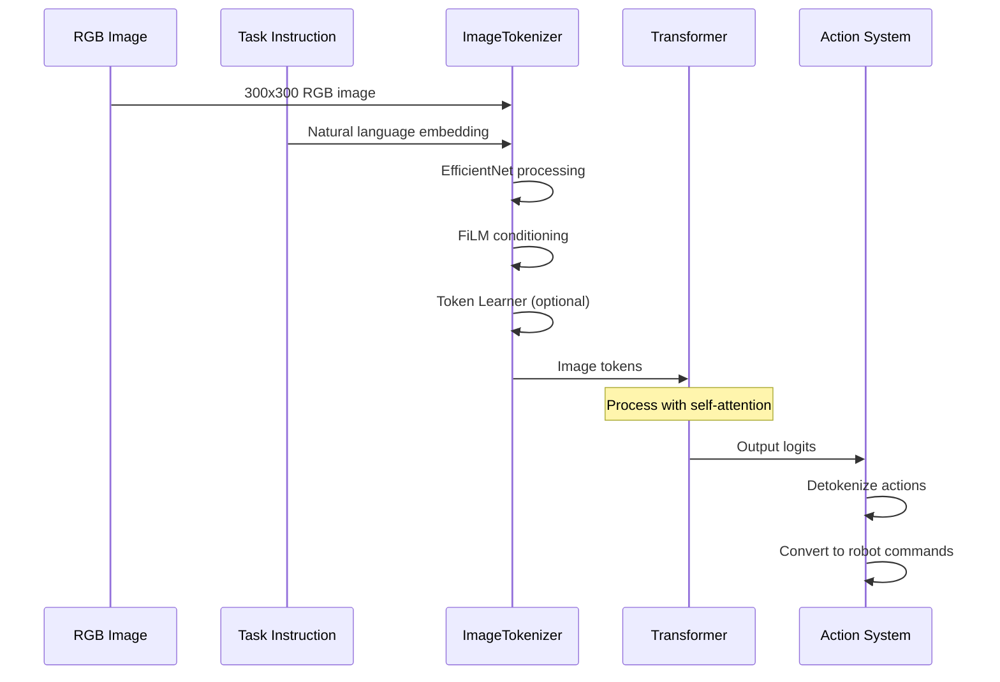

<!-- source: DeepWiki mcp.deepwiki.com · repo google-deepmind/open_x_embodiment · page 3.1 Model Architecture · fetched 2026-10-26 -->

# Model Architecture

<details>
<summary>Relevant source files</summary>

The following files were used as context for generating this wiki page:

- [models/efficientnet.py](models/efficientnet.py)
- [models/film_conditioning.py](models/film_conditioning.py)
- [models/rt1.py](models/rt1.py)
- [models/token_learner.py](models/token_learner.py)

</details>


This document provides a detailed explanation of the RT-1-X model architecture, which serves as the core intelligence system for mapping visual and language inputs to robot actions in the Open X-Embodiment project. This page focuses on the internal structure and components of the model, while details about the image processing pipeline and action system can be found in [Image Processing Pipeline](#3.2) and [Action System](#3.3) respectively.

## Overview

RT-1-X (Robotics Transformer 1-X) is a transformer-based model designed for robotic control that enables cross-embodiment learning and generalization. The model processes visual inputs with language instructions to produce robot actions directly, in an end-to-end fashion.



Sources: [models/rt1.py:358-482]()

## Core Components

The RT-1-X architecture consists of three primary components:

1. **Image Tokenizer**: Processes images using EfficientNet with FiLM conditioning and optionally Token Learner
2. **Transformer**: Processes the tokenized inputs with multi-head self-attention
3. **Action System**: Handles tokenization and detokenization of robot actions



Sources: [models/rt1.py:358-482](), [models/rt1.py:114-190](), [models/rt1.py:71-111](), [models/rt1.py:28-68]()

## Image Tokenization Process

The image tokenization process converts raw RGB images into tokens that can be processed by the transformer. This process involves several steps:



Sources: [models/rt1.py:114-190](), [models/efficientnet.py:581-643](), [models/film_conditioning.py:10-39](), [models/token_learner.py:66-126]()

### EfficientNet with FiLM

The image encoding backbone is an EfficientNet-B3 architecture modified with Feature-wise Linear Modulation (FiLM) conditioning layers that incorporate language context. The EfficientNet backbone consists of multiple MBConv blocks arranged in a specific pattern.



Sources: [models/efficientnet.py:387-505](), [models/efficientnet.py:327-383](), [models/efficientnet.py:581-643]()

### FiLM Conditioning

FiLM conditioning modulates the feature maps from convolutional layers based on language context. It applies an affine transformation to each channel:

```
output = (1 + γ) * input + β
```

where γ and β are learned from the language context. This mechanism allows the visual processing to be conditioned on language instructions.

Sources: [models/film_conditioning.py:10-39]()

### Token Learner

Token Learner reduces the spatial dimensions of the feature map into a fixed number of tokens, creating a more compact representation:



Sources: [models/token_learner.py:66-126](), [models/rt1.py:192-254]()

## Transformer Architecture

The transformer processes the tokenized inputs to predict actions. It consists of multiple transformer blocks with multi-head self-attention.



Sources: [models/rt1.py:71-111](), [models/rt1.py:28-68]()

### Transformer Block Details

Each transformer block consists of:

1. **Multi-Head Self-Attention**: Processes relationships between tokens
2. **Feed-Forward Network**: Processes each token individually

The feed-forward network can be configured with different options, including:
- Linear: Simple linear projection
- SwiGLU: Gated linear unit with swish activation (default)

Sources: [models/rt1.py:28-68]()

## Action Processing

The model processes actions with tokenization and detokenization systems. Actions include:

| Action Component | Description | Range |
|------------------|-------------|-------|
| terminate_episode | Episode termination mode | Discrete (0, 1, 2) |
| world_vector | 3D position in world coordinates | [-1.0, 1.0] or [-2.0, 2.0] |
| rotation_delta | Rotation changes | [-π/2, π/2] |
| gripper_closedness_action | Gripper state | [-1.0, 1.0] |
| base_displacement_vertical_rotation | Base rotation | [-π, π] |
| base_displacement_vector | Base movement | [-1.0, 1.0] |

During inference, the model generates tokenized actions which are then detokenized into robot control commands.

Sources: [models/rt1.py:257-354]()

## Model Configuration

Key configuration parameters for the RT-1-X model:

| Parameter | Default Value | Description |
|-----------|---------------|-------------|
| num_layers | 8 | Number of transformer layers |
| layer_size | 128 | Size of attention layers |
| num_heads | 8 | Number of attention heads |
| feed_forward_hidden_size | 512 | Size of FFN hidden layer |
| feed_forward_output_size | 512 | Size of FFN output |
| vocab_size | 256 | Vocabulary size for tokenization |
| num_image_tokens | 8 | Number of image tokens |
| num_action_tokens | 11 | Number of action tokens |
| image_num_features | 512 | Feature dimension of image tokens |

Sources: [models/rt1.py:358-382]()

## Data Flow During Inference



Sources: [models/rt1.py:396-482](), [models/rt1.py:311-354]()

## Full Model Implementation

The RT-1 class in `rt1.py` ties all these components together. It:

1. Initializes the image tokenizer and transformer
2. Processes images and language context
3. Combines image tokens with action tokens
4. Runs the transformer to predict next actions
5. Handles token caching for inference

The overall architecture enables end-to-end learning from raw images and language instructions to robot actions.

Sources: [models/rt1.py:358-552]()

---

