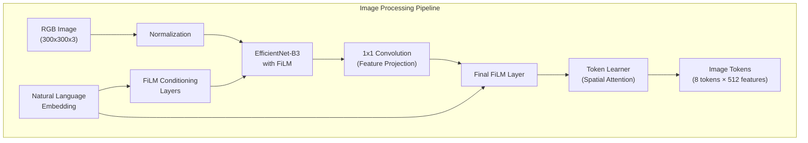
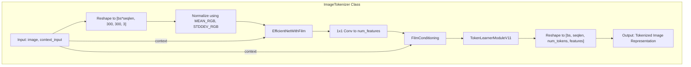
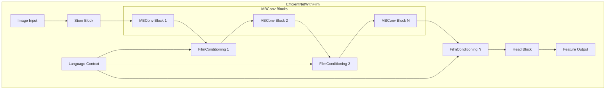
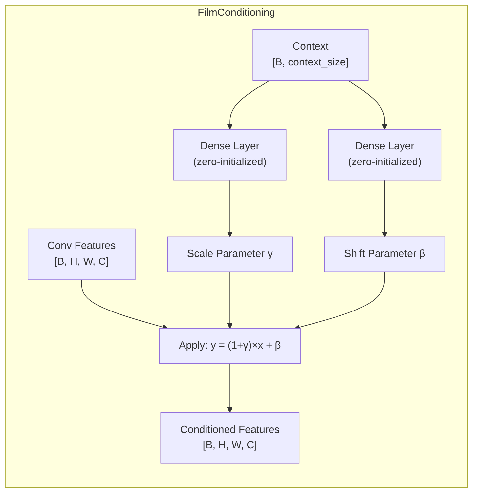
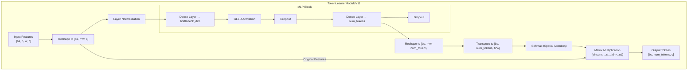
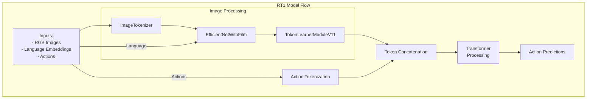

<!-- source: DeepWiki mcp.deepwiki.com · repo google-deepmind/open_x_embodiment · page 3.2 Image Processing Pipeline · fetched 2026-10-26 -->

# Image Processing Pipeline

<details>
<summary>Relevant source files</summary>

The following files were used as context for generating this wiki page:

- [models/efficientnet.py](models/efficientnet.py)
- [models/film_conditioning.py](models/film_conditioning.py)
- [models/rt1.py](models/rt1.py)
- [models/token_learner.py](models/token_learner.py)

</details>


## Purpose and Scope

This document details the image processing pipeline of the RT-1/RT-1-X model architecture, focusing on how robot camera images are processed, tokenized, and conditioned with language instructions before being fed into the transformer model. The pipeline's primary purpose is to convert high-dimensional visual inputs (RGB images) into a compact set of contextualized tokens that effectively capture the visual information needed for robotic tasks.

For details on how these tokens are used by the transformer model, see [RT-1-X Model](#3.1). For information about the action prediction system, see [Action System](#3.3).

## Pipeline Overview



Sources: [models/rt1.py:114-189](), [models/efficientnet.py:581-643]()

## Image Tokenization Process

The image tokenization process follows these steps:

1. **Input Preparation**: The model receives RGB images of size 300×300×3 and language embeddings.
2. **Image Normalization**: Images are normalized using pre-defined mean and standard deviation values.
3. **EfficientNet with FiLM**: The normalized images are processed by an EfficientNet-B3 backbone with FiLM conditioning layers applied at each block.
4. **Feature Projection**: A 1×1 convolution projects features to a specified dimension (typically 512).
5. **Final FiLM Conditioning**: Another FiLM conditioning layer is applied after projection.
6. **Token Learning**: The Token Learner module converts spatial features into a fixed number of tokens (typically 8).

### Detailed Component Architecture



Sources: [models/rt1.py:114-189]()

## EfficientNet with FiLM Conditioning

The backbone of the image processing pipeline is an EfficientNet-B3 model enhanced with Feature-wise Linear Modulation (FiLM) conditioning. This architecture allows the model to modulate visual features based on language instructions.

### EfficientNet Architecture

EfficientNet-B3 is a convolutional neural network designed for high accuracy with constrained computational resources. The model consists of:

- Initial Stem block
- Seven blocks of MBConv layers with varying configurations
- Head layer for feature aggregation

Each MBConv block can include:
- Expansion phase (1×1 convolution)
- Depthwise convolution
- Squeeze-and-Excite attention
- Projection phase

### FiLM Conditioning Integration

FiLM conditioning is applied after each MBConv block in the EfficientNet architecture to incorporate language information. The conditioning mechanism works by:

1. Generating scale (γ) and shift (β) parameters from the language embedding
2. Applying these parameters element-wise to the convolutional features: y = (1 + γ) * x + β



Sources: [models/efficientnet.py:581-643](), [models/film_conditioning.py:10-39]()

### FiLM Conditioning Implementation

The `FilmConditioning` class applies feature-wise linear modulation to convolutional feature maps:



Sources: [models/film_conditioning.py:10-39]()

## Token Learner Module

The Token Learner module converts spatially-structured convolutional features into a fixed number of tokens through a learned spatial attention mechanism. This significantly reduces the number of tokens that need to be processed by the transformer while preserving the most relevant visual information.

### Token Learner Architecture



Sources: [models/token_learner.py:66-126]()

### Operation Details

The TokenLearnerModuleV11 follows these steps:
1. Reshapes input features to merge spatial dimensions
2. Applies layer normalization
3. Uses an MLP with GELU activation to compute attention weights
4. Applies softmax to get a spatial attention map for each token
5. Performs a weighted combination of features according to the attention maps

This produces a fixed number of tokens (default: 8), each capturing information from different spatial regions of the input based on learned attention patterns.

## Integration with RT-1 Model

The image processing pipeline is integrated into the RT-1/RT-1-X architecture through the `ImageTokenizer` class, which is called by the main `RT1` model class.



Sources: [models/rt1.py:358-551]()

## Implementation Details

### Key Configuration Parameters

| Parameter | Default Value | Description |
|-----------|---------------|-------------|
| `num_tokens` | 8 | Number of tokens extracted per image by Token Learner |
| `num_features` | 512 | Dimensionality of feature vectors for each token |
| `use_token_learner` | True | Whether to use Token Learner or simpler pooling |
| `image_size` | 300×300 | Input image resolution for EfficientNet-B3 |

Sources: [models/rt1.py:369-375]()

### Normalization Constants

Images are normalized using the following constants:

```
MEAN_RGB = [0.485, 0.456, 0.406]
STDDEV_RGB = [0.229, 0.224, 0.225]
```

Sources: [models/efficientnet.py:19-20]()

## Usage in RT-1/RT-1-X Model

In the context of the full RT-1/RT-1-X architecture:

1. **Temporal Sequence Handling**: The image tokenizer processes a sequence of images (batch × sequence_length × height × width × channels)
2. **Token Integration**: Image tokens are concatenated with action tokens 
3. **Transformer Processing**: The combined tokens are processed by a transformer with causal attention
4. **Action Prediction**: The transformer outputs action token predictions for robotic control

The image tokenization step is critical for enabling the transformer to effectively process visual information while keeping computational requirements manageable.

Sources: [models/rt1.py:389-394](), [models/rt1.py:446-466]()

## Pipeline Execution Flow

The complete image processing pipeline execution can be traced in the `tokenize_image` method of the `RT1` class:

1. Image and language embedding inputs are received
2. Language embedding is reshaped to match the batch size of flattened image sequence
3. `ImageTokenizer` processes the images using the language context
4. The resulting tokens are used in the transformer model alongside action tokens

This ensures that visual information is properly conditioned on language instructions and efficiently encoded before transformer processing.

Sources: [models/rt1.py:389-394]()

---

