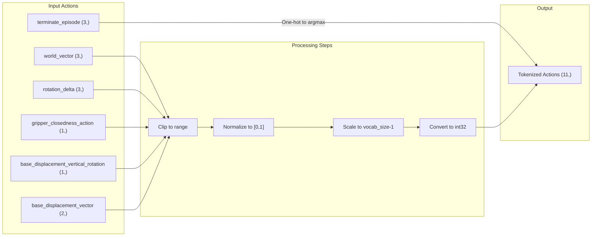
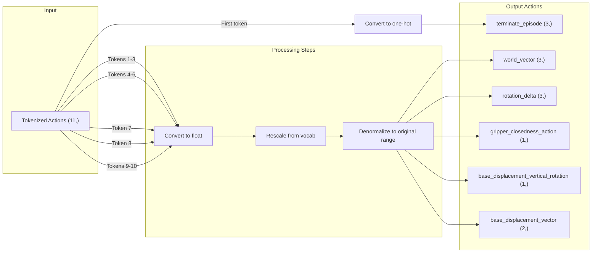
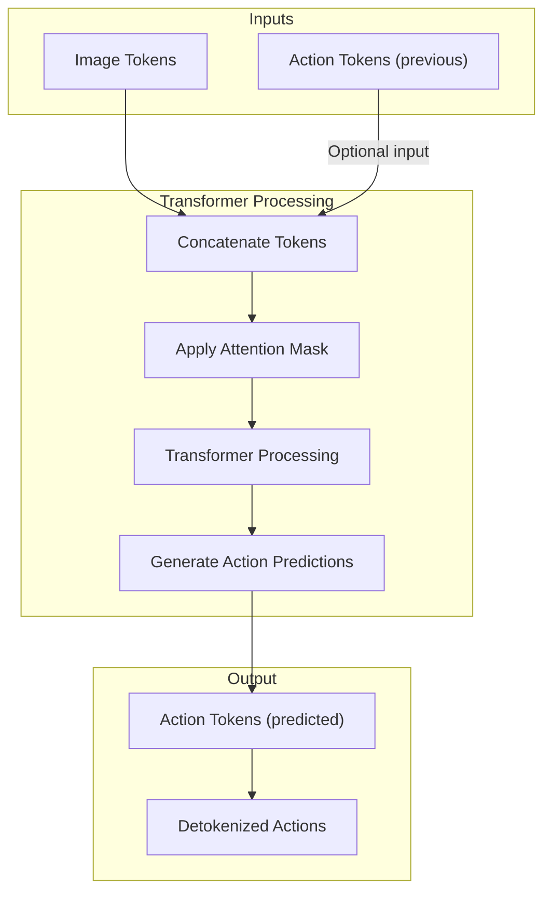
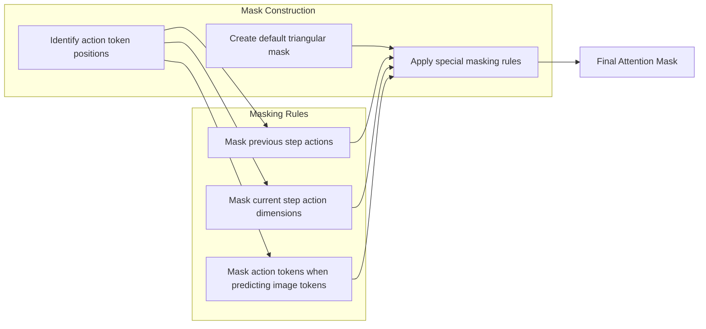
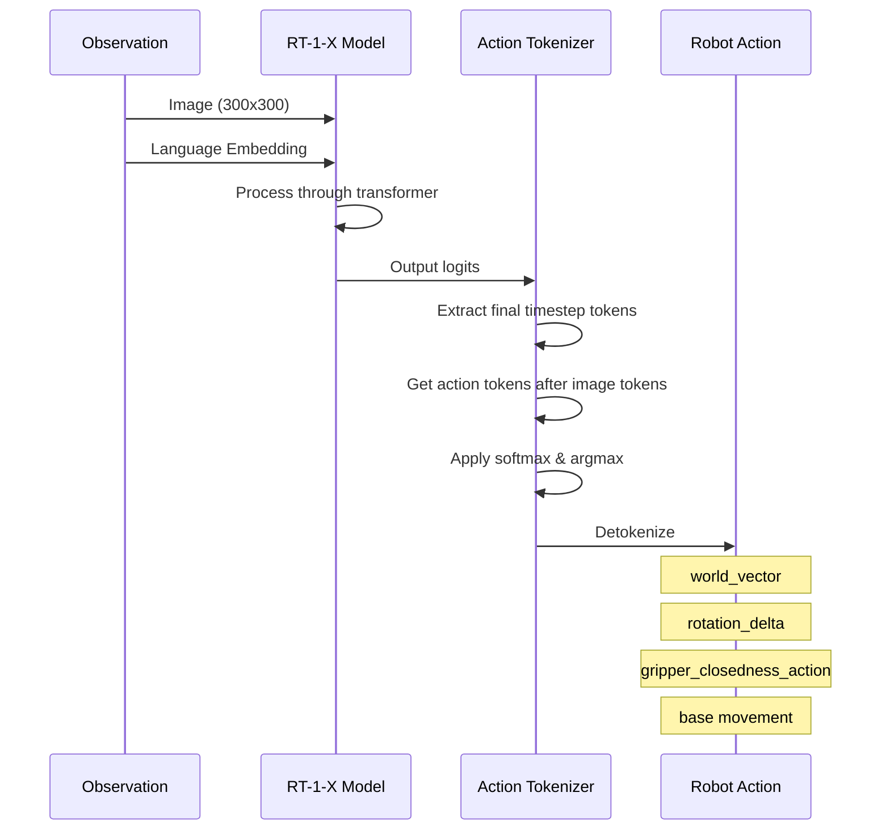
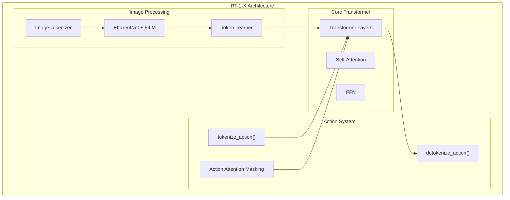

<!-- source: DeepWiki mcp.deepwiki.com · repo google-deepmind/open_x_embodiment · page 3.3 Action System · fetched 2026-10-26 -->

# Action System

Relevant source files

The following files were used as context for generating this wiki page:

- [models/rt1.py](models/rt1.py)
- [models/rt1_inference_example.py](models/rt1_inference_example.py)

This page documents the action system used in the RT-1/RT-1-X models, focusing on how the model represents, processes, and outputs robot actions. The action system is responsible for converting between continuous robot control signals and the tokenized representation used by the transformer model. This page explains the action structure, tokenization/detokenization process, and how actions flow through the system during both training and inference.

For information about the overall RT-1-X model architecture, see [RT-1-X Model](#3) and [Model Architecture](#3.1). For details on image processing, see [Image Processing Pipeline](#3.2).

## Action Structure

The RT-1/RT-1-X action system uses a unified action representation that can control different robot embodiments. Each action consists of multiple components that together specify robot movement in 3D space:

| Action Component | Shape | Value Range | Description |
|------------------|-------|-------------|-------------|
| `terminate_episode` | (3,) | Discrete modes | Mode 0: terminate episode Mode 1: arm + gripper Mode 2: base |
| `world_vector` | (3,) | [-1.0, 1.0] (RT-1) [-2.0, 2.0] (RT-1-X) | 3D positional offset in world coordinates |
| `rotation_delta` | (3,) | [-π/2, π/2] | Rotation changes around each axis |
| `gripper_closedness_action` | (1,) | [-1.0, 1.0] | Gripper control (-1: open, 1: closed) |
| `base_displacement_vertical_rotation` | (1,) | [-π, π] | Base rotation |
| `base_displacement_vector` | (2,) | [-1.0, 1.0] | 2D base movement vector |

This action space supports both manipulation (arm + gripper) and navigation (base movement) for different robot embodiments.

Sources: [models/rt1.py:257-307](). [models/rt1_inference_example.py:162-163]()

## Action Tokenization Process

The action tokenization process converts continuous robot actions into discrete tokens that can be processed by the transformer model. This is essential for treating action prediction as a sequence modeling problem.

### Tokenization Diagram

The tokenization function `tokenize_action` performs the following steps:
1. For `terminate_episode`, convert the one-hot representation to a class index
2. For continuous actions, clip values to their respective ranges
3. Normalize values to [0,1] based on their min/max bounds
4. Scale to [0, vocab_size-1] for token representation
5. Convert to integer tokens
6. Concatenate all tokens into a single vector

Sources: [models/rt1.py:257-308]()

## Action Detokenization Process

The detokenization process converts discrete tokens back into continuous robot action values that can be executed by a robot.

### Detokenization Diagram

The detokenization function `detokenize_action` performs the following steps:
1. For `terminate_episode`, convert the token back to a one-hot vector
2. For continuous actions, convert tokens to float
3. Normalize by the vocabulary size
4. Scale back to original range using the min/max bounds
5. Construct action dictionary with all components

Sources: [models/rt1.py:311-354]()

## Action Integration in RT-1-X Model

Actions are integrated into the RT-1-X model architecture in a specific way to enable action prediction based on visual and language inputs.

### Action Flow in RT-1-X

Key aspects of action integration:
1. **Handling previous actions**: The model can optionally include previous timestep actions through the `include_prev_timesteps_actions` flag
2. **Action masking**: Special attention mask prevents the model from "cheating" by looking at future actions
3. **Concatenation with image tokens**: Action tokens are concatenated with image tokens to form the input sequence
4. **Action prediction**: The model predicts the next action tokens, which are then detokenized

Sources: [models/rt1.py:357-482](), [models/rt1.py:511-551]()

## Attention Masking for Actions

The RT-1-X model uses a specialized attention masking mechanism that prevents information leakage between actions and ensures proper autoregressive prediction.

### Attention Mask Diagram

The attention mask ensures:
1. Actions from previous steps are properly masked based on the `include_prev_timesteps_actions` setting
2. Autoregressive behavior within action dimensions (each action dimension only depends on previous dimensions)
3. Image token predictions can't depend on action tokens in certain configurations

This masking is crucial for proper training and prediction of action sequences.

Sources: [models/rt1.py:484-551]()

## Action Inference

During inference, the RT-1 model generates actions in response to visual and language inputs. The `RT1Policy` class handles this process.

### Inference Process

The inference process in `RT1Policy._run_action_inference` performs:
1. Processes the input observation (image and language embedding)
2. Applies the RT-1-X model to generate output logits
3. Extracts the action tokens for the final timestep
4. Detokenizes the action tokens to continuous robot actions
5. Handles special cases like the `terminate_episode` action

Sources: [models/rt1_inference_example.py:71-145]()

## World Vector Range Adaptation

One important difference between RT-1 and RT-1-X is the range of the `world_vector` component:
- RT-1 uses range [-1.0, 1.0]
- RT-1-X uses range [-2.0, 2.0]

This expanded range in RT-1-X allows for larger movement commands, important for generalization across different robot embodiments with varying workspace sizes.

Sources: [models/rt1.py:292-294](), [models/rt1_inference_example.py:162-163]()

## Integration with RT-1-X Architecture

The action system is tightly integrated with the overall RT-1-X architecture.

The action system is not an isolated component but works together with:
1. The image tokenization system that provides visual tokens
2. The transformer that processes the combined token sequence
3. The language embedding system that provides task context

Sources: [models/rt1.py:357-482]()

---

