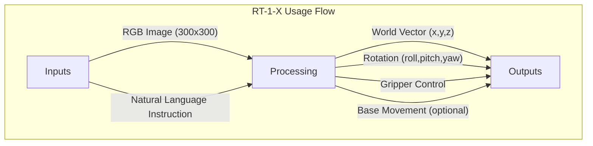
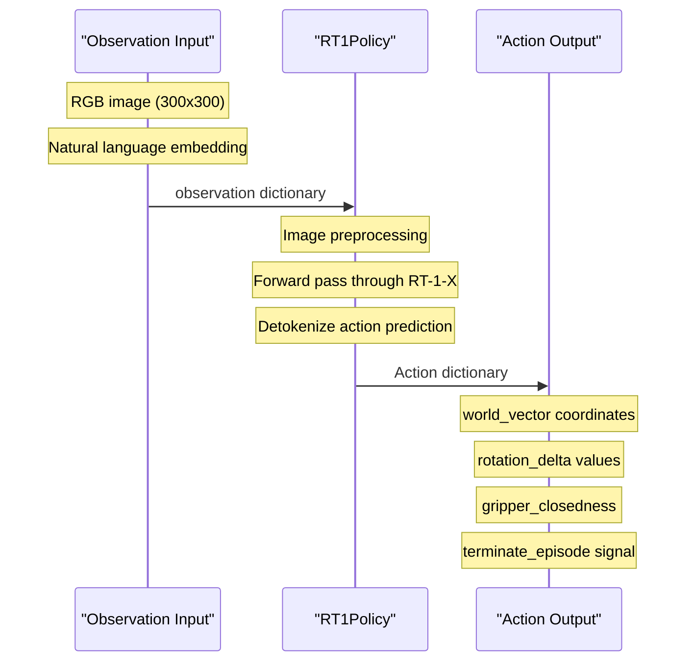
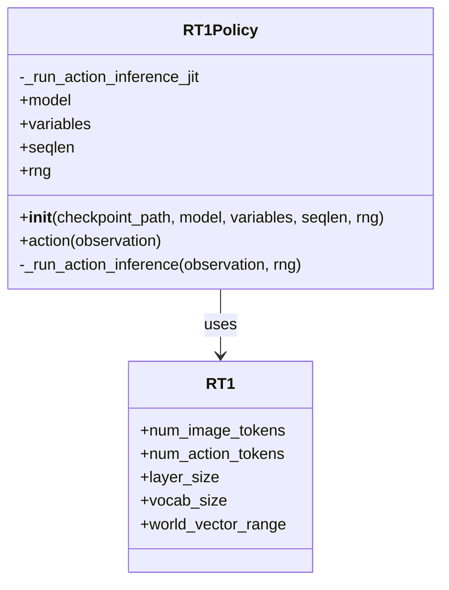
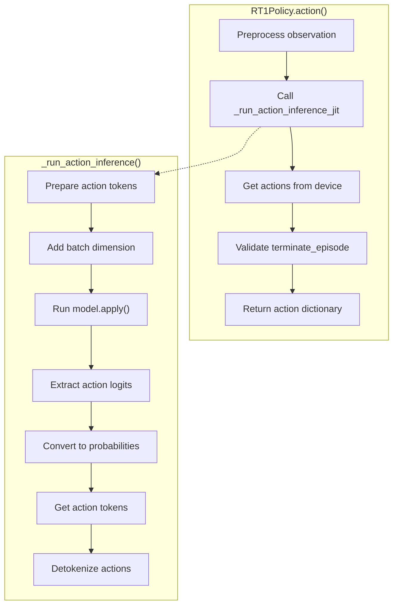
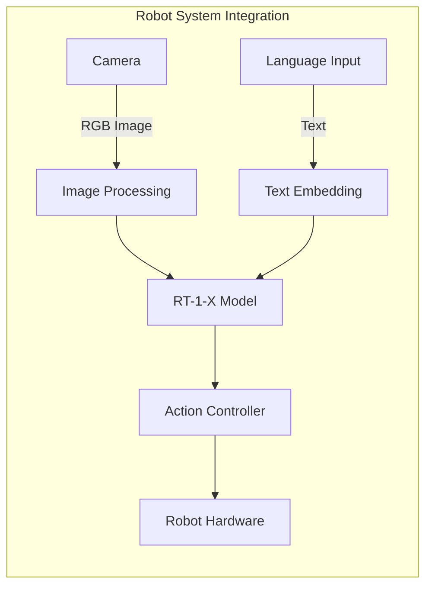

<!-- source: DeepWiki mcp.deepwiki.com · repo google-deepmind/open_x_embodiment · page 4 Using RT-1-X · fetched 2026-10-26 -->

# Using RT-1-X

<details>
<summary>Relevant source files</summary>

The following files were used as context for generating this wiki page:

- [README.md](README.md)
- [colabs/Minimal_example_for_running_inference_using_RT_1_X_TF_using_tensorflow_datasets.ipynb](colabs/Minimal_example_for_running_inference_using_RT_1_X_TF_using_tensorflow_datasets.ipynb)
- [models/rt1_inference_example.py](models/rt1_inference_example.py)

</details>


This guide provides practical instructions for using the RT-1-X model within the Open X-Embodiment project. It covers the basics of loading the model, running inference, and interpreting the model's outputs. For details about the model architecture, see [RT-1-X Model](#3) and [Model Architecture](#3.1).

## Overview of RT-1-X

RT-1-X is a robotics transformer model that can map visual inputs and language instructions to robot actions. It's designed to enable zero-shot generalization across different robots and tasks. The model takes RGB images from a robot's workspace camera along with natural language task descriptions and produces control actions that a robot can execute.



Sources: [README.md:25-37](), [models/rt1_inference_example.py:1-3]()

## Getting Started

### Model Input and Output

RT-1-X accepts two primary inputs:

1. **RGB Images**: Images from a robot workspace camera (resized to 300x300 pixels)
2. **Task Instructions**: Natural language descriptions converted to embeddings

The model outputs action dimensions including:

- World vector coordinates (x, y, z)
- Rotation deltas (roll, pitch, yaw) 
- Gripper opening parameter
- Optional base movement parameters



Sources: [README.md:25-37](), [models/rt1_inference_example.py:116-145]()

## Model Setup and Initialization

To use RT-1-X, you first need to download and load the model checkpoint.

### Downloading the Checkpoint

The JAX checkpoint can be downloaded with:

```
gsutil -m cp -r gs://gdm-robotics-open-x-embodiment/open_x_embodiment_and_rt_x_oss/rt_1_x_jax .
```

### Initializing the RT1Policy

The primary interface for using RT-1-X is the `RT1Policy` class, which handles loading the model and running inference.



The initialization process requires specifying:
- Path to the model checkpoint
- Model configuration parameters like sequence length and token counts
- Optional random seed for reproducibility

Sources: [models/rt1_inference_example.py:23-69](), [models/rt1_inference_example.py:148-169]()

## Running Inference

### Preparing Observations

Before passing to the model, observations must be properly formatted:

1. **Images**: Resize to 300x300 pixels and normalize to [0,1] range
2. **Natural Language**: Convert text to embeddings of dimension 512

Example observation format:
```
observation = {
    'image': image_array,  # Shape (15, 300, 300, 3)
    'natural_language_embedding': embedding_array  # Shape (15, 512)
}
```

### Getting Actions

With a properly formatted observation, you can obtain robot actions using the `action` method:

```python
action = policy.action(observation)
```

The returned action is a dictionary containing:
- `world_vector`: Position in 3D space (x, y, z)
- `rotation_delta`: Changes in orientation (roll, pitch, yaw)
- `gripper_closedness`: Gripper control parameter
- `terminate_episode`: Signal to end the current episode

Sources: [models/rt1_inference_example.py:116-145](), [models/rt1_inference_example.py:170-177]()

## Implementation Details

### Internal Process Flow

When you call `policy.action()`, the following steps occur:

1. The observation is preprocessed (image resizing, normalization)
2. The policy calls the JIT-compiled `_run_action_inference` function
3. The model produces tokenized action predictions
4. Actions are detokenized into usable values
5. Final action dictionary is returned



Sources: [models/rt1_inference_example.py:71-114]()

### Model Configuration for RT-1-X

The RT-1-X model has specific configuration parameters that differ from the base RT-1 model:

| Parameter | RT-1-X Value | Description |
|-----------|-------------|-------------|
| num_image_tokens | 81 | Number of image tokens after token learner |
| num_action_tokens | 11 | Number of tokens for representing actions |
| layer_size | 256 | Size of transformer layers |
| vocab_size | 512 | Vocabulary size for action tokenization |
| use_token_learner | True | Enables token learner for image token reduction |
| world_vector_range | (-2.0, 2.0) | Range for world vector values (expanded from original RT-1) |

Sources: [models/rt1_inference_example.py:148-169]()

## Examples

### Basic Inference Example

Here's a minimal example of how to initialize the RT-1-X model and run inference:

```python
# Initialize the model
rt1x_model = rt1.RT1(
    num_image_tokens=81,
    num_action_tokens=11,
    layer_size=256,
    vocab_size=512,
    use_token_learner=True,
    world_vector_range=(-2.0, 2.0),
)

# Create the policy
policy = RT1Policy(
    checkpoint_path="path/to/checkpoint",
    model=rt1x_model,
    seqlen=15,
)

# Create a test observation
obs = {
    'image': np.ones((15, 300, 300, 3)),  # Placeholder image
    'natural_language_embedding': np.ones((15, 512)),  # Placeholder embedding
}

# Get predicted action
action = policy.action(obs)
```

### Using the Inference Colab

For a more comprehensive example, you can try the inference colab that demonstrates:
- Loading the RT-1-X TensorFlow checkpoint
- Running inference on offline episodes
- Visualizing the predicted actions alongside ground truth actions

The colab is available at:
[https://colab.research.google.com/github/google-deepmind/open_x_embodiment/blob/main/colabs/Minimal_example_for_running_inference_using_RT_1_X_TF_using_tensorflow_datasets.ipynb](https://colab.research.google.com/github/google-deepmind/open_x_embodiment/blob/main/colabs/Minimal_example_for_running_inference_using_RT_1_X_TF_using_tensorflow_datasets.ipynb)

Sources: [README.md:37-37](), [models/rt1_inference_example.py:148-177]()

## Integration with Robot Systems

When integrating RT-1-X into a real robot system, keep in mind:

1. **Input Preparation**: Ensure proper image resizing (300x300) and normalization (values in [0,1])
2. **Execution Frequency**: The model is designed to run at approximately 3 Hz (every 333 milliseconds)
3. **Camera Requirements**: The model uses only RGB images from a workspace camera (no wrist/in-hand cameras or depth data)
4. **Task Communication**: All task information must be conveyed through the natural language instruction



Sources: [README.md:25-31]()

## Troubleshooting

### Common Issues

1. **Model Output Shape Mismatch**: Ensure your observation format matches the expected input shapes
2. **Invalid Actions**: If the model outputs invalid actions, check your image preprocessing and make sure values are properly normalized
3. **Low Performance**: Make sure you're using the correct checkpoint and model configuration for RT-1-X

For issues with accessing datasets (which might be needed for training or more advanced inference), see [Accessing and Using Datasets](#2.2).

Sources: [README.md:45-57]()

---

