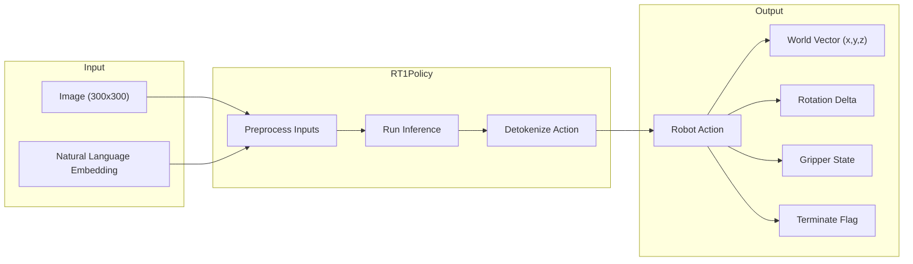
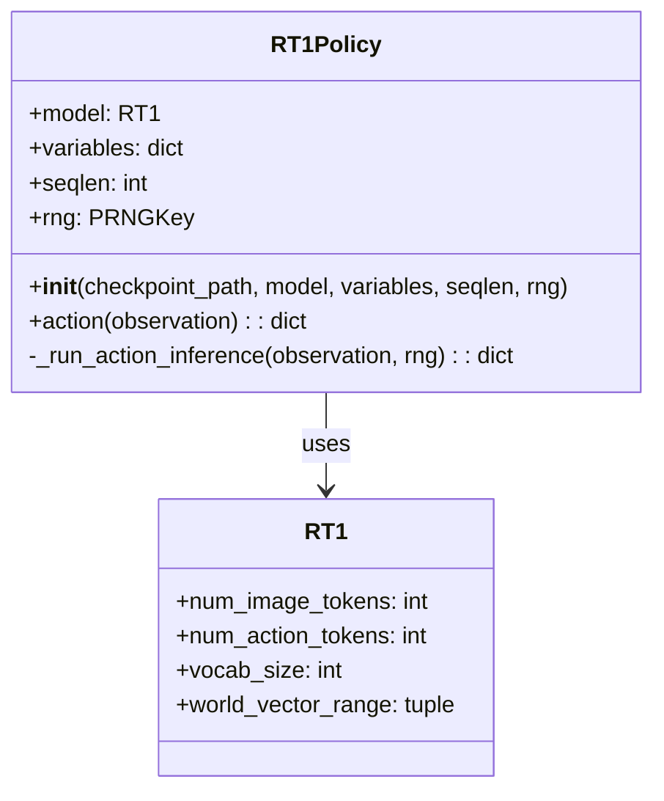
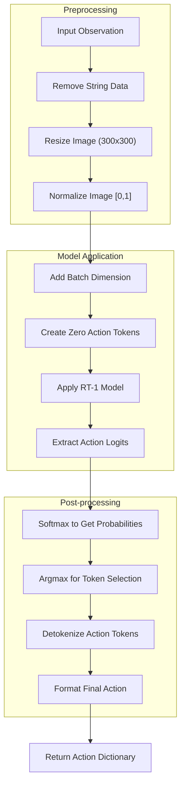

<!-- source: DeepWiki mcp.deepwiki.com · repo google-deepmind/open_x_embodiment · page 4.1 Inference Examples · fetched 2026-10-26 -->

# Inference Examples

<details>
<summary>Relevant source files</summary>

The following files were used as context for generating this wiki page:

- [colabs/Minimal_example_for_running_inference_using_RT_1_X_TF_using_tensorflow_datasets.ipynb](colabs/Minimal_example_for_running_inference_using_RT_1_X_TF_using_tensorflow_datasets.ipynb)
- [models/rt1_inference_example.py](models/rt1_inference_example.py)

</details>


This page provides detailed guidance on running inference with the RT-1-X model in the Open X-Embodiment framework. It covers how to initialize the inference policy, prepare inputs, execute inference, and interpret the model outputs. For information about training the model, see [Training Examples](#4.2).

## Inference Process Overview

The RT-1-X inference pipeline transforms robot observations and language instructions into executable robot actions. The process follows a well-defined sequence of operations that handle input preprocessing, model inference, and output detokenization.



Sources: [models/rt1_inference_example.py:71-145]()

## RT1Policy Class

The core component for inference is the `RT1Policy` class, which encapsulates the loaded model and provides methods for running inference.



Sources: [models/rt1_inference_example.py:23-145]()

### Initialization

The `RT1Policy` class is initialized with the following parameters:

- `checkpoint_path`: Path to a saved model checkpoint
- `model`: An RT-1 model instance
- `variables`: Optional pre-loaded model variables (alternative to checkpoint_path)
- `seqlen`: Sequence length for observations (default: 15)
- `rng`: JAX random number generator key

Either `checkpoint_path` or `variables` must be provided to initialize the policy.

```python
policy = RT1Policy(
    checkpoint_path='path/to/checkpoint',
    model=rt1.RT1(...),
    seqlen=15
)
```

Sources: [models/rt1_inference_example.py:26-69]()

### Running Inference

Inference is performed by calling the `action()` method with an observation dictionary. This method:

1. Makes a copy of the observation
2. Removes string data like natural language instructions
3. Preprocesses the image (resize to 300x300 and normalize)
4. Calls the JAX-optimized inference function
5. Post-processes the output

Sources: [models/rt1_inference_example.py:116-145]()

## Input Format

The RT-1-X model expects observations in a specific format:

| Input Key | Type | Shape | Description |
|-----------|------|-------|-------------|
| `image` | Float32 | (H, W, 3) | RGB image from robot camera |
| `natural_language_embedding` | Float32 | (seqlen, 512) | Embedding of the text instruction |
| `natural_language_instruction` | String | - | Text instruction (removed during inference) |

The image is automatically resized to 300x300 and normalized to [0,1] range during preprocessing.

Sources: [models/rt1_inference_example.py:116-132](), [models/rt1_inference_example.py:172-175]()

## Internal Inference Process



The key inference steps include:

1. The model processes images with an EfficientNet backbone with FiLM conditioning
2. Token Learner reduces image tokens to a manageable number (default: 81)
3. A transformer processes the combined tokens to predict action tokens
4. Action tokens are detokenized into continuous physical actions

Sources: [models/rt1_inference_example.py:71-114]()

## Output Format

The inference process produces a structured action dictionary:

| Output Key | Type | Description |
|------------|------|-------------|
| `world_vector` | Float32 array | (x, y, z) position in world coordinates |
| `rotation_delta` | Float32 array | Rotation change for the end effector |
| `gripper` | Float32 array | Gripper state (open/closed) |
| `terminate_episode` | Int array | Flag indicating episode completion |

The output values are scaled according to the `world_vector_range` parameter of the model, which defines the bounds of the action space (typically [-2.0, 2.0] for RT-1-X).

Sources: [models/rt1_inference_example.py:108-113]()

## Example Usage

Here's a complete example of initializing the RT-1-X model and running inference:

```python
# Initialize the RT-1-X model
rt1x_model = rt1.RT1(
    num_image_tokens=81,
    num_action_tokens=11,
    layer_size=256,
    vocab_size=512,
    use_token_learner=True,
    world_vector_range=(-2.0, 2.0),
)

# Create the policy
policy = RT1Policy(
    checkpoint_path="path/to/checkpoint",
    model=rt1x_model,
    seqlen=15,
)

# Create an observation
observation = {
    'image': numpy_image,  # Shape: (H, W, 3)
    'natural_language_embedding': language_embedding,  # Shape: (15, 512)
    'natural_language_instruction': "pick up the cup"  # Will be removed during inference
}

# Run inference
action = policy.action(observation)

# Use the action
world_vector = action['world_vector']
rotation_delta = action['rotation_delta']
gripper_state = action['gripper']
```

Sources: [models/rt1_inference_example.py:148-177]()

## Command-Line Inference

The repository includes a command-line script for running inference with a pre-trained RT-1-X model.

```bash
python models/rt1_inference_example.py --checkpoint_path=/path/to/checkpoint
```

This script:
1. Initializes an RT-1-X model with standard parameters
2. Creates an RT1Policy using the specified checkpoint
3. Runs inference on a test observation
4. Prints the resulting action

Sources: [models/rt1_inference_example.py:148-181]()

## Implementation Details

### Input Preprocessing

The `action()` method of `RT1Policy` handles input preparation:
- Removes string data that JAX cannot process
- Resizes images to 300x300 using TensorFlow's image resize
- Normalizes pixel values to [0,1] range

Sources: [models/rt1_inference_example.py:116-132]()

### Core Inference Function

The main inference logic is implemented in the `_run_action_inference()` method, which is JIT-compiled for efficiency:

1. Zero action tokens are created for historical context
2. Observations are batched for model processing
3. The model is applied to get output logits
4. Logits are reshaped and sliced to extract action predictions
5. Softmax is applied to get token probabilities
6. The most likely tokens are selected using argmax
7. Tokens are detokenized into physical actions

Sources: [models/rt1_inference_example.py:71-114]()

## Troubleshooting

Common issues when running inference:

1. **Checkpoint Loading Errors**: Ensure the checkpoint path is correct and the checkpoint is compatible with the model architecture.

2. **Image Format Issues**: The model expects RGB images of shape (H, W, 3). Ensure images are properly formatted before passing to the model.

3. **Action Range Mismatch**: RT-1-X uses a world vector range of (-2.0, 2.0) instead of the (-1.0, 1.0) used in vanilla RT-1. Ensure your model is configured with the correct range.

4. **Invalid Termination Actions**: The code includes logic to handle invalid termination flags by defaulting to a valid mode.

Sources: [models/rt1_inference_example.py:140-145]()

---

