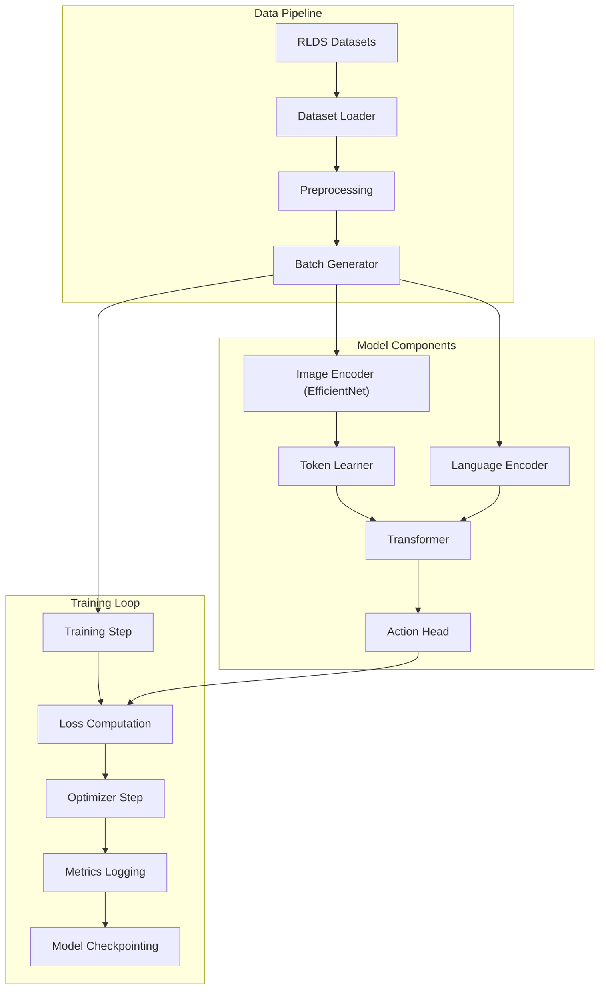
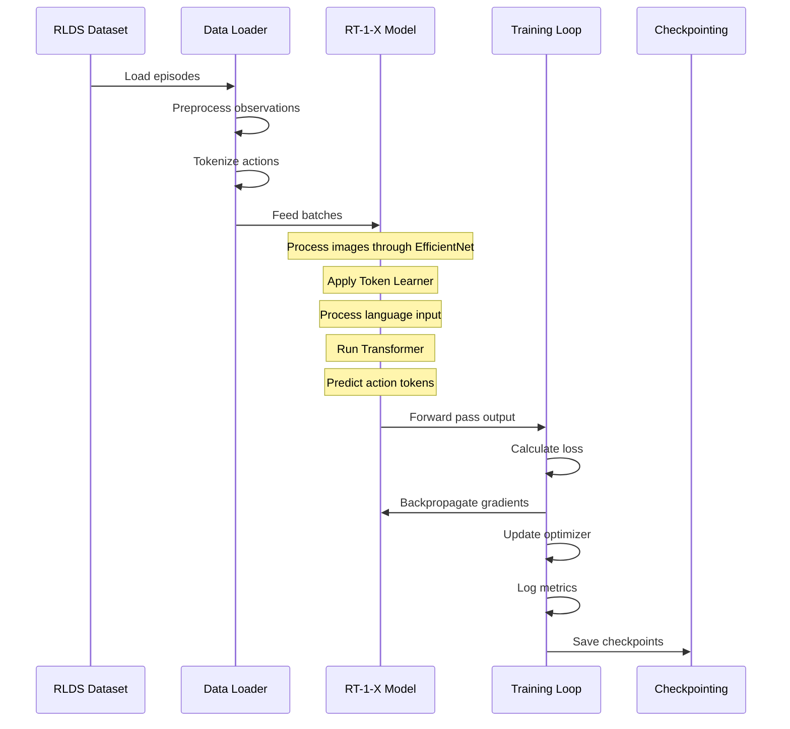
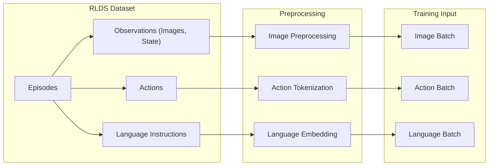
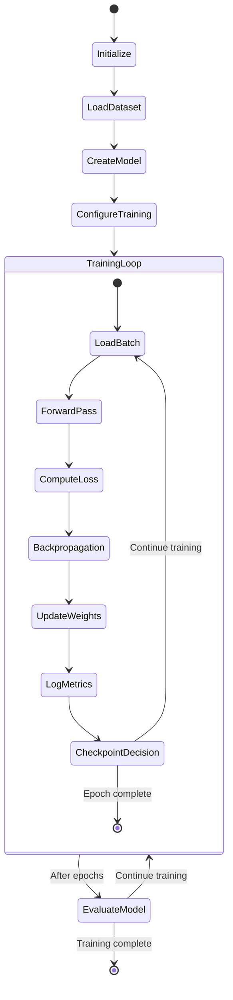
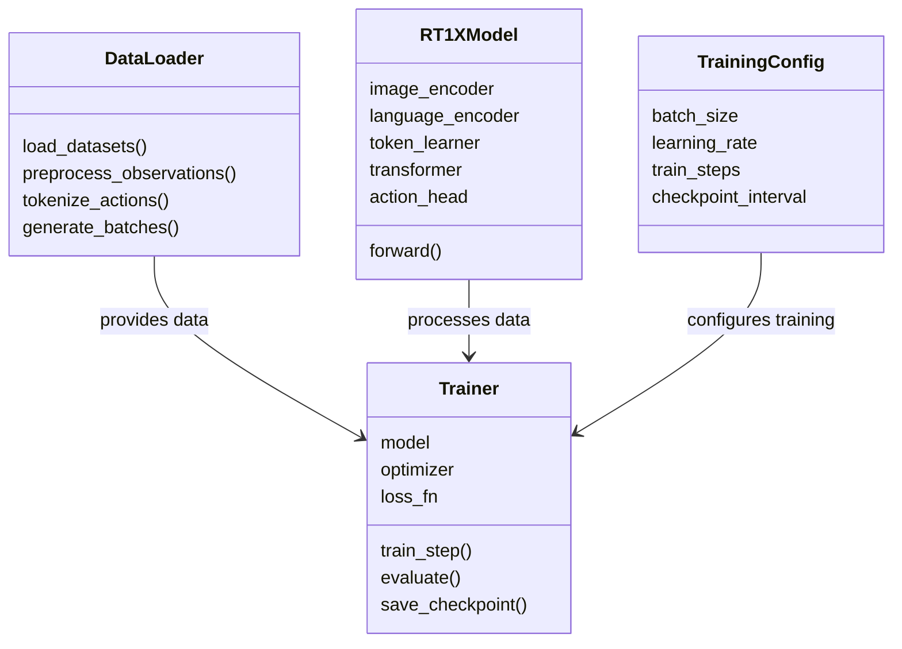
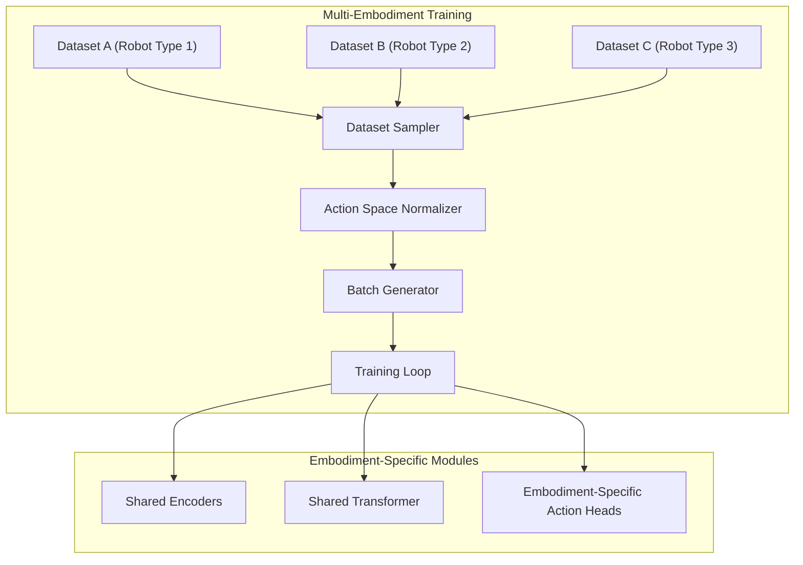

<!-- source: DeepWiki mcp.deepwiki.com · repo google-deepmind/open_x_embodiment · page 4.2 Training Examples · fetched 2026-10-26 -->

# Training Examples

Relevant source files

The following files were used as context for generating this wiki page:

- [colabs/Minimal_Training_Example.ipynb](colabs/Minimal_Training_Example.ipynb)
- [colabs/Open_X_Embodiment_Datasets.ipynb](colabs/Open_X_Embodiment_Datasets.ipynb)

## Purpose and Scope

This document provides guidance and examples for training models using the Open X-Embodiment datasets. It covers the training architecture, process, and configurations necessary to train or fine-tune RT-1-X models for robotic control tasks. For information about running inference with pre-trained models, see [Inference Examples](#4.1). For details about the dataset structure, see [Dataset Format and Structure](#2.1).

## Training Architecture

The training system in Open X-Embodiment connects robotics datasets in RLDS format with the RT-1-X model architecture through a standardized training pipeline. The diagram below illustrates the high-level architecture of the training system:

Sources: System architecture diagrams from the provided context

## Training Process Overview

Training an RT-1-X model involves the following sequence of operations:

Sources: System architecture diagrams from the provided context

## Data Preparation and Input Pipeline

The training pipeline converts RLDS format datasets into batches suitable for model training:

Sources: System architecture diagrams from the provided context

## Model Training Configuration

Training an RT-1-X model requires configuration of several key components:

| Component | Description |
|-----------|-------------|
| Dataset Configuration | Specifies which datasets to use, sampling strategies, and preprocessing operations |
| Model Architecture | Defines the model structure, including encoder types, token learner settings, and transformer configuration |
| Training Hyperparameters | Learning rate, batch size, optimizer settings, and training schedule |
| Action Space | Defines the action space representation and tokenization scheme |
| Evaluation Metrics | Specifies metrics to track during training |

Sources: System architecture diagrams from the provided context

## Training Execution Flow

The following diagram illustrates the control flow during model training:

Sources: System architecture diagrams from the provided context

## Training Components and Code Structure

The RT-1-X training system consists of several key components that work together:

Sources: System architecture diagrams from the provided context

## Performance Optimization

Training RT-1-X models involves significant computational resources. The following considerations can help optimize training performance:

1. **Hardware Requirements**:
   - GPU memory requirements scale with batch size and model size
   - Multi-GPU training can accelerate the process

2. **Dataset Optimization**:
   - Caching preprocessed data can reduce training time
   - Strategic dataset sampling can improve convergence

3. **Model Configuration**:
   - Smaller EfficientNet variants reduce memory usage
   - Token Learner parameters affect computational efficiency

4. **Distributed Training**:
   - Model parallelism for large models
   - Data parallelism for large datasets

Sources: System architecture diagrams from the provided context

## Common Issues and Troubleshooting

When training RT-1-X models, you may encounter these common issues:

| Issue | Potential Cause | Recommended Solution |
|-------|-----------------|----------------------|
| Out of Memory Errors | Batch size too large | Reduce batch size or use gradient accumulation |
| Poor Convergence | Learning rate issues | Adjust learning rate or use a schedule |
| Overfitting | Insufficient data | Apply regularization or data augmentation |
| Slow Training | Inefficient data pipeline | Enable caching or optimize preprocessing |
| Action Space Mismatch | Misconfigured action tokenization | Verify action space configuration |

Sources: System architecture diagrams from the provided context

## Example Training Workflow

A typical workflow for training an RT-1-X model consists of these steps:

1. **Configure the training environment**:
   - Set up hardware (GPUs)
   - Install dependencies
   - Configure dataset access

2. **Prepare the configuration**:
   - Define model architecture
   - Set training hyperparameters
   - Configure dataset sampling

3. **Execute training**:
   - Run the training script
   - Monitor metrics and convergence
   - Save checkpoints periodically

4. **Evaluate model performance**:
   - Run evaluation metrics
   - Analyze performance on validation data
   - Fine-tune if necessary

5. **Export the trained model**:
   - Convert to deployment format
   - Validate on test scenarios

Sources: System architecture diagrams from the provided context

## Cross-Embodiment Considerations

Training models across different robot embodiments requires special considerations:

Sources: System architecture diagrams from the provided context

## Conclusion

This document has provided an overview of training examples and processes for the RT-1-X model using Open X-Embodiment datasets. By following the architecture and configurations outlined here, researchers and developers can train robotic control models that leverage the diverse data available in the project.

For information on using trained models for inference, refer to [Inference Examples](#4.1). For details about the datasets themselves, see [Datasets](#2).

---

