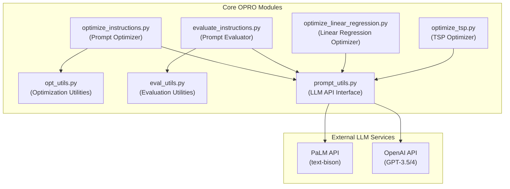
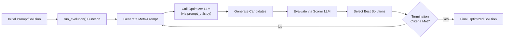
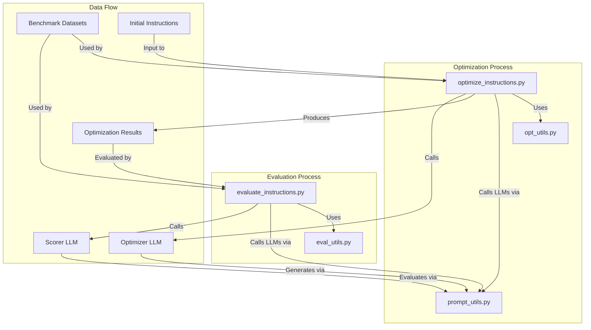

<!-- source: DeepWiki mcp.deepwiki.com · repo google-deepmind/opro · page 1 Overview · fetched 2026-10-26 -->

# Overview

<details>
<summary>Relevant source files</summary>

The following files were used as context for generating this wiki page:

- [README.md](README.md)
- [img/gpt_meta_prompt.png](img/gpt_meta_prompt.png)
- [img/workflow.png](img/workflow.png)

</details>


This document provides a comprehensive introduction to OPRO (Optimizing PROmpts), a framework that uses Large Language Models (LLMs) as optimizers for prompt engineering and other optimization tasks. OPRO implements the methods described in the research paper "Large Language Models as Optimizers" and provides tools for both prompt optimization and evaluation, as well as demonstrations of LLMs as optimizers for other domains such as linear regression and traveling salesman problems.

For detailed information about the methodology behind prompt optimization, see [Purpose and Methodology](#1.1). For specifics on the system components, see [Key Components](#1.2).

Sources: [README.md:1-7]()

## System Architecture

OPRO consists of several key components that work together to enable LLM-based optimization. The system is designed to use one LLM (the optimizer) to generate improved versions of prompts or solutions, which are then evaluated by another LLM (the scorer).



**System Components Diagram**

Sources: [README.md:27-51]()

## Optimization Workflow

The core workflow of OPRO involves an iterative process where an optimizer LLM generates candidate solutions that are evaluated and refined over multiple iterations.



**OPRO Optimization Process**

Sources: [README.md:27-35]()

## Key Features and Capabilities

OPRO supports several types of optimization tasks:

| Optimization Task | Implementation File | Description |
|-------------------|---------------------|-------------|
| Prompt Optimization | `optimize_instructions.py` | Optimizes prompts/instructions for LLMs to improve performance on various tasks |
| Prompt Evaluation | `evaluate_instructions.py` | Evaluates prompt performance using different LLMs on benchmark datasets |
| Linear Regression | `optimize_linear_regression.py` | Uses LLMs to optimize parameters for linear regression models |
| Traveling Salesman Problem | `optimize_tsp.py` | Uses LLMs to find optimal routes for the traveling salesman problem |

Sources: [README.md:27-51]()

## Supported Models and Datasets

### LLM Support

OPRO currently supports two main LLM providers:

1. Google PaLM API (text-bison)
2. OpenAI API (GPT-3.5-turbo, GPT-4)

The system is designed to be extensible, allowing developers to add support for other models by implementing appropriate interfaces in the `prompt_utils.py` file.

### Benchmark Datasets

OPRO evaluates prompt performance on several benchmark datasets:

- GSM8K (Grade School Math problems)
- MMLU (Massive Multitask Language Understanding)
- BBH (Big-Bench Hard)
- MultiArith (Arithmetic word problems)
- AQuA (Algebraic Question Answering)

Sources: [README.md:54-56]()

## System Interactions

The following diagram illustrates how the different components of OPRO interact during the prompt optimization process:



**OPRO Component Interactions**

Sources: [README.md:25-44]()

## Getting Started

To use OPRO, you need to install Python 3.10.13 or compatible and the following dependencies:
- absl-py (2.0.0)
- google.generativeai (0.1.0)
- immutabledict (3.0.0)
- openai (0.27.2)

Basic usage examples:

1. **Prompt Optimization:**
   ```
   python optimize_instructions.py --optimizer="gpt-3.5-turbo" --scorer="text-bison"
   --instruction_pos="Q_begin" --dataset="gsm8k" --task="train"
   ```

2. **Prompt Evaluation:**
   ```
   python evaluate_instructions.py --scorer="text-bison" --dataset="gsm8k" 
   --task="test" --instruction_pos="Q_begin" --evaluate_training_fold=false 
   --evaluate_test_fold=true
   ```

3. **Linear Regression and TSP Optimization:**
   Use `optimize_linear_regression.py` and `optimize_tsp.py` respectively.

**Note:** Using PaLM or OpenAI APIs may incur costs. It's recommended to start with smaller datasets or fewer optimization steps before scaling up.

Sources: [README.md:14-23](), [README.md:27-51](), [README.md:59-61]()

## Conclusion

OPRO represents a novel approach to optimization by leveraging the reasoning capabilities of Large Language Models. Instead of traditional optimization algorithms, OPRO uses one LLM to generate optimized solutions and another to evaluate them. This approach has shown promising results across different domains, from prompt engineering to solving classical optimization problems like linear regression and traveling salesman.

For more detailed information on specific components, refer to the dedicated sections in this wiki.

Sources: [README.md:1-7]()

---

