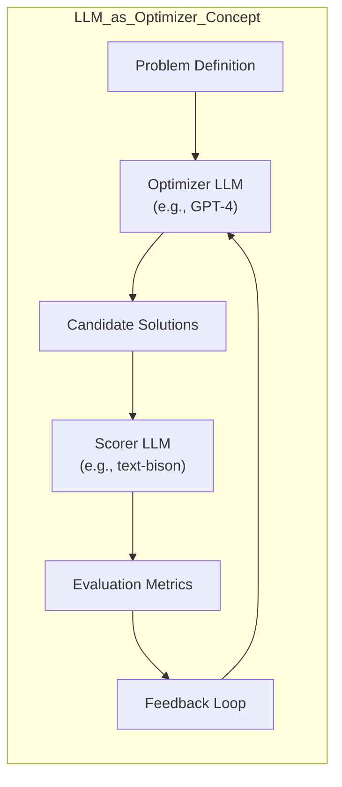
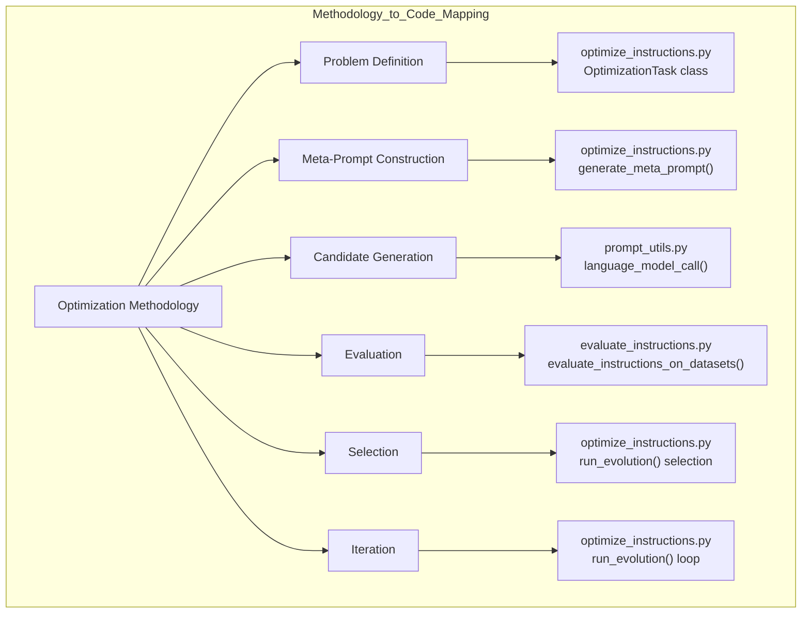
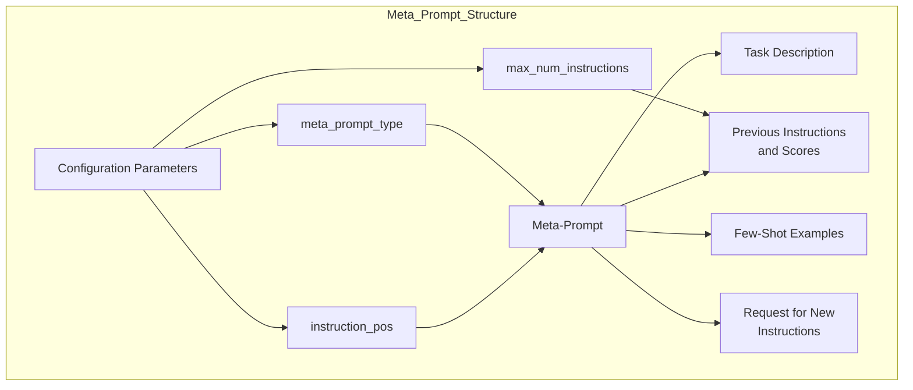
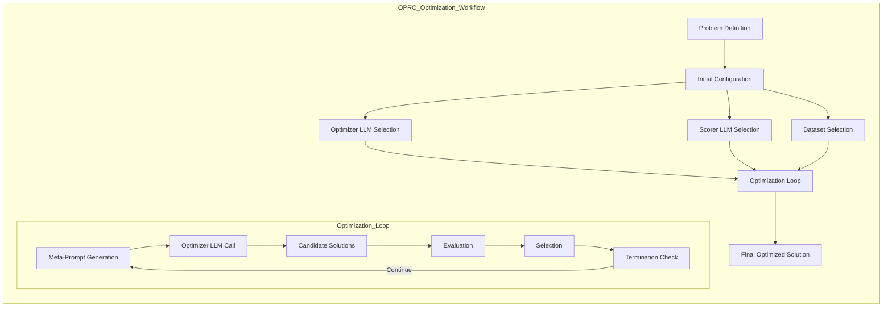
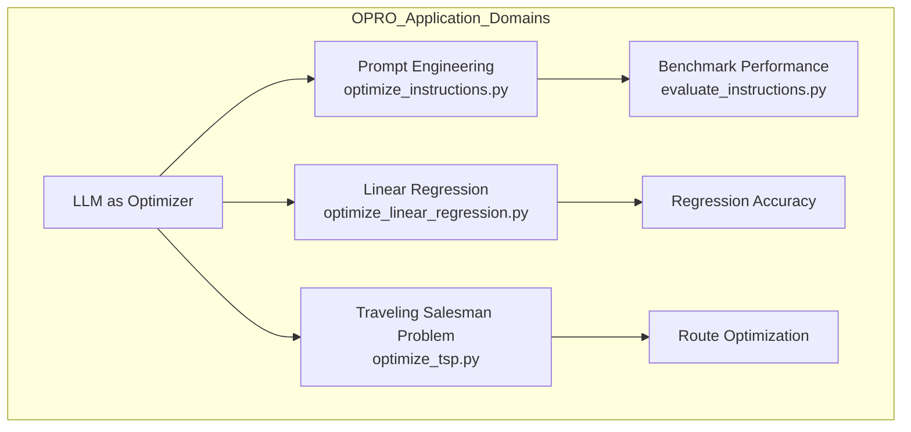

<!-- source: DeepWiki mcp.deepwiki.com · repo google-deepmind/opro · page 1.1 Purpose and Methodology · fetched 2026-10-26 -->

# Purpose and Methodology

Relevant source files

The following files were used as context for generating this wiki page:

- [README.md](README.md)
- [img/gpt_meta_prompt.png](img/gpt_meta_prompt.png)
- [img/workflow.png](img/workflow.png)

This document explains the core concept of using Large Language Models (LLMs) as optimizers in the OPRO framework and details the methodology behind prompt optimization. For information about the key components that implement this methodology, see [Key Components](#1.2).

## Core Concept: LLMs as Optimizers

OPRO (Optimizing PROmpts) introduces a novel approach that leverages the reasoning capabilities of Large Language Models to perform optimization tasks. Rather than using traditional optimization algorithms, OPRO uses LLMs' ability to understand, reason about, and generate solutions for various problems.

In this framework, LLMs serve two distinct roles:
1. **Optimizer LLM**: Acts as the optimization algorithm, generating candidate solutions
2. **Scorer LLM**: Evaluates the quality of the generated solutions

This dual-role architecture enables an iterative optimization process where solutions are continuously improved based on feedback.

Sources: [README.md:5-7]()

## Optimization Methodology

The OPRO methodology follows an evolution-inspired approach where solutions (such as prompts) are iteratively refined through a structured feedback loop. The process begins with an initial solution and improves it over multiple iterations.

Key aspects of the methodology include:

1. **Meta-prompting**: Using a structured prompt to instruct the optimizer LLM on how to generate improved solutions
2. **Few-shot learning**: Providing examples of successful optimizations to guide the model
3. **Iterative refinement**: Continuously improving solutions based on evaluation results
4. **Domain flexibility**: Applying the same methodology to different optimization problems

Sources: [README.md:27-35](), [README.md:37-44]()

## Meta-Prompt Structure

The meta-prompt is central to OPRO's methodology. It instructs the optimizer LLM on how to perform optimization tasks and contains several key components:

The meta-prompt construction is controlled by several key parameters:

| Parameter | Description | Impact |
|-----------|-------------|--------|
| `instruction_pos` | Position of instructions (e.g., beginning of query) | Determines how the optimized instructions are integrated with the task |
| `meta_prompt_type` | Type of meta-prompt used | Affects how the optimizer is guided |
| `max_num_instructions` | Maximum number of previous instructions to include | Controls how much history is provided to the optimizer |
| `few_shot_selection_criteria` | Criteria for selecting few-shot examples | Determines which examples are shown to the optimizer |

Sources: [README.md:32-34]()

## Optimization Workflow

The complete workflow in OPRO involves several stages from initializing the optimization to producing the final optimized solution:

The workflow implementation in code follows these steps:
1. Define optimization parameters via command-line arguments
2. Initialize the optimizer and scorer LLMs
3. Load the appropriate dataset
4. Enter the optimization loop (`run_evolution()`)
5. Generate meta-prompts and candidate solutions
6. Evaluate candidates using the scorer LLM
7. Select the best-performing candidates
8. Repeat until termination criteria are met

Sources: [README.md:27-35]()

## Application Domains

While OPRO was primarily designed for prompt optimization, its methodology is domain-agnostic and can be applied to various optimization problems:

Each application domain follows the same core methodology but adapts it to the specific optimization task:

1. **Prompt Optimization**: Optimizes instructions for language models to improve their performance on specific tasks like GSM8K, MMLU, BBH, and other benchmarks
2. **Linear Regression**: Finds optimal coefficients for linear regression models
3. **Traveling Salesman Problem**: Discovers optimal routes for the classic TSP problem

Sources: [README.md:27-51]()

## Technical Implementation

At a technical level, OPRO implements its optimization methodology through a set of Python modules that handle different aspects of the process:

| Component | File | Purpose |
|-----------|------|---------|
| Instruction Optimization | optimize_instructions.py | Implements the optimization process for prompts/instructions |
| Instruction Evaluation | evaluate_instructions.py | Evaluates the performance of optimized instructions |
| Linear Regression Optimization | optimize_linear_regression.py | Applies the methodology to linear regression problems |
| TSP Optimization | optimize_tsp.py | Applies the methodology to traveling salesman problems |
| Prompt Utilities | prompt_utils.py | Handles interactions with LLM APIs |
| Optimization Utilities | opt_utils.py | Provides utility functions for the optimization process |
| Evaluation Utilities | eval_utils.py | Provides utility functions for the evaluation process |

The system is designed to be modular, allowing for:
- Support for different LLMs (currently text-bison and GPT models)
- Integration with various benchmarks and datasets
- Extension to new optimization problems beyond the examples provided

Sources: [README.md:27-51](), [README.md:55-56]()

---

