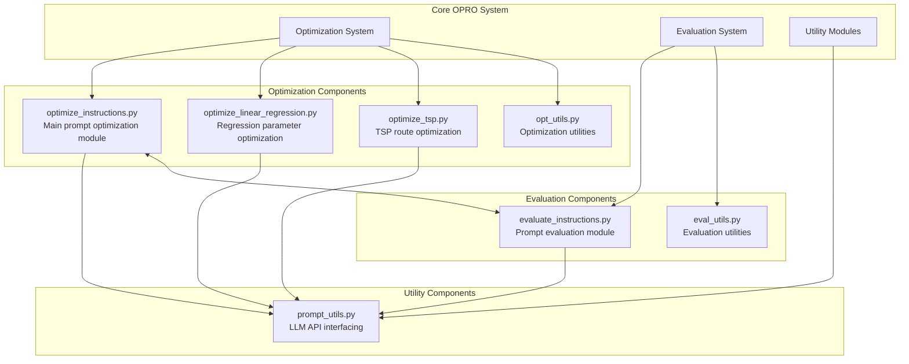
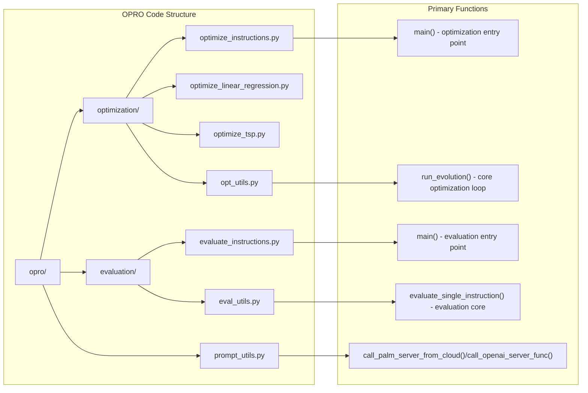
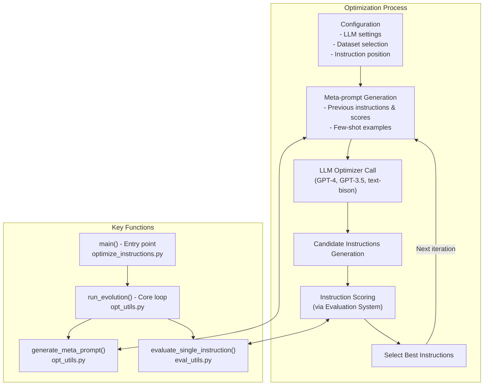
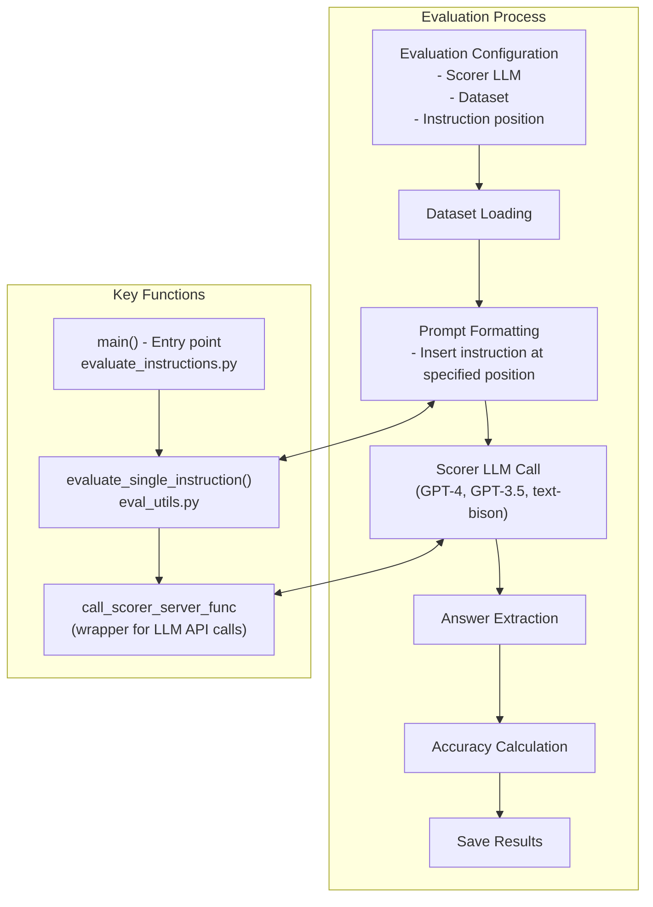
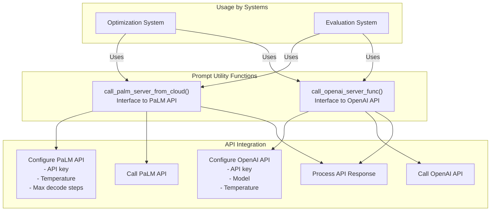
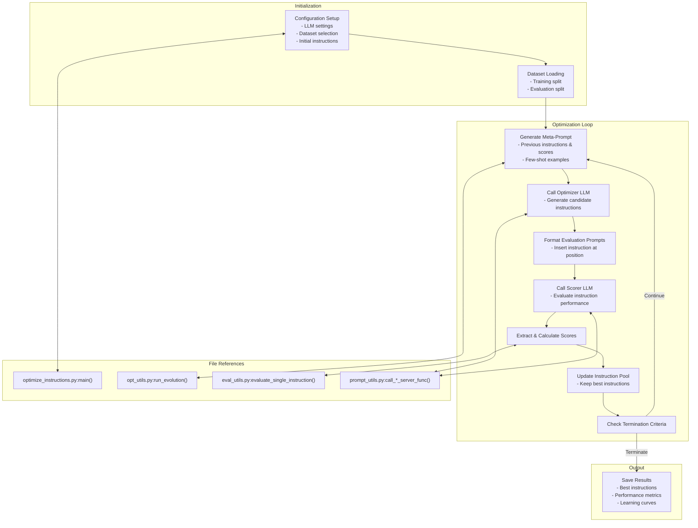
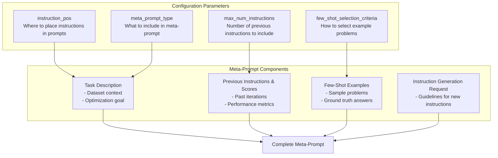

<!-- source: DeepWiki mcp.deepwiki.com · repo google-deepmind/opro · page 1.2 Key Components · fetched 2026-10-26 -->

# Key Components

Relevant source files

The following files were used as context for generating this wiki page:

- [README.md](README.md)
- [opro/evaluation/evaluate_instructions.py](opro/evaluation/evaluate_instructions.py)
- [opro/optimization/optimize_instructions.py](opro/optimization/optimize_instructions.py)

This document provides an overview of the main components that make up the OPRO (Optimizing PROmpts) system. It describes the core modules, their functions, and how they interact to enable Language Models (LLMs) to serve as optimizers for prompt engineering and other optimization tasks. For specific details about the optimization methodology, see [Purpose and Methodology](#1.1), and for in-depth information about the optimization and evaluation systems, see [Optimization System](#2) and [Evaluation System](#3) respectively.

## System Architecture Overview

The OPRO system consists of two primary subsystems - the Optimization System and the Evaluation System - supported by utility modules that facilitate interaction with external LLM APIs.

Sources: [README.md:25-51](), [opro/optimization/optimize_instructions.py:1-43](), [opro/evaluation/evaluate_instructions.py:1-39]()

## Core Components: Code Structure Mapping

The following diagram maps the conceptual components to the actual code files and their primary classes and functions:

Sources: [README.md:25-51](), [opro/optimization/optimize_instructions.py:104-801](), [opro/evaluation/evaluate_instructions.py:98-766]()

## Optimization System

The Optimization System is responsible for using LLMs to generate improved prompts or solutions to optimization problems. It consists of the following key components:

1. **Instruction Optimizer (`optimize_instructions.py`)**: 
   - Main entry point for prompt optimization
   - Configures the optimization process (optimizer LLM, scorer LLM, datasets)
   - Manages the optimization loop through `run_evolution`
   - Generates meta-prompts that guide the optimizer LLM

2. **Domain-Specific Optimizers**:
   - **Linear Regression Optimizer (`optimize_linear_regression.py`)**: Optimizes regression parameters
   - **TSP Optimizer (`optimize_tsp.py`)**: Optimizes routes for the Traveling Salesman Problem

3. **Optimization Utilities (`opt_utils.py`)**:
   - Contains the `run_evolution` function that implements the core optimization loop
   - Handles meta-prompt generation and instruction evaluation
   - Provides data loading and preprocessing functions

Sources: [opro/optimization/optimize_instructions.py:104-800](), [README.md:27-35]()

## Evaluation System

The Evaluation System assesses the performance of prompts/instructions using LLMs on various benchmark datasets. Its components include:

1. **Instruction Evaluator (`evaluate_instructions.py`)**:
   - Entry point for evaluating instructions
   - Configures the evaluation process (scorer LLM, datasets, metrics)
   - Evaluates instructions on various benchmarks
   - Outputs performance metrics and detailed results

2. **Evaluation Utilities (`eval_utils.py`)**:
   - Contains the `evaluate_single_instruction` function that implements the core evaluation logic
   - Handles prompt formatting and answer extraction
   - Calculates accuracy and other performance metrics
   - Provides dataset loading and processing functions

Sources: [opro/evaluation/evaluate_instructions.py:98-766](), [README.md:37-44]()

## Utility Components

The Utility Components provide common functionality used by both the Optimization and Evaluation systems:

1. **Prompt Utilities (`prompt_utils.py`)**:
   - Provides standardized interfaces to different LLM APIs (PaLM, OpenAI)
   - Implements retry logic and error handling for API calls
   - Contains prompt formatting and processing functions

Sources: [opro/optimization/optimize_instructions.py:59-60](), [opro/evaluation/evaluate_instructions.py:57-59](), [README.md:54-56]()

## Data Flow in OPRO System

The following diagram illustrates how data flows through the OPRO system during a typical prompt optimization process:

Sources: [opro/optimization/optimize_instructions.py:699-799](), [opro/evaluation/evaluate_instructions.py:681-742]()

## Benchmark Dataset Integration

OPRO supports several benchmark datasets for instruction optimization and evaluation:

| Dataset | Task Types | Used For | File Location |
|---------|------------|----------|--------------|
| GSM8K | Mathematical reasoning | Training & evaluation of problem-solving instructions | data/gsm_data/ |
| MMLU | Multiple choice Q&A across subjects | Training & evaluation of domain-specific instructions | data/MMLU-data/ |
| BBH (Big-Bench Hard) | Various reasoning tasks | Evaluation of reasoning capabilities | data/BIG-Bench-Hard-data/ |
| MultiArith | Arithmetic problems | Evaluation of math instructions | data/MultiArith.json |
| AQuA | Algebraic word problems | Evaluation of algebraic reasoning | data/AQuA-data/ |

The integration of these datasets is handled by various utility functions in the evaluation and optimization systems.

Sources: [opro/evaluation/evaluate_instructions.py:125-142](), [opro/optimization/optimize_instructions.py:113-118]()

## Meta-Prompt Structure

The meta-prompt is a critical component that guides the optimizer LLM in generating improved instructions. Its structure includes:

Sources: [opro/optimization/optimize_instructions.py:730-786]()

This overview of key components provides a foundation for understanding how the OPRO system functions. The subsequent sections in this wiki dive deeper into specific aspects of the system, including detailed explanations of the optimization and evaluation processes.

---

