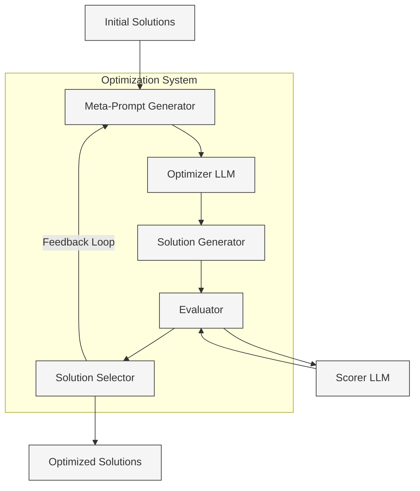
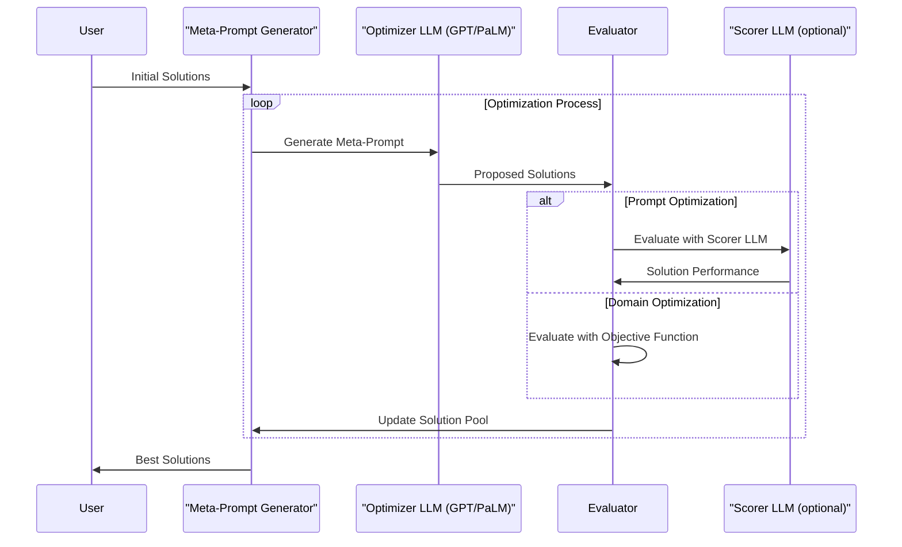
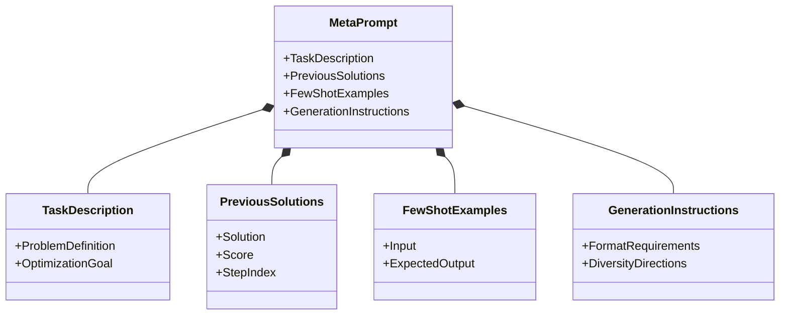
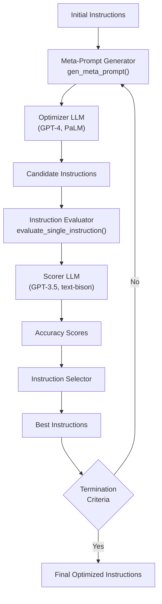
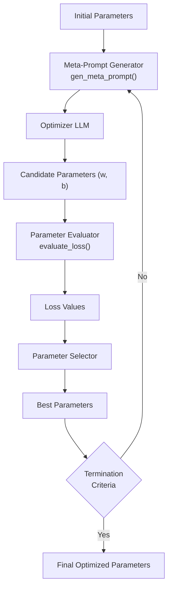
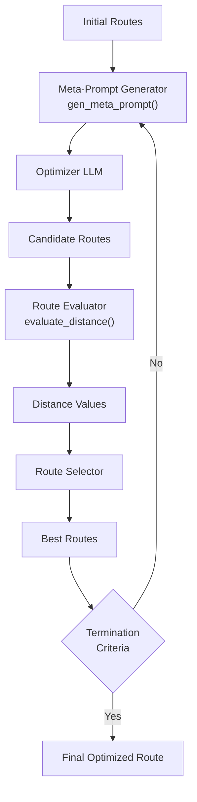
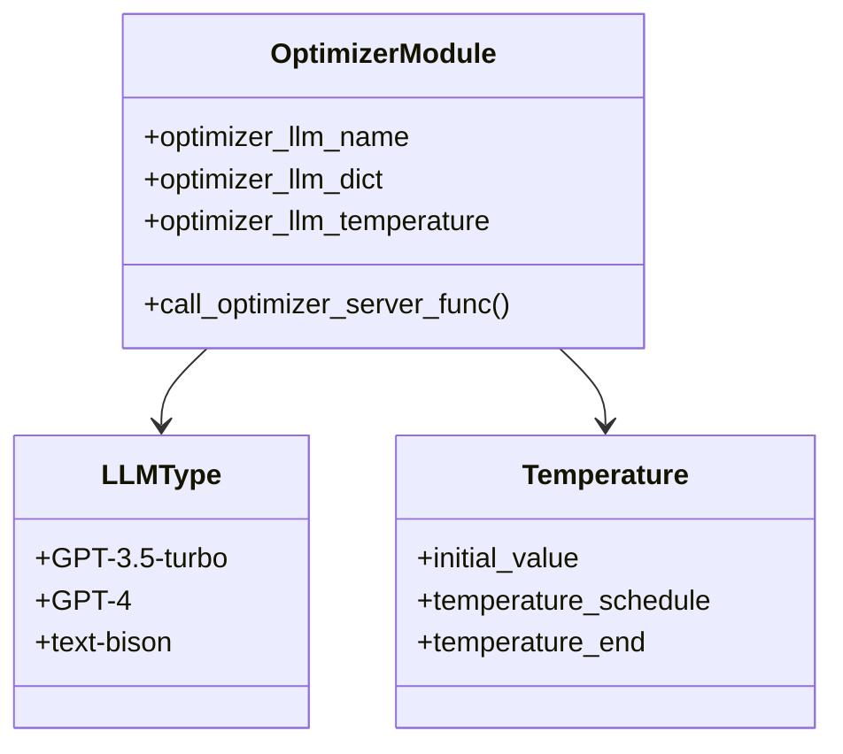
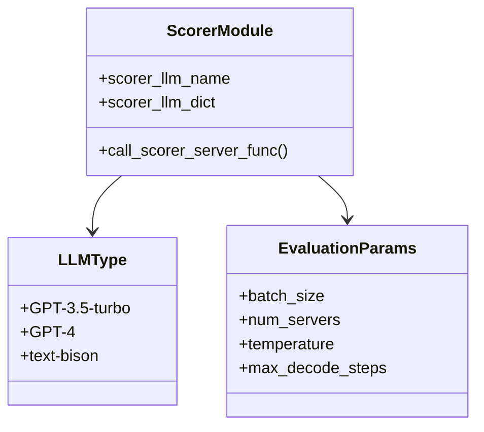

<!-- source: DeepWiki mcp.deepwiki.com · repo google-deepmind/opro · page 2 Optimization System · fetched 2026-10-26 -->

# Optimization System

<details>
<summary>Relevant source files</summary>

The following files were used as context for generating this wiki page:

- [opro/optimization/opt_utils.py](opro/optimization/opt_utils.py)
- [opro/optimization/optimize_instructions.py](opro/optimization/optimize_instructions.py)
- [opro/optimization/optimize_linear_regression.py](opro/optimization/optimize_linear_regression.py)
- [opro/optimization/optimize_tsp.py](opro/optimization/optimize_tsp.py)

</details>


The Optimization System is the core component of OPRO (Optimizing PROmpts) that enables using Language Models (LLMs) as optimizers. This system provides mechanisms for both prompt optimization and domain-specific optimization tasks like linear regression and traveling salesman problems. The system leverages LLMs' ability to generate and refine solutions through iterative improvements guided by a fitness function.

For a general overview of OPRO, see [Overview](#1). For details on evaluating optimization results, see [Evaluation System](#3).

## System Architecture

The Optimization System consists of several interrelated components that work together to improve solutions iteratively. The primary components include an optimizer LLM, a scorer LLM (for prompt optimization), meta-prompt templates, and utility functions for running the optimization process.



Sources: [opro/optimization/optimize_instructions.py:103-104](), [opro/optimization/opt_utils.py:338-343]()

## Optimization Process

The optimization process follows a general pattern across all optimization types:

1. **Initialize Solutions**: Start with initial solutions (instructions, parameters, routes)
2. **Generate Meta-Prompt**: Create a prompt that includes previous solutions and their scores
3. **Generate New Solutions**: Use the optimizer LLM to propose new solutions
4. **Evaluate Solutions**: Assess the quality of new solutions
5. **Update Solution Set**: Keep the best solutions for the next iteration
6. **Repeat**: Continue the process until termination criteria are met



Sources: [opro/optimization/opt_utils.py:338-800](), [opro/optimization/optimize_instructions.py:104-799]()

## Meta-Prompt Structure

The meta-prompt is a crucial component that guides the optimizer LLM in generating improved solutions. It typically contains:

1. **Task Description**: Explanation of the optimization task
2. **Previous Solutions**: List of previously generated solutions with scores
3. **Few-Shot Examples**: Example problems (for prompt optimization)
4. **Instructions**: Direction for generating new solutions



Sources: [opro/optimization/opt_utils.py:90-106](), [opro/optimization/opt_utils.py:173-186](), [opro/optimization/optimize_tsp.py:254-291]()

## Optimization Types

The system supports different types of optimization problems, each with specialized implementations:

### Instruction Optimization

Instruction optimization improves prompts for language models to enhance their performance on specific tasks. This process involves:

1. Generating candidate instructions using an optimizer LLM
2. Evaluating the instructions with a scorer LLM on a dataset
3. Collecting the best instructions for the next iteration



Sources: [opro/optimization/optimize_instructions.py:104-799](), [opro/optimization/opt_utils.py:338-1035]()

### Linear Regression Optimization

Linear regression optimization uses LLMs to find optimal parameters (w, b) that minimize the residual sum of squares:



Sources: [opro/optimization/optimize_linear_regression.py:169-424]()

### Traveling Salesman Problem Optimization

TSP optimization uses LLMs to find optimal routes that minimize the total travel distance:



Sources: [opro/optimization/optimize_tsp.py:172-425]()

## Core Components

### Optimizer Module

The optimizer module is responsible for generating improved solutions based on previous attempts:



Sources: [opro/optimization/optimize_instructions.py:108-153](), [opro/optimization/optimize_instructions.py:300-353](), [opro/optimization/optimize_linear_regression.py:109-156](), [opro/optimization/optimize_tsp.py:109-156]()

### Scorer Module (for Prompt Optimization)

The scorer module evaluates the quality of generated instructions:



Sources: [opro/optimization/optimize_instructions.py:246-299]()

### Utility Functions

The system includes various utility functions for optimization:

| Function | Purpose | File Path |
|---------|---------|-----------|
| `gen_meta_prompt()` | Generates meta-prompts for optimization | [opro/optimization/opt_utils.py:90-336]() |
| `run_evolution()` | Runs the evolutionary optimization process | [opro/optimization/opt_utils.py:338-1035]() |
| `evaluate_single_instruction()` | Evaluates the performance of a single instruction | [opro/evaluation/eval_utils.py]() |
| `evaluate_loss()` | Calculates loss for linear regression | [opro/optimization/optimize_linear_regression.py:169-171]() |
| `evaluate_distance()` | Calculates distance for TSP | [opro/optimization/optimize_tsp.py:172-185]() |
| `extract_string_in_square_brackets()` | Extracts solutions from LLM outputs | [opro/optimization/opt_utils.py:33-38]() |
| `parse_tag_content()` | Parses tagged content from LLM outputs | [opro/optimization/opt_utils.py:41-44]() |

Sources: [opro/optimization/opt_utils.py:33-1035](), [opro/optimization/optimize_linear_regression.py:169-248](), [opro/optimization/optimize_tsp.py:172-302]()

## Configuration Options

The optimization system offers various configuration options:

### Shared Configuration Parameters

| Parameter | Description | Default |
|-----------|-------------|---------|
| `optimizer` | The LLM used for optimization (text-bison, gpt-3.5-turbo, gpt-4) | gpt-3.5-turbo |
| `temperature` | Temperature for LLM sampling | 1.0 |
| `max_decode_steps` | Maximum number of tokens in LLM response | 1024 |
| `num_steps` | Maximum number of optimization steps | Varies |
| `max_num_pairs` | Maximum number of previous solutions in meta-prompt | 20 |

### Instruction Optimization Parameters

| Parameter | Description | Default |
|-----------|-------------|---------|
| `scorer` | The LLM used for scoring instructions | text-bison |
| `dataset` | Dataset to optimize instructions for (gsm8k, mmlu, bbh) | gsm8k |
| `task` | Specific task within the dataset | train |
| `instruction_pos` | Position of the instruction (A_begin, Q_begin, Q_end, before_Q) | A_begin |
| `meta_prompt_type` | Type of meta-prompt (both_instructions_and_exemplars, instructions_only) | both_instructions_and_exemplars |
| `train_ratio` | Proportion of data used for training | 0.8 for MMLU, 0.035 for GSM8K, 0.2 for BBH |
| `few_shot_selection_criteria` | How to select few-shot examples | random |

Sources: [opro/optimization/optimize_instructions.py:55-101](), [opro/optimization/optimize_linear_regression.py:49-57](), [opro/optimization/optimize_tsp.py:52-64]()

## Usage Examples

### Command-line Example for Instruction Optimization

```bash
python optimize_instructions.py \
    --optimizer="gpt-3.5-turbo" --scorer="text-bison" \
    --instruction_pos="A_begin" --dataset="gsm8k" --task="train" \
    --palm_api_key="<your_key>" --openai_api_key="<your_key>"
```

### Command-line Example for Linear Regression Optimization

```bash
python optimize_linear_regression.py \
    --optimizer="text-bison" \
    --palm_api_key="<your_key>"
```

### Command-line Example for TSP Optimization

```bash
python optimize_tsp.py \
    --optimizer="gpt-4" \
    --openai_api_key="<your_key>" \
    --starting_algorithm="farthest_insertion"
```

Sources: [opro/optimization/optimize_instructions.py:14-42](), [opro/optimization/optimize_linear_regression.py:14-27](), [opro/optimization/optimize_tsp.py:14-27]()

## Code Map

This diagram maps the main function calls and data flow in the optimization system:

```mermaid
graph TD
    subgraph "optimize_instructions.py"
        A["main()"] --> B["run_evolution()"]
        B --> C["gen_meta_prompt()"]
        C --> D["call_optimizer_server_func()"]
        D --> E["evaluate_single_instruction()"]
    end
    
    subgraph "optimize_linear_regression.py"
        F["main()"] --> G["gen_meta_prompt()"]
        G --> H["call_optimizer_server_func()"]
        H --> I["extract_string_in_square_brackets()"]
        I --> J["evaluate_loss()"]
    end
    
    subgraph "optimize_tsp.py"
        K["main()"] --> L["gen_meta_prompt()"]
        L --> M["call_optimizer_server_func()"]
        M --> N["extract_string()"]
        N --> O["evaluate_distance()"]
    end
    
    subgraph "opt_utils.py"
        P["run_evolution()"] --> Q["gen_meta_prompt()"] 
        Q --> R["gen_ins_and_score_pairs_substr()"]
        P --> S["evaluate_single_instruction()"]
    end
```



Sources: [opro/optimization/optimize_instructions.py:104-799](), [opro/optimization/optimize_linear_regression.py:60-423](), [opro/optimization/optimize_tsp.py:60-429](), [opro/optimization/opt_utils.py:338-1035]()

## Key Takeaways

1. **LLMs as Optimizers**: The system uses LLMs not just for language tasks but as general optimizers that can improve solutions through iterative refinement.

2. **Meta-Prompt Design**: The meta-prompt structure is crucial for effective optimization, providing the LLM with context about previous solutions and their performance.

3. **Versatility**: The same fundamental approach works for diverse optimization problems, from prompt engineering to mathematical optimization and combinatorial optimization.

4. **Evaluation Integration**: The system integrates tightly with the evaluation module to assess solution quality and guide the optimization process.

5. **Configurability**: The system offers extensive configuration options to adapt to different optimization scenarios and requirements.

---

