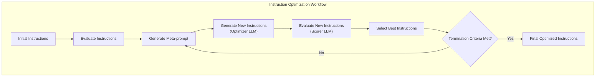
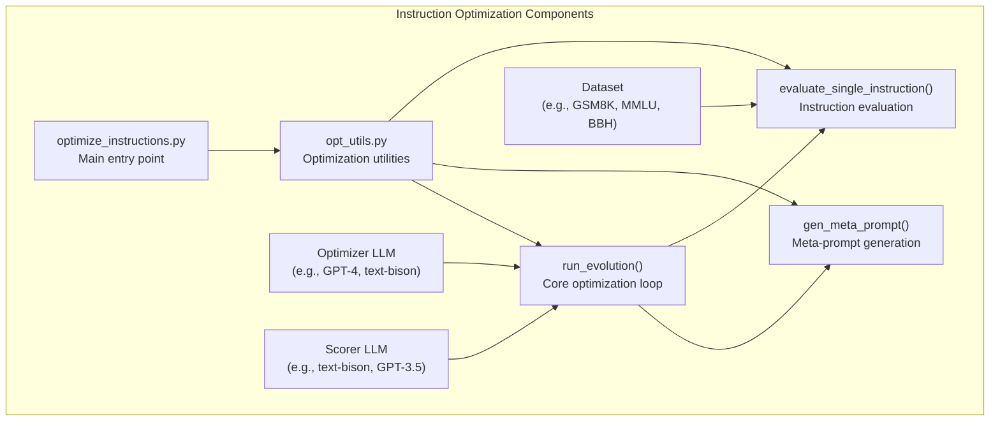
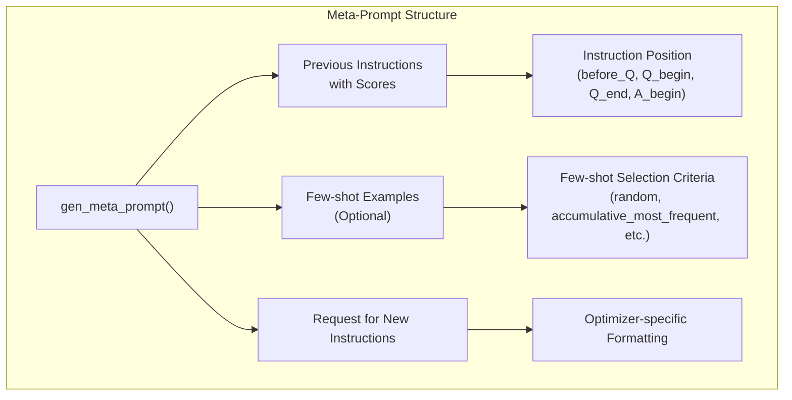
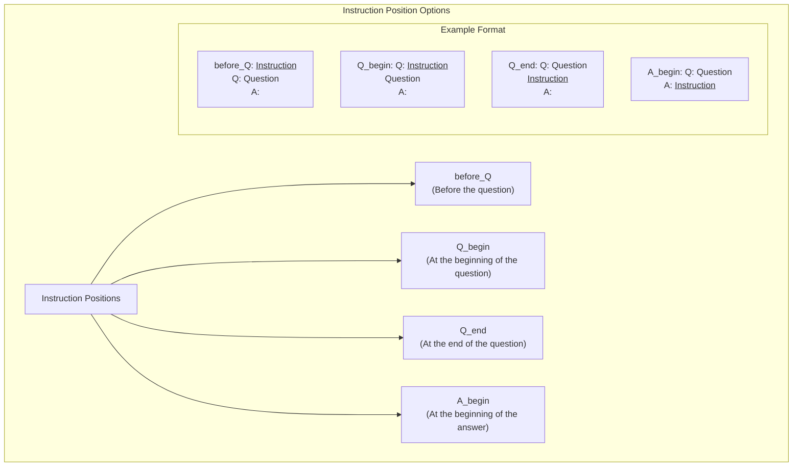
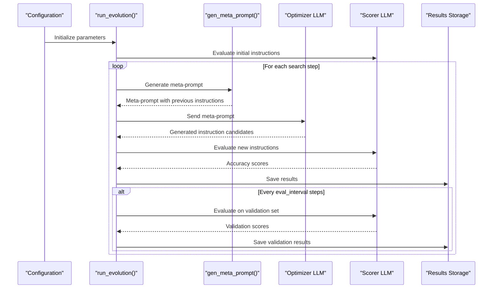

<!-- source: DeepWiki mcp.deepwiki.com · repo google-deepmind/opro · page 2.1 Instruction Optimization · fetched 2026-10-26 -->

# Instruction Optimization

<details>
<summary>Relevant source files</summary>

The following files were used as context for generating this wiki page:

- [img/gpt_meta_prompt.png](img/gpt_meta_prompt.png)
- [img/workflow.png](img/workflow.png)
- [opro/optimization/opt_utils.py](opro/optimization/opt_utils.py)
- [opro/optimization/optimize_instructions.py](opro/optimization/optimize_instructions.py)

</details>


## Purpose and Scope

This document provides a detailed technical overview of the instruction optimization system within OPRO. The system is designed to automatically discover and refine effective instructions (prompts) that improve language model performance on specific tasks. Instruction optimization serves as a core functionality of OPRO, enabling the systematic search for optimal prompts through an evolutionary approach using language models themselves as optimizers.

For information about other types of optimization supported by OPRO, such as linear regression optimization or traveling salesman problem optimization, see [Domain-specific Optimization](#2.2).

Sources: [opro/optimization/optimize_instructions.py:14-42]()

## System Overview

Instruction optimization in OPRO follows an evolutionary process where language models are used to both generate candidate instructions and evaluate their effectiveness. The system iteratively refines instructions through a feedback loop, measuring performance improvements to guide the optimization process.



Sources: [opro/optimization/optimize_instructions.py:104-116](), [opro/optimization/opt_utils.py:338-344]()

## Key Components

The instruction optimization system consists of several key components that work together to discover effective instructions:



Sources: [opro/optimization/optimize_instructions.py:59-68](), [opro/optimization/opt_utils.py:32-45]()

### Main Optimization Loop

The core of instruction optimization is implemented in `run_evolution()`, which orchestrates the iterative process of instruction generation, evaluation, and selection:

1. Evaluation of initial instructions
2. Iterative generation of new instructions using the optimizer LLM
3. Evaluation of new instructions using the scorer LLM
4. Selection of best instructions based on performance
5. Periodic evaluation on validation set to measure generalization

Sources: [opro/optimization/opt_utils.py:338-401](), [opro/optimization/opt_utils.py:798-799]()

### Meta-Prompt Generation

Meta-prompts guide the optimizer LLM in generating effective instructions. Two main types are supported:

1. **Both Instructions and Exemplars**: Includes previous instructions with their scores and dataset examples (suitable for fine-tuned optimizers)
2. **Instructions Only**: Includes only previous instructions and their scores (suitable for pre-trained optimizers)

The meta-prompt structure varies based on the optimizer LLM, instruction position, and whether few-shot examples are included.



Sources: [opro/optimization/opt_utils.py:90-153](), [opro/optimization/opt_utils.py:684-724]()

### Instruction Evaluation

Generated instructions are evaluated on the training set using the scorer LLM. The evaluation process:

1. Combines instructions with examples from the dataset based on the instruction position
2. Sends the prompts to the scorer LLM
3. Parses responses and computes accuracy scores
4. Saves detailed evaluation results

Periodically, instructions are also evaluated on a validation set to measure generalization performance.

Sources: [opro/optimization/opt_utils.py:905-935](), [opro/optimization/opt_utils.py:980-1009]()

## Instruction Positions

The system supports four different positions for placing instructions in prompts:



Sources: [opro/optimization/opt_utils.py:140-148](), [opro/optimization/optimize_instructions.py:174-184]()

## Configuration Parameters

The instruction optimization system offers extensive configuration options to control the optimization process.

### LLM Configuration

Two language models are used in the optimization process:
1. **Scorer LLM**: Evaluates the effectiveness of instructions
2. **Optimizer LLM**: Generates new instruction candidates

Both can be configured with parameters such as temperature, maximum decoding steps, and batch size.

| Parameter | Description | Typical Values |
|-----------|-------------|----------------|
| scorer_llm_name | Name of the LLM used for evaluation | text-bison, gpt-3.5-turbo, gpt-4 |
| optimizer_llm_name | Name of the LLM used for generation | text-bison, gpt-3.5-turbo, gpt-4 |
| temperature | Randomness in generation | 0.0 (evaluation), 1.0 (generation) |
| max_decode_steps | Maximum output length | 512-1024 tokens |

Sources: [opro/optimization/optimize_instructions.py:246-298](), [opro/optimization/optimize_instructions.py:301-353]()

### Optimization Parameters

Parameters that control the evolutionary optimization process:

| Parameter | Description | Default Value |
|-----------|-------------|---------------|
| num_search_steps | Number of optimization iterations | 200 |
| num_generated_instructions_in_each_step | Instructions to generate per step | 8 |
| old_instruction_score_threshold | Minimum score to keep instructions | 0.0-0.3 |
| max_num_instructions | Maximum instructions in meta-prompt | 20 |
| meta_prompt_type | Type of meta-prompt to use | both_instructions_and_exemplars |
| few_shot_selection_criteria | How to select few-shot examples | random |
| eval_interval | Steps between validation evaluations | 3 |

Sources: [opro/optimization/optimize_instructions.py:681-736](), [opro/optimization/opt_utils.py:710-724]()

## Datasets and Task Support

The system supports optimization for multiple benchmark datasets:

1. **GSM8K**: Grade school math problems
2. **MMLU**: Massive Multitask Language Understanding benchmark with multiple categories
3. **BBH**: BIG-Bench Hard tasks

Each dataset has specific configurations and processing requirements. The system appropriately handles different task types:
- Multiple-choice tasks
- Boolean tasks (yes/no, true/false)
- Numerical output tasks

Sources: [opro/optimization/optimize_instructions.py:113-157](), [opro/optimization/opt_utils.py:404-408]()

## Usage Example

Instruction optimization can be initiated using the command-line interface provided by `optimize_instructions.py`:

```
python optimize_instructions.py \
    --optimizer="gpt-3.5-turbo" --scorer="text-bison" \
    --instruction_pos="A_begin" --dataset="gsm8k" --task="train"
```

The process requires:
1. API keys for the selected LLMs
2. Initial instructions defined in the script
3. Dataset selection
4. Configuration of optimization parameters

Sources: [opro/optimization/optimize_instructions.py:14-42]()

## Data Flow During Optimization

The following diagram illustrates the detailed data flow during the instruction optimization process:



Sources: [opro/optimization/opt_utils.py:338-1036]()

## Output and Results

The optimization process generates several outputs:

1. **Optimized Instructions**: The best-performing instructions discovered
2. **Performance Metrics**: Accuracy scores on training and validation sets
3. **Detailed Evaluation Results**: Per-example performance data
4. **Meta-Prompts**: The prompts used to generate new instructions
5. **Optimization Trace**: The history of instructions and scores throughout the process

Results are saved to the specified output directory, with detailed evaluation results for each instruction.

Sources: [opro/optimization/optimize_instructions.py:221-237](), [opro/optimization/opt_utils.py:1012-1035]()

## Implementation Details

### Few-Shot Example Selection

The system supports several strategies for selecting few-shot examples to include in meta-prompts:

1. **accumulative_most_frequent**: Selects examples that were most frequently answered incorrectly across all previous instructions
2. **current_most_frequent**: Selects examples that are most frequently answered incorrectly by the current set of instructions
3. **random**: Randomly selects examples from the training set
4. **constant**: Uses the same examples across all iterations

Sources: [opro/optimization/opt_utils.py:587-688]()

### Instruction Processing

Generated instructions undergo preprocessing to:
1. Extract instructions from LLM outputs based on formatting markers
2. Remove duplicates and previously evaluated instructions
3. Filter out invalid instructions (too long, containing numbers for certain tasks, etc.)

Sources: [opro/optimization/opt_utils.py:732-824]()

## Related Components

For more details on specific aspects of the OPRO system, refer to:

- [Evaluation System](#3) for details on how instructions are evaluated
- [Meta-prompt Design](#6) for more information on meta-prompt structure and design
- [Domain-specific Optimization](#2.2) for other optimization capabilities in OPRO

---

