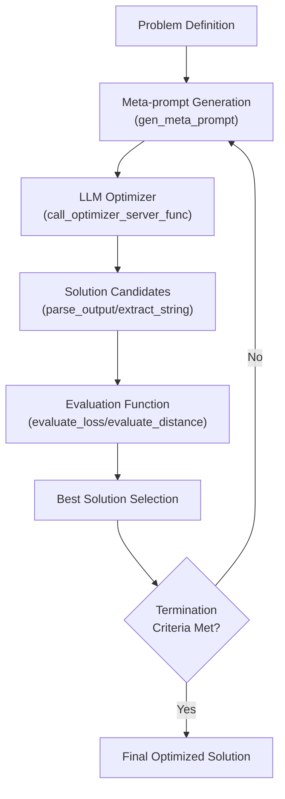
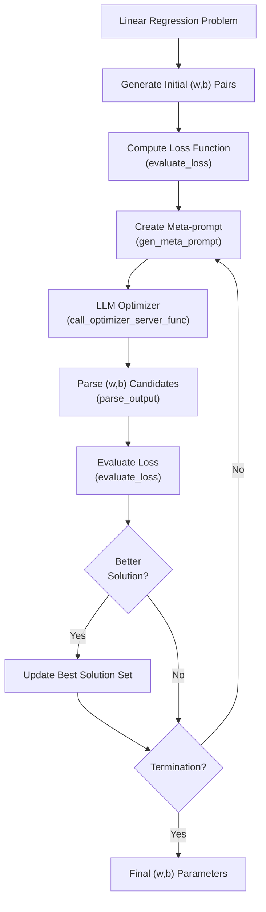
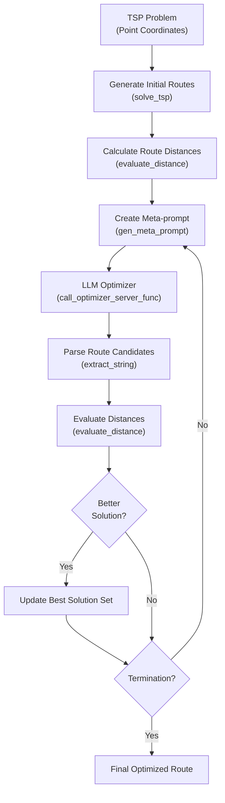
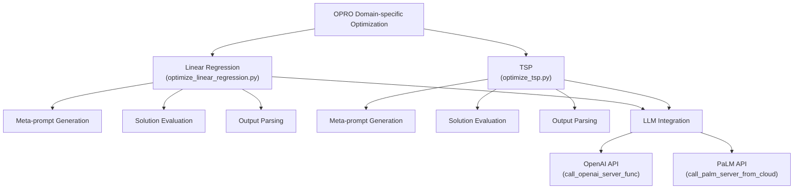

<!-- source: DeepWiki mcp.deepwiki.com · repo google-deepmind/opro · page 2.2 Domain-specific Optimization · fetched 2026-10-26 -->

# Domain-specific Optimization

<details>
<summary>Relevant source files</summary>

The following files were used as context for generating this wiki page:

- [opro/optimization/optimize_linear_regression.py](opro/optimization/optimize_linear_regression.py)
- [opro/optimization/optimize_tsp.py](opro/optimization/optimize_tsp.py)

</details>


This document describes how the OPRO (Optimizing PROmpts) framework extends beyond prompt optimization to solve problems in specific domains through the use of Large Language Models (LLMs) as optimizers. While [Instruction Optimization](#2.1) focuses on improving prompts for LLMs, domain-specific optimization demonstrates how the same methodology can be applied to traditional optimization problems from other fields.

## Overview of Domain-specific Optimization

OPRO's domain-specific optimization modules implement a general framework where LLMs are used to iteratively improve solutions to optimization problems. The system currently supports two example domains:

1. Linear Regression - Finding optimal parameters for linear models
2. Traveling Salesman Problem (TSP) - Finding optimal routes that visit all points

Both implementations follow a similar pattern: using meta-prompts to communicate problem context and previous solutions to an LLM, which then generates improved solution candidates.



**General Domain-specific Optimization Process**

Sources: [opro/optimization/optimize_linear_regression.py:160-166](), [opro/optimization/optimize_tsp.py:160-166](), [opro/optimization/optimize_linear_regression.py:341-407](), [opro/optimization/optimize_tsp.py:374-425]()

## Linear Regression Optimization

The linear regression optimization module demonstrates how LLMs can be used to find optimal parameters for a linear model of the form y = wx + b, where the goal is to minimize the sum of squared residuals.

### Configuration and Implementation

The linear regression optimizer accepts several configuration parameters:

| Parameter | Description | Default |
|-----------|-------------|---------|
| num_points | Number of data points in regression problem | 50 |
| w_true, b_true | True parameter values (for evaluation) | 15, 14 |
| max_num_steps | Maximum optimization iterations | 500 |
| num_reps | Number of repeated runs | 5 |
| max_num_pairs | Maximum examples in meta-prompt | 20 |
| num_input_decimals | Decimal precision for input parameters | 0 |
| num_output_decimals | Decimal precision for output values | 0 |
| num_generated_points_in_each_step | Number of candidates per step | 8 |

Sources: [opro/optimization/optimize_linear_regression.py:61-70]()

### Optimization Process



**Linear Regression Optimization Workflow**

Sources: [opro/optimization/optimize_linear_regression.py:170-172](), [opro/optimization/optimize_linear_regression.py:173-237](), [opro/optimization/optimize_linear_regression.py:276-410]()

### Meta-prompt Structure

The linear regression meta-prompt includes:

1. Task description: Minimizing a function with two input variables (w, b)
2. Previous (w, b) pairs and their function values in descending order
3. Request for a new (w, b) pair with lower function value

Example meta-prompt format:
```
Now you will help me minimize a function with two input variables w, b. I have some (w, b) pairs and the function values at those points. The pairs are arranged in descending order based on their function values, where lower values are better.

input:
w=10, b=15
value:
2500

input:
w=12, b=14
value:
1800

...

Give me a new (w, b) pair that is different from all pairs above, and has a function value lower than any of the above. Do not write code. The output must end with a pair [w, b], where w and b are numerical values.
```

Sources: [opro/optimization/optimize_linear_regression.py:173-237]()

## Traveling Salesman Problem Optimization

The TSP optimization module demonstrates how LLMs can be used to find the shortest possible route that visits all points exactly once and returns to the origin point.

### Configuration and Implementation

The TSP optimizer accepts several configuration parameters:

| Parameter | Description | Default |
|-----------|-------------|---------|
| num_points | Number of points/cities in the TSP | 100 |
| num_steps | Maximum optimization iterations | 500 |
| max_num_pairs | Maximum examples in meta-prompt | 10 |
| num_decimals | Decimal precision for distances | 0 |
| num_starting_points | Number of initial routes | 5 |
| num_decode_per_step | Number of candidates per step | 8 |
| starting_algorithm | Algorithm to generate initial solutions | farthest_insertion |

Sources: [opro/optimization/optimize_tsp.py:67-74](), [opro/optimization/optimize_tsp.py:63-64]()

### Optimization Process



**TSP Optimization Workflow**

Sources: [opro/optimization/optimize_tsp.py:172-185](), [opro/optimization/optimize_tsp.py:254-291](), [opro/optimization/optimize_tsp.py:374-425]()

### Meta-prompt Structure

The TSP meta-prompt includes:

1. Coordinates of all points
2. Previous routes and their total distances in descending order
3. Request for a new route with shorter distance

Example meta-prompt format:
```
You are given a list of points with coordinates below:
(0): (45, 23), (1): (-12, 85), (2): (67, -34), ...

Below are some previous traces and their lengths. The traces are arranged in descending order based on their lengths, where lower values are better.

<trace> 0,4,7,2,9,5,1,8,3,6 </trace>
length:
1250

<trace> 0,3,6,9,5,1,8,4,2,7 </trace>
length:
1180

...

Give me a new trace that is different from all traces above, and has a length lower than any of the above. The trace should traverse all points exactly once. The trace should start with '<trace>' and end with </trace>.
```

Sources: [opro/optimization/optimize_tsp.py:254-291]()

## Common Components and Integration

Both domain-specific optimization examples share several key components:



**Component Relationships in Domain-specific Optimization**

Sources: [opro/optimization/optimize_linear_regression.py:82-143](), [opro/optimization/optimize_tsp.py:82-143]()

### LLM Integration

Both optimization modules support multiple LLM providers:

1. **OpenAI models**: GPT-3.5-turbo and GPT-4
2. **Google PaLM models**: text-bison

Configuration parameters for the LLMs include:
- Temperature (controlling randomness)
- Maximum decode steps (limiting response length)
- Batch size (for processing multiple solutions)

Sources: [opro/optimization/optimize_linear_regression.py:108-156](), [opro/optimization/optimize_tsp.py:108-156]()

### Shared Patterns

Both domain-specific optimization examples illustrate key patterns:

1. **Meta-prompt Evolution**: Meta-prompts incorporate better solutions as they are found
2. **Solution History Management**: Tracking all tried solutions and their scores
3. **Iterative Refinement**: Using the same LLM repeatedly with updated context
4. **Evaluation Functions**: Domain-specific functions to calculate objective values

Sources: [opro/optimization/optimize_linear_regression.py:341-407](), [opro/optimization/optimize_tsp.py:374-425]()

## Usage Example

To run a domain-specific optimization, use the respective Python script with appropriate API keys:

```bash
# For linear regression optimization
python optimize_linear_regression.py --optimizer="text-bison" --palm_api_key="your_key"

# For TSP optimization
python optimize_tsp.py --optimizer="gpt-4" --openai_api_key="your_key" --starting_algorithm="farthest_insertion"
```

Sources: [opro/optimization/optimize_linear_regression.py:14-27](), [opro/optimization/optimize_tsp.py:14-27]()

## Extending to Other Domains

The pattern demonstrated by these examples can be extended to other optimization problems by:

1. Defining a suitable meta-prompt for the problem domain
2. Implementing a domain-specific evaluation function
3. Creating appropriate parsing logic for LLM-generated solutions
4. Following the iterative optimization loop structure

---

