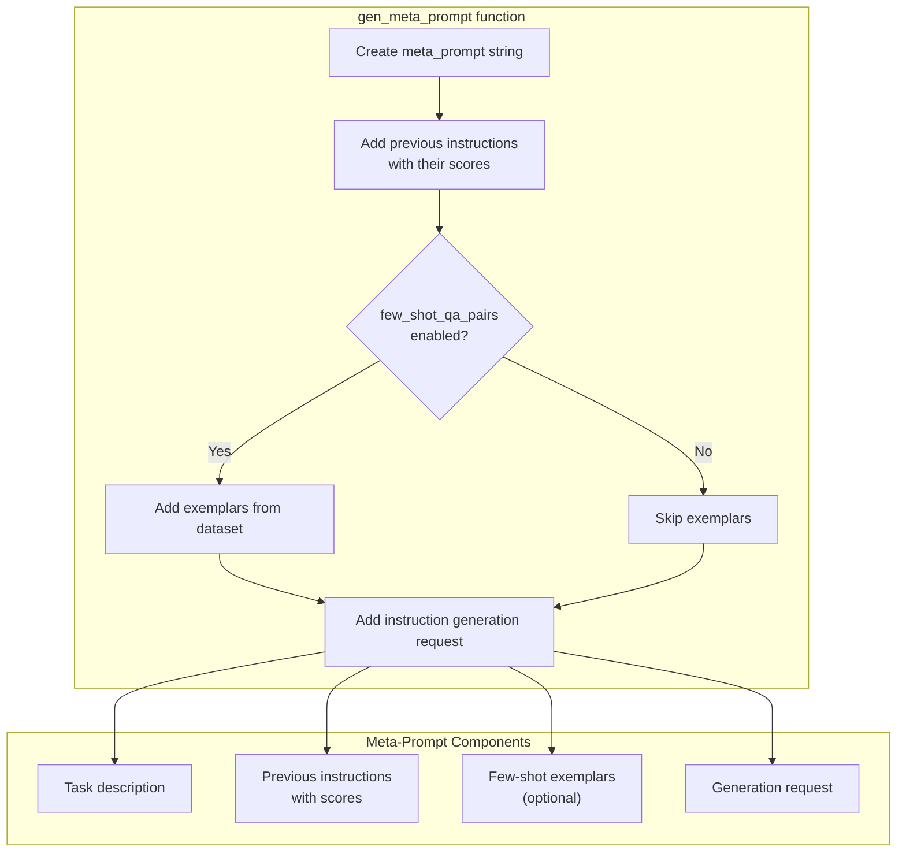
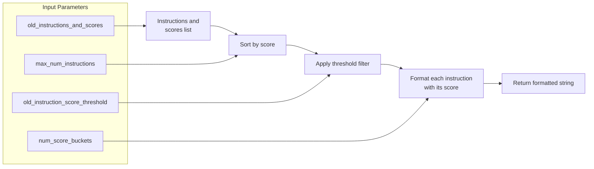
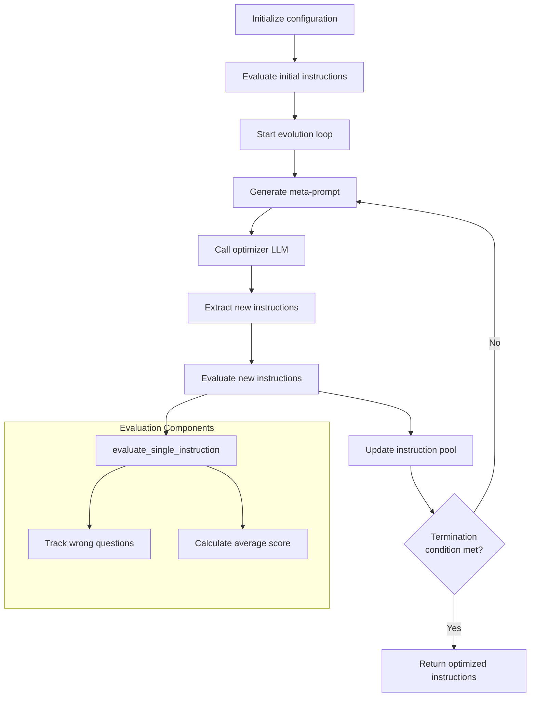
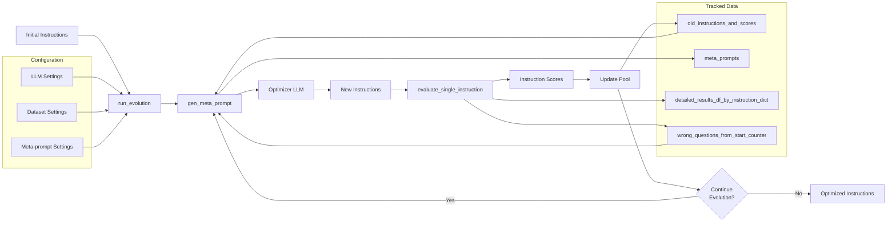
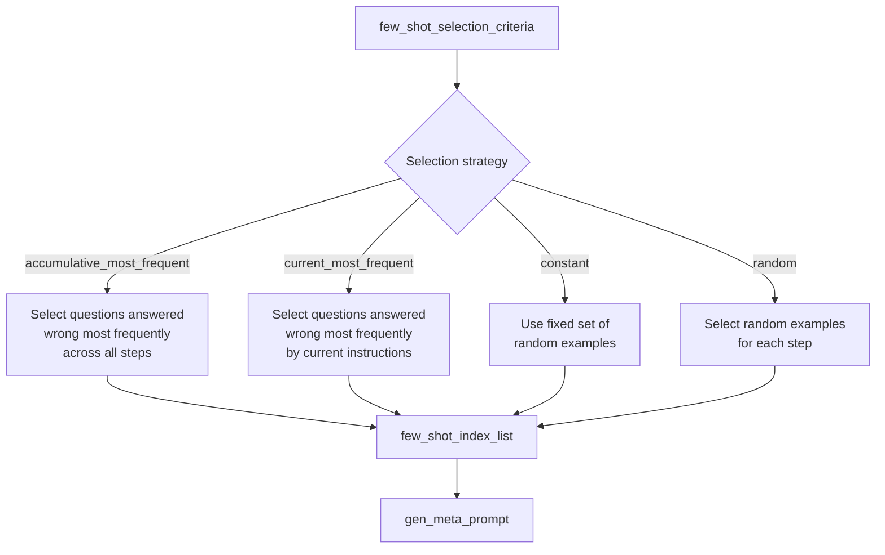
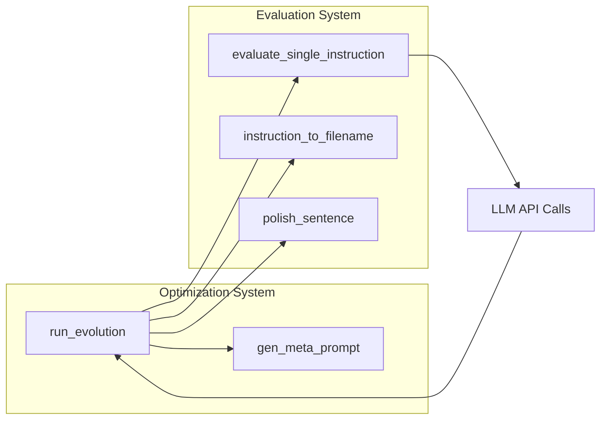

<!-- source: DeepWiki mcp.deepwiki.com · repo google-deepmind/opro · page 2.3 Optimization Utilities · fetched 2026-10-26 -->

# Optimization Utilities

Relevant source files

The following files were used as context for generating this wiki page:

- [opro/optimization/opt_utils.py](opro/optimization/opt_utils.py)

## Purpose and Scope

This document details the utility functions and helpers used in the OPRO optimization process. These utilities provide the foundational components for generating meta-prompts, executing evolutionary optimization algorithms, and managing the prompt optimization workflow.

For information about how these utilities are used to optimize instructions/prompts for language models, see [Instruction Optimization](#2.1). For details on domain-specific applications like linear regression and traveling salesman problem optimization, see [Domain-specific Optimization](#2.2).

Sources: [opro/optimization/opt_utils.py:14-14]()

## Core Utility Functions

The optimization utilities provide several helper functions that support the prompt optimization process:

| Function | Purpose |
|----------|---------|
| `extract_string_in_square_brackets` | Extracts content enclosed in square brackets from a string |
| `parse_tag_content` | Extracts content between specified XML-like tags (e.g., `<TEXT>...</TEXT>`) |
| `_bucketize_float` | Converts a float between 0 and 1 into a discrete bucket number |
| `gen_ins_and_score_pairs_substr` | Generates a formatted string of instruction-score pairs for meta-prompts |
| `gen_meta_prompt` | Creates the meta-prompt for instruction rewriting/optimization |
| `run_evolution` | Executes the evolutionary optimization process |

These utilities collectively support the iterative refinement of prompts through LLM-guided optimization.

Sources: [opro/optimization/opt_utils.py:33-45](), [opro/optimization/opt_utils.py:47-49]()

## Meta-Prompt Generation

The `gen_meta_prompt` function is a critical component that constructs prompts used to guide the optimizer LLM in generating improved instructions.

### Meta-Prompt Structure

The meta-prompt contains:
1. Task description tailored to the optimizer LLM
2. Previous instructions with their performance scores
3. Optional few-shot exemplars from the dataset
4. A specific request for generating new, improved instructions

Meta-prompt generation supports different LLMs (e.g., GPT-3.5/4, PaLM/text-bison) and can be configured based on:
- Where instructions should be positioned (`instruction_pos`)
- Whether to include few-shot examples
- How to display scores (bucketed or raw)
- The type of meta-prompt (instructions only or instructions with exemplars)

Sources: [opro/optimization/opt_utils.py:90-335]()

## Instruction-Score Pair Generation

The `gen_ins_and_score_pairs_substr` function creates formatted strings containing previous instructions and their scores for inclusion in meta-prompts:

This function supports:
- Filtering instructions by score threshold
- Limiting the number of instructions included
- Optionally bucketing scores into discrete values

Sources: [opro/optimization/opt_utils.py:52-87]()

## Evolutionary Optimization Process

The `run_evolution` function implements the core optimization workflow:

The evolution process:
1. Starts with initial instructions
2. In each step:
   - Generates a meta-prompt using previous instructions and their scores
   - Uses the optimizer LLM to generate new candidate instructions
   - Evaluates new instructions on the training data
   - Optionally evaluates on few-shot examples
3. Periodically evaluates on a separate evaluation set
4. Saves results and configurations throughout the process

Sources: [opro/optimization/opt_utils.py:338-1035]()

## Key Configuration Parameters

The evolutionary optimization process accepts numerous configuration parameters:

| Parameter Category | Description | Examples |
|-------------------|-------------|----------|
| **Experimental Setup** | Basic evolution parameters | `num_search_steps`, `old_instruction_score_threshold` |
| **LLM Configuration** | LLM-specific settings | `scorer_llm_dict`, `optimizer_llm_dict`, `optimizer_llm_temperature` |
| **Dataset Configuration** | Dataset-related settings | `dataset_name`, `task_name`, `train_index`, `eval_index` |
| **Meta-prompt Configuration** | Meta-prompt generation parameters | `instruction_pos`, `few_shot_qa_pairs`, `meta_prompt_type` |
| **Evaluation Settings** | How to evaluate instructions | `evaluate_in_parallel`, `extract_final_answer_by_prompting_again` |
| **Storage Configuration** | Where to save results | `save_folder`, `result_by_instruction_folder` |

Sources: [opro/optimization/opt_utils.py:338-401]()

## Optimization Data Flow

The optimization process maintains several data structures to track progress:
- `old_instructions_and_scores`: Instructions and their performance scores
- `meta_prompts`: Generated meta-prompts for each step
- `detailed_results_df_by_instruction_dict`: Detailed evaluation results
- `wrong_questions_from_start_counter`: Counter for questions answered incorrectly
- `instruction_score_dict`: Dictionary mapping instructions to their scores

Sources: [opro/optimization/opt_utils.py:430-448](), [opro/optimization/opt_utils.py:1012-1035]()

## Few-Shot Example Selection

The optimization process can use various strategies to select few-shot examples for instruction refinement:

These selection strategies help focus the instruction optimization on examples that are particularly challenging for the current set of instructions.

Sources: [opro/optimization/opt_utils.py:587-688]()

## Implementation Considerations

The optimization utilities handle several practical implementation concerns:

1. **Instruction Deduplication**: Uses MD5 hashing to avoid re-evaluating previously seen instructions
2. **Error Handling**: Implements retries and sleep times for API calls
3. **Result Persistence**: Saves results incrementally throughout the optimization process
4. **Temperature Scheduling**: Supports linear temperature increase for the optimizer LLM
5. **Instruction Filtering**: Skips instructions that are too long or contain undesirable elements
6. **Parallelization**: Supports parallel evaluation of instructions

Sources: [opro/optimization/opt_utils.py:786-798](), [opro/optimization/opt_utils.py:731-784](), [opro/optimization/opt_utils.py:803-823]()

## Integration with Evaluation System

The optimization utilities integrate closely with the evaluation system through the `eval_utils` module:

The optimization process uses the evaluation system to:
1. Calculate performance scores for instructions
2. Format and process instructions
3. Load and prepare dataset examples
4. Handle LLM API interactions

Sources: [opro/optimization/opt_utils.py:29-29](), [opro/optimization/opt_utils.py:523-542](), [opro/optimization/opt_utils.py:906-925]()

---

