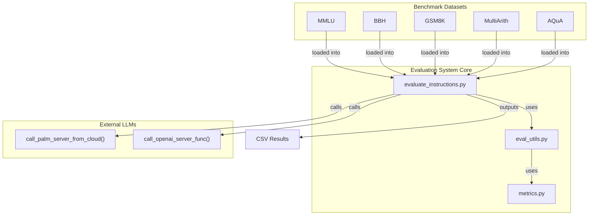
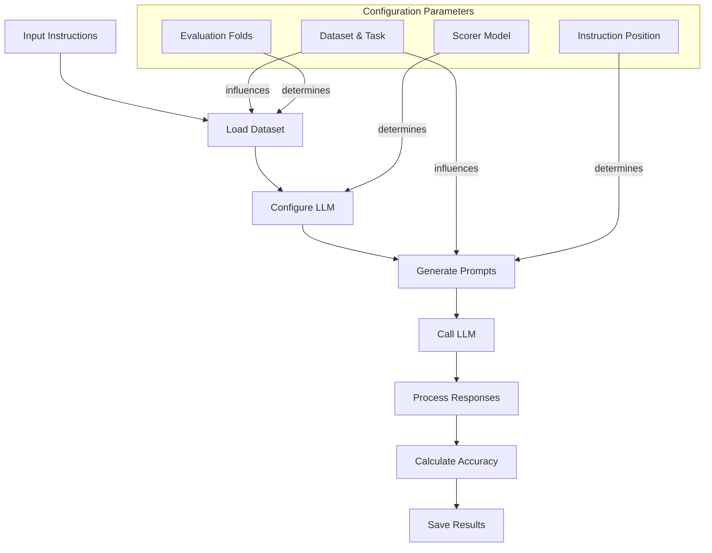
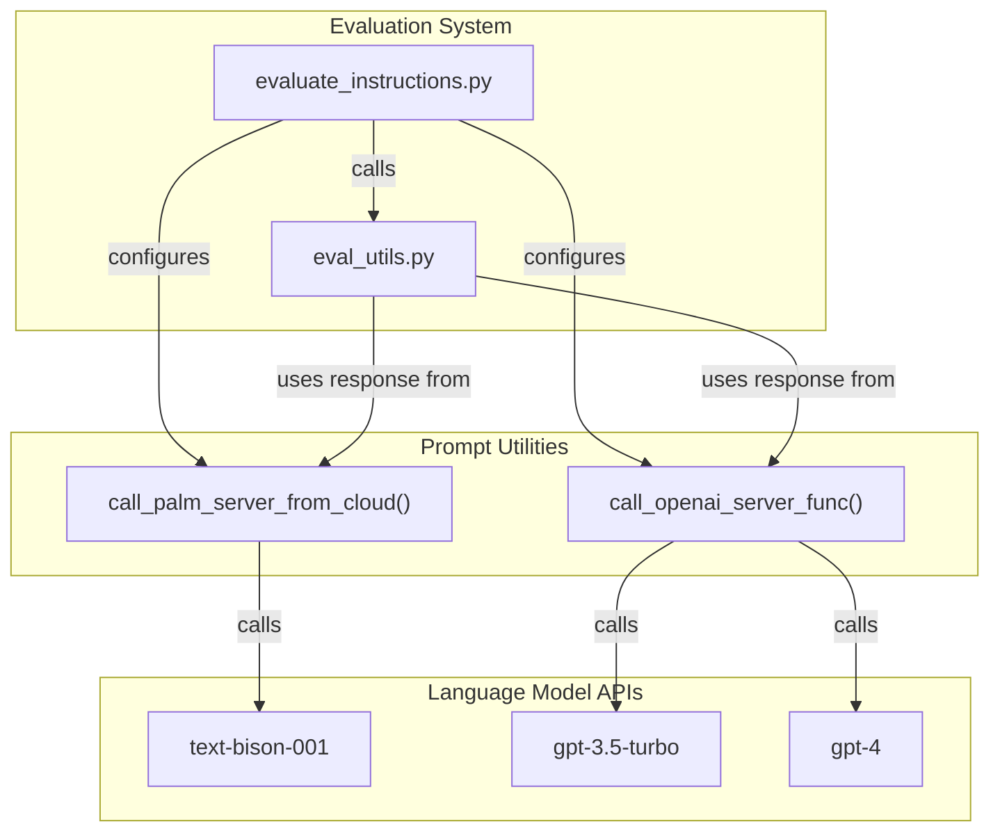
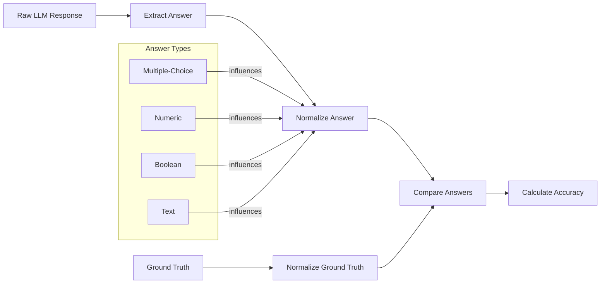

<!-- source: DeepWiki mcp.deepwiki.com · repo google-deepmind/opro · page 3 Evaluation System · fetched 2026-10-26 -->

# Evaluation System

<details>
<summary>Relevant source files</summary>

The following files were used as context for generating this wiki page:

- [opro/evaluation/eval_utils.py](opro/evaluation/eval_utils.py)
- [opro/evaluation/evaluate_instructions.py](opro/evaluation/evaluate_instructions.py)
- [opro/evaluation/metrics.py](opro/evaluation/metrics.py)

</details>


The Evaluation System is a core component of OPRO that systematically assesses instruction (prompt) performance across various benchmark datasets using different language models (LLMs). This page documents the architecture, workflow, and configuration options of the evaluation framework. For information about the optimization process that generates instructions to be evaluated, see [Optimization System](#2).

## Overview

The Evaluation System takes instructions as input, applies them to problems from various datasets, and measures how well language models perform when given these instructions. This allows researchers to quantitatively compare the effectiveness of different prompting strategies.



Sources: [opro/evaluation/evaluate_instructions.py:1-40](), [opro/evaluation/eval_utils.py:14-29]()

## Key Components

The Evaluation System consists of three primary components:

1. **Evaluate Instructions Module** (`evaluate_instructions.py`): The main script that orchestrates the evaluation process.
2. **Evaluation Utilities** (`eval_utils.py`): Helper functions for prompt generation, accuracy calculation, and response processing.
3. **Metrics Module** (`metrics.py`): Specialized functions for answer normalization and metric calculations.

### Evaluate Instructions Module

This is the entry point for evaluation, handling:
- Command-line arguments for configuration
- Dataset loading and preprocessing
- API setup for language model access
- Instruction evaluation with accuracy calculations
- Result storage and reporting

### Evaluation Utilities

Contains functions that:
- Generate prompts with instructions positioned appropriately
- Evaluate instructions across datasets
- Process model responses
- Calculate accuracy metrics
- Handle various answer formats (multiple-choice, numeric, boolean)

### Metrics Module

Specializes in:
- Normalizing model predictions for consistent comparison
- Extracting final answers from verbose model outputs
- Handling different answer formats (text, numbers, choices)

Sources: [opro/evaluation/evaluate_instructions.py:41-61](), [opro/evaluation/eval_utils.py:30-46](), [opro/evaluation/metrics.py:14-29]()

## Evaluation Workflow



Sources: [opro/evaluation/evaluate_instructions.py:97-118](), [opro/evaluation/evaluate_instructions.py:536-546]()

## Instruction Positioning

The system supports placing instructions in different positions within the prompt:

| Position | Description | Example |
| --- | --- | --- |
| `before_Q` | Instruction placed before the question | `{instruction}\nQ: {question}\n\nA:` |
| `Q_begin` | Instruction placed at the beginning of the question | `Q: {instruction}\n{question}\n\nA:` |
| `Q_end` | Instruction placed at the end of the question | `Q: {question}\n{instruction}\n\nA:` |
| `A_begin` | Instruction placed at the beginning of the answer | `Q: {question}\n\nA: {instruction}` |

Sources: [opro/evaluation/eval_utils.py:164-259]()

## Supported Datasets

The Evaluation System supports several benchmark datasets:

| Dataset | Description | Answer Type |
| --- | --- | --- |
| MMLU | Multiple-choice questions across 57 subjects | Multiple-choice |
| BBH | Collection of 27 challenging tasks | Multiple-choice, Boolean, Numeric |
| GSM8K | Elementary-level math problems | Numeric |
| MultiArith | Simple arithmetic word problems | Numeric |
| AQuA | Algebra question answering | Multiple-choice |

The system handles these different answer types appropriately during evaluation.

Sources: [opro/evaluation/evaluate_instructions.py:125-176](), [opro/evaluation/evaluate_instructions.py:386-525]()

## Integration with Language Models



Sources: [opro/evaluation/evaluate_instructions.py:178-302]()

## Result Processing and Metrics

The system calculates accuracy metrics based on the LLM's response compared to the ground truth:

1. **Initial Response Processing** - Extracts answers from model responses
2. **Answer Normalization** - Standardizes both model answers and ground truth
3. **Accuracy Calculation** - Determines if answers match based on type:
   - For multiple-choice: Checks if the selected option matches
   - For numeric: Compares values after normalization
   - For boolean: Handles various boolean formats (yes/no, true/false)



Sources: [opro/evaluation/eval_utils.py:379-490](), [opro/evaluation/metrics.py:188-340]()

## Usage Example

To use the Evaluation System, run the `evaluate_instructions.py` script with appropriate parameters:

```bash
python evaluate_instructions.py \
    --scorer="text-bison" --dataset="gsm8k" \
    --task="test" --instruction_pos="Q_begin" \
    --evaluate_training_fold=false --evaluate_test_fold=true \
    --openai_api_key="<your_key>" --palm_api_key="<your_key>"
```

The system allows evaluating multiple instructions simultaneously:

```python
instructions_to_evaluate = [
    "",  # Baseline - no instruction
    "Let's think step by step.",
    "Take a deep breath and work on this problem step-by-step."
]
```

Results are written to `outputs/scorer-outputs/` as CSV files containing:
- Raw prompts
- Model responses
- Extracted answers
- Ground truth
- Accuracy scores

Sources: [opro/evaluation/evaluate_instructions.py:14-39](), [opro/evaluation/evaluate_instructions.py:97-104](), [opro/evaluation/evaluate_instructions.py:222-236]()

## Advanced Features

### Parallel Evaluation

The system can evaluate instructions in parallel using multithreading to improve throughput:

```python
def _prompt_a_list_in_parallel(raw_prompts_flattened, num_servers, call_server_local_func):
    # Create batches
    # Assign server indices
    # Create thread pool
    # Process batches in parallel
    # Collect results
```

### Answer Extraction

The system can perform a two-step prompting process to better extract final answers:
1. Initial prompt with the instruction and question
2. Follow-up prompt adding "So the final answer is" to extract a concise answer

Sources: [opro/evaluation/eval_utils.py:647-698](), [opro/evaluation/eval_utils.py:714-747]()

## Configuration Parameters

| Parameter | Description | Options |
| --- | --- | --- |
| `scorer` | LLM to use for evaluation | text-bison, gpt-3.5-turbo, gpt-4 |
| `dataset` | Benchmark dataset | mmlu, bbh, gsm8k, multiarith, aqua |
| `task` | Task within the dataset | Varies by dataset |
| `instruction_pos` | Where to place instruction | before_Q, Q_begin, Q_end, A_begin |
| `evaluate_training_fold` | Whether to evaluate on training data | true, false |
| `evaluate_test_fold` | Whether to evaluate on test data | true, false |
| `palm_api_key` | API key for PaLM | Required for PaLM models |
| `openai_api_key` | API key for OpenAI | Required for OpenAI models |

Sources: [opro/evaluation/evaluate_instructions.py:63-95]()

The Evaluation System plays a crucial role in the OPRO framework by providing quantitative feedback on instruction performance, which can then guide the [Instruction Optimization](#2.1) process to find more effective prompting strategies.

---

