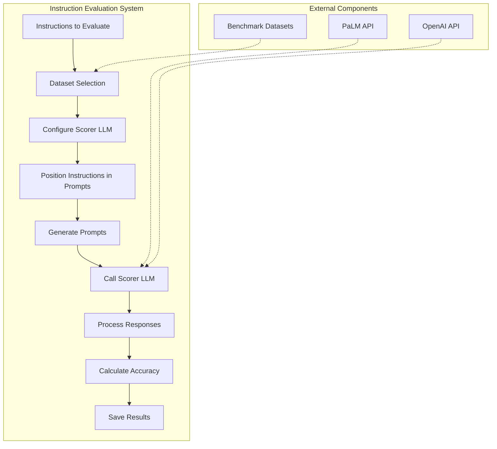
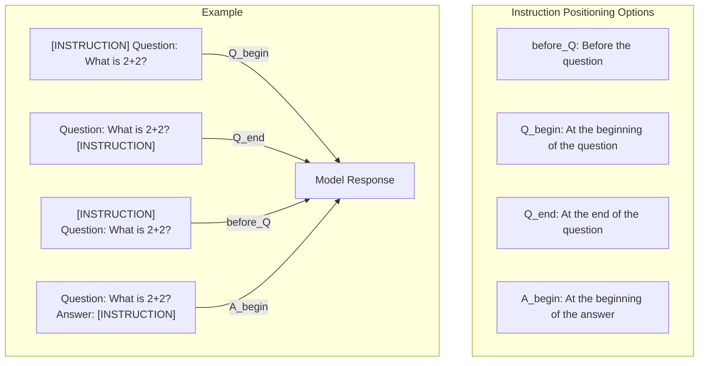
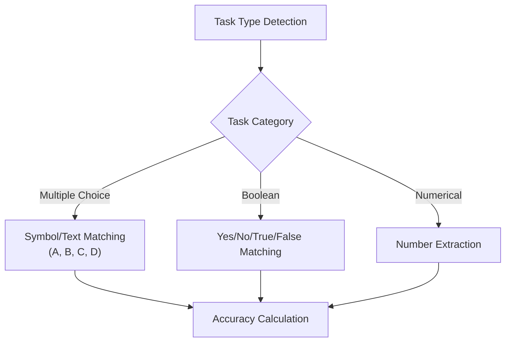
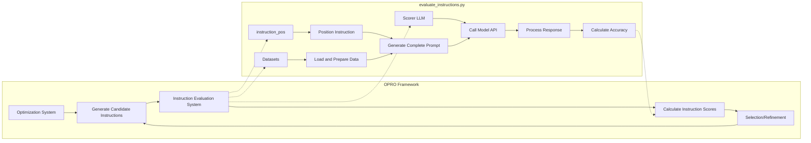

<!-- source: DeepWiki mcp.deepwiki.com · repo google-deepmind/opro · page 3.1 Instruction Evaluation · fetched 2026-10-26 -->

# Instruction Evaluation

<details>
<summary>Relevant source files</summary>

The following files were used as context for generating this wiki page:

- [opro/evaluation/eval_utils_test.py](opro/evaluation/eval_utils_test.py)
- [opro/evaluation/evaluate_instructions.py](opro/evaluation/evaluate_instructions.py)

</details>


## Purpose and Scope

This document covers the instruction evaluation system within OPRO, which is designed to assess the effectiveness of prompt instructions across various language models and benchmark datasets. The evaluation system measures how different instructions affect model performance on specific tasks, providing quantitative metrics to compare instruction effectiveness. For information about optimizing instructions, see [Instruction Optimization](#2.1).

The instruction evaluation system is a core component that enables the measurement of instruction quality, which is essential for the prompt optimization workflow.

Sources: [opro/evaluation/evaluate_instructions.py:14-39]()

## System Overview

The instruction evaluation system takes a set of instructions, applies them to prompts in specific positions, runs these prompts through a language model (scorer LLM), and measures the accuracy of the responses. The system supports multiple datasets, model providers, and evaluation configurations.



Sources: [opro/evaluation/evaluate_instructions.py:96-106](), [opro/evaluation/evaluate_instructions.py:537-548]()

## Supported Components

### Language Models (Scorer LLMs)

The evaluation system can use the following language models as scorers:

| Model Name | Provider | API Used |
|------------|----------|----------|
| text-bison | Google | PaLM API |
| gpt-3.5-turbo | OpenAI | OpenAI API |
| gpt-4 | OpenAI | OpenAI API |

Configuration parameters for scorer models include temperature, maximum decode steps, and batch size.

Sources: [opro/evaluation/evaluate_instructions.py:178-193](), [opro/evaluation/evaluate_instructions.py:238-294]()

### Benchmark Datasets

The system supports multiple benchmark datasets for evaluating instruction performance:

| Dataset | Description | Task Types |
|---------|-------------|------------|
| MMLU | Massive Multitask Language Understanding | Multiple-choice tasks across categories (STEM, humanities, social sciences, etc.) |
| BBH | Big-Bench Hard | Various tasks (boolean expressions, causal judgment, date understanding, etc.) |
| GSM8K | Grade School Math 8K | Numerical problem-solving |
| MultiArith | Multi-step Arithmetic | Numerical problem-solving |
| AQuA | Algebra Question Answering | Multiple-choice algebra problems |

Sources: [opro/evaluation/evaluate_instructions.py:125-134](), [opro/evaluation/evaluate_instructions.py:387-525]()

## Instruction Positioning

The system allows instructions to be placed in different positions within the prompt:



Sources: [opro/evaluation/evaluate_instructions.py:195-204]()

## Evaluation Process

### Workflow

The evaluation process follows these steps:

1. **Configuration**: Set up the scorer LLM, dataset, instruction position, and other parameters
2. **Data Loading**: Load the specified benchmark dataset
3. **Train/Test Split**: Optionally split the dataset into training and test folds
4. **Instruction Application**: Position the instructions within the prompts
5. **Model Inference**: Send the prompts to the scorer LLM
6. **Response Processing**: Extract answers from model responses
7. **Accuracy Calculation**: Compute accuracy based on task type
8. **Result Storage**: Save detailed results to CSV files

Sources: [opro/evaluation/evaluate_instructions.py:554-765]()

### Task Type Handling

The system handles different types of tasks:



Each task type has specific evaluation methods to extract and compare answers with the ground truth.

Sources: [opro/evaluation/evaluate_instructions.py:477-525](), [opro/evaluation/eval_utils_test.py:176-302]()

## Command-line Usage

The evaluation system can be run from the command line with various parameters:

```
python evaluate_instructions.py \
    --scorer="text-bison" --dataset="gsm8k" \
    --task="test" --instruction_pos="Q_begin" \
    --evaluate_training_fold=false --evaluate_test_fold=true \
    --openai_api_key="<your_key>" --palm_api_key="<your_key>"
```

Key parameters include:
- `--scorer`: Model to use (text-bison, gpt-3.5-turbo, gpt-4)
- `--dataset`: Dataset to evaluate on
- `--task`: Specific task within the dataset
- `--instruction_pos`: Position to place the instruction
- `--evaluate_training_fold`/`--evaluate_test_fold`: Which data splits to evaluate

Sources: [opro/evaluation/evaluate_instructions.py:16-39](), [opro/evaluation/evaluate_instructions.py:63-95]()

## Output and Results

Results are saved to CSV files with detailed information on each evaluated example:

| Column | Description |
|--------|-------------|
| index_in_raw_dataset | Original index of the example |
| prompt | Full prompt sent to the model |
| response | Raw model response |
| ground_truth | Correct answer |
| prediction | Extracted answer from model response |
| accuracy | Binary score (1 for correct, 0 for incorrect) |

The system calculates and outputs average accuracy percentages for the evaluated instructions.

Sources: [opro/evaluation/evaluate_instructions.py:700-765]()

## Internal Implementation Details

### Accuracy Calculation

The evaluation system uses sophisticated matching techniques to determine if a model's answer is correct:

1. **Multiple-choice tasks**: Matches answer symbols (A/B/C/D) or their corresponding text
2. **Boolean tasks**: Handles variations of yes/no, true/false responses
3. **Numerical tasks**: Extracts and compares numerical answers

The system handles various formats of responses, including answers with punctuation, case differences, and partial matches.

Sources: [opro/evaluation/eval_utils_test.py:62-302]()

### Error Handling and Retries

To handle temporary API failures, the system implements retry logic with configurable maximum retries and sleep time between attempts.

Sources: [opro/evaluation/evaluate_instructions.py:698-699](), [opro/evaluation/evaluate_instructions.py:734-735]()

## Integration with OPRO System

The instruction evaluation system serves as a critical component in the OPRO framework, providing feedback for the optimization process:



Sources: [opro/evaluation/evaluate_instructions.py:41-60]()

---

