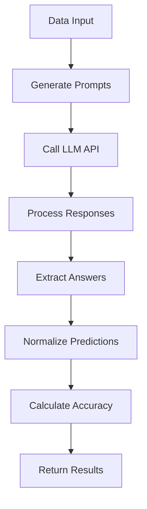
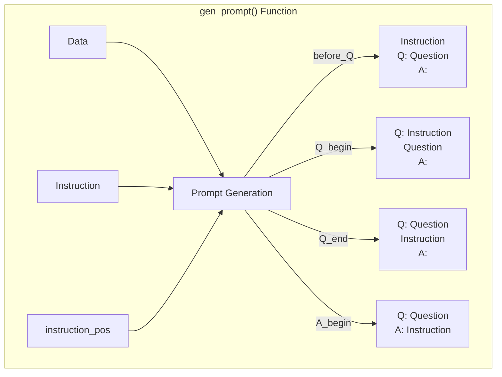
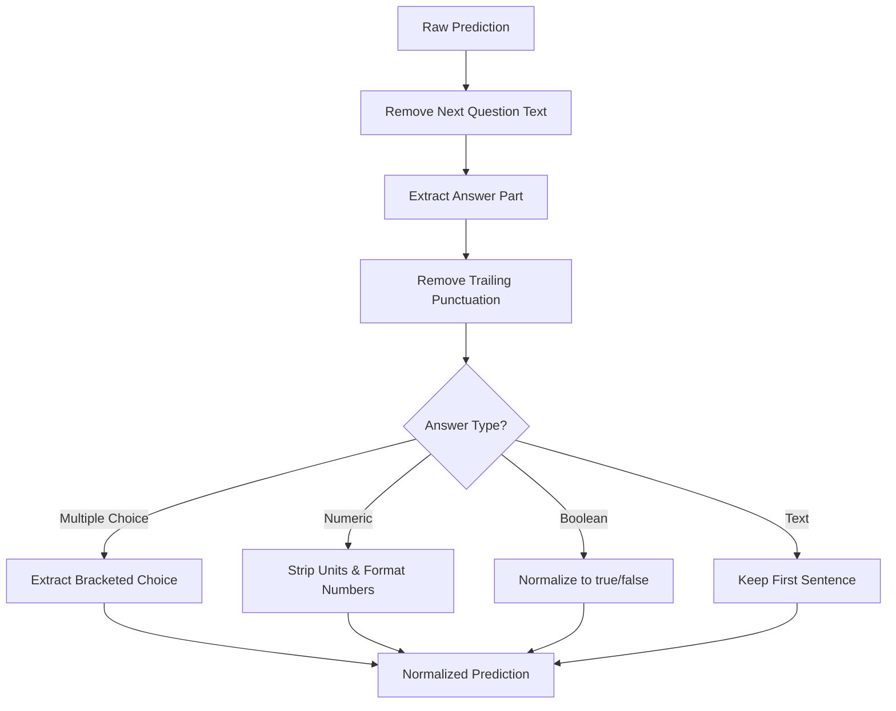
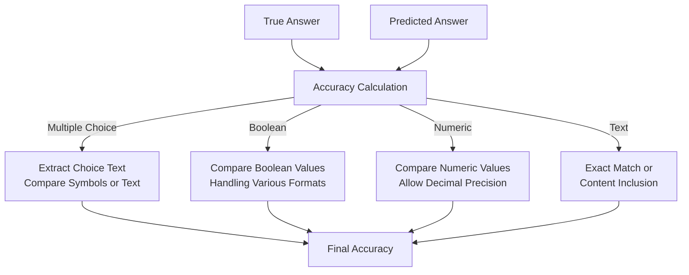
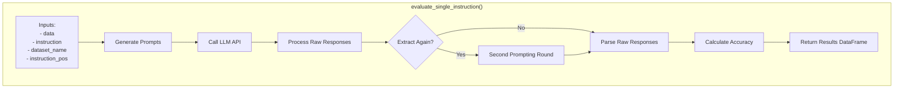
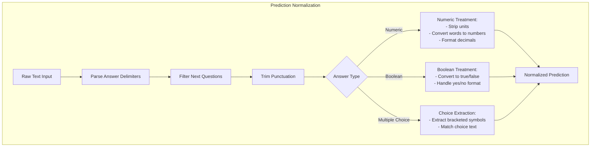
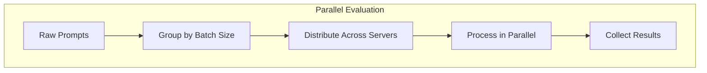

<!-- source: DeepWiki mcp.deepwiki.com · repo google-deepmind/opro · page 3.2 Evaluation Utilities · fetched 2026-10-26 -->

# Evaluation Utilities

Relevant source files

The following files were used as context for generating this wiki page:

- [opro/evaluation/eval_utils.py](opro/evaluation/eval_utils.py)
- [opro/evaluation/metrics.py](opro/evaluation/metrics.py)

The Evaluation Utilities module provides tools and functions for assessing Language Model (LLM) performance when given specific prompts or instructions. These utilities focus on processing model responses, normalizing predictions, and calculating accuracy metrics across various benchmark datasets. This page documents the core components, workflow, and functionality of the evaluation system in OPRO.

For information about how these utilities are used to evaluate specific instructions across different benchmarks, see [Instruction Evaluation](#3.1).

## Core Components

The evaluation system consists of two main utility files:
- `eval_utils.py`: Contains functions for prompting models, processing responses, and calculating accuracy
- `metrics.py`: Provides specialized normalization and parsing functions for different answer formats

### Evaluation Workflow

The overall workflow for evaluating instructions using the evaluation utilities follows this pattern:

Sources: [opro/evaluation/eval_utils.py:536-863]()

## Prompt Generation

The system can generate prompts with instructions positioned in different ways relative to the question and answer parts. This is crucial for testing different instruction placement strategies.

The `gen_prompt` function supports four instruction positions:
- `before_Q`: Instruction appears before the question
- `Q_begin`: Instruction appears at the beginning of the question
- `Q_end`: Instruction appears at the end of the question 
- `A_begin`: Instruction appears at the beginning of the answer

Sources: [opro/evaluation/eval_utils.py:164-259]()

## Answer Normalization

A critical component of the evaluation system is the normalization of model predictions to enable accurate comparison with ground truth answers. The prediction normalization flow handles various answer formats:

The system can detect answer patterns like:
- "The answer is X"
- "X is the answer"
- "The final answer is X"
- Multiple choice formats like "(A)", "(B)", etc.
- Numeric answers with units or different formats

Sources: [opro/evaluation/metrics.py:188-342](), [opro/evaluation/eval_utils.py:765-819]()

## Accuracy Calculation

The evaluation utilities include sophisticated methods to calculate accuracy across different question types:

The `_get_accuracy` function handles different answer types:
- For multiple choice, it can match by choice symbol (A/B/C/D) or by the actual text of the choice
- For boolean questions, it handles various formats (true/false, yes/no, valid/invalid)
- For numeric questions, it compares the numeric values with appropriate precision
- It can optionally treat answers as correct if the true answer is included in the prediction

Sources: [opro/evaluation/eval_utils.py:381-490](), [opro/evaluation/eval_utils.py:499-533]()

## Supported Datasets

The evaluation utilities support several benchmark datasets with specialized handling for each:

| Dataset | Type | Format | Special Handling |
|---------|------|--------|------------------|
| MMLU | Multiple choice | A/B/C/D format | Extracts choices with formatting |
| BBH (Big-Bench Hard) | Various | Multiple formats | Task-specific extraction |
| GSM8K | Math problems | Numerical answers | Extracts final number |
| MultiArith | Arithmetic | Numerical answers | Extracts numerical solutions |
| AQuA | Algebra | A/B/C/D/E format | Multiple choice extraction |

Sources: [opro/evaluation/eval_utils.py:262-285](), [opro/evaluation/eval_utils.py:868-916]()

## Main Evaluation Function

The primary function for evaluating instructions is `evaluate_single_instruction`, which handles the entire pipeline from prompt generation to accuracy calculation.

Key parameters for this function include:
- `data`: The dataset to evaluate on
- `instruction`: The instruction text to evaluate
- `eval_index_all`: Which examples to evaluate
- `call_server_func`: Function to call the LLM
- `instruction_pos`: Where to position the instruction
- `extract_final_answer_by_prompting_again`: Whether to use a second round of prompting to extract cleaner answers

The function returns a DataFrame with detailed results including:
- Raw prompts and responses
- Parsed answers
- True answers
- Accuracy scores

Sources: [opro/evaluation/eval_utils.py:536-863]()

## Normalization Techniques

The `metrics.py` module contains specialized functions for normalizing predictions:

The system uses pattern matching to identify common formats like:
- `FINAL_ANSWER_BEHIND_PATTERNS`: "answer is ", "answer: ", etc.
- `FINAL_ANSWER_AHEAD_PATTERNS`: "is the correct answer", "is the final answer", etc.
- Mathematical expressions with formats like "= X" or "X pounds"

Sources: [opro/evaluation/metrics.py:188-342](), [opro/evaluation/metrics.py:66-76]()

## Parallel Evaluation

The evaluation utilities support parallel processing of predictions for efficiency:

The parallel evaluation uses Python's multiprocessing to distribute prompts across multiple servers, which significantly speeds up the evaluation process when dealing with large datasets.

Sources: [opro/evaluation/eval_utils.py:647-697]()

## Conclusion

The Evaluation Utilities module provides a robust system for evaluating Language Model performance on various tasks. It handles the complexities of prompt generation, answer normalization, and accuracy calculation across different dataset formats and question types. These utilities are essential for measuring the effectiveness of different instructions and prompt formats in the OPRO system.

---

