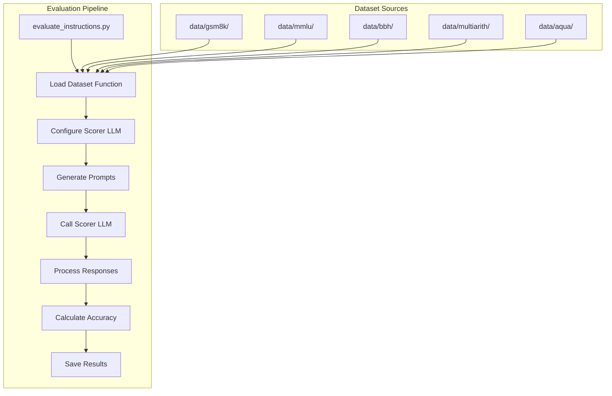
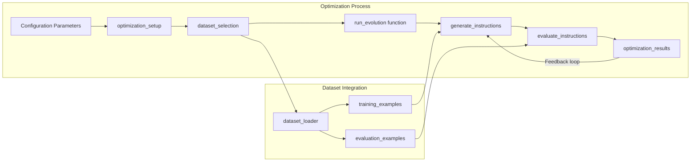
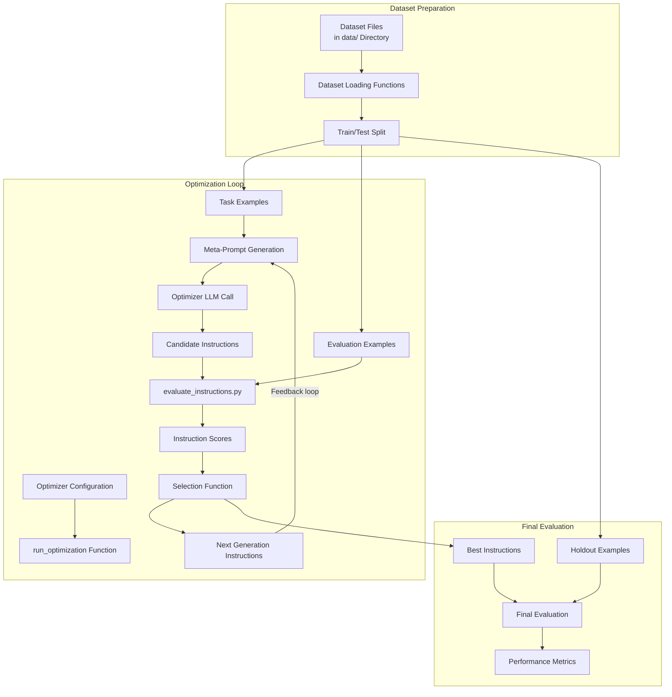

<!-- source: DeepWiki mcp.deepwiki.com · repo google-deepmind/opro · page 4 Datasets · fetched 2026-10-26 -->

# Datasets

<details>
<summary>Relevant source files</summary>

The following files were used as context for generating this wiki page:

- [data/README.md](data/README.md)

</details>


This document provides an overview of the benchmark datasets used in the OPRO (Optimizing PROmpts) system for training and evaluation of language model instructions. These datasets serve as the foundation for measuring the effectiveness of optimized prompts across various reasoning tasks. For information about how these datasets are utilized in the evaluation process, see [Evaluation System](#3).

Sources: [data/README.md:1-31]()

## Benchmark Datasets Overview

OPRO includes several standard benchmarks that test different aspects of language model capabilities. Each dataset has been selected to evaluate specific reasoning skills and provide a comprehensive assessment of prompt optimization effectiveness.

The following table summarizes the benchmark datasets included in the repository:

| Dataset | Focus Area | Source |
|---------|------------|--------|
| GSM8K | Multi-step math reasoning | [github.com/openai/grade-school-math](https://github.com/openai/grade-school-math) |
| MMLU | 57 subjects across STEM, humanities, etc. | [github.com/hendrycks/test](https://github.com/hendrycks/test) (test split only) |
| BBH | 23 challenging reasoning tasks | [github.com/suzgunmirac/BIG-Bench-Hard](https://github.com/suzgunmirac/BIG-Bench-Hard) |
| MultiArith | Multi-step arithmetic word problems | Not specified |
| AQuA | Algebraic reasoning | [github.com/google-deepmind/AQuA](https://github.com/google-deepmind/AQuA) |

Sources: [data/README.md:3-24]()

## Dataset Integration in OPRO

### Dataset Flow in Evaluation Pipeline

The following diagram illustrates how datasets are integrated into the OPRO evaluation system:



Sources: [data/README.md:3-24]()

### Dataset Usage in Optimization Loop

Datasets play a crucial role in the instruction optimization process, providing problems against which candidate instructions are evaluated.



Sources: [data/README.md:1-31]()

## Dataset Details

### GSM8K (Grade School Math 8K)

GSM8K contains approximately 8,500 grade school math word problems that require multi-step reasoning. Problems in this dataset test a model's ability to:
- Parse relevant numerical information
- Apply appropriate mathematical operations
- Perform step-by-step problem solving
- Arrive at precise numerical answers

Example problems include arithmetic operations, percentages, ratios, and basic algebra presented as word problems.

Sources: [data/README.md:5-7]()

### Massive Multitask Language Understanding (MMLU)

MMLU evaluates language models across 57 different subjects spanning STEM, humanities, social sciences, and more. The benchmark tests both factual knowledge and problem-solving abilities.

Note: Only the test split is included in the repository due to file size limitations. According to the README, the headroom for prompt optimization was observed to be relatively small for MMLU (usually <10% improvement across the four main categories) compared to other benchmarks.

Sources: [data/README.md:9-14]()

### Big-Bench Hard (BBH)

BBH consists of 23 challenging tasks selected from the larger Big-Bench benchmark. These tasks were chosen specifically because they proved difficult for large language models while remaining relatively easy for humans.

The tasks in BBH cover diverse reasoning skills including:
- Logical reasoning
- Multi-step reasoning
- Linguistic understanding
- Common sense reasoning
- Mathematical reasoning

Sources: [data/README.md:16-18]()

### MultiArith

MultiArith focuses on multi-step arithmetic word problems. Each problem requires performing a sequence of arithmetic operations to arrive at the correct answer. This benchmark tests a model's ability to:
- Extract numerical information from text
- Determine the appropriate sequence of operations
- Perform accurate calculations

Sources: [data/README.md:20]()

### AQuA (Algebraic Question Answering)

AQuA contains algebraic word problems that test a model's ability to:
- Translate natural language into algebraic expressions
- Apply algebraic rules and principles
- Reason through multi-step algebraic problems

Sources: [data/README.md:22-24]()

## Data Directory Structure

The datasets are organized in the `data/` directory of the repository. All benchmark datasets are stored in their respective subdirectories:

```
data/
├── README.md         # Information about included datasets
├── gsm8k/            # GSM8K dataset files
├── mmlu/             # MMLU test split
├── bbh/              # Big-Bench Hard dataset
├── multiarith/       # MultiArith dataset
└── aqua/             # AQuA dataset
```

Sources: [data/README.md:1-3]()

## Dataset Usage Considerations

When using these datasets in the OPRO system, it's important to consider:

1. **Dataset Selection**: Choose datasets appropriate for the specific reasoning capabilities you want to optimize.

2. **Evaluation Metrics**: Different datasets may require different evaluation approaches (exact match, numeric equivalence, etc.).

3. **Split Usage**: Typically, a portion of each dataset is used for optimization, while a separate portion is reserved for final evaluation to prevent overfitting.

4. **Attribution**: All copyrights for the benchmark datasets belong to their original authors, as noted in the repository's data README.

Sources: [data/README.md:26-28]()

## Dataset Integration with Optimization

The following diagram illustrates how datasets are used in the complete OPRO optimization workflow:



Sources: [data/README.md:1-31]()

---

