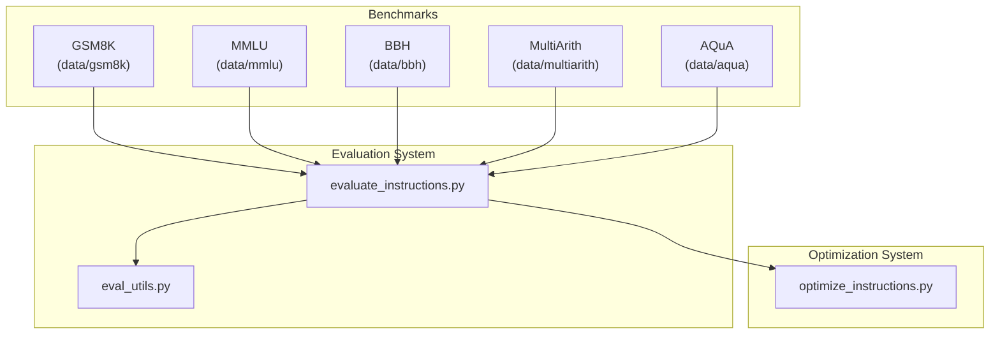
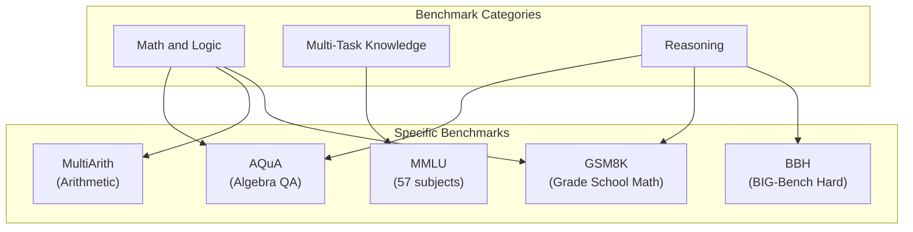
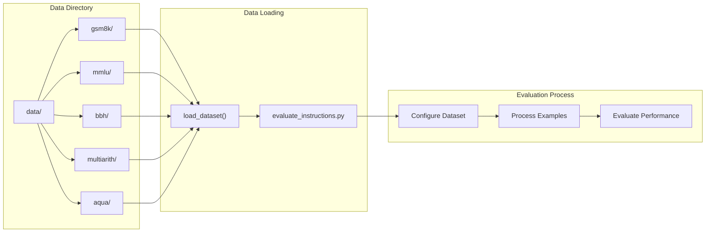

<!-- source: DeepWiki mcp.deepwiki.com · repo google-deepmind/opro · page 4.1 Available Benchmarks · fetched 2026-10-26 -->

# Available Benchmarks

Relevant source files

The following files were used as context for generating this wiki page:

- [data/README.md](data/README.md)

## Purpose and Scope

This document provides a detailed overview of the benchmark datasets included in the OPRO repository. These benchmarks serve as standard evaluation datasets for testing the effectiveness of prompt optimization techniques and language model performance. For information about how these datasets are used in the optimization and evaluation processes, see [Dataset Usage](#4.2).

## Overview of Benchmarks

The OPRO repository includes five prominent benchmark datasets that cover various reasoning and problem-solving tasks. These benchmarks are commonly used in the field of language model evaluation and represent diverse challenges that assess different aspects of language model capabilities.

| Benchmark | Type | Source | Description |
|-----------|------|--------|-------------|
| GSM8K | Mathematical Reasoning | OpenAI | Grade school math word problems requiring multi-step reasoning |
| MMLU | Multitask Knowledge | Hendrycks et al. | Diverse tasks spanning 57 subjects across STEM, humanities, and more |
| BBH | Reasoning | BIG-Bench | Hard subset of BIG-Bench tasks focusing on challenging reasoning problems |
| MultiArith | Arithmetic | - | Multi-step arithmetic word problems |
| AQuA | Algebraic Reasoning | DeepMind | Algebra word problems requiring analytical problem-solving |

Sources: [data/README.md:3-28]()

## Benchmark Integration in OPRO

The following diagram illustrates how benchmarks are integrated into the OPRO evaluation system:

Sources: [data/README.md:3-28]()

## Benchmark Categories and Task Types

The benchmarks cover a range of cognitive tasks and reasoning capabilities:

Sources: [data/README.md:3-28]()

## Detailed Benchmark Descriptions

### GSM8K (Grade School Math 8K)

GSM8K is a dataset of grade school math word problems that require multi-step reasoning to solve. These problems are designed to test a model's ability to break down complex mathematical problems into steps and apply arithmetic operations correctly.

**Source:** Downloaded from OpenAI's grade-school-math repository
**Location in Codebase:** `data/gsm8k/`

**Example Usage in OPRO:**
- Used to evaluate instruction optimization effectiveness for mathematical reasoning tasks
- Serves as a benchmark for step-by-step problem-solving capabilities

Sources: [data/README.md:5-7]()

### MMLU (Massive Multitask Language Understanding)

MMLU is a comprehensive benchmark covering 57 subjects across STEM, humanities, social sciences, and more. It tests a model's ability to perform well across diverse domains of knowledge.

**Source:** Downloaded from Hendrycks' test repository
**Location in Codebase:** `data/mmlu/`

**Note:** The OPRO repository only includes the test split due to file size limitations. The authors observed that prompt optimization provided smaller improvements on MMLU (usually <10% for the four categories) compared to other benchmarks.

Sources: [data/README.md:9-14]()

### BBH (Big-Bench Hard)

BBH is a challenging subset of tasks from the BIG-Bench collection. These tasks are specifically selected to be difficult for current language models and focus on complex reasoning abilities.

**Source:** Downloaded from BIG-Bench-Hard repository
**Location in Codebase:** `data/bbh/`

**Example Usage in OPRO:**
- Tests the limits of instruction optimization techniques
- Evaluates model performance on particularly challenging reasoning tasks

Sources: [data/README.md:16-18]()

### MultiArith

MultiArith consists of multi-step arithmetic word problems. These problems require the model to understand the problem statement, extract the relevant numbers, and perform a sequence of arithmetic operations to arrive at the answer.

**Location in Codebase:** `data/multiarith/`

**Example Usage in OPRO:**
- Evaluates straightforward arithmetic reasoning capabilities
- Tests ability to follow multi-step procedures in mathematical contexts

Sources: [data/README.md:20]()

### AQuA (Algebraic Question Answering)

AQuA contains algebra word problems that require analytical problem-solving skills. These problems test a model's ability to translate natural language descriptions into algebraic expressions and solve them correctly.

**Source:** Downloaded from Google DeepMind's AQuA repository
**Location in Codebase:** `data/aqua/`

**Example Usage in OPRO:**
- Tests algebraic reasoning and problem formulation
- Evaluates performance on translating text to mathematical formulations

Sources: [data/README.md:22-24]()

## Benchmark Data Structure and Access

The following diagram illustrates how benchmark data is structured and accessed within the OPRO system:

Sources: [data/README.md:3-28]()

## Copyright and Attribution

All benchmark datasets included in the OPRO repository maintain their original copyrights, which belong to the original benchmark authors. The datasets are included for research purposes to facilitate prompt optimization and evaluation.

Sources: [data/README.md:27-30]()

## Benchmark Selection Considerations

When selecting which benchmark to use for evaluation or optimization in OPRO, consider the following factors:

| Consideration | Description |
|---------------|-------------|
| Task Type | Select benchmarks that match your target application domain (math, general knowledge, reasoning) |
| Optimization Headroom | Some benchmarks (like MMLU) show less improvement from prompt optimization than others |
| Complexity | Benchmarks like GSM8K and BBH test complex multi-step reasoning |
| Scope | MMLU tests breadth of knowledge across many domains |
| Specificity | MultiArith and AQuA focus on specific mathematical capabilities |

Sources: [data/README.md:3-28]()

---

