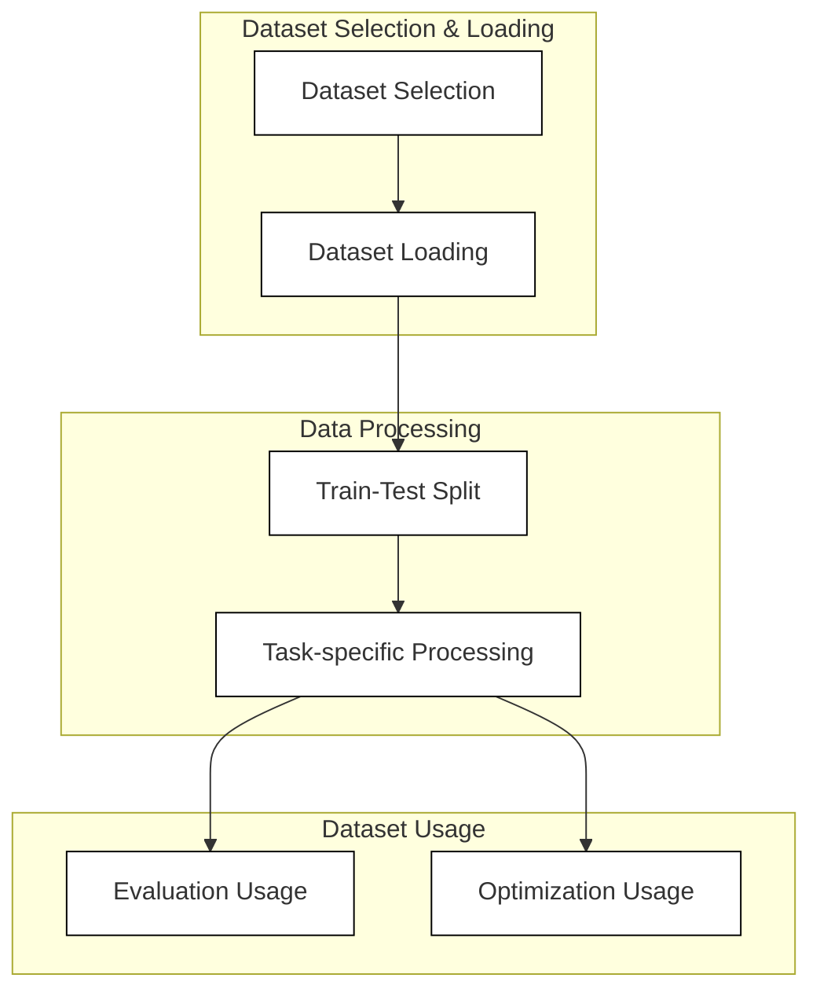
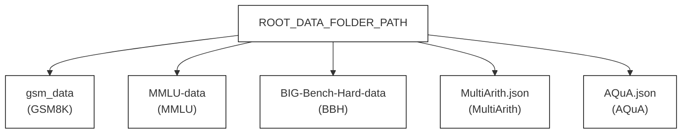
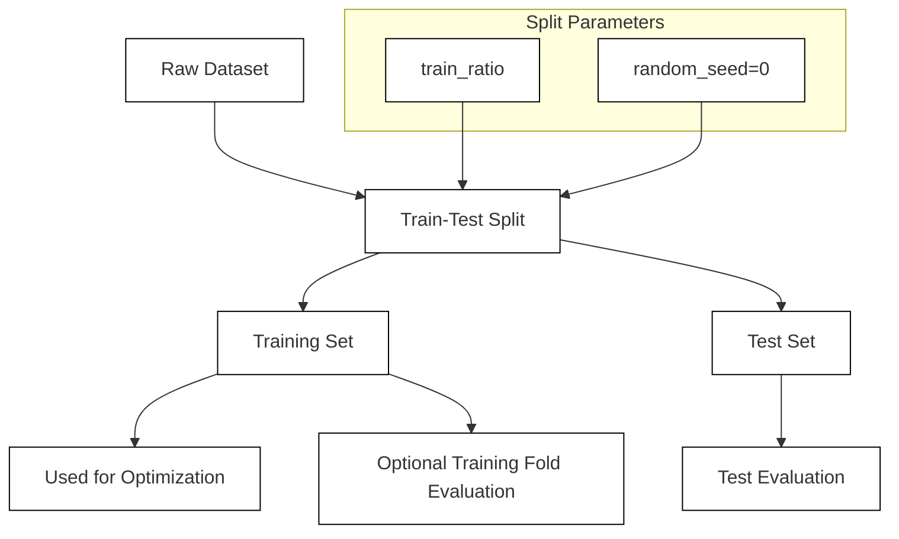
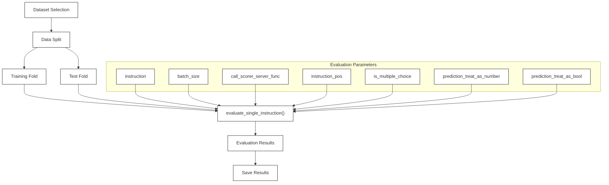
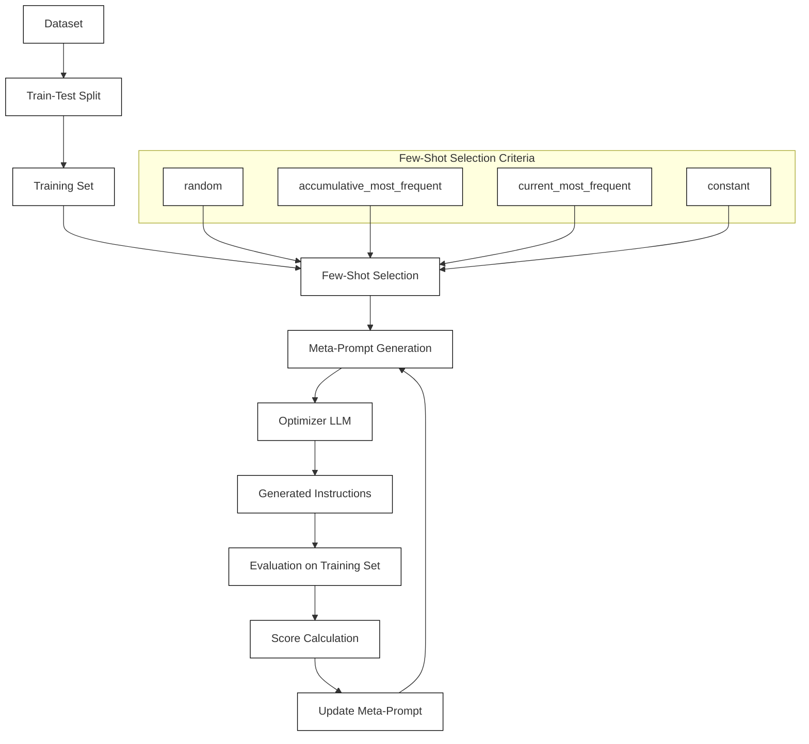
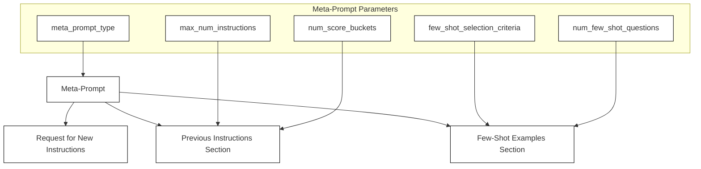
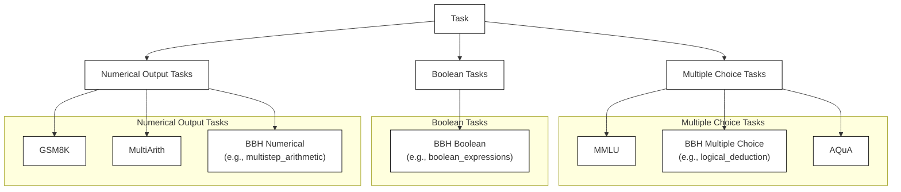

<!-- source: DeepWiki mcp.deepwiki.com · repo google-deepmind/opro · page 4.2 Dataset Usage · fetched 2026-10-26 -->

# Dataset Usage

<details>
<summary>Relevant source files</summary>

The following files were used as context for generating this wiki page:

- [data/README.md](data/README.md)
- [opro/evaluation/evaluate_instructions.py](opro/evaluation/evaluate_instructions.py)
- [opro/optimization/optimize_instructions.py](opro/optimization/optimize_instructions.py)

</details>


This page documents how benchmark datasets are loaded, processed, and used within the OPRO (Optimizing PROmpts) system for both instruction optimization and evaluation purposes. For information about what benchmark datasets are available, see [Available Benchmarks](#4.1).

## Dataset Overview

OPRO relies on benchmark datasets to drive both the optimization and evaluation of language model instructions. The system supports several standardized benchmarks which are used to measure instruction effectiveness and guide the optimization process.



Sources: [opro/evaluation/evaluate_instructions.py:555-628](), [opro/optimization/optimize_instructions.py:607-636]()

## Dataset Loading

The OPRO system loads datasets from the `data` directory based on the specified dataset name and task. The primary function for loading is handled within the evaluation and optimization modules.

### Dataset Path Structure



Sources: [opro/evaluation/evaluate_instructions.py:61-63](), [opro/evaluation/evaluate_instructions.py:209-220](), [opro/optimization/optimize_instructions.py:63](), [opro/optimization/optimize_instructions.py:211-219]()

### Dataset Format by Benchmark

Each dataset has a specific format and loading mechanism:

| Dataset | Format | Loading Method | Content Structure |
|---------|--------|---------------|-------------------|
| MMLU | CSV | `pd.read_csv()` | Multiple choice questions across various subjects |
| BBH | JSON | `load_bbh_task_data()` | 27 challenging reasoning tasks |
| GSM8K | TSV | `pd.read_csv(sep="\t")` | Grade school math word problems |
| MultiArith | JSON | `json.load()` | Multi-step arithmetic word problems |
| AQuA | JSON | `read_jsonl()` | Algebraic word problems |

Sources: [opro/evaluation/evaluate_instructions.py:559-628](), [opro/optimization/optimize_instructions.py:607-636]()

## Dataset Splitting

OPRO splits datasets into training and test subsets to support both optimization (training) and evaluation (testing) processes.

### Splitting Process



Sources: [opro/evaluation/evaluate_instructions.py:646-671](), [opro/optimization/optimize_instructions.py:650-670]()

### Dataset-Specific Split Ratios

Different datasets use different split ratios depending on their intended use:

| Dataset | Training Ratio | Evaluation Ratio | Test Ratio |
|---------|----------------|------------------|------------|
| MMLU | 0.8 | 0.2 | 0.0 |
| GSM8K | 0.035 | 0.0 | 0.965 |
| BBH | 0.2 | 0.0 | 0.8 |
| MultiArith/AQuA | Varies | Varies | Varies |

Sources: [opro/optimization/optimize_instructions.py:640-649]()

## Dataset Usage in Evaluation

Datasets provide the basis for evaluating instruction effectiveness across different tasks and language models.

### Evaluation Workflow



Sources: [opro/evaluation/evaluate_instructions.py:680-741]()

### Task-Specific Evaluation

OPRO supports different evaluation methods depending on the task type:

| Task Type | Examples | Evaluation Method |
|-----------|----------|------------------|
| Multiple Choice | MMLU, parts of BBH, AQuA | Match selected option |
| Boolean | Parts of BBH | Match yes/no or true/false |
| Numerical | GSM8K, MultiArith, parts of BBH | Extract and compare numerical answers |

Sources: [opro/evaluation/evaluate_instructions.py:627-635]()

## Dataset Usage in Optimization

Datasets play a crucial role in the instruction optimization process, providing examples for meta-prompt generation and evaluation of instruction effectiveness.

### Optimization Data Flow



Sources: [opro/optimization/optimize_instructions.py:738-796]()

### Meta-Prompt Construction

The meta-prompt used for optimization includes:
1. Previous instructions and their scores
2. Few-shot examples from the dataset
3. Instructions for generating new candidates



Sources: [opro/optimization/optimize_instructions.py:738-795]()

## Task-Specific Dataset Handling

OPRO handles different types of tasks differently based on their characteristics and evaluation requirements.

### Task Classification



Sources: [opro/evaluation/evaluate_instructions.py:471-525](), [opro/optimization/optimize_instructions.py:543-583]()

### Task Type Detection

OPRO automatically detects the task type and applies the appropriate evaluation methods:

| Variable | Function | Code Path |
|----------|----------|-----------|
| `is_multiple_choice` | Determines if the task is multiple choice | `task_name in multiple_choice_tasks` |
| `prediction_treat_as_number` | Determines if the answer should be numeric | Based on task type |
| `prediction_treat_as_bool` | Determines if the answer is boolean | `task_name in boolean_tasks` |

Sources: [opro/evaluation/evaluate_instructions.py:630-635]()

## Practical Dataset Usage Examples

### Example 1: Evaluating Instructions on GSM8K Dataset

To evaluate instruction effectiveness on the GSM8K dataset:

```
python evaluate_instructions.py \
    --scorer="text-bison" --dataset="gsm8k" \
    --task="test" --instruction_pos="Q_begin" \
    --evaluate_training_fold=false --evaluate_test_fold=true \
    --openai_api_key="<your_key>" --palm_api_key="<your_key>"
```

Sources: [opro/evaluation/evaluate_instructions.py:14-39]()

### Example 2: Optimizing Instructions for GSM8K Dataset

To optimize instructions for the GSM8K dataset:

```
python optimize_instructions.py \
    --optimizer="gpt-3.5-turbo" --scorer="text-bison" \
    --instruction_pos="A_begin" --dataset="gsm8k" --task="train"
```

Sources: [opro/optimization/optimize_instructions.py:14-42]()

## Dataset Configuration Parameters

Key dataset configuration parameters:

| Parameter | Description | Example Value |
|-----------|-------------|---------------|
| `dataset` | The benchmark dataset to use | `"gsm8k"`, `"mmlu"`, `"bbh"` |
| `task` | The specific task within the dataset | `"train"`, `"STEM"`, `"boolean_expressions"` |
| `instruction_pos` | Where to place the instruction | `"A_begin"`, `"Q_begin"`, `"Q_end"` |
| `train_ratio` | Portion of data used for training | `0.035` for GSM8K, `0.8` for MMLU |
| `few_shot_selection_criteria` | How to select examples | `"random"`, `"accumulative_most_frequent"` |
| `num_few_shot_questions` | Number of examples to include | `3` |

Sources: [opro/optimization/optimize_instructions.py:739-795](), [opro/evaluation/evaluate_instructions.py:655-671]()

By understanding the dataset usage patterns in OPRO, users can effectively customize the system for different optimization and evaluation scenarios across various benchmarks and language models.

---

