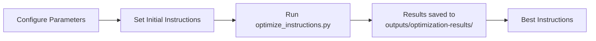
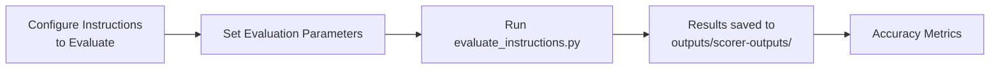
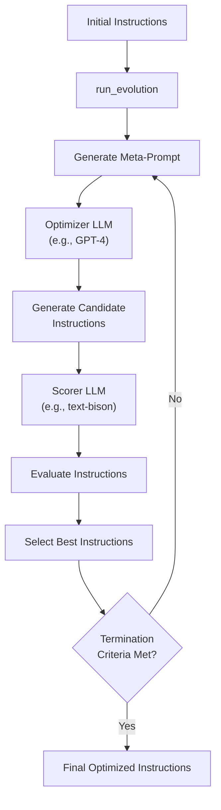
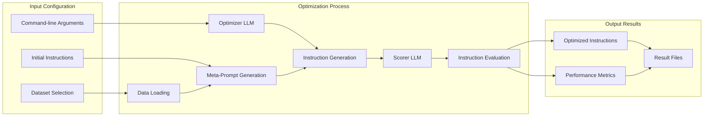
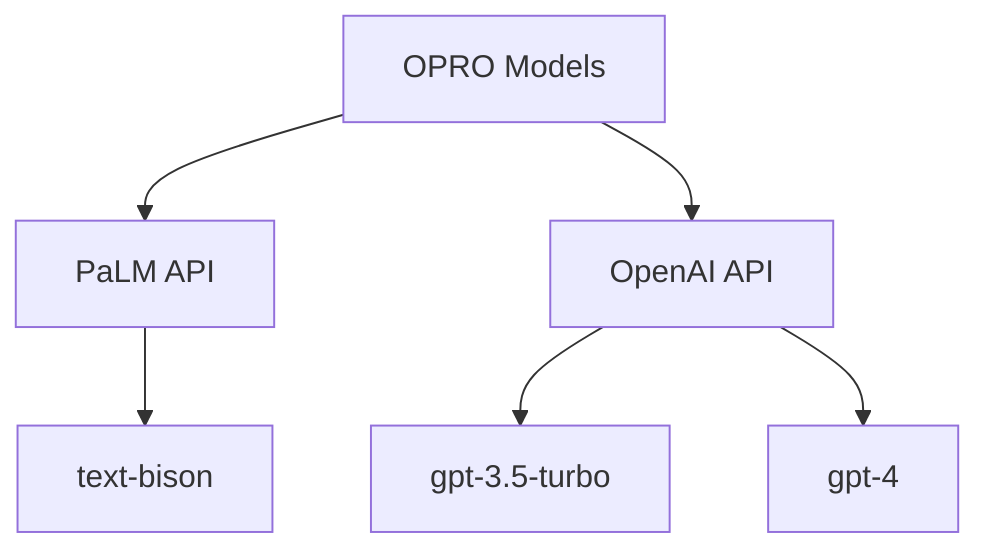

<!-- source: DeepWiki mcp.deepwiki.com · repo google-deepmind/opro · page 5 Usage Examples · fetched 2026-10-26 -->

# Usage Examples

<details>
<summary>Relevant source files</summary>

The following files were used as context for generating this wiki page:

- [README.md](README.md)
- [opro/evaluation/evaluate_instructions.py](opro/evaluation/evaluate_instructions.py)
- [opro/optimization/optimize_instructions.py](opro/optimization/optimize_instructions.py)

</details>


This document provides practical examples of how to use the OPRO (Optimizing PROmpts) framework. These examples demonstrate how to leverage the system's capabilities for prompt optimization, prompt evaluation, and specialized optimization tasks. For a conceptual overview of how OPRO works, see [Overview](#1).

## Command-line Usage

OPRO provides several command-line scripts for different optimization and evaluation tasks. Below are examples of how to use these scripts with various parameters.

### Prompt Optimization



The basic command to optimize instructions is:

```
python optimize_instructions.py --optimizer="gpt-3.5-turbo" --scorer="text-bison" --instruction_pos="Q_begin" --dataset="gsm8k" --task="train" --palm_api_key="<your_palm_api_key>" --openai_api_key="<your_openai_api_key>"
```

Key parameters:
- `--optimizer`: The LLM used to generate new instructions (e.g., "gpt-3.5-turbo", "gpt-4", "text-bison")
- `--scorer`: The LLM used to evaluate instructions (e.g., "text-bison", "gpt-3.5-turbo", "gpt-4")
- `--instruction_pos`: Where to place the instruction ("before_Q", "Q_begin", "Q_end", "A_begin")
- `--dataset`: The dataset to use ("gsm8k", "mmlu", "bbh")
- `--task`: The specific task within the dataset (e.g., "train", "test", or specific task name for BBH)
- `--meta_prompt_type`: "both_instructions_and_exemplars" or "instructions_only"

You can modify the initial instructions to optimize by editing the `initial_instructions` variable in [opro/optimization/optimize_instructions.py:710-714]().

Sources: [README.md:25-35](), [opro/optimization/optimize_instructions.py:14-42](), [opro/optimization/optimize_instructions.py:710-714]()

### Prompt Evaluation



To evaluate instructions with a model:

```
python evaluate_instructions.py --scorer="text-bison" --dataset="gsm8k" --task="test" --instruction_pos="Q_begin" --evaluate_training_fold=false --evaluate_test_fold=true --palm_api_key="<your_palm_api_key>"
```

Key parameters:
- `--scorer`: The LLM used for evaluation
- `--dataset`: The dataset to evaluate on
- `--task`: The specific task to evaluate
- `--instruction_pos`: Where the instruction is positioned
- `--evaluate_training_fold`: Whether to evaluate on training data (true/false)
- `--evaluate_test_fold`: Whether to evaluate on test data (true/false)

You can customize the instructions to evaluate by modifying the `instructions_to_evaluate` list in [opro/evaluation/evaluate_instructions.py:100-104]().

Sources: [README.md:37-44](), [opro/evaluation/evaluate_instructions.py:14-35](), [opro/evaluation/evaluate_instructions.py:100-104]()

### Other Optimization Tasks

OPRO also supports using LLMs for other optimization tasks:

#### Linear Regression

```
python optimize_linear_regression.py --optimizer="gpt-3.5-turbo" --palm_api_key="<your_palm_api_key>" --openai_api_key="<your_openai_api_key>"
```

#### Traveling Salesman Problem

```
python optimize_tsp.py --optimizer="gpt-3.5-turbo" --palm_api_key="<your_palm_api_key>" --openai_api_key="<your_openai_api_key>"
```

Sources: [README.md:46-51]()

## Optimization Workflow

The following diagram illustrates the typical workflow when using OPRO for prompt optimization:



Sources: [opro/optimization/optimize_instructions.py:736-799]()

## Data Flow in OPRO



Sources: [opro/optimization/optimize_instructions.py](), [opro/evaluation/evaluate_instructions.py]()

## Supported Models and Datasets

### Models

OPRO currently supports the following LLM providers:



To use these models, you need to provide the appropriate API keys.

### Datasets

The system supports the following datasets:

| Dataset | Description | Available Tasks |
|---------|-------------|-----------------|
| GSM8K | Grade school math word problems | train, test |
| MMLU | Massive Multitask Language Understanding | STEM, humanities, social sciences, other |
| BBH | BIG-Bench Hard | 27 different reasoning tasks |
| MultiArith | Multi-step arithmetic problems | self |
| AQuA | Algebraic word problems | self |

Sources: [README.md:54-56](), [opro/evaluation/evaluate_instructions.py:125-176]()

## Integration Examples

You can also use OPRO as a library in your own code. Below are examples of how to integrate the optimization capabilities.

### Basic Integration Example

To use OPRO for prompt optimization in your code:

1. Import the necessary modules:
```python
from opro.optimization import opt_utils
from opro import prompt_utils
```

2. Configure the optimization parameters:
```python
evolution_kwargs = {
    "num_search_steps": 50,
    "initial_instructions": ["Let's solve the problem."],
    "instruction_pos": "Q_begin",
    "dataset_name": "gsm8k",
    # Additional parameters...
}
```

3. Run the optimization:
```python
opt_utils.run_evolution(**evolution_kwargs)
```

Sources: [opro/optimization/optimize_instructions.py:736-799]()

### Customized Evaluation

To evaluate instructions with custom parameters:

```python
from opro.evaluation import eval_utils

results_df = eval_utils.evaluate_single_instruction(
    data=raw_data,
    instruction="Let's think step by step.",
    eval_index_all=test_index,
    batch_size=1,
    call_server_func=call_scorer_func,
    dataset_name="gsm8k",
    instruction_pos="Q_begin",
    # Additional parameters...
)
```

Sources: [opro/evaluation/evaluate_instructions.py:714-735]()

## Precautions and Best Practices

1. **API Costs**: Be aware that calling the PaLM or OpenAI APIs for optimization and evaluation can incur significant costs. Start with smaller datasets or fewer optimization steps to estimate costs before scaling up.

2. **Model Selection**: Different models have different strengths. GPT-4 generally performs better as an optimizer, while models like text-bison can be more cost-effective as scorers.

3. **Instruction Position**: The position of the instruction (`instruction_pos`) can significantly impact performance. Experiment with different positions to find what works best for your task.

4. **Initial Instructions**: The quality of initial instructions can affect the optimization process. Start with reasonable instructions based on prior knowledge about the task.

5. **Optimization Steps**: More optimization steps generally lead to better results, but with diminishing returns. Balance the number of steps with API costs.

Sources: [README.md:59-61]()

## Output Interpretation

OPRO saves results to specific directories:

- Optimization results: `outputs/optimization-results/`
- Evaluation results: `outputs/scorer-outputs/`

Each run creates a timestamped directory with detailed results for each instruction and optimization step.

The optimization process outputs:
- Individual instruction performance in CSV files
- Optimization trajectory showing how scores improve over time
- The final set of optimized instructions

Evaluation outputs include:
- Accuracy metrics for each instruction
- Detailed response data
- Configuration information

Sources: [opro/optimization/optimize_instructions.py:221-238](), [opro/evaluation/evaluate_instructions.py:227-237]()

---

