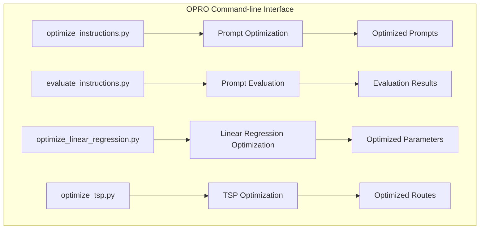
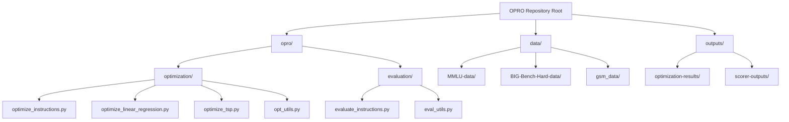
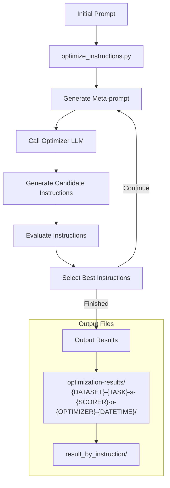
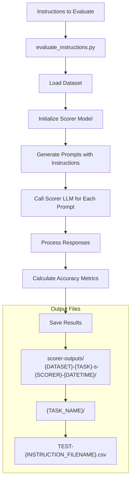
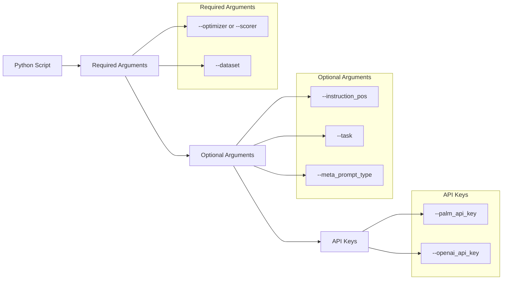
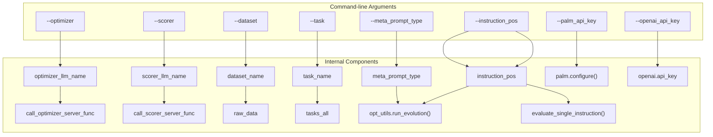

<!-- source: DeepWiki mcp.deepwiki.com · repo google-deepmind/opro · page 5.1 Command-line Examples · fetched 2026-10-26 -->

# Command-line Examples

<details>
<summary>Relevant source files</summary>

The following files were used as context for generating this wiki page:

- [README.md](README.md)
- [opro/evaluation/evaluate_instructions.py](opro/evaluation/evaluate_instructions.py)
- [opro/optimization/optimize_instructions.py](opro/optimization/optimize_instructions.py)

</details>


This page provides practical examples of using the OPRO (Optimizing PRompts) system from the command line. It covers how to run the key scripts for prompt optimization, evaluation, and other optimization tasks through the command-line interface. For information about integrating OPRO into other projects, see [Integration Examples](#5.2).

## Overview of Command-line Usage

OPRO provides several command-line scripts that allow you to optimize prompts and evaluate their performance. The two main scripts are:

1. `optimize_instructions.py` - For optimizing prompts using language models as optimizers
2. `evaluate_instructions.py` - For evaluating the performance of prompts on various datasets

Additionally, OPRO includes specialized optimization scripts for:

3. `optimize_linear_regression.py` - For optimizing linear regression parameters
4. `optimize_tsp.py` - For optimizing solutions to traveling salesman problems



Sources: [README.md:26-51]()

## Prerequisites and Setup

Before using the OPRO command-line tools, ensure you have:

1. Installed Python 3.10.13 or compatible version
2. Installed required dependencies:
   - absl-py (2.0.0)
   - google.generativeai (0.1.0)
   - immutabledict (3.0.0)
   - openai (0.27.2)
3. Obtained necessary API keys:
   - OpenAI API key (for GPT models)
   - PaLM API key (for text-bison model)

The repository path structure is important to understand for command-line usage:



Sources: [README.md:14-23](), [opro/optimization/optimize_instructions.py:49-51](), [opro/evaluation/evaluate_instructions.py:47-50]()

## Prompt Optimization Examples

### Basic Usage

The simplest way to run prompt optimization is:

```
python optimize_instructions.py --optimizer="gpt-3.5-turbo" --scorer="text-bison" \
    --instruction_pos="Q_begin" --dataset="gsm8k" --task="train" \
    --palm_api_key="<your_palm_api_key>" --openai_api_key="<your_openai_api_key>"
```

This example:
- Uses GPT-3.5-Turbo as the optimizer model
- Uses text-bison as the scorer model
- Places the instruction at the beginning of each question
- Uses the GSM8K dataset, train split
- Requires both PaLM and OpenAI API keys

Sources: [README.md:26-35](), [opro/optimization/optimize_instructions.py:14-42]()

### Workflow and Output

When you run the prompt optimization, the following process occurs:



The results are saved to the `outputs/optimization-results/` directory with a timestamp and experiment details in the folder name.

Sources: [opro/optimization/optimize_instructions.py:222-238](), [opro/optimization/optimize_instructions.py:799]()

### Customizing Optimization Parameters

You can customize your optimization run by editing key parameters in the script before running:

```python
# Edit initial instructions
initial_instructions = [
    "Let's solve the problem.",
    # "",
    # "The answer is",
]

# Edit evaluation settings
train_ratio = 0.035  # For GSM8K
eval_ratio = 0  

# Other parameters that can be edited
num_generated_instructions_in_each_step = 8
num_search_steps = 200
few_shot_selection_criteria = "random"
```

These parameters can be found in [opro/optimization/optimize_instructions.py:710-722]()

Sources: [opro/optimization/optimize_instructions.py:644-722]()

### Parameter Reference

| Parameter | Flag | Description | Example Values |
|-----------|------|-------------|----------------|
| Optimizer | `--optimizer` | The model that generates new prompts | `"gpt-3.5-turbo"`, `"gpt-4"`, `"text-bison"` |
| Scorer | `--scorer` | The model that evaluates prompt performance | `"text-bison"`, `"gpt-3.5-turbo"`, `"gpt-4"` |
| Dataset | `--dataset` | Dataset to optimize prompts for | `"gsm8k"`, `"mmlu"`, `"bbh"` |
| Task | `--task` | Specific task within the dataset | `"train"`, `"test"`, `"STEM"` |
| Instruction position | `--instruction_pos` | Where to place the prompt | `"before_Q"`, `"Q_begin"`, `"Q_end"`, `"A_begin"` |
| Meta-prompt type | `--meta_prompt_type` | What to include in the meta-prompt | `"both_instructions_and_exemplars"`, `"instructions_only"` |

Sources: [opro/optimization/optimize_instructions.py:65-101](), [opro/optimization/optimize_instructions.py:174-184]()

## Prompt Evaluation Examples

### Basic Usage

To evaluate the performance of prompts, use the `evaluate_instructions.py` script:

```
python evaluate_instructions.py --scorer="text-bison" --dataset="gsm8k" \
    --task="test" --instruction_pos="Q_begin" \
    --evaluate_training_fold=false --evaluate_test_fold=true \
    --palm_api_key="<your_palm_api_key>"
```

This example:
- Uses text-bison as the scorer model
- Evaluates on the GSM8K dataset, test split
- Places the instruction at the beginning of each question
- Evaluates only the test fold (not training fold)
- Requires a PaLM API key

Sources: [README.md:37-44](), [opro/evaluation/evaluate_instructions.py:14-39]()

### Evaluation Process

The evaluation process follows this workflow:



The results are saved to the `outputs/scorer-outputs/` directory with experiment details in the folder name.

Sources: [opro/evaluation/evaluate_instructions.py:222-236](), [opro/evaluation/evaluate_instructions.py:736-742]()

### Specifying Instructions to Evaluate

You can specify which instructions to evaluate by modifying the `instructions_to_evaluate` list in the script:

```python
instructions_to_evaluate = [
    "",
    "Let's think step by step.",
    "Take a deep breath and work on this problem step-by-step.",
]
```

This allows you to compare the performance of different prompts on the same dataset.

Sources: [opro/evaluation/evaluate_instructions.py:100-104]()

### Evaluation Parameters

| Parameter | Flag | Description | Example Values |
|-----------|------|-------------|----------------|
| Scorer | `--scorer` | The model used for evaluation | `"text-bison"`, `"gpt-3.5-turbo"`, `"gpt-4"` |
| Dataset | `--dataset` | Dataset to evaluate on | `"gsm8k"`, `"mmlu"`, `"bbh"`, `"multiarith"`, `"aqua"` |
| Task | `--task` | Specific task within the dataset | `"train"`, `"test"`, `"STEM"` |
| Instruction position | `--instruction_pos` | Where to place the prompt | `"before_Q"`, `"Q_begin"`, `"Q_end"`, `"A_begin"` |
| Evaluate training fold | `--evaluate_training_fold` | Whether to evaluate on training data | `true`, `false` |
| Evaluate test fold | `--evaluate_test_fold` | Whether to evaluate on test data | `true`, `false` |

Sources: [opro/evaluation/evaluate_instructions.py:63-95](), [opro/evaluation/evaluate_instructions.py:175-184]()

## Other Optimization Tasks

OPRO can be used to optimize tasks beyond prompt engineering. Here are examples of other optimization tasks:

### Linear Regression Optimization

To optimize parameters for a linear regression model:

```
python optimize_linear_regression.py --optimizer="gpt-3.5-turbo" \
    --openai_api_key="<your_openai_api_key>"
```

### Traveling Salesman Problem Optimization

To optimize routes for a traveling salesman problem:

```
python optimize_tsp.py --optimizer="gpt-3.5-turbo" \
    --openai_api_key="<your_openai_api_key>"
```

Both scripts follow similar patterns to the prompt optimization but are specialized for their respective domains.

Sources: [README.md:46-51]()

## Common Command-line Patterns

The following diagram illustrates the common pattern for all OPRO command-line tools:



Sources: [README.md:26-51](), [opro/optimization/optimize_instructions.py:65-101](), [opro/evaluation/evaluate_instructions.py:63-95]()

## Precautions and Best Practices

### API Cost Considerations

Running OPRO command-line tools can incur significant API costs, especially when using commercial LLMs like GPT-4. Consider these best practices:

1. Start with a smaller dataset or fewer optimization steps for initial testing
2. Use the `train_ratio` parameter to limit the number of examples processed
3. Consider using local, self-served models when possible
4. Monitor your API usage carefully

Sources: [README.md:59-61]()

### Error Handling and Retries

The evaluation script includes retry functionality for when API calls fail:

```python
# Maximum number of retries when API calls fail
max_retry = 5
# Sleep time between retries (in seconds)
sleep_time = 180
```

These settings can be found in [opro/evaluation/evaluate_instructions.py:698-699]() and can be adjusted if you're experiencing timeouts or rate limits.

Sources: [opro/evaluation/evaluate_instructions.py:698-699](), [opro/evaluation/evaluate_instructions.py:733-734]()

## Code-to-Command Mapping

This diagram illustrates how command-line arguments map to internal code components:



Sources: [opro/optimization/optimize_instructions.py:105-111](), [opro/evaluation/evaluate_instructions.py:118-123]()

## Conclusion

The command-line interface for OPRO provides a flexible way to run prompt optimization and evaluation experiments. By using the examples in this guide, you can quickly get started with optimizing prompts for different tasks and datasets, as well as using language models as optimizers for other problem domains.

---

