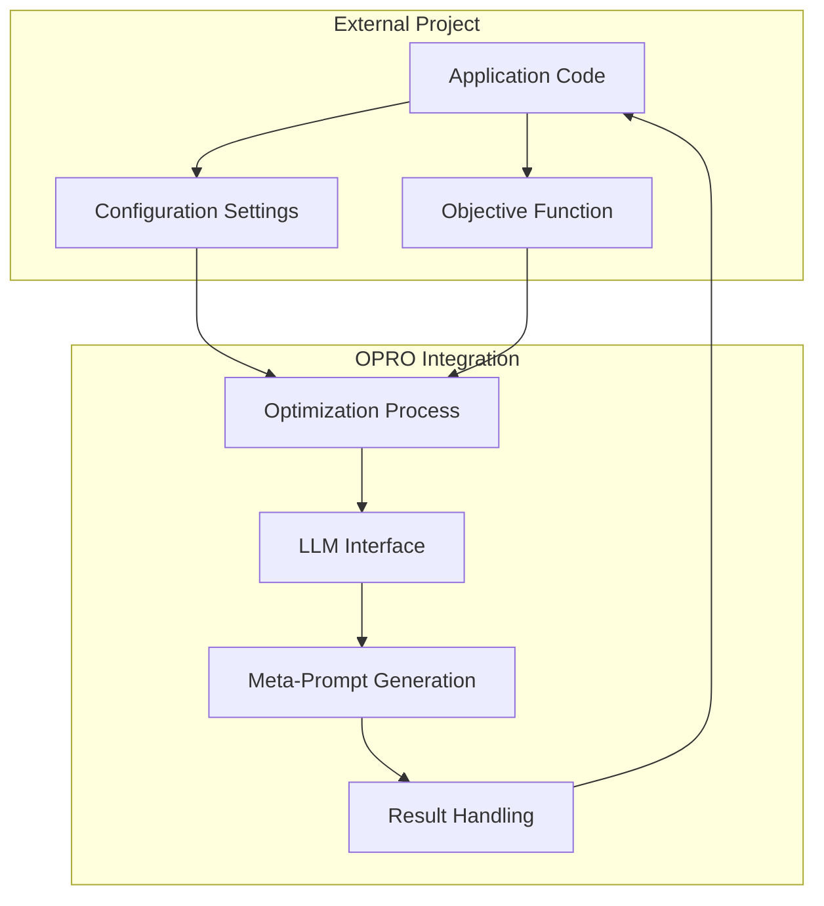
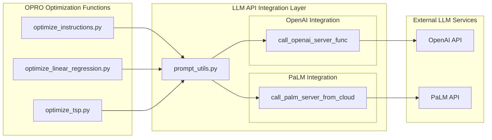
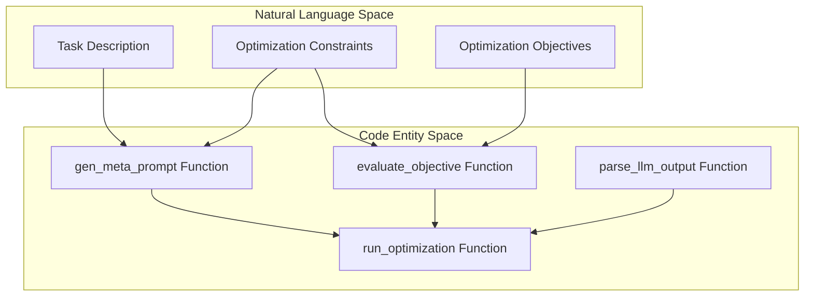
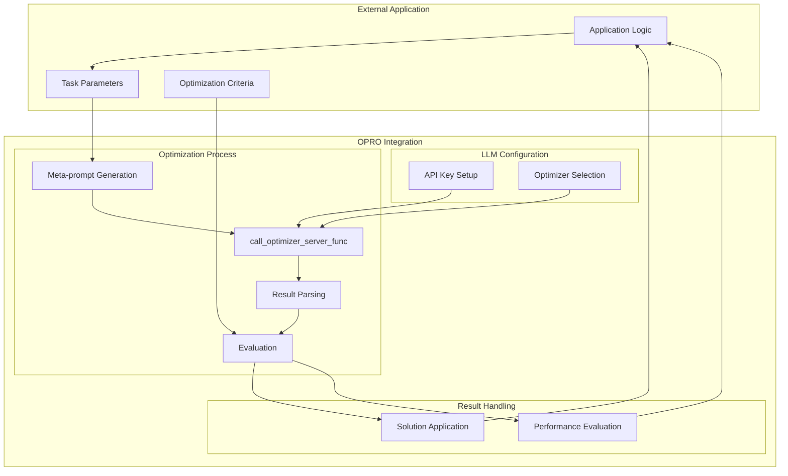

<!-- source: DeepWiki mcp.deepwiki.com · repo google-deepmind/opro · page 5.2 Integration Examples · fetched 2026-10-26 -->

# Integration Examples

<details>
<summary>Relevant source files</summary>

The following files were used as context for generating this wiki page:

- [opro/optimization/optimize_instructions.py](opro/optimization/optimize_instructions.py)
- [opro/optimization/optimize_linear_regression.py](opro/optimization/optimize_linear_regression.py)
- [opro/optimization/optimize_tsp.py](opro/optimization/optimize_tsp.py)

</details>


This page provides detailed guidance on how to integrate OPRO's optimization capabilities into your own projects. While [Command-line Examples](#5.1) shows how to use OPRO directly via the command line, this page focuses on how to incorporate OPRO's functionality programmatically into other systems and applications.

## Overview of Integration Approaches

OPRO provides several optimization modules that can be integrated into external projects. The main optimization capabilities include:

1. **Instruction/Prompt Optimization** - Optimizing prompts for language models
2. **Linear Regression Optimization** - Finding optimal parameters for linear regression
3. **Traveling Salesman Problem (TSP) Optimization** - Finding optimal routes for TSP

Each module follows a similar integration pattern, requiring:
- Configuration of optimization parameters
- Setup of LLM API access (OpenAI or PaLM)
- Implementation of objective functions
- Handling of optimization results



Sources: [opro/optimization/optimize_instructions.py:42-190](), [opro/optimization/optimize_linear_regression.py:60-101](), [opro/optimization/optimize_tsp.py:66-109]()

## Common Integration Components

All OPRO optimization modules share these common integration components:

| Component | Purpose | Example Configuration |
|-----------|---------|------------------------|
| LLM API Configuration | Set up access to language model APIs | API keys for OpenAI/PaLM |
| Optimizer Selection | Choose which LLM to use as optimizer | "text-bison", "gpt-3.5-turbo", "gpt-4" |
| Meta-prompt Generation | Create prompts for the optimizer | Functions to structure optimization requests |
| Result Parsing | Extract optimization results | Functions to parse LLM outputs |
| Output Handling | Process and use optimization results | Save or apply optimized solutions |

Sources: [opro/optimization/optimize_instructions.py:95-117](), [opro/optimization/optimize_linear_regression.py:72-94](), [opro/optimization/optimize_tsp.py:76-93]()

## LLM API Integration

OPRO supports integration with two main LLM providers:



The API integration follows this pattern in all optimization modules:

```python
# For OpenAI models
if model_name in {"gpt-3.5-turbo", "gpt-4"}:
    openai.api_key = openai_api_key
    call_model_func = functools.partial(
        prompt_utils.call_openai_server_func,
        model=model_name,
        max_decode_steps=max_decode_steps,
        temperature=temperature
    )
# For PaLM models
else:
    palm.configure(api_key=palm_api_key)
    call_model_func = functools.partial(
        prompt_utils.call_palm_server_from_cloud,
        model="text-bison-001",
        max_decode_steps=max_decode_steps,
        temperature=temperature
    )
```

Sources: [opro/optimization/optimize_instructions.py:190-209](), [opro/optimization/optimize_linear_regression.py:108-156](), [opro/optimization/optimize_tsp.py:111-159]()

## Instruction Optimization Integration

The instruction optimization module can be integrated to optimize prompts for specific tasks. This is particularly useful for applications that heavily rely on LLM interactions.

### Integration Workflow

```mermaid
flowchart TD
    subgraph "External Application"
        Task["Task Definition"]
        Dataset["Dataset Access"]
        Eval["Evaluation Criteria"]
    end
    
    subgraph "OPRO Instruction Optimization"
        OI["optimize_instructions.py"]
        RUN["run_evolution Function"]
        EU["Optimization Utilities"]
        INS["Initial Instructions"]
        CFG["Optimization Configuration"]
    end
    
    Task --> OI
    Dataset --> OI
    Eval --> OI
    INS --> RUN
    CFG --> RUN
    OI --> RUN
    RUN --> EU
    
    RUN --> Optimized["Optimized Instructions"]
    Optimized --> "External Application"
```

### Key Integration Parameters

The main integration points for instruction optimization include:

1. **Dataset Selection**: Connect your dataset to the optimization process
   ```python
   # Dataset configuration
   dataset_name = "your_dataset"
   task_name = "your_task"
   # Load or configure your dataset
   raw_data = load_your_dataset()
   ```

2. **Instruction Position**: Specify where instructions should be placed
   ```python
   instruction_pos = "A_begin"  # Options: "before_Q", "Q_begin", "Q_end", "A_begin"
   ```

3. **Initial Instructions**: Provide starting instructions for optimization
   ```python
   initial_instructions = ["Let's solve the problem."]
   ```

4. **Optimizer Configuration**: Configure the optimization process
   ```python
   evolution_kwargs = {
       "num_search_steps": 200,
       "old_instruction_score_threshold": 0.3,
       "scorer_llm_dict": scorer_llm_dict,
       "optimizer_llm_dict": optimizer_llm_dict,
       # Other configuration parameters
   }
   ```

5. **Running the Optimization**: Execute the optimization process
   ```python
   from opro.optimization import opt_utils
   opt_utils.run_evolution(**evolution_kwargs)
   ```

Sources: [opro/optimization/optimize_instructions.py:734-799]()

## Linear Regression Optimization Integration

The linear regression optimization module demonstrates how to use LLMs to optimize numerical parameters. This can be integrated into applications that require parameter tuning.

### Integration Workflow

```mermaid
flowchart TD
    subgraph "External Application"
        TaskDef["Regression Task Definition"]
        DataAccess["Data Access"]
        LossFunc["Loss Function"]
    end
    
    subgraph "OPRO Linear Regression Optimization"
        OLR["optimize_linear_regression.py"]
        MP["gen_meta_prompt Function"]
        EP["extract_string_in_square_brackets"]
        PO["parse_output"]
        EL["evaluate_loss"]
    end
    
    TaskDef --> OLR
    DataAccess --> OLR
    LossFunc --> EL
    
    OLR --> MP
    MP --> "Optimizer LLM"
    "Optimizer LLM" --> EP
    EP --> PO
    PO --> EL
    EL --> OLR
    
    OLR --> Optimized["Optimized Parameters"]
    Optimized --> "External Application"
```

### Key Integration Components

The integration for linear regression optimization includes:

1. **Data Generation**: Create or load your data
   ```python
   X = np.arange(num_points).astype(float) + 1
   y = X * w_true + b_true + np.random.randn(num_points)
   ```

2. **Meta-prompt Generation**: Generate prompts for the optimizer
   ```python
   meta_prompt = gen_meta_prompt(
       old_value_pairs_set,
       X,
       y,
       num_input_decimals=num_input_decimals,
       num_output_decimals=num_output_decimals,
       max_num_pairs=max_num_pairs
   )
   ```

3. **Optimizer Calling**: Send prompts to the LLM optimizer
   ```python
   raw_outputs = call_optimizer_server_func(meta_prompt)
   ```

4. **Result Parsing**: Parse the optimization results
   ```python
   parsed_output = parse_output(
       extract_string_in_square_brackets(string)
   )
   ```

5. **Evaluation**: Evaluate the quality of optimization results
   ```python
   z = evaluate_loss(X, y, w, b)
   ```

Sources: [opro/optimization/optimize_linear_regression.py:169-268](), [opro/optimization/optimize_linear_regression.py:342-368]()

## Traveling Salesman Problem Optimization Integration

The TSP optimization module shows how to optimize combinatorial problems and can be integrated into route planning or scheduling applications.

### Integration Workflow

```mermaid
flowchart TD
    subgraph "External Application"
        ProbDef["TSP Problem Definition"]
        CoordData["Coordinate Data"]
        DistFunc["Distance Function"]
    end
    
    subgraph "OPRO TSP Optimization"
        OTSP["optimize_tsp.py"]
        GMP["gen_meta_prompt Function"]
        ES["extract_string"]
        ED["evaluate_distance"]
    end
    
    ProbDef --> OTSP
    CoordData --> OTSP
    DistFunc --> ED
    
    OTSP --> GMP
    GMP --> "Optimizer LLM"
    "Optimizer LLM" --> ES
    ES --> ED
    ED --> OTSP
    
    OTSP --> Optimized["Optimized Route"]
    Optimized --> "External Application"
```

### Key Integration Components

The integration for TSP optimization includes:

1. **Problem Definition**: Define the TSP problem
   ```python
   x = np.random.uniform(low=-100, high=100, size=num_points)
   y = np.random.uniform(low=-100, high=100, size=num_points)
   ```

2. **Meta-prompt Generation**: Generate prompts for the optimizer
   ```python
   meta_prompt = gen_meta_prompt(
       old_value_pairs_set,
       x,
       y,
       max_num_pairs=max_num_pairs
   )
   ```

3. **Result Extraction**: Extract routes from optimizer outputs
   ```python
   parsed_output = extract_string(string)
   ```

4. **Distance Evaluation**: Evaluate the route distances
   ```python
   dis = evaluate_distance(x, y, trace, num_decimals)
   ```

Sources: [opro/optimization/optimize_tsp.py:172-186](), [opro/optimization/optimize_tsp.py:254-301]()

## Custom Optimization Task Integration

OPRO's design allows for integration of custom optimization tasks by following a common pattern. This section outlines how to create your own optimization module.

### Integration Architecture



### Implementation Steps

1. **Define the Objective Function**: Create a function to evaluate solutions
   ```python
   def evaluate_objective(solution_parameters, problem_data):
       # Calculate and return objective value
       return objective_value
   ```

2. **Create Meta-prompt Generator**: Create a function to generate prompts
   ```python
   def gen_meta_prompt(previous_solutions, problem_data, max_solutions=10):
       # Generate meta-prompt for the optimizer
       return meta_prompt
   ```

3. **Implement Parser**: Create a function to parse optimizer outputs
   ```python
   def parse_output(optimizer_output):
       # Extract and parse the solution
       return parsed_solution
   ```

4. **Implement Optimization Loop**: Create the main optimization function
   ```python
   def run_optimization(problem_data, optimizer_config, num_steps=100):
       # Initialize solution tracking
       previous_solutions = []
       
       # Optimization loop
       for step in range(num_steps):
           # Generate meta-prompt
           meta_prompt = gen_meta_prompt(previous_solutions, problem_data)
           
           # Call optimizer
           optimizer_outputs = call_optimizer_func(meta_prompt)
           
           # Parse outputs
           parsed_solutions = [parse_output(output) for output in optimizer_outputs]
           
           # Evaluate solutions
           for solution in parsed_solutions:
               objective_value = evaluate_objective(solution, problem_data)
               previous_solutions.append((solution, objective_value))
               
       # Return best solution
       return sorted(previous_solutions, key=lambda x: x[1])[0]
   ```

5. **Configure LLM Integration**: Set up the LLM API integration
   ```python
   def setup_optimizer(optimizer_name, api_key):
       # Configure LLM API access
       if optimizer_name in ["gpt-3.5-turbo", "gpt-4"]:
           openai.api_key = api_key
           return prompt_utils.call_openai_server_func
       else:
           palm.configure(api_key=api_key)
           return prompt_utils.call_palm_server_from_cloud
   ```

Sources: [opro/optimization/optimize_instructions.py:744-799](), [opro/optimization/optimize_linear_regression.py:169-268](), [opro/optimization/optimize_tsp.py:172-310]()

## Integration Best Practices

When integrating OPRO optimization modules into your projects, consider these best practices:

1. **API Key Management**: Securely manage API keys for LLM services
   ```python
   # Use environment variables or secure storage
   openai_api_key = os.environ.get("OPENAI_API_KEY")
   palm_api_key = os.environ.get("PALM_API_KEY")
   ```

2. **Error Handling**: Implement robust error handling for LLM API calls
   ```python
   try:
       optimizer_output = call_optimizer_server_func(meta_prompt)
   except Exception as e:
       logging.error(f"Optimizer call failed: {e}")
       # Implement fallback strategy
   ```

3. **Optimization Parameter Tuning**: Tune optimization parameters for your specific task
   ```python
   # Example parameters to tune
   num_search_steps = 200  # Number of optimization iterations
   temperature = 1.0  # LLM temperature
   max_num_pairs = 20  # Maximum examples in meta-prompt
   ```

4. **Result Persistence**: Save optimization results for analysis and reuse
   ```python
   # Save results to JSON
   with open(results_json_path, "w") as f:
       json.dump(results_dict, f, indent=4)
   ```

5. **Meta-prompt Design**: Carefully design meta-prompts for your specific task
   ```python
   # Clear task description
   meta_prompt = "You are optimizing parameters for the following task: [task description]"
   
   # Include previous solutions
   meta_prompt += "\n\nPrevious solutions and their performance:\n"
   for solution, performance in previous_solutions:
       meta_prompt += f"\nSolution: {solution}, Performance: {performance}"
   
   # Clear request for improvement
   meta_prompt += "\n\nProvide a new solution that improves upon the previous best performance."
   ```

Sources: [opro/optimization/optimize_instructions.py:214-233](), [opro/optimization/optimize_linear_regression.py:210-236](), [opro/optimization/optimize_tsp.py:356-425]()

## Complete Integration Example

This section showcases a complete integration example that ties together all the components discussed above.



### Integration Pseudocode

```python
# 1. Import necessary modules
from opro import prompt_utils
from opro.optimization import opt_utils

# 2. Configure LLM API access
def setup_optimizer(optimizer_name, api_key):
    if optimizer_name in ["gpt-3.5-turbo", "gpt-4"]:
        import openai
        openai.api_key = api_key
        return prompt_utils.call_openai_server_func
    else:
        import google.generativeai as palm
        palm.configure(api_key=api_key)
        return prompt_utils.call_palm_server_from_cloud

# 3. Define optimization problem
def define_problem():
    problem_data = {
        "parameters": [...],
        "constraints": [...],
        "initial_solutions": [...]
    }
    return problem_data

# 4. Generate meta-prompt
def create_meta_prompt(previous_solutions, problem_data):
    meta_prompt = "Task description...\n\n"
    meta_prompt += "Previous solutions:\n"
    for solution, performance in previous_solutions:
        meta_prompt += f"Solution: {solution}, Performance: {performance}\n"
    meta_prompt += "\nProvide a better solution."
    return meta_prompt

# 5. Parse results
def parse_solution(llm_output):
    # Extract solution from LLM output
    return parsed_solution

# 6. Evaluate solution
def evaluate_solution(solution, problem_data):
    # Calculate solution performance
    return performance_score

# 7. Optimization loop
def run_optimization(problem_data, optimizer_func, num_steps=100):
    previous_solutions = problem_data["initial_solutions"]
    
    for step in range(num_steps):
        # Generate meta-prompt
        meta_prompt = create_meta_prompt(previous_solutions, problem_data)
        
        # Get optimizer suggestions
        llm_outputs = optimizer_func(meta_prompt)
        
        # Parse and evaluate solutions
        for output in llm_outputs:
            solution = parse_solution(output)
            if solution:
                performance = evaluate_solution(solution, problem_data)
                previous_solutions.append((solution, performance))
        
        # Sort by performance
        previous_solutions.sort(key=lambda x: x[1])
    
    # Return best solution
    return previous_solutions[0]

# 8. Main integration function
def integrate_opro_optimization(optimizer_name, api_key):
    # Setup optimizer
    optimizer_func = setup_optimizer(optimizer_name, api_key)
    
    # Define problem
    problem_data = define_problem()
    
    # Run optimization
    best_solution, best_performance = run_optimization(problem_data, optimizer_func)
    
    # Apply solution
    apply_solution(best_solution)
    
    return best_solution, best_performance
```

Sources: [opro/optimization/optimize_instructions.py:104-395](), [opro/optimization/optimize_linear_regression.py:60-323](), [opro/optimization/optimize_tsp.py:66-365]()

---

