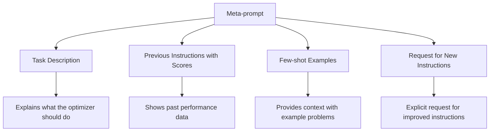
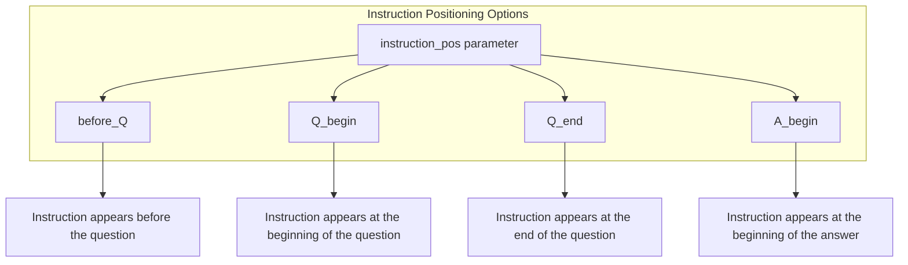
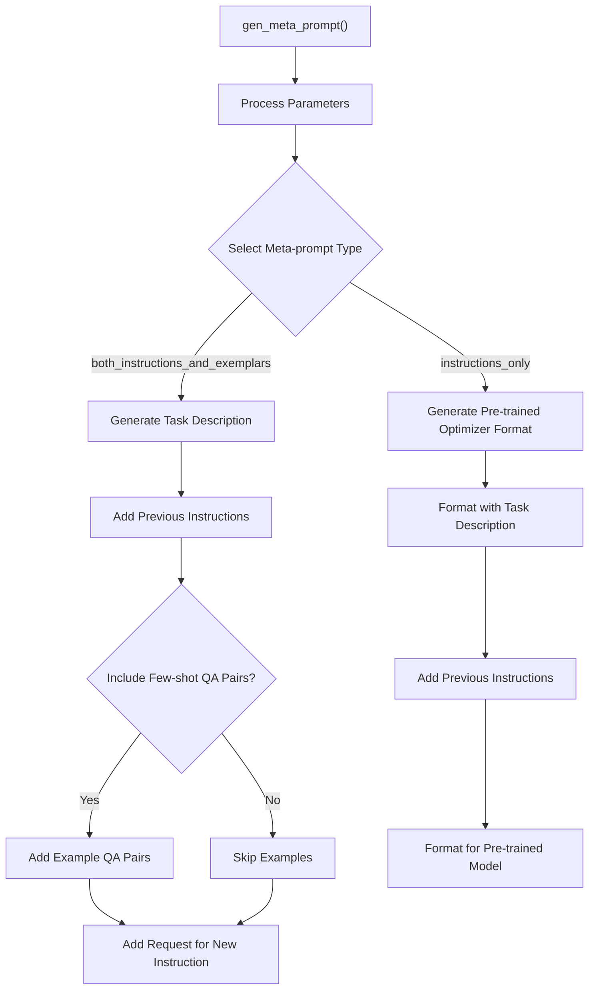
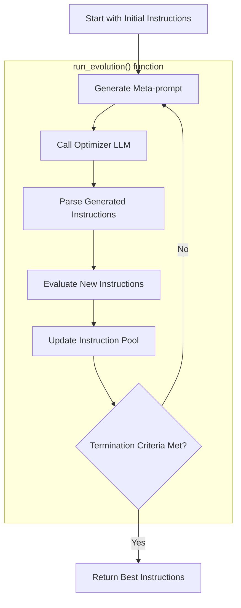
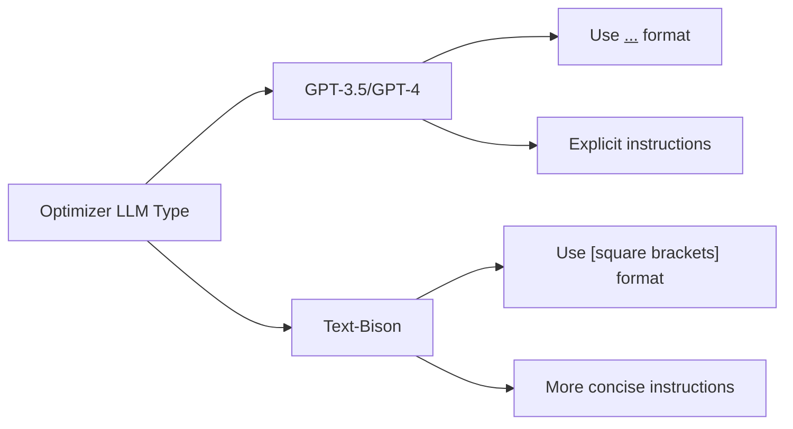
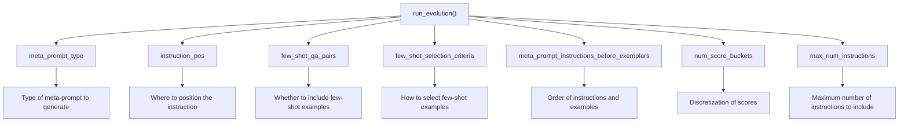

<!-- source: DeepWiki mcp.deepwiki.com · repo google-deepmind/opro · page 6 Meta-prompt Design · fetched 2026-10-26 -->

# Meta-prompt Design

<details>
<summary>Relevant source files</summary>

The following files were used as context for generating this wiki page:

- [img/gpt_meta_prompt.png](img/gpt_meta_prompt.png)
- [img/workflow.png](img/workflow.png)
- [opro/optimization/opt_utils.py](opro/optimization/opt_utils.py)

</details>


## Introduction

Meta-prompt design is a critical component of the OPRO (Optimizing PROmpts) framework, as it defines how the system communicates with the optimizer language model (LLM) to generate improved prompts. This document provides a detailed explanation of meta-prompt structure, configuration options, and how meta-prompts drive the optimization process. 

For information about the overall optimization system, see [Optimization System](#2).

## What is a Meta-prompt?

In OPRO, a meta-prompt is a specially structured prompt given to an optimizer LLM that instructs it to generate new and improved prompts. The meta-prompt contains information about previous instructions, their performance scores, example problems, and guidance on how to create better instructions.



Sources: [opro/optimization/opt_utils.py:90-139]()

## Meta-prompt Components

A meta-prompt typically consists of the following components:

1. **Task Description**: Explains the task to the optimizer LLM
2. **Previous Instructions with Scores**: Shows previously tried instructions and their performance
3. **Few-shot Examples** (optional): Provides examples from the dataset
4. **Request for New Instructions**: Explicitly asks for improved instructions

### Meta-prompt Types

OPRO supports two primary types of meta-prompts, controlled by the `meta_prompt_type` parameter:

| Type | Description | Best Used For |
|------|-------------|--------------|
| `both_instructions_and_exemplars` | Includes both previous instructions with scores and examples from the dataset | Fine-tuned optimizers |
| `instructions_only` | Includes only previous instructions with scores | Pre-trained optimizers |

Sources: [opro/optimization/opt_utils.py:150-158](), [opro/optimization/opt_utils.py:161-335]()

## Instruction Positioning

A key aspect of meta-prompt design is specifying where the instruction should be positioned relative to the question and answer. OPRO supports four positions:



Sources: [opro/optimization/opt_utils.py:140-149](), [opro/optimization/opt_utils.py:221-232]()

## Meta-prompt Generation

The `gen_meta_prompt()` function is responsible for generating meta-prompts in OPRO:



Sources: [opro/optimization/opt_utils.py:90-335]()

### Key Parameters for Meta-prompt Generation

| Parameter | Description | Default |
|-----------|-------------|---------|
| `old_instructions_and_scores` | List of (instruction, score, step) tuples | Required |
| `instruction_pos` | Where to place instruction: before_Q, Q_begin, Q_end, A_begin | Required |
| `optimizer_llm_name` | Name of the LLM used for optimization | Required |
| `old_instruction_score_threshold` | Minimum score for including old instructions | 0.1 |
| `max_num_instructions` | Maximum number of instructions to include | 1000 |
| `meta_prompt_type` | Type of meta-prompt | "both_instructions_and_exemplars" |
| `few_shot_qa_pairs` | Whether to include example QA pairs | False |
| `include_qa` | Whether to format with "Q:" and "A:" | True |
| `instructions_before_exemplars` | Order of instructions and exemplars | True |
| `num_score_buckets` | Number of buckets for discretizing scores | inf |

Sources: [opro/optimization/opt_utils.py:90-139]()

## Meta-prompt in the Optimization Process

Meta-prompts are used in an iterative optimization process, as shown below:



Sources: [opro/optimization/opt_utils.py:338-1035]()

### Selection of Few-shot Examples

OPRO offers several strategies for selecting few-shot examples to include in meta-prompts:

| Strategy | Description |
|----------|-------------|
| `accumulative_most_frequent` | Select questions that have been answered incorrectly most frequently across all iterations |
| `current_most_frequent` | Select questions that are answered incorrectly most often by currently shown instructions |
| `constant` | Use the same fixed set of examples for all iterations |
| `random` | Randomly select examples in each iteration |

Sources: [opro/optimization/opt_utils.py:587-688]()

## Example Meta-prompt Structure

For GPT models, a meta-prompt might look like:

```
Your task is to generate the instruction <INS>.
Below are some previous instructions with their scores.
The score ranges from 0 to 100.

text:
Solve step by step, showing all your work.
score:
75

text:
Break down the problem into smaller parts and solve each part.
score:
82

The following exemplars show how to apply your text...

input:
<INS>
Q: If John has 5 apples and gives 2 to Mary, how many does he have left?
A:

output:
John has 5 - 2 = 3 apples left.

Generate an instruction that is different from all the instructions <INS> above,
and has a higher score than all the instructions <INS> above.
The instruction should begin with <INS> and end with </INS>.
The instruction should be concise, effective, and generally applicable to all problems above.
```

For Text-Bison:

```
I have some texts along with their corresponding scores.
The texts are arranged in ascending order based on their scores,
where higher scores indicate better quality.

text:
Solve step by step, showing all your work.
score:
75

...

Write your new text that is different from the old ones and
has a score as high as possible. Write the text in square brackets.
```

Sources: [opro/optimization/opt_utils.py:161-296]()

## Best Practices for Meta-prompt Design

### 1. Tailor to Your Optimizer LLM

Different LLMs require different formats:



Sources: [opro/optimization/opt_utils.py:163-204]()

### 2. Balance Information and Length

- Include enough previous instructions to provide guidance but not so many that the meta-prompt becomes too long
- Set appropriate values for `old_instruction_score_threshold` and `max_num_instructions` to control the number of examples

### 3. Strategic Few-shot Selection

- Choose few-shot examples that highlight the challenges your instructions should address
- Experiment with different selection strategies (`few_shot_selection_criteria`)
- Consider using a strategy like `current_most_frequent` to focus on examples that are still challenging

Sources: [opro/optimization/opt_utils.py:587-688]()

## Meta-prompt Configuration in Code

The meta-prompt design is configured through parameters passed to the `run_evolution()` function:



Sources: [opro/optimization/opt_utils.py:338-401]()

## Conclusion

Meta-prompt design is a crucial aspect of OPRO that directly impacts the quality of optimized prompts. By carefully configuring the structure and content of meta-prompts, you can guide the optimizer LLM to generate increasingly effective instructions. The flexibility of OPRO's meta-prompt system allows for adaptation to different tasks, datasets, and optimizer models.

For practical examples of using this meta-prompt system, see [Usage Examples](#5).

---

