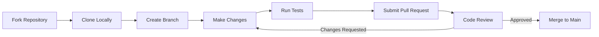
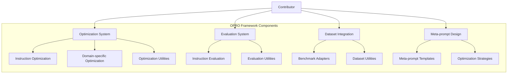
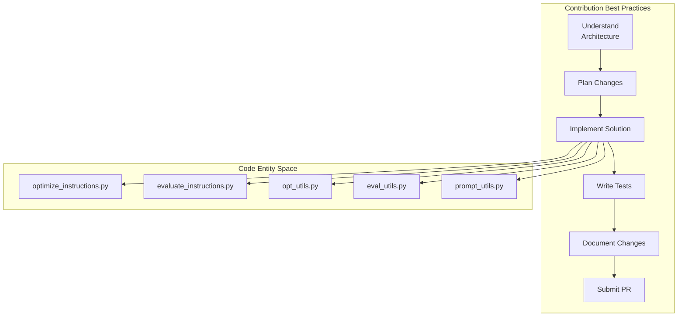
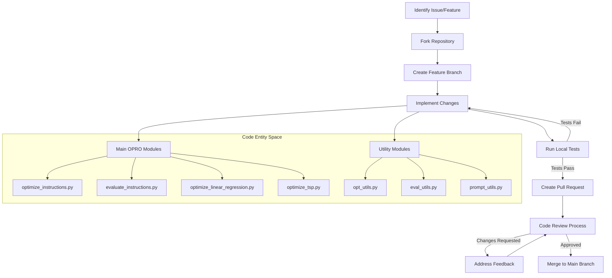

<!-- source: DeepWiki mcp.deepwiki.com · repo google-deepmind/opro · page 7 Contributing · fetched 2026-10-26 -->

# Contributing

Relevant source files

The following files were used as context for generating this wiki page:

- [.gitignore](.gitignore)
- [CONTRIBUTING.md](CONTRIBUTING.md)
- [LICENSE](LICENSE)

This page provides comprehensive information on how to contribute to the OPRO (Optimizing PROmpts) project. It outlines the prerequisites, process, and best practices for making contributions to enhance and extend the capabilities of the OPRO framework. For information about the overall system architecture and components, see [Overview](#1).

## Prerequisites for Contributing

Before contributing to the OPRO project, there are several important prerequisites that must be addressed.

### Contributor License Agreement

All contributions to OPRO must be accompanied by a Contributor License Agreement (CLA). This agreement ensures that the project has the necessary permissions to use and redistribute your contributions.

- If you or your employer have already signed the Google CLA for another project, you may not need to sign it again
- Visit the [Google CLA portal](https://cla.developers.google.com/) to check your current agreements or sign a new one

### Community Guidelines

The OPRO project follows Google's Open Source Community Guidelines, which establish expectations for conduct and collaboration within the project. Familiarize yourself with these guidelines before contributing.

Sources: [CONTRIBUTING.md:21-24]()

## Contribution Process

The diagram below illustrates the standard workflow for contributing to the OPRO project:

### Code Reviews

All submissions to the OPRO project require review, including those from project members. The review process ensures code quality and consistency throughout the codebase.

- Pull requests are used for the code review process
- Reviewers may request changes or clarification before approving
- Once approved, contributions can be merged into the main codebase

Sources: [CONTRIBUTING.md:28-33]()

## Contributing to Different System Components

The diagram below shows the main components of OPRO where contributions can be made:

### Key Areas for Contribution

The table below outlines the primary areas where contributions to OPRO are particularly valuable:

| Component | Description | Relevant Files |
|-----------|-------------|----------------|
| Optimization System | Enhancing LLM optimization capabilities | `optimize_instructions.py`, `optimize_linear_regression.py`, `optimize_tsp.py` |
| Evaluation System | Improving evaluation methodologies | `evaluate_instructions.py`, `eval_utils.py` |
| Dataset Integration | Adding support for new benchmarks | Dataset-specific files in the repository |
| Meta-prompt Design | Refining optimization prompt templates | `prompt_utils.py` |
| Documentation | Improving technical documentation | Wiki pages and README files |
| Testing | Expanding test coverage | Test files throughout the codebase |

Sources: System architecture diagrams

## Best Practices for Contributors

Follow these best practices when contributing to OPRO:

1. **Understand the architecture**: Familiarize yourself with the overall system architecture (see [Overview](#1) and [Optimization System](#2)) before making changes
2. **Follow code style**: Maintain consistency with the existing codebase
3. **Document your changes**: Include clear documentation for any new features or modifications
4. **Write tests**: Add appropriate tests for new functionality
5. **Keep changes focused**: Each contribution should address a specific issue or feature

## Contribution Submission Workflow

The following diagram illustrates the detailed process from identifying an issue to having your contribution merged:

Sources: [CONTRIBUTING.md]()

## License Information

All contributions to OPRO are subject to the Apache License 2.0. By submitting contributions, you agree that your work will be licensed under this license.

Key licensing terms to be aware of:
- You retain copyright to your contributions
- Your contributions will be available under the Apache License 2.0
- Any modifications to files should carry notices stating that you changed the files

Sources: [LICENSE](), [CONTRIBUTING.md:130-137]()

## Getting Help

If you have questions about contributing to OPRO, you can:
- Open an issue in the GitHub repository
- Review existing documentation and examples
- Refer to the [Overview](#1) section for general information about the project

Following these guidelines will help ensure a smooth contribution process and facilitate the integration of your improvements into the OPRO framework.