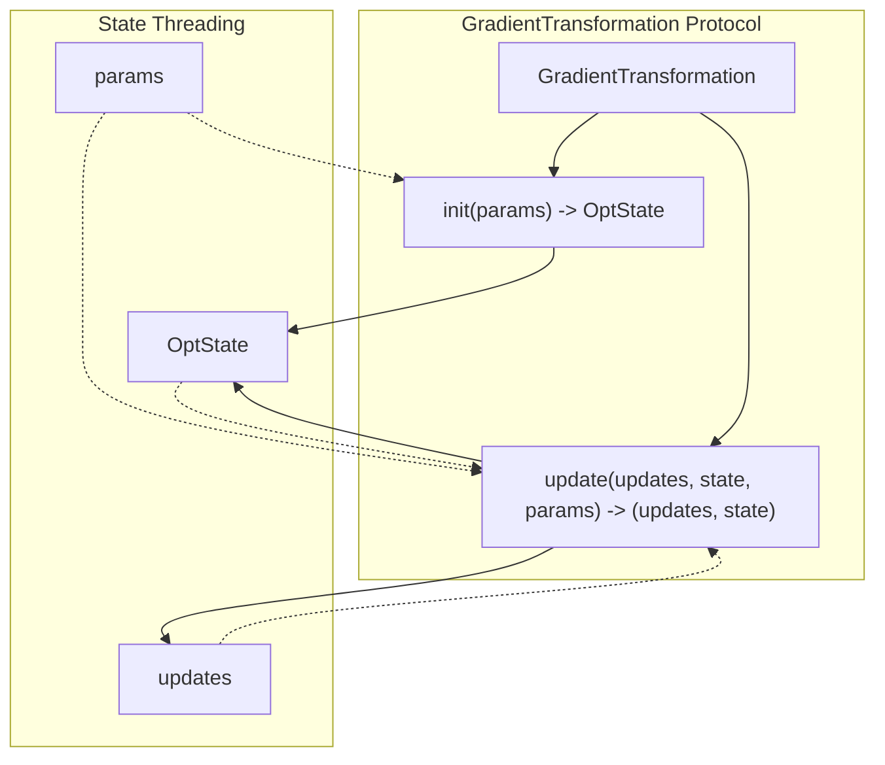
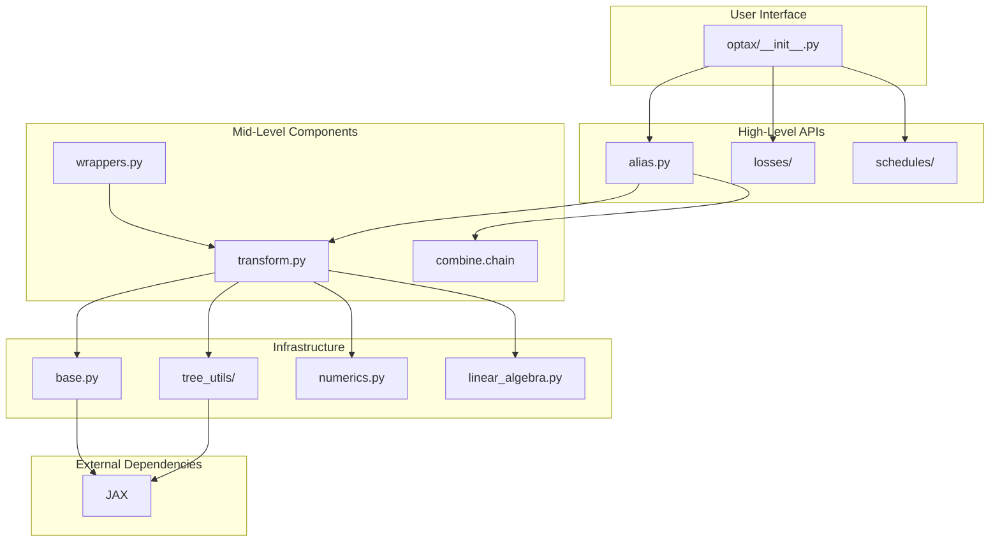
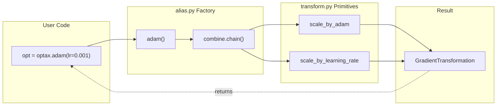
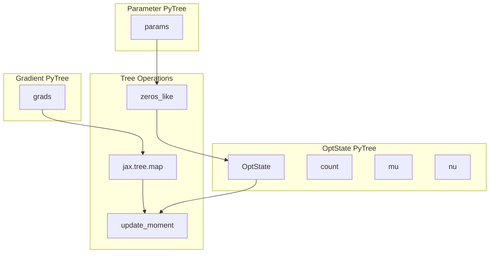

<!-- source: DeepWiki mcp.deepwiki.com · repo google-deepmind/optax · page 1 Overview · fetched 2026-10-26 -->

# Overview

<details>
<summary>Relevant source files</summary>

The following files were used as context for generating this wiki page:

- [README.md](README.md)
- [docs/development.md](docs/development.md)
- [docs/getting_started.ipynb](docs/getting_started.ipynb)
- [docs/index.rst](docs/index.rst)
- [optax/__init__.py](optax/__init__.py)
- [optax/_src/schedule.py](optax/_src/schedule.py)
- [optax/_src/transform_test.py](optax/_src/transform_test.py)
- [optax/_src/wrappers.py](optax/_src/wrappers.py)

</details>


Optax is a gradient processing and optimization library for JAX that provides composable building blocks for constructing and customizing optimizers. It is designed to facilitate research by enabling users to combine low-level transformations into custom optimization algorithms for parametric models, particularly deep neural networks.

This page provides a high-level introduction to Optax's architecture, design philosophy, and core abstractions. For detailed information about specific subsystems:
- Getting started and installation: see [Getting Started](#1.1)
- Example gallery and notebooks: see [Example Gallery](#1.2)
- Core abstractions and patterns: see [Core Architecture](#2)
- Optimizer implementations: see [Optimizers](#3)
- Gradient transformations: see [Gradient Transformations](#6)
- Loss functions: see [Loss Functions](#5)

**Sources:** [optax/__init__.py:15](), [docs/index.rst:7-22]()

## Getting Started

Optax integrates smoothly into JAX training workflows. Getting started involves installing the library from PyPI or GitHub, setting up a model parameter structure, initializing an optimizer state, and executing an update loop. 

For a complete walkthrough on installation, writing your first training loop, and initial code snippets, see [Getting Started](#1.1).

**Sources:** [README.md:33-81](), [docs/getting_started.ipynb:1-178]()

## Example Gallery

Optax includes a rich collection of end-to-end example notebooks demonstrating how to train various architectures—ranging from simple MLPs on MNIST to ResNets on CIFAR-10, transformer-based language models (nanoLM), and advanced techniques like gradient accumulation, freezing parameters, meta-learning, and second-order optimization using LBFGS.

For detailed walkthroughs of these notebooks and contrib examples, see [Example Gallery](#1.2).

**Sources:** [README.md:1-150](), [docs/index.rst:42-50]()

## Design Philosophy

Optax follows three core principles:

1. **Composability**: Complex optimizers are built by chaining simple, reusable transformations
2. **Functional Programming**: All operations are pure functions with explicit state threading
3. **JAX Integration**: Built on JAX primitives for automatic differentiation and JIT compilation

The library favors small, well-tested building blocks over monolithic abstractions, prioritizing code readability and matching standard mathematical formulations over code reuse.

**Sources:** [docs/index.rst:12-22](), [optax/_src/base.py:152-191]()

## Core Abstraction: GradientTransformation

The fundamental abstraction in Optax is `GradientTransformation`, a named tuple containing two pure functions:


**Diagram: GradientTransformation Protocol**

- **`init`**: Takes initial parameters and returns initial optimizer state (e.g., momentum buffers, step counts)
- **`update`**: Takes gradient updates and current state, returns transformed updates and new state
- All state is immutable and explicitly threaded through each call

**Sources:** [optax/_src/base.py:65-110](), [optax/_src/base.py:152-195]()

## Architecture Layers

Optax is organized into distinct architectural layers, each with specific responsibilities:


**Diagram: Optax Architecture Layers**

| Layer | Modules | Purpose |
|-------|---------|---------|
| **Public API** | `optax/__init__.py` | Exports all public symbols |
| **High-Level APIs** | `alias.py`, `losses/`, `schedules/` | User-facing optimizers and utilities |
| **Mid-Level** | `transform.py`, `combine.py`, `wrappers.py` | Composable transformation building blocks |
| **Infrastructure** | `base.py`, `tree_utils/`, `numerics.py` | Core abstractions and PyTree operations |
| **Foundation** | JAX | Array operations, autodiff, compilation |

**Sources:** [optax/__init__.py:1-156](), [optax/_src/alias.py:1-30](), [optax/_src/transform.py:1-30](), [optax/_src/base.py:1-341]()

## Optimizer Construction Pattern

Optimizers in Optax follow a factory pattern where high-level functions compose lower-level transformations:


**Diagram: Optimizer Construction via Composition**

Example from `alias.py`:

```python
def adam(learning_rate, b1=0.9, b2=0.999, eps=1e-8):
    return combine.chain(
        transform.scale_by_adam(b1=b1, b2=b2, eps=eps),
        transform.scale_by_learning_rate(learning_rate),
    )
```

This pattern enables:
- **Modularity**: Transformations can be mixed and matched
- **Extensibility**: New optimizers composed from existing pieces
- **Transparency**: Clear mapping to mathematical formulations

**Sources:** [optax/_src/alias.py:1-65](), [optax/_src/transform.py:100-135]()

## Training Loop Integration

Optax optimizers integrate into standard JAX training loops using a functional state-threading pattern:

```mermaid
sequenceDiagram
    participant User as Training Loop
    participant Opt as GradientTransformation
    participant Loss as Loss Function
    
    User->>Loss: Define loss_fn(params, batch)
    User->>Opt: opt = optax.adam(lr=0.001)
    User->>Opt: state = opt.init(params)
    Opt-->>User: initial OptState
    
    loop Every Training Step
        User->>Loss: grads = jax.grad(loss_fn)(params, batch)
        User->>Opt: updates, state = opt.update(grads, state, params)
        Note over Opt: Applies transformations<br/>Updates state
        Opt-->>User: (updates, new_state)
        User->>User: params = optax.apply_updates(params, updates)
    end
```
**Diagram: Training Loop State Threading**

Key characteristics:
- **Immutable State**: Each `update` call returns new state; original is unchanged
- **Explicit Threading**: State must be explicitly passed and stored between calls
- **JIT Compatible**: All operations are pure functions that compile efficiently
- **No Hidden State**: All optimizer state is visible in `OptState` PyTree

**Sources:** [optax/_src/base.py:152-195](), [optax/_src/update.py:109]()

## PyTree Support

Optax operates on arbitrary nested parameter structures (PyTrees) using JAX's tree utilities:


**Diagram: PyTree Operations in Optimizer State**

Tree utilities handle:
- **Structural Operations**: `zeros_like`, `full_like` create matching structures
- **Element-wise Math**: `tree` operations for nested structures
- **Moment Updates**: `update_moment`, `bias_correction` for optimizer statistics
- **Type Handling**: Automatic dtype casting and complex number support

**Sources:** [optax/tree/__init__.py:1-30](), [optax/_src/transform.py:278-280]()

## Extension Points

Optax provides multiple customization mechanisms:

| Extension Mechanism | Module | Purpose |
|-------------------|---------|---------|
| **Transformation Wrappers** | `wrappers.py` | Modify behavior (masking, conditional execution) |
| **Learning Rate Schedules** | `schedules/` | Dynamic hyperparameter control |
| **Contrib Optimizers** | `contrib/` | Experimental algorithms |
| **Custom Losses** | `losses/` | Training objectives |
| **Transformation Composition** | `combine.chain`, `combine.partition` | Build custom optimizers |

All extensions respect the `GradientTransformation` protocol, ensuring they compose correctly with existing components.

**Sources:** [optax/__init__.py:22-33](), [optax/_src/wrappers.py:15-38]()

## State Management

Optimizer state in Optax follows these principles:

1. **Named Tuples**: States are subclasses for type safety and introspection
2. **Nested Structure**: Complex optimizers have nested state tuples
3. **Immutability**: All state updates return new instances
4. **Explicit Counts**: Step counts are stored as arrays for JIT compatibility

Example state structures:

| Optimizer | State Type | Fields |
|-----------|------------|--------|
| `adam` | `ScaleByAdamState` | `count`, `mu`, `nu` |
| `sgd` with momentum | `TraceState` | `trace` |
| `adafactor` | `FactoredState` | Factored moment matrices, scale parameters |
| `chain` | Tuple of states | One state per chained transformation |

**Sources:** [optax/_src/transform.py:133-146](), [optax/_src/base.py:67-82]()

## Key Modules Summary

| Module | Primary Exports | Description |
|--------|----------------|-------------|
| `optax._src.base` | `GradientTransformation`, `OptState`, `Params`, `Updates` | Core types and protocols |
| `optax._src.alias` | `adam`, `sgd`, `adamw`, `rmsprop`, etc. | High-level optimizer factories |
| `optax._src.transform` | `scale_by_adam`, `scale_by_rms`, `scale`, `trace` | Low-level transformations |
| `optax._src.wrappers` | `apply_if_finite`, `masked`, `MultiSteps` | Behavior modifiers |
| `optax.losses` | `softmax_cross_entropy`, `l2_loss`, etc. | Loss functions |
| `optax.schedules` | `exponential_decay`, `warmup_cosine_decay_schedule` | Learning rate schedules |
| `optax.contrib` | Experimental optimizers | Experimental algorithms |

**Sources:** [optax/__init__.py:22-152]()

## Typical Usage Pattern

A minimal Optax training loop demonstrates the functional state-threading pattern:

```python
# 1. Define optimizer
optimizer = optax.adam(learning_rate=0.001)

# 2. Initialize state
opt_state = optimizer.init(params)

# 3. Training loop
for batch in dataset:
    # Compute gradients
    grads = jax.grad(loss_fn)(params, batch)
    
    # Transform gradients and update state
    updates, opt_state = optimizer.update(grads, opt_state, params)
    
    # Apply updates to parameters
    params = optax.apply_updates(params, updates)
```

This pattern is:
- **JIT-compilable**: All functions are pure and can be compiled
- **Explicit**: No hidden state or side effects
- **Composable**: Optimizers can be wrapped or chained
- **Inspectable**: State can be examined or modified between steps

**Sources:** [docs/getting_started.ipynb:105-148](), [optax/_src/base.py:152-195]()

---

