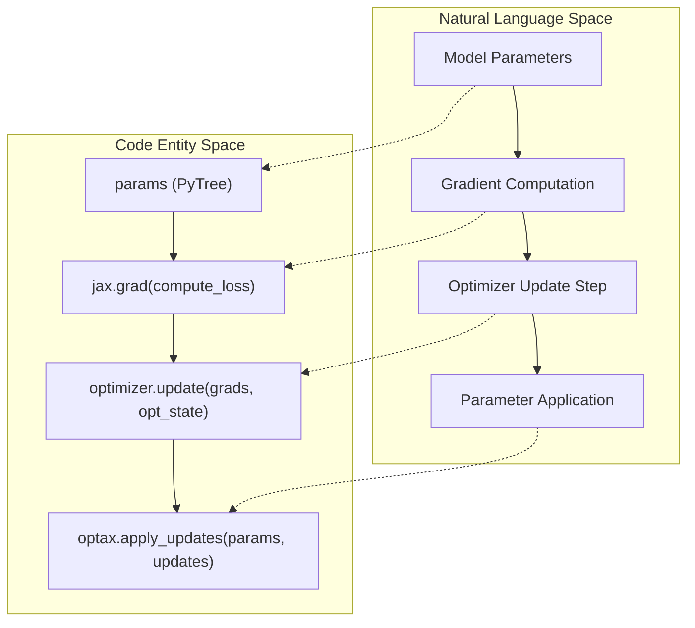
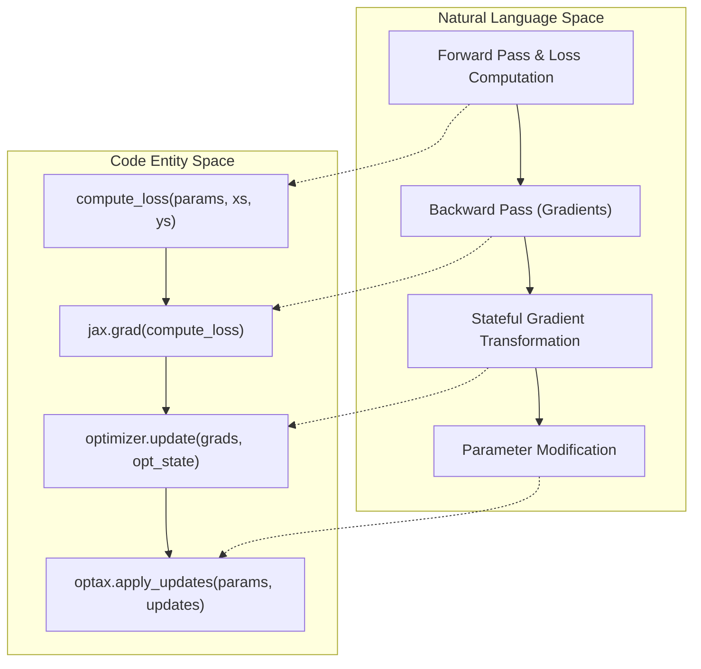

<!-- source: DeepWiki mcp.deepwiki.com · repo google-deepmind/optax · page 1.1 Getting Started · fetched 2026-10-26 -->

# Getting Started

<details>
<summary>Relevant source files</summary>

The following files were used as context for generating this wiki page:

- [README.md](README.md)
- [docs/development.md](docs/development.md)
- [docs/gallery.rst](docs/gallery.rst)
- [docs/getting_started.ipynb](docs/getting_started.ipynb)
- [docs/index.rst](docs/index.rst)
- [examples/flax_example.ipynb](examples/flax_example.ipynb)
- [examples/lbfgs.ipynb](examples/lbfgs.ipynb)
- [examples/linear_assignment_problem.ipynb](examples/linear_assignment_problem.ipynb)
- [examples/lookahead_mnist.ipynb](examples/lookahead_mnist.ipynb)
- [examples/mlp_mnist.ipynb](examples/mlp_mnist.ipynb)

</details>


## Purpose and Scope

This page serves as the entry point for users integrating Optax into JAX-based machine learning pipelines [README.md:7-9](). It covers installation procedures [README.md:33-45](), core optimizer initialization and state management via the `GradientTransformation` protocol [docs/getting_started.ipynb:13-14](), a basic training loop implementation using `jax.grad` and `optax.apply_updates` [README.md:62-78](), and an exhaustive reference to the example gallery notebooks available in the documentation [docs/gallery.rst:4-222]().

Sources: [README.md:7-9](), [README.md:33-45](), [README.md:62-78](), [docs/getting_started.ipynb:13-14](), [docs/gallery.rst:4-222]()

---

## Installation

Optax can be installed as a pre-packaged release from the Python Package Index (PyPI) or directly fetched from the source repository for development purposes [README.md:33-45](). Because Optax relies fundamentally on JAX, a compatible JAX installation is required beforehand [docs/index.rst:37-39]().

To install the stable release from PyPI, execute:
```sh
pip install optax
```
*(See [README.md:37-39]())*

To install the latest development snapshot directly from the GitHub repository:
```sh
pip install git+https://github.com/google-deepmind/optax.git
```
*(See [README.md:43-45]())*

Sources: [README.md:33-45](), [docs/index.rst:37-39]()

---

## First Optimizer Usage and Core Abstractions

Optax centers around the `GradientTransformation` protocol [docs/getting_started.ipynb:13-14](), a stateless container of pure functions that processes gradients and updates internal optimizer states. An optimizer is defined by an initialization function (`init`) and an update function (`update`).

```
Optax Transformation Lifecycle
```

*(See [README.md:56-78](), [docs/getting_started.ipynb:112-147]())*

When utilizing an optimizer such as Adam [README.md:51-59](), the workflow requires instantiating the transformation function, initializing the optimizer state (`opt_state`) using model parameters (`params`), and transforming incoming gradients [README.md:56-78](). Custom optimizers can also be constructed by chaining multiple low-level gradient transformations using `optax.chain` [docs/getting_started.ipynb:155-178]().

Sources: [README.md:51-78](), [docs/getting_started.ipynb:13-178]()

---

## Basic Training Loop

The optimization loop in Optax combines JAX autodiff (`jax.grad` or `jax.value_and_grad`) with Optax's stateful gradient transformations and `optax.apply_updates` [README.md:62-78](). 

```
Training Loop Data Flow Architecture
```

*(See [README.md:62-78](), [docs/getting_started.ipynb:139-148]())*

During each iteration, gradients of the loss function are computed with respect to model weights, passed into `optimizer.update()`, and applied back to the parameters via `optax.apply_updates()` [README.md:62-78]().

Sources: [README.md:62-78](), [docs/getting_started.ipynb:139-148]()

---

## Example Gallery Overview

Optax provides a comprehensive set of example notebooks in the documentation gallery illustrating real-world applications across various architectures and tasks [docs/gallery.rst:4-222](). 

| Example Category / Notebook | Target Architecture / Domain | Description & Key Optax Modules |
| :--- | :--- | :--- |
| `mlp_mnist.ipynb` | Multilayer Perceptron / MNIST | Trains a simple digit classifier using cross-entropy loss [docs/gallery.rst:123-135]() |
| `cifar10_resnet.ipynb` | ResNet / CIFAR10 | End-to-end convolutional residual network training with Flax and Optax [docs/gallery.rst:72-84]() |
| `nanolm.ipynb` | Character-level Transformer | Implements a language model on Tiny Shakespeare [docs/gallery.rst:156-168]() |
| `lbfgs.ipynb` | Numerical Optimization | Demonstrates L-BFGS gradient transformation and line searches [docs/gallery.rst:173-185]() |
| `gradient_accumulation.ipynb` | Large-batch Training | Shows how to accumulate gradients over multiple steps [docs/gallery.rst:21-33]() |
| `adversarial_training.ipynb` | Robustness / CNN | Adversarial training routines on MNIST datasets [docs/gallery.rst:139-151]() |
| `lookahead_mnist.ipynb` | Lookahead Wrapper | Combines fast optimizers with slow parameter updates [docs/gallery.rst:106-118]() |
| `meta_learning.ipynb` | Meta-Optimization | Higher-order optimization flows [docs/gallery.rst:38-50]() |
| `perturbations.ipynb` | Stochastic Smoothing | Differentiable discrete operations using perturbations [docs/gallery.rst:190-202]() |
| `linear_assignment_problem.ipynb` | Combinatorial Optimization | Solves linear assignment problems using the Hungarian algorithm [docs/gallery.rst:207-219]() |

Contrib examples also cover advanced techniques such as differential privacy (`differentially_private_sgd`), reduce-on-plateau schedulers, and Sharpness-Aware Minimization (`sam`) [docs/gallery.rst:227-290]().

Sources: [docs/gallery.rst:4-290]()

---

