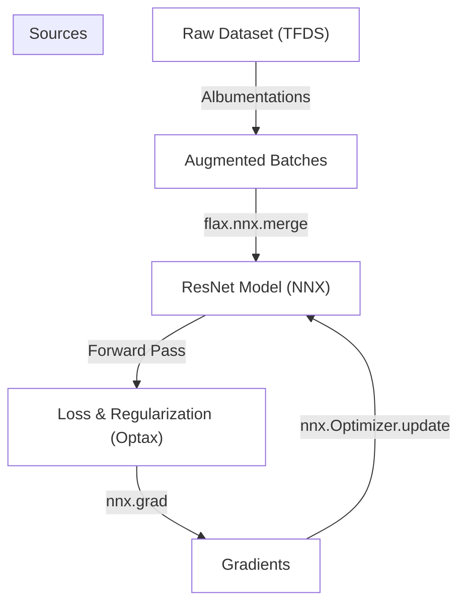
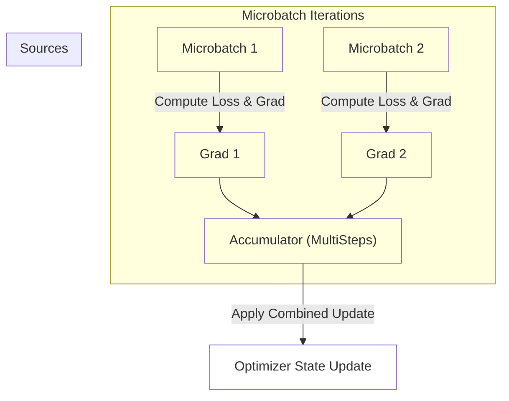
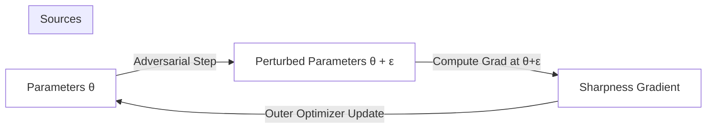

<!-- source: DeepWiki mcp.deepwiki.com · repo google-deepmind/optax · page 1.2 Example Gallery · fetched 2026-10-26 -->

# Example Gallery

Relevant source files

The following files were used as context for generating this wiki page:

- [docs/Makefile](docs/Makefile)
- [docs/images/examples/cifar10_resnet.png](docs/images/examples/cifar10_resnet.png)
- [docs/images/examples/contrib/sam.png](docs/images/examples/contrib/sam.png)
- [docs/images/examples/ogda.png](docs/images/examples/ogda.png)
- [docs/images/examples/tiny_shakespeare.png](docs/images/examples/tiny_shakespeare.png)
- [examples/README.md](examples/README.md)
- [examples/adversarial_training.ipynb](examples/adversarial_training.ipynb)
- [examples/cifar10_resnet.ipynb](examples/cifar10_resnet.ipynb)
- [examples/contrib/README.md](examples/contrib/README.md)
- [examples/contrib/differentially_private_sgd.ipynb](examples/contrib/differentially_private_sgd.ipynb)
- [examples/contrib/reduce_on_plateau.ipynb](examples/contrib/reduce_on_plateau.ipynb)
- [examples/contrib/sam.ipynb](examples/contrib/sam.ipynb)
- [examples/freezing_parameters.ipynb](examples/freezing_parameters.ipynb)
- [examples/gradient_accumulation.ipynb](examples/gradient_accumulation.ipynb)
- [examples/meta_learning.ipynb](examples/meta_learning.ipynb)
- [examples/nanolm.ipynb](examples/nanolm.ipynb)
- [examples/ogda_example.ipynb](examples/ogda_example.ipynb)

This section walks through the various example notebooks and tutorials provided in the `examples/` and `examples/contrib/` directories of the Optax repository. These notebooks demonstrate how to integrate Optax with deep learning frameworks like Flax (specifically `flax.nnx` and `flax.linen`), build high-performance data loaders with Grain and TensorFlow Datasets, and implement advanced training paradigms such as adversarial training, gradient accumulation, parameter freezing, meta-learning, and experimental optimization techniques.

---

## 1. Overview of Example Notebooks

The Optax example gallery covers end-to-end model training tasks across various domains—ranging from simple multilayer perceptrons (MLPs) to deep residual networks and character-level language models. 

| Example Notebook | Domain / Task | Key Optax & Framework Integration |
| :--- | :--- | :--- |
| **MNIST MLP** | Image Classification (Fashion-MNIST) | `flax.nnx`, `optax.softmax_cross_entropy_with_integer_labels`, `grain` data loaders |
| **CIFAR10 ResNet** | Deep Image Classification | `flax.nnx`, `albumentations` data augmentation, custom learning rate schedules |
| **Adversarial Training** | Robust Deep Learning (PGD) | Infinity-ball projection, `optax.tree_utils.tree_norm`, sign gradients |
| **nanoLM** | Character-level Language Modeling | `flax.linen`, `optax.adamw`, Tiny Shakespeare corpus via `tfds` |
| **Gradient Accumulation** | Large-Batch Simulation | `optax.MultiSteps`, microbatching, state splitting |
| **Freezing Parameters** | Parameter Constraint & Masking | `optax.transforms.freeze`, `optax.transforms.selective_transform`, masks |
| **Meta-Learning** | Bilevel Optimization / MAML | High-order automatic differentiation, custom inner/outer loops |
| **SAM (Contrib)** | Sharpness-Aware Minimization | `optax.contrib.sam`, synchronized adversarial and outer steps |
| **Reduce on Plateau (Contrib)** | Adaptive Learning Rate Schedulers | `optax.contrib.reduce_on_plateau`, metric-driven adjustments |
| **Differentially Private SGD (Contrib)**| Privacy-Preserving Training | Per-example gradient clipping, `dp_accounting`, `stax` |

Sources: `examples/README.md`, `examples/contrib/README.md`, `examples/cifar10_resnet.ipynb`, `examples/adversarial_training.ipynb`, `examples/freezing_parameters.ipynb`, `examples/gradient_accumulation.ipynb`, `examples/contrib/reduce_on_plateau.ipynb`, `examples/contrib/sam.ipynb`, `examples/contrib/differentially_private_sgd.ipynb`, `examples/nanolm.ipynb`

---

## 2. Vision and Classification Examples

### MNIST MLP & Fashion-MNIST Reduce on Plateau
The basic image classification examples demonstrate standard training pipelines using MLPs with `flax.nnx` [examples/contrib/reduce_on_plateau.ipynb:142-159] and data streaming via `grain` [examples/contrib/reduce_on_plateau.ipynb:105-124]. 

The Reduce on Plateau notebook introduces `optax.contrib.reduce_on_plateau`, which monitors validation metrics (such as loss or accuracy) and dynamically scales down the learning rate when progress stalls.

### CIFAR10 ResNet
The ResNet example (`cifar10_resnet.ipynb`) scales up the vision pipeline by implementing residual network architectures (`resnet18` through `resnet200`) using `flax.nnx` combined with data augmentation via `albumentations` [cifar10_resnet.ipynb:35-42, 139-148]. It demonstrates weight decay configuration (`L2_REG = 1e-4`) and tracking state across batched iterations [cifar10_resnet.ipynb:56-68].

Sources: `examples/contrib/reduce_on_plateau.ipynb`, `examples/cifar10_resnet.ipynb`

---

## 3. Robustness and Advanced Training Paradigms

### Adversarial Training (PGD)
The adversarial training notebook (`adversarial_training.ipynb`) implements Projected Gradient Descent (PGD) to train robust CNNs against $\ell_\infty$-bounded perturbations [adversarial_training.ipynb:9-22]. It computes local adversarial perturbations by taking the sign of the input gradients and projecting them back onto an infinity-ball of radius `EPSILON`:

$$\tilde{x} = x + \epsilon \cdot \text{sign}(\nabla_x \mathcal{L}(\theta, x, y))$$

### Gradient Accumulation
The gradient accumulation notebook (`gradient_accumulation.ipynb`) shows how to simulate large batch sizes under memory constraints using `optax.MultiSteps` or manual accumulation loops [examples/gradient_accumulation.ipynb:20-24]. Gradients over sequential microbatches are summed without updating optimizer states until a predefined accumulation frequency is reached.

Sources: `examples/adversarial_training.ipynb`, `examples/gradient_accumulation.ipynb`

---

## 4. Parameter Control and Meta-Learning

### Freezing Parameters
The parameter freezing guide (`freezing_parameters.ipynb`) details multiple mechanisms for holding subsets of model parameters constant during optimization:
1. **`optax.transforms.freeze`**: Combines an optimizer with a boolean mask via `optax.chain(optax.adam(lr), freeze(mask))` [examples/freezing_parameters.ipynb:65-98].
2. **`optax.transforms.selective_transform`**: Applies specific transformations selectively to targeted subtrees.
3. **Manual Masking**: Using `optax.masked()` or `optax.set_to_zero()` to nullify updates for frozen parameters.

### Meta-Learning
The meta-learning notebook (`meta_learning.ipynb`) demonstrates higher-order automatic differentiation for bilevel optimization problems (such as Model-Agnostic Meta-Learning, MAML). It uses nested JAX gradient transformations to compute gradients through inner-loop optimization steps.

Sources: `examples/freezing_parameters.ipynb`, `examples/meta_learning.ipynb`

---

## 5. Contributed Optimizers and Wrappers

### Sharpness-Aware Minimization (SAM)
The SAM example (`contrib/sam.ipynb`) implements Sharpness-Aware Minimization using `optax.contrib.sam` [examples/contrib/sam.ipynb:9-15]. SAM optimizes both parameter value and loss landscape sharpness by finding perturbations that simultaneously maximize loss locally and minimize it globally:

### Differentially Private SGD (DP-SGD)
The DP-SGD notebook (`contrib/differentially_private_sgd.ipynb`) showcases privacy-preserving machine learning on MNIST [examples/contrib/differentially_private_sgd.ipynb:9-25]. It relies on per-example gradient clipping (`L2_NORM_CLIP`) combined with Gaussian noise injection managed through `dp_accounting` [examples/contrib/differentially_private_sgd.ipynb:80-90, 168-177].

Sources: `examples/contrib/sam.ipynb`, `examples/contrib/differentially_private_sgd.ipynb`

---

