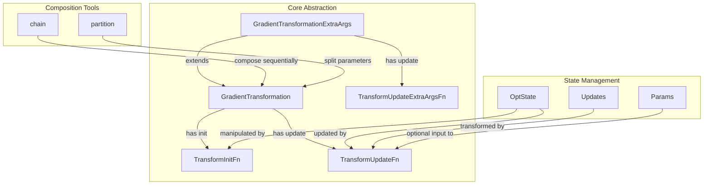

<!-- source: DeepWiki mcp.deepwiki.com · repo google-deepmind/optax · page 2 Core Architecture · fetched 2026-10-26 -->

# Core Architecture

Relevant source files

The following files were used as context for generating this wiki page:

- [optax/__init__.py](optax/__init__.py)
- [optax/_src/base.py](optax/_src/base.py)
- [optax/_src/base_test.py](optax/_src/base_test.py)
- [optax/_src/lookahead.py](optax/_src/lookahead.py)
- [optax/_src/schedule.py](optax/_src/schedule.py)
- [optax/_src/transform_test.py](optax/_src/transform_test.py)
- [optax/_src/wrappers.py](optax/_src/wrappers.py)

## Purpose and Scope

This document explains the fundamental design and core abstractions of Optax. It covers the central `GradientTransformation` interface, state management, tree utilities, and optimization composition patterns that form the foundation of the optimization library. 

As this is a parent page, it provides a high-level overview. For deep technical details, refer to the following child pages:
- **Gradient Transformation Protocol**: See [GradientTransformation Protocol](#2.1) for details on the init/update lifecycle and the functional programming pattern.
- **Tree Utilities**: See [Tree Utilities](#2.2) for nested structure operations, dtype handling, and state introspection.
- **Optimizer Composition**: See [Optimizer Composition](#2.3) for chaining and partitioning strategies.

Sources: [optax/_src/base.py:1-42]()

## Overview

Optax is built around a functional design philosophy where optimizers are represented as pure, composable transformations. This approach allows for flexibility in constructing custom optimization algorithms while maintaining compatibility with JAX's pure transformation system (`jax.jit`, `jax.grad`, etc.).

**Diagram: Core Architecture Overview of Optax**

Sources: [optax/_src/base.py:66-152]()

---

## 2.1 GradientTransformation Protocol

Optax optimizers are not objects with internal mutable state; instead, they are implemented as *gradient transformations*. A `GradientTransformation` is a `NamedTuple` containing two pure functions: `init` and `update` [optax/_src/base.py:153-162](). 

- **`init`**: Takes initial model parameters (`Params`) and returns the initial optimizer state (`OptState`) [optax/_src/base.py:66-82]().
- **`update`**: Takes gradient updates, current optimizer state, and optionally current parameters, returning transformed updates and a new optimizer state [optax/_src/base.py:85-110]().

For detailed documentation on the lifecycle, state management, and extended keyword argument support (`GradientTransformationExtraArgs`), see [GradientTransformation Protocol](#2.1).

Sources: [optax/_src/base.py:153-174]()

---

## 2.2 Tree Utilities

Because JAX models and optimizer states are represented as PyTrees (nested structures of arrays, tuples, lists, and dictionaries), Optax provides robust utilities for manipulating these nested structures. This includes mathematical operations, dtype conversions, random generation, and optimizer state introspection (`tree_utils/_state_utils.py`) for reading, filtering, and updating hyperparameters.

For detailed documentation on PyTree manipulation and state introspection, see [Tree Utilities](#2.2).

Sources: [optax/tree/__init__.py:1-15](), [optax/tree_utils/__init__.py:1-15]()

---

## 2.3 Optimizer Composition

Complex optimization algorithms in Optax are rarely monolithic; instead, they emerge from chaining and partitioning simple building blocks. 
- **Chaining (`combine.chain`)**: Sequentially applies multiple gradient transformations so that the output updates of one transform become the input to the next [optax/_src/combine.py:15-23]().
- **Partitioning (`combine.partition`)**: Directs different transformations to distinct subsets of parameters based on a partitioning rule or labeling function [optax/_src/combine.py:23]().

For detailed documentation on composition patterns, see [Optimizer Composition](#2.3).

Sources: [optax/_src/combine.py:1-23]()

---

## Stateless Transformations

Optax provides helper utilities to convert arbitrary stateless functions into standard `GradientTransformation` objects:

- **`stateless`**: Wraps a function operating on gradients and parameters, returning an `EmptyState` upon initialization [optax/_src/base.py:273-300]().
- **`stateless_with_tree_map`**: Automatically applies tree mapping over the inputs [optax/_src/base.py:302-341]().

Sources: [optax/_src/base.py:273-341]()

---

## Additive and Auxiliary Transformations

Beyond standard optimizers, Optax includes modular building blocks for specific gradient modifications:
- **Weight Decay**: `add_decayed_weights` adds scaled parameter values directly to the gradients [optax/transforms/_adding.py:29-65]().
- **Noise Injection**: `add_noise` introduces stochasticity to assist with generalization [optax/transforms/_adding.py:68-111]().

Sources: [optax/transforms/_adding.py:29-111]()

---

## Summary

The core architecture of Optax revolves around the `GradientTransformation` abstraction [optax/_src/base.py:153-162](), which provides a functional interface for implementing optimization algorithms. By composing these transformations via `chain` and `partition`, sophisticated optimization strategies can be cleanly constructed from reusable components. PyTree utilities and state management functions further empower users to inspect, modify, and distribute optimizer states across accelerators.

---

