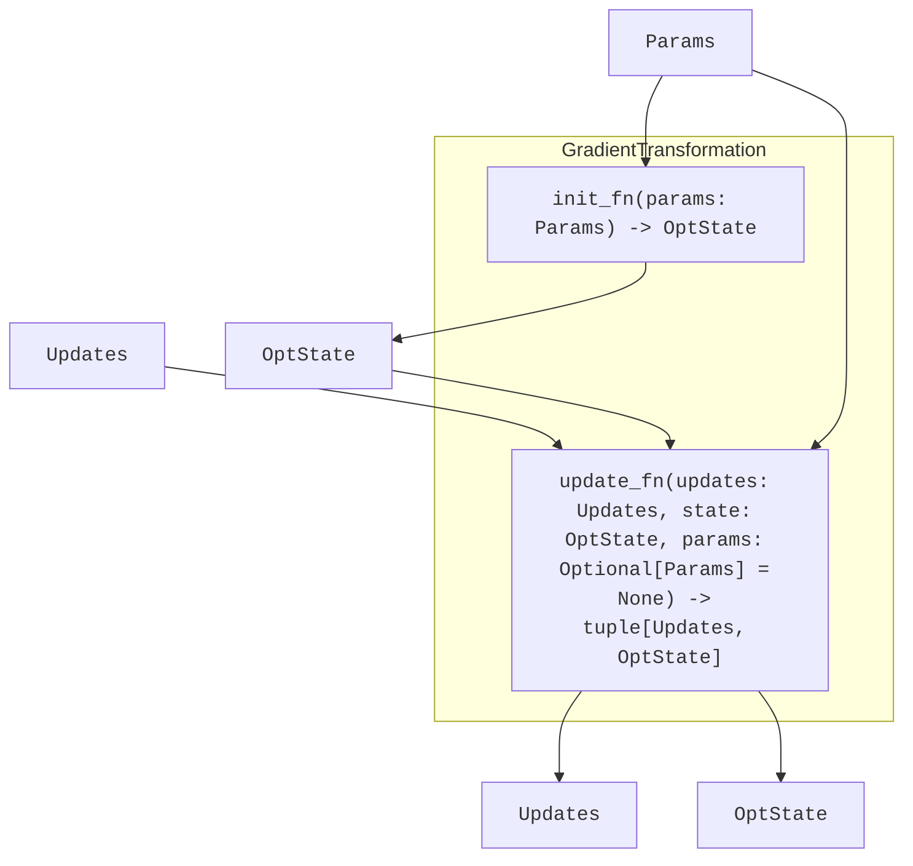
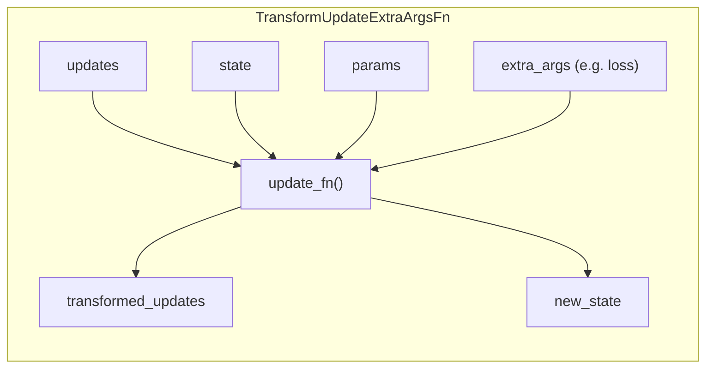
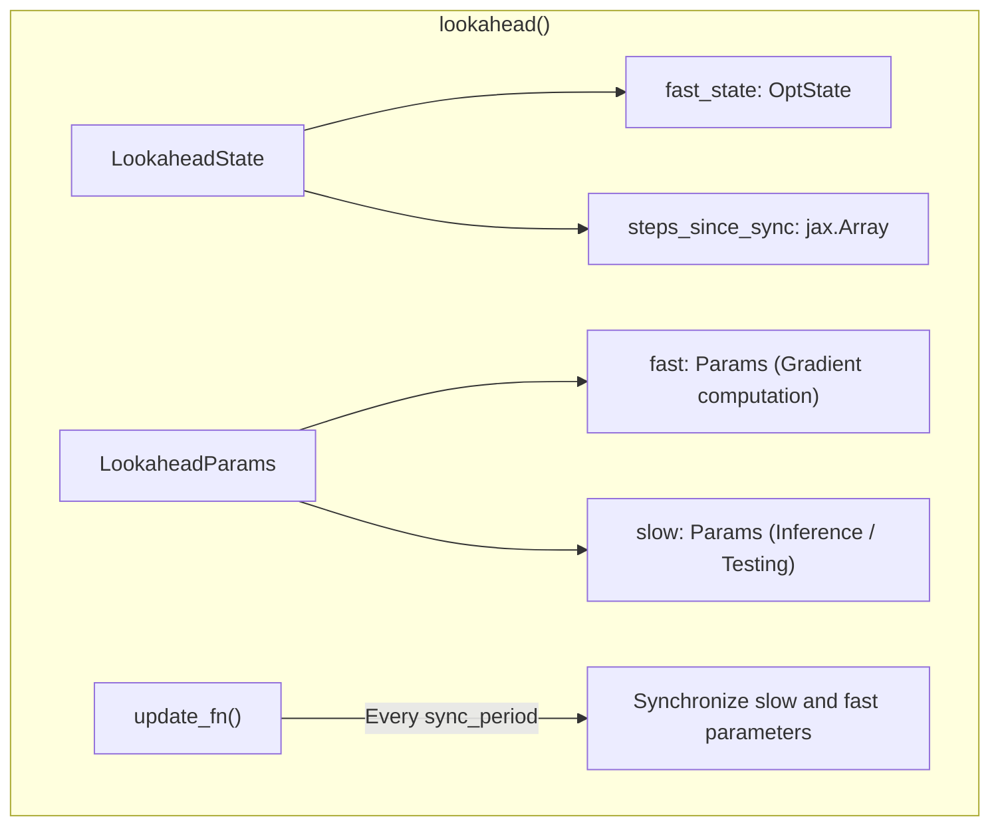

<!-- source: DeepWiki mcp.deepwiki.com · repo google-deepmind/optax · page 2.1 GradientTransformation Protocol · fetched 2026-10-26 -->

# GradientTransformation Protocol

Relevant source files

The following files were used as context for generating this wiki page:

- [optax/_src/base.py](optax/_src/base.py)
- [optax/_src/base_test.py](optax/_src/base_test.py)
- [optax/_src/lookahead.py](optax/_src/lookahead.py)
- [optax/_src/update.py](optax/_src/update.py)
- [optax/_src/update_test.py](optax/_src/update_test.py)

## Purpose and Scope

This page documents the `GradientTransformation` abstraction, which serves as the core architectural foundation for all optimization algorithms, gradient preconditioning, clipping, and parameter updates in Optax. It covers the functional programming lifecycle (`init` and `update`), optimization state management (`OptState`), extended argument support (`GradientTransformationExtraArgs`), and advanced stateful wrappers like `lookahead`.

Sources: [optax/_src/base.py:1-192](), [optax/_src/lookahead.py:1-155]()

---

## The GradientTransformation Abstraction

Optax implements all optimization components as pure functions packaged into a `GradientTransformation` `NamedTuple` [optax/_src/base.py:153-162](). Rather than bundling mutable state inside optimizer objects (as seen in traditional object-oriented frameworks), Optax passes an explicit optimization state (`OptState`) through every step [optax/_src/base.py:168-174]().

*Figure 1: Data flow through the `GradientTransformation` protocol lifecycle.*

Sources: [optax/_src/base.py:66-111](), [optax/_src/base.py:153-174]()

### Core Protocols

A transformation consists of two primary function types defined as protocols:

1. **`TransformInitFn`**: A callable that accepts model parameters (`Params`) and initializes the state (`OptState`) [optax/_src/base.py:66-83]().
2. **`TransformUpdateFn`**: A callable that accepts gradient updates (`Updates`), the current optimizer state (`OptState`), and optionally the current parameters (`Params`), returning transformed updates and the next state [optax/_src/base.py:85-111]().

Sources: [optax/_src/base.py:66-111]()

---

## State Management (`OptState`)

Because transformations are pure functions, all internal tracking statistics—such as step counts, momentum buffers, and exponential moving averages—reside entirely within `OptState` [optax/_src/base.py:168-174](). 

- `OptState` and `Params` are both aliases for `ArrayTree` (arbitrary nested structures, or PyTrees, of `jnp.ndarray` leaves) [optax/_src/base.py:32-36]().
- Stateless transformations return `EmptyState` or equivalent stateless PyTrees [optax/_src/base_test.py:56-61]().
- Mutating or inspecting optimizer parameters and hyperparameters between steps is performed by manipulating this PyTree directly (see [2.2.1 Optimizer State Introspection]()).

Sources: [optax/_src/base.py:32-38](), [optax/_src/base_test.py:56-61]()

---

## Extended Arguments Support

While standard update functions only take `updates`, `state`, and optional `params`, many modern workflows require dynamic scheduling parameters or callbacks that depend on loss values or metrics. Optax provides `GradientTransformationExtraArgs` and `TransformUpdateExtraArgsFn` to handle arbitrary keyword arguments (`**extra_args`) [optax/_src/base.py:113-152]().

*Figure 2: Processing additional context via `TransformUpdateExtraArgsFn`.*

Sources: [optax/_src/base.py:113-152]()

---

## Complex Transformation Example: Lookahead

The `lookahead` wrapper [optax/_src/lookahead.py:63-155]() demonstrates a composite stateful transformation maintaining multi-tier state and parameters via `LookaheadState` and `LookaheadParams`.

*Figure 3: Code entity association for the `lookahead` optimization wrapper.*

Sources: [optax/_src/lookahead.py:25-62](), [optax/_src/lookahead.py:63-155]()

---

