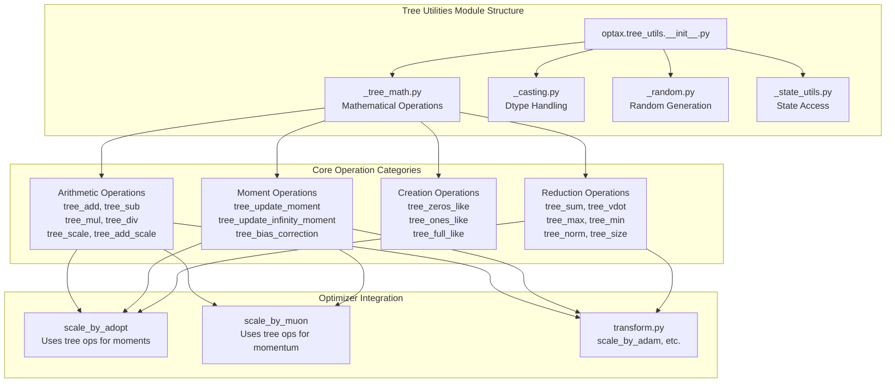

<!-- source: DeepWiki mcp.deepwiki.com · repo google-deepmind/optax · page 2.2 Tree Utilities · fetched 2026-10-26 -->

# Tree Utilities

<details>
<summary>Relevant source files</summary>

The following files were used as context for generating this wiki page:

- [docs/api/utilities.rst](docs/api/utilities.rst)
- [optax/tree/__init__.py](optax/tree/__init__.py)
- [optax/tree_utils/__init__.py](optax/tree_utils/__init__.py)
- [optax/tree_utils/_casting.py](optax/tree_utils/_casting.py)
- [optax/tree_utils/_casting_test.py](optax/tree_utils/_casting_test.py)
- [optax/tree_utils/_random.py](optax/tree_utils/_random.py)
- [optax/tree_utils/_random_test.py](optax/tree_utils/_random_test.py)
- [optax/tree_utils/_tree_math.py](optax/tree_utils/_tree_math.py)
- [optax/tree_utils/_tree_math_test.py](optax/tree_utils/_tree_math_test.py)

</details>


This page documents the tree utilities system in Optax, which provides operations on PyTrees (nested parameter structures). Tree utilities are foundational infrastructure that enable mathematical operations, dtype handling, and random generation on arbitrary nested structures of JAX arrays.

**Scope**: This page covers functions in the `optax.tree_utils` and `optax.tree` modules for manipulating PyTrees. For information about the core `GradientTransformation` protocol that uses these utilities, see [GradientTransformation Protocol](#2.1). For optimizer composition patterns, see [Optimizer Composition](#2.3).

**Child Pages**:
- [Optimizer State Introspection](#2.2.1) — Document tree_utils/_state_utils.py: reading, filtering and updating hyperparameters and named state inside nested optimizer states.

## Overview

PyTrees are JAX's abstraction for nested data structures (dictionaries, tuples, lists, etc.) containing arrays. Tree utilities extend standard array operations to work element-wise across entire PyTree structures, maintaining the tree's structure while operating on each leaf.

**Tree Operations Architecture**



Sources: [optax/tree_utils/__init__.py:1-107](), [optax/tree_utils/_tree_math.py:1-235](), [optax/tree_utils/_casting.py:1-188](), [optax/tree_utils/_random.py:1-109]()

## Mathematical Operations

Tree utilities provide element-wise mathematical operations that preserve PyTree structure. Each operation applies a function to corresponding leaves in the input tree(s).

### Arithmetic Operations

| Function | Operation | Example |
|----------|-----------|---------|
| `tree_add(tree_x, tree_y, *others)` | Element-wise addition | `tree_x + tree_y + ...` |
| `tree_sub(tree_x, tree_y)` | Element-wise subtraction | `tree_x - tree_y` |
| `tree_mul(tree_x, tree_y)` | Element-wise multiplication | `tree_x * tree_y` |
| `tree_div(tree_x, tree_y)` | Element-wise division | `tree_x / tree_y` |
| `tree_scale(scalar, tree)` | Scalar multiplication | `scalar * tree` |
| `tree_add_scale(tree_x, scalar, tree_y)` | Scaled addition | `tree_x + scalar * tree_y` |

**Key Implementation Details**:
- `tree_add` uses `jax.tree.map(lambda *leaves: sum(leaves), *trees)` to sum corresponding leaves [optax/tree_utils/_tree_math.py:29-44]()
- `tree_add_scale` handles `None` leaves specially, preserving them in the output [optax/tree_utils/_tree_math.py:104-123]()
- All operations use `jax.tree.map` to maintain structure compatibility

### Reduction Operations

Reduction operations collapse a PyTree to a scalar or compute properties of the entire tree:

```python
# Example usage patterns
gradient_norm = tree_norm(gradients)  # Compute L2 norm
inner_product = tree_vdot(tree_a, tree_b)  # Dot product
total_params = tree_size(params)  # Count total elements
max_gradient = tree_max(gradients)  # Find maximum value
```

| Function | Returns | Description |
|----------|---------|-------------|
| `tree_sum(tree)` | Scalar | Sum of all elements |
| `tree_vdot(tree_x, tree_y)` | Scalar | Inner product (conjugate for complex) |
| `tree_norm(tree, ord=None, squared=False)` | Scalar | Vector norm (L1, L2, Linf) |
| `tree_max(tree)` | Scalar | Maximum element |
| `tree_min(tree)` | Scalar | Minimum element |
| `tree_size(tree)` | Integer | Total number of elements |

**Inner Product for Complex Arrays**:

The `tree_vdot` implementation handles complex conjugation and uses high-precision computation [optax/tree_utils/_tree_math.py:125-170]():
```python
def _vdot(a, b, precision=jax.lax.Precision.HIGHEST):
    if jax.dtypes.issubdtype(a.dtype, jnp.complexfloating):
        a = jnp.conj(a)  # Conjugate first argument
    return jnp.tensordot(a, b, a.ndim, precision=precision)
```

Sources: [optax/tree_utils/_tree_math.py:29-235](), [optax/tree_utils/_tree_math_test.py:56-178]()

## Tree Creation and Initialization

Tree utilities provide functions to create new trees with the same structure as existing ones:

| Function | Creates | Parameters |
|----------|---------|------------|
| `tree_zeros_like(tree, dtype=None)` | All zeros | Optional dtype override |
| `tree_ones_like(tree, dtype=None)` | All ones | Optional dtype override |
| `tree_full_like(tree, fill_value, dtype=None)` | Constant value | Required fill_value |
| `tree_clip(tree, min_value=None, max_value=None)` | Clipped values | Optional min/max bounds |
| `tree_batch_shape(tree, shape)` | Broadcasted tree | Leading batch dimensions |

Sources: [optax/tree_utils/_tree_math.py:29-57](), [docs/api/utilities.rst:55-93]()

## Dtype Handling

Tree utilities provide functions for casting and inspecting data types across entire PyTrees.

### Casting Operations

| Function | Purpose | Usage |
|----------|---------|-------|
| `tree_cast(tree, dtype)` | Cast entire tree to dtype | `tree_cast(params, jnp.float32)` |
| `tree_cast_like(tree, other_tree)` | Match dtypes of another tree | `tree_cast_like(grads, params)` |
| `tree_dtype(tree, mixed_dtype_handler=None)` | Fetch tree's dtype | `dtype = tree_dtype(state.mu)` |

**Mixed Dtype Handling**:

When a tree contains multiple dtypes, `tree_dtype` offers several strategies [optax/tree_utils/_casting.py:77-165]():

- `mixed_dtype_handler=None`: Raises error if dtypes differ (default)
- `mixed_dtype_handler='promote'`: Promotes to common dtype using `jnp.promote_types`
- `mixed_dtype_handler='highest'`: Returns highest dtype in promotion hierarchy
- `mixed_dtype_handler='lowest'`: Returns lowest dtype in promotion hierarchy

Sources: [optax/tree_utils/_casting.py:1-188](), [optax/tree_utils/_casting_test.py:25-124]()

## Random Tree Generation

Random tree utilities generate PyTrees of random values matching the structure and shapes of template trees.

### Random Key Splitting

`tree_split_key_like` creates a tree of PRNGKeys matching a target structure [optax/tree_utils/_random.py:25-40]():

```python
rng_key = jax.random.key(0)
params = {'w1': jnp.zeros((10, 5)), 'w2': jnp.zeros((5, 3))}
keys_tree = tree_split_key_like(rng_key, params)
```

### Random Value Generation

`tree_random_like` generates random arrays matching template shapes [optax/tree_utils/_random.py:42-91]():

```python
params = {'w': jnp.zeros((10, 5), dtype=jnp.float32), 'b': jnp.zeros(5)}
noise = tree_random_like(
    rng_key, 
    params, 
    sampler=jax.random.normal,
    dtype=jnp.bfloat16
)
```

Sources: [optax/tree_utils/_random.py:1-109](), [optax/tree_utils/_random_test.py:52-111]()

## Optimizer State Introspection

For reading, filtering, and updating hyperparameters and named state inside nested optimizer states (such as those wrapped by `inject_hyperparams`), see the dedicated child page:

For details, see [Optimizer State Introspection](#2.2.1).

Sources: [optax/tree_utils/_state_utils.py:1-100]()

---

