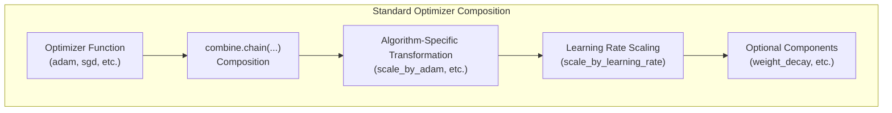
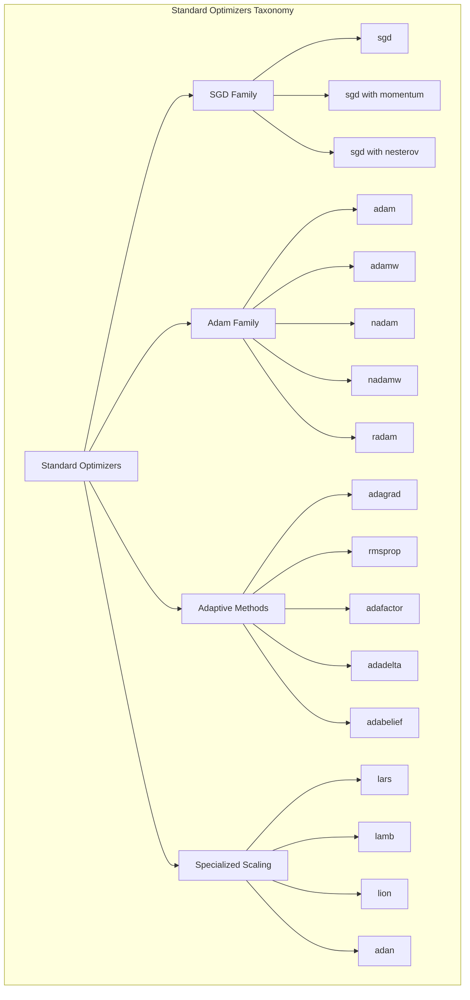
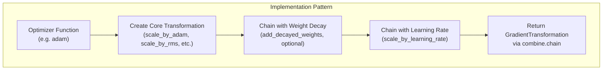

<!-- source: DeepWiki mcp.deepwiki.com · repo google-deepmind/optax · page 3.1 Standard Optimizers · fetched 2026-10-26 -->

# Standard Optimizers

<details>
<summary>Relevant source files</summary>

The following files were used as context for generating this wiki page:

- [optax/_src/alias.py](optax/_src/alias.py)
- [optax/_src/alias_test.py](optax/_src/alias_test.py)
- [optax/_src/transform.py](optax/_src/transform.py)

</details>


This page documents the standard optimization algorithms provided by Optax, which are commonly used to update model parameters during training. These optimizers implement widely-used algorithms like SGD, Adam, AdaGrad, and their variants as composable gradient transformations.

For specialized optimizers like L-BFGS and Lookahead, see [Adaptive and Second-Order Optimizers](#3.2). For experimental optimizers, see [Contributed Optimizers](#3.3).

## Relationship to Optax Architecture

Standard optimizers are built on Optax's core `GradientTransformation` abstraction [optax/_src/base.py](). Each optimizer is implemented as a function that returns a `GradientTransformation` or `GradientTransformationExtraArgs` object, created by chaining together more primitive transformations using `combine.chain` [optax/_src/combine.py]().



Sources: [optax/_src/alias.py](), [optax/_src/transform.py](), [optax/_src/combine.py]()

## Optimizer Classification

Standard optimizers can be grouped into several families based on their algorithm characteristics:



Sources: [optax/_src/alias.py]()

## SGD Family

The SGD family includes basic stochastic gradient descent and its momentum-based variants.

### SGD (Stochastic Gradient Descent)

SGD is the simplest optimization algorithm that updates parameters in the direction of the negative gradient scaled by a learning rate.

```python
def sgd(
    learning_rate: base.ScalarOrSchedule,
    momentum: Optional[float] = None,
    nesterov: bool = False,
    accumulator_dtype: Optional[jnp.dtype] = None,
) -> base.GradientTransformation:
    """Stochastic gradient descent optimizer."""
```

Implementation details:
- Without momentum, scales gradients by learning rate using `scale` or `scale_by_learning_rate` [optax/_src/alias.py]()
- With momentum, uses the `trace` transformation to accumulate past gradients [optax/_src/transform.py]()
- With `nesterov=True`, applies Nesterov's accelerated gradient method via the trace transformation.

Sources: [optax/_src/alias.py](), [optax/_src/transform.py]()

### SGD with Momentum

Adds a momentum term that accumulates past gradients to speed up convergence and help escape local minima.

Mathematical update:
```
v(t) = momentum * v(t-1) + g(t)
w(t+1) = w(t) - learning_rate * v(t)
```

Sources: [optax/_src/alias.py](), [optax/_src/transform.py]()

## Adam Family

The Adam family includes Adam and its variants, which adapt learning rates based on first and second moments of gradients.

### Adam (Adaptive Moment Estimation)

Adam combines ideas from RMSProp and momentum methods to adapt learning rates based on both the first and second moments of gradients.

```python
def adam(
    learning_rate: base.ScalarOrSchedule = 1e-3,
    b1: jax.typing.ArrayLike = 0.9,
    b2: jax.typing.ArrayLike = 0.999,
    eps: jax.typing.ArrayLike = 1e-8,
    eps_root: jax.typing.ArrayLike = 0.0,
    mu_dtype: Optional[jnp.dtype] = None,
    *,
    nesterov: bool = False,
) -> base.GradientTransformation:
    """The Adam optimizer."""
```

Mathematical update:
```
m(t) = b1 * m(t-1) + (1 - b1) * g(t)
v(t) = b2 * v(t-1) + (1 - b2) * g(t)^2
m_hat(t) = m(t) / (1 - b1^t)
v_hat(t) = v(t) / (1 - b2^t)
w(t+1) = w(t) - learning_rate * m_hat(t) / (sqrt(v_hat(t) + eps_root) + eps)
```

Implementation details:
- Uses `scale_by_adam` for the core algorithm [optax/_src/transform.py]()
- Chains with `scale_by_learning_rate` to apply the learning rate [optax/_src/transform.py]()

Sources: [optax/_src/alias.py](), [optax/_src/transform.py]()

### AdamW

AdamW is a variant of Adam that implements weight decay correctly by decoupling it from the gradient update.

```python
def adamw(
    learning_rate: base.ScalarOrSchedule = 1e-3,
    b1: jax.typing.ArrayLike = 0.9,
    b2: jax.typing.ArrayLike = 0.999,
    eps: jax.typing.ArrayLike = 1e-8,
    eps_root: jax.typing.ArrayLike = 0.0,
    mu_dtype: Optional[jnp.dtype] = None,
    weight_decay: base.ScalarOrSchedule = 1e-4,
    mask: Optional[Union[Any, Callable[[base.Params], Any]]] = None,
    *,
    nesterov: bool = False,
) -> base.GradientTransformationExtraArgs:
    """Adam with weight decay regularization."""
```

Implementation details:
- Adds `add_decayed_weights` to the Adam transformation chain [optax/_src/transform.py]()
- Properly separates weight decay from adaptive gradient scaling

Sources: [optax/_src/alias.py](), [optax/_src/transform.py]()

### NAdam and NAdamW

NAdam (Nesterov-accelerated Adam) incorporates Nesterov momentum into Adam. NAdamW combines NAdam with proper weight decay [optax/_src/alias.py]().

Sources: [optax/_src/alias.py]()

## Other Adaptive Methods

### AdaGrad

AdaGrad adapts learning rates per parameter by scaling them inversely proportional to the square root of the sum of all past squared gradients.

```python
def adagrad(
    learning_rate: base.ScalarOrSchedule,
    initial_accumulator_value: jax.typing.ArrayLike = 0.1,
    eps: jax.typing.ArrayLike = 1e-7,
) -> base.GradientTransformation:
    """The Adagrad optimizer."""
```

Mathematical update:
```
sum_of_squares(t) = sum_of_squares(t-1) + g(t)^2
w(t+1) = w(t) - learning_rate * g(t) / sqrt(sum_of_squares(t) + eps)
```

Implementation details:
- Uses `scale_by_rss` (root sum of squares) transformation [optax/_src/transform.py]()
- Chains with `scale_by_learning_rate` [optax/_src/transform.py]()

Sources: [optax/_src/alias.py](), [optax/_src/transform.py]()

### RMSProp

RMSProp uses an exponentially weighted moving average of squared gradients to normalize the gradient update [optax/_src/transform.py]().

```python
def rmsprop(
    learning_rate: base.ScalarOrSchedule,
    decay: jax.typing.ArrayLike = 0.9,
    eps: jax.typing.ArrayLike = 1e-8,
    initial_scale: jax.typing.ArrayLike = 0.0,
    centered: bool = False,
    momentum: Optional[float] = None,
    nesterov: bool = False,
) -> base.GradientTransformation:
    """The RMSProp optimizer."""
```

Implementation details:
- Uses either `scale_by_rms` or `scale_by_stddev` depending on the `centered` parameter [optax/_src/transform.py]()
- Can include momentum via the `trace` transformation [optax/_src/transform.py]()

Sources: [optax/_src/alias.py](), [optax/_src/transform.py]()

### AdaDelta

AdaDelta adapts learning rates based on a moving window of gradient updates, eliminating the need for an initial learning rate [optax/_src/transform.py]().

Sources: [optax/_src/alias.py](), [optax/_src/transform.py]()

### Adafactor

Adafactor is a memory-efficient optimizer for large models that uses factored second-moment estimates [optax/_src/factorized.py]().

Sources: [optax/_src/alias.py](), [optax/_src/factorized.py]()

## Large Batch Optimizers

### LAMB (Layer-wise Adaptive Moments optimizer for Batch training)

LAMB enables training with large batch sizes by adapting the learning rate for each layer [optax/_src/alias.py]().

Sources: [optax/_src/alias.py]()

### LARS (Layer-wise Adaptive Rate Scaling)

LARS supports large batch training by scaling learning rates per layer based on the ratio of weight norms to gradient norms [optax/_src/transform.py]().

Sources: [optax/_src/alias.py](), [optax/_src/transform.py]()

## Recent Optimizers

### Lion

Lion (Evolved Sign Momentum) is an optimizer that only tracks momentum and uses sign operations for updates [optax/_src/transform.py]().

Sources: [optax/_src/alias.py](), [optax/_src/transform.py]()

### Adan

Adan (ADAptive Nesterov momentum algorithm) reformulates Nesterov acceleration to develop a new momentum estimation method [optax/_src/transform.py]().

Sources: [optax/_src/alias.py](), [optax/_src/transform.py]()

## Usage Examples

Here's a typical pattern for using a standard optimizer:

```python
import optax
import jax
import jax.numpy as jnp

# Define a simple objective function
def objective(params):
    return jnp.sum(params ** 2)

# Initialize parameters
params = jnp.array([1.0, 2.0, 3.0])

# Create an optimizer
optimizer = optax.adam(learning_rate=0.01)

# Initialize optimizer state
opt_state = optimizer.init(params)

# Training loop
for _ in range(100):
    # Compute gradients
    grads = jax.grad(objective)(params)
    
    # Update parameters
    updates, opt_state = optimizer.update(grads, opt_state, params)
    params = optax.apply_updates(params, updates)
```

Sources: [optax/_src/alias.py]()

## Optimizer Comparison and Selection

| Optimizer | Strengths | Typical Use Cases |
|-----------|-----------|-------------------|
| SGD | Simple, predictable convergence | Small datasets, convex problems |
| SGD w/ Momentum | Faster convergence than SGD | General purpose |
| Adam | Fast convergence, adaptive learning rates | Deep neural networks, non-convex problems |
| AdamW | Better generalization than Adam | When regularization is important |
| AdaGrad | Handles sparse gradients well | NLP models, recommender systems |
| RMSProp | Good for non-stationary objectives | Recurrent neural networks |
| LAMB/LARS | Scales to very large batch sizes | Distributed training |
| Lion | Memory efficient, strong performance | Large language models |
| Adafactor | Memory efficient | Very large models that don't fit in memory otherwise |

Sources: [optax/_src/alias.py]()

## Implementation Details

The standard optimizers are all implemented using a common pattern in `optax/_src/alias.py`:



For example, Adam is implemented as:

```python
def adam(learning_rate, b1=0.9, b2=0.999, eps=1e-8, eps_root=0.0, mu_dtype=None, *, nesterov=False):
    return combine.chain(
        transform.scale_by_adam(
            b1=b1,
            b2=b2,
            eps=eps,
            eps_root=eps_root,
            mu_dtype=mu_dtype,
            nesterov=nesterov,
        ),
        transform.scale_by_learning_rate(learning_rate),
    )
```

Sources: [optax/_src/alias.py]()

---

