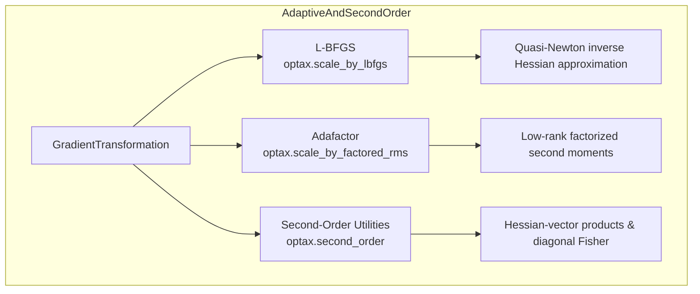
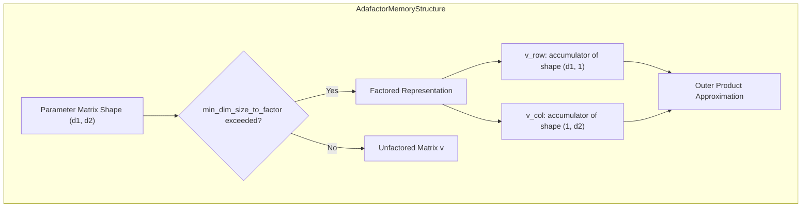

<!-- source: DeepWiki mcp.deepwiki.com · repo google-deepmind/optax · page 3.2 Adaptive and Second-Order Optimizers · fetched 2026-10-26 -->

# Adaptive and Second-Order Optimizers

<details>
<summary>Relevant source files</summary>

The following files were used as context for generating this wiki page:

- [optax/_src/factorized.py](optax/_src/factorized.py)
- [optax/_src/lbfgs_test.py](optax/_src/lbfgs_test.py)
- [optax/losses/_segmentation.py](optax/losses/_segmentation.py)
- [optax/second_order/__init__.py](optax/second_order/__init__.py)
- [optax/second_order/_deprecated.py](optax/second_order/_deprecated.py)

</details>


This page covers advanced optimization algorithms in Optax that go beyond standard diagonal first-order adaptive methods (like Adam or RMSProp). This includes quasi-Newton second-order methods such as L-BFGS, memory-efficient factorized second-moment estimators like Adafactor, and specialized second-order diagnostic utilities.

## Overview

Adaptive and second-order optimizers adjust update directions and step sizes using curvature information or factorized representations of gradient statistics.



Sources: [optax/_src/factorized.py:88-129](), [optax/second_order/_deprecated.py:43-120]()

---

## L-BFGS (Limited-Memory BFGS)

### Concept and Implementation

L-BFGS is a quasi-Newton optimization algorithm that approximates the inverse Hessian matrix using a rolling history of recent parameter differences ($s_k = x_{k+1} - x_k$) and gradient differences ($y_k = g_{k+1} - g_k$). 


In Optax, L-BFGS is implemented via the low-level transformation `scale_by_lbfgs()` and paired with linesearch utilities (`scale_by_backtracking_linesearch` or `scale_by_zoom_linesearch`) to determine step sizes that satisfy the strong Wolfe conditions.

### Usage Example

```python
import optax
import jax

optimizer = optax.lbfgs(memory_size=10)
state = optimizer.init(params)

# Optimization loop requires value, grad, and the objective function
value, grad = jax.value_and_grad(objective_fn)(params)
updates, state = optimizer.update(
    grad, state, params,
    value=value,
    grad=grad,
    value_fn=objective_fn
)
params = optax.apply_updates(params, updates)
```

Sources: [optax/_src/lbfgs_test.py:56-86](), [optax/_src/lbfgs_test.py:183-202]()

---

## Adafactor and Factorized Second Moments

The `scale_by_factored_rms` transformation implements the Adafactor algorithm, which uses a factored second-moment estimator to dramatically reduce memory consumption when training large models (such as Transformers) [optax/_src/factorized.py:88-129]().

### Factorization Mechanism

For 2D weight matrices (e.g., dense layers or attention projections), instead of storing an entire second-moment matrix of shape $(d_1, d_2)$, Adafactor maintains row-wise ($v_{row}$) and column-wise ($v_{col}$) accumulators of shapes $(d_1, 1)$ and $(1, d_2)$ when dimensions exceed a configurable threshold (`min_dim_size_to_factor`) [optax/_src/factorized.py:35-58]().



### Core Data Structures

The state of the factorized optimizer is encapsulated in `FactoredState` [optax/_src/factorized.py:79-87]():

```python
class FactoredState(NamedTuple):
  count: jax.typing.ArrayLike  # number of update steps.
  v_row: base.ArrayTree        # Tree of factored row statistics.
  v_col: base.ArrayTree        # Tree of factored column statistics.
  v: base.ArrayTree            # Tree for params where factoring is skipped.
```

### Decay Schedule

Adafactor supports power-law decay schedules for the second-order momentum via `_decay_rate_pow()` [optax/_src/factorized.py:28-32]():

$$\alpha_t = 1.0 - (t + 1)^{-\text{exponent}}$$

This prevents second-moment accumulators from saturating prematurely during long training runs.

Sources: [optax/_src/factorized.py:28-138]()

---

## Legacy and Supporting Second-Order Utilities

Optax provides secondary diagnostic utilities for second-order optimization in `optax.second_order` [optax/second_order/__init__.py:15-21](). These include functions for Hessian-vector products (`hvp`), diagonal Hessians (`hessian_diag`), and diagonal Fisher information matrices (`fisher_diag`) [optax/second_order/_deprecated.py:43-120]():

| Function | Code Entity | Description |
| :--- | :--- | :--- |
| `hvp` | `optax.second_order.hvp` | Computes efficient vector-Hessian products via automatic differentiation [optax/second_order/_deprecated.py:43-68]() |
| `hessian_diag` | `optax.second_order.hessian_diag` | Computes the diagonal elements of the Hessian matrix [optax/second_order/_deprecated.py:70-94]() |
| `fisher_diag` | `optax.second_order.fisher_diag` | Computes the diagonal of the observed Fisher information matrix [optax/second_order/_deprecated.py:96-120]() |

Sources: [optax/second_order/__init__.py:15-21](), [optax/second_order/_deprecated.py:43-120]()

---

