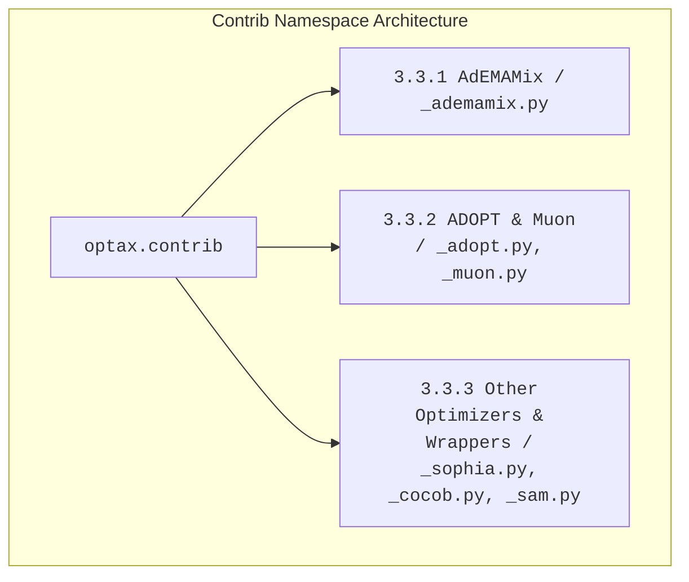

<!-- source: DeepWiki mcp.deepwiki.com · repo google-deepmind/optax · page 3.3 Contributed Optimizers · fetched 2026-10-26 -->

# Contributed Optimizers

Relevant source files

The following files were used as context for generating this wiki page:

- [docs/api/contrib.rst](docs/api/contrib.rst)
- [optax/contrib/__init__.py](optax/contrib/__init__.py)
- [optax/contrib/_common_test.py](optax/contrib/_common_test.py)
- [optax/contrib/_madgrad.py](optax/contrib/_madgrad.py)
- [optax/contrib/_sophia.py](optax/contrib/_sophia.py)

The `optax.contrib` module serves as an incubation space for experimental, specialized, or cutting-edge optimizers and wrappers that have not yet moved into the core library or met standard inclusion criteria [docs/api/contrib.rst:1-5](). These optimizers implement advanced optimization research—ranging from dual-momentum and orthogonalization to adaptive step sizes and second-order approximations—while strictly adhering to Optax's functional `GradientTransformation` architecture [optax/contrib/_madgrad.py:37-134]().

Because these methods often introduce unique state requirements, custom update signatures, or specialized hyperparameter dynamics, they are organized into three primary child categories.

Sources: [optax/contrib/__init__.py:1-76](), [docs/api/contrib.rst:1-61]()

## AdEMAMix and Momentum Variants

Momentum-based acceleration is central to modern deep learning. The `optax.contrib` module includes optimizers that extend classical momentum mechanisms, such as mixing multiple exponential moving averages (EMAs) of historical gradients or maintaining specialized dual-averaging states [optax/contrib/_ademamix.py:21-26](). These variants aim to bridge the gap between early-stage stability and late-stage convergence speed across diverse modalities like vision and language modeling.

For comprehensive details on these dual-momentum architectures, implementation specifics, and simplified variants, see [AdEMAMix and Momentum Variants](#3.3.1).

Sources: [optax/contrib/_ademamix.py:21-26](), [optax/contrib/_madgrad.py:37-134]()

## ADOPT and Muon Optimizers

Second-order approximations, robust gradient scaling, and matrix-level orthogonalization have emerged as powerful techniques for training large models without the instability of unconstrained adaptive methods. Algorithms like ADOPT refine denominator updates to improve convergence guarantees, while Muon applies Newton-Schulz iterations to orthogonalize gradient updates for matrix parameters [optax/contrib/_adopt.py:27-28](), [optax/contrib/_muon.py:53-56]().

For detailed breakdowns of ADOPT's robustness improvements, Muon's Newton-Schulz orthogonalization approach, and dimension number configurations, see [ADOPT and Muon Optimizers](#3.3.2).

Sources: [optax/contrib/_adopt.py:27-28](), [optax/contrib/_muon.py:53-56]()

## Other Contrib Optimizers

The broader `optax.contrib` namespace hosts a wide array of specialized optimization paradigms, parameter-free methods, second-order diagonal estimators, schedule-free training wrappers, and privacy mechanisms. These include coin-betting algorithms like COCOB, distance-over-gradient estimators like DoG, second-order diagonal scaling via Sophia, low-rank factorization methods like GaLore, and wrappers for sharpness-aware minimization (SAM) or plateaus [optax/contrib/__init__.py:29-76]().

For detailed coverage of Sophia, MADGRAD, Prodigy, Momo, D-Adaptation, DoG, COCOB, GaLore, ACProp, schedule-free methods, and wrappers like SAM and Mechanize, see [Other Contrib Optimizers](#3.3.3).

Sources: [optax/contrib/__init__.py:29-76](), [docs/api/contrib.rst:12-61]()

---

