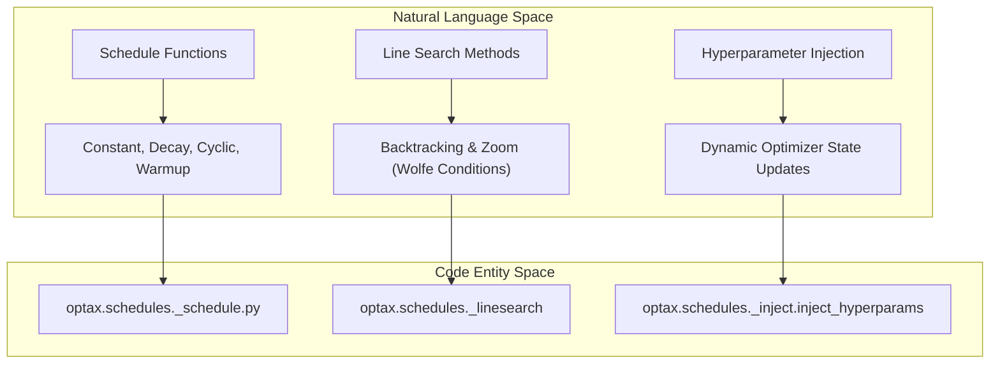
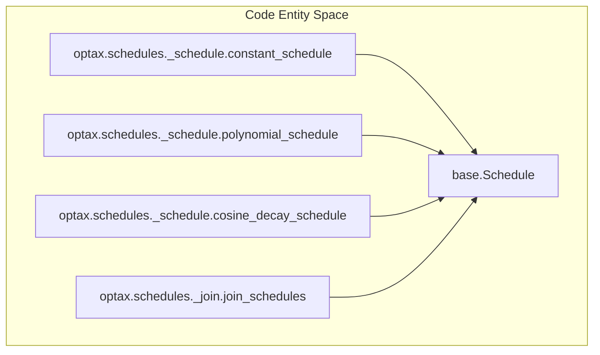
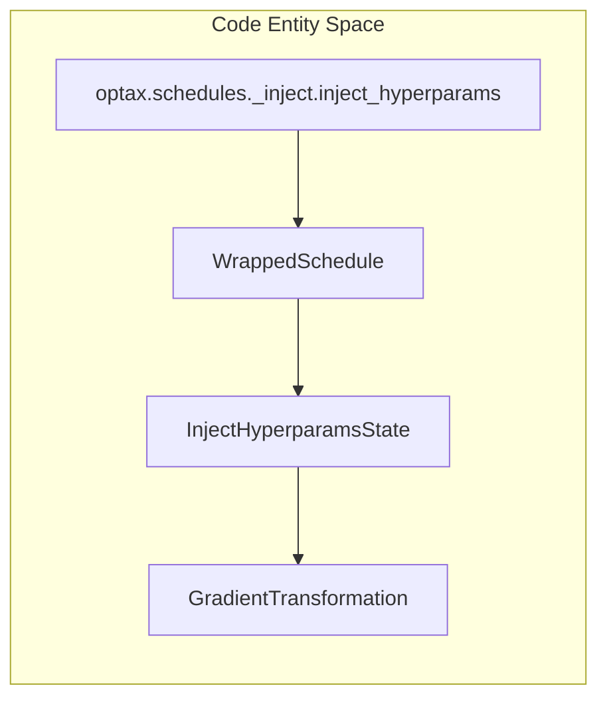

<!-- source: DeepWiki mcp.deepwiki.com · repo google-deepmind/optax · page 4 Learning Rate Schedules · fetched 2026-10-26 -->

# Learning Rate Schedules

Relevant source files

The following files were used as context for generating this wiki page:

- [optax/schedules/__init__.py](optax/schedules/__init__.py)
- [optax/schedules/_schedule.py](optax/schedules/_schedule.py)
- [optax/schedules/_schedule_test.py](optax/schedules/_schedule_test.py)

This page provides a high-level overview of learning rate schedules and adaptive step sizing mechanisms in Optax. Learning rate schedules govern how optimizer hyperparameters—principally the learning rate—evolve over training iterations.

For detailed technical breakdowns, implementations, and advanced usage, refer to the child pages:
- [Schedule Functions](#4.1)
- [Line Search Methods](#4.2)
- [Hyperparameter Injection](#4.3)

Sources: [optax/schedules/_schedule.py:15-32](), [optax/schedules/__init__.py:1-39]()

---

## 4.1 Schedule Functions

Optax provides an extensive collection of schedule functions that map iteration counts to scalar hyperparameters. These include constant, linear, polynomial, exponential, cosine decay, piecewise variants, cyclical policies (OneCycle, SGDR), and various warmup compositions. 

For complete documentation on all schedule types, mathematical formulations, composition utilities (`join_schedules`), and code examples, see [Schedule Functions](#4.1).

Sources: [optax/schedules/_schedule.py:31-40](), [optax/schedules/_join.py:15-47]()

---

## 4.2 Line Search Methods

Beyond closed-form iteration-based schedules, Optax implements adaptive step sizing via line search algorithms. These methods determine step sizes dynamically by satisfying conditions such as the Wolfe conditions, ensuring sufficient decrease and curvature alignment along search directions.

For details on backtracking algorithms, zoom procedures, and integration with optimizers, see [Line Search Methods](#4.2).

Sources: [optax/schedules/__init__.py:1-39]()

---

## 4.3 Hyperparameter Injection

To make optimizer parameters dynamic without manually threading schedule values through training loops, Optax provides `inject_hyperparams`. This wrapper intercepts optimizer initialization and update calls, querying registered schedule functions using the current optimizer state step count.

For comprehensive details on `inject_hyperparams`, state inspection, and stateful hyperparameter handling, see [Hyperparameter Injection](#4.3).

Sources: [optax/schedules/_inject.py:1-35]()

---

