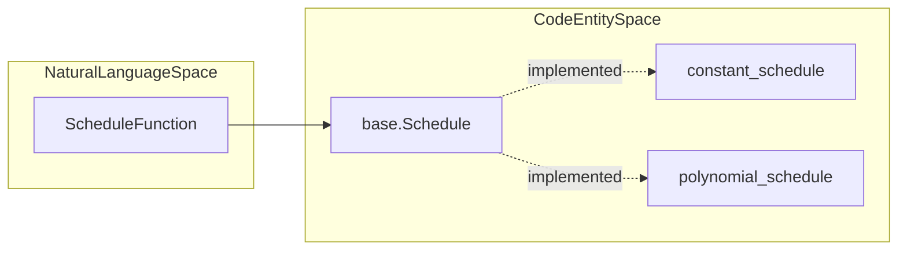
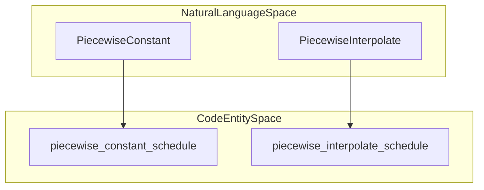

<!-- source: DeepWiki mcp.deepwiki.com · repo google-deepmind/optax · page 4.1 Schedule Functions · fetched 2026-10-26 -->

# Schedule Functions

<details>
<summary>Relevant source files</summary>

The following files were used as context for generating this wiki page:

- [optax/schedules/_join.py](optax/schedules/_join.py)
- [optax/schedules/_schedule.py](optax/schedules/_schedule.py)
- [optax/schedules/_schedule_test.py](optax/schedules/_schedule_test.py)

</details>


## Purpose and Scope

Schedule functions in Optax provide time-varying hyperparameters, most commonly learning rates, that change during the optimization process. These functions map step counts (integers) to scalar values, enabling sophisticated training strategies like warmup, decay, and cyclic learning rates.

This page covers all schedule function implementations in `optax/schedules/_schedule.py` and composition utilities in `optax/schedules/_join.py`. For adaptive step sizing methods that dynamically compute learning rates based on function values and gradients, see [Line Search Methods](#4.2). For information on how to inject schedules into optimizer state dynamically, see the `inject_hyperparams` functionality.

Sources: [optax/schedules/_schedule.py:15-20](), [optax/schedules/_join.py:15-16]()

## Schedule Abstraction

All schedule functions in Optax follow the `base.Schedule` protocol, which is a callable that takes a step count and returns a scalar value.

Schedules are pure functions with no internal state. They are JAX-compatible and can be jitted, vmapped, and differentiated. The step count is typically provided by the optimizer's state counter during the update loop.



Sources: [optax/schedules/_schedule.py:31-48](), [optax/schedules/_schedule.py:51-146]()

## Basic Schedules

### constant_schedule

Returns a constant value at every step. Useful as a baseline or when no decay is desired. Defined via `constant_schedule`.

**Function**: `constant_schedule(value: ArrayLike) -> Schedule`

**Parameters**:
- `value`: The constant value to return

**Example**:
```python
schedule = optax.constant_schedule(0.001)
schedule(0)    # 0.001
schedule(1000) # 0.001
```

Sources: [optax/schedules/_schedule.py:31-48]()

### polynomial_schedule

Implements polynomial interpolation between an initial and end value over a specified number of steps via `polynomial_schedule`. The transition follows: `(init_value - end_value) * (1 - progress)^power + end_value`.

**Function**: `polynomial_schedule(init_value, end_value, power, transition_steps, transition_begin=0) -> Schedule`

**Parameters**:
- `init_value`: Starting value
- `end_value`: Final value after transition
- `power`: Exponent controlling the curve shape (1=linear, 2=quadratic, etc.)
- `transition_steps`: Duration of the transition
- `transition_begin`: Step at which transition starts (default 0)

Sources: [optax/schedules/_schedule.py:51-146]()

### linear_schedule

Convenience wrapper for `polynomial_schedule` with `power=1`, providing linear interpolation via `linear_schedule`.

**Function**: `linear_schedule(init_value, end_value, transition_steps, transition_begin=0) -> Schedule`

Sources: [optax/schedules/_schedule.py:149-187]()

Sources: [optax/schedules/_schedule.py:31-187]()

## Exponential Decay Schedule

### exponential_decay

Implements exponential decay with optional discrete (staircase) steps and clamping to an end value via `exponential_decay`.

**Function**: `exponential_decay(init_value, transition_steps, decay_rate, transition_begin=0, staircase=False, end_value=None) -> Schedule`

**Parameters**:
- `init_value`: Initial learning rate
- `transition_steps`: Period over which decay is applied
- `decay_rate`: Multiplicative decay factor per period
- `transition_begin`: Delay before decay starts
- `staircase`: If True, decay at discrete intervals rather than continuously
- `end_value`: Optional clamp value

Sources: [optax/schedules/_schedule.py:250-325]()

## Cosine Decay Schedules

### cosine_decay_schedule

Implements smooth cosine-based learning rate decay, following SGDR via `cosine_decay_schedule`.

**Function**: `cosine_decay_schedule(init_value, decay_steps, alpha=0.0, exponent=1.0) -> Schedule`

**Parameters**:
- `init_value`: Starting learning rate
- `decay_steps`: Number of steps over which decay occurs
- `alpha`: Minimum value as fraction of init_value (default 0.0)
- `exponent`: Power applied to cosine curve for modified decay shape

Sources: [optax/schedules/_schedule.py:328-389]()

Sources: [optax/schedules/_schedule.py:250-389]()

## Piecewise Schedules

### piecewise_constant_schedule

Creates a schedule with instantaneous jumps at specified boundaries, multiplying the current value by scale factors via `piecewise_constant_schedule`.

**Function**: `piecewise_constant_schedule(init_value, boundaries_and_scales: dict[int, float]) -> Schedule`

**Parameters**:
- `init_value`: Starting value
- `boundaries_and_scales`: Dictionary mapping step numbers to multiplicative scale factors

Sources: [optax/schedules/_schedule.py:203-247]()

### piecewise_interpolate_schedule

Smoothly interpolates between piecewise segments using linear or cosine interpolation via `piecewise_interpolate_schedule`.

**Function**: `piecewise_interpolate_schedule(interpolate_type: str, init_value, boundaries_and_scales: dict[int, float]) -> Schedule`

Sources: [optax/schedules/_schedule.py:408-480]()



Sources: [optax/schedules/_schedule.py:203-247](), [optax/schedules/_schedule.py:408-480]()

## Warmup Schedules

Warmup schedules linearly increase the learning rate from an initial value to a peak value, then apply a decay schedule.

### warmup_constant_schedule

Linear warmup followed by a constant learning rate via `warmup_constant_schedule`.

**Function**: `warmup_constant_schedule(init_value, peak_value, warmup_steps) -> Schedule`

Sources: [optax/schedules/_schedule.py:594-614]()

### warmup_cosine_decay_schedule

Linear warmup followed by cosine decay via `warmup_cosine_decay_schedule`.

**Function**: `warmup_cosine_decay_schedule(init_value, peak_value, warmup_steps, decay_steps, end_value=0.0, exponent=1.0) -> Schedule`

Sources: [optax/schedules/_schedule.py:617-657]()

### warmup_exponential_decay_schedule

Linear warmup followed by exponential decay via `warmup_exponential_decay_schedule`.

**Function**: `warmup_exponential_decay_schedule(init_value, peak_value, warmup_steps, transition_steps, decay_rate, transition_begin=0, staircase=False, end_value=None) -> Schedule`

Sources: [optax/schedules/_schedule.py:660-705]()

Sources: [optax/schedules/_schedule.py:594-705]()

## OneCycle Schedules

### linear_onecycle_schedule

Three-phase schedule with linear transitions via `linear_onecycle_schedule`.

**Function**: `linear_onecycle_schedule(transition_steps, peak_value, pct_start=0.3, pct_final=0.85, div_factor=25.0, final_div_factor=1e4) -> Schedule`

Sources: [optax/schedules/_schedule.py:483-539]()

### cosine_onecycle_schedule

OneCycle with cosine interpolation via `cosine_onecycle_schedule`.

**Function**: `cosine_onecycle_schedule(transition_steps, peak_value, pct_start=0.3, div_factor=25.0, final_div_factor=1e4) -> Schedule`

Sources: [optax/schedules/_schedule.py:542-591]()

Sources: [optax/schedules/_schedule.py:483-591]()

## SGDR Schedule

### sgdr_schedule

Implements Stochastic Gradient Descent with Warm Restarts via `sgdr_schedule`.

**Function**: `sgdr_schedule(cosine_kwargs: Iterable[dict[str, ArrayLike]]) -> Schedule`

Sources: [optax/schedules/_schedule.py:708-736]()

## Schedule Composition

Schedules can be composed using the `join_schedules` function from `optax.schedules._join`, which concatenates multiple schedules with specified boundary points.

**Function**: `join_schedules(schedules: Sequence[base.Schedule], boundaries: Sequence[int]) -> base.Schedule`

Sources: [optax/schedules/_join.py:24-47]()

## Schedule Function Reference

| Schedule Function | Primary Use Case | Key Parameters | Transition Type |
|-------------------|------------------|----------------|-----------------|
| `constant_schedule` | Baseline, no decay | `value` | None |
| `polynomial_schedule` | Flexible polynomial decay | `power`, `transition_steps` | Polynomial |
| `linear_schedule` | Linear decay/warmup | `transition_steps` | Linear |
| `exponential_decay` | Exponential LR reduction | `decay_rate`, `staircase` | Exponential |
| `cosine_decay_schedule` | Smooth decay | `decay_steps`, `alpha` | Cosine |
| `piecewise_constant_schedule` | Step-wise changes | `boundaries_and_scales` | Step |
| `piecewise_interpolate_schedule` | Multi-phase smooth training | `interpolate_type`, `boundaries_and_scales` | Linear/Cosine |
| `linear_onecycle_schedule` | Super-convergence | `peak_value`, `pct_start` | 3-phase Linear |
| `cosine_onecycle_schedule` | Super-convergence | `peak_value`, `pct_start` | 3-phase Cosine |
| `warmup_constant_schedule` | Stabilize early training | `warmup_steps`, `peak_value` | Linear warmup |
| `warmup_cosine_decay_schedule` | Standard training | `warmup_steps`, `decay_steps` | Warmup + Cosine |
| `warmup_exponential_decay_schedule` | Alternative training | `warmup_steps`, `decay_rate` | Warmup + Exponential |
| `sgdr_schedule` | Cyclic training | `cosine_kwargs` | Multiple restarts |

Sources: [optax/schedules/_schedule.py:31-736]()

---

