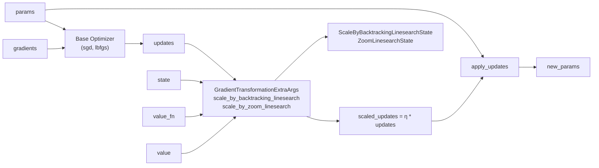
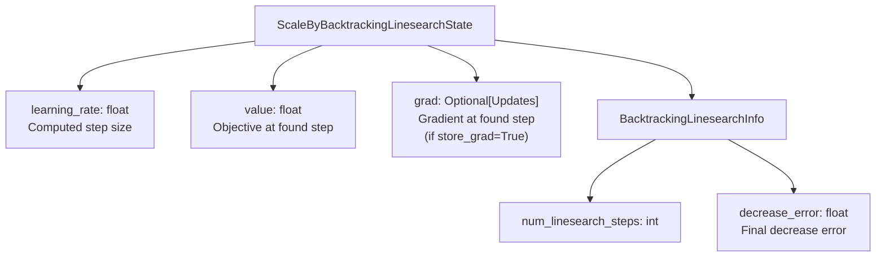
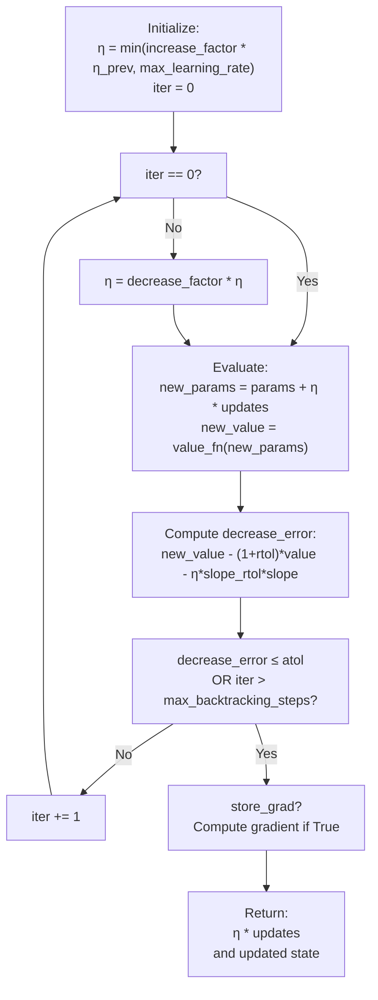
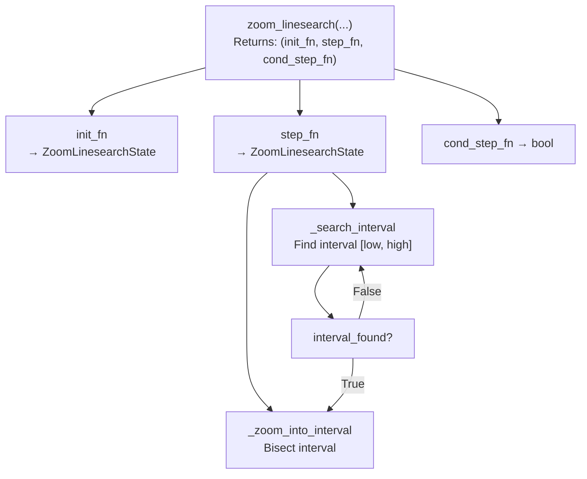
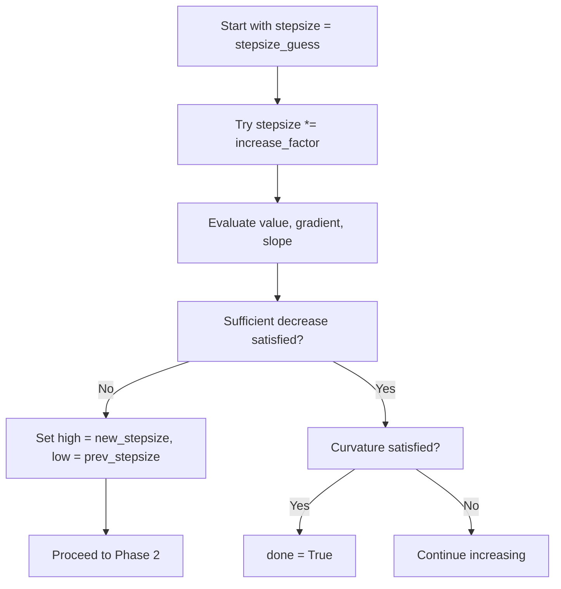
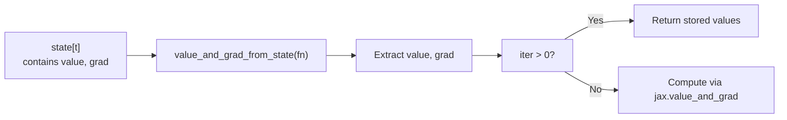

<!-- source: DeepWiki mcp.deepwiki.com · repo google-deepmind/optax · page 4.2 Line Search Methods · fetched 2026-10-26 -->

# Line Search Methods

<details>
<summary>Relevant source files</summary>

The following files were used as context for generating this wiki page:

- [optax/_src/linesearch.py](optax/_src/linesearch.py)
- [optax/_src/linesearch_test.py](optax/_src/linesearch_test.py)

</details>


Line search methods provide adaptive step size determination as an alternative to fixed learning rate schedules. Optax implements line searches as `GradientTransformation` objects that can be chained with other optimizers to automatically find step sizes satisfying convergence conditions.

Optax provides two line search implementations:

| Function | Conditions Enforced | Use Case |
|----------|-------------------|----------|
| `scale_by_backtracking_linesearch` | Sufficient decrease (Armijo) | Simpler, faster, works with most optimizers |
| `scale_by_zoom_linesearch` | Sufficient decrease + Curvature (Wolfe) | More robust, required for quasi-Newton methods |

Both implementations are located in [optax/_src/linesearch.py]() and can be composed with standard optimizers like SGD, Adam, or quasi-Newton methods like L-BFGS.

Sources: [optax/_src/linesearch.py:1-28](), [optax/_src/linesearch.py:80-90](), [optax/_src/linesearch.py:526-607]()

## Line Search Problem Formulation

Given current parameters `params`, update direction `updates`, and objective function `value_fn`, a line search finds a step size (learning rate) `η` such that `params + η * updates` satisfies convergence conditions.

#### Line Search as Gradient Transformation



Sources: [optax/_src/linesearch.py:80-90](), [optax/_src/linesearch.py:526-607](), [optax/_src/base.py:42-66]()

## Convergence Conditions

### Sufficient Decrease (Armijo Condition)

The Armijo condition ensures meaningful decrease in the objective:

$$f(w + \eta u) \leq (1+\delta)f(w) + \eta c \langle u, \nabla f(w) \rangle + \epsilon$$

where:
- `f` is the objective function (`value_fn`)
- `w` are current parameters (`params`)
- `u` is the update direction (`updates`)
- `η` is the learning rate (step size)
- `c` is `slope_rtol` (typically 1e-4)
- `δ` is `rtol` (relative tolerance)
- `ε` is `atol` (absolute tolerance)

The slope term `⟨u, ∇f(w)⟩` is computed using `optax.tree.vdot(updates, grad)`.

Sources: [optax/_src/linesearch.py:91-110](), [optax/_src/linesearch.py:330-345]()

### Curvature Condition (Strong Wolfe)

The strong Wolfe curvature condition ensures the slope is sufficiently reduced:

$$|\langle \nabla f(w + \eta u), u \rangle| \leq c_2 |\langle \nabla f(w), u \rangle|$$

where `c_2` is `curv_rtol` (typically 0.9). This condition is only enforced by `scale_by_zoom_linesearch`.

Sources: [optax/_src/linesearch.py:526-607](), [optax/_src/linesearch.py:706-719]()

### Descent Direction Requirement

For a non-trivial solution to exist, the update direction must be a descent direction: `⟨u, ∇f(w)⟩ < 0`. This is automatically satisfied for `optax.sgd` but may not hold for other optimizers like `optax.adam`.

Sources: [optax/_src/linesearch.py:229-247]()

## Backtracking Line Search (`scale_by_backtracking_linesearch`)

The backtracking line search iteratively reduces the step size until the Armijo sufficient decrease condition is satisfied.

### State Structure



Sources: [optax/_src/linesearch.py:34-68]()

### Algorithm Parameters

The function signature is:

```python
scale_by_backtracking_linesearch(
    max_backtracking_steps: int,
    slope_rtol: float = 1e-4,
    decrease_factor: float = 0.8,
    increase_factor: float = 1.5,
    max_learning_rate: float = 1.0,
    atol: float = 0.0,
    rtol: float = 0.0,
    store_grad: bool = False,
    verbose: bool = False,
) -> base.GradientTransformationExtraArgs
```

Key parameters:
- `max_backtracking_steps`: Maximum iterations for line search
- `slope_rtol`: Coefficient `c` in Armijo condition
- `decrease_factor`: Multiplier to reduce step size each iteration
- `increase_factor`: Multiplier for initial step size guess (set to `math.inf` to always start at `max_learning_rate`)
- `store_grad`: Whether to compute and store gradient at the found step (enables reuse via `value_and_grad_from_state`)

Sources: [optax/_src/linesearch.py:80-146]()

### Backtracking Algorithm Flow



Sources: [optax/_src/linesearch.py:80-146]()

### Usage Example

```python
import optax
import jax
import jax.numpy as jnp

solver = optax.chain(
   optax.sgd(learning_rate=1.),
   optax.scale_by_backtracking_linesearch(max_backtracking_steps=15)
)
```

Sources: [optax/_src/linesearch.py:147-186]()

## Zoom Line Search (`scale_by_zoom_linesearch`)

The zoom line search satisfies both sufficient decrease and curvature conditions (strong Wolfe conditions). It operates in two phases implemented by helper function `zoom_linesearch`.

### Two-Phase Algorithm Structure



Sources: [optax/_src/linesearch.py:526-607]()

### State Structure

```python
class ZoomLinesearchState(NamedTuple):
    count: int
    params: base.Params
    updates: base.Updates
    stepsize_guess: float
    stepsize: float
    value: float
    grad: base.Updates
    slope: float
    value_init: float
    slope_init: float
    decrease_error: float
    curvature_error: float
    error: float
    interval_found: bool
    done: bool
    failed: bool
    low: float
    value_low: float
    slope_low: float
    high: float
    value_high: float
    slope_high: float
    cubic_ref: float
    value_cubic_ref: float
    safe_stepsize: float
    safe_value: float
    safe_grad: base.Updates
```

Sources: [optax/_src/linesearch.py:475-524]()

### Phase 1: Interval Search



Sources: [optax/_src/linesearch.py:526-607]()

### Algorithm Parameters

```python
scale_by_zoom_linesearch(
    max_linesearch_steps: int,
    max_learning_rate: Optional[float] = None,
    tol: float = 0.0,
    increase_factor: float = 2.0,
    slope_rtol: float = 1e-4,
    curv_rtol: float = 0.9,
    approx_dec_rtol: Optional[float] = 1e-6,
    interval_threshold: float = 1e-5,
    stepsize_precision: float = 1e-8,
    verbose: bool = False,
) -> base.GradientTransformationExtraArgs
```

Sources: [optax/_src/linesearch.py:1013-1085]()

## Reusing Computed Values (`value_and_grad_from_state`)

Line searches store the objective value and gradient at the accepted step in their state. For deterministic objectives, these can be reused in the next iteration using `value_and_grad_from_state`.



Sources: [optax/_src/linesearch.py:1198-1255]()

## Tree Utility Functions

Line searches perform mathematical operations on parameter PyTrees using `optax.tree`:
- `optax.tree.add_scale`: Compute trial parameters `params + η * updates`
- `optax.tree.vdot`: Compute slope `⟨updates, grad⟩`
- `optax.tree.real` / `optax.tree.conj`: Complex parameter support
- `optax.tree.scale`: Scale updates

Sources: [optax/_src/linesearch.py:27-28](), [optax/_src/linesearch.py:330-360]()

## Debugging and Failure Modes

Line search states track diagnostic information such as `decrease_error`, `curvature_error`, and `num_linesearch_steps`. Both backtracking and zoom line searches support `verbose=True` for debugging via `jax.debug.print`.

Sources: [optax/_src/linesearch.py:34-46](), [optax/_src/linesearch.py:475-524]()

---

