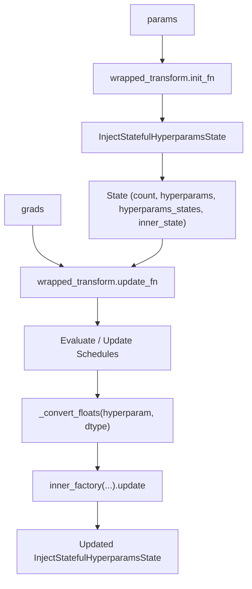
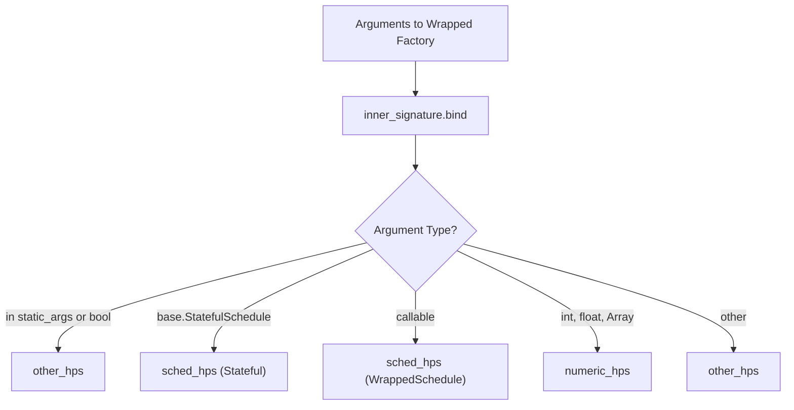

<!-- source: DeepWiki mcp.deepwiki.com · repo google-deepmind/optax · page 4.3 Hyperparameter Injection · fetched 2026-10-26 -->

# Hyperparameter Injection

<details>
<summary>Relevant source files</summary>

The following files were used as context for generating this wiki page:

- [optax/schedules/_inject.py](optax/schedules/_inject.py)
- [optax/schedules/_inject_test.py](optax/schedules/_inject_test.py)

</details>


## Purpose and Scope
This page documents `optax.inject_hyperparams` and the associated state machinery that enables optimizer hyperparameters to be dynamically evaluated from schedules, inspected, and mutated at runtime. Dynamic hyperparameters allow learning rates, momentum decay coefficients, and other optimizer parameters to change per-step without breaking JAX transformation purity.

Sources: `optax/schedules/_inject.py:15-169`, `optax/schedules/_inject_test.py:54-128`

---

## Core Architecture and Data Flow

The `inject_hyperparams` wrapper intercepts an optimizer factory function (`inner_factory`), inspects its signature, separates static arguments, constant values, and callable schedules, and returns a `GradientTransformationExtraArgs` object [optax/schedules/_inject.py:65-148].

### State Representation
The state of an injected hyperparameter transformation is maintained via `InjectStatefulHyperparamsState` [optax/schedules/_inject.py:56-63]:

```
InjectStatefulHyperparamsState (NamedTuple)
├── count: jnp.ndarray                 # Step counter, shape=(), dtype=jnp.int32
├── hyperparams: dict                  # Current evaluated hyperparameter values
├── hyperparams_states: dict           # Internal states for stateful schedules
└── inner_state: base.OptState         # State of the wrapped GradientTransformation
```

### Transformation Flow Diagram
The following diagram illustrates how `inject_hyperparams` orchestrates state initialization and updates across internal schedules and the wrapped optimizer.


Sources: `optax/schedules/_inject.py:56-169`

---

## Handling Schedules and Static Arguments

When `inject_hyperparams` wraps an optimizer factory, it categorizes each keyword or positional argument into one of three buckets [optax/schedules/_inject.py:152-164]:

1. **Static Arguments (`static_args`)**: Arguments explicitly designated as non-schedules (e.g., boolean flags like `nesterov`, masks, or custom callables that should not be evaluated as step-based schedules) [optax/schedules/_inject.py:133-155].
2. **Stateful or Stateless Schedules (`sched_hps`)**: Callables implementing `base.StatefulSchedule` or standard Python functions taking a step count [optax/schedules/_inject.py:156-160].
3. **Numeric Constants (`numeric_hps`)**: Literal integers, floats, or JAX arrays treated as static hyperparameters that remain inspectable and mutable in `state.hyperparams` [optax/schedules/_inject.py:161-164].

### Static Arguments and Configuration Flow


Sources: `optax/schedules/_inject.py:133-165`, `optax/schedules/_inject_test.py:129-161`

---

## Runtime Inspection and Hyperparameter Overriding

A key capability of `inject_hyperparams` is runtime inspection and manual override. Because all non-scheduled numeric hyperparameters are stored inside `state.hyperparams`, users can read or modify them between optimization steps [optax/schedules/_inject.py:60]:

```python
>>> scheduled_adam = optax.inject_hyperparams(optax.scale_by_adam)(
...     b1=linear_schedule, b2=0.99)
>>> params, grads = jnp.array(0.), jnp.array(0.)
>>> state = scheduled_adam.init(params)
>>> updates, state = scheduled_adam.update(grads, state)
>>> state.hyperparams['b2'] = 0.95  # Manually override un-scheduled hyperparameter
>>> updates, state = scheduled_adam.update(updates, state)
```
*(Note: Manually overriding a hyperparameter that is bound to an active schedule will have no effect, as schedule evaluation overwrites the value on every step).*

Sources: `optax/schedules/_inject.py:94-105`, `optax/schedules/_inject_test.py:117-128`

---

## Precision Management and Type Casting

To support mixed-precision training without unintended type promotion or casting errors, `inject_hyperparams` provides the `hyperparam_dtype` parameter [optax/schedules/_inject.py:68]. 

The internal helper `_convert_floats` enforces precision constraints [optax/schedules/_inject.py:31-41]:
- Strongly typed JAX arrays with explicit dtypes (`jax.Array` with `weak_type=False`) are preserved.
- Floating-point scalars and weak arrays are cast to `hyperparam_dtype` if specified.
- Non-floating types pass through unmodified.

Sources: `optax/schedules/_inject.py:31-41, 168-169`

---

