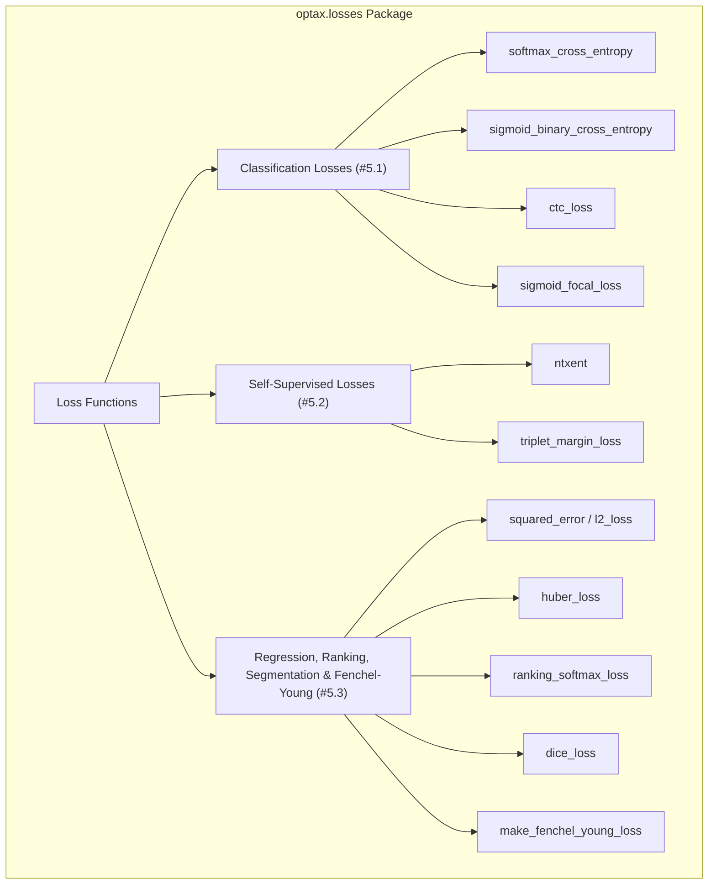
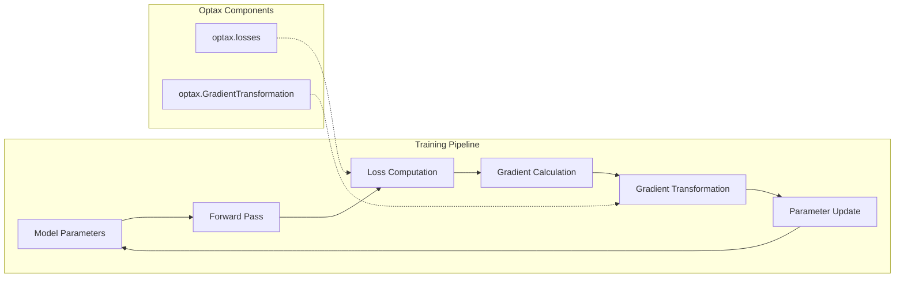

<!-- source: DeepWiki mcp.deepwiki.com · repo google-deepmind/optax · page 5 Loss Functions · fetched 2026-10-26 -->

# Loss Functions

Relevant source files

The following files were used as context for generating this wiki page:

- [docs/api/losses.rst](docs/api/losses.rst)
- [optax/contrib/_dog.py](optax/contrib/_dog.py)
- [optax/losses/__init__.py](optax/losses/__init__.py)

This page provides a high-level reference for the loss functions sub-package (`optax.losses`) provided by Optax. Loss functions measure the discrepancy between model predictions and ground-truth targets, generating the scalar penalties that drive automatic differentiation and optimization.

For a complete breakdown of specific implementations, numerical stability mechanisms, and advanced formulations, see the child pages:
- Classification Losses: [Classification Losses](#5.1)
- Self-Supervised Losses: [Self-Supervised Losses](#5.2)
- Regression, Ranking, Segmentation and Fenchel-Young Losses: [Regression, Ranking, Segmentation and Fenchel-Young Losses](#5.3)

## Overview of Loss Functions in Optax

Optax organizes loss functions by machine learning task types, exposing them through `optax.losses` (and aliased at the top-level `optax` namespace). These functions are implemented purely functionally to integrate directly with JAX transformations like `jax.grad` and `jax.vmap`.

Sources: [optax/losses/__init__.py:15-52](), [docs/api/losses.rst:1-40]()

## Integration within Training Pipelines

Loss functions sit between the model's forward pass and the gradient transformation engine. They accept predictions and targets (along with optional configuration flags such as weights, masks, or temperature parameters) and return per-element or aggregated loss values.

Sources: [optax/losses/__init__.py:15-52]()

---

## 5.1 Classification Losses

Classification losses handle discrete categorization tasks, ranging from standard multi-class cross-entropy to structured sequence alignment and focal losses for imbalanced data. These functions incorporate built-in numerical stability techniques (such as log-sum-exp stabilization in cross-entropy variants) to prevent underflow and overflow during training.

For detailed documentation on cross-entropy variants, integer label versions, binary cross-entropy, hinge losses, Kullback-Leibler divergences, poly-loss formulations, CTC loss, and focal loss, see [Classification Losses](#5.1).

Sources: [optax/losses/_classification.py:1-852](), [optax/losses/__init__.py:19-38]()

---

## 5.2 Self-Supervised Losses

Self-supervised and metric learning losses optimize representation spaces without relying on traditional class labels. They operate directly on embedded representations to pull positive pairs together and push negative pairs apart in vector space.

For detailed documentation on the NT-Xent contrastive loss (used in frameworks like SimCLR) and triplet margin loss for metric learning, see [Self-Supervised Losses](#5.2).

Sources: [optax/losses/_self_supervised.py:1-174](), [optax/losses/__init__.py:50-51]()

---

## 5.3 Regression, Ranking, Segmentation and Fenchel-Young Losses

This category encompasses continuous target prediction, relevance ranking, dense pixel-level segmentation, and convex loss construction via Fenchel-Young duality:
- **Regression:** Squared error, L2 loss, Huber loss, log-cosh loss, and cosine similarity/distance.
- **Ranking:** Ranking softmax loss for learning-to-rank tasks.
- **Segmentation:** Binary and multi-class Dice losses for image segmentation and overlap metrics.
- **Fenchel-Young:** Generic loss builders (`make_fenchel_young_loss`) that bridge convex optimization solvers and neural network outputs.

For detailed implementations, equations, and code examples, see [Regression, Ranking, Segmentation and Fenchel-Young Losses](#5.3).

Sources: [optax/losses/_regression.py:1-219](), [optax/losses/_ranking.py:1-166](), [optax/losses/_segmentation.py](), [optax/losses/_fenchel_young.py](), [optax/losses/__init__.py:39-49]()

---

