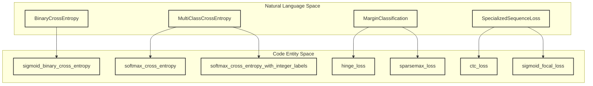
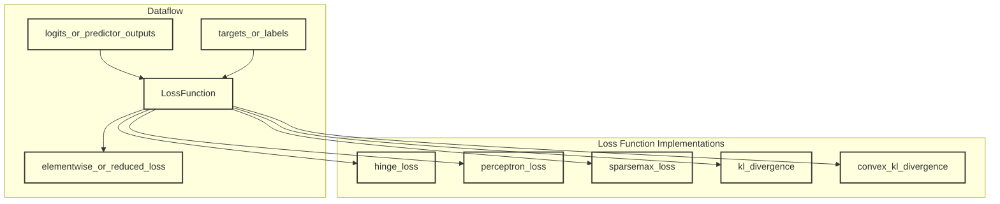

<!-- source: DeepWiki mcp.deepwiki.com · repo google-deepmind/optax · page 5.1 Classification Losses · fetched 2026-10-26 -->

# Classification Losses

<details>
<summary>Relevant source files</summary>

The following files were used as context for generating this wiki page:

- [optax/losses/_classification.py](optax/losses/_classification.py)
- [optax/losses/_classification_test.py](optax/losses/_classification_test.py)

</details>


This page documents the classification loss functions provided by Optax (`optax.losses`), which measure the discrepancy between model predictions (logits or unnormalized predictor outputs) and ground truth labels across binary, multi-class, and specialized sequence or structured classification tasks [optax/losses/_classification.py:15-885]().

## Overview and Interface Design

Classification loss functions in Optax take unnormalized scores (`logits` or `predictor_outputs`) and ground truth targets (`labels`), returning an array of loss values (element-wise or reduced depending on parameters like `axis` or `where`) [optax/losses/_classification.py:47-290](). 

The following diagram maps the high-level classification concepts (Natural Language Space) to their corresponding implementation symbols in `optax/losses/_classification.py` (Code Entity Space).



Sources: [optax/losses/_classification.py:47-885]()

---

## Cross-Entropy Losses and Variants

Cross-entropy losses form the core of probabilistic classification in Optax. They evaluate the cross-entropy between model predictions and target probability distributions or discrete labels.

### Sigmoid Binary Cross-Entropy

`sigmoid_binary_cross_entropy` computes element-wise sigmoid cross-entropy given logits and labels [optax/losses/_classification.py:47-85](). It is designed for binary classification or multi-label classification where classes are independent:

```python
loss = optax.sigmoid_binary_cross_entropy(logits, labels)
```

The function computes `-labels * log_p - (1.0 - labels) * log_not_p` utilizing `jax.nn.log_sigmoid(logits)` and `jax.nn.log_sigmoid(-logits)` for numerical stability [optax/losses/_classification.py:81-85](). `binary_logistic_loss` is provided as a deprecated alias [optax/losses/_classification.py:88-95]().

### Softmax Cross-Entropy

For mutually exclusive multi-class classification, `softmax_cross_entropy` applies the log-sum-exp stabilization trick over the class axis [optax/losses/_classification.py:224-290](). It accepts one-hot encoded or probability-distribution `labels` [optax/losses/_classification.py:224-290]().

```python
loss = optax.softmax_cross_entropy(logits, labels, axis=-1, where=mask)
```

### Softmax Cross-Entropy with Integer Labels

`softmax_cross_entropy_with_integer_labels` provides a convenience wrapper when ground truth labels are provided as integer class indices rather than one-hot vectors [optax/losses/_classification.py:293-399]().

```python
loss = optax.softmax_cross_entropy_with_integer_labels(logits, labels_int)
```

### Poly Loss Cross-Entropy

`poly_loss_cross_entropy` implements polynomial loss expansion over cross-entropy [optax/losses/_classification.py:461-516](). By adding a polynomial term $\epsilon (1 - p_t)^\nu$ to the standard cross-entropy, it allows fine-grained control over gradient weighting for hard and easy examples [optax/losses/_classification.py:461-516]().

Sources: [optax/losses/_classification.py:47-85](), [optax/losses/_classification.py:88-95](), [optax/losses/_classification.py:224-399](), [optax/losses/_classification.py:461-516]()

---

## Margin and Divergence-Based Losses

Optax provides several margin-based and divergence-based classification losses tailored for support vector machines, margin classifiers, and distribution matching.



### Hinge and Perceptron Losses
- `hinge_loss`: Computes the binary max-margin loss `jnp.maximum(0, 1 - predictor_outputs * targets)` where targets must be in $\{-1, 1\}$ [optax/losses/_classification.py:98-111]().
- `perceptron_loss`: Computes `jnp.maximum(0, -predictor_outputs * targets)` for the classical perceptron update rule [optax/losses/_classification.py:113-131]().

### Sparsemax Loss
- `sparsemax_loss`: Implements the Fenchel-Young loss associated with the sparsemax transformation, yielding sparse probability representations [optax/losses/_classification.py:133-156]().

### KL Divergence Losses
- `kl_divergence` and `convex_kl_divergence`: Compute the Kullback-Leibler divergence between predicted log-probabilities and target probability distributions, with joint convexity guarantees in the convex variant [optax/losses/_classification.py:519-619]().

Sources: [optax/losses/_classification.py:98-156](), [optax/losses/_classification.py:519-619]()

---

## Specialized Classification Losses (Focal and CTC)

For complex tasks like object detection and sequence labeling, Optax provides specialized loss functions.

### Sigmoid Focal Loss
`sigmoid_focal_loss` addresses severe class imbalance in binary/multi-label classification tasks by down-weighting easy-to-classify examples [optax/losses/_classification.py:806-852]().

```python
loss = optax.sigmoid_focal_loss(logits, labels, alpha=0.25, gamma=2.0)
```
- `alpha`: Balances the importance of positive vs. negative examples [optax/losses/_classification.py:806-852]().
- `gamma`: Modulates the loss scaling based on prediction confidence [optax/losses/_classification.py:806-852]().

### Connectionist Temporal Classification (CTC) Loss
`ctc_loss` computes the CTC loss between continuous logits and variable-length integer targets for unaligned sequence recognition tasks such as speech-to-text [optax/losses/_classification.py:760-802]().

```python
loss = optax.ctc_loss(logits, logit_paddings, labels, label_paddings)
```

Sources: [optax/losses/_classification.py:760-852]()

---

## Numerical Stability Mechanisms

Numerical stability is critical when calculating exponential and logarithmic operations in classification losses. Optax implements several guards against underflow, overflow, and `NaN` propagation:

1. **Log-Sigmoid Stability**: `sigmoid_binary_cross_entropy` utilizes `jax.nn.log_sigmoid(logits)` and `jax.nn.log_sigmoid(-logits)` to avoid evaluating $\log(1 - \sigma(x))$ directly, which is prone to cancellation errors [optax/losses/_classification.py:81-85]().
2. **Safe Softmax Cross-Entropy**: `safe_softmax_cross_entropy` handles extreme logit values, including `-inf` inputs and masked dimensions, ensuring finite gradients even when logits or label probabilities reach boundary conditions [optax/losses/_classification.py:200-221]() [optax/losses/_classification_test.py:103-178]().
3. **Weighted Log-Softmax Custom JVP**: `weighted_logsoftmax` implements a custom JVP derivative rule to correctly handle $0 \log 0 = 0$ conventions when weights are zero and inputs approach $-\infty$, preventing `NaN` gradients [optax/losses/_classification.py:166-204]().

Sources: [optax/losses/_classification.py:81-85](), [optax/losses/_classification.py:166-221](), [optax/losses/_classification_test.py:103-178]()

---

