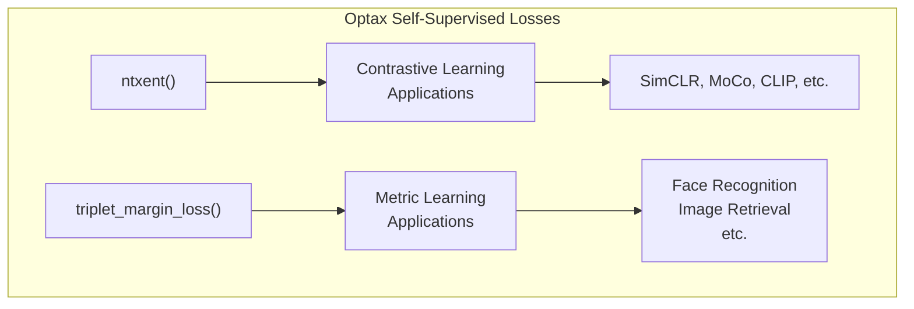
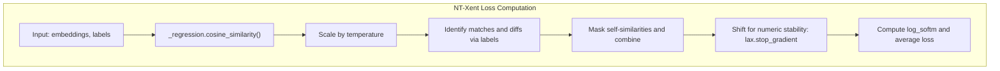
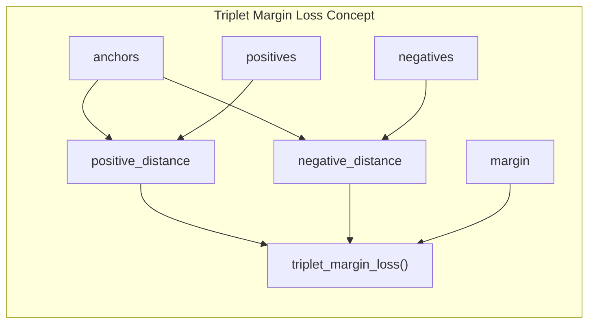
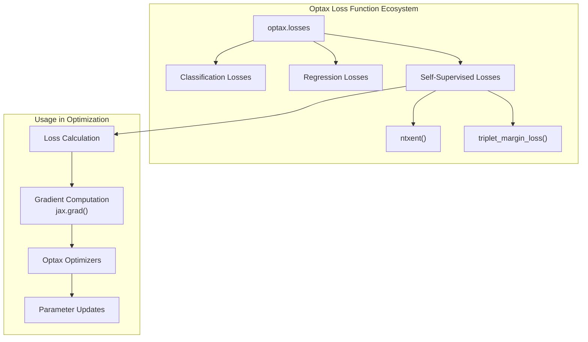

<!-- source: DeepWiki mcp.deepwiki.com · repo google-deepmind/optax · page 5.2 Self-Supervised Losses · fetched 2026-10-26 -->

# Self-Supervised Losses

<details>
<summary>Relevant source files</summary>

The following files were used as context for generating this wiki page:

- [optax/losses/_self_supervised.py](optax/losses/_self_supervised.py)
- [optax/losses/_self_supervised_test.py](optax/losses/_self_supervised_test.py)

</details>


This document covers the self-supervised learning loss functions provided by Optax. Self-supervised learning is a paradigm where the supervision signal is derived from the input data itself, without requiring explicit labels. These loss functions enable training models to learn meaningful representations from unlabeled data. For supervised learning loss functions, see [Classification Losses](#5.1).

## Overview of Self-Supervised Losses

Optax provides two primary loss functions for self-supervised learning:

1. **NT-Xent Loss**: Normalized temperature-scaled cross entropy loss for contrastive learning
2. **Triplet Margin Loss**: A metric learning loss for embedding similar examples closer together



Sources: [optax/losses/_self_supervised.py:15-22]()

## NT-Xent Loss

The NT-Xent (Normalized Temperature-scaled Cross Entropy) loss is a core component of modern contrastive learning approaches like SimCLR. It encourages embeddings of similar examples (positive pairs) to be close to each other while pushing embeddings of dissimilar examples (negative pairs) apart.

### Function Signature

```python
def ntxent(
    embeddings: jax.typing.ArrayLike,
    labels: jax.typing.ArrayLike,
    temperature: jax.typing.ArrayLike = 0.07,
) -> jax.Array
```

Sources: [optax/losses/_self_supervised.py:24-28]()

### Parameters

- **embeddings**: Batch of embeddings with shape `[batch, feature_length]`
- **labels**: Labels for groups that are positive pairs (e.g., `[0, 0, 1, 1]` indicates first two and last two embeddings are positive pairs)
- **temperature**: Temperature scaling parameter (default: 0.07)

Sources: [optax/losses/_self_supervised.py:62-67]()

### Implementation Details

The NT-Xent loss implementation:

1. Computes cosine similarity between all pairs of embeddings
2. Scales similarity scores by temperature
3. Identifies positive and negative pairs based on labels
4. Computes a softmax-based contrastive loss



Sources: [optax/losses/_self_supervised.py:91-125]()

### Example Usage

```python
import jax
import jax.numpy as jnp
import optax

# Create sample data
key = jax.random.key(42)
key1, key2, key3 = jax.random.split(key, 3)
x = jax.random.normal(key1, shape=(4,2))
labels = jnp.array([0, 0, 1, 1])  # First two and last two are similar

# Train a model
w = jax.random.normal(key2, shape=(2,1))  # params
b = jax.random.normal(key3, shape=(1,))   # params
embeddings = x @ w + b  # model output

# Compute NT-Xent loss
loss = optax.ntxent(embeddings, labels)
```

Sources: [optax/losses/_self_supervised.py:32-60]()

## Triplet Margin Loss

Triplet margin loss is commonly used for metric learning tasks where the goal is to learn a distance metric that minimizes the distance between similar examples and maximizes the distance between dissimilar examples.

### Function Signature

```python
def triplet_margin_loss(
    anchors: jax.typing.ArrayLike,
    positives: jax.typing.ArrayLike,
    negatives: jax.typing.ArrayLike,
    axis: int = -1,
    norm_degree: jax.typing.ArrayLike = 2,
    margin: jax.typing.ArrayLike = 1.0,
    eps: jax.typing.ArrayLike = 1e-6,
) -> jax.Array
```

Sources: [optax/losses/_self_supervised.py:130-138]()

### Parameters

- **anchors**: Array of anchor embeddings with shape `[batch, feature_dim]`
- **positives**: Array of positive (similar) embeddings with shape `[batch, feature_dim]`
- **negatives**: Array of negative (dissimilar) embeddings with shape `[batch, feature_dim]`
- **axis**: Axis along which to compute distances (default: -1)
- **norm_degree**: Norm degree for distance calculation (default: 2 for Euclidean distance)
- **margin**: Minimum margin by which positive distance should be smaller than negative distance
- **eps**: Small epsilon value for numerical stability

Sources: [optax/losses/_self_supervised.py:152-164]()

### Conceptual Model

The triplet margin loss works with triplets of samples:



The loss pushes the anchor closer to the positive example and farther from the negative example, with a minimum margin between the distances.

Sources: [optax/losses/_self_supervised.py:178-193]()

### Example Usage

```python
import jax.numpy as jnp
import optax

# Create sample triplets
anchors = jnp.array([[0.0, 0.0], [1.0, 1.0]])
positives = jnp.array([[0.1, 0.1], [1.1, 1.1]])   # Similar to anchors
negatives = jnp.array([[1.0, 0.0], [0.0, 1.0]])   # Dissimilar to anchors

# Compute triplet margin loss
loss = optax.losses.triplet_margin_loss(anchors, positives, negatives, margin=1.0)
# Output: [0.1414 0.1414]
```

Sources: [optax/losses/_self_supervised.py:141-150]()

## Implementation Details and Integration

Both self-supervised losses are part of Optax's larger loss function ecosystem and are integrated with the rest of the library.



Sources: [optax/losses/_self_supervised.py:15-22]()

## Practical Considerations

When using these self-supervised losses, consider the following:

1. **Temperature in NT-Xent**: The temperature parameter controls the concentration of the distribution. Lower values make the model more confident about positive pairs.

2. **Margin in Triplet Loss**: The margin value influences how far apart negative examples should be from positive examples. Larger margins enforce stricter separation.

3. **Normalization**: NT-Xent internally uses cosine similarity, which normalizes the embeddings. For triplet margin loss, consider normalizing the embeddings before computing the loss for better stability.

4. **Batch Size**: Contrastive learning typically benefits from larger batch sizes to provide more negative examples.

Sources: [optax/losses/_self_supervised.py:91-100](), [optax/losses/_self_supervised.py:130-138]()

## References

Both loss functions include academic references in their documentation:

- NT-Xent: T. Chen et al., "A Simple Framework for Contrastive Learning of Visual Representations," 2020 (SimCLR paper)
  
- Triplet Margin Loss: V. Balntas et al., "Learning shallow convolutional feature descriptors with triplet losses," 2016

Sources: [optax/losses/_self_supervised.py:73-77](), [optax/losses/_self_supervised.py:169-173]()

---

